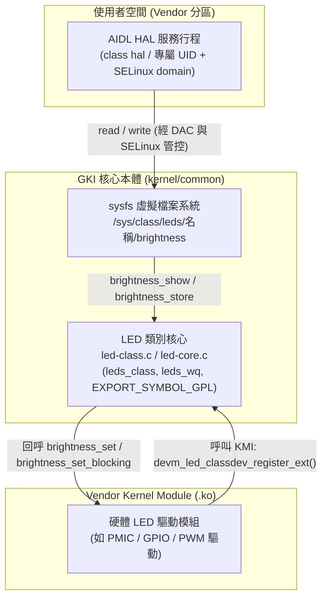
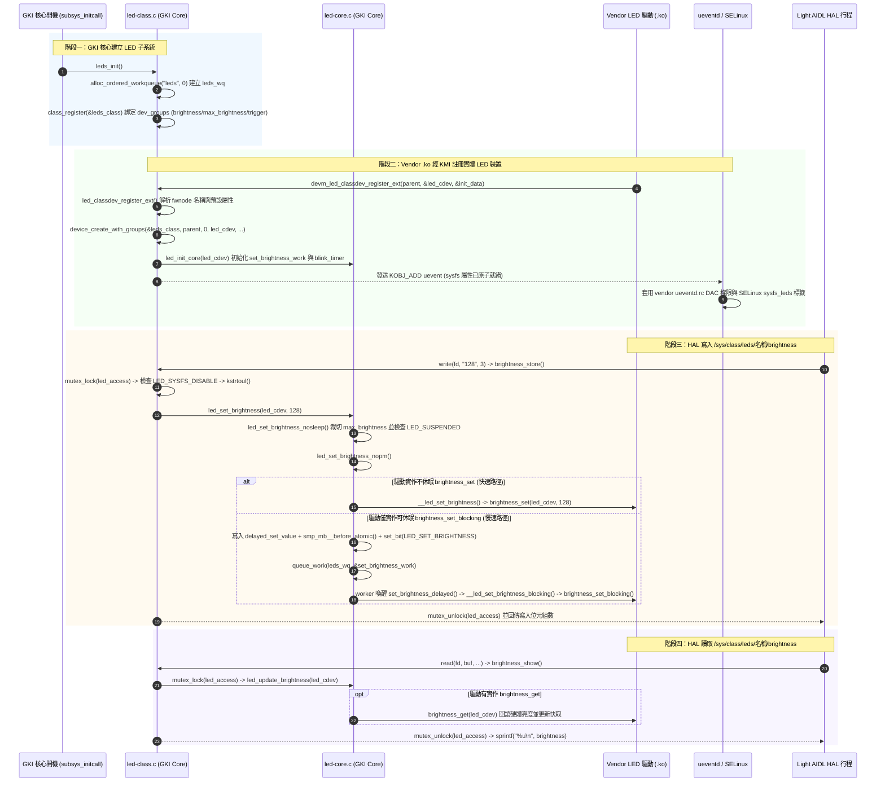

# 2.1 核心驅動與 GKI 邊界：以 Linux LED 子系統為例

- **情景說明**：GKI（Generic Kernel Image）核心於開機階段初始化標準 Linux LED 類別子系統（`/sys/class/leds`）；接著硬體供應商的裝置驅動模組（Vendor Kernel Module，`.ko`）透過 GKI 匯出的 KMI 符號向 LED 子系統註冊一顆實體 LED 裝置，自動在 sysfs 建立 `brightness`、`max_brightness`、`trigger` 等標準屬性節點；當使用者空間的 AIDL HAL 服務行程讀寫 `/sys/class/leds/<name>/brightness` 時，核心 sysfs 回呼經互斥鎖保護與工作佇列非同步機制，一路分派至底層硬體驅動的亮度設定回呼（`brightness_set` 或 `brightness_set_blocking`）。最後剖析 GKI 編譯邊界與現代設備節點權限隔離機制（`ueventd.rc` + SELinux + 獨立 `class hal` 行程）。
- **對應原書**：第 2 章引言（p.21–22）、2.1 節〈开发Android硬件驱动程序〉（p.22–31）與 2.3.4 節〈处理硬件设备访问权限问题〉（p.44–45）
- **涉及專案與版本基準**：
  - `kernel/common` 〔`android17-6.18`，Linux 6.18，commit `1e0de07`〕
  - `platform/hardware/interfaces` 〔`android-17.0.0_r1`，commit `0162af6`〕

---

## 2.1.1 GKI 時代的硬體驅動邊界與 LED 子系統核心資料結構（`struct led_classdev`）

> 對應原書第 2 章引言（p.21–22）與 2.1.1（p.22–23）。原書開篇點出 Android 將硬體支援拆分為「核心驅動（GPL）」與「使用者空間 HAL（Apache License）」兩層的核心動機：既保留核心特權存取硬體的能力，又讓廠商能在使用者空間封裝硬體細節與演算法。在 Android 17 中，這個分層進一步往核心內部延伸為 **GKI（Generic Kernel Image）架構**：Google 維護通用核心映像（`boot.img`，內含標準 Linux 子系統與穩定的 **KMI，Kernel Module Interface**），而各 SoC／硬體廠商不再修改核心原始碼重新編譯單體核心，而是將硬體專屬驅動編譯為獨立載入模組（Vendor Kernel Module，`.ko`），透過標準 Linux 子系統介面（如 LED 子系統 `/sys/class/leds/`）對接上層 AIDL HAL，取代原書自建字元裝置 `/dev/freg` 與 `/proc/freg` 的作法。



### Step 1：`enum led_brightness`、`struct led_init_data` 與 `struct led_classdev` 核心資料結構
**位置**：`kernel/common/include/linux/leds.h` 〔`android17-6.18`，lines 33–38、61–83、91–244〕

```c
enum led_brightness {
	LED_OFF		= 0,
	LED_ON		= 1,
	LED_HALF	= 127,
	LED_FULL	= 255,
};
...
struct led_init_data {
	/* device fwnode handle */
	struct fwnode_handle *fwnode;
	/*
	 * default <color:function> tuple, for backward compatibility
	 * with in-driver hard-coded LED names used as a fallback when
	 * DT "label" property is absent; it should be set to NULL
	 * in new LED class drivers.
	 */
	const char *default_label;
	/*
	 * string to be used for devicename section of LED class device
	 * either for label based LED name composition path or for fwnode
	 * based when devname_mandatory is true
	 */
	const char *devicename;
	/*
	 * indicates if LED name should always comprise devicename section;
	 * only LEDs exposed by drivers of hot-pluggable devices should
	 * set it to true
	 */
	bool devname_mandatory;
};
...
struct led_classdev {
	const char		*name;
	unsigned int brightness;
	unsigned int max_brightness;
	unsigned int color;
	int			 flags;

	/* Lower 16 bits reflect status */
#define LED_SUSPENDED		BIT(0)
#define LED_UNREGISTERING	BIT(1)
	/* Upper 16 bits reflect control information */
#define LED_CORE_SUSPENDRESUME	BIT(16)
#define LED_SYSFS_DISABLE	BIT(17)
#define LED_DEV_CAP_FLASH	BIT(18)
#define LED_HW_PLUGGABLE	BIT(19)
#define LED_PANIC_INDICATOR	BIT(20)
#define LED_BRIGHT_HW_CHANGED	BIT(21)
#define LED_RETAIN_AT_SHUTDOWN	BIT(22)
#define LED_INIT_DEFAULT_TRIGGER BIT(23)
#define LED_REJECT_NAME_CONFLICT BIT(24)
#define LED_MULTI_COLOR		BIT(25)

	/* set_brightness_work / blink_timer flags, atomic, private. */
	unsigned long		work_flags;

#define LED_BLINK_SW			0
#define LED_BLINK_ONESHOT		1
#define LED_BLINK_ONESHOT_STOP		2
#define LED_BLINK_INVERT		3
#define LED_BLINK_BRIGHTNESS_CHANGE 	4
#define LED_BLINK_DISABLE		5
	/* Brightness off also disables hw-blinking so it is a separate action */
#define LED_SET_BRIGHTNESS_OFF		6
#define LED_SET_BRIGHTNESS		7
#define LED_SET_BLINK			8

	/* Set LED brightness level
	 * Must not sleep. Use brightness_set_blocking for drivers
	 * that can sleep while setting brightness.
	 */
	void		(*brightness_set)(struct led_classdev *led_cdev,
					  enum led_brightness brightness);
	/*
	 * Set LED brightness level immediately - it can block the caller for
	 * the time required for accessing a LED device register.
	 */
	int (*brightness_set_blocking)(struct led_classdev *led_cdev,
				       enum led_brightness brightness);
	/* Get LED brightness level */
	enum led_brightness (*brightness_get)(struct led_classdev *led_cdev);
...
	int		(*blink_set)(struct led_classdev *led_cdev,
				     unsigned long *delay_on,
				     unsigned long *delay_off);

	int (*pattern_set)(struct led_classdev *led_cdev,
			   struct led_pattern *pattern, u32 len, int repeat);
	int (*pattern_clear)(struct led_classdev *led_cdev);

	struct device		*dev;
	const struct attribute_group	**groups;

	struct list_head	 node;			/* LED Device list */
	const char		*default_trigger;	/* Trigger to use */

	unsigned long		 blink_delay_on, blink_delay_off;
	struct timer_list	 blink_timer;
	int			 blink_brightness;
	int			 new_blink_brightness;
	void			(*flash_resume)(struct led_classdev *led_cdev);

	struct workqueue_struct *wq;			/* LED workqueue */
	struct work_struct	set_brightness_work;
	int			delayed_set_value;
	unsigned long		delayed_delay_on;
	unsigned long		delayed_delay_off;

#ifdef CONFIG_LEDS_TRIGGERS
	/* Protects the trigger data below */
	struct rw_semaphore	 trigger_lock;

	struct led_trigger	*trigger;
	struct list_head	 trig_list;
	void			*trigger_data;
	/* true if activated - deactivate routine uses it to do cleanup */
	bool			activated;
...
#endif

#ifdef CONFIG_LEDS_BRIGHTNESS_HW_CHANGED
	int			 brightness_hw_changed;
	struct kernfs_node	*brightness_hw_changed_kn;
#endif

	/* Ensures consistent access to the LED class device */
	struct mutex		led_access;
};
```

`struct led_classdev` 是整個 Linux LED 子系統的抽象核心，對應到每一顆掛在 `/sys/class/leds/` 底下的邏輯 LED 裝置，其關鍵成員分工如下：

1. **狀態與上限欄位**：`brightness` 記錄目前快取的亮度值；`max_brightness` 定義該硬體支援的最大亮度階數（不再寫死為 255，例如高階背光或 PMIC PWM 驅動常設為 1023 或 4095，上層 HAL 讀取 `max_brightness` 即可動態縮放）。
2. **雙軌硬體回呼（不休眠 vs 可休眠）**：
   - `brightness_set`：**嚴禁休眠**，適用於直接寫記憶體映射暫存器（MMIO）或不休眠的 GPIO，可安全地在中斷上下文或計時器（`blink_timer`）中直接執行。
   - `brightness_set_blocking`：**允許阻塞與休眠**，適用於掛在 I2C、SPI、SPMI 或 PWM 匯流排上的手機 PMIC LED 控制器。核心 LED 子系統會自動透過工作佇列（`wq` + `set_brightness_work`）將設定動作轉到行程上下文（process context）執行，硬體驅動開發者無須自己手寫 workqueue。
   - `brightness_get`：選填回呼，供子系統反查硬體實際亮度並回填 `led_cdev->brightness`。
3. **原子位元狀態與工作佇列欄位**：`work_flags` 搭配 `set_bit` / `test_and_clear_bit` 進行無鎖原子協調，區分軟體閃爍（`LED_BLINK_SW`）、關閉閃爍（`LED_BLINK_DISABLE`）、歸零熄滅（`LED_SET_BRIGHTNESS_OFF`）與一般調亮（`LED_SET_BRIGHTNESS`），避免中斷上下文與工作佇列執行緒之間發生競態。
4. **控制旗標與鎖**：`flags` 低 16 位記錄執行期狀態（`LED_SUSPENDED`、`LED_UNREGISTERING`），高 16 位記錄驅動宣告的能力與策略（如 `LED_CORE_SUSPENDRESUME` 交由子系統在系統休眠時自動熄滅與恢復、`LED_SYSFS_DISABLE` 供相機閃光燈等核心內部消費者暫時鎖定 sysfs）。`led_access` 是一把標準 `struct mutex`，序列化來自 sysfs 的併發讀寫與註冊流程。
5. **裝置模型與固件命名**：`dev` 指向在 `leds_class` 下建立的 `struct device`；`groups` 允許驅動附掛額外的自訂 sysfs 屬性群組；註冊時傳入的 `struct led_init_data` 透過 `fwnode`（Device Tree 或 ACPI 節點）自動組合標準化裝置名稱（`<color:function>` 或 `<devicename:color:function>`）。

> 〔與 2.3 差異〕**邏輯改變**：原書 2.1.1（p.22–23）為虛擬裝置自訂 `struct fake_reg_dev`，直接內嵌字元裝置 `struct cdev dev`、暫存器整數 `int val` 與舊式信號量 `struct semaphore sem`；Android 17 在 GKI 架構下改由核心標準子系統提供 `struct led_classdev`，將同步鎖換成 `struct mutex led_access`，並內建可休眠／不休眠雙軌回呼、電源管理、`fwnode` 命名與 workqueue 排程，硬體驅動無須自行實作 `cdev` 與 `file_operations`。

---

## 2.1.2 核心子系統初始化與標準 sysfs 節點註冊

> 對應原書 2.1.1（p.27–29）。原書 `freg_init` 由單一驅動一手包辦 `alloc_chrdev_region`、`cdev_add`、`class_create`、`device_create`、`device_create_file` 與 `create_proc_entry`；Android 17 將其拆成「GKI 核心開機建立子系統類別」與「Vendor 驅動模組透過 KMI 註冊裝置」兩個獨立階段，徹底消除了驅動重複造輪子與 sysfs 建立競態問題。

### Step 2：`leds_init` 與 `leds_class` 子系統初始化
**位置**：`kernel/common/drivers/leds/led-class.c` 〔`android17-6.18`，lines 28、87–114、245–249、691–709〕

```c
static struct workqueue_struct *leds_wq;
...
#ifdef CONFIG_LEDS_TRIGGERS
static const BIN_ATTR(trigger, 0644, led_trigger_read, led_trigger_write, 0);
static const struct bin_attribute *const led_trigger_bin_attrs[] = {
	&bin_attr_trigger,
	NULL,
};
static const struct attribute_group led_trigger_group = {
	.bin_attrs = led_trigger_bin_attrs,
};
#endif

static struct attribute *led_class_attrs[] = {
	&dev_attr_brightness.attr,
	&dev_attr_max_brightness.attr,
	NULL,
};

static const struct attribute_group led_group = {
	.attrs = led_class_attrs,
};

static const struct attribute_group *led_groups[] = {
	&led_group,
#ifdef CONFIG_LEDS_TRIGGERS
	&led_trigger_group,
#endif
	NULL,
};
...
static const struct class leds_class = {
	.name = "leds",
	.dev_groups = led_groups,
	.pm = &leds_class_dev_pm_ops,
};
...
static int __init leds_init(void)
{
	leds_wq = alloc_ordered_workqueue("leds", 0);
	if (!leds_wq) {
		pr_err("Failed to create LEDs ordered workqueue\n");
		return -ENOMEM;
	}

	return class_register(&leds_class);
}

static void __exit leds_exit(void)
{
	class_unregister(&leds_class);
	destroy_workqueue(leds_wq);
}

subsys_initcall(leds_init);
module_exit(leds_exit);
```

開機階段的初始化設計有四個關鍵重點：

1. **啟動順序（`subsys_initcall`）**：`leds_init` 掛在 `subsys_initcall` 層級（initcall level 4），早於一般平台驅動的 `module_init` / `device_initcall`（level 6），更早於使用者空間 `init` 載入 Vendor `.ko` 模組的時機，確保任何硬體 LED 驅動執行 `probe()` 時，`/sys/class/leds` 與 `leds_wq` 均已就緒。
2. **有序工作佇列（`alloc_ordered_workqueue`）**：`leds_wq` 是全域有序工作佇列（最多同時執行一個 work item，嚴格遵守 FIFO）。這保證對可休眠 LED 驅動連續送出的「熄滅 → 調亮」請求不會因多核心並行執行而亂序覆蓋硬體狀態。
3. **唯讀靜態類別與 `.dev_groups` 綁定**：Linux 6.18 的 `leds_class` 是 `static const struct class`，直接透過 `.dev_groups = led_groups` 宣告該類別底下每個裝置都必須擁有的標準 sysfs 屬性檔：`brightness`、`max_brightness`，以及（在啟用 `CONFIG_LEDS_TRIGGERS` 時）`trigger`（以 `BIN_ATTR` 定義，支援超過單頁或大列表讀寫）。
4. **消除 uevent 競態**：將屬性群組掛在 `class.dev_groups` 後，核心驅動模型會在發送 `KOBJ_ADD` uevent 通知使用者空間 `ueventd` **之前**就先建立好所有 sysfs 屬性節點；這修正了舊式先 `device_create()` 再 `device_create_file()` 的經典競態漏洞（`ueventd` 收到事件時屬性檔尚未出現而無法套用權限）。

> 〔與 2.3 差異〕**邏輯改變**：原書 2.1.1（p.27–29）使用 `module_init(freg_init)` 動態呼叫 `class_create(THIS_MODULE, ...)` 並於 `device_create()` 之後再手動 `device_create_file()`，同時建立 `/proc/freg`；17 改用 `subsys_initcall` 註冊靜態唯讀 `const struct class` 並透過 `.dev_groups` 原子建立 sysfs 節點，且現代驅動不再暴露 `/proc` 節點。

---

### Step 3：`led_classdev_register_ext`、`devm_led_classdev_register_ext` 與 `EXPORT_SYMBOL_GPL`（GKI KMI 邊界）
**位置**：`kernel/common/drivers/leds/led-class.c` 〔`android17-6.18`，lines 484–588、643–665〕

```c
int led_classdev_register_ext(struct device *parent,
			      struct led_classdev *led_cdev,
			      struct led_init_data *init_data)
{
	char composed_name[LED_MAX_NAME_SIZE];
	char final_name[LED_MAX_NAME_SIZE];
	const char *proposed_name = composed_name;
	int ret;

	if (init_data) {
		if (init_data->devname_mandatory && !init_data->devicename) {
			dev_err(parent, "Mandatory device name is missing");
			return -EINVAL;
		}
		ret = led_compose_name(parent, init_data, composed_name);
		if (ret < 0)
			return ret;

		if (init_data->fwnode) {
			fwnode_property_read_string(init_data->fwnode,
				"linux,default-trigger",
				&led_cdev->default_trigger);

			if (fwnode_property_present(init_data->fwnode,
						    "retain-state-shutdown"))
				led_cdev->flags |= LED_RETAIN_AT_SHUTDOWN;

			fwnode_property_read_u32(init_data->fwnode,
				"max-brightness",
				&led_cdev->max_brightness);

			if (fwnode_property_present(init_data->fwnode, "color"))
				fwnode_property_read_u32(init_data->fwnode, "color",
							 &led_cdev->color);
		}
	} else {
		proposed_name = led_cdev->name;
	}

	ret = led_classdev_next_name(proposed_name, final_name, sizeof(final_name));
	if (ret < 0)
		return ret;
	else if (ret && led_cdev->flags & LED_REJECT_NAME_CONFLICT)
		return -EEXIST;
	else if (ret)
		dev_warn(parent, "Led %s renamed to %s due to name collision\n",
			 proposed_name, final_name);

	if (led_cdev->color >= LED_COLOR_ID_MAX)
		dev_warn(parent, "LED %s color identifier out of range\n", final_name);

	mutex_init(&led_cdev->led_access);
	mutex_lock(&led_cdev->led_access);
	led_cdev->dev = device_create_with_groups(&leds_class, parent, 0,
						  led_cdev, led_cdev->groups, "%s", final_name);
	if (IS_ERR(led_cdev->dev)) {
		mutex_unlock(&led_cdev->led_access);
		return PTR_ERR(led_cdev->dev);
	}
	if (init_data && init_data->fwnode)
		device_set_node(led_cdev->dev, init_data->fwnode);

	if (led_cdev->flags & LED_BRIGHT_HW_CHANGED) {
		ret = led_add_brightness_hw_changed(led_cdev);
		if (ret) {
			device_unregister(led_cdev->dev);
			led_cdev->dev = NULL;
			mutex_unlock(&led_cdev->led_access);
			return ret;
		}
	}

	led_cdev->work_flags = 0;
#ifdef CONFIG_LEDS_TRIGGERS
	init_rwsem(&led_cdev->trigger_lock);
#endif
#ifdef CONFIG_LEDS_BRIGHTNESS_HW_CHANGED
	led_cdev->brightness_hw_changed = -1;
#endif
	if (!led_cdev->max_brightness)
		led_cdev->max_brightness = LED_FULL;

	led_update_brightness(led_cdev);

	led_cdev->wq = leds_wq;

	led_init_core(led_cdev);

	/* add to the list of leds */
	down_write(&leds_list_lock);
	list_add_tail(&led_cdev->node, &leds_list);
	up_write(&leds_list_lock);

#ifdef CONFIG_LEDS_TRIGGERS
	led_trigger_set_default(led_cdev);
#endif

	mutex_unlock(&led_cdev->led_access);

	dev_dbg(parent, "Registered led device: %s\n",
			led_cdev->name);

	return 0;
}
EXPORT_SYMBOL_GPL(led_classdev_register_ext);
...
int devm_led_classdev_register_ext(struct device *parent,
				   struct led_classdev *led_cdev,
				   struct led_init_data *init_data)
{
	struct led_classdev **dr;
	int rc;

	dr = devres_alloc(devm_led_classdev_release, sizeof(*dr), GFP_KERNEL);
	if (!dr)
		return -ENOMEM;

	rc = led_classdev_register_ext(parent, led_cdev, init_data);
	if (rc) {
		devres_free(dr);
		return rc;
	}

	*dr = led_cdev;
	devres_add(parent, dr);

	return 0;
}
EXPORT_SYMBOL_GPL(devm_led_classdev_register_ext);
```

當硬體驅動在 `probe()` 中呼叫 `devm_led_classdev_register_ext()`（或其非託管版本 `led_classdev_register_ext()`）時，子系統完成以下註冊流程：

1. **從 Device Tree / ACPI 組合標準名稱並讀取通用屬性**：若提供 `init_data`，先由 `led_compose_name()` 解析 `fwnode` 的 `label` 或 `color` + `function` 組合裝置名，再自動讀取 `linux,default-trigger`、`retain-state-shutdown`、`max-brightness`、`color` 等標準 DT 屬性。接著由 `led_classdev_next_name()` 檢查 `leds_class` 是否已有同名裝置，衝突時自動加上 `_1`、`_2` 後綴（若設了 `LED_REJECT_NAME_CONFLICT` 則回傳 `-EEXIST`）。
2. **持鎖建立純 sysfs 類別裝置**：初始化並鎖定 `led_cdev->led_access` 後，呼叫 `device_create_with_groups(&leds_class, parent, 0, led_cdev, led_cdev->groups, "%s", final_name)`：
   - 第 3 個參數 `dev_t` 傳入 `0`：代表這是一個**純 sysfs 裝置**，不會申請主／次設備號，也不會在 `/dev` 下產生字元設備節點；所有控制完全透過 `/sys/class/leds/<final_name>/` 進行。
   - 第 4 個參數直接把 `led_cdev` 設為 `drvdata`，確保 `brightness_show`/`brightness_store` 在裝置一出現即可透過 `dev_get_drvdata(dev)` 取回 `led_cdev`（無須像 2.3 在 `device_create` 後才補呼叫 `dev_set_drvdata`）。
   - 第 5 個參數 `led_cdev->groups` 會與 `leds_class.dev_groups` 一併建立。
3. **補齊預設值、初始化核心工作項目並掛入全域鏈表**：若驅動未設 `max_brightness` 則預設為 `LED_FULL`（255）；呼叫 `led_update_brightness()` 同步硬體初值；將 `led_cdev->wq` 指向 `leds_wq` 並呼叫 `led_init_core(led_cdev)`；取得寫鎖 `leds_list_lock` 將裝置加入全域 `leds_list`；最後套用預設 trigger 並釋放 `led_access` 互斥鎖（在此之前任何搶先存取 sysfs 的使用者行程都會安全阻塞在 `led_access` 上）。
4. **Devres 資源託管（`devm_led_classdev_register_ext`）**：將 `led_cdev` 與釋放回呼 `devm_led_classdev_release` 掛在父裝置 `parent` 的 `devres` 清單上，驅動 `probe()` 中途失敗或模組卸載時核心會自動反註冊，杜絕資源洩漏。
5. **`EXPORT_SYMBOL_GPL` 與 GKI KMI 邊界**：注意函式尾端的 `EXPORT_SYMBOL_GPL(led_classdev_register_ext)` 與 `EXPORT_SYMBOL_GPL(devm_led_classdev_register_ext)`。在 Android GKI 架構下，核心本體（`kernel/common`）匯出的符號構成 **KMI（Kernel Module Interface）** 契約：
   - Vendor LED 驅動（`.ko`）在編譯與載入階段動態連結這些匯出符號，不必改動 `led-class.c` 或重新編譯 GKI 映像，便能跨 GKI 安全更新（如 LTS 小版本升級）維持二進位 ABI 相容。
   - `_GPL` 後綴同時強制任何呼叫 LED 子系統的 Vendor `.ko` 必須宣告相容的 `MODULE_LICENSE("GPL")`，這也再次印證了第 2 章的核心分層哲學：核心驅動只需實作精簡的暫存器／匯流排操作並註冊為 `led_classdev`，把商業邏輯與客製燈效保留在使用者空間的 Apache-licensed AIDL HAL 中。

> 〔與 2.3 差異〕**邏輯改變**：原書 2.1.1（p.27–28）由驅動直接呼叫 `alloc_chrdev_region`、`cdev_add`、`device_create` 與 `dev_set_drvdata`；17 透過 `device_create_with_groups(..., 0, led_cdev, ...)` 單一步驟原子建立純 sysfs 裝置，並以 `devm_*` 資源託管與 `EXPORT_SYMBOL_GPL` 劃清 GKI 核心與 Vendor 模組的 KMI 邊界。

---

### Step 4：`led_init_core` 與 `led_classdev_unregister`（生命週期初始化與安全卸載）
**位置**：`kernel/common/drivers/leds/led-core.c` 〔`android17-6.18`，lines 237–243〕；`kernel/common/drivers/leds/led-class.c` 〔`android17-6.18`，lines 596–629〕

```c
void led_init_core(struct led_classdev *led_cdev)
{
	INIT_WORK(&led_cdev->set_brightness_work, set_brightness_delayed);

	timer_setup(&led_cdev->blink_timer, led_timer_function, 0);
}
EXPORT_SYMBOL_GPL(led_init_core);
```

```c
void led_classdev_unregister(struct led_classdev *led_cdev)
{
	if (IS_ERR_OR_NULL(led_cdev->dev))
		return;

#ifdef CONFIG_LEDS_TRIGGERS
	down_write(&led_cdev->trigger_lock);
	if (led_cdev->trigger)
		led_trigger_set(led_cdev, NULL);
	up_write(&led_cdev->trigger_lock);
#endif

	led_cdev->flags |= LED_UNREGISTERING;

	/* Stop blinking */
	led_stop_software_blink(led_cdev);

	if (!(led_cdev->flags & LED_RETAIN_AT_SHUTDOWN))
		led_set_brightness(led_cdev, LED_OFF);

	flush_work(&led_cdev->set_brightness_work);

	if (led_cdev->flags & LED_BRIGHT_HW_CHANGED)
		led_remove_brightness_hw_changed(led_cdev);

	device_unregister(led_cdev->dev);

	down_write(&leds_list_lock);
	list_del(&led_cdev->node);
	up_write(&leds_list_lock);

	mutex_destroy(&led_cdev->led_access);
}
EXPORT_SYMBOL_GPL(led_classdev_unregister);
```

- `led_init_core()` 綁定兩項核心非同步機制：將 `set_brightness_work` 指向 `set_brightness_delayed`（處理可休眠的延遲亮度設定），並將軟體閃爍計時器 `blink_timer` 指向 `led_timer_function`。
- `led_classdev_unregister()` 展現了可載入模組（`.ko`）安全反註冊的嚴格順序：
  1. 先解除綁定中的 `trigger`，避免核心事件繼續觸發亮度變更；
  2. 標記 `LED_UNREGISTERING` 並停止軟體閃爍計時器（`timer_delete_sync`）；
  3. 若未設 `LED_RETAIN_AT_SHUTDOWN`，透過 `led_set_brightness(led_cdev, LED_OFF)` 熄滅 LED；
  4. **關鍵屏障**：呼叫 `flush_work(&led_cdev->set_brightness_work)` 等待已排入 `leds_wq` 的所有非同步亮度任務執行完畢，再執行 `device_unregister(led_cdev->dev)` 與 `mutex_destroy()`。這防止 Vendor `.ko` 卸載釋放 `led_cdev` 記憶體後，工作佇列執行緒才醒來造成 UAF（Use-After-Free）崩潰。

> 〔與 2.3 差異〕**邏輯改變**：原書 `freg_exit`（p.28–29）僅依序執行 `freg_remove_proc`、`device_destroy`、`class_destroy`、`cdev_del` 與 `kfree`，無非同步工作佇列與計時器同步清理流程；17 的 `led_classdev_unregister` 必須同步排空 `trigger`、`blink_timer` 與 `set_brightness_work` 以支援熱插拔與 Vendor `.ko` 安全卸載。

---

## 2.1.3 使用者空間讀寫亮度呼叫鏈

> 對應原書 2.1.1（p.24–26）與 2.1.5（p.31）。當使用者空間的 AIDL HAL 行程（或除錯時的 `cat` / `echo`）讀寫 `/sys/class/leds/<name>/brightness` 時，VFS／kernfs 會把 `read(2)` / `write(2)` 系統呼叫轉發給 `dev_attr_brightness` 綁定的 `brightness_show` 與 `brightness_store`。以下沿完整呼叫鏈追蹤到實體驅動回呼。

### Step 5：sysfs 讀取路徑：`brightness_show`、`max_brightness_show` 與 `led_update_brightness`
**位置**：`kernel/common/drivers/leds/led-class.c` 〔`android17-6.18`，lines 30–42、73–85〕；`kernel/common/drivers/leds/led-core.c` 〔`android17-6.18`，lines 417–431〕

```c
static ssize_t brightness_show(struct device *dev,
		struct device_attribute *attr, char *buf)
{
	struct led_classdev *led_cdev = dev_get_drvdata(dev);
	unsigned int brightness;

	mutex_lock(&led_cdev->led_access);
	led_update_brightness(led_cdev);
	brightness = led_cdev->brightness;
	mutex_unlock(&led_cdev->led_access);

	return sprintf(buf, "%u\n", brightness);
}
...
static ssize_t max_brightness_show(struct device *dev,
		struct device_attribute *attr, char *buf)
{
	struct led_classdev *led_cdev = dev_get_drvdata(dev);
	unsigned int max_brightness;

	mutex_lock(&led_cdev->led_access);
	max_brightness = led_cdev->max_brightness;
	mutex_unlock(&led_cdev->led_access);

	return sprintf(buf, "%u\n", max_brightness);
}
static DEVICE_ATTR_RO(max_brightness);
```

```c
int led_update_brightness(struct led_classdev *led_cdev)
{
	int ret;

	if (led_cdev->brightness_get) {
		ret = led_cdev->brightness_get(led_cdev);
		if (ret < 0)
			return ret;

		led_cdev->brightness = ret;
	}

	return 0;
}
EXPORT_SYMBOL_GPL(led_update_brightness);
```

- `brightness_show` 先透過 `dev_get_drvdata(dev)` 取回 `led_cdev`，取得 `led_access` 互斥鎖後呼叫 `led_update_brightness(led_cdev)`：若底層硬體驅動有提供 `brightness_get` 回呼（例如可直接回讀 PMIC 暫存器），便即時刷新 `led_cdev->brightness`；否則直接沿用核心內快取的上次寫入值。
- 讀取完成並解鎖後，以十進位字串 `%u\n` 格式化寫入 sysfs 頁面緩衝區 `buf`。
- 唯讀屬性 `max_brightness`（`DEVICE_ATTR_RO`，權限 `0444`）則讓上層 HAL 能在初始化階段探測這顆 LED 的亮度刻度上限（如 `1` 代表開關型 GPIO LED、`255` 或 `4095` 代表 PWM/電流型背光），進而把 AIDL 層的 ARGB／亮度值正確映射到硬體區間。

> 〔與 2.3 差異〕**邏輯改變**：原書 2.1.1（p.24–26）同時維護了三套讀取路徑（字元裝置二進位 `freg_read` + `copy_to_user`、sysfs `freg_val_show`、以及 `/proc/freg` 的 `freg_proc_read`），並以 `down_interruptible(&(dev->sem))` 同步；17 統一收斂至標準 sysfs 文本介面，以 `mutex_lock(&led_cdev->led_access)` 保護，並透過 `brightness_get` 回呼把通用介面與硬體實作解耦。

---

### Step 6：sysfs 寫入入口：`brightness_store`
**位置**：`kernel/common/drivers/leds/led-class.c` 〔`android17-6.18`，lines 44–71〕

```c
static ssize_t brightness_store(struct device *dev,
		struct device_attribute *attr, const char *buf, size_t size)
{
	struct led_classdev *led_cdev = dev_get_drvdata(dev);
	unsigned long state;
	ssize_t ret;

	mutex_lock(&led_cdev->led_access);

	if (led_sysfs_is_disabled(led_cdev)) {
		ret = -EBUSY;
		goto unlock;
	}

	ret = kstrtoul(buf, 10, &state);
	if (ret)
		goto unlock;

	if (state == LED_OFF)
		led_trigger_remove(led_cdev);
	led_set_brightness(led_cdev, state);

	ret = size;
unlock:
	mutex_unlock(&led_cdev->led_access);
	return ret;
}
static DEVICE_ATTR_RW(brightness);
```

當 HAL 行程對 `/sys/class/leds/<name>/brightness` 寫入數值字串（例如 `"128"` 或 `"0"`）時，`brightness_store` 依序執行四個檢查與動作：

1. **互斥鎖與 sysfs 佔用檢查**：鎖定 `led_cdev->led_access` 後呼叫 `led_sysfs_is_disabled(led_cdev)`（定義於 `include/linux/leds.h` lines 467–470，檢查 `flags & LED_SYSFS_DISABLE`）。若該 LED 正被核心其他子系統獨佔（例如 V4L2 閃光燈驅動），立刻回傳 `-EBUSY` 拒絕寫入。
2. **嚴格字串解析**：使用現代核心 API `kstrtoul(buf, 10, &state)` 解析無號十進位整數；若使用者傳入非數字字串或溢位，直接回傳錯誤碼（`-EINVAL` / `-ERANGE`），不會像原書 2.3 使用的舊函式 `simple_strtol` 靜默把非法輸入當成 `0` 寫入暫存器。
3. **寫入 `0` 時解除核心 Trigger**：若 `state == LED_OFF`，呼叫 `led_trigger_remove(led_cdev)` 卸除目前掛載的 trigger（例如充電呼吸燈或心跳閃爍），確保使用者空間下達熄滅命令後不會立刻又被核心 trigger 點亮。
4. **分派至核心亮度設定函式**：呼叫 `led_set_brightness(led_cdev, state)`，成功後回傳消耗的位元組數 `size` 並解鎖。
5. **預設檔案權限**：巨集 `static DEVICE_ATTR_RW(brightness);` 將節點預設模式展開為 `0644`（`S_IWUSR | S_IRUGO`，即僅 `root` 可寫、其他人唯讀），這直接決定了 2.1.4 節必須配合 `ueventd.rc` 與 SELinux 授權給專屬 HAL 行程的機制。

> 〔與 2.3 差異〕**邏輯改變**：原書 `freg_val_store` → `__freg_set_val`（p.25）先呼叫 `simple_strtol` 再直接把數值寫進記憶體變數 `dev->val`；17 的 `brightness_store` 增加了 `led_sysfs_is_disabled` 獨佔檢查、嚴格的 `kstrtoul` 驗證、歸零時解除 `trigger`，並將實際硬體控制下沉至 `led-core.c`。

---

### Step 7：亮度分派與不休眠保護：`led_set_brightness`、`led_set_brightness_nosleep` 與 `led_set_brightness_nopm`
**位置**：`kernel/common/drivers/leds/led-core.c` 〔`android17-6.18`，lines 47–63、305–371〕

```c
static int __led_set_brightness(struct led_classdev *led_cdev, unsigned int value)
{
	if (!led_cdev->brightness_set)
		return -ENOTSUPP;

	led_cdev->brightness_set(led_cdev, value);

	return 0;
}

static int __led_set_brightness_blocking(struct led_classdev *led_cdev, unsigned int value)
{
	if (!led_cdev->brightness_set_blocking)
		return -ENOTSUPP;

	return led_cdev->brightness_set_blocking(led_cdev, value);
}
...
void led_set_brightness(struct led_classdev *led_cdev, unsigned int brightness)
{
	/*
	 * If software blink is active, delay brightness setting
	 * until the next timer tick.
	 */
	if (test_bit(LED_BLINK_SW, &led_cdev->work_flags)) {
		/*
		 * If we need to disable soft blinking delegate this to the
		 * work queue task to avoid problems in case we are called
		 * from hard irq context.
		 */
		if (!brightness) {
			set_bit(LED_BLINK_DISABLE, &led_cdev->work_flags);
			queue_work(led_cdev->wq, &led_cdev->set_brightness_work);
		} else {
			set_bit(LED_BLINK_BRIGHTNESS_CHANGE,
				&led_cdev->work_flags);
			led_cdev->new_blink_brightness = brightness;
		}
		return;
	}

	led_set_brightness_nosleep(led_cdev, brightness);
}
EXPORT_SYMBOL_GPL(led_set_brightness);

void led_set_brightness_nopm(struct led_classdev *led_cdev, unsigned int value)
{
	/* Use brightness_set op if available, it is guaranteed not to sleep */
	if (!__led_set_brightness(led_cdev, value))
		return;

	/*
	 * Brightness setting can sleep, delegate it to a work queue task.
	 * value 0 / LED_OFF is special, since it also disables hw-blinking
	 * (sw-blink disable is handled in led_set_brightness()).
	 * To avoid a hw-blink-disable getting lost when a second brightness
	 * change is done immediately afterwards (before the work runs),
	 * it uses a separate work_flag.
	 */
	led_cdev->delayed_set_value = value;
	/* Ensure delayed_set_value is seen before work_flags modification */
	smp_mb__before_atomic();

	if (value)
		set_bit(LED_SET_BRIGHTNESS, &led_cdev->work_flags);
	else {
		clear_bit(LED_SET_BRIGHTNESS, &led_cdev->work_flags);
		clear_bit(LED_SET_BLINK, &led_cdev->work_flags);
		set_bit(LED_SET_BRIGHTNESS_OFF, &led_cdev->work_flags);
	}

	queue_work(led_cdev->wq, &led_cdev->set_brightness_work);
}
EXPORT_SYMBOL_GPL(led_set_brightness_nopm);

void led_set_brightness_nosleep(struct led_classdev *led_cdev, unsigned int value)
{
	led_cdev->brightness = min(value, led_cdev->max_brightness);

	if (led_cdev->flags & LED_SUSPENDED)
		return;

	led_set_brightness_nopm(led_cdev, led_cdev->brightness);
}
EXPORT_SYMBOL_GPL(led_set_brightness_nosleep);
```

這三層函式構成 LED 子系統最核心的亮度分派狀態機，而且整個 `led_set_brightness()` 契約**保證不休眠**（因為除了 sysfs 之外，網路封包、磁碟 I/O 等硬中斷內的 LED trigger 也會呼叫它）：

1. **軟體閃爍協作（`led_set_brightness`）**：若 `LED_BLINK_SW` 位元為真（軟體計時器正在閃爍）：
   - 傳入 `0`（熄滅）時，不直接在當前上下文呼叫可能阻塞的 `timer_delete_sync`，而是標記 `LED_BLINK_DISABLE` 並排入 `set_brightness_work` 延遲關閉。
   - 傳入非零亮度時，僅更新 `new_blink_brightness` 並設 `LED_BLINK_BRIGHTNESS_CHANGE`，待下一次 `led_timer_function` 點亮週期生效。
2. **亮度裁切與休眠快取（`led_set_brightness_nosleep`）**：先以 `min(value, led_cdev->max_brightness)` 鉗制越界輸入並更新 `led_cdev->brightness`。若裝置正處於系統休眠（`LED_SUSPENDED`），直接返回，待系統喚醒執行 `led_classdev_resume()` 時再把最新快取亮度一次寫入硬體。
3. **快／慢雙路徑分流（`led_set_brightness_nopm`）**：
   - **同步快速路徑**：先試呼 `__led_set_brightness()`。若驅動有實作不休眠的 `brightness_set`，立即呼叫完畢返回 `0`，整個路徑零排程開銷。
   - **非同步工作佇列路徑**：若驅動只實作了可休眠的 `brightness_set_blocking`（`__led_set_brightness` 回傳 `-ENOTSUPP`），則把目標值寫入 `led_cdev->delayed_set_value`，插入記憶體屏障 `smp_mb__before_atomic()` 確保另一顆 CPU 的 worker 執行緒在讀到旗標時必能看到最新的 `delayed_set_value`，再分情況設定原子旗標：
     - `value != 0`：設 `LED_SET_BRIGHTNESS`。
     - `value == 0`：清除先前尚未執行的 `LED_SET_BRIGHTNESS` 與 `LED_SET_BLINK`，並單獨設置 `LED_SET_BRIGHTNESS_OFF`（因為對硬體閃爍而言，寫入 `0` 兼具「關閉硬體閃爍」語義，獨立旗標可避免緊接而來的非零亮度把它覆蓋掉）。
   - 最後呼叫 `queue_work(led_cdev->wq, &led_cdev->set_brightness_work)` 交由有序工作佇列非同步執行。

> 〔與 2.3 差異〕**新增**：原書 2.1（p.25）的虛擬暫存器直接覆寫記憶體整數，沒有同步／非同步匯流排分流、亮度上限裁切、電源休眠保護與記憶體屏障協調。

---

### Step 8：非同步工作佇列回呼與底層硬體驅動對接：`set_brightness_delayed` 與 `leds-gpio.c` / `leds-pwm.c` 實作範例
**位置**：`kernel/common/drivers/leds/led-core.c` 〔`android17-6.18`，lines 123–186〕；`kernel/common/drivers/leds/leds-gpio.c` 〔`android17-6.18`，lines 38–66、87–91、117–124〕；`kernel/common/drivers/leds/leds-pwm.c` 〔`android17-6.18`，lines 40–63、99、135〕

```c
static void set_brightness_delayed_set_brightness(struct led_classdev *led_cdev,
						  unsigned int value)
{
	int ret;

	ret = __led_set_brightness(led_cdev, value);
	if (ret == -ENOTSUPP) {
		ret = __led_set_brightness_blocking(led_cdev, value);
		if (ret == -ENOTSUPP)
			/* No back-end support to set a fixed brightness value */
			return;
	}

	/* LED HW might have been unplugged, therefore don't warn */
	if (ret == -ENODEV && led_cdev->flags & LED_UNREGISTERING &&
	    led_cdev->flags & LED_HW_PLUGGABLE)
		return;

	if (ret < 0)
		dev_err(led_cdev->dev,
			"Setting an LED's brightness failed (%d)\n", ret);
}

static void set_brightness_delayed(struct work_struct *ws)
{
	struct led_classdev *led_cdev =
		container_of(ws, struct led_classdev, set_brightness_work);

	if (test_and_clear_bit(LED_BLINK_DISABLE, &led_cdev->work_flags)) {
		led_stop_software_blink(led_cdev);
		set_bit(LED_SET_BRIGHTNESS_OFF, &led_cdev->work_flags);
	}

	/*
	 * Triggers may call led_set_brightness(LED_OFF),
	 * led_set_brightness(LED_FULL) in quick succession to disable blinking
	 * and turn the LED on. Both actions may have been scheduled to run
	 * before this work item runs once. To make sure this works properly
	 * handle LED_SET_BRIGHTNESS_OFF first.
	 */
	if (test_and_clear_bit(LED_SET_BRIGHTNESS_OFF, &led_cdev->work_flags)) {
		set_brightness_delayed_set_brightness(led_cdev, LED_OFF);
		/*
		 * The consecutives led_set_brightness(LED_OFF),
		 * led_set_brightness(LED_FULL) could have been executed out of
		 * order (LED_FULL first), if the work_flags has been set
		 * between LED_SET_BRIGHTNESS_OFF and LED_SET_BRIGHTNESS of this
		 * work. To avoid ending with the LED turned off, turn the LED
		 * on again.
		 */
		if (led_cdev->delayed_set_value != LED_OFF)
			set_bit(LED_SET_BRIGHTNESS, &led_cdev->work_flags);
	}

	if (test_and_clear_bit(LED_SET_BRIGHTNESS, &led_cdev->work_flags))
		set_brightness_delayed_set_brightness(led_cdev, led_cdev->delayed_set_value);

	if (test_and_clear_bit(LED_SET_BLINK, &led_cdev->work_flags)) {
		unsigned long delay_on = led_cdev->delayed_delay_on;
		unsigned long delay_off = led_cdev->delayed_delay_off;

		led_blink_set(led_cdev, &delay_on, &delay_off);
	}
}
```

當有序工作佇列 `leds_wq` 的核心工作執行緒喚醒 `set_brightness_delayed` 時，已處於**可休眠的行程上下文**：

1. **嚴格的動作優先序**：依序處理 `LED_BLINK_DISABLE`（停止軟閃爍並連帶標記 `LED_SET_BRIGHTNESS_OFF`）→ `LED_SET_BRIGHTNESS_OFF`（先熄滅／關硬體閃爍）→ `LED_SET_BRIGHTNESS`（套用目標亮度）→ `LED_SET_BLINK`。
2. **併發亂序防呆**：若執行完 `LED_OFF` 後發現 `delayed_set_value != LED_OFF`（代表上層在兩次位元操作間隙又送出了點亮請求），會主動補設 `LED_SET_BRIGHTNESS`，確保最終結果不會錯誤停在熄滅狀態。
3. **落入硬體回呼**：`set_brightness_delayed_set_brightness` 先嘗試 `__led_set_brightness()`，若回傳 `-ENOTSUPP` 則呼叫 `__led_set_brightness_blocking()` 進入硬體驅動。若為熱插拔裝置正在反註冊期間回傳 `-ENODEV`，則靜默返回不洗版錯誤日誌。

以下檢視 `kernel/common/drivers/leds/` 內兩個標準上游驅動，對照硬體驅動如何極簡地掛接進上述雙軌機制：

- **GPIO LED 驅動（同時示範不休眠與可休眠雙路徑選擇）**：`kernel/common/drivers/leds/leds-gpio.c` 〔`android17-6.18`，lines 38–66、87–91、117–124〕

```c
static void gpio_led_set(struct led_classdev *led_cdev,
	enum led_brightness value)
{
	struct gpio_led_data *led_dat = cdev_to_gpio_led_data(led_cdev);
	int level;

	if (value == LED_OFF)
		level = 0;
	else
		level = 1;

	if (led_dat->blinking) {
		led_dat->platform_gpio_blink_set(led_dat->gpiod, level,
						 NULL, NULL);
		led_dat->blinking = 0;
	} else {
		if (led_dat->can_sleep)
			gpiod_set_value_cansleep(led_dat->gpiod, level);
		else
			gpiod_set_value(led_dat->gpiod, level);
	}
}

static int gpio_led_set_blocking(struct led_classdev *led_cdev,
	enum led_brightness value)
{
	gpio_led_set(led_cdev, value);
	return 0;
}
...
	led_dat->can_sleep = gpiod_cansleep(led_dat->gpiod);
	if (!led_dat->can_sleep)
		led_dat->cdev.brightness_set = gpio_led_set;
	else
		led_dat->cdev.brightness_set_blocking = gpio_led_set_blocking;
...
	if (template->name) {
		led_dat->cdev.name = template->name;
		ret = devm_led_classdev_register(parent, &led_dat->cdev);
	} else {
		init_data.fwnode = fwnode;
		ret = devm_led_classdev_register_ext(parent, &led_dat->cdev,
						     &init_data);
	}
```

- **PWM LED 驅動（典型可休眠控制器，依 `max_brightness` 換算佔空比）**：`kernel/common/drivers/leds/leds-pwm.c` 〔`android17-6.18`，lines 40–63、99、135〕

```c
static int led_pwm_set(struct led_classdev *led_cdev,
		       enum led_brightness brightness)
{
	struct led_pwm_data *led_dat =
		container_of(led_cdev, struct led_pwm_data, cdev);
	unsigned int max = led_dat->cdev.max_brightness;
	unsigned long long duty = led_dat->pwmstate.period;

	duty *= brightness;
	do_div(duty, max);

	if (led_dat->active_low)
		duty = led_dat->pwmstate.period - duty;

	led_dat->pwmstate.duty_cycle = duty;
	/*
	 * Disabling a PWM doesn't guarantee that it emits the inactive level.
	 * So keep it on. Only for suspending the PWM should be disabled because
	 * otherwise it refuses to suspend. The possible downside is that the
	 * LED might stay (or even go) on.
	 */
	led_dat->pwmstate.enabled = !(led_cdev->flags & LED_SUSPENDED);
	return pwm_apply_might_sleep(led_dat->pwm, &led_dat->pwmstate);
}
...
	led_data->cdev.brightness_set_blocking = led_pwm_set;
...
	ret = devm_led_classdev_register_ext(dev, &led_data->cdev, &init_data);
```

可以看到，現代硬體驅動**完全不需要觸碰任何 `file_operations`、`cdev`、`copy_from_user` 或 `DEVICE_ATTR`**：只要用 `container_of` 從 `struct led_classdev *` 取回私有資料、實作一個簡短的硬體設定回呼（依匯流排是否可能休眠選擇填 `brightness_set` 或 `brightness_set_blocking`），最後呼叫 `devm_led_classdev_register_ext()` 即可接入整套標準 `/sys/class/leds/` 介面。

> 〔與 2.3 差異〕**邏輯改變**：原書 2.1.1（p.24–26）中驅動本身必須手寫 sysfs、procfs 與字元裝置讀寫緩衝邏輯；17 由 GKI LED 子系統承擔所有使用者空間介面與工作佇列排程，硬體驅動退化為純粹的回呼外掛。

---

## 2.1.4 驅動編譯邊界與設備權限隔離

### Step 9：驅動編譯邊界（GKI `Kconfig`/`Makefile` vs Vendor `.ko`）
**位置**：`kernel/common/drivers/leds/Kconfig` 〔`android17-6.18`，lines 15–56、393–402、655–660〕；`kernel/common/drivers/leds/Makefile` 〔`android17-6.18`，lines 3–9、33、84、115–121〕

```kconfig
menuconfig NEW_LEDS
	bool "LED Support"
	help
	  Say Y to enable Linux LED support.  This allows control of supported
	  LEDs from both userspace and optionally, by kernel events (triggers).

if NEW_LEDS

config LEDS_CLASS
	tristate "LED Class Support"
	help
	  This option enables the LED sysfs class in /sys/class/leds.  You'll
	  need this to do anything useful with LEDs.  If unsure, say Y.

config LEDS_CLASS_FLASH
	tristate "LED Flash Class Support"
	depends on LEDS_CLASS
...
config LEDS_CLASS_MULTICOLOR
	tristate "LED Multicolor Class Support"
	depends on LEDS_CLASS
...
config LEDS_BRIGHTNESS_HW_CHANGED
	bool "LED Class brightness_hw_changed attribute support"
	depends on LEDS_CLASS
...
config LEDS_GPIO
	tristate "LED Support for GPIO connected LEDs"
	depends on LEDS_CLASS
	depends on GPIOLIB || COMPILE_TEST
...
config LEDS_PWM
	tristate "PWM driven LED Support"
	depends on LEDS_CLASS
	depends on PWM
```

```makefile
# LED Core
obj-$(CONFIG_NEW_LEDS)			+= led-core.o
obj-$(CONFIG_LEDS_CLASS)		+= led-class.o
obj-$(CONFIG_LEDS_CLASS_FLASH)		+= led-class-flash.o
obj-$(CONFIG_LEDS_CLASS_MULTICOLOR)	+= led-class-multicolor.o
obj-$(CONFIG_LEDS_TRIGGERS)		+= led-triggers.o
obj-$(CONFIG_LEDS_KUNIT_TEST)		+= led-test.o
...
obj-$(CONFIG_LEDS_GPIO)			+= leds-gpio.o
...
obj-$(CONFIG_LEDS_PWM)			+= leds-pwm.o
...
# Flash and Torch LED Drivers
obj-$(CONFIG_LEDS_CLASS_FLASH)		+= flash/

# RGB LED Drivers
obj-$(CONFIG_LEDS_CLASS_MULTICOLOR)	+= rgb/

# LED Triggers
obj-$(CONFIG_LEDS_TRIGGERS)		+= trigger/
```

從 `Kconfig` 與 `Makefile` 可以清楚看到 Linux 子系統如何自然切分出 GKI 與 Vendor 模組的編譯邊界：

1. **核心子系統層（內建於 GKI，`obj-y`）**：`CONFIG_NEW_LEDS`（`bool`）與 `CONFIG_LEDS_CLASS`（`tristate`，GKI 映像編為 `=y`）將 `led-core.o` 與 `led-class.o` 靜態鏈結進 GKI 核心本體，對外透過 `EXPORT_SYMBOL_GPL` 提供穩定的 KMI 函式（如 `devm_led_classdev_register_ext`、`led_set_brightness`、`led_classdev_unregister`）。
2. **硬體驅動層（獨立模組，`obj-m` / Out-of-Tree Vendor `.ko`）**：具體硬體驅動（如 `CONFIG_LEDS_GPIO`、`CONFIG_LEDS_PWM`，以及各手機廠放在獨立外部原始碼樹中的 PMIC LED 驅動）皆為 `tristate`（編譯成 `=m`）或以外部模組方式針對 GKI 核心標頭與 KMI 符號表編譯，產出 `.ko` 檔案打包至 **`vendor_boot`** 或 **`vendor_dlkm`** 分區。
3. **開機動態載入與升級解耦**：系統啟動時由 `init` 依模組相依性（`modules.dep`）載入 Vendor `.ko`；日後 Google 推送新版 GKI 核心安全修補（只更新 `boot.img`）時，只要 KMI 符號簽章保持相容，廠商的 LED `.ko` 驅動無須重新編譯即可直接掛載運作。

> 〔與 2.3 差異〕**邏輯改變**：原書 2.1.2–2.1.4（p.29–31）需直接修改核心原始碼樹的 `arch/arm/Kconfig`、`drivers/Kconfig`、`drivers/Makefile`，執行 `make menuconfig` 將 `CONFIG_FREG=y` 內建進單體 `zImage`；Android 17 在 GKI 規範下禁止為單一裝置客製改寫 GKI 核心映像，通用子系統留在 GKI 內建，硬體驅動一律以 Vendor Kernel Module（`.ko`）形式置於 `vendor_boot` / `vendor_dlkm` 分區載入。

---

### Step 10：設備權限隔離——從 2.3 `ueventd.rc` `0666` 到 Android 17 三層防護
**位置**：`platform/hardware/interfaces/light/aidl/default/lights-default.rc` 〔`android-17.0.0_r1`，lines 1–5〕

```text
service vendor.light-default /vendor/bin/hw/android.hardware.lights-service.example
    class hal
    user nobody
    group nobody
    shutdown critical
```

在原書 2.3.4 節（p.44–45），作者在 HAL 模組中 `open("/dev/freg", O_RDWR)` 遭遇 `Permission denied` 後，採取的解法是在 `system/core/rootdir/ueventd.rc`（打包進 `ramdisk.img`）加入一行 `/dev/freg 0666 root root`。這在 Android 2.3 的單純教學環境中雖能跑通，但在現代系統安全模型下屬於嚴重的權限過度開放——任何第三方 App 行程只要知道路徑就能直接開啟 `/dev/freg` 讀寫硬體暫存器，完全繞過系統服務與 Android 權限檢查。

Android 17 透過**三層隔離防線**取代 `0666`：

1. **第一層（DAC 最小權限：`vendor` 分區 `ueventd.rc`）**：
   - 如 Step 6 所見，`DEVICE_ATTR_RW(brightness)` 建立的 `/sys/class/leds/<name>/brightness` 預設權限為 `0644 root:root`。
   - 當 Step 3 的 `device_create_with_groups()` 發出 `KOBJ_ADD` uevent 後，`ueventd` 會讀取裝置對應的 `/vendor/etc/ueventd.rc`（而非修改 system 分區的通用 `ueventd.rc`），針對特定 sysfs 屬性精準授予最小權限（典型格式為 `/sys/class/leds/<name> brightness 0660 system system` 或指定專屬 HAL UID/GID），絕不使用 `0666` 開放給 `other`。
2. **第二層（行程隔離：獨立 Vendor HAL 服務，`lights-default.rc`）**：
   - `lights-default.rc` 將 Light HAL 宣告為獨立於 `system_server` 之外的原生守護行程（`class hal`、`shutdown critical`），且以非特權身分執行（AOSP 參考實作因未操作真實 sysfs 節點，僅以記憶體模擬狀態，故設為最低權限的 `user nobody` / `group nobody`；真實硬體裝置則配置為與 `/vendor/etc/ueventd.rc` 匹配的專屬非 root `user`/`group`）。
   - `system_server`（`LightsService`）與所有應用程式都**不會直接開啟 `/sys/class/leds/*`**，只能透過 Stable AIDL（`ILights`）經 Binder IPC 請求該 HAL 行程代為操作（見 2.3–2.5 節）。
3. **第三層（MAC 強制存取控制：SELinux）**：
   - 即使某個檔案的 DAC 權限設定寬鬆，Android 強制啟用的 SELinux 仍會依據行程網域（如 Light HAL 的專屬 domain）與 sysfs 檔案標籤（如 `sysfs_leds`）執行強制存取控制，並透過 `neverallow` 規則在編譯期即封鎖 `untrusted_app` 甚至 `system_server` 直接寫入硬體 LED sysfs 節點，徹底杜絕繞過框架權限檢查的可能。

#### 原書 2.3 `freg` 驅動與 Android 17 GKI LED 子系統對照表

| 比較面向 | 原書 Android 2.3（`freg`，p.22–31、44–45） | Android 17（GKI LED 子系統） |
|---|---|---|
| 核心結構 | 單體核心，直接修改 `drivers/` 編入 `zImage` | GKI 核心本體（`led-class.o`/`led-core.o`）+ 外部 Vendor `.ko` 透過 `EXPORT_SYMBOL_GPL` KMI 連結 |
| 驅動介面形態 | 自建字元裝置 `/dev/freg` + `/proc/freg` + `/sys/class/freg/freg/val` | 複用標準 Linux LED 類別純 sysfs 節點 `/sys/class/leds/<name>/{brightness,max_brightness,trigger}`（無 `/dev` 節點） |
| 同步與匯流排支援 | `struct semaphore sem` + 同步記憶體變數讀寫 | `struct mutex led_access` + `brightness_set`（不休眠）／`brightness_set_blocking`（自動委派有序 `leds_wq`）雙軌 |
| sysfs 建立時機 | `device_create()` 後補呼叫 `device_create_file()` 與 `dev_set_drvdata()` | `leds_class.dev_groups` + `device_create_with_groups()` 於發送 uevent 前原子建立 |
| 設備權限模型 | `system/core/rootdir/ueventd.rc` 設 `/dev/freg 0666 root root`（全系統可讀寫） | Vendor `ueventd.rc` 最小 DAC + 獨立非 root `class hal` 行程（`lights-default.rc`）+ SELinux MAC 強制隔離 |

> 〔與 2.3 差異〕**邏輯改變**：原書 2.3.4（p.44–45）藉由手動解包 `ramdisk.img` 修改 `ueventd.rc` 將 `/dev/freg` 權限設為 `0666`，讓非 root 行程直接開檔存取；Android 17 徹底廢止全域 `0666`，改採「Vendor `ueventd.rc` 最小 DAC + 獨立非特權 `class hal` 行程 + SELinux MAC」三層防線，讓硬體節點僅對單一 Vendor HAL 行程可見可寫。

---

## 整節呼叫鏈總結

以下時序圖串聯 GKI LED 子系統初始化、Vendor 模組跨 KMI 註冊、以及使用者空間 HAL 行程讀寫 `/sys/class/leds/<name>/brightness` 的完整路徑（包含不休眠快速路徑與可休眠工作佇列路徑）：


