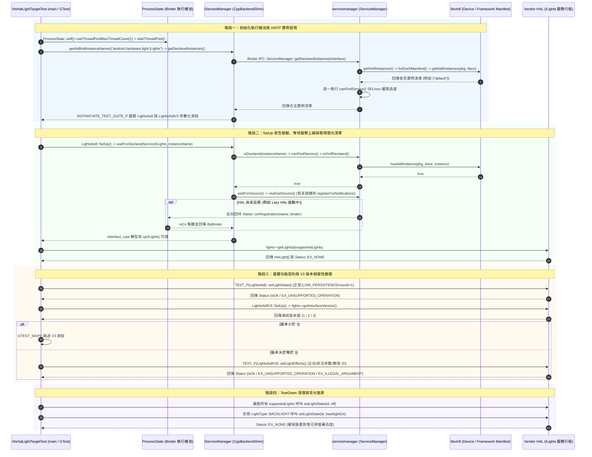

# 2.2 驗證 AIDL HAL：VTS 功能測試

- **情景說明**：透過 AOSP VTS（Vendor Test Suite）原生測試執行檔 `VtsHalLightTargetTest`，在不直接存取任何 `/dev` 或 `/sys` 核心裝置節點的前提下，藉由 VINTF Manifest 與 `ServiceManager` 自動發現裝置上宣告的所有 `ILights` AIDL HAL 實例、透過 Binder 取得遠端介面代理，逐一驗證燈光設定、詮釋資料不變量、錯誤異常碼與 V3 版本向後相容性契約，並在測試結束後復原螢幕背光狀態。
- **對應原書**：第 2 章 2.2 節〈开发C可执行程序验证Android硬件驱动程序〉（p.32–33）
- **涉及專案與版本基準**：
  - `platform/hardware/interfaces` 〔`android-17.0.0_r1`，commit `0162af6`〕
  - `platform/frameworks/native` 〔`android-17.0.0_r1`，commit `ae266dc`〕

---

## 2.2.1 驗證範式轉變：從直開 `/dev/freg` 到 VTS 契約測試與 `Android.bp`

> 對應原書 2.2（p.32–33）。在 Android 2.3 中，驗證硬體驅動的方式是在 `external/freg/` 下撰寫一支獨立 C 程式 `freg.c`，於 `main()` 中直接 `open("/dev/freg", O_RDWR)` 並以 `read()`/`write()` 讀寫二進位數值 `0` 與 `5`，再以 `Android.mk` 的 `include $(BUILD_EXECUTABLE)` 編譯進 `/system/bin/freg`，透過 `adb shell` 手動執行並肉眼比對 `printf` 輸出。
>
> 在 Android 17（Project Treble + SELinux 強制隔離）下，系統分區程式與一般測試程式**不再允許直接打開驅動裝置檔或 sysfs 節點**；系統與供應商之間的唯一合法契約邊界是 **Stable AIDL HAL 介面**。因此驗證重心轉移至 GoogleTest 驅動的 **VTS（Vendor Test Suite）功能測試**：測試程式作為標準 Binder 客戶端，由 VINTF 動態列舉所有已宣告的 HAL 實例，並針對 AIDL 介面規範自動斷言成功行為與異常碼。

| 比較維度 | Android 2.3（原書 p.32–33） | Android 17（VTS 功能測試） |
|---|---|---|
| **測試目標邊界** | 核心字元裝置檔 `/dev/freg`（`open`/`read`/`write`） | Stable AIDL HAL 介面 `android.hardware.light.ILights`（Binder IPC） |
| **原始碼位置** | `external/freg/freg.c` | `platform/hardware/interfaces/light/aidl/vts/functional/VtsHalLightTargetTest.cpp` |
| **建置腳本** | `Android.mk`（`include $(BUILD_EXECUTABLE)`） | Soong `Android.bp`（`cc_test` + `test_suites: ["vts"]`） |
| **實例發現機制** | 硬編碼裝置路徑 `#define FREG_DEVICE_NAME "/dev/freg"` | 透過 VINTF + `ServiceManager::getDeclaredInstances` 動態參數化生成測試實例 |
| **驗證手段** | 手動執行 `/system/bin/freg` 並肉眼檢視 `printf` | GoogleTest `TEST_P` 自動化斷言 `binder::Status`（`isOk()` / `EX_*`）與 `TearDown` 復原 |
| **版本相容性** | 無版本協商概念 | 透過 `getInterfaceVersion()` 動態 `GTEST_SKIP()`，支援新版系統驗證舊版 Vendor HAL |

### Step 1：VTS 測試模組建置定義（`Android.bp`）
**位置**：`platform/hardware/interfaces/light/aidl/vts/functional/Android.bp` 〔`android-17.0.0_r1`，lines 27–45〕

```bp
cc_test {
    name: "VtsHalLightTargetTest",
    defaults: [
        "VtsHalTargetTestDefaults",
        "use_libaidlvintf_gtest_helper_static",
    ],
    srcs: [
        "VtsHalLightTargetTest.cpp",
    ],
    shared_libs: [
        "libbinder",
    ],
    static_libs: [
        "android.hardware.light-V3-cpp",
    ],
    test_suites: [
        "vts",
    ],
}
```

**解說**：
1. **`cc_test` 與 `test_suites: ["vts"]`**：Soong 以 `cc_test` 模組取代傳統 `Android.mk` 的 `BUILD_EXECUTABLE`，並將產物歸類至 `vts` 測試套件，供 Tradefed / `atest VtsHalLightTargetTest` 在裝置端自動推送與執行。
2. **`defaults` 繼承兩組共用配置**：
   - `VtsHalTargetTestDefaults`：提供 VTS 原生目標測試所需的共通編譯旗標、GoogleTest 相依與預設部署設定。
   - `use_libaidlvintf_gtest_helper_static`：靜態連結 AIDL VINTF GoogleTest 輔助程式庫，提供程式碼中 `#include <aidl/Vintf.h>` 所宣告的 `android::getAidlHalInstanceNames(...)` 等實例發現函式。
3. **`shared_libs` 與 `static_libs`**：
   - 連結 C++ `libbinder`（`ProcessState`、`IServiceManager`、`binder::Status`），而非 Vendor HAL 服務端常用的 `libbinder_ndk`——因 VTS 測試以系統端高權限測試二進位檔身分執行，可直接透過 C++ Binder 後端呼叫 `@VintfStability` AIDL 介面。
   - 靜態連結 `android.hardware.light-V3-cpp`：由 `light/aidl/Android.bp` 中凍結的 V3 `aidl_interface` 自動生成的 C++ Proxy/Stub 程式庫（含 `ILights`、`HwLight`、`HwLightState`、`HwLightEffect` 與 `enum_range<LightType>()`）。靜態連結確保測試執行檔自帶 V3 客戶端代理程式碼，不依賴目標裝置 `/system/lib64` 上是否預裝同版本 `.so`。

> 〔與 2.3 差異〕**已移除並改寫**：2.3 使用 `Android.mk`（`BUILD_EXECUTABLE`）將驗證程式打進 `system.img` 的 `/system/bin/freg`（原書 p.33）；17 改用 Soong `Android.bp` 的 `cc_test` 並納入 `vts` 測試套件，直接靜態連結凍結版 AIDL C++ 客戶端函式庫，與系統映像檔解耦。

---

## 2.2.2 VTS 實例自動發現與連線

> 在 Android 17 中，同一套 VTS 測試執行檔必須能直接跑在任意廠商的裝置上：某些裝置只有一個 `default` 實例，某些裝置可能宣告多個實例，甚至部分無燈光硬體的裝置完全沒有宣告 `ILights`。因此 VTS 透過「啟動 Binder 執行緒池 → 參數化列舉 VINTF 宣告實例 → 逐實例呼叫 `waitForDeclaredService<ILights>` 取得代理」三段機制完成連線。

### Step 2：測試入口 `main()` 啟動 Binder 執行緒池
**位置**：`platform/hardware/interfaces/light/aidl/vts/functional/VtsHalLightTargetTest.cpp` 〔`android-17.0.0_r1`，lines 469–474〕

```cpp
int main(int argc, char** argv) {
    ::testing::InitGoogleTest(&argc, argv);
    ProcessState::self()->setThreadPoolMaxThreadCount(1);
    ProcessState::self()->startThreadPool();
    return RUN_ALL_TESTS();
}
```

**解說**：
1. 雖然 `VtsHalLightTargetTest` 表面上只是「單向呼叫 HAL 的客戶端」，並未向 `ServiceManager` 註冊任何對外服務，但它仍**必須**在 `RUN_ALL_TESTS()` 之前配置並啟動至少 1 條 Binder 執行緒（`setThreadPoolMaxThreadCount(1)` + `startThreadPool()`）。
2. 根本原因將在 **Step 7** 的 `CppBackendShim::waitForService` 中揭曉：當目標 HAL 是 Lazy HAL（隨需啟動）或尚未完成註冊時，`waitForDeclaredService` 會向 `servicemanager` 註冊一個本地 `BnServiceCallback` 回呼物件（`Waiter`），並在條件變數上休眠等待。`servicemanager` 必須透過反向 Binder 交易呼叫 `Waiter::onRegistration()` 來喚醒測試主執行緒；若沒有啟動 Binder 執行緒池，這筆回呼永遠無法被讀取，測試將無限期卡死。
3. 啟動執行緒池後，`RUN_ALL_TESTS()` 依序實例化下一個 Step 所註冊的所有參數化測試案例。

> 〔與 2.3 差異〕**新增**：2.3 的 `freg.c::main()` 直接對單一字元裝置做同步系統呼叫 `open`/`read`/`write`，不需要任何 IPC 執行緒池或測試框架入口（原書 p.32–33）；17 的 VTS 測試本身即是一個具備非同步回呼能力的 Binder 行程。

### Step 3：參數化測試套件註冊與 VINTF 實例列舉
**位置**：`platform/hardware/interfaces/light/aidl/vts/functional/VtsHalLightTargetTest.cpp` 〔`android-17.0.0_r1`，lines 459–467〕

```cpp
GTEST_ALLOW_UNINSTANTIATED_PARAMETERIZED_TEST(LightsAidl);
INSTANTIATE_TEST_SUITE_P(Lights, LightsAidl,
                         testing::ValuesIn(android::getAidlHalInstanceNames(ILights::descriptor)),
                         android::PrintInstanceNameToString);

GTEST_ALLOW_UNINSTANTIATED_PARAMETERIZED_TEST(LightsAidlV3);
INSTANTIATE_TEST_SUITE_P(Lights, LightsAidlV3,
                         testing::ValuesIn(android::getAidlHalInstanceNames(ILights::descriptor)),
                         android::PrintInstanceNameToString);
```

**解說**：
1. **參數化測試（`TestWithParam<std::string>`）**：`LightsAidl` 與其子類別 `LightsAidlV3` 皆繼承自 `testing::TestWithParam<std::string>`，每個測試實例收到的參數字串即為完整服務名稱（例如 `"android.hardware.light.ILights/default"`）。
2. **`android::getAidlHalInstanceNames(ILights::descriptor)`**：於 `#include <aidl/Vintf.h>`（來自 `use_libaidlvintf_gtest_helper_static`）中提供，傳入介面描述字串 `ILights::descriptor`（`"android.hardware.light.ILights"`），底層向 `ServiceManager` 查詢該介面在裝置 VINTF Manifest 中宣告的所有實例名稱並組合成 `<interface>/<instance>` 清單。
3. **`GTEST_ALLOW_UNINSTANTIATED_PARAMETERIZED_TEST`**：GoogleTest 預設會將「0 個參數實例」的參數化測試視為錯誤。由於 `ILights` 對部分 Android 裝置（例如無螢幕背光與 LED 指示燈的裝置形態）並非強制必備，加上此巨集允許在查詢結果為空時合法跳過而不報失敗。
4. **`android::PrintInstanceNameToString`**：由 `#include <hidl/GtestPrinter.h>` 引入的名稱格式化器，將含 `/` 與 `.` 的實例名稱轉成 GoogleTest 合法的測試案例後綴，方便報表辨識是哪一個 HAL 實例失敗。

> 〔與 2.3 差異〕**新增**：2.3 將裝置路徑 `/dev/freg` 寫死在巨集中（原書 p.32）；17 由 VINTF 作為裝置硬體能力的單一事實來源（Single Source of Truth），測試套件在執行期自動依 Manifest 展開所有實例。

### Step 4：`ServiceManager` 查詢 VINTF 宣告實例與 SELinux 過濾
**位置**：`platform/frameworks/native/cmds/servicemanager/ServiceManager.cpp` 〔`android-17.0.0_r1`，lines 144–172、309–340、708–753〕

```cpp
static bool isVintfDeclared(const Access::CallingContext& ctx, const std::string& name) {
...
    AidlName aname;
    if (!AidlName::fill(name, &aname, true)) return false;

    bool found = forEachManifest([&](const ManifestWithDescription& mwd) {
        if (mwd.manifest->hasAidlInstance(aname.package, aname.iface, aname.instance)) {
            ALOGI("%s Found %s in %s VINTF manifest.", ctx.toDebugString().c_str(), name.c_str(),
                  mwd.description);
            return true; // break
        }
        return false;  // continue
    });
```

```cpp
static std::vector<std::string> getVintfInstances(const std::string& interface) {
    size_t lastDot = interface.rfind('.');
    if (lastDot == std::string::npos) {
...
        ALOGE("VINTF interfaces require names in Java package format (e.g. some.package.foo.IFoo) "
              "but got: %s",
              interface.c_str());
        return {};
    }
    const std::string package = interface.substr(0, lastDot);
    const std::string iface = interface.substr(lastDot+1);

    std::vector<std::string> ret;
    (void)forEachManifest([&](const ManifestWithDescription& mwd) {
        auto instances = mwd.manifest->getAidlInstances(package, iface);
        ret.insert(ret.end(), instances.begin(), instances.end());
        return false;  // continue
    });

    return ret;
}
```

```cpp
Status ServiceManager::isDeclared(const std::string& name, bool* outReturn) {
    SM_PERFETTO_TRACE_FUNC(PERFETTO_TE_PROTO_FIELDS(
            PERFETTO_TE_PROTO_FIELD_CSTR(kProtoServiceName, name.c_str())));

    auto ctx = mAccess->getCallingContext();

    std::optional<std::string> accessorName;
    if (auto status = canFindService(ctx, name, &accessorName); !status.isOk()) {
        return status;
    }

    *outReturn = false;

#ifndef VENDORSERVICEMANAGER
    *outReturn = isVintfDeclared(ctx, name);
#endif
    return Status::ok();
}

binder::Status ServiceManager::getDeclaredInstances(const std::string& interface, std::vector<std::string>* outReturn) {
    SM_PERFETTO_TRACE_FUNC(PERFETTO_TE_PROTO_FIELDS(
            PERFETTO_TE_PROTO_FIELD_CSTR(kProtoInterfaceName, interface.c_str())));

    auto ctx = mAccess->getCallingContext();

    std::vector<std::string> allInstances;
#ifndef VENDORSERVICEMANAGER
    allInstances = getVintfInstances(interface);
#endif

    outReturn->clear();

    std::optional<std::string> _accessorName;
    for (const std::string& instance : allInstances) {
        if (auto status = canFindService(ctx, interface + "/" + instance, &_accessorName);
            status.isOk()) {
            outReturn->push_back(instance);
        }
    }

    if (outReturn->size() == 0 && allInstances.size() != 0) {
        return Status::fromExceptionCode(Status::EX_SECURITY, "SELinux denied.");
    }

    return Status::ok();
}
```

**解說**：
1. **`ServiceManager::getDeclaredInstances` 的兩階段查詢**：
   - **VINTF 查詢**：呼叫 `getVintfInstances(interface)`，將 `"android.hardware.light.ILights"` 依最後一個 `.` 拆分為 `package = "android.hardware.light"` 與 `iface = "ILights"`，再透過 `forEachManifest()`（見同檔 lines 80–111）依序掃描 `VintfObject::GetInstance()` 的 **Device HAL Manifest**（Vendor 分區）與 **Framework HAL Manifest**（System 分區），收集所有宣告的實例名（如 `["default"]`）。
   - **SELinux 過濾**：對每個查得的 `instance`，逐一以呼叫端的 `CallingContext`（PID/UID/SELinux SID）執行 `canFindService(ctx, interface + "/" + instance, ...)` 權限檢查。只有 SELinux 允許 `find` 的實例才會加入 `outReturn`；若 VINTF 確實有宣告但全部被 SELinux 拒絕，則直接回傳 `Status::EX_SECURITY`。
2. **`ServiceManager::isDeclared` 的對稱驗證**：
   - 先做 `canFindService` 權限校驗，再呼叫 `isVintfDeclared()`。`AidlName::fill()` 要求服務名稱符合 `<package>.<IFace>/<instance>` 格式（如 `android.hardware.light.ILights/default`），並呼叫 `mwd.manifest->hasAidlInstance(...)` 確認該實例確實存在於 Device 或 Framework VINTF Manifest 中。
   - 注意 `#ifndef VENDORSERVICEMANAGER` 條件編譯：僅標準 `/dev/binder` 上的系統 `servicemanager` 負責 VINTF 跨分區 HAL 宣告驗證，純 Vendor 內部的 `vndservicemanager` 不參與 VINTF。

> 〔與 2.3 差異〕**新增**：2.3 的 `servicemanager` 僅維護一張純字串雜湊表（見第 5 章 5.3 節），完全沒有 VINTF Manifest 概念，也無 `isDeclared` / `getDeclaredInstances` 介面（原書 p.32–33 不涉及 `servicemanager`）；17 由 `ServiceManager` 整合 `libvintf` 與 SELinux 實作受控的實例發現。

### Step 5：`LightsAidl::SetUp()` 取得遠端代理並初始化支援燈光清單
**位置**：`platform/hardware/interfaces/light/aidl/vts/functional/VtsHalLightTargetTest.cpp` 〔`android-17.0.0_r1`，lines 55–65〕

```cpp
class LightsAidl : public testing::TestWithParam<std::string> {
  public:
    virtual void SetUp() override {
        lights = android::waitForDeclaredService<ILights>(String16(GetParam().c_str()));
        ASSERT_NE(lights, nullptr);
        ASSERT_TRUE(lights->getLights(&supportedLights).isOk());
    }

    sp<ILights> lights;
    std::vector<HwLight> supportedLights;
```

**解說**：
1. 每個 `TEST_P(LightsAidl, ...)` 測試案例執行前，GoogleTest 都會先呼叫 `SetUp()`：
   - 以 `GetParam()` 取得該次參數化實例的完整服務名（如 `"android.hardware.light.ILights/default"`），轉為 `String16` 後交給 `android::waitForDeclaredService<ILights>(...)` 取得強參考代理 `sp<ILights>`（底層為 `BpLights` 包裹 `BpBinder`）。
   - `ASSERT_NE(lights, nullptr)` 強制斷言服務必須成功連線——既然實例已宣告於 VINTF，若 HAL 服務未啟動、崩潰或權限拒絕，測試立即中止並報錯。
   - 接著透過 Binder 遠端呼叫 `lights->getLights(&supportedLights)` 查詢此 HAL 實例回報的所有邏輯燈光描述（`std::vector<HwLight>`），並斷言回傳的 `binder::Status::isOk()` 為真，將結果暫存於成員 `supportedLights` 供後續測試與 `TearDown()` 使用。
2. 對照 `HwLight.aidl`（`light/aidl/android/hardware/light/HwLight.aidl`），每一筆 `HwLight` 含有四個欄位：`id`（控制用整數識別碼）、`ordinal`（同類型燈光的實體排序號）、`type`（`LightType` 列舉）與 V3 新增的 `minUpdatePeriodMillis`（動畫更新最小間隔毫秒數，`0` 代表不支援燈光特效）。

> 〔與 2.3 差異〕**邏輯改變**：2.3 的 `freg.c` 在 `main()` 以 `open("/dev/freg", O_RDWR)` 取得單一檔案描述符 `fd`（原書 p.32）；17 改於測試 Fixture 的 `SetUp()` 透過 Binder 連線取得 `sp<ILights>` 代理，並以 `getLights()` 動態探索裝置上的所有邏輯燈光清單。

### Step 6：`waitForDeclaredService<INTERFACE>` 宣告檢查與介面轉型
**位置**：`platform/frameworks/native/libs/binder/include/binder/IServiceManager.h` 〔`android-17.0.0_r1`，lines 110–122、204–209〕

```cpp
    /**
     * Check if a service is declared (e.g. VINTF manifest).
     *
     * If this returns true, waitForService should always be able to return the
     * service.
     */
    virtual bool isDeclared(const String16& name) = 0;

    /**
     * Get all instances of a service as declared in the VINTF manifest
     */
    virtual Vector<String16> getDeclaredInstances(const String16& interface) = 0;
```

```cpp
template<typename INTERFACE>
sp<INTERFACE> waitForDeclaredService(const String16& name) {
    const sp<IServiceManager> sm = defaultServiceManager();
    if (!sm->isDeclared(name)) return nullptr;
    return interface_cast<INTERFACE>(sm->waitForService(name));
}
```

**解說**：
1. `waitForDeclaredService<ILights>` 是一個極其關鍵的安全包裝模板：
   - **先問 `isDeclared(name)`**：若該服務根本未宣告在 VINTF Manifest（或呼叫端無 SELinux `find` 權限），立即返回 `nullptr`，**避免在未宣告的服務上呼叫 `waitForService()` 導致永久阻塞**。
   - **再等 `waitForService(name)`**：確認已宣告後，才阻塞等待服務上線並取得 `sp<IBinder>`。
   - **最後 `interface_cast<ILights>(...)`**：將裸 `BpBinder` 轉型為強型別代理 `sp<ILights>`（即 AIDL 生成的 `BpLights`）。
2. 同檔案 lines 218–223 亦提供更精簡的 `waitForVintfService<INTERFACE>(instance = "default")`，內部就是自動拼接 `INTERFACE::descriptor + "/" + instance` 後轉呼叫 `waitForDeclaredService<INTERFACE>`；VTS 因為已從 `getAidlHalInstanceNames` 拿到含實例名的完整字串，故直接呼叫 `waitForDeclaredService<ILights>`。

> 〔與 2.3 差異〕**新增**：2.3 的 `IServiceManager` 僅有 `getService`（輪詢 sleep）與 `checkService`，無 VINTF 宣告感知，也無 `waitForDeclaredService` 範本。

### Step 7：`CppBackendShim::waitForService` 的非同步回呼等待與 Lazy HAL 競態處理
**位置**：`platform/frameworks/native/libs/binder/IServiceManager.cpp` 〔`android-17.0.0_r1`，lines 687–749〕

```cpp
    const std::string name = String8(name16).c_str();

    sp<IBinder> out;
    if (Status status = realGetService(name, &out); !status.isOk()) {
        ALOGW("Failed to getService in waitForService for %s: %s", name.c_str(),
              status.toString8().c_str());
        sp<ProcessState> self = ProcessState::selfOrNull();
        if (self && 0 == self->getThreadPoolMaxTotalThreadCount()) {
            ALOGW("Got service, but may be racey because we could not wait efficiently for it. "
                  "Threadpool has 0 guaranteed threads. "
                  "Is the threadpool configured properly? "
                  "See ProcessState::startThreadPool and "
                  "ProcessState::setThreadPoolMaxThreadCount.");
        }
        return nullptr;
    }
    if (out != nullptr) return out;

    sp<Waiter> waiter = sp<Waiter>::make();
    if (Status status = mUnifiedServiceManager->registerForNotifications(name, waiter);
        !status.isOk()) {
        ALOGW("Failed to registerForNotifications in waitForService for %s: %s", name.c_str(),
              status.toString8().c_str());
        return nullptr;
    }
    Defer unregister([&] { mUnifiedServiceManager->unregisterForNotifications(name, waiter); });

    while(true) {
        {
            // It would be really nice if we could read binder commands on this
            // thread instead of needing a threadpool to be started, but for
            // instance, if we call getAndExecuteCommand, it might be the case
            // that another thread serves the callback, and we never get a
            // command, so we hang indefinitely.
            std::unique_lock<std::mutex> lock(waiter->mMutex);
            waiter->mCv.wait_for(lock, 1s, [&] {
                return waiter->mBinder != nullptr;
            });
            if (waiter->mBinder != nullptr) return waiter->mBinder;
        }

        sp<ProcessState> self = ProcessState::selfOrNull();
        ALOGW("Waited one second for %s (is service started? Number of threads started in the "
              "threadpool: %zu. Are binder threads started and available?)",
              name.c_str(), self ? self->getThreadPoolMaxTotalThreadCount() : 0);

        // Handle race condition for lazy services. Here is what can happen:
        // - the service dies (not processed by init yet).
        // - sm processes death notification.
        // - sm gets getService and calls init to start service.
        // - init gets the start signal, but the service already appears
        //   started, so it does nothing.
        // - init gets death signal, but doesn't know it needs to restart
        //   the service
        // - we need to request service again to get it to start
        if (Status status = realGetService(name, &out); !status.isOk()) {
            ALOGW("Failed to getService in waitForService on later try for %s: %s", name.c_str(),
                  status.toString8().c_str());
            return nullptr;
        }
        if (out != nullptr) return out;
    }
```

**解說**：
1. **快路徑（Fast Path）**：先呼叫 `realGetService(name, &out)`（對應 `servicemanager` 的 `getService2`，若為 Lazy HAL 會一併觸發 `init` 設定屬性拉起該服務）。若 HAL 行程早已註冊上線，直接返回 `out`。
2. **慢路徑與執行緒池依賴**：若服務尚未就緒，建立一個實作 `android::os::BnServiceCallback` 的 `Waiter` 並向 `servicemanager` 呼叫 `registerForNotifications(name, waiter)`，再透過 RAII `Defer` 確保退出時自動 `unregisterForNotifications`。主執行緒隨即在 `waiter->mCv.wait_for(lock, 1s, ...)` 休眠，等待 Binder 執行緒池收到 `onRegistration()` 回呼後填入 `waiter->mBinder` 並喚醒條件變數——這正是 **Step 2** 在 `main()` 中必須呼叫 `ProcessState::self()->startThreadPool()` 的直接原始碼證據（line 695–699 與 line 729–730 的警告訊息亦明確點出此事）。
3. **1 秒逾時重試與 Lazy HAL 競態修復**：若 1 秒未獲通知，迴圈會重新呼叫 `realGetService(name, &out)`，專門防範註解中詳述的「Lazy HAL 剛剛崩潰、`init` 尚未收到 `SIGCHLD` 導致前一次拉起請求被略過」的競態條件。

> 〔與 2.3 差異〕**邏輯改變**：2.3 的 `BpServiceManager::getService()` 是寫死最多 5 次的 `sleep(1)` 輪詢（無回呼機制、無 Lazy HAL 拉起邏輯）；17 的 `waitForService()` 結合事件驅動回呼（`registerForNotifications`）與 1 秒防競態重試，能無縫銜接現代 Lazy AIDL HAL。

---

## 2.2.3 基礎功能契約與異常驗證

> 取得 `sp<ILights>` 與 `supportedLights` 後，VTS 開始驗證 `ILights`（V1/V2 基礎契約）的各項行為規範。與 2.3 僅讀寫一個整數不同，AIDL HAL 的每個遠端方法都會回傳結構化的 `android::binder::Status`，讓測試能精確區分「執行成功」、「HAL 合法回報不支援某選配能力」、「HAL 拒絕非法參數」與「底層 Binder 傳輸異常」。

### Step 8：`binder::Status` 契約異常碼定義
**位置**：`platform/frameworks/native/libs/binder/include/binder/Status.h` 〔`android-17.0.0_r1`，lines 55–78、138–147〕

```cpp
class LIBBINDER_EXPORTED Status final {
public:
    // Keep the exception codes in sync with android/os/Parcel.java.
    enum Exception {
        EX_NONE = 0,
        EX_SECURITY = -1,
        EX_BAD_PARCELABLE = -2,
        EX_ILLEGAL_ARGUMENT = -3,
        EX_NULL_POINTER = -4,
        EX_ILLEGAL_STATE = -5,
        EX_NETWORK_MAIN_THREAD = -6,
        EX_UNSUPPORTED_OPERATION = -7,
        EX_SERVICE_SPECIFIC = -8,
        EX_PARCELABLE = -9,

        // See android/os/Parcel.java. We need to handle this in native code.
        EX_HAS_NOTED_APPOPS_REPLY_HEADER = -127,

        // This is special and Java specific; see Parcel.java.
        EX_HAS_REPLY_HEADER = -128,
        // This is special, and indicates to C++ binder proxies that the
        // transaction has failed at a low level.
        EX_TRANSACTION_FAILED = -129,
    };
```

```cpp
    // Get information about an exception.
    int32_t exceptionCode() const  { return mException; }
    const String8& exceptionMessage() const { return mMessage; }
    status_t transactionError() const {
        return mException == EX_TRANSACTION_FAILED ? mErrorCode : OK;
    }
    int32_t serviceSpecificErrorCode() const {
        return mException == EX_SERVICE_SPECIFIC ? mErrorCode : 0;
    }

    bool isOk() const { return mException == EX_NONE; }
```

**解說**：
1. **`EX_*` 與 Java 異常一一對應**：`Status::Exception` 與 `android/os/Parcel.java` 同步編號。對 `ILights` 契約最關鍵的三個狀態碼為：
   - `EX_NONE = 0`（`isOk() == true`）：遠端方法正常完成。
   - `EX_UNSUPPORTED_OPERATION = -7`：對應 Java `UnsupportedOperationException`。依 `ILights.aidl` 規範，存取無效 `lightId`、硬體不支援 `LOW_PERSISTENCE`，或對不支援特效的燈光呼叫 `setLightEffects()` 時，HAL 必須回傳此異常碼。
   - `EX_ILLEGAL_ARGUMENT = -3`：對應 Java `IllegalArgumentException`。依 `ILights.aidl` 規範，當 `HwLightEffect` 結構不合法或請求超過硬體極限的更新率時，HAL 必須回傳此異常碼。
2. **區分業務異常與傳輸失敗**：當遠端 HAL 行程崩潰（`DEAD_OBJECT`）或 Binder 驅動回錯時，`mException` 會被設為 `EX_TRANSACTION_FAILED = -129`（底層 `status_t` 存於 `mErrorCode`），這確保測試斷言 `status.exceptionCode() == Status::EX_UNSUPPORTED_OPERATION` 時，**絕不會誤把 HAL 行程當機當成「合法拒絕」而放行**。

> 〔與 2.3 差異〕**新增**：2.3 的 `freg.c` 僅檢查 `open()` 回傳 `-1`（`errno`），`read()`/`write()` 甚至未檢查回傳值（原書 p.32–33）；17 透過 AIDL 跨語言標準異常碼 `binder::Status` 進行精確契約驗證。

### Step 9：正常功能與詮釋資料契約驗證（`TestSupported`、`TestSupportedLightTypes`、`TestUniqueIds`、`TestUniqueOrdinalsForType`）
**位置**：`platform/hardware/interfaces/light/aidl/vts/functional/VtsHalLightTargetTest.cpp` 〔`android-17.0.0_r1`，lines 52–53、98–143〕

```cpp
const std::set<LightType> kAllTypes{android::enum_range<LightType>().begin(),
                                    android::enum_range<LightType>().end()};
```

```cpp
/**
 * Ensure all reported lights actually work.
 */
TEST_P(LightsAidl, TestSupported) {
    HwLightState whiteFlashing;
    whiteFlashing.color = 0xFFFFFFFF;
    whiteFlashing.flashMode = FlashMode::TIMED;
    whiteFlashing.flashOnMs = 100;
    whiteFlashing.flashOffMs = 50;
    whiteFlashing.brightnessMode = BrightnessMode::USER;
    for (const HwLight& light : supportedLights) {
        EXPECT_TRUE(lights->setLightState(light.id, whiteFlashing).isOk());
    }
}

/**
 * Ensure all reported lights have one of the supported types.
 */
TEST_P(LightsAidl, TestSupportedLightTypes) {
    for (const HwLight& light : supportedLights) {
        EXPECT_TRUE(kAllTypes.find(light.type) != kAllTypes.end());
    }
}

/**
 * Ensure all lights have a unique id.
 */
TEST_P(LightsAidl, TestUniqueIds) {
    std::set<int> ids;
    for (const HwLight& light : supportedLights) {
        EXPECT_TRUE(ids.find(light.id) == ids.end());
        ids.insert(light.id);
    }
}

/**
 * Ensure all lights have a unique ordinal for a given type.
 */
TEST_P(LightsAidl, TestUniqueOrdinalsForType) {
    std::map<int, std::set<int>> ordinalsByType;
    for (const HwLight& light : supportedLights) {
        auto& ordinals = ordinalsByType[(int)light.type];
        EXPECT_TRUE(ordinals.find(light.ordinal) == ordinals.end());
        ordinals.insert(light.ordinal);
    }
}
```

**解說**：
這四個基礎 `TEST_P` 案例從功能可用性與資料一致性兩個層面檢驗 HAL：
1. **`TestSupported`**：構造一個白色（`0xFFFFFFFF`）、定時閃爍（`FlashMode::TIMED`，亮 100ms / 滅 50ms）、使用者亮度模式（`BrightnessMode::USER`）的 `HwLightState`，逐一對 `supportedLights` 中每一顆燈呼叫 `setLightState(light.id, whiteFlashing)`，斷言所有 HAL 自行宣告支援的燈都必須回傳 `isOk()`。依 `ILights.aidl` 規範，對已支援燈光的子能力（例如硬體不支援閃爍只支援常亮）採「盡力而為（best-effort）」，不應拋錯。
2. **`TestSupportedLightTypes`**：利用 AIDL 編譯器為 `@VintfStability enum LightType` 自動生成的 `android::enum_range<LightType>()`（涵蓋 `BACKLIGHT = 0` 至 `PRIORITY_NOTIFICATIONS = 11` 共 12 種合法類型），建立 `kAllTypes` 集合，防止廠商填入未定義的私有魔術數字。
3. **`TestUniqueIds`**：確認 `getLights()` 回傳的所有 `HwLight.id` 全域唯一，避免上層 `LightsService`（2.4 節）以 `id` 作為 `SparseArray` 索引鍵時發生碰撞覆蓋。
4. **`TestUniqueOrdinalsForType`**：確認同一個 `LightType` 下的多顆實體燈具有不重複的 `ordinal` 排序號，使框架層得以確定同類燈光的實體排列次序。

> 〔與 2.3 差異〕**邏輯改變**：2.3 測試邏輯單純驗證「寫 5 再讀回 5」的資料往返（原書 p.32–33）；17 的 VTS 不僅驗證控制呼叫成功，還將 AIDL 介面文件上的資料模型不變量（列舉合法性、`id` 唯一性、`(type, ordinal)` 唯一性）全部編碼為自動化斷言。

### Step 10：可選能力與非法 ID 異常契約驗證（`TestLowPersistence`、`TestInvalidLightIdUnsupported`）
**位置**：`platform/hardware/interfaces/light/aidl/vts/functional/VtsHalLightTargetTest.cpp` 〔`android-17.0.0_r1`，lines 145–172〕

```cpp
/**
 * Ensure EX_UNSUPPORTED_OPERATION is returned if LOW_PERSISTENCE is not supported.
 */
TEST_P(LightsAidl, TestLowPersistence) {
    HwLightState lowPersistence;
    lowPersistence.color = 0xFF123456;
    lowPersistence.flashMode = FlashMode::TIMED;
    lowPersistence.flashOnMs = 100;
    lowPersistence.flashOffMs = 50;
    lowPersistence.brightnessMode = BrightnessMode::LOW_PERSISTENCE;
    for (const HwLight& light : supportedLights) {
        Status status = lights->setLightState(light.id, lowPersistence);
        EXPECT_TRUE(status.isOk() || Status::EX_UNSUPPORTED_OPERATION == status.exceptionCode());
    }
}

/**
 * Ensure EX_UNSUPPORTED_OPERATION is returns for an invalid light id.
 */
TEST_P(LightsAidl, TestInvalidLightIdUnsupported) {
    int maxId = INT_MIN;
    for (const HwLight& light : supportedLights) {
        maxId = std::max(maxId, light.id);
    }

    Status status = lights->setLightState(maxId + 1, HwLightState());
    EXPECT_TRUE(status.exceptionCode() == Status::EX_UNSUPPORTED_OPERATION);
}
```

**解說**：
1. **`TestLowPersistence`（可選硬體能力契約）**：`BrightnessMode::LOW_PERSISTENCE` 是專為頭戴式顯示器（HMD / VR）設計的低餘暉背光模式（見 `BrightnessMode.aidl` 規範，要求像素切換 ≤ 3 ms、餘暉 ≤ 3.5 ms）。多數手機螢幕不具備此硬體模式，因此契約允許兩種合法結果：`status.isOk()`（支援）或 `Status::EX_UNSUPPORTED_OPERATION`（不支援），但禁止回傳其他錯誤碼或造成 HAL 崩潰。
2. **`TestInvalidLightIdUnsupported`（負向邊界契約）**：掃描 `supportedLights` 算出最大 `id`（`maxId`），故意傳入必然不存在的 `maxId + 1`。依 `ILights.aidl` 的明確規範，HAL **必須**回傳 `Status::EX_UNSUPPORTED_OPERATION`，不可靜默忽略（回傳 `OK`）或發生陣列越界崩潰。

> 〔與 2.3 差異〕**新增**：2.3 的驗證程式未包含任何負向輸入或可選能力測試（原書 p.32–33）；17 的 VTS 將「合法拒絕的精確異常碼」納入強制通過條件，以保證系統層 `LightsService` 能獲得一致的錯誤語意。

### Step 11：`LightsAidl::TearDown()` 清理狀態與復原背光
**位置**：`platform/hardware/interfaces/light/aidl/vts/functional/VtsHalLightTargetTest.cpp` 〔`android-17.0.0_r1`，lines 66–85〕

```cpp
    virtual void TearDown() override {
        for (const HwLight& light : supportedLights) {
            HwLightState off;
            off.color = 0x00000000;
            off.flashMode = FlashMode::NONE;
            off.brightnessMode = BrightnessMode::USER;
            EXPECT_TRUE(lights->setLightState(light.id, off).isOk());
        }

        // must leave the device in a useable condition
        for (const HwLight& light : supportedLights) {
            if (light.type == LightType::BACKLIGHT) {
                HwLightState backlightOn;
                backlightOn.color = 0xFFFFFFFF;
                backlightOn.flashMode = FlashMode::TIMED;
                backlightOn.brightnessMode = BrightnessMode::USER;
                EXPECT_TRUE(lights->setLightState(light.id, backlightOn).isOk());
            }
        }
    }
```

**解說**：
每跑完一個 `TEST_P` 案例，GoogleTest 都會自動執行 `TearDown()` 進行兩階段硬體狀態還原：
1. **全面熄滅**：遍歷所有 `supportedLights`，寫入 `color = 0x00000000`、`FlashMode::NONE`、`BrightnessMode::USER`，停止前一個測試留下的閃爍或動畫特效，避免測試間互相污染。
2. **恢復螢幕背光**：立刻針對所有 `LightType::BACKLIGHT` 燈光重新設定為最亮（`color = 0xFFFFFFFF`），如註解所言 `// must leave the device in a useable condition`——因為 VTS 直接操控真實硬體背光，若測試結束時將螢幕背光留在關閉狀態，後續 UI 測試或工程師操作將面對一片黑屏。

> 〔與 2.3 差異〕**新增**：2.3 的 `freg.c` 寫入數值 `5` 後直接 `close(fd)` 退出，並未還原原本的寄存器值 `0`（原書 p.33）；VTS 操作真實硬體子系統，必須在 `TearDown()` 中將裝置還原至可用狀態。

---

## 2.2.4 版本相容性測試（`LightsAidlV3`）

> 在 Project Treble 架構下，執行 Android 17 系統映像檔（含 Android 17 VTS）的裝置，其 Vendor 分區可能仍搭載舊版本（V1 或 V2）凍結的 `ILights` HAL 實作。對比 `aidl_api/android.hardware.light/` 版本快照可知：**V3** 在 `HwLight` 新增了 `int minUpdatePeriodMillis` 欄位，並在 `ILights` 新增了 `void setLightEffects(in HwLightEffect[] effects)` 方法。VTS 必須在同一份測試二進位檔中同時驗證 V3 新功能，且不對合法的 V1/V2 舊版 Vendor HAL 誤報失敗。

### Step 12：透過 `getInterfaceVersion()` 動態跳過舊版 HAL（`LightsAidlV3::SetUp`）
**位置**：`platform/hardware/interfaces/light/aidl/vts/functional/VtsHalLightTargetTest.cpp` 〔`android-17.0.0_r1`，lines 88–96〕

```cpp
class LightsAidlV3 : public LightsAidl {
  public:
    virtual void SetUp() override {
        LightsAidl::SetUp();
        if (lights->getInterfaceVersion() < 3) {
            GTEST_SKIP() << "Skipping a v3 test on an older HAL.";
        }
    }
};
```

**解說**：
1. **繼承共用連線與復原邏輯**：`LightsAidlV3` 繼承 `LightsAidl`，先呼叫 `LightsAidl::SetUp()` 完成 `waitForDeclaredService<ILights>` 與 `getLights(&supportedLights)`，同時自動沿用 `TearDown()` 的熄燈與背光復原邏輯。
2. **`getInterfaceVersion()` 執行期版本協商**：每個 Stable AIDL 介面都由 AIDL 編譯器自動植入內建交易碼 `TRANSACTION_getInterfaceVersion`（不需要 HAL 實作者手寫）。測試端呼叫 `lights->getInterfaceVersion()` 會透過 Binder 向遠端 Vendor HAL 行程查詢其編譯連結的凍結介面版本號（V1 回傳 `1`、V2 回傳 `2`、V3 回傳 `3`）。
3. **`GTEST_SKIP()`**：若遠端 HAL 版本小於 `3`，立即標記此測試為 `SKIPPED`（而非 `FAILED`），確保新版系統／VTS 對舊版 Vendor 分區的向後相容性（Backward Compatibility）。

> 〔與 2.3 差異〕**新增**：2.3 的 `libhardware` 雖有 `version_major`/`version_minor` 欄位（原書 p.35），但 2.2 的驅動驗證程式完全沒有跨版本協商能力；17 的 Stable AIDL 將介面版本號內建於 Binder 協定中，讓 VTS 能在執行期按版本條件啟用測試。

### Step 13：V3 燈光特效正向與異常契約驗證（`setLightEffects` 系列測試）
**位置**：`platform/hardware/interfaces/light/aidl/vts/functional/VtsHalLightTargetTest.cpp` 〔`android-17.0.0_r1`，lines 174–242、244–305、370–390〕

```cpp
/**
 * Ensure a valid light effect is handled if supported, or the hal returns EX_UNSUPPORTED_OPERATION.
 */
TEST_P(LightsAidlV3, TestLightEffects) {
    for (const HwLight& light : supportedLights) {
        HwLightEffect effect;
        effect.lightId = light.id;
        effect.frames = {5};
        effect.colors = {(int32_t)0xFFFFFFFF};
        effect.iterations = 1;
        effect.preemptive = false;
        effect.framePeriodMillis = light.minUpdatePeriodMillis + 1;
        effect.interpolationType = InterpolationType::LINEAR;

        Status status = lights->setLightEffects({effect});

        if (light.minUpdatePeriodMillis > 0) {
            EXPECT_TRUE(status.isOk());
        } else {
            EXPECT_EQ(Status::EX_UNSUPPORTED_OPERATION, status.exceptionCode());
        }
    }
}

/**
 * Ensure infinite effects are supported.
 */
TEST_P(LightsAidlV3, TestEffectsInfiniteIterations) {
    for (const HwLight& light : supportedLights) {
        HwLightEffect effect;
        effect.lightId = light.id;
        effect.frames = {5};
        effect.colors = {(int32_t)0xFFFFFFFF};
        effect.iterations = 0;
        effect.preemptive = false;
        effect.framePeriodMillis = light.minUpdatePeriodMillis;
        effect.interpolationType = InterpolationType::LINEAR;

        if (light.minUpdatePeriodMillis > 0) {
            Status status = lights->setLightEffects({effect});
            EXPECT_TRUE(status.isOk());
        }
    }
}

/**
 * Ensure EX_UNSUPPORTED_OPERATION is returned setting an effect for an invalid light id.
 */
TEST_P(LightsAidlV3, TestEffectsInvalidLightIdUnsupported) {
    int maxId = INT_MIN;
    int minPeriod = INT_MIN;
    for (const HwLight& light : supportedLights) {
        maxId = std::max(maxId, light.id);
        minPeriod = std::max(minPeriod, light.minUpdatePeriodMillis);
    }

    HwLightEffect effect;
    effect.lightId = maxId + 1;
    effect.frames = {5};
    effect.colors = {(int32_t)0xFFFFFFFF};
    effect.iterations = 1;
    effect.preemptive = false;
    effect.framePeriodMillis = minPeriod;
    effect.interpolationType = InterpolationType::LINEAR;

    Status status = lights->setLightEffects({effect});

    EXPECT_EQ(Status::EX_UNSUPPORTED_OPERATION, status.exceptionCode());
}
```

```cpp
/**
 * Ensure EX_ILLEGAL_ARGUMENT is returned when no frames are specified for the effect.
 */
TEST_P(LightsAidlV3, TestEffectsInvalidEffect_emptyFrames) {
    for (const HwLight& light : supportedLights) {
        HwLightEffect effect;
        effect.lightId = light.id;
        effect.frames = {};
        effect.colors = {(int32_t)0xFFFFFFFF};
        effect.iterations = 1;
        effect.preemptive = false;
        effect.framePeriodMillis = light.minUpdatePeriodMillis;
        effect.interpolationType = InterpolationType::LINEAR;

        if (light.minUpdatePeriodMillis > 0) {
            Status status = lights->setLightEffects({effect});
            EXPECT_EQ(Status::EX_ILLEGAL_ARGUMENT, status.exceptionCode());
        }
    }
}

/**
 * Ensure EX_ILLEGAL_ARGUMENT is returned when no colors have been specified for the effect.
 */
TEST_P(LightsAidlV3, TestEffectsInvalidEffect_emptyColors) {
    for (const HwLight& light : supportedLights) {
        HwLightEffect effect;
        effect.lightId = light.id;
        effect.frames = {5};
        effect.colors = {};
        effect.iterations = 1;
        effect.preemptive = false;
        effect.framePeriodMillis = light.minUpdatePeriodMillis;
        effect.interpolationType = InterpolationType::LINEAR;

        if (light.minUpdatePeriodMillis > 0) {
            Status status = lights->setLightEffects({effect});
            EXPECT_EQ(Status::EX_ILLEGAL_ARGUMENT, status.exceptionCode());
        }
    }
}

/**
 * Ensure EX_ILLEGAL_ARGUMENT is returned when the number of frames and colors does not match.
 */
TEST_P(LightsAidlV3, TestEffectsInvalidEffect_unevenArrays) {
    for (const HwLight& light : supportedLights) {
        HwLightEffect effect;
        effect.lightId = light.id;
        effect.frames = {5, 10};
        effect.colors = {(int32_t)0xFFFFFFFF};
        effect.iterations = 1;
        effect.preemptive = false;
        effect.framePeriodMillis = light.minUpdatePeriodMillis;
        effect.interpolationType = InterpolationType::LINEAR;

        if (light.minUpdatePeriodMillis > 0) {
            Status status = lights->setLightEffects({effect});
            EXPECT_EQ(Status::EX_ILLEGAL_ARGUMENT, status.exceptionCode());
        }
    }
}
```

```cpp
/**
 * Ensure EX_ILLEGAL_ARGUMENT is returned when the requested frame rate exceeds the max frame rate
 * specified by the light.
 */
TEST_P(LightsAidlV3, TestEffectsInvalidEffect_ExcessiveFrameRate) {
    for (const HwLight& light : supportedLights) {
        HwLightEffect effect;
        effect.lightId = light.id;
        effect.frames = {5};
        effect.colors = {(int32_t)0xFFFFFFFF};
        effect.iterations = 1;
        effect.preemptive = false;
        effect.framePeriodMillis = light.minUpdatePeriodMillis - 1;
        effect.interpolationType = InterpolationType::LINEAR;

        if (light.minUpdatePeriodMillis > 0) {
            Status status = lights->setLightEffects({effect});
            EXPECT_EQ(Status::EX_ILLEGAL_ARGUMENT, status.exceptionCode());
        }
    }
}
```

**解說**：
`LightsAidlV3` 共有 12 個 `TEST_P` 測試案例（lines 177–457），完整覆蓋 `ILights::setLightEffects()` 的能力宣告與錯誤邊界：
1. **以 `minUpdatePeriodMillis` 作為能力門檻**：依 `HwLight.aidl` 定義，`minUpdatePeriodMillis == 0` 代表該燈不支援快速動畫特效。因此在 `TestLightEffects` 中，當 `minUpdatePeriodMillis > 0` 時斷言 `isOk()`，否則強制斷言 `Status::EX_UNSUPPORTED_OPERATION`。
2. **`EX_UNSUPPORTED_OPERATION` 與 `EX_ILLEGAL_ARGUMENT` 的明確分界**：
   - 目標燈光無效（`maxId + 1`）或該燈宣告不支援特效（`minUpdatePeriodMillis == 0`）→ **`EX_UNSUPPORTED_OPERATION`**。
   - 特效參數本身不合法 → **`EX_ILLEGAL_ARGUMENT`**（對應 `ILights.aidl` 規範：`If the effect is ill formed or requests unsupported frame rates this method must throw an IllegalArgumentException`）。
3. **其餘 V3 案例一覽（均定義於同檔 lines 310–457）**：

| 測試案例名稱（`LightsAidlV3`） | 測試條件 | 預期 `binder::Status` |
|---|---|---|
| `TestLightEffects` | `framePeriodMillis = minUpdatePeriodMillis + 1` | `minUpdatePeriodMillis > 0` → `isOk()`；否則 `EX_UNSUPPORTED_OPERATION` |
| `TestEffectsInfiniteIterations` | `iterations = 0`（無限循環） | `isOk()` |
| `TestEffectsInvalidLightIdUnsupported` | `lightId = maxId + 1` | `EX_UNSUPPORTED_OPERATION` |
| `TestEffectsInvalidEffect_emptyFrames` | `frames = {}` | `EX_ILLEGAL_ARGUMENT` |
| `TestEffectsInvalidEffect_emptyColors` | `colors = {}` | `EX_ILLEGAL_ARGUMENT` |
| `TestEffectsInvalidEffect_unevenArrays` | `frames.size() != colors.size()` | `EX_ILLEGAL_ARGUMENT` |
| `TestEffectsInvalidEffect_negativeIterations` | `iterations = -1` | `EX_ILLEGAL_ARGUMENT` |
| `TestEffectsInvalidEffect_ZeroFrameRate` | `framePeriodMillis = 0` | `EX_ILLEGAL_ARGUMENT` |
| `TestEffectsInvalidEffect_NegativeFrameRate` | `framePeriodMillis = -10` | `EX_ILLEGAL_ARGUMENT` |
| `TestEffectsInvalidEffect_ExcessiveFrameRate` | `framePeriodMillis = minUpdatePeriodMillis - 1` | `EX_ILLEGAL_ARGUMENT` |
| `TestEffectsInvalidEffect_OneInvalidEffectInList` | 多特效批次中混入一筆無效特效 | `EX_ILLEGAL_ARGUMENT`（註：見下方原始碼細節） |
| `TestEffectsInvalidEffect_OneInvalidLightInList` | 多特效批次中混入不支援特效的燈光 | `EX_UNSUPPORTED_OPERATION`（註：見下方原始碼細節） |

> **閱讀 `android-17.0.0_r1` 原始碼的實務細節觀察**：在 `VtsHalLightTargetTest.cpp` 最後兩個批次測試中存在兩處上游實作瑕疵值得留意：一是 `TestEffectsInvalidEffect_OneInvalidEffectInList`（line 415）試圖把第二筆特效改成無效，卻寫成 `effect.iterations = 0`（但依 `HwLightEffect.aidl` line 78 與 `TestEffectsInfiniteIterations` line 207，`iterations = 0` 代表合法的無限循環，負值才是非法）；二是 `TestEffectsInvalidEffect_OneInvalidLightInList`（lines 437–453）的迴圈未過濾 `minUpdatePeriodMillis == 0` 就將所有燈塞進 `effects`，導致下方判斷 `if (supportedLights.size() == effects.size()) return;` 恆為真而提早返回。這也說明直接閱讀一線原始碼而非憑文件推測的重要性。

> 〔與 2.3 差異〕**新增**：2.3 僅能做單點功能手動測試（原書 p.32–33）；17 的 VTS 透過版本門檻與細粒度異常斷言，確保每一代新增的 Stable AIDL 方法都受到嚴格的跨分區契約保護。

---

## 整節呼叫鏈總結

以下時序圖總結 `VtsHalLightTargetTest` 從啟動 Binder 執行緒池、經由 `ServiceManager` 與 VINTF 發現並連線至 `ILights` Vendor HAL 實例、執行基礎與 V3 契約測試，到 `TearDown()` 復原背光的完整呼叫鏈：



> **本節核心對照（2.3 → 17）**：原書 2.2 節（p.32–33）透過手動執行直開 `/dev/freg` 的 C 程式驗證核心驅動；Android 17 在 Treble 與 SELinux 邊界下，將驗證抽象提升至 **VTS 契約測試**：以 `Android.bp` 的 `cc_test`（`vts`）打包，透過 `ServiceManager` + `libvintf` 自動發現實例、以執行緒池支撐 `waitForDeclaredService` 等待 Lazy HAL、以 `binder::Status` 精確檢驗正向與異常契約、以 `getInterfaceVersion()` 達成跨分區版本相容，並在 `TearDown()` 復原真實硬體狀態。
