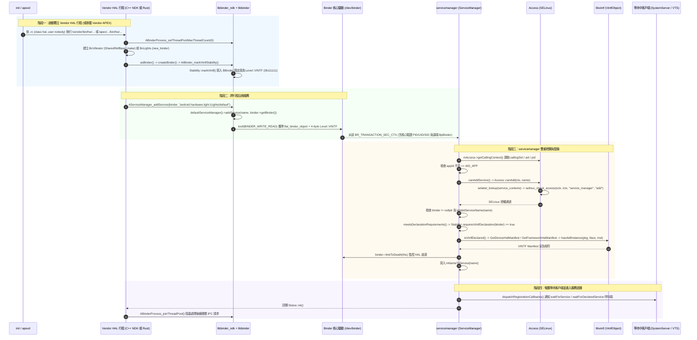

# 2.3 AIDL HAL 介面、服務實作、VINTF 與載入驗證

- **情景說明**：對照 Android 2.3 經由 `libhardware` 在呼叫端同行程內以 `dlopen` / `dlsym` 載入 HAL `.so` 動態庫的傳統機制，在 Android 17 中從零串通一個獨立行程 Stable AIDL HAL 的四個完整環節：回顧仍殘留於 17 原始碼樹的 `libhardware` → 以 `@VintfStability` 與 `aidl_api/` 定義並凍結跨分區 Stable AIDL 介面（以 `android.hardware.light.ILights` 為例）→ 透過 C++ `libbinder_ndk`（`vibrator` + Vendor APEX）與 Rust `libbinder_rs`（`light`）兩種實作形態建立並由 `init` 啟動獨立 Vendor 服務 → 沿 `libbinder_ndk` 進入 `servicemanager`，完整追蹤取代 `hw_get_module` 的 SELinux（`Access::canAdd`）與 VINTF Manifest（`isVintfDeclared`）雙重把關路徑。
- **對應原書**：第 2 章 2.3 節〈开发Android硬件抽象层模块〉（p.34–46）
- **涉及專案與版本基準**：
  - `platform/hardware/libhardware` 〔`android-17.0.0_r1`，commit `97ee3e3`〕
  - `platform/hardware/interfaces` 〔`android-17.0.0_r1`，commit `0162af6`〕
  - `platform/frameworks/native` 〔`android-17.0.0_r1`，commit `ae266dc`〕

---

## 2.3.1 歷史對照：從 `libhardware`（同行程 `.so` `dlopen`）到 Project Treble / HIDL / AIDL HAL（獨立行程）

> 對應原書 2.3.1（p.34–37）與 2.3.3（p.41–44）。在 Android 2.3 中，HAL 模組本質上是一個符合特定命名規則（`<MODULE_ID>.<variant>.so`）的共享函式庫；系統服務透過 `hw_get_module()` 以 `dlopen()` 將它直接載入到 **`system_server`（或對應系統服務）的同一個行程空間** 內，再用 `dlsym()` 尋找名為 `"HMI"` 的全域結構體符號。
>
> 自 Android 8.0 導入 **Project Treble** 後，為了將 `/system` 框架更新與 `/vendor` 硬體實作解耦，Android 先以 **HIDL（`/dev/hwbinder`）** 將 HAL 拆分為獨立的 Vendor 行程，隨後自 Android 11 起逐步以 **Stable AIDL HAL（`/dev/binder` + `libbinder_ndk`）** 全面取代 HIDL，成為 Android 17 的標準 HAL 架構。值得注意的是，`platform/hardware/libhardware` 在 Android 17 原始碼中依然存在——但已被明確限縮為歷史遺留模組與少數內部轉接層，不再用於現代系統與供應商之間的跨分區 HAL 邊界。以下先檢視 Android 17 樹中保留的 `libhardware` 實作，藉此對照它為何必須被獨立行程的 AIDL HAL 取代。

### Step 1：`libhardware` 結構體契約：`hw_module_t`、`hw_module_methods_t`、`hw_device_t` 與 `HAL_MODULE_INFO_SYM`
**位置**：`platform/hardware/libhardware/include/hardware/hardware.h` 〔`android-17.0.0_r1`，lines 32–240〕

```c
#define MAKE_TAG_CONSTANT(A,B,C,D) (((A) << 24) | ((B) << 16) | ((C) << 8) | (D))

#define HARDWARE_MODULE_TAG MAKE_TAG_CONSTANT('H', 'W', 'M', 'T')
#define HARDWARE_DEVICE_TAG MAKE_TAG_CONSTANT('H', 'W', 'D', 'T')
...
typedef struct hw_module_t {
    /** tag must be initialized to HARDWARE_MODULE_TAG */
    uint32_t tag;
...
    uint16_t module_api_version;
#define version_major module_api_version
...
    uint16_t hal_api_version;
#define version_minor hal_api_version

    /** Identifier of module */
    const char *id;

    /** Name of this module */
    const char *name;

    /** Author/owner/implementor of the module */
    const char *author;

    /** Modules methods */
    struct hw_module_methods_t* methods;

    /** module's dso */
    void* dso;

#ifdef __LP64__
    uint64_t reserved[32-7];
#else
    /** padding to 128 bytes, reserved for future use */
    uint32_t reserved[32-7];
#endif

} hw_module_t;

typedef struct hw_module_methods_t {
    /** Open a specific device */
    int (*open)(const struct hw_module_t* module, const char* id,
            struct hw_device_t** device);

} hw_module_methods_t;

typedef struct hw_device_t {
    /** tag must be initialized to HARDWARE_DEVICE_TAG */
    uint32_t tag;
...
    uint32_t version;

    /** reference to the module this device belongs to */
    struct hw_module_t* module;

    /** padding reserved for future use */
#ifdef __LP64__
    uint64_t reserved[12];
#else
    uint32_t reserved[12];
#endif

    /** Close this device */
    int (*close)(struct hw_device_t* device);

} hw_device_t;
...
#define HAL_MODULE_INFO_SYM         HMI
...
#define HAL_MODULE_INFO_SYM_AS_STR  "HMI"
...
int hw_get_module(const char *id, const struct hw_module_t **module);
...
int hw_get_module_by_class(const char *class_id, const char *inst,
                           const struct hw_module_t **module);
```

這組 C 語言介面以「結構體首成員繼承」為核心規範：
1. **模組與裝置的雙層描述**：每個 HAL 模組自訂結構體（如原書 `freg_module_t`）的第一個成員必為 `struct hw_module_t`，且必須匯出名為 `HMI`（`HAL_MODULE_INFO_SYM`）的全域符號、`tag` 設為 `HARDWARE_MODULE_TAG`（`'HWMT'`）。透過 `module->methods->open()` 開啟具體裝置後，回傳的自訂裝置結構體（首成員為 `struct hw_device_t`、`tag` 為 `'HWDT'`）提供業務函式指標與 `close()` 回呼。
2. **版本欄位語意重塑與 64 位元對齊**：Android 17 保留了 `version_major` / `version_minor` 巨集別名，實際欄位已改名為 `module_api_version` 與 `hal_api_version`，並以 `#ifdef __LP64__` 區分 64 位元與 32 位元的 `reserved` 填充大小。此外，除 `hw_get_module()` 外，也擴充了支援多實例的 `hw_get_module_by_class(class_id, inst, module)`。
3. **先天 ABI 脆弱性**：介面完全依賴 C 結構體記憶體佈局與函式指標表，編譯期與執行期皆無強型別跨行程協定，也無強制凍結檢查。

> 〔與 2.3 差異〕**邏輯改變（結構體相容擴充，但架構上已棄用）**：`hw_module_t` / `hw_module_methods_t` / `hw_device_t` 骨架與 `HMI` 符號規範仍與原書 2.3.1.2（p.35–37）相同，但欄位改為 `module_api_version` / `hal_api_version`、支援 `__LP64__` 並新增 `hw_get_module_by_class`；在 Android 17 中此介面僅作遺留相容，不再作為新 HAL 介面標準。

---

### Step 2：同行程動態載入鏈：`hw_get_module_by_class` → `hw_module_exists` → `load`（`dlopen` / `dlsym`）
**位置**：`platform/hardware/libhardware/hardware.c` 〔`android-17.0.0_r1`，lines 41–278〕

```c
#if defined(__LP64__)
#define HAL_LIBRARY_SUBDIR "lib64/hw"
#else
#define HAL_LIBRARY_SUBDIR "lib/hw"
#endif

#define HAL_LIBRARY_PATH1 "/system/" HAL_LIBRARY_SUBDIR
#define HAL_LIBRARY_PATH2 "/vendor/" HAL_LIBRARY_SUBDIR
#define HAL_LIBRARY_PATH3 "/odm/" HAL_LIBRARY_SUBDIR
...
static const char *variant_keys[] = {
    "ro.hardware",  /* This goes first so that it can pick up a different
                       file on the emulator. */
    "ro.product.board",
    "ro.board.platform",
    "ro.arch"
};

static const int HAL_VARIANT_KEYS_COUNT =
    (sizeof(variant_keys)/sizeof(variant_keys[0]));
...
static int load(const char *id,
        const char *path,
        const struct hw_module_t **pHmi)
{
    int status = -EINVAL;
    void *handle = NULL;
    struct hw_module_t *hmi = NULL;
#if defined(__ANDROID_VNDK__) || defined(__ANDROID_APEX__)
    const bool try_system = false;
#else
    const bool try_system = true;
#endif
...
    if (try_system &&
        strncmp(path, HAL_LIBRARY_PATH1, strlen(HAL_LIBRARY_PATH1)) == 0) {
        /* If the library is in system partition, no need to check
         * sphal namespace. Open it with dlopen.
         */
        handle = dlopen(path, RTLD_NOW);
    } else {
#if defined(__ANDROID_RECOVERY__) || !defined(__ANDROID__) || defined(__ANDROID_APEX__)
        handle = dlopen(path, RTLD_NOW);
#else
        handle = android_load_sphal_library(path, RTLD_NOW);
#endif
    }
    if (handle == NULL) {
        char const *err_str = dlerror();
        ALOGE("load: module=%s\n%s", path, err_str?err_str:"unknown");
        status = -EINVAL;
        goto done;
    }

    /* Get the address of the struct hal_module_info. */
    const char *sym = HAL_MODULE_INFO_SYM_AS_STR;
    hmi = (struct hw_module_t *)dlsym(handle, sym);
    if (hmi == NULL) {
        ALOGE("load: couldn't find symbol %s", sym);
        status = -EINVAL;
        goto done;
    }

    /* Check that the id matches */
    if (strcmp(id, hmi->id) != 0) {
        ALOGE("load: id=%s != hmi->id=%s", id, hmi->id);
        status = -EINVAL;
        goto done;
    }

    hmi->dso = handle;

    /* success */
    status = 0;

    done:
    if (status != 0) {
        hmi = NULL;
        if (handle != NULL) {
            dlclose(handle);
            handle = NULL;
        }
    } else {
        ALOGV("loaded HAL id=%s path=%s hmi=%p handle=%p",
                id, path, hmi, handle);
    }

    *pHmi = hmi;

    return status;
}
...
static int hw_module_exists(char *path, size_t path_len, const char *name,
                            const char *subname)
{
#ifdef __ANDROID_APEX__
    // When used in VAPEX, it should look only into the same APEX because
    // libhardware modules don't provide ABI stability.
    if (__builtin_available(android __ANDROID_API_V__, *)) {
        AApexInfo *apex_info;
        if (AApexInfo_create(&apex_info) == AAPEXINFO_OK) {
            snprintf(path, path_len, "/apex/%s/%s/%s.%s.so",
                    AApexInfo_getName(apex_info), HAL_LIBRARY_SUBDIR, name, subname);
            AApexInfo_destroy(apex_info);
            if (access(path, R_OK) == 0)
                return 0;
        }
    }
#else // __ANDROID_APEX__
    snprintf(path, path_len, "%s/%s.%s.so",
             HAL_LIBRARY_PATH3, name, subname);
    if (path_in_path(path, HAL_LIBRARY_PATH3) && access(path, R_OK) == 0)
        return 0;

    snprintf(path, path_len, "%s/%s.%s.so",
             HAL_LIBRARY_PATH2, name, subname);
    if (path_in_path(path, HAL_LIBRARY_PATH2) && access(path, R_OK) == 0)
        return 0;

#ifndef __ANDROID_VNDK__
    snprintf(path, path_len, "%s/%s.%s.so",
             HAL_LIBRARY_PATH1, name, subname);
    if (path_in_path(path, HAL_LIBRARY_PATH1) && access(path, R_OK) == 0)
        return 0;
#endif

#endif // __ANDROID_APEX__

    return -ENOENT;
}

int hw_get_module_by_class(const char *class_id, const char *inst,
                           const struct hw_module_t **module)
{
    int i = 0;
    char prop[PATH_MAX] = {0};
    char path[PATH_MAX] = {0};
    char name[PATH_MAX] = {0};
    char prop_name[PATH_MAX] = {0};


    if (inst)
        snprintf(name, PATH_MAX, "%s.%s", class_id, inst);
#if defined(__ANDROID__)
    else
        strlcpy(name, class_id, PATH_MAX);
#else
    else
        snprintf(name, PATH_MAX, "%s", class_id);
#endif
...
    /* First try a property specific to the class and possibly instance */
    snprintf(prop_name, sizeof(prop_name), "ro.hardware.%s", name);
    if (property_get(prop_name, prop, NULL) > 0) {
        if (hw_module_exists(path, sizeof(path), name, prop) == 0) {
            goto found;
        }
    }

    /* Loop through the configuration variants looking for a module */
    for (i=0 ; i<HAL_VARIANT_KEYS_COUNT; i++) {
        if (property_get(variant_keys[i], prop, NULL) == 0) {
            continue;
        }
        if (hw_module_exists(path, sizeof(path), name, prop) == 0) {
            goto found;
        }
    }

    /* Nothing found, try the default */
    if (hw_module_exists(path, sizeof(path), name, "default") == 0) {
        goto found;
    }

    return -ENOENT;

found:
    /* load the module, if this fails, we're doomed, and we should not try
     * to load a different variant. */
    return load(class_id, path, module);
}

int hw_get_module(const char *id, const struct hw_module_t **module)
{
    return hw_get_module_by_class(id, NULL, module);
}
```

對比原書 2.3.3 的實作，Android 17 中的 `hardware.c` 清楚暴露了同行程 `.so` HAL 的歷史補丁與根本極限：
1. **搜尋路徑優先權反轉與安全加固**：`hw_get_module_by_class` 先查專屬屬性 `ro.hardware.<name>`，再依 `variant_keys` 與 `"default"` 呼叫 `hw_module_exists()`，依序檢查 `/odm/lib(64)/hw` → `/vendor/lib(64)/hw` → `/system/lib(64)/hw`（與 2.3 先 `/system` 再 `/vendor` 相反），並以 `path_in_path()`（`realpath` 驗證）防範路徑穿越攻擊；若位於 Vendor APEX（`__ANDROID_APEX__`），則強制只查找同 APEX 內（`/apex/<apex>/lib64/hw/`），原始碼註解更直言原因：**`"libhardware modules don't provide ABI stability."`**。
2. **動態連結器命名空間隔離（SP-HAL）**：在 `load()` 中，非系統分區的 `.so` 不再直接 `dlopen()`，而改呼叫 `android_load_sphal_library(path, RTLD_NOW)` 透過 `sphal` linker namespace 隔離動態連結相依，接著才以 `dlsym(handle, "HMI")` 取出 `hw_module_t*` 並核對 `strcmp(id, hmi->id) == 0`。
3. **為何必須改由獨立行程 AIDL HAL 取代**：
   - **崩潰隔離（Fault Isolation）**：同行程 `dlopen` 意味著供應商 `.so` 內的記憶體越界或空指標解參考會直接拖垮 `system_server` 導致整機軟重啟；獨立行程的 AIDL HAL 崩潰只影響該 HAL 行程，可由 `init` 重啟並經 `linkToDeath` 復原。
   - **最小權限與 SELinux 隔離**：同行程模式下，系統服務行程被迫擁有直接讀寫底層硬體裝置節點的權限（原書 2.3.4 甚至直接把 `/dev/freg` 設為 `0666`）；獨立行程可將硬體節點存取權嚴格鎖定在單一 Vendor HAL 行程的 SELinux domain 內。
   - **分區獨立升級（Project Treble）**：同行程共享 C++ runtime、struct ABI 與系統函式庫，導致 Android 版本升級必須由 SoC 廠商同步重新編譯整個系統；改用跨行程 **Stable AIDL HAL + VINTF** 後，`/system`（GSI）與 `/vendor` 可各自獨立編譯與 OTA 升級。

> 〔與 2.3 差異〕**邏輯改變（已降級為歷史相容機制）**：相較原書 2.3.1.1 與 2.3.3（p.34–35、41–44），17 的 `hardware.c` 新增了 64 位元路徑、`/odm` 分區、`ro.hardware.<name>`、`path_in_path` 檢查、`android_load_sphal_library` 與 Vendor APEX 限制；但現代 Android HAL 均已改採以下 2.3.2–2.3.4 剖析的獨立行程 Stable AIDL HAL。

---

## 2.3.2 定義 Stable AIDL HAL 介面（`@VintfStability`、`frozen: true`、`aidl_api/` 版本凍結）

> 對應原書 2.3.2 中撰寫 C 介面標頭檔 `hardware/libhardware/include/hardware/freg.h`（p.37–38）的步驟。在 Android 17 中，HAL 契約不再是 C 語言 struct 標頭檔，而是位於 `platform/hardware/interfaces/<hal>/aidl/` 下、受 Soong `aidl_interface` 管理的 **Stable AIDL** 介面定義。本節以 `android.hardware.light`（`ILights`）為例完整追蹤。

### Step 3：Soong `aidl_interface` 建置定義：`stability: "vintf"`、`frozen: true` 與 `versions_with_info`
**位置**：`platform/hardware/interfaces/light/aidl/Android.bp` 〔`android-17.0.0_r1`，lines 10–43〕

```bp
aidl_interface {
    name: "android.hardware.light",
    vendor_available: true,
    srcs: [
        "android/hardware/light/*.aidl",
    ],
    stability: "vintf",
    host_supported: true,
    frozen: true,
    backend: {
        java: {
            sdk_version: "module_current",
        },
        rust: {
            enabled: true,
        },
    },
    versions_with_info: [
        {
            version: "1",
            imports: [],
        },
        {
            version: "2",
            imports: [],
        },
        {
            version: "3",
            imports: [],
        },

    ],

}
```

這個 `aidl_interface` 模組定義了整個 Lights HAL 跨語言、跨分區的建置與穩定度規則：
1. **`stability: "vintf"`**：宣告此介面屬於 VINTF 跨分區穩定度等級。AIDL 編譯器會強制要求其中每一個 `interface`、`parcelable`、`enum` 都標註 `@VintfStability`，並在產生的 C++ NDK / Rust / Java Stub 程式碼中自動注入 VINTF 穩定度標記呼叫（例如 `AIBinder_markVintfStability`）。
2. **`vendor_available: true` 與多語言 `backend`**：Soong 會為每個已凍結版本同時產生多種後端程式庫，供不同分區與語言連結：
   - **Vendor HAL 服務端**：連結 NDK 後端（如 `android.hardware.light-V3-ndk`）或 Rust 後端（`android.hardware.light-V3-rust`，因 `rust.enabled: true` 而啟用）。
   - **System 框架客戶端**：連結 Java 後端（`android.hardware.light-V3-java`，2.4 節的 `LightsService.java` 直接呼叫）或 C++/NDK 後端（2.2 節的 VTS 測試程式）。
3. **`frozen: true` 與 `versions_with_info`**：宣告目前介面已凍結在最新版本（V3），不允許在未遞增版本號的情況下修改 API 簽章；所有歷史版本（`"1"`、`"2"`、`"3"`）皆被保留並逐版進行向後相容檢查。

> 〔與 2.3 差異〕**新增（取代傳統 `freg.h` 與 `Android.mk`）**：原書 2.3.2（p.37–41）僅手寫 C 標頭檔與 `Android.mk` 的 `BUILD_SHARED_LIBRARY`；17 透過 Soong `aidl_interface` 單一規格同時產生 Java / C++ NDK / Rust 跨行程 Stub 與 Proxy，並在編譯期強制執行 VINTF ABI 穩定度檢查。

---

### Step 4：`@VintfStability` 介面與資料結構定義（`ILights.aidl` 與關聯 Parcelable / Enum）
**位置**：`platform/hardware/interfaces/light/aidl/android/hardware/light/ILights.aidl` 〔`android-17.0.0_r1`，lines 17–62〕

```java
package android.hardware.light;

import android.hardware.light.HwLight;
import android.hardware.light.HwLightEffect;
import android.hardware.light.HwLightState;

/**
 * Allows controlling logical lights/indicators, mapped to LEDs in a
 * hardware-specific manner by the HAL implementation.
 */
@VintfStability
interface ILights {
...
    void setLightState(in int id, in HwLightState state);
...
    HwLight[] getLights();
...
    void setLightEffects(in HwLightEffect[] effects);
}
```

搭配的資料結構 `HwLight`、`HwLightState` 與列舉 `LightType`、`FlashMode`、`BrightnessMode` 分別定義於同目錄下：

**位置**：`platform/hardware/interfaces/light/aidl/android/hardware/light/HwLight.aidl` 〔`android-17.0.0_r1`，lines 17–56〕

```java
package android.hardware.light;

import android.hardware.light.LightType;
...
@RustDerive(Clone=true, Copy=true)
@VintfStability
parcelable HwLight {
    int id;
...
    int ordinal;
...
    LightType type;
...
    int minUpdatePeriodMillis;
}
```

**位置**：`platform/hardware/interfaces/light/aidl/android/hardware/light/HwLightState.aidl` 〔`android-17.0.0_r1`，lines 17–65〕

```java
package android.hardware.light;

import android.hardware.light.BrightnessMode;
import android.hardware.light.FlashMode;
...
@RustDerive(Clone=true, Copy=true)
@VintfStability
parcelable HwLightState {
...
    int color;
...
    FlashMode flashMode;
...
    int flashOnMs;
...
    int flashOffMs;

    BrightnessMode brightnessMode;
}
```

**位置**：`platform/hardware/interfaces/light/aidl/android/hardware/light/LightType.aidl`（lines 16–38）、`FlashMode.aidl`（lines 16–34）與 `BrightnessMode.aidl`（lines 16–58）〔`android-17.0.0_r1`〕

```java
package android.hardware.light;
...
@VintfStability
enum LightType {
    BACKLIGHT = 0,
    KEYBOARD = 1,
    BUTTONS = 2,
    BATTERY = 3,
    NOTIFICATIONS = 4,
    ATTENTION = 5,
    BLUETOOTH = 6,
    WIFI = 7,
    MICROPHONE = 8,
    CAMERA = 9,
    APPLICATION = 10,
    PRIORITY_NOTIFICATIONS = 11,
}
```

```java
package android.hardware.light;

@VintfStability
enum FlashMode {
...
    NONE = 0,
...
    TIMED = 1,
...
    HARDWARE = 2,
}
```

```java
package android.hardware.light;

@VintfStability
enum BrightnessMode {
...
    USER = 0,
...
    SENSOR = 1,
...
    LOW_PERSISTENCE = 2,
}
```

從這些 AIDL 檔可以看出 Stable AIDL HAL 介面的四項嚴格規範：
1. **全域 `@VintfStability` 標註**：所有跨分區傳遞的 `interface`、`parcelable`（結構化資料）與 `enum` 均須標註 `@VintfStability`，確保序列化線格式（wire format）與版本演進皆受 AIDL 編譯器管控。
2. **結構化 Parcelable 取代原始 C 指標**：`HwLight`、`HwLightState` 與 V3 新增的 `HwLightEffect`（見同目錄 `HwLightEffect.aidl`）皆為結構化 Parcelable，由 AIDL 編譯器自動產生帶長度前綴的 `writeToParcel` / `readFromParcel`；舊版客戶端收到新版擴充欄位（例如 `HwLight.minUpdatePeriodMillis`）時，反序列化端會依據長度前綴安全跳過未知尾端欄位，實現向前與向後相容。
3. **跨語言輔助標註**：`@RustDerive(Clone=true, Copy=true)` 指示 Rust AIDL 後端為產生的 `struct HwLight` 與 `struct HwLightState` 自動衍生 `Clone` 與 `Copy` trait，讓 2.3.3 的 Rust 服務實作可以直接值複製 `*state`。
4. **語意化的異常契約**：方法回傳不再是負值 `errno`，而是透過 Binder `Status` 傳遞標準異常碼（如操作無效 `id` 時拋出 `EX_UNSUPPORTED_OPERATION`，動畫參數不合法時拋出 `EX_ILLEGAL_ARGUMENT`）。

> 〔與 2.3 差異〕**全面重寫**：原書 2.3.2（p.37–38）以 `freg.h` 定義包含原始 `int fd` 與函式指標的 `struct freg_device_t`；17 以結構化、跨語言、強型別的 `@VintfStability` AIDL 介面取代，完全隱藏硬體檔案描述符與底層驅動實作細節。

---

### Step 5：`aidl_api/` 版本凍結快照與 `.hash` 完整性驗證
**位置**：`platform/hardware/interfaces/light/aidl/aidl_api/android.hardware.light/1/android/hardware/light/ILights.aidl`（lines 18–23）、`.../3/android/hardware/light/ILights.aidl`（lines 34–40）與 `.../3/.hash`（line 1）〔`android-17.0.0_r1`〕

```java
package android.hardware.light;
@VintfStability
interface ILights {
  void setLightState(in int id, in android.hardware.light.HwLightState state);
  android.hardware.light.HwLight[] getLights();
}
```

```java
package android.hardware.light;
@VintfStability
interface ILights {
  void setLightState(in int id, in android.hardware.light.HwLightState state);
  android.hardware.light.HwLight[] getLights();
  void setLightEffects(in android.hardware.light.HwLightEffect[] effects);
}
```

```text
8fa9fb09512f2d9c7a42ba5408006e0440dfdc72
```

在 `light/aidl/aidl_api/android.hardware.light/` 目錄下，存放了 `1/`、`2/`、`3/` 三個不可變的凍結快照目錄以及 `current/` 目錄：
1. **僅允許向後相容的演進**：對比 `1/` 與 `3/` 的 `ILights.aidl` 快照可見，V1 僅有 `setLightState`（交易碼 1）與 `getLights`（交易碼 2）；V3 在介面末尾追加了 `setLightEffects`（交易碼 3），既未刪除舊方法，也未改變既有方法順序或參數型別。若開發者試圖做出破壞相容性的修改，建置系統在比對最新凍結快照時會直接報錯阻擋；合法擴充則須先以 `m android.hardware.light-update-api` 更新 `current/`，發布凍結時再產生新版本目錄與 `.hash`。
2. **`.hash` 與執行期版本協商**：`3/.hash` 記錄 V3 快照的雜湊值（`8fa9fb09512f2d9c7a42ba5408006e0440dfdc72`），編譯器會將介面版本號（`3`）與此雜湊值編進 Stub／Proxy 的內建交易方法 `getInterfaceVersion()` 與 `getInterfaceHash()` 中。當 Android 17 的 `LightsService`（System 端）連上可能停留在 V1/V2 的舊裝置 Vendor HAL 時，即可在執行期透過 `getInterfaceVersion()` 判斷遠端是否支援 `setLightEffects()`（詳見 2.4 節）。

> 〔與 2.3 差異〕**新增**：原書 2.3.1.2（p.35–37）僅靠人工維護 `hw_module_t.version_major` / `version_minor`，既無編譯期 ABI 比對，也無快照雜湊驗證；17 透過 `aidl_api/` 凍結機制在建置期與執行期同時保障多年跨版本相容性。

---

## 2.3.3 Vendor HAL 服務實作、init 啟動與打包（C++ `libbinder_ndk` `vibrator` + Vendor APEX 與 Rust `libbinder_rs` `light` 雙實作對照）

> 對應原書 2.3.2 實作 `freg.cpp` 與 `Android.mk`（p.38–41）以及 2.3.4 權限設定（p.44–46）。在 Android 17 中，Vendor HAL 不再是放進 `/system/lib/hw/` 的 `.so`，而是一個獨立執行的 daemon 執行檔（由 `init` 透過 `.rc` 啟動，或進一步打包為 **Vendor APEX**），並透過 **VINTF XML fragment** 向系統宣告自己提供的 AIDL 實例。以下同時剖析 AOSP 中最具代表性的兩種語言實作：**C++ `libbinder_ndk`（`vibrator`）** 與 **Rust `libbinder_rs`（`light`）**。

### Step 6：C++ `libbinder_ndk` 服務入口與實作：`vibrator/aidl/default/`（`main.cpp`、`Vibrator.h`、`Vibrator.cpp`）
**位置**：`platform/hardware/interfaces/vibrator/aidl/default/main.cpp` 〔`android-17.0.0_r1`，lines 17–45〕

```cpp
#include "vibrator-impl/Vibrator.h"
#include "vibrator-impl/VibratorManager.h"

#include <android-base/logging.h>
#include <android/binder_manager.h>
#include <android/binder_process.h>

using aidl::android::hardware::vibrator::Vibrator;
using aidl::android::hardware::vibrator::VibratorManager;

int main() {
    ABinderProcess_setThreadPoolMaxThreadCount(0);

    // make a default vibrator service
    auto vib = ndk::SharedRefBase::make<Vibrator>();
    binder_status_t status = AServiceManager_addService(
            vib->asBinder().get(), Vibrator::makeServiceName("default").c_str());
    CHECK_EQ(status, STATUS_OK);

    // make the vibrator manager service with a different vibrator
    auto managedVib = ndk::SharedRefBase::make<Vibrator>();
    auto vibManager = ndk::SharedRefBase::make<VibratorManager>(std::move(managedVib));
    status = AServiceManager_addService(vibManager->asBinder().get(),
                                        VibratorManager::makeServiceName("default").c_str());
    CHECK_EQ(status, STATUS_OK);

    ABinderProcess_joinThreadPool();
    return EXIT_FAILURE;  // should not reach
}
```

服務本體類別繼承自 AIDL 編譯器產生的 NDK 基底類別 `BnVibrator`：

**位置**：`platform/hardware/interfaces/vibrator/aidl/default/include/vibrator-impl/Vibrator.h` 〔`android-17.0.0_r1`，lines 19–80〕

```cpp
#include <aidl/android/hardware/vibrator/BnVibrator.h>
#include <android-base/thread_annotations.h>

namespace aidl {
namespace android {
namespace hardware {
namespace vibrator {

class Vibrator : public BnVibrator {
  public:
    ndk::ScopedAStatus getCapabilities(int32_t* _aidl_return) override;
    ndk::ScopedAStatus off() override;
    ndk::ScopedAStatus on(int32_t timeoutMs,
                          const std::shared_ptr<IVibratorCallback>& callback) override;
    ndk::ScopedAStatus perform(Effect effect, EffectStrength strength,
                               const std::shared_ptr<IVibratorCallback>& callback,
                               int32_t* _aidl_return) override;
...
  private:
    mutable std::mutex mMutex;
    bool mIsVibrating GUARDED_BY(mMutex) = false;
    int32_t mCapabilities GUARDED_BY(mMutex) = 0;
    std::shared_ptr<IVibratorCallback> mVibrationCallback GUARDED_BY(mMutex) = nullptr;
    std::shared_ptr<IVibratorCallback> mGlobalVibrationCallback GUARDED_BY(mMutex) = nullptr;

    void dispatchVibrate(int32_t timeoutMs, const std::shared_ptr<IVibratorCallback>& callback);
};
```

**位置**：`platform/hardware/interfaces/vibrator/aidl/default/Vibrator.cpp` 〔`android-17.0.0_r1`，lines 118–198〕

```cpp
ndk::ScopedAStatus Vibrator::getCapabilities(int32_t* _aidl_return) {
    LOG(VERBOSE) << "Vibrator reporting capabilities";
    std::lock_guard lock(mMutex);
    if (mCapabilities == 0) {
        int32_t version;
        if (!getInterfaceVersion(&version).isOk()) {
            return ndk::ScopedAStatus(AStatus_fromExceptionCode(EX_ILLEGAL_STATE));
        }
        mCapabilities = IVibrator::CAP_ON_CALLBACK | IVibrator::CAP_PERFORM_CALLBACK |
                        IVibrator::CAP_AMPLITUDE_CONTROL | IVibrator::CAP_EXTERNAL_CONTROL |
                        IVibrator::CAP_EXTERNAL_AMPLITUDE_CONTROL | IVibrator::CAP_COMPOSE_EFFECTS |
                        IVibrator::CAP_ALWAYS_ON_CONTROL | IVibrator::CAP_GET_RESONANT_FREQUENCY |
                        IVibrator::CAP_GET_Q_FACTOR | IVibrator::CAP_FREQUENCY_CONTROL |
                        IVibrator::CAP_COMPOSE_PWLE_EFFECTS;

        if (version >= 3) {
            mCapabilities |=
                    IVibrator::CAP_PERFORM_VENDOR_EFFECTS | IVibrator::CAP_COMPOSE_PWLE_EFFECTS_V2;
        }
    }

    *_aidl_return = mCapabilities;
    return ndk::ScopedAStatus::ok();
}
...
ndk::ScopedAStatus Vibrator::on(int32_t timeoutMs,
                                const std::shared_ptr<IVibratorCallback>& callback) {
    LOG(VERBOSE) << "Vibrator on for timeoutMs: " << timeoutMs;
    dispatchVibrate(timeoutMs, callback);
    return ndk::ScopedAStatus::ok();
}

ndk::ScopedAStatus Vibrator::perform(Effect effect, EffectStrength strength,
                                     const std::shared_ptr<IVibratorCallback>& callback,
                                     int32_t* _aidl_return) {
    LOG(VERBOSE) << "Vibrator perform";

    if (effect != Effect::CLICK && effect != Effect::TICK) {
        return ndk::ScopedAStatus(AStatus_fromExceptionCode(EX_UNSUPPORTED_OPERATION));
    }
    if (strength != EffectStrength::LIGHT && strength != EffectStrength::MEDIUM &&
        strength != EffectStrength::STRONG) {
        return ndk::ScopedAStatus(AStatus_fromExceptionCode(EX_UNSUPPORTED_OPERATION));
    }

    constexpr size_t kEffectMillis = 100;
    dispatchVibrate(kEffectMillis, callback);
    *_aidl_return = kEffectMillis;
    return ndk::ScopedAStatus::ok();
}
```

C++ `libbinder_ndk` HAL 服務的啟動與物件生命週期包含五個關鍵細節：
1. **單執行緒 Binder 池設定**：`main()` 一開始呼叫 `ABinderProcess_setThreadPoolMaxThreadCount(0)`，將額外背景 Binder 執行緒上限設為 `0`，接著在註冊完服務後由主執行緒呼叫 `ABinderProcess_joinThreadPool()` 直接加入 Binder 迴圈。對震動馬達這類低併發硬體服務而言，單一執行緒即可依序處理所有 IPC 請求且節省記憶體開銷。
2. **`ndk::SharedRefBase::make<T>()` 的所有權保護**：`BnVibrator` 繼承自 `ndk::BnCInterface<IVibrator>` → `ndk::ICInterface` → `ndk::SharedRefBase`（見 `libs/binder/ndk/include_cpp/android/binder_interface_utils.h`）。`SharedRefBase` 透過內部 `mThis` 弱指標讓底層 `AIBinder` 的 `userData`（`ICInterfaceData`）與 C++ `std::shared_ptr` 共享同一套參考計數；因此標頭檔甚至以 `static_assert` 禁用 `std::make_shared` 與 `std::make_unique`，強制使用 `ndk::SharedRefBase::make<Vibrator>()` 以防雙重釋放。
3. **惰性建立與標記 VINTF 穩定度**：呼叫 `vib->asBinder()` 時，`BnCInterface::asBinder()` 會呼叫 AIDL 編譯器產生的 `BnVibrator::createBinder()`，建立一個對應 `ABBinder` 的 `SpAIBinder` 並於其中自動呼叫 `AIBinder_markVintfStability()`。
4. **單一行程註冊多項 VINTF 實例**：`Vibrator::makeServiceName("default")` 來自 `BnCInterface::makeServiceName`，會拼出標準 FQName `"android.hardware.vibrator.IVibrator/default"`；同一個 `main()` 亦同時註冊了 `"android.hardware.vibrator.IVibratorManager/default"`，並以 `CHECK_EQ(status, STATUS_OK)` 強制要求註冊成功（若 VINTF 或 SELinux 驗證失敗即刻崩潰暴露問題）。
5. **版本感知與異常回傳**：`Vibrator::getCapabilities()` 透過 `getInterfaceVersion(&version)` 動態決定是否宣告 V3 能力旗標；不支援的效果則以 `AStatus_fromExceptionCode(EX_UNSUPPORTED_OPERATION)` 回報給呼叫端。在真實硬體實作中，`on()` / `off()` 內部會改為操作對應的 Linux 驅動介面（如 `/sys/class/leds/vibrator/` 或 `/dev/input/event*` ff-memless ioctl）。

> 〔與 2.3 差異〕**全面重寫**：原書 2.3.2（p.38–40）的 `freg.cpp` 僅定義靜態全域 `HAL_MODULE_INFO_SYM` 與同步函式 `freg_device_open` / `freg_get_val` / `freg_set_val`，沒有 `main()` 入口與執行緒池；17 的 HAL 是獨立執行檔，透過 `libbinder_ndk` 註冊遠端服務並進入 Binder 迴圈等待跨行程請求。

---

### Step 7：C++ HAL 的 Soong 建置、`init.rc`、VINTF Fragment 與 Vendor APEX 打包
**位置**：`platform/hardware/interfaces/vibrator/aidl/default/Android.bp`（lines 11–21、45–63）、`vibrator-default.rc`（lines 1–4）與 `android.hardware.vibrator.xml`（lines 1–12）〔`android-17.0.0_r1`〕

```bp
vibrator_example_impl_libs = [
    "libbase",
    "libbinder_ndk",
    "libfmq",
    "libutils",
    "libcutils",
    "android.hardware.vibrator-V4-ndk",
    "android.hardware.common-V2-ndk",
    "android.hardware.common.fmq-V1-ndk",
    "android.media.audio.common.types-V5-ndk",
]
...
prebuilt_etc {
    name: "android.hardware.vibrator.xml",
    src: "android.hardware.vibrator.xml",
    sub_dir: "vintf",
    installable: false,
}

cc_binary {
    name: "android.hardware.vibrator-service.example",
    relative_install_path: "hw",
    init_rc: ["vibrator-default.rc"],
    vintf_fragments: ["android.hardware.vibrator.xml"],
    vendor: true,
    shared_libs: vibrator_example_impl_libs,
    static_libs: [
        "libvibratorexampleimpl",
    ],
    srcs: ["main.cpp"],
}
```

```rc
service vendor.vibrator-default /vendor/bin/hw/android.hardware.vibrator-service.example
    class hal
    user nobody
    group nobody
```

```xml
<manifest version="1.0" type="device">
    <hal format="aidl">
        <name>android.hardware.vibrator</name>
        <version>4</version>
        <fqname>IVibrator/default</fqname>
    </hal>
    <hal format="aidl">
        <name>android.hardware.vibrator</name>
        <version>4</version>
        <fqname>IVibratorManager/default</fqname>
    </hal>
</manifest>
```

在 Android 17 中，除了傳統直接安裝到 `/vendor/bin/hw/` 之外，AOSP 也大力推動將 AIDL HAL 進一步封裝成 **Vendor APEX**，讓執行檔、`init.rc`、VINTF fragment 與 SELinux `file_contexts` 以單一可驗證套件部署：

**位置**：`platform/hardware/interfaces/vibrator/aidl/default/apex/Android.bp`（lines 6–30）、`com.android.hardware.vibrator.rc`（lines 1–4）、`apex_manifest.json`（lines 1–4）與 `file_contexts`（lines 1–3）〔`android-17.0.0_r1`〕

```bp
prebuilt_etc {
    name: "com.android.hardware.vibrator.rc",
    src: "com.android.hardware.vibrator.rc",
    installable: false,
}

apex {
    name: "com.android.hardware.vibrator",
    manifest: "apex_manifest.json",
    key: "com.android.hardware.key",
    certificate: ":com.android.hardware.certificate",
    file_contexts: "file_contexts",
    updatable: false,
    vendor: true,

    binaries: [
        "android.hardware.vibrator-service.example",
    ],
    prebuilts: [
        "com.android.hardware.vibrator.rc",
        "android.hardware.vibrator.xml",
    ],
    // vibrator.default.so is not needed by the AIDL service binary.
    overrides: ["vibrator.default"],
}
```

```rc
service vendor.vibrator-default /apex/com.android.hardware.vibrator/bin/hw/android.hardware.vibrator-service.example
    class hal
    user nobody
    group nobody
```

```json
{
  "name": "com.android.hardware.vibrator",
  "version": 1
}
```

```text
(/.*)?                                                  u:object_r:vendor_file:s0
/etc(/.*)?                                              u:object_r:vendor_configs_file:s0
/bin/hw/android\.hardware\.vibrator-service\.example    u:object_r:hal_vibrator_default_exec:s0
```

這套建置與部署組合把四個核心環節綁在一起：
1. **分區與執行路徑**：`cc_binary` 設 `vendor: true` 與 `relative_install_path: "hw"`，直接安裝時位於 `/vendor/bin/hw/android.hardware.vibrator-service.example`；若封裝進 Vendor APEX（`apex { name: "com.android.hardware.vibrator", vendor: true }`），開機由 `apexd` 掛載至 `/apex/com.android.hardware.vibrator/`，因此 APEX 版 `.rc` 改以 `/apex/com.android.hardware.vibrator/bin/hw/...` 啟動。
2. **取代傳統 `libhardware` `.so`**：`apex/Android.bp` 第 29 行明確宣告 `overrides: ["vibrator.default"]` 並註明 `vibrator.default.so is not needed by the AIDL service binary`，正式宣告與舊式 `.so` HAL 切割。
3. **`init` 啟動與最小權限**：`.rc` 將服務歸類於 `class hal`（開機時由 `init` 透過 `class_start hal` 統一拉起），以最低權限的 `user nobody` / `group nobody` 執行，並經由 `file_contexts` 的 `hal_vibrator_default_exec` 標籤在 `execve` 時自動轉換至專屬 SELinux domain。
4. **VINTF Fragment 宣告**：`android.hardware.vibrator.xml` 透過 `vintf_fragments`（或 APEX 內的 `prebuilts` + `sub_dir: "vintf"`）安裝至裝置 VINTF 目錄，宣告 `<hal format="aidl">`、套件名稱、版本 `4` 與兩個 `<fqname>`（`IVibrator/default`、`IVibratorManager/default`）。這是 2.3.4 節 `servicemanager` 核准註冊的必要憑據。

> 〔與 2.3 差異〕**全面重寫 + 新增（VINTF Fragment 與 Vendor APEX）**：原書 2.3.2 的 `Android.mk`（p.40–41）僅產出 `/system/lib/hw/freg.default.so`，且 2.3.4（p.44–46）須修改 `ramdisk.img` 內的 `ueventd.rc` 將 `/dev/freg` 設為 `0666`；17 則改以獨立 `cc_binary` / Vendor APEX + `init.rc` + VINTF XML + SELinux `file_contexts` 完成隔離部署。

---

### Step 8：Rust `libbinder_rs` 服務實作、入口與設定檔對照：`light/aidl/default/`
**位置**：`platform/hardware/interfaces/light/aidl/default/main.rs`（lines 18–46）、`lights.rs`（lines 31–46、113–168）、`lights-default.rc`（lines 1–5）、`lights-default.xml`（lines 1–7）與 `Android.bp`（lines 10–23）〔`android-17.0.0_r1`〕

```rust
use android_hardware_light::aidl::android::hardware::light::ILights::{BnLights, ILights};
use binder::BinderFeatures;

mod lights;
use lights::LightsService;

const LOG_TAG: &str = "lights_service_example_rust";

use log::LevelFilter;

fn main() {
    let logger_success = logger::init(
        logger::Config::default().with_tag_on_device(LOG_TAG).with_max_level(LevelFilter::Trace),
    );
    if !logger_success {
        panic!("{LOG_TAG}: Failed to start logger.");
    }

    binder::ProcessState::set_thread_pool_max_thread_count(0);

    let lights_service = LightsService::default();
    let lights_service_binder = BnLights::new_binder(lights_service, BinderFeatures::default());

    let service_name = format!("{}/default", LightsService::get_descriptor());
    binder::add_service(&service_name, lights_service_binder.as_binder())
        .expect("Failed to register service");

    binder::ProcessState::join_thread_pool()
}
```

```rust
struct Light {
    hw_light: HwLight,
    state: HwLightState,
    effect: HwLightEffect,
}

const NUM_DEFAULT_LIGHTS: i32 = 3;
const MIN_UPDATE_PERIOD_MS: i32 = 33;


/// Defined so we can implement the ILights AIDL interface.
pub struct LightsService {
    lights: Mutex<HashMap<i32, Light>>,
}

impl Interface for LightsService {}
...
impl Default for LightsService {
    fn default() -> Self {
        let id_mapping_closure =
            |light_id| HwLight {
                id: light_id,
                ordinal: light_id,
                r#type: LightType::BACKLIGHT,
                minUpdatePeriodMillis:
                    if light_id == 1 {
                        MIN_UPDATE_PERIOD_MS
                    } else {
                        0
                    },
            };

        Self::new((1..=NUM_DEFAULT_LIGHTS).map(id_mapping_closure))
    }
}

impl ILights for LightsService {
    fn setLightState(&self, id: i32, state: &HwLightState) -> binder::Result<()> {
        info!("Lights setting state for id={} to color {:x}", id, state.color);

        if let Some(light) = self.lights.lock().unwrap().get_mut(&id) {
            light.state = *state;
            return Ok(());
        } else {
            return Err(Status::new_exception(ExceptionCode::UNSUPPORTED_OPERATION, None));
        }
    }

    fn setLightEffects(&self, effects: &[HwLightEffect]) -> binder::Result<()> {
        info!("Lights setting effect for {} lights: {:?}", effects.len(), effects);

        for effect in effects {
            let validation_err = self.validate_effect(effect);
            if validation_err != ExceptionCode::NONE {
                error!("Lights effect for {} is not valid. {:#?}", effect.lightId, validation_err);
                return Err(Status::new_exception(validation_err, None));
            }
        }

        for effect in effects {
            if let Some(light) = self.lights.lock().unwrap().get_mut(&effect.lightId) {
                light.effect = effect.clone();
            }
        }

        return Ok(());
    }

    fn getLights(&self) -> binder::Result<Vec<HwLight>> {
        info!("Lights reporting supported lights");
        Ok(self.lights.lock().unwrap().values().map(|light| light.hw_light).collect())
    }
}
```

```rc
service vendor.light-default /vendor/bin/hw/android.hardware.lights-service.example
    class hal
    user nobody
    group nobody
    shutdown critical
```

```xml
<manifest version="1.0" type="device">
    <hal format="aidl">
        <name>android.hardware.light</name>
        <version>2</version>
        <fqname>ILights/default</fqname>
    </hal>
</manifest>
```

```bp
rust_binary {
    name: "android.hardware.lights-service.example",
    relative_install_path: "hw",
    init_rc: ["lights-default.rc"],
    vintf_fragments: ["lights-default.xml"],
    vendor: true,
    rustlibs: [
        "liblogger",
        "liblog_rust",
        "libbinder_rs",
        "android.hardware.light-V3-rust",
    ],
    srcs: ["main.rs"],
}
```

將 Rust `light` HAL 與 C++ `vibrator` HAL 兩相對照，可以看出 Android 17 在底層共用同一條 `libbinder_ndk` 管線，同時在語言層帶來明顯的安全性優勢：
1. **底層 FFI 完全對接 `libbinder_ndk`**：檢視 `platform/frameworks/native/libs/binder/rust/src/{state.rs,service.rs}` 可證實：
   - `binder::ProcessState::set_thread_pool_max_thread_count(0)` 直接呼叫 `sys::ABinderProcess_setThreadPoolMaxThreadCount(0)`；
   - `binder::add_service(&service_name, ...)` 直接呼叫 `sys::AServiceManager_addService(binder.as_native_mut(), instance.as_ptr())`；
   - `binder::ProcessState::join_thread_pool()` 直接呼叫 `sys::ABinderProcess_joinThreadPool()`。
   換言之，無論 HAL 採用 C++ 或 Rust 撰寫，進入 2.3.4 節的 `libbinder_ndk` → `servicemanager` 註冊驗證路徑完全一致。
2. **Trait 實作與記憶體安全**：`LightsService` 只需實作 `Interface` 與 AIDL 產生的 `ILights` trait，以 `Mutex<HashMap<i32, Light>>` 管理狀態並透過 `BnLights::new_binder(...)` 包裝成已標記 `@VintfStability` 的 `SpIBinder`。面對外部傳入的 `HwLightEffect` 陣列，Rust 的所有權與邊界檢查從根本消除了傳統 C/C++ HAL 常見的緩衝區溢位與 use-after-free 漏洞。
3. **`shutdown critical` 與實務細節**：`lights-default.rc` 額外加上 `shutdown critical`，避免系統關機流程中過早終止背光／指示燈服務；另外值得留意的是，`Android.bp` 連結了 V3 介面庫 `"android.hardware.light-V3-rust"`（且 `lights.rs` 已實作 V3 的 `setLightEffects`），而此範例檔 `lights-default.xml` 的 `<version>` 仍寫著 `2`——在 VINTF 規則中，`ServiceManager::addService` 的 `isVintfDeclared` 核對的是 `(package, interface, instance)` 存在與否，而執行期客戶端（如 2.4 節的 `LightsService.java`）會再透過 `getInterfaceVersion()` 確認實際服務版本；量產裝置若需對 Compatibility Matrix 宣告 V3 能力，則應將 manifest 中的 `<version>` 同步升級為 `3`。

> 〔與 2.3 差異〕**新增（Rust `libbinder_rs` HAL 實作）**：Android 2.3 時代僅有 C/C++ HAL 共享庫；Android 17 原生支援以 `rust_binary` + `libbinder_rs` 開發記憶體安全的獨立行程 Vendor HAL，並直接複用同一套 `libbinder_ndk` 與 VINTF 基礎設施（對照原書 2.3.2，p.37–41）。

---

## 2.3.4 取代 `hw_get_module` 的註冊與驗證路徑：`libbinder_ndk` → `ServiceManager::addService` → VINTF manifest（`isVintfDeclared`）與 SELinux（`Access::canAdd`）雙重把關

> 對應原書 2.3.3 的 `hw_get_module()` 載入流程（p.41–44）與 2.3.4 的權限配置（p.44–46）。在 Android 17 中，HAL 不再是被動等待呼叫端用 `dlopen` 載入，而是由獨立的 Vendor 行程主動透過 `libbinder_ndk` 向 `servicemanager` 註冊；`servicemanager` 則依據 Binder 物件在傳輸線上攜帶的 **穩定度標籤（`Level::VINTF`）**，強制執行 **SELinux `service_contexts` 授權** 與 **VINTF Manifest 宣告驗證** 雙重關卡。以下沿完整呼叫鏈逐層追進原始碼。

### Step 9：`libbinder_ndk` 執行緒池、穩定度標記與服務註冊橋接
**位置**：`platform/frameworks/native/libs/binder/ndk/process.cpp`（lines 25–36）、`stability.cpp`（lines 47–53）與 `service_manager.cpp`（lines 34–42、137–148、211–218）〔`android-17.0.0_r1`〕

```cpp
void ABinderProcess_startThreadPool(void) {
    ProcessState::self()->startThreadPool();
}
bool ABinderProcess_setThreadPoolMaxThreadCount(uint32_t numThreads) {
    return ProcessState::self()->setThreadPoolMaxThreadCount(numThreads) == 0;
}
bool ABinderProcess_isThreadPoolStarted(void) {
    return ProcessState::self()->isThreadPoolStarted();
}
void ABinderProcess_joinThreadPool(void) {
    IPCThreadState::self()->joinThreadPool();
}
```

```cpp
void AIBinder_markVintfStability(AIBinder* binder) {
    Stability::markVintf(binder->getBinder().get());
}

bool AIBinder_requiresVintfDeclaration(AIBinder* binder) {
    return Stability::requiresVintfDeclaration(binder->getBinder().get());
}
```

```cpp
binder_exception_t AServiceManager_addService(AIBinder* binder, const char* instance) {
    if (binder == nullptr || instance == nullptr) {
        return EX_ILLEGAL_ARGUMENT;
    }

    sp<IServiceManager> sm = defaultServiceManager();
    status_t exception = sm->addService(String16(instance), binder->getBinder());
    return PruneException(exception);
}
...
AIBinder* AServiceManager_waitForService(const char* instance) {
    if (instance == nullptr) {
        return nullptr;
    }

    sp<IServiceManager> sm = defaultServiceManager();
    sp<IBinder> binder = sm->waitForService(String16(instance));

    sp<AIBinder> ret = ABpBinder::lookupOrCreateFromBinder(binder);
    AIBinder_incStrong(ret.get());
    return ret.get();
}
...
bool AServiceManager_isDeclared(const char* instance) {
    if (instance == nullptr) {
        return false;
    }

    sp<IServiceManager> sm = defaultServiceManager();
    return sm->isDeclared(String16(instance));
}
```

`libbinder_ndk` 扮演 Vendor 行程（或 APEX）與系統底層 C++ `libbinder` 之間的穩定 C ABI（LLNDK）橋樑：
1. **物件轉接**：在 `libs/binder/ndk/ibinder_internal.h` 中，本地端 `ABBinder` 同時多重繼承 `AIBinder` 與 `android::BBinder`，其 `getBinder()` 直接回傳 `this`（一個 `sp<IBinder>`）。
2. **標記 VINTF 穩定度**：當 C++ 的 `BnVibrator::createBinder()` 或 Rust 的 `BnLights::new_binder()` 建立本地 `AIBinder` 時，AIDL 產生的程式碼會呼叫 `AIBinder_markVintfStability()`，轉而呼叫 `Stability::markVintf()` 將 `Level::VINTF` 寫入底層 `BBinder`。
3. **送出註冊交易**：`AServiceManager_addService()` 取得 `defaultServiceManager()`（指向 handle `0` 的 `servicemanager` 代理），呼叫 `sm->addService(String16(instance), binder->getBinder())`。在 `Parcel` 打包這個本地 `BBinder` 時（見第 5 章 `5.2-libbinder.md` 的 `finishFlattenBinder`），驅動與 `libbinder` 會將 `Level::VINTF` 作為 4-byte 穩定度欄位隨 `flat_binder_object` 一併送達 `servicemanager`，使 `servicemanager` 端還原出的遠端 `BpBinder` 攜帶 `mStability == Level::VINTF`。
4. **客戶端發現對應函式**：同檔案的 `AServiceManager_waitForService()` 與 `AServiceManager_isDeclared()` 則是取代舊版 `hw_get_module()` 的客戶端入口（將由 2.2 節 VTS 與 2.4 節 `VibratorHalController` 呼叫），前者會阻塞等待服務完成註冊，並在取得 `sp<IBinder>` 後以 `ABpBinder::lookupOrCreateFromBinder()` 包裝為 `AIBinder*` 返回。

> 〔與 2.3 差異〕**新增（以跨行程 Binder NDK 橋接取代同行程 `hw_get_module`）**：原書 2.3.3（p.41–44）完全在呼叫端行程內執行檔案尋找與 `dlopen`；17 由 HAL 服務端經 `libbinder_ndk` 主動註冊至 `servicemanager`，客戶端再經由 `waitForService` / `isDeclared` 跨行程取得代理。

---

### Step 10：`Stability` 穩定度位元遮罩與 VINTF 強制宣告判定
**位置**：`platform/frameworks/native/libs/binder/include/binder/Stability.h`（lines 147–153）與 `platform/frameworks/native/libs/binder/Stability.cpp`（lines 54–70、92–103、148–185）〔`android-17.0.0_r1`〕

```cpp
    enum Level : int16_t {
        UNDECLARED = 0,

        VENDOR = 0b000011,
        SYSTEM = 0b001100,
        VINTF = 0b111111,
    };
```

```cpp
void Stability::markVintf(IBinder* binder) {
    status_t result = setRepr(binder, Level::VINTF, REPR_LOG);
    LOG_ALWAYS_FATAL_IF(result != OK, "Should only mark known object.");
}
...
bool Stability::requiresVintfDeclaration(const sp<IBinder>& binder) {
    return check(getRepr(binder.get()), Level::VINTF);
}
...
Stability::Level Stability::getLocalLevel() {
#ifdef __ANDROID_APEX__
#error "APEX can't use libbinder (must use libbinder_ndk)"
#endif

#ifdef __ANDROID_VNDK__
    return Level::VENDOR;
#else
    // TODO(b/139325195): split up stability levels for system/APEX.
    return Level::SYSTEM;
#endif
}
...
    BBinder* local = binder->localBinder();
    if (local != nullptr) {
        local->setStability(setting);
    } else {
        binder->remoteBinder()->mStability = setting;
    }

    return OK;
}

int16_t Stability::getRepr(IBinder* binder) {
    if (binder == nullptr) {
        return Level::UNDECLARED;
    }

    BBinder* local = binder->localBinder();
    if (local != nullptr) {
        return local->getStability();
    }

    return binder->remoteBinder()->mStability;
}

bool Stability::check(int16_t provided, Level required) {
    bool stable = (provided & required) == required;

    if (provided != UNDECLARED && !isDeclaredLevel(provided)) {
        ALOGE("Unknown stability when checking interface stability %d.", provided);

        stable = false;
    }

    return stable;
}

bool Stability::isDeclaredLevel(int32_t stability) {
    return stability == VENDOR || stability == SYSTEM || stability == VINTF;
}
```

這套精巧的 6-bit 位元遮罩設計是 Project Treble 跨分區執行期防線的核心：
1. **位元包含關係**：`VENDOR`（`0b000011`）與 `SYSTEM`（`0b001100`）互不相交，而 `VINTF`（`0b111111`）同時包含兩者以及額外高位元。`Stability::check(provided, required)` 以 `(provided & required) == required` 驗證：
   - 當 System 行程試圖呼叫一個只標記 `VENDOR`（非 `@VintfStability`）的遠端 Binder 時，`0b000011 & 0b001100 != 0b001100`，`BpBinder::transact` 會直接拒絕交易（避免系統不慎依賴未凍結的供應商私有介面）。
   - 反之，`VINTF`（`0b111111`）同時通過 `SYSTEM` 與 `VENDOR` 檢查，成為唯一合法跨越分區邊界的介面穩定度。
2. **強制綁定 VINTF Manifest 宣告**：`Stability::requiresVintfDeclaration(binder)` 檢查 `check(getRepr(binder), Level::VINTF)`。在 `servicemanager` 端收到遠端 `BpBinder` 後，只有標記為 `Level::VINTF` 的物件會回傳 `true`——也就是說，**只要你把介面標成 `@VintfStability` 以換取跨分區呼叫資格，`servicemanager` 就一定會要求該實例存在於裝置或框架的 VINTF Manifest 中**。
3. **編譯期禁止 APEX 誤用 `libbinder`**：`getLocalLevel()` 內的 `#ifdef __ANDROID_APEX__` / `#error` 直接從編譯期切斷 APEX 連結不穩定 C++ `libbinder` 的可能，強制所有 Vendor APEX 走 `libbinder_ndk`。

> 〔與 2.3 差異〕**新增**：原書 2.3 並無分區隔離與執行期介面穩定度檢驗機制（對照 2.3.1.2，p.35–37）；17 將穩定度直接編入 Binder 傳輸層並作為 VINTF 宣告查核的觸發條件。

---

### Step 11：`ServiceManager::addService` 註冊守門員：UID、SELinux、VINTF 與死亡連結
**位置**：`platform/frameworks/native/cmds/servicemanager/ServiceManager.cpp` 〔`android-17.0.0_r1`，lines 512–603、1134–1149〕

```cpp
Status ServiceManager::addService(const std::string& name, const sp<IBinder>& binder, bool allowIsolated, int32_t dumpPriority) {
    SM_PERFETTO_TRACE_FUNC(PERFETTO_TE_PROTO_FIELDS(
            PERFETTO_TE_PROTO_FIELD_CSTR(kProtoServiceName, name.c_str())));

    auto ctx = mAccess->getCallingContext();

    if (multiuser_get_app_id(ctx.uid) >= AID_APP) {
        return Status::fromExceptionCode(Status::EX_SECURITY, "App UIDs cannot add services.");
    }

    std::optional<std::string> accessorName;
    if (auto status = canAddService(ctx, name, &accessorName); !status.isOk()) {
        return status;
    }

    if (binder == nullptr) {
        return Status::fromExceptionCode(Status::EX_ILLEGAL_ARGUMENT, "Null binder.");
    }

    if (!isValidServiceName(name)) {
        ALOGE("%s Invalid service name: %s", ctx.toDebugString().c_str(), name.c_str());
        return Status::fromExceptionCode(Status::EX_ILLEGAL_ARGUMENT, "Invalid service name.");
    }

#ifndef VENDORSERVICEMANAGER
    if (!meetsDeclarationRequirements(ctx, binder, name)) {
        // already logged
        return Status::fromExceptionCode(Status::EX_ILLEGAL_ARGUMENT, "VINTF declaration error.");
    }
#endif  // !VENDORSERVICEMANAGER

    if ((dumpPriority & DUMP_FLAG_PRIORITY_ALL) == 0) {
        ALOGW("%s Dump flag priority is not set when adding %s", ctx.toDebugString().c_str(),
              name.c_str());
    }

    // implicitly unlinked when the binder is removed
    if (binder->remoteBinder() != nullptr &&
        binder->linkToDeath(sp<ServiceManager>::fromExisting(this)) != OK) {
        ALOGE("%s Could not linkToDeath when adding %s", ctx.toDebugString().c_str(), name.c_str());
        return Status::fromExceptionCode(Status::EX_ILLEGAL_STATE, "Couldn't linkToDeath.");
    }

    auto it = mNameToService.find(name);
    bool prevClients = false;
    if (it != mNameToService.end()) {
        const Service& existing = it->second;
        prevClients = existing.hasClients;
...
        if (existing.ctx.uid != ctx.uid) {
            ALOGW("Service '%s' originally registered from UID %u but it is now being registered "
                  "from UID %u. Multiple instances installed?",
                  name.c_str(), existing.ctx.uid, ctx.uid);
        }

        if (existing.ctx.sid != ctx.sid) {
            ALOGW("Service '%s' originally registered from SID %s but it is now being registered "
                  "from SID %s. Multiple instances installed?",
                  name.c_str(), existing.ctx.sid.c_str(), ctx.sid.c_str());
        }

        ALOGI("Service '%s' originally registered from PID %d but it is being registered again "
              "from PID %d. Bad state? Late death notification? Multiple instances installed?",
              name.c_str(), existing.ctx.debugPid, ctx.debugPid);
    }

    // Overwrite the old service if it exists
    mNameToService[name] = Service{
            .binder = binder,
            .allowIsolated = allowIsolated,
            .dumpPriority = dumpPriority,
            .hasClients = prevClients, // see b/279898063, matters if existing callbacks
            .guaranteeClient = false,
            .ctx = ctx,
    };

    if (auto it = mNameToRegistrationCallback.find(name); it != mNameToRegistrationCallback.end()) {
        // If someone is currently waiting on the service, notify the service that
        // we're waiting and flush it to the service.
        mNameToService[name].guaranteeClient = true;
        CHECK(handleServiceClientCallback(2 /* sm + transaction */, name, false));
        mNameToService[name].guaranteeClient = true;

        dispatchRegistrationCallbacks(name, binder, allowIsolated, /*callbacks=*/it->second);
    }

    return Status::ok();
}
...
Status ServiceManager::canAddService(const Access::CallingContext& ctx, const std::string& name,
                                     std::optional<std::string>* accessor) {
    if (!mAccess->canAdd(ctx, name)) {
        return Status::fromExceptionCode(Status::EX_SECURITY, "SELinux denied for service.");
    }
#ifndef VENDORSERVICEMANAGER
    *accessor = getVintfAccessorName(name);
#endif
    if (accessor->has_value()) {
        if (!mAccess->canAdd(ctx, accessor->value())) {
            return Status::fromExceptionCode(Status::EX_SECURITY,
                                             "SELinux denied for the accessor of the service.");
        }
    }
    return Status::ok();
}
```

當 Vendor HAL 行程呼叫 `AServiceManager_addService`（或 Rust 的 `binder::add_service`）後，請求在 `servicemanager` 行程內進入 `ServiceManager::addService`，依序通過六道把關與登錄動作：
1. **阻擋 App UID**：任何一般應用程式 UID（`multiuser_get_app_id(ctx.uid) >= AID_APP`）一律直接回傳 `EX_SECURITY`。
2. **第一道核心關卡 — SELinux 權限驗證**：呼叫 `canAddService(ctx, name, &accessorName)` → `mAccess->canAdd(ctx, name)`（詳見 Step 13）；若該服務在 VINTF 中透過 `IAccessor` 代理（例如跨 VM 的服務），還會連帶檢查該 accessor 的 `add` 權限。
3. **基本合法性與名稱字元檢查**：確認 `binder != nullptr` 且 `isValidServiceName(name)` 僅含英數與 `_`、`-`、`.`、`/`（長度 1–127），藉此容納 `android.hardware.light.ILights/default` 這類 AIDL FQName。
4. **第二道核心關卡 — VINTF Manifest 驗證**：在標準 `/dev/binder` 的 `servicemanager`（非 `VENDORSERVICEMANAGER`）中呼叫 `meetsDeclarationRequirements(ctx, binder, name)`（詳見 Step 12）。只要宣告不符即回傳 `EX_ILLEGAL_ARGUMENT`（`"VINTF declaration error."`），HAL 行程啟動時的 `CHECK_EQ(status, STATUS_OK)` / `.expect(...)` 就會立即中止並留下清晰錯誤日誌。
5. **死亡監控（`linkToDeath`）與覆寫告警**：對遠端 Binder 掛上 `linkToDeath(this)`，確保一旦 HAL 行程意外崩潰，`ServiceManager::binderDied()` 能自動從 `mNameToService` 移除失效項目；若偵測到同名服務已被不同 UID/SID/PID 註冊，則印出多實例安裝警告後以新實例覆寫。
6. **喚醒所有等待中的客戶端**：若 `SystemServer` 或 VTS 早已呼叫 `waitForService` / `waitForDeclaredService` 並向 `servicemanager` 登記了 `mNameToRegistrationCallback[name]`，這裡會立即透過 `dispatchRegistrationCallbacks()` 推送剛註冊成功的 `binder` 代理（同時為 Lazy HAL 觸發一次 `handleServiceClientCallback` 以防服務在交接瞬間自我退出）。

> 〔與 2.3 差異〕**全面重寫**：原書 2.3.3（p.41–44）的載入驗證僅限於 `load()` 裡的 `strcmp(id, hmi->id)`；Android 17 則將 HAL 登錄整合進 `servicemanager`，一次完成 UID、SELinux、VINTF Manifest 宣告、崩潰自動清理與非同步就緒喚醒。

---

### Step 12：VINTF Manifest 查詢實作：`meetsDeclarationRequirements` → `isVintfDeclared` 與 `getVintfUpdatableApex`
**位置**：`platform/frameworks/native/cmds/servicemanager/ServiceManager.cpp` 〔`android-17.0.0_r1`，lines 76–111、117–199、201–238、342–349〕

```cpp
struct ManifestWithDescription {
    std::shared_ptr<const vintf::HalManifest> manifest;
    const char* description;
};
static std::vector<ManifestWithDescription> GetManifestsWithDescription() {
#ifdef __ANDROID_RECOVERY__
    auto vintfObject = vintf::VintfObjectRecovery::GetInstance();
    if (vintfObject == nullptr) {
        ALOGE("NULL VintfObjectRecovery!");
        return {};
    }
    return {ManifestWithDescription{vintfObject->getRecoveryHalManifest(), "recovery"}};
#else
    auto vintfObject = vintf::VintfObject::GetInstance();
    if (vintfObject == nullptr) {
        ALOGE("NULL VintfObject!");
        return {};
    }
    return {ManifestWithDescription{vintfObject->getDeviceHalManifest(), "device"},
            ManifestWithDescription{vintfObject->getFrameworkHalManifest(), "framework"}};
#endif
}

// func true -> stop search and forEachManifest will return true
static bool forEachManifest(const std::function<bool(const ManifestWithDescription&)>& func) {
    for (const ManifestWithDescription& mwd : GetManifestsWithDescription()) {
        if (mwd.manifest == nullptr) {
            ALOGE("NULL VINTF MANIFEST!: %s", mwd.description);
            // note, we explicitly do not retry here, so that we can detect VINTF
            // or other bugs (b/151696835)
            continue;
        }
        if (func(mwd)) return true;
    }
    return false;
}
...
struct AidlName {
    std::string package;
    std::string iface;
    std::string instance;

    static bool fill(const std::string& name, AidlName* aname, bool logError) {
        size_t firstSlash = name.find('/');
        size_t lastDot = name.rfind('.', firstSlash);
        if (firstSlash == std::string::npos || lastDot == std::string::npos) {
            if (logError) {
                ALOGE("VINTF HALs require names in the format type/instance (e.g. "
                      "some.package.foo.IFoo/default) but got: %s",
                      name.c_str());
            }
            return false;
        }
        aname->package = name.substr(0, lastDot);
        aname->iface = name.substr(lastDot + 1, firstSlash - lastDot - 1);
        aname->instance = name.substr(firstSlash + 1);
        return true;
    }
};
...
static bool isVintfDeclared(const Access::CallingContext& ctx, const std::string& name) {
    NativeName nname;
    if (NativeName::fill(name, &nname)) {
        bool found = forEachManifest([&](const ManifestWithDescription& mwd) {
            if (mwd.manifest->hasNativeInstance(nname.package, nname.instance)) {
                ALOGI("%s Found %s in %s VINTF manifest.", ctx.toDebugString().c_str(),
                      name.c_str(), mwd.description);
                return true; // break
            }
            return false; // continue
        });
        if (!found) {
            ALOGI("%s Could not find %s in the VINTF manifest.", ctx.toDebugString().c_str(),
                  name.c_str());
        }
        return found;
    }

    AidlName aname;
    if (!AidlName::fill(name, &aname, true)) return false;

    bool found = forEachManifest([&](const ManifestWithDescription& mwd) {
        if (mwd.manifest->hasAidlInstance(aname.package, aname.iface, aname.instance)) {
            ALOGI("%s Found %s in %s VINTF manifest.", ctx.toDebugString().c_str(), name.c_str(),
                  mwd.description);
            return true; // break
        }
        return false;  // continue
    });

    if (!found) {
        std::set<std::string> instances;
        forEachManifest([&](const ManifestWithDescription& mwd) {
            std::set<std::string> res = mwd.manifest->getAidlInstances(aname.package, aname.iface);
            instances.insert(res.begin(), res.end());
            return true;
        });

        std::string available;
        if (instances.empty()) {
            available = "No alternative instances declared in VINTF";
        } else {
            // for logging only. We can't return this information to the client
            // because they may not have permissions to find or list those
            // instances
            available = "VINTF declared instances: " + base::Join(instances, ", ");
        }
        // Although it is tested, explicitly rebuilding qualified name, in case it
        // becomes something unexpected.
        ALOGI("%s Could not find %s.%s/%s in the VINTF manifest. %s.", ctx.toDebugString().c_str(),
              aname.package.c_str(), aname.iface.c_str(), aname.instance.c_str(),
              available.c_str());
    }

    return found;
}

static std::optional<std::string> getVintfUpdatableApex(const std::string& name) {
    NativeName nname;
    if (NativeName::fill(name, &nname)) {
        std::optional<std::string> updatableViaApex;

        forEachManifest([&](const ManifestWithDescription& mwd) {
            bool cont = mwd.manifest->forEachInstance([&](const auto& manifestInstance) {
                if (manifestInstance.format() != vintf::HalFormat::NATIVE) return true;
                if (manifestInstance.package() != nname.package) return true;
                if (manifestInstance.instance() != nname.instance) return true;
                updatableViaApex = manifestInstance.updatableViaApex();
                return false; // break (libvintf uses opposite convention)
            });
            return !cont;
        });

        return updatableViaApex;
    }

    AidlName aname;
    if (!AidlName::fill(name, &aname, true)) return std::nullopt;

    std::optional<std::string> updatableViaApex;

    forEachManifest([&](const ManifestWithDescription& mwd) {
        bool cont = mwd.manifest->forEachInstance([&](const auto& manifestInstance) {
            if (manifestInstance.format() != vintf::HalFormat::AIDL) return true;
            if (manifestInstance.package() != aname.package) return true;
            if (manifestInstance.interface() != aname.iface) return true;
            if (manifestInstance.instance() != aname.instance) return true;
            updatableViaApex = manifestInstance.updatableViaApex();
            return false; // break (libvintf uses opposite convention)
        });
        return !cont;
    });

    return updatableViaApex;
}
...
static bool meetsDeclarationRequirements(const Access::CallingContext& ctx,
                                         const sp<IBinder>& binder, const std::string& name) {
    if (!Stability::requiresVintfDeclaration(binder)) {
        return true;
    }

    return isVintfDeclared(ctx, name);
}
```

這段邏輯將 2.3.3 的 VINTF XML 與 2.3.4 的執行期驗證徹底串接起來：
1. **依穩定度分流**：`meetsDeclarationRequirements()` 先呼叫 `Stability::requiresVintfDeclaration(binder)`。一般系統服務（如 `lights` / `vibrator_manager` 這類 `Level::SYSTEM` 服務）直接回傳 `true` 放行；而 `@VintfStability` AIDL HAL（`Level::VINTF`）則必須進入 `isVintfDeclared()`。
2. **解析三段式 FQName**：`AidlName::fill()` 嚴格要求名稱符合 `package.IFoo/instance` 格式。以 Lights HAL 為例，`"android.hardware.light.ILights/default"` 會被拆解為：
   - `package = "android.hardware.light"`
   - `iface = "ILights"`
   - `instance = "default"`
3. **查驗合併後的 Device / Framework VINTF Manifest**：`GetManifestsWithDescription()` 透過 `vintf::VintfObject::GetInstance()` 取得 `getDeviceHalManifest()`（自動聚合 `/vendor/etc/vintf/manifest.xml`、`/vendor/etc/vintf/manifest/*.xml`、`/odm/etc/vintf/` 以及已掛載 Vendor APEX 內的 `etc/vintf/` fragment，正包含 Step 7 的 `android.hardware.vibrator.xml` 與 Step 8 的 `lights-default.xml`）與 `getFrameworkHalManifest()`，並呼叫 `mwd.manifest->hasAidlInstance(aname.package, aname.iface, aname.instance)` 比對。值得注意的是，早期為加速啟動而在 `ServiceManager` 建構子內啟動背景執行緒預熱 `VintfObject::GetDeviceHalManifest()` 的程式碼已被註解停用（見 lines 365–378），改於首次查核時經由 `VintfObject::GetInstance()` 載入。
4. **支援可更新 Vendor APEX 查詢**：`getVintfUpdatableApex()` 以同樣的三段式比對遍歷 VINTF Manifest 實例並讀取 `manifestInstance.updatableViaApex()`，供 `ServiceManager::updatableViaApex()` 與 `AServiceManager_isUpdatableViaApex()` 查詢該 HAL 是否由可更新的 Vendor APEX 提供。

> 〔與 2.3 差異〕**新增**：原書 2.3 沒有 VINTF Manifest 概念，HAL 是否存在僅靠 `access("/vendor/lib/hw/...", R_OK)` 猜測檔案（p.41–43）；Android 17 透過 `libvintf` 將裝置與 Vendor APEX 宣告的所有 HAL 契約統一納入 `servicemanager` 強制核對。

---

### Step 13：SELinux `service_contexts` 查表與存取裁決（`Access::canAdd`）
**位置**：`platform/frameworks/native/cmds/servicemanager/Access.cpp` 〔`android-17.0.0_r1`，lines 51–66、113–183〕

```cpp
static struct selabel_handle* getSehandle() {
    static struct selabel_handle* gSehandle = nullptr;
    if (gSehandle != nullptr && selinux_status_updated()) {
        selabel_close(gSehandle);
        gSehandle = nullptr;
    }

    if (gSehandle == nullptr) {
        gSehandle = kIsVendor
            ? selinux_android_vendor_service_context_handle()
            : selinux_android_service_context_handle();
    }

    CHECK(gSehandle != nullptr);
    return gSehandle;
}
...
Access::CallingContext Access::getCallingContext() {
#ifdef __ANDROID__
    IPCThreadState* ipc = IPCThreadState::self();

    const char* callingSid = ipc->getCallingSid();
    pid_t callingPid = ipc->getCallingPid();

    return CallingContext {
        .debugPid = callingPid,
        .uid = ipc->getCallingUid(),
        .sid = callingSid ? std::string(callingSid) : getPidcon(callingPid),
    };
#else
    return CallingContext();
#endif
}

bool Access::canFind(const CallingContext& ctx,const std::string& name) {
    return actionAllowedFromLookup(ctx, name, "find");
}

bool Access::canAdd(const CallingContext& ctx, const std::string& name) {
    return actionAllowedFromLookup(ctx, name, "add");
}

bool Access::canList(const CallingContext& ctx) {
    return actionAllowed(ctx, mThisProcessContext, "list", "service_manager");
}

bool Access::actionAllowed(const CallingContext& sctx, const char* tctx, const char* perm,
        const std::string& tname) {
#ifdef __ANDROID__
    const char* tclass = "service_manager";

    AuditCallbackData data = {
        .context = &sctx,
        .tname = &tname,
    };

    return 0 == selinux_check_access(sctx.sid.c_str(), tctx, tclass, perm,
        reinterpret_cast<void*>(&data));
#else
    (void)sctx;
    (void)tctx;
    (void)perm;
    (void)tname;

    return true;
#endif
}

bool Access::actionAllowedFromLookup(const CallingContext& sctx, const std::string& name, const char *perm) {
#ifdef __ANDROID__
    char *tctx = nullptr;
    if (selabel_lookup(getSehandle(), &tctx, name.c_str(), SELABEL_CTX_ANDROID_SERVICE) != 0) {
        LOG(ERROR) << "SELinux: No match for " << name << " in service_contexts.\n";
        return false;
    }

    bool allowed = actionAllowed(sctx, tctx, perm, name);
    freecon(tctx);
    return allowed;
#else
    (void)sctx;
    (void)name;
    (void)perm;
    (void)kIsVendor;

    return true;
#endif
}
```

`Access.cpp` 完整落實了使用者空間服務管理器的 SELinux 強制存取控制（MAC）：
1. **零 TOCTOU 的呼叫者身分取得**：`Access::getCallingContext()` 優先從 `IPCThreadState::self()->getCallingSid()` 讀取由核心 Binder 驅動隨該筆交易（`BR_TRANSACTION_SEC_CTX`）原子附帶的安全上下文（SID），避免傳統以 `getpidcon(callingPid)` 反查 `/proc/<pid>/attr/current` 時可能發生的 PID 重用競態條件（TOCTOU）。
2. **`service_contexts` 目標標籤查表**：`canAdd()` 呼叫 `actionAllowedFromLookup(ctx, name, "add")`，透過 `selabel_lookup(getSehandle(), &tctx, name.c_str(), SELABEL_CTX_ANDROID_SERVICE)` 將服務名稱（例如 `android.hardware.light.ILights/default`）映射為 SELinux 目標類型（例如 `u:object_r:hal_light_service:s0`）。若該服務名稱未登記於 `service_contexts` 規則檔中，`selabel_lookup` 失敗並直接拒絕註冊。
3. **AVC 權限裁決**：`actionAllowed()` 呼叫 `selinux_check_access(sctx.sid.c_str(), tctx, "service_manager", "add", &data)`，向核心／AVC 查詢呼叫行程的 SELinux domain（例如 `hal_light_default`）是否具備對目標服務類型執行 `service_manager:add` 的權限（同理，2.4 節的 `system_server` 查詢服務時會走 `canFind` → `service_manager:find`）。任何越權嘗試都會透過 `auditCallback` 寫入 SELinux audit 日誌（含 `pid`、`uid`、`name`）並回傳 `EX_SECURITY`。
4. **權限治理的根本典範轉移**：對照原書 2.3.4（p.44–46）為了讓上層開啟 `/dev/freg` 而把裝置節點改成 `0666` 的權宜作法，Android 17 以「雙層隔離」徹底解決硬體存取權限問題——**底層核心裝置節點（`/sys/class/leds/*` 或 `/dev/*`）僅對對應 Vendor HAL domain 開放**，**上層框架與測試程式則只能經由受 SELinux `find` 與 VINTF 保護的 AIDL Binder 介面與 HAL 互動**。

> 〔與 2.3 差異〕**新增（徹底取代原書 2.3.4 開放 `0666` 權限的做法）**：原書 2.3.4（p.44–46）以 DAC（`ueventd.rc` `0666`）對全系統開放裝置檔；Android 17 結合核心 Binder `TXN_SECURITY_CTX`、`service_contexts` 標籤表與 SELinux `service_manager` `{ add, find, list }` 規則，將 HAL 註冊與存取嚴格納管。

---

## 整節呼叫鏈總結

### Android 2.3（`libhardware`）vs Android 17（Stable AIDL HAL）核心對照

| 比較維度 | Android 2.3（`libhardware`，原書 2.3） | Android 17（Stable AIDL HAL） |
|---|---|---|
| **介面定義** | C 標頭檔（`hw_module_t` / `hw_device_t` + 函式指標） | `@VintfStability` Stable AIDL（`aidl_interface` + `aidl_api/` 凍結快照與 `.hash`） |
| **實作語言與執行期** | C/C++ 共享庫（`<id>.<variant>.so`） | C++（`libbinder_ndk`）或 Rust（`libbinder_rs`）獨立執行檔 |
| **打包與啟動方式** | `/system/lib/hw/` 或 `/vendor/lib/hw/`（呼叫時 `dlopen`） | `/vendor/bin/hw/` 或 **Vendor APEX**（`/apex/com.android.hardware.*/`），由 `init` 依 `.rc`（`class hal`、`user nobody`）拉起 |
| **載入與發現機制** | 呼叫端 `hw_get_module()` → `dlopen()` + `dlsym("HMI")` | HAL 主動 `AServiceManager_addService` / `binder::add_service` 註冊；呼叫端 `waitForDeclaredService` / `AServiceManager_waitForService` 取得代理 |
| **版本與相容性保證** | 僅靠人工欄位 `version_major/minor`，無跨分區 ABI 穩定保證 | `Stability::Level::VINTF`（`0b111111`）線路標記 + `aidl_api/` 編譯期相容檢查 + 執行期 `getInterfaceVersion()` / `getInterfaceHash()` |
| **安全與權限隔離** | 與呼叫端同行程共享權限；原書 2.3.4 透過 `ueventd.rc` 開放 `0666` | 獨立行程 + `user nobody` + `file_contexts` domain 轉換 + `servicemanager` SELinux（`Access::canAdd`）與 VINTF（`isVintfDeclared`）雙重把關 |

### Stable AIDL HAL 啟動、註冊與 VINTF / SELinux 驗證時序圖


