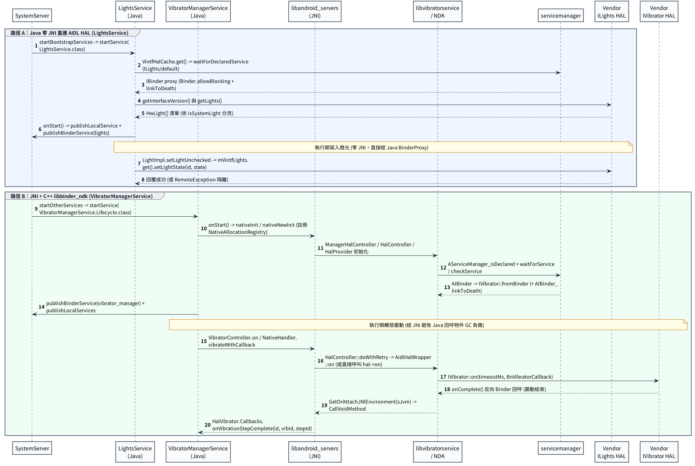

# 2.4 系統服務層存取 AIDL HAL：Java 直連與 JNI 雙路徑

- **情景說明**：開機階段 `SystemServer` 啟動管理底層硬體的系統服務，並在系統服務內連線至位於獨立 Vendor 行程的 Stable AIDL HAL，對內與對外發佈服務介面。本節並排追蹤現代 Android 17 的兩條標準路徑：**路徑 A（Java 零 JNI 直連）**——以 `LightsService` 透過 `VintfHalCache` 直連 `ILights` AIDL HAL 並暴露 `ILightsManager`；以及 **路徑 B（JNI + C++ `libbinder_ndk`）**——以 `VibratorManagerService` 經由 `onload.cpp`、`com_android_server_vibrator_VibratorController.cpp` 與 `com_android_server_vibrator_VibratorManagerService.cpp`，透過 `libvibratorservice`（`VibratorManagerHalController` / `VibratorHalController` / `AidlHalWrapper`）與 NDK `HalProvider` 連線至 `IVibratorManager` / `IVibrator` AIDL HAL，最後歸納兩條路徑的工程取捨。
- **對應原書**：第 2 章 2.4 節〈开发 Android 硬件访问服务〉（p.46–52，含 2.4.1 p.46–47、2.4.2 p.47–48、2.4.3 p.48–51、2.4.4 p.51–52）
- **涉及專案與版本基準**：
  - `platform/frameworks/base` 〔`android-17.0.0_r1`，commit `94b4c163`〕
  - `platform/frameworks/native` 〔`android-17.0.0_r1`，commit `ae266dc`〕

---

## 2.4.1 `SystemServer` 啟動硬體系統服務與雙重發佈模型

> 對應原書 2.4.4〈启动硬件访问服务〉（p.51–52）。原書 Android 2.3 的系統服務都在 `SystemServer.java` 的 `ServerThread::run()` 裡手動 `new FregService()` 並直接呼叫 `ServiceManager.addService("freg", ...)`。到了 Android 17，`SystemServer` 將啟動流程劃分為 `startBootstrapServices`、`startCoreServices`、`startOtherServices` 等階段，統一由 `SystemServiceManager.startService(...)` 透過反射建立 `SystemService` 子類、驅動 `onStart()` 與 `onBootPhase()`，而且大多數硬體系統服務都同時發佈**同行程本地服務（`publishLocalService`）**與**跨行程 Binder 服務（`publishBinderService`）**。

### Step 1：`SystemServer` 分階段啟動 `LightsService` 與 `VibratorManagerService`
**位置**：`platform/frameworks/base/services/java/com/android/server/SystemServer.java` 〔`android-17.0.0_r1`，lines 1192–1193, 1335–1338, 1349–1356, 1550–1552, 1709–1713〕

```java
    private void startBootstrapServices(@NonNull TimingsTraceAndSlog t) {
        t.traceBegin("startBootstrapServices");
...
        // Manages LEDs and display backlight so we need it to bring up the display.
        t.traceBegin("StartLightsService");
        mSystemServiceManager.startService(LightsService.class);
        t.traceEnd();
...
        // Display manager is needed to provide display metrics before package manager
        // starts up.
        t.traceBegin("StartDisplayManager");
        mDisplayManagerService = mSystemServiceManager.startService(DisplayManagerService.class);
        t.traceEnd();

        // We need the default display before we can initialize the package manager.
        t.traceBegin("WaitForDisplay");
        mSystemServiceManager.startBootPhase(t, SystemService.PHASE_WAIT_FOR_DEFAULT_DISPLAY);
        t.traceEnd();
...
    private void startOtherServices(@NonNull TimingsTraceAndSlog t) {
        t.traceBegin("startOtherServices");
        mSystemServiceManager.updateOtherServicesStartIndex();
...
            if (!isTv) {
                t.traceBegin("StartVibratorManagerService");
                mSystemServiceManager.startService(VibratorManagerService.Lifecycle.class);
                t.traceEnd();
            }
```

`SystemServer` 針對兩種硬體服務安排了不同的啟動時機與生命週期型態：
1. **啟動依賴排序**：`LightsService` 放在 `startBootstrapServices`、緊接在 `DisplayManagerService` 與 `PHASE_WAIT_FOR_DEFAULT_DISPLAY` 之前，因為螢幕背光（`LightType.BACKLIGHT`）是點亮預設顯示器的前置依賴；而 `VibratorManagerService` 沒有早期開機硬依賴（且 TV 裝置通常無震動馬達，直接以 `if (!isTv)` 跳過），因此放在較晚的 `startOtherServices`。
2. **`SystemService` 直接繼承 vs `Lifecycle` 外殼**：`LightsService` 本身直接繼承 `SystemService`（因為對外 Binder 服務另外交由內部類 `LightsManagerBinderService` 繼承 `ILightsManager.Stub`）；而 `VibratorManagerService` 本體直接繼承 `IVibratorManagerService.Stub`，受 Java 單繼承限制，遂以靜態內部類 `VibratorManagerService.Lifecycle extends SystemService` 承接 `SystemServiceManager` 的生命週期回呼。
3. **`SystemServiceManager.startService` 集中管理**：取代逐一裸呼叫 `ServiceManager.addService`，`SystemServiceManager` 統一以反射呼叫建構子 `(Context)`、記錄到服務清單、觸發 `onStart()`，並在後續各開機里程碑派發 `onBootPhase(phase)`。

> 〔與 2.3 差異〕**邏輯改變**：2.3 在 `SystemServer.java` 的 `ServerThread::run()` 內單一線性執行 `ServiceManager.addService("freg", new FregService())`（原書 2.4.4，p.51–52）；17 改由 `SystemServiceManager` 驅動 `startBootstrapServices` / `startOtherServices` 與 `SystemService` 生命週期階段。

---

### Step 2：雙重發佈模型——`publishLocalService` 與 `publishBinderService`
**位置**：
- `platform/frameworks/base/services/core/java/com/android/server/lights/LightsService.java` 〔`android-17.0.0_r1`，lines 930–958〕
- `platform/frameworks/base/services/core/java/com/android/server/vibrator/VibratorManagerService.java` 〔`android-17.0.0_r1`，lines 145–165, 398–404〕

```java
    @Override
    public void onStart() {
        publishLocalService(LightsManager.class, mService);
        publishBinderService(Context.LIGHTS_SERVICE, mManagerService);
    }

    @Override
    public void onBootPhase(int phase) {
    }
...
    private final LightsManager mService = new LightsManager() {
        @Override
        public LogicalLight getLight(int lightType) {
            return mLightsByType.get(lightType);
        }

        @Override
        public void setMutedState(boolean muted) {
            LightsService.this.setMutedState(muted);
        }
    };
```

對照 `VibratorManagerService.Lifecycle` 的啟動與兩階段初始化：

```java
    public static class Lifecycle extends SystemService {
        private VibratorManagerService mService;

        public Lifecycle(Context context) {
            super(context);
        }

        @Override
        public void onStart() {
            mService = new VibratorManagerService(getContext(), new Injector());
            publishBinderService(Context.VIBRATOR_MANAGER_SERVICE, mService);
            mService.publishLocalServices();
        }

        @Override
        public void onBootPhase(int phase) {
            if (phase == SystemService.PHASE_SYSTEM_SERVICES_READY) {
                mService.systemReady();
            }
        }
    }
...
    /** Publishes the local service. Separated for testability. */
    @VisibleForTesting
    void publishLocalServices() {
        if (Flags.enableTrustedCallers()) {
            LocalServices.addService(VibratorManagerInternal.class, mInternalService);
        }
    }
```

Android 17 硬體系統服務對上層呼叫端嚴格切分兩條通道：
1. **同行程本地服務（`publishLocalService` / `LocalServices.addService`）**：註冊在 `system_server` 行程私有的靜態表（`LocalServices`）內，不經 Binder 驅動、無 Parcel 序列化與權限檢查負擔，且**對行程外完全不可見**。以 `LightsService` 為例，它發佈 `com.android.server.lights.LightsManager` 讓同行程的 `DisplayManagerService`、`PowerManagerService`、`NotificationManagerService` 透過 `getLight(LightType.BACKLIGHT)` 取得 `LogicalLight` 控制系統專屬燈具。
2. **跨行程 Binder 服務（`publishBinderService`）**：底層呼叫 `ServiceManager.addService(...)` 把 `IBinder` 實作註冊進 `servicemanager`（`Context.LIGHTS_SERVICE` 對應 `LightsManagerBinderService`，`Context.VIBRATOR_MANAGER_SERVICE` 對應 `VibratorManagerService`），暴露給外部 App 與其他系統行程，並由服務端強制執行權限、Session 與參數隔離。
3. **`onBootPhase` 延遲就緒**：像 `VibratorManagerService.Lifecycle` 在 `onStart()` 先完成建構與註冊，等到 `SystemService.PHASE_SYSTEM_SERVICES_READY` 才執行 `mService.systemReady()`，在所有相依服務與 HAL 都更穩定後完成二次初始化（包含重試先前失敗的 `getInfo` 查詢）。

> 〔與 2.3 差異〕**新增**：2.3 的 `FregService` 僅以 `ServiceManager.addService("freg", ...)` 暴露單一跨行程 Binder 介面，沒有 `LocalServices` 行程內外隔離，也沒有 `onStart` / `onBootPhase` 兩階段初始化（原書 2.4.2 與 2.4.4，p.47–48、p.51–52）。

---

## 2.4.2 路徑 A：Java 零 JNI 直連 AIDL HAL（`LightsService`）

> 對應原書 2.4.1–2.4.2（p.46–48）。原書在 2.4 節開頭明確寫道：「由於硬體抽象層模組是使用 C++ 語言開發的，而應用程式框架層中的硬體存取服務是使用 Java 語言開發的，因此硬體存取服務**必須**透過 JNI 來呼叫硬體抽象層模組的介面」（原書 p.46）。在 Android 17 的 Stable AIDL HAL 架構下，這個技術前提已徹底翻轉：AIDL 編譯器為同一個 `@VintfStability` 介面同時產出 C++ NDK、Rust 與 **Java** 綁定碼，使 `LightsService` 能從 Java 端**零 JNI** 直接透過 Binder 呼叫獨立行程的 `ILights` Vendor HAL（例如 2.3 節分析的 Rust `android.hardware.lights-service`）。

### Step 3：定義框架對外服務介面 `ILightsManager.aidl` 與宣告式權限檢查
**位置**：`platform/frameworks/base/core/java/android/hardware/lights/ILightsManager.aidl` 〔`android-17.0.0_r1`，lines 17–50〕

```java
package android.hardware.lights;

import android.hardware.lights.ColorSequence;
import android.hardware.lights.Light;
import android.hardware.lights.LightState;
import android.hardware.lights.MultiLightEffect;

/**
 * API to lights manager service.
 *
 * @hide
 */
interface ILightsManager {
  @EnforcePermission("CONTROL_DEVICE_LIGHTS")
  List<Light> getLights();

  @EnforcePermission("CONTROL_DEVICE_LIGHTS")
  LightState getLightState(int lightId);

  @EnforcePermission("CONTROL_DEVICE_LIGHTS")
  void openSession(in IBinder sessionToken, in int priority);

  @EnforcePermission("CONTROL_DEVICE_LIGHTS")
  void closeSession(in IBinder sessionToken);

  @EnforcePermission("CONTROL_DEVICE_LIGHTS")
  void setLightStates(in IBinder sessionToken, in int[] lightIds, in LightState[] states);

  @EnforcePermission("CONTROL_DEVICE_LIGHTS")
  void setLightEffect(in IBinder sessionToken, in MultiLightEffect effect);

  @EnforcePermission("CONTROL_DEVICE_LIGHTS")
  ColorSequence getLightSequence(in int lightId);
}
```

這份 AIDL 與 2.3 節的 `android.hardware.light.ILights` 形成清晰的**上下雙層 AIDL 邊界**：
1. **命名與責任分離**：對下的 `android.hardware.light.ILights`（單數 `light`，標註 `@VintfStability`）定義 System 與 Vendor 分區之間的硬體抽象契約；對上的 `android.hardware.lights.ILightsManager`（複數 `lights`，框架內部 AIDL）則面向 App/Framework，多出了 `openSession` / `closeSession` 的 `IBinder sessionToken` 生命週期綁定、`priority` 優先權仲裁與高階動畫效果（`MultiLightEffect`）。
2. **`@EnforcePermission` 編譯期權限防護**：AIDL 編譯器為每個標註 `@EnforcePermission("CONTROL_DEVICE_LIGHTS")` 的方法，自動在 `ILightsManager.Stub` 產生 `<method>_enforcePermission()`，並在執行期透過 `PermissionEnforcer` 驗證呼叫端是否具備權限（同時搭配靜態分析強制實作類別呼叫該檢查方法），避免忘記做權限驗證。

> 〔與 2.3 差異〕**邏輯改變**：2.3 的 `IFregService.aidl` 放在 `frameworks/base/core/java/android/os/` 且沒有權限註解與 Session 設計，需手動修改 `Android.mk` 的 `LOCAL_SRC_FILES`（原書 2.4.1，p.46–47）；17 改由 Soong `Android.bp` 自動建置，並在 AIDL 層引入 `@EnforcePermission` 與基於 `IBinder` token 的 Session 模型。

---

### Step 4：`VintfHalCache`——Java 端發現、直連與 `linkToDeath` 自動重連 `ILights`
**位置**：`platform/frameworks/base/services/core/java/com/android/server/lights/LightsService.java` 〔`android-17.0.0_r1`，lines 888–900, 965–990〕

```java
    public LightsService(Context context) {
        this(context, new VintfHalCache(), Looper.myLooper());
    }

    @VisibleForTesting
    LightsService(Context context, Supplier<ILights> service, Looper looper) {
        super(context);
        mH = new Handler(looper);
        mVintfLights = service.get() != null ? service : null;

        populateAvailableLights(context);
        mManagerService = new LightsManagerBinderService();
    }
```

實際負責向 `servicemanager` 連線並快取 `ILights` 代理的是靜態內部類別 `VintfHalCache`：

```java
    private static class VintfHalCache implements Supplier<ILights>, IBinder.DeathRecipient {
        @GuardedBy("this")
        private ILights mInstance = null;

        @Override
        public synchronized ILights get() {
            if (mInstance == null) {
                IBinder binder = Binder.allowBlocking(
                        ServiceManager.waitForDeclaredService(ILights.DESCRIPTOR + "/default"));
                if (binder != null) {
                    mInstance = ILights.Stub.asInterface(binder);
                    try {
                        binder.linkToDeath(this, 0);
                    } catch (RemoteException e) {
                        Slog.e(TAG, "Unable to register DeathRecipient for " + mInstance);
                    }
                }
            }
            return mInstance;
        }

        @Override
        public synchronized void binderDied() {
            mInstance = null;
        }
    }
```

短短 25 行的 `VintfHalCache` 構成了現代 Java 系統服務直連 AIDL HAL 的標準範本，四個細節缺一不可：
1. **`ServiceManager.waitForDeclaredService(ILights.DESCRIPTOR + "/default")`**：先核對裝置 VINTF manifest 是否宣告了 `android.hardware.light.ILights/default`。若有宣告但 HAL 行程尚未就緒，會阻塞等待直到 HAL 呼叫 `addService`（見 2.3 節）；若裝置根本沒有宣告此 HAL，則**立即回傳 `null`**，避免開機卡死。建構子透過 `service.get() != null ? service : null` 首次觸發連線，確認裝置是否具備 `ILights` HAL。
2. **`Binder.allowBlocking(...)`**：`system_server` 預設對 Binder 執行緒套用阻塞呼叫檢查，提醒開發者避免在處理跨行程請求時再同步呼叫外部行程。由於呼叫硬體 HAL 是必要且受控的同步交易，必須以 `Binder.allowBlocking` 標記此 `BinderProxy` 允許阻塞呼叫。
3. **`ILights.Stub.asInterface(binder)` 零 JNI 橋接**：將 `IBinder` 轉型為 AIDL 編譯器生成的 Java 代理 `android.hardware.light.ILights.Stub.Proxy`。此後每次呼叫 `getLights()`、`setLightState()` 都直接由 Java `Parcel` 打包後經 `BinderProxy.transact` 進入核心 Binder 驅動，再分派到 Vendor HAL 行程——整個路徑完全不需編寫任何自訂 JNI 程式碼。
4. **`binder.linkToDeath(this, 0)` 與自動重連**：因為 HAL 獨立於 Vendor 行程，一旦驅動異常導致 HAL 行程崩潰並被 `init` 重啟，原本的 `BpBinder` 就會失效。註冊 `DeathRecipient` 後，Binder 驅動會在對端死亡時觸發 `binderDied()` 將 `mInstance` 清為 `null`；下一次業務層呼叫 `mVintfLights.get()` 時，便自動重走 `waitForDeclaredService` 連上重啟後的新 HAL 實例，整個快取由 `synchronized` 保證執行緒安全。
5. **依賴注入可測試性**：`LightsService` 透過 `Supplier<ILights>` 介面接收 `VintfHalCache`，使單元測試能直接傳入 mock `Supplier<ILights>`，無需啟動真實 HAL。

> 〔與 2.3 差異〕**全面重寫**：2.3 的 `FregService` 建構子呼叫 `init_native()` → JNI `hw_get_module` + `open` 在同行程開啟裝置並保存 32-bit 指標 `mPtr`（原書 2.4.2–2.4.3，p.47–50），既沒有跨行程隔離也沒有 HAL 崩潰重連機制；17 以純 Java 的 `VintfHalCache` + `waitForDeclaredService` + `linkToDeath` 徹底取代。

---

### Step 5：開機枚舉硬體燈具與 Stable AIDL 版本協商（`populateAvailableLightsFromHal`）
**位置**：`platform/frameworks/base/services/core/java/com/android/server/lights/LightsService.java` 〔`android-17.0.0_r1`，lines 805–825, 902–928〕

```java
    private void populateAvailableLights(Context context) {
        if (mVintfLights != null) {
            populateAvailableLightsFromHal(context);
        } else {
            Slog.e(TAG, "Failed to populate available lights, no ILights HAL service available");
        }

        for (int i = mLightsById.size() - 1; i >= 0; i--) {
            LightImpl light = mLightsById.valueAt(i);
            if (light.isSystemLight()) {
                mLightsByType.append(light.mHwLight.type, light);
            }
        }
    }

    private void populateAvailableLightsFromHal(Context context) {
        try {
            mSupportsEffects =
                Flags.enableLightAnimations() && mVintfLights.get().getInterfaceVersion() >= 3;

            for (HwLight hwLight : mVintfLights.get().getLights()) {
                mLightsById.put(hwLight.id, new LightImpl(context, hwLight));
            }
        } catch (RemoteException ex) {
            Slog.e(TAG, "Unable to get lights from HAL", ex);
        }
    }
```

其中判斷系統專用燈與外部可控制燈具的分類函式 `isSystemLight()` 如下：

```java
        private boolean isSystemLight() {
            // This list of lights is based on the list of lights from the HAL, which only
            // contains system lights.
            //
            // Newly-added public lights are made available via the public LightsManager API and
            // new system-only lights are filtered here, through constants from the latest HAL API.
            switch(mHwLight.type) {
                case  LightType.BACKLIGHT:
                case  LightType.KEYBOARD:
                case  LightType.BUTTONS:
                case  LightType.BATTERY:
                case  LightType.NOTIFICATIONS:
                case  LightType.ATTENTION:
                case  LightType.BLUETOOTH:
                case  LightType.WIFI:
                case LightType.PRIORITY_NOTIFICATIONS:
                    return true;
                default:
                    return false;
            }
        }
```

初始化階段完成兩項關鍵治理：
1. **跨分區版本協商（`getInterfaceVersion() >= 3`）**：由於 System 分區可能獨立於 Vendor 分區升級（Treble / GSI），Android 17 系統服務不能假設 Vendor 一定實作了最新版 `ILights` v3。`getInterfaceVersion()` 是 Stable AIDL 自動生成的內建遠端交易，查詢對端編譯時凍結的介面版本；只有當 feature flag `Flags.enableLightAnimations()` 開啟**且**對端版本 `>= 3` 時，才把 `mSupportsEffects` 設為 `true` 以啟用 `setLightEffects` 動畫 API。
2. **雙索引分流隔離系統燈具**：`getLights()` 透過一次跨行程呼叫取得所有 `HwLight` 描述子，全數建立 `LightImpl` 並依 `hwLight.id` 放進 `mLightsById`。接著再篩出 `isSystemLight() == true` 的項目（螢幕背光、鍵盤、按鍵、電池、通知等）放入 `mLightsByType`，僅供同行程的 `LocalServices`（`LightsManager.getLight(type)`）存取；對外暴露給 App 的 `ILightsManager` 則嚴格過濾 `!isSystemLight()`，防止外部程式透過 `LightsManager` 干擾螢幕背光或系統狀態燈。

> 〔與 2.3 差異〕**新增**：2.3 假設單一靜態裝置（如 `freg`）且系統與驅動同步編譯，無動態枚舉裝置清單、版本協商（`getInterfaceVersion`）或系統/應用燈具權限分流（原書 2.4.2，p.47–48）。

---

### Step 6：對外服務樁（`LightsManagerBinderService`）與下發硬體狀態（`LightImpl`）
**位置**：`platform/frameworks/base/services/core/java/com/android/server/lights/LightsService.java` 〔`android-17.0.0_r1`，lines 90–92, 105–132, 162–179, 239–264, 746–795〕

先看對外承接 Binder 請求的 `LightsManagerBinderService`：

```java
    private final class LightsManagerBinderService extends ILightsManager.Stub
          implements IBinder.DeathRecipient {
...
        @GuardedBy("LightsService.this")
        private final List<Session> mSessions = new ArrayList<>();

        LightsManagerBinderService() {
            super(PermissionEnforcer.fromContext(getContext()));
        }

        /** @see #binderDied(IBinder) */
        @Override
        public void binderDied() {}

        /**
         * Callback for sessions which died without explicitly closing.
         */
        @Override
        public void binderDied(IBinder token) {
            closeSessionInternal(token);
        }

        /**
         * Returns the lights available for apps to control on the device. Only lights that aren't
         * reserved for system use are available to apps.
         */
        @android.annotation.EnforcePermission(android.Manifest.permission.CONTROL_DEVICE_LIGHTS)
        @Override
        public List<Light> getLights() {
            getLights_enforcePermission();
...
        @android.annotation.EnforcePermission(android.Manifest.permission.CONTROL_DEVICE_LIGHTS)
        @Override
        public void setLightStates(IBinder token, int[] lightIds, LightState[] lightStates) {
            setLightStates_enforcePermission();
            Preconditions.checkState(lightIds.length == lightStates.length);

            synchronized (LightsService.this) {
                Session session = getSessionLocked(Preconditions.checkNotNull(token));
                Preconditions.checkState(session != null, "not registered");

                checkRequestIsValid(lightIds);

                for (int i = 0; i < lightIds.length; i++) {
                    session.setRequest(lightIds[i], lightStates[i]);
                }
                computeAndApplyLightConfigurationsLocked();
            }
        }
...
        @android.annotation.EnforcePermission(android.Manifest.permission.CONTROL_DEVICE_LIGHTS)
        @Override
        public void openSession(IBinder token, int priority) {
            openSession_enforcePermission();
            Preconditions.checkNotNull(token);

            synchronized (LightsService.this) {
                Preconditions.checkState(getSessionLocked(token) == null, "already registered");
                try {
                    token.linkToDeath(LightsManagerBinderService.this, 0);
                    mSessions.add(new Session(token, priority, mSessionListener, mH));
                    Collections.sort(mSessions);
                } catch (RemoteException e) {
                    Slog.e(TAG, "Couldn't open session, client already died" , e);
                    throw new IllegalArgumentException("Client is already dead.");
                }
            }
        }

        @android.annotation.EnforcePermission(android.Manifest.permission.CONTROL_DEVICE_LIGHTS)
        @Override
        public void closeSession(IBinder token) {
            closeSession_enforcePermission();
            Preconditions.checkNotNull(token);
            closeSessionInternal(token);
        }
```

不論是來自 `LightsManagerBinderService` 仲裁後的 `light.setColor(...)` / `light.turnOff()`，或是來自同行程 `DisplayManagerService` 呼叫的 `light.setBrightness(...)`，最終都會匯流至 `LightImpl::setLightLocked` 與 `setLightUnchecked`：

```java
        private void setLightLocked(int color, int mode, int onMS, int offMS, int brightnessMode) {
            if (shouldBeInLowPersistenceMode()) {
                brightnessMode = BRIGHTNESS_MODE_LOW_PERSISTENCE;
            } else if (brightnessMode == BRIGHTNESS_MODE_LOW_PERSISTENCE) {
                brightnessMode = mLastBrightnessMode;
            }

            if (!mInitialized || color != mColor || mode != mMode || onMS != mOnMS ||
                    offMS != mOffMS || mBrightnessMode != brightnessMode) {
                if (DEBUG) {
                    Slog.v(TAG, "setLight #" + mHwLight.id + ": color=#"
                            + Integer.toHexString(color) + ": brightnessMode=" + brightnessMode);
                }
                mInitialized = true;
                mLastColor = mColor;
                mColor = color;
                mMode = mode;
                mOnMS = onMS;
                mOffMS = offMS;
                mBrightnessMode = brightnessMode;

                // Only send the new configuration if the light is not muted.
                if (!mMuted) {
                    setLightUnchecked(color, mode, onMS, offMS, brightnessMode);
                }
            }
        }

        private void setLightUnchecked(int color, int mode, int onMS, int offMS,
                int brightnessMode) {
            Trace.traceBegin(Trace.TRACE_TAG_POWER, "setLightState(" + mHwLight.id + ", 0x"
                    + Integer.toHexString(color) + ")");
            try {
                if (mVintfLights != null) {
                    HwLightState lightState = new HwLightState();
                    lightState.color = color;
                    lightState.flashMode = (byte) mode;
                    lightState.flashOnMs = onMS;
                    lightState.flashOffMs = offMS;
                    lightState.brightnessMode = (byte) brightnessMode;
                    mVintfLights.get().setLightState(mHwLight.id, lightState);
                } else {
                    Slog.e(TAG, "Failed issuing setLightState, no ILights HAL service available");
                }
            } catch (RemoteException | UnsupportedOperationException ex) {
                Slog.e(TAG, "Failed issuing setLightState", ex);
            } finally {
                Trace.traceEnd(Trace.TRACE_TAG_POWER);
            }
        }
```

整條路徑 A 的資料流與安全邊界到此完全閉環：
1. **雙向死亡監聽**：`LightsService` 內部同時存在兩套 `IBinder.DeathRecipient`——對下（`VintfHalCache`）監聽 Vendor HAL 行程死亡以便自動重連；對上（`LightsManagerBinderService`）在 `openSession` 對客戶端傳入的 `token` 呼叫 `token.linkToDeath(this, 0)`，一旦 App 異常崩潰未呼叫 `closeSession`，`binderDied(IBinder token)` 立即回收該 Session 並重算燈具狀態（多 Session 仲裁與客戶端流程見 2.5 節）。
2. **權限注入與去重快取**：`LightsManagerBinderService` 建構子將 `PermissionEnforcer.fromContext(getContext())` 交給父類 `ILightsManager.Stub`，每個方法入口呼叫 `*_enforcePermission()`。進入 `LightImpl::setLightLocked` 後先比對上一次狀態與 `mMuted` 旗標，避免重複發出不必要的跨行程 IPC。
3. **隔離 Vendor 失敗**：`setLightUnchecked` 填寫 `HwLightState` Parcelable 後，直接呼叫 `mVintfLights.get().setLightState(mHwLight.id, lightState)`，並捕捉 `RemoteException | UnsupportedOperationException` 只記 log 而不外拋——即使 Vendor HAL 實作崩潰或回報不支援，也不會拖垮 `system_server`。

> 〔與 2.3 差異〕**邏輯改變**：2.3 的 `FregService::setVal` 僅檢查 `mPtr != 0` 後便直呼 JNI `setVal_native(mPtr, val)` 轉調同行程 `.so`（原書 2.4.2，p.48），HAL 崩潰會直接導致 `system_server` SIGSEGV；17 則整合了 `@EnforcePermission`、客戶端 `linkToDeath`、狀態去重快取與跨行程例外隔離。

---

## 2.4.3 路徑 B：經 JNI + C++ `libbinder_ndk` 存取 AIDL HAL（`VibratorManagerService`）

> 對應原書 2.4.3〈实现硬件访问服务的 JNI 方法〉（p.48–51）。既然 Java 已經能零 JNI 直連 AIDL HAL，為什麼 Android 17 的 `system_server` 裡依然保留多組 JNI 入口？`VibratorManagerService` 是最完整的真實案例：Android 17 同時並存兩條機制——
> 1. **完整 JNI + `libvibratorservice` 軌道**（`!Flags.removeHidlSupport()`）：為相容歷史架構與複用原生 C++ `libvibratorservice`（`VibratorManagerHalController` / `VibratorHalController` / `AidlHalWrapper`），所有 HAL 操作經由 `VibratorController.java` → `com_android_server_vibrator_VibratorController.cpp` 下發；
> 2. **Android 17 混合軌道**（`Flags.removeHidlSupport()`）：雖然已把無回呼的簡單操作遷回 Java 直連（`VintfHalVibrator`），卻**刻意保留 JNI + C++ `libbinder_ndk` 通道**（`NativeHandler` → `com_android_server_vibrator_VibratorManagerService.cpp`），專門處理高頻帶 `IVibratorCallback` 的震動呼叫與 `vibrationflinger` 觸覺 PCM 串流。

### Step 7：`libandroid_servers` 啟動期註冊 JNI 方法（`onload.cpp`）
**位置**：`platform/frameworks/base/services/core/jni/onload.cpp` 〔`android-17.0.0_r1`，lines 26–27, 41–42, 77–79, 83–92, 107–108, 144–145〕

```cpp
namespace android {
int register_android_server_BatteryStatsService(JNIEnv* env);
...
int register_android_server_vibrator_VibratorController(JavaVM* vm, JNIEnv* env);
int register_android_server_vibrator_VibratorManagerService(JavaVM* vm, JNIEnv* env);
...
// Note: Consider adding new JNI entrypoints for optional services to
// LazyJniRegistrar instead, and relying on lazy registration.
};
...
extern "C" jint JNI_OnLoad(JavaVM* vm, void* /* reserved */)
{
    JNIEnv* env = NULL;
    jint result = -1;

    if (vm->GetEnv((void**) &env, JNI_VERSION_1_4) != JNI_OK) {
        ALOGE("GetEnv failed!");
        return result;
    }
    ALOG_ASSERT(env, "Could not retrieve the env!");
...
    register_android_server_vibrator_VibratorController(vm, env);
    register_android_server_vibrator_VibratorManagerService(vm, env);
...
    return JNI_VERSION_1_4;
}
```

與原書 2.3 的 `onload.cpp` 相比，這段看似相似的註冊骨架藏著三個現代重點：
1. **明確傳入 `JavaVM* vm`**：震動 HAL 具備非同步完成回呼（`IVibratorCallback::onComplete`），該回呼是由 Vendor HAL 透過 Binder 反向呼叫進 `system_server` 的 **C++ NDK Binder 執行緒**觸發的，該執行緒未必已附加到 ART；因此註冊函式必須保存全域 `JavaVM* sJvm`，待回呼發生時再透過 `GetOrAttachJNIEnvironment(sJvm)` 取得有效的 `JNIEnv*`。
2. **`LightsService` 已徹底從 `onload.cpp` 消失**：在 `onload.cpp` 全檔中完全找不到任何 `LightsService` 的註冊呼叫，直接印證路徑 A 的純 Java 化。
3. **延遲註冊趨勢（`LazyJniRegistrar`）**：註解明確建議可選服務不要在開機時全部塞進 `JNI_OnLoad`，改用 `LazyJniRegistrar` 按需註冊以縮短 `system_server` 冷啟動時間。

> 〔與 2.3 差異〕**改名搬家 + 邏輯改變**：檔案路徑由 `frameworks/base/services/jni/onload.cpp` 移至 `frameworks/base/services/core/jni/onload.cpp`（原書 2.4.3，p.50–51）；註冊骨架保留，但多數支援原生回呼的服務需傳入 `JavaVM*`，並引入 `LazyJniRegistrar`。

---

### Step 8：Java 服務的雙軌分派、`NativeAllocationRegistry` 與刻意保留的回呼 JNI
**位置**：
- `platform/frameworks/base/services/core/java/com/android/server/vibrator/VibratorManagerService.java` 〔`android-17.0.0_r1`，lines 345–350, 1926–1932, 2370–2393, 2508–2528, 2638–2675〕
- `platform/frameworks/base/services/core/java/com/android/server/vibrator/VibratorController.java` 〔`android-17.0.0_r1`，lines 235–249, 406–429, 453–476〕
- `platform/frameworks/base/services/core/java/com/android/server/vibrator/VintfHalVibrator.java` 〔`android-17.0.0_r1`，lines 305–336〕

首先看 `VibratorManagerService` 建構子如何依 feature flag 分派兩條軌道：

```java
        HalListener halListener = new HalListener(this);
        mVibratorManager = Flags.removeHidlSupport()
                ? injector.createHalVibratorManager(mHandler)
                : injector.createNativeHalVibratorManager();
        mVibratorManager.init(halListener, halListener);
...
        HalVibratorManager createHalVibratorManager(Handler handler) {
            return VintfHalVibratorManager.createHalVibratorManager(handler, new NativeHandler());
        }

        HalVibratorManager createNativeHalVibratorManager() {
            return new NativeHalVibratorManager(new NativeWrapper());
        }
```

在完整 JNI 軌道下，`NativeHalVibratorManager` 與 `NativeWrapper` 初始化原生管理器並為每顆馬達建立 `VibratorController`：

```java
        @Override
        public void init(@NonNull Callbacks cb, @NonNull HalVibrator.Callbacks vibratorCb) {
            mNativeWrapper.init(cb);

            // Load vibrator hardware info. The vibrator ids and manager capabilities are loaded
            // once and assumed unchanged for the lifecycle of this service. Each vibrator can still
            // retry loading each individual vibrator hardware spec once more at systemReady.
            mCapabilities = mNativeWrapper.getCapabilities();
            // Keep original vibrator id order, which might be meaningful.
            int[] vibratorIds = mNativeWrapper.getVibratorIds();
            if (vibratorIds != null) {
                mVibratorIds = vibratorIds;
                for (int id : vibratorIds) {
                    HalVibrator vibrator = mNativeWrapper.createVibrator(id);
                    vibrator.init(vibratorCb);
                    mVibrators.put(id, vibrator);
                }
            }

            // Reset the hardware to a default state.
            // In case this is a runtime restart instead of a fresh boot.
            cancelSynced();
            mNativeWrapper.clearSessions();
        }
...
    public static class NativeWrapper {

        private long mNativeServicePtr = 0;

        /** Create the {@link HalVibrator} instance for given vibrator ID. */
        public HalVibrator createVibrator(int vibratorId) {
            return new VibratorController(vibratorId);
        }

        /** Returns native pointer to newly created controller and connects with HAL service. */
        public void init(HalVibratorManager.Callbacks callback) {
            mNativeServicePtr = nativeInit(callback);
            long finalizerPtr = nativeGetFinalizer();

            if (finalizerPtr != 0) {
                NativeAllocationRegistry registry =
                        NativeAllocationRegistry.createMalloced(
                                VibratorManagerService.class.getClassLoader(), finalizerPtr);
                registry.registerNativeAllocation(this, mNativeServicePtr);
            }
        }
```

每顆馬達對應的 `VibratorController` 透過內部 `NativeWrapper` 綁定 64-bit 原生指標並轉發 `on(...)`：

```java
    @Override
    public long on(long vibrationId, long stepId, long milliseconds) {
        Trace.traceBegin(TRACE_TAG_VIBRATOR, "HalVibrator.onMillis");
        try {
            synchronized (mLock) {
                long duration = mNativeWrapper.on(milliseconds, vibrationId, stepId);
                if (duration > 0) {
                    updateStateAndNotifyListenersLocked(State.VIBRATING);
                }
                return duration;
            }
        } finally {
            Trace.traceEnd(TRACE_TAG_VIBRATOR);
        }
    }
...
    public static class NativeWrapper {
...
        private static native long nativeInit(int vibratorId, Callbacks callbacks);

        /**
         * Returns pointer to native function responsible for cleaning up the native pointer
         * allocated and returned by {@link #nativeInit(int, Callbacks)}.
         */
        private static native long getNativeFinalizer();

        private static native long on(long nativePtr, long milliseconds, long vibrationId,
                long stepId);

        private static native void off(long nativePtr);
...
        private long mNativePtr = 0;

        /** Initializes native controller and allocation registry to destroy native instances. */
        public void init(int vibratorId, Callbacks callbacks) {
            mNativePtr = nativeInit(vibratorId, callbacks);
            long finalizerPtr = getNativeFinalizer();

            if (finalizerPtr != 0) {
                NativeAllocationRegistry registry =
                        NativeAllocationRegistry.createMalloced(
                                VibratorController.class.getClassLoader(), finalizerPtr);
                registry.registerNativeAllocation(this, mNativePtr);
            }
        }

        /** Turns vibrator on for given time. */
        public long on(long milliseconds, long vibrationId, long stepId) {
            return on(mNativePtr, milliseconds, vibrationId, stepId);
        }

        /** Turns vibrator off. */
        public void off() {
            off(mNativePtr);
        }
```

而在開啟 `Flags.removeHidlSupport()` 的 Android 17 新混合軌道中，觀察 `VintfHalVibrator.java` 與 `VibratorManagerService.NativeHandler` 的實作，更能看清「為何不全面移除 JNI」的官方工程理由：

```java
        @Override
        public long on(long vibrationId, long stepId, long milliseconds) {
            Trace.traceBegin(TRACE_TAG_VIBRATOR, "HalVibrator.onMillis");
            try {
                synchronized (mLock) {
                    int result;
                    if (mVibratorInfo.hasCapability(IVibrator.CAP_ON_CALLBACK)) {
                        // Delegate vibrate with callback to native, to avoid creating a new
                        // callback instance for each call, overloading the GC.
                        result = mNativeHandler.vibrateWithCallback(mVibratorId, vibrationId,
                                stepId, (int) milliseconds);
                    } else {
                        // Vibrate callback not supported, avoid unnecessary JNI round trip and
                        // simulate HAL callback here using a Handler.
                        result = vibrateNoThrow(
                                hal -> hal.on((int) milliseconds, null),
                                (int) milliseconds,
                                e -> logError("Error turning on for " + milliseconds + "ms", e));
                        if (result > 0) {
                            mHandler.postDelayed(newVibrationCallback(vibrationId, stepId),
                                    milliseconds);
                        }
                    }
                    if (result > 0) {
                        updateStateAndNotifyListenersLocked(State.VIBRATING);
                    }
                    return result > 0 ? milliseconds : result;
                }
            } finally {
                Trace.traceEnd(TRACE_TAG_VIBRATOR);
            }
        }
```

其中 `mNativeHandler`（`VibratorManagerService.NativeHandler`）對應如下：

```java
        @Override
        public void init(@NonNull HalVibratorManager.Callbacks managerCallback,
                @NonNull HalVibrator.Callbacks vibratorCallbacks) {
            mManagerCallbacks = managerCallback; // Used from native as a weak global reference
            mVibratorCallbacks = vibratorCallbacks; // Used from native as a weak global reference
            mNativePtr = nativeNewInit(managerCallback, vibratorCallbacks);
            long finalizerPtr = nativeGetFinalizer();

            if (finalizerPtr != 0) {
                NativeAllocationRegistry registry =
                        NativeAllocationRegistry.createMalloced(
                                VibratorManagerService.class.getClassLoader(), finalizerPtr);
                registry.registerNativeAllocation(this, mNativePtr);
            }
        }
...
        @Override
        public int vibrateWithCallback(int vibratorId, long vibrationId, long stepId,
                int durationMs) {
            return nativeVibratorOnWithCallback(mNativePtr, vibratorId, vibrationId, stepId,
                    durationMs);
        }
```

這組 Java 端包裝有兩點值得特別記住：
1. **64-bit `long` 原生指標 + `NativeAllocationRegistry`**：原書 2.3 使用 32-bit `int mPtr` 存放指標且未處理釋放；Android 17 一律以 `long` 承接 64-bit C++ 指標，並透過 `NativeAllocationRegistry.createMalloced(..., finalizerPtr).registerNativeAllocation(this, mNativePtr)` 交由 ART GC 在 Java 物件回收時自動呼叫 C++ `destroyNativeWrapper` / `destroyNativeService`。
2. **精準切分 Java 直連與 JNI**：在 `VintfHalVibrator.on(...)` 的註解裡講得非常直白——當馬達不支援 `CAP_ON_CALLBACK` 時，直接從 Java 呼叫 `hal.on(..., null)` 以省去一次 JNI 往返；但當馬達支援 `CAP_ON_CALLBACK` 時，因為每一次短促按鍵震動都必須傳遞一個新的 `IVibratorCallback` Binder 物件給 HAL，若在 Java 端每次 `new IVibratorCallback.Stub()`，會把大量帶原生 `JavaBBinderHolder` 的短命物件塞給 GC，因此刻意下沉到 `mNativeHandler` 用輕量 C++ `BnVibratorCallback` 處理。

> 〔與 2.3 差異〕**邏輯改變**：2.3 的 `FregService` 直接在服務類別內宣告 `private static native` 並以 32-bit `int mPtr` 保存裸指標（原書 2.4.2，p.47–48）；17 將 JNI 方法封裝在可替換的 `NativeWrapper` / `NativeHandler` 中便於單元測試，並以 `long` + `NativeAllocationRegistry` 管理原生生命週期。

---

### Step 9：JNI 橋接層——`com_android_server_vibrator_VibratorController.cpp` 與 `VibratorManagerService.cpp/.h`
**位置**：
- `platform/frameworks/base/services/core/jni/com_android_server_vibrator_VibratorController.cpp` 〔`android-17.0.0_r1`，lines 67–118, 171–196, 447–471, 521–524〕
- `platform/frameworks/base/services/core/jni/com_android_server_vibrator_VibratorManagerService.h` 〔`android-17.0.0_r1`，lines 67–149, 174–198〕
- `platform/frameworks/base/services/core/jni/com_android_server_vibrator_VibratorManagerService.cpp` 〔`android-17.0.0_r1`，lines 77–106, 478–496, 928–945〕

先追蹤完整 JNI 軌道（`VibratorController` → `libvibratorservice`）：

```cpp
static std::shared_ptr<vibrator::HalController> findVibrator(int32_t vibratorId) {
    vibrator::ManagerHalController* manager =
            android_server_vibrator_VibratorManagerService_getManager();
    if (manager == nullptr) {
        return nullptr;
    }
    auto result = manager->getVibrator(vibratorId);
    return result.isOk() ? result.value() : nullptr;
}

class VibratorControllerWrapper {
public:
    VibratorControllerWrapper(JNIEnv* env, int32_t vibratorId, jobject callbackListener)
          : mHal(findVibrator(vibratorId)),
            mVibratorId(vibratorId),
            mCallbackListener(env->NewGlobalRef(callbackListener)) {
        LOG_ALWAYS_FATAL_IF(mHal == nullptr,
                            "Failed to connect to vibrator HAL, or vibratorId is invalid");
        LOG_ALWAYS_FATAL_IF(mCallbackListener == nullptr,
                            "Unable to create global reference to vibration callback handler");
    }

    ~VibratorControllerWrapper() {
        auto jniEnv = GetOrAttachJNIEnvironment(sJvm);
        jniEnv->DeleteGlobalRef(mCallbackListener);
    }

    int32_t getVibratorId() const { return mVibratorId; }

    vibrator::Info getVibratorInfo() { return mHal->getInfo(); }

    void initHal() { mHal->init(); }

    template <typename T>
    vibrator::HalResult<T> halCall(const vibrator::HalFunction<vibrator::HalResult<T>>& fn,
                                   const char* functionName) {
        return mHal->doWithRetry(fn, functionName);
    }

    std::function<void()> createCallback(jlong vibrationId, jlong stepId) {
        return [vibrationId, stepId, this]() {
            auto jniEnv = GetOrAttachJNIEnvironment(sJvm);
            jniEnv->CallVoidMethod(mCallbackListener, sMethodIdOnComplete, mVibratorId, vibrationId,
                                   stepId);
        };
    }

private:
    const std::shared_ptr<vibrator::HalController> mHal;
    const int32_t mVibratorId;
    const jobject mCallbackListener;
};
...
static jlong vibratorNativeInit(JNIEnv* env, jclass /* clazz */, jint vibratorId,
                                jobject callbackListener) {
    std::unique_ptr<VibratorControllerWrapper> wrapper =
            std::make_unique<VibratorControllerWrapper>(env, vibratorId, callbackListener);
    wrapper->initHal();
    return reinterpret_cast<jlong>(wrapper.release());
}

static jlong vibratorGetNativeFinalizer(JNIEnv* /* env */, jclass /* clazz */) {
    return static_cast<jlong>(reinterpret_cast<uintptr_t>(&destroyNativeWrapper));
}

static jlong vibratorOn(JNIEnv* env, jclass /* clazz */, jlong ptr, jlong timeoutMs,
                        jlong vibrationId, jlong stepId) {
    VibratorControllerWrapper* wrapper = reinterpret_cast<VibratorControllerWrapper*>(ptr);
    if (wrapper == nullptr) {
        ALOGE("vibratorOn failed because native wrapper was not initialized");
        return -1;
    }
    auto callback = wrapper->createCallback(vibrationId, stepId);
    auto onFn = [timeoutMs, &callback](vibrator::HalWrapper* hal) {
        return hal->on(std::chrono::milliseconds(timeoutMs), callback);
    };
    auto result = wrapper->halCall<void>(onFn, "on");
    return result.isOk() ? timeoutMs : (result.isUnsupported() ? 0 : -1);
}
...
static const JNINativeMethod method_table[] = {
        {"nativeInit", "(ILcom/android/server/vibrator/HalVibrator$Callbacks;)J",
         (void*)vibratorNativeInit},
        {"getNativeFinalizer", "()J", (void*)vibratorGetNativeFinalizer},
        {"on", "(JJJJ)J", (void*)vibratorOn},
        {"off", "(J)V", (void*)vibratorOff},
        {"setAmplitude", "(JF)V", (void*)vibratorSetAmplitude},
        {"performEffect", "(JJJJJ)J", (void*)vibratorPerformEffect},
        {"performVendorEffect", "(JLandroid/os/Parcel;JFFJJ)J", (void*)vibratorPerformVendorEffect},
        {"performComposedEffect", "(J[Landroid/os/vibrator/PrimitiveSegment;JJ)J",
         (void*)vibratorPerformComposedEffect},
        {"performPwleV2Effect", "(J[Landroid/os/vibrator/PwlePoint;JJ)J",
         (void*)vibratorPerformPwleV2Effect},
        {"setExternalControl", "(JZ)V", (void*)vibratorSetExternalControl},
        {"alwaysOnEnable", "(JJJJ)V", (void*)vibratorAlwaysOnEnable},
        {"alwaysOnDisable", "(JJ)V", (void*)vibratorAlwaysOnDisable},
        {"getInfo", "(JLandroid/os/VibratorInfo$Builder;)Z", (void*)vibratorGetInfo},
};

int register_android_server_vibrator_VibratorController(JavaVM* jvm, JNIEnv* env) {
    sJvm = jvm;
    auto listenerClassName = "com/android/server/vibrator/HalVibrator$Callbacks";
    jclass listenerClass = FindClassOrDie(env, listenerClassName);
    sMethodIdOnComplete = GetMethodIDOrDie(env, listenerClass, "onVibrationStepComplete", "(IJJ)V");
...
    return jniRegisterNativeMethods(env,
                                    "com/android/server/vibrator/VibratorController$NativeWrapper",
                                    method_table, NELEM(method_table));
}
```

再對照 Android 17 新混合軌道中，直接駐留在 JNI 層使用 `libbinder_ndk`（`AIBinder_linkToDeath` + `AServiceManager_checkService` + `BnVibratorCallback`）的 `HalProvider` 與 `nativeVibratorOnWithCallback`：

```cpp
// Provides default HAL service declared on the device, using link-to-death to reload dead objects.
template <typename I>
class HalProvider {
public:
    HalProvider()
          : mDeathRecipient(AIBinder_DeathRecipient_new(onBinderDied)),
            mIsDeathRecipientLinked(false),
            mHal(nullptr) {
        AIBinder_DeathRecipient_setOnUnlinked(mDeathRecipient.get(), onBinderUnlinked);
    }
    virtual ~HalProvider() {
        // This will unlink all linked binders.
        AIBinder_DeathRecipient_delete(mDeathRecipient.release());
        {
            // Need to wait until onBinderUnlinked is called.
            std::unique_lock lock(mMutex);
            mDeathRecipientCv.wait(lock, [this] { return !mIsDeathRecipientLinked; });
        }
    }

    std::shared_ptr<I> getHal() {
        std::lock_guard<std::mutex> lock(mMutex);
        if (mHal) {
            return mHal;
        }
        mHal = loadHal();
        if (mHal == nullptr) {
            ALOGE("%s: Error connecting to HAL", __func__);
            return mHal;
        }
        auto binder = mHal->asBinder().get();
        if (binder == nullptr) {
            ALOGE("%s: Error getting HAL binder object", __func__);
            return mHal;
        }
        auto status = ndk::ScopedAStatus::fromStatus(
                AIBinder_linkToDeath(binder, mDeathRecipient.get(), this));
        if (status.isOk()) {
            mIsDeathRecipientLinked = true;
        } else {
            ALOGE("%s: Error linking to HAL binder death: %s", __func__,
                  status.getDescription().c_str());
        }
        return mHal;
    }
...
    static void onBinderDied(void* cookie) {
        HalProvider* provider = reinterpret_cast<HalProvider*>(cookie);
        if (provider) {
            ALOGW("%s: resetting HAL", __func__);
            provider->handleBinderDeath();
        } else {
            ALOGE("%s: null cookie", __func__);
        }
    }

    static void onBinderUnlinked(void* cookie) {
        HalProvider* provider = reinterpret_cast<HalProvider*>(cookie);
        if (provider) {
            ALOGW("%s: resetting HAL death recipient", __func__);
            provider->handleBinderUnlinked();
        } else {
            ALOGE("%s: null cookie", __func__);
        }
    }
...
template <typename I>
class DefaultProvider : public HalProvider<I> {
public:
    DefaultProvider() = default;
    virtual ~DefaultProvider() = default;

private:
    std::shared_ptr<I> loadHal() override {
        auto halName = std::string(I::descriptor) + "/default";
        auto hal = I::fromBinder(ndk::SpAIBinder(AServiceManager_checkService(halName.c_str())));
        if (hal == nullptr) {
            ALOGE("%s: Error connecting to %s", halName.c_str(), __func__);
        }
        return hal;
    }
};

// Returns a new provider for the default HAL service declared on the device, null if not declared.
template <typename I>
std::unique_ptr<HalProvider<I>> defaultProviderForDeclaredService() {
    if (AServiceManager_isDeclared((std::string(I::descriptor) + "/default").c_str())) {
        return std::make_unique<DefaultProvider<I>>();
    }
    return nullptr;
}
```

以及 `com_android_server_vibrator_VibratorManagerService.cpp` 中使用 `BnVibratorCallback` 的 `nativeVibratorOnWithCallback`：

```cpp
// IVibratorCallback implementation for HalVibrator.Callbacks.
class VibrationCallback : public BnVibratorCallback {
public:
    VibrationCallback(jweak callback, jint vibratorId, jlong vibrationId, jlong stepId)
          : mCallbackRef(callback),
            mVibratorId(vibratorId),
            mVibrationId(vibrationId),
            mStepId(stepId) {}
    virtual ~VibrationCallback() = default;

    ndk::ScopedAStatus onComplete() override {
        if (DEBUG) {
            ALOGD("%s(%d, %d, %d)", __func__, static_cast<int32_t>(mVibratorId),
                  static_cast<int32_t>(mVibrationId), static_cast<int32_t>(mStepId));
        }
        auto env = GetOrAttachJNIEnvironment(sJvm);
        if (env->IsSameObject(mCallbackRef, NULL)) {
            ALOGE("Null reference to vibrator service callbacks");
            return ndk::ScopedAStatus::fromExceptionCode(EX_ILLEGAL_STATE);
        }
        env->CallVoidMethod(mCallbackRef, sMethodIdOnVibrationComplete, mVibratorId, mVibrationId,
                            mStepId);
        return ndk::ScopedAStatus::ok();
    }

private:
    const jweak mCallbackRef;
    const jint mVibratorId;
    const jlong mVibrationId;
    const jlong mStepId;
};
...
static jint nativeVibratorOnWithCallback(JNIEnv* env, jclass /* clazz */, jlong ptr,
                                         jint vibratorId, jlong vibrationId, jlong stepId,
                                         jint durationMs) {
    if (DEBUG) {
        ALOGD("%s(%d, %d, %d)", __func__, static_cast<int32_t>(vibratorId),
              static_cast<int32_t>(vibrationId), static_cast<int32_t>(stepId));
    }
    auto service = toNativeService(ptr, __func__);
    auto hal = loadVibratorHal(service, static_cast<int32_t>(vibratorId), __func__);
    if (service == nullptr || hal == nullptr) {
        return -1;
    }
    auto callback = ndk::SharedRefBase::make<VibrationCallback>(service->vibratorCallbacks(),
                                                                vibratorId, vibrationId, stepId);
    int32_t millis = static_cast<int32_t>(durationMs);
    auto status = hal->on(millis, callback);
    service->processVibratorStatus(static_cast<int32_t>(vibratorId), status, __func__);
    return vibrationResultFromStatus(status, millis, __func__);
}
...
int register_android_server_vibrator_VibratorManagerService(JavaVM* jvm, JNIEnv* env) {
    sJvm = jvm;
    jclass managerCallbacksClass =
            FindClassOrDie(env, "com/android/server/vibrator/HalVibratorManager$Callbacks");
    jclass vibratorCallbacksClass =
            FindClassOrDie(env, "com/android/server/vibrator/HalVibrator$Callbacks");
    sMethodIdOnSyncedVibrationComplete =
            GetMethodIDOrDie(env, managerCallbacksClass, "onSyncedVibrationComplete", "(J)V");
    sMethodIdOnVibrationSessionComplete =
            GetMethodIDOrDie(env, managerCallbacksClass, "onVibrationSessionComplete", "(J)V");
    sMethodIdOnVibrationComplete =
            GetMethodIDOrDie(env, vibratorCallbacksClass, "onVibrationStepComplete", "(IJJ)V");
    sMethodIdOnHapticGeneratorSessionComplete =
            GetMethodIDOrDie(env, managerCallbacksClass, "onHapticGeneratorSessionComplete",
                             "(J)V");
    return jniRegisterNativeMethods(env, "com/android/server/vibrator/VibratorManagerService",
                                    method_table, NELEM(method_table));
}
```

這層 JNI 程式碼清楚展示了 Android 17 的三大設計技巧：
1. **JNI 角色徹底轉變**：原書 `com_android_server_FregService.cpp` 是在同行程呼叫 `hw_get_module` + `module->methods->open` 載入 `.so`；Android 17 的 JNI 層則是 **`libbinder_ndk` 客戶端膠水層**，既能委派給共用的 C++ 函式庫 `libvibratorservice`（`VibratorControllerWrapper`），也能直接呼叫 `AServiceManager_isDeclared` / `AServiceManager_checkService` / `I::fromBinder` 連向獨立的 Vendor HAL 行程。
2. **NDK `AIBinder_linkToDeath` 與防 use-after-free 解構同步**：`HalProvider<I>` 是 C++ 版的 `VintfHalCache`——呼叫 `AIBinder_linkToDeath(binder, mDeathRecipient.get(), this)` 傳入 `this` 作為 `cookie`，Vendor 崩潰時由 `onBinderDied` 清空 `mHal`。更細膩的是，C++ 物件解構時可能正有另一條 Binder 執行緒準備派發死亡通知，因此建構子註冊了 `AIBinder_DeathRecipient_setOnUnlinked(..., onBinderUnlinked)`，解構子在 `AIBinder_DeathRecipient_delete` 後以 `mDeathRecipientCv.wait(...)` 等待所有引用確實解除才允許釋放 `this`，避免懸空指標。
3. **跨語言資料與回呼橋接**：除透過 `GetOrAttachJNIEnvironment(sJvm)` 把 NDK `BnVibratorCallback::onComplete()` 轉回 Java 的 `HalVibrator$Callbacks.onVibrationStepComplete` 外，同一檔案也善用 `libbinder_ndk` 的 `AParcel_fromJavaParcel`（將 Java `Parcel` 零複製轉為 NDK `AParcel` 讀取 `VendorEffect` / `CompositeEffect`）與 `AIBinder_toJavaBinder`（把 HAL 回傳的 `IVibrationSession` 轉回 Java `IBinder`）。

> 〔與 2.3 差異〕**全面重寫**：2.3 的 `com_android_server_FregService.cpp` 直接依賴 `hardware/hardware.h` 呼叫 `hw_get_module` 並透過函式指標呼叫 `device->set_val` / `device->get_val`（原書 2.4.3，p.48–50）；17 的 JNI 改以 `libbinder_ndk` 跨行程存取 Stable AIDL HAL，並增加 `JavaVM*` 反向回呼與 `AIBinder_DeathRecipient` 生命週期同步。

---

### Step 10：原生 C++ HAL 控制器與自動重試封裝（`libvibratorservice`）
**位置**：
- `platform/frameworks/native/services/vibratorservice/VibratorManagerHalController.cpp` 〔`android-17.0.0_r1`，lines 32–50〕
- `platform/frameworks/native/services/vibratorservice/VibratorHalController.cpp` 〔`android-17.0.0_r1`，lines 42–81〕
- `platform/frameworks/native/services/vibratorservice/include/vibratorservice/VibratorHalController.h` 〔`android-17.0.0_r1`，lines 97–145〕
- `platform/frameworks/native/services/vibratorservice/VibratorHalWrapper.cpp` 〔`android-17.0.0_r1`，lines 244–270〕
- `platform/frameworks/native/services/vibratorservice/include/vibratorservice/VibratorHalWrapper.h` 〔`android-17.0.0_r1`，lines 126–155, 418–435〕

往下進入 `frameworks/native/services/vibratorservice/`。首先看管理器與單馬達的 NDK 服務發現與連線函式：

```cpp
std::shared_ptr<ManagerHalWrapper> connectManagerHal(std::shared_ptr<CallbackScheduler> scheduler) {
    static bool gHalExists = true;
    if (gHalExists) {
        auto serviceName = std::string(IVibratorManager::descriptor) + "/default";
        if (AServiceManager_isDeclared(serviceName.c_str())) {
            std::shared_ptr<IVibratorManager> hal = IVibratorManager::fromBinder(
                    ndk::SpAIBinder(AServiceManager_checkService(serviceName.c_str())));
            if (hal) {
                ALOGV("Successfully connected to VibratorManager HAL AIDL service.");
                return std::make_shared<AidlManagerHalWrapper>(std::move(scheduler),
                                                               std::move(hal));
            }
        }
    }

    ALOGV("VibratorManager HAL service not available.");
    gHalExists = false;
    return std::make_shared<LegacyManagerHalWrapper>();
}
```

若裝置沒有 `IVibratorManager`（例如單馬達裝置直接提供 `IVibrator`），`LegacyManagerHalWrapper` 會委派給 `VibratorHalController.cpp` 的 `connectHal`：

```cpp
std::shared_ptr<HalWrapper> connectHal(std::shared_ptr<CallbackScheduler> scheduler) {
    static bool gHalExists = true;
    if (!gHalExists) {
        // We already tried to connect to all of the vibrator HAL versions and none was available.
        return nullptr;
    }

    auto serviceName = std::string(IVibrator::descriptor) + "/default";
    if (AServiceManager_isDeclared(serviceName.c_str())) {
        std::shared_ptr<IVibrator> hal = IVibrator::fromBinder(
                ndk::SpAIBinder(AServiceManager_waitForService(serviceName.c_str())));
        if (hal) {
            ALOGV("Successfully connected to Vibrator HAL AIDL service.");
            return std::make_shared<AidlHalWrapper>(std::move(scheduler), std::move(hal));
        }
    }

    ALOGV("Vibrator HAL service not available.");
    gHalExists = false;
    return nullptr;
}

// -------------------------------------------------------------------------------------------------

bool HalController::init() {
    std::lock_guard<std::mutex> lock(mConnectedHalMutex);
    if (mConnectedHal == nullptr) {
        mConnectedHal = mConnector(mCallbackScheduler);
    }
    return mConnectedHal != nullptr;
}

void HalController::tryReconnect() {
    std::lock_guard<std::mutex> lock(mConnectedHalMutex);
    if (mConnectedHal == nullptr) {
        mConnectedHal = mConnector(mCallbackScheduler);
    } else {
        mConnectedHal->tryReconnect();
    }
}
```

每一次經由 `VibratorControllerWrapper::halCall` 送出的操作，都會進入 `HalController::doWithRetry` 執行自動重連與重試：

```cpp
    template <typename T>
    HalResult<T> doWithRetry(const HalFunction<HalResult<T>>& halFn, const char* functionName) {
        return doWithRetry<T>(halFn, HalResult<T>::unsupported(), functionName);
    }

private:
    static constexpr int MAX_RETRIES = 1;

    Connector mConnector;
    std::mutex mConnectedHalMutex;
    // Shared pointer to allow local copies to be used by different threads.
    std::shared_ptr<HalWrapper> mConnectedHal GUARDED_BY(mConnectedHalMutex);
    // Shared pointer to allow copies to be passed to possible recreated mConnectedHal instances.
    std::shared_ptr<CallbackScheduler> mCallbackScheduler;

    /* Calls given HAL function, applying automatic retries to reconnect with the HAL when the
     * result has failed. Given default value is returned when no HAL is available, and given
     * function name is for logging purposes.
     */
    template <typename T>
    HalResult<T> doWithRetry(const HalFunction<HalResult<T>>& halFn, HalResult<T> defaultValue,
                             const char* functionName) {
        if (!init()) {
            ALOGV("Skipped %s because Vibrator HAL is not available", functionName);
            return defaultValue;
        }
        std::shared_ptr<HalWrapper> hal;
        {
            std::lock_guard<std::mutex> lock(mConnectedHalMutex);
            hal = mConnectedHal;
        }

        HalResult<T> result = doOnce(hal.get(), halFn, functionName);
        for (int i = 0; i < MAX_RETRIES && result.shouldRetry(); i++) {
            tryReconnect();
            result = doOnce(hal.get(), halFn, functionName);
        }
        return result;
    }

    template <typename T>
    HalResult<T> doOnce(HalWrapper* hal, const HalFunction<HalResult<T>>& halFn,
                        const char* functionName) {
        HalResult<T> result = halFn(hal);
        if (result.isFailed()) {
            ALOGE("Vibrator HAL %s failed: %s", functionName, result.errorMessage());
        }
        return result;
    }
```

最後，實際呼叫 `IVibrator::on` 並處理 `IVibratorCallback` 與斷線重連的 `AidlHalWrapper` 實作於 `VibratorHalWrapper.cpp` 與 `VibratorHalWrapper.h`：

```cpp
    template <typename T>
    static HalResult<T> fromFailedStatus(ndk::ScopedAStatus&& status) {
        if (status.getExceptionCode() == EX_UNSUPPORTED_OPERATION ||
            status.getStatus() == STATUS_UNKNOWN_TRANSACTION) {
            // STATUS_UNKNOWN_TRANSACTION means the HAL implementation is an older version, so this
            // is the same as the operation being unsupported by this HAL. Should not retry.
            return HalResult<T>::unsupported();
        }
        if (status.getExceptionCode() == EX_TRANSACTION_FAILED) {
            return HalResult<T>::transactionFailed(status.getDescription().c_str());
        }
        return HalResult<T>::failed(status.getDescription().c_str());
    }
};

// -------------------------------------------------------------------------------------------------

class HalCallbackWrapper : public aidl::android::hardware::vibrator::BnVibratorCallback {
public:
    HalCallbackWrapper(std::function<void()> completionCallback)
          : mCompletionCallback(completionCallback) {}

    ndk::ScopedAStatus onComplete() override {
        mCompletionCallback();
        return ndk::ScopedAStatus::ok();
    }

private:
    const std::function<void()> mCompletionCallback;
};
...
class AidlHalWrapper : public HalWrapper {
public:
    using IVibrator = aidl::android::hardware::vibrator::IVibrator;
    using reconnect_fn = std::function<HalResult<std::shared_ptr<IVibrator>>()>;

    AidlHalWrapper(
            std::shared_ptr<CallbackScheduler> scheduler, std::shared_ptr<IVibrator> handle,
            reconnect_fn reconnectFn =
                    []() {
                        auto serviceName = std::string(IVibrator::descriptor) + "/default";
                        auto hal = IVibrator::fromBinder(
                                ndk::SpAIBinder(AServiceManager_checkService(serviceName.c_str())));
                        return HalResult<std::shared_ptr<IVibrator>>::ok(std::move(hal));
                    })
          : HalWrapper(std::move(scheduler)),
            mReconnectFn(reconnectFn),
            mHandle(std::move(handle)) {}
    virtual ~AidlHalWrapper() = default;
```

以及 `AidlHalWrapper::tryReconnect` 與 `AidlHalWrapper::on`（`VibratorHalWrapper.cpp`）：

```cpp
void AidlHalWrapper::tryReconnect() {
    auto result = mReconnectFn();
    if (!result.isOk()) {
        return;
    }
    std::shared_ptr<IVibrator> newHandle = result.value();
    if (newHandle) {
        std::lock_guard<std::mutex> lock(mHandleMutex);
        mHandle = std::move(newHandle);
    }
}

HalResult<void> AidlHalWrapper::on(milliseconds timeout,
                                   const std::function<void()>& completionCallback) {
    HalResult<Capabilities> capabilities = getCapabilities();
    bool supportsCallback = capabilities.isOk() &&
            static_cast<int32_t>(capabilities.value() & Capabilities::ON_CALLBACK);
    auto cb = supportsCallback ? ndk::SharedRefBase::make<HalCallbackWrapper>(completionCallback)
                               : nullptr;

    auto ret = HalResultFactory::fromStatus(getHal()->on(timeout.count(), cb));
    if (!supportsCallback && ret.isOk()) {
        mCallbackScheduler->schedule(completionCallback, timeout);
    }

    return ret;
}
```

拆解這組 C++ NDK 客戶端，可以清楚看見四大機制：
1. **NDK 代理建構管線**：`AServiceManager_isDeclared`（確認 VINTF 宣告）→ `AServiceManager_waitForService` / `AServiceManager_checkService`（取得原始 `AIBinder*` 並交由 `ndk::SpAIBinder` 管理引用計數）→ `IVibrator::fromBinder(...)`（生成 `BpVibrator` 並回傳 `std::shared_ptr<IVibrator>`），與 2.3 節服務端 `AServiceManager_addService` 完美對稱。
2. **交易失敗自動重試（`doWithRetry`）**：當 Vendor HAL 行程重啟導致遠端呼叫回傳 `EX_TRANSACTION_FAILED` 時，`HalResultFactory::fromFailedStatus` 產生帶 `mDeadObject = true` 的 `HalResult::transactionFailed`，使 `result.shouldRetry()` 為真；`HalController::doWithRetry` 隨即呼叫 `tryReconnect()` → `AidlHalWrapper::tryReconnect()` 重新查詢新代理並立刻重試一次（`MAX_RETRIES = 1`）。而對 `EX_UNSUPPORTED_OPERATION` 與舊版 HAL 回傳的 `STATUS_UNKNOWN_TRANSACTION`，則統一歸類為 `unsupported()` 不做無謂重試。
3. **雙模式完成通知（`IVibratorCallback` vs `CallbackScheduler`）**：`AidlHalWrapper::on` 先檢查快取的能力位元 `Capabilities::ON_CALLBACK`；若硬體支援，透過 `ndk::SharedRefBase::make<HalCallbackWrapper>(completionCallback)` 建立一個繼承 `BnVibratorCallback` 的 C++ 本地 Binder 隨交易送到 Vendor 行程，待馬達停止由 HAL 反向觸發 `onComplete()` → `completionCallback()` → JNI `CallVoidMethod` 通知 Java；若不支援，則交由 `mCallbackScheduler->schedule(...)` 在原生排程執行緒計時補發回呼。
4. **跨行程程式碼複用**：整套 `libvibratorservice` 獨立置於 `frameworks/native/services/vibratorservice/`，除了供 `system_server` 經 JNI 呼叫外，亦可供其他原生測試工具或系統 daemon 複用。

> 〔與 2.3 差異〕**新增**：2.3 不存在獨立於 `system_server` 之外的原生 HAL 客戶端控制庫，也沒有跨行程 `DEAD_OBJECT` 自動重連重試、向後相容的 `STATUS_UNKNOWN_TRANSACTION` 降級與雙向 Binder 回呼封裝（原書 2.4.3，p.48–50）。

---

### Step 11：Java 直連 vs JNI + C++ `libbinder_ndk` 雙路徑工程取捨

總結本節追蹤的兩條路徑，Android 17 系統服務存取 Stable AIDL HAL 的核心差異與選型準則如下：

| 比較維度 | 路徑 A：Java 零 JNI 直連（`LightsService`、`VintfHalVibrator` 簡單呼叫） | 路徑 B：JNI + C++ `libbinder_ndk`（`VibratorController` / `NativeHandler` + `libvibratorservice`） |
|---|---|---|
| **代表原始碼** | `LightsService.java`（`VintfHalCache`） | `com_android_server_vibrator_VibratorController.cpp`、`com_android_server_vibrator_VibratorManagerService.cpp/.h`、`VibratorHalController.cpp` |
| **AIDL 綁定後端** | Java backend（`android.hardware.<hal>.I*.Stub.asInterface`） | C++ NDK backend（`aidl::android::hardware::<hal>::I*::fromBinder`） |
| **服務發現 API** | `ServiceManager.waitForDeclaredService("<desc>/default")` + `Binder.allowBlocking` | `AServiceManager_isDeclared` + `AServiceManager_waitForService` / `AServiceManager_checkService` |
| **HAL 死亡與重連** | `IBinder.DeathRecipient`（`binder.linkToDeath`）於 `binderDied()` 清空快取，下次呼叫重連 | `AIBinder_linkToDeath` + `setOnUnlinked`（`HalProvider`），或 `HalController::doWithRetry` 偵測 `EX_TRANSACTION_FAILED` 即時重連重試 |
| **執行期資源與 GC 成本** | 無 JNI 轉換成本；但若高頻建立短期 Java `Stub` 回呼物件，會增加 ART GC 與 `JavaBBinderHolder` 壓力 | 需承擔 JNI 邊界呼叫與型別轉換（`jobject` / `AParcel_fromJavaParcel`）；短期回呼使用輕量 C++ `Bn*`（`ndk::SharedRefBase`），不增加 Java 堆壓力 |
| **原生指標生命週期** | 無原生指標，天然記憶體安全 | 必須以 `long` 保存 64-bit 指標並搭配 `NativeAllocationRegistry` 自動釋放，解構 `DeathRecipient` 亦須同步防 use-after-free |
| **工程選型建議** | **Android 17 預設首選**：低頻或無短期回呼 Stub 的控制型 HAL（如燈光、電源狀態、感測控制），程式碼最精簡且易於以 `Supplier<I>` 進行單元測試 | **具明確效能或原生複用需求時選用**：① 高頻傳遞短期 Binder 回呼（如 `VintfHalVibrator` 刻意將 `CAP_ON_CALLBACK` 交給 `NativeHandler` 避開 GC 負擔）；② 需整合原生媒體／訊號管線（如 `vibrationflinger` HapticGenerator PCM 串流）；③ 需與其他原生 C++ daemon 共用同一套 HAL 客戶端庫 |

> 〔與 2.3 差異〕**邏輯改變**：2.3 時代因 HAL 是 C/C++ 同行程 `.so`，Java 系統服務「只能」走 JNI 單一路徑（原書 2.4，p.46）；17 時代在 Stable AIDL 統一多語言 Binder 契約後，預設已轉向零 JNI 的 Java 直連，JNI 退居「避開高頻回呼 GC 負擔」與「複用原生 C++ 客戶端／資料管線」的特化工具。

---

## 整節呼叫鏈總結

以下時序圖同時呈現 Android 17 `SystemServer` 啟動後的**路徑 A（`LightsService` Java 零 JNI 直連 `ILights`）**與**路徑 B（`VibratorManagerService` 經 JNI + C++ `libbinder_ndk` 存取 `IVibrator` 並接收 `IVibratorCallback` 反向回呼）**：


