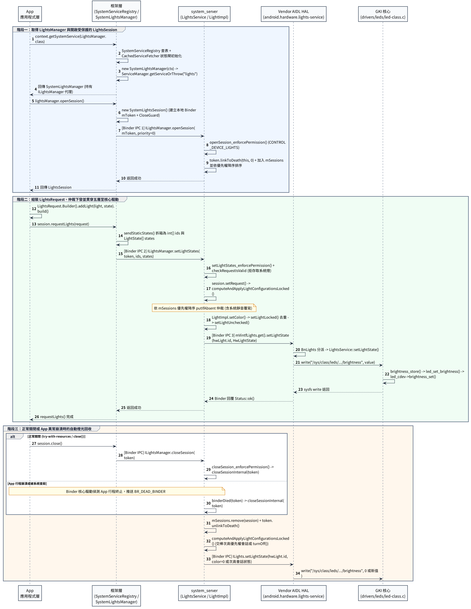

# 2.5 框架 Manager 與應用程式層存取硬體服務

- **情景說明**：一個具備 `CONTROL_DEVICE_LIGHTS` 權限的應用程式（例如系統設定、遊戲手把控制或裝置燈效管理 App）呼叫 `context.getSystemService(LightsManager.class)` 取得 `LightsManager`，開啟受生命週期保護的 `LightsSession`，透過 `LightsRequest.Builder` 組裝目標燈光狀態並呼叫 `session.requestLights(request)`，最終跨越兩道 Binder 行程邊界（App → `system_server` 的 `LightsService` → Vendor 行程的 `ILights` AIDL HAL）寫入核心 LED 驅動；並在會話正常關閉或 App 異常崩潰時完成多會話仲裁與硬體狀態自動回收。最後以 `vibrator/aidl/default/example_java_client/` 對照說明 App 直連 AIDL HAL 的嚴格邊界。
- **對應原書**：第 2 章 2.5 節〈开发 Android 应用程序来使用硬件访问服务〉（p.52–56）
- **涉及專案與版本基準**：
  - `platform/frameworks/base` 〔`android-17.0.0_r1`，commit `94b4c163`〕
  - `platform/hardware/interfaces` 〔`android-17.0.0_r1`，commit `0162af6`〕
  - 呼叫鏈下游銜接 2.3 的 Vendor AIDL HAL（`platform/hardware/interfaces` `light/aidl/default/`）與 2.1 的核心 LED 子系統（`kernel/common` 〔`android17-6.18`，commit `1e0de07`〕）

---

## 2.5.1 透過 `Context.getSystemService` 取得 `LightsManager`

> 對應原書 2.5（p.52–54）。在原書 Android 2.3 的範例 `Freg.java` 中，實驗性 App 直接 `import android.os.ServiceManager` 並於 `onCreate()` 執行 `IFregService.Stub.asInterface(ServiceManager.getService("freg"))`，毫無封裝地把系統內部 Binder 服務名稱與遠端代理暴露給應用程式。在 Android 17 中，`ServiceManager` 與 `ILightsManager` 皆屬 `@hide` 內部介面，標準應用程式必須經由 `Context.getSystemService(LightsManager.class)` 向 `SystemServiceRegistry` 取得框架層 Manager（`SystemLightsManager`），由 Manager 隱藏底層 Binder 連線、例外轉換與 Session 生命週期管理。

### Step 1：`SystemServiceRegistry` 靜態註冊 `Context.LIGHTS_SERVICE` 與快取取得機制
**位置**：`platform/frameworks/base/core/java/android/app/SystemServiceRegistry.java` 〔`android-17.0.0_r1`，lines 1736–1742、2291–2297、2389–2411、2709–2799〕

```java
        registerService(Context.LIGHTS_SERVICE, LightsManager.class,
            new CachedServiceFetcher<LightsManager>() {
                @Override
                public LightsManager createService(ContextImpl ctx)
                    throws ServiceNotFoundException {
                    return new SystemLightsManager(ctx);
                }});
...
    public static Object getSystemService(@NonNull ContextImpl ctx, String name) {
        final ServiceFetcher<?> fetcher = getSystemServiceFetcher(name);
        if (fetcher == null) {
            return null;
        }

        final Object ret = fetcher.getService(ctx);
...
    public static String getSystemServiceName(Class<?> serviceClass) {
        if (serviceClass == null) {
            return null;
        }
        final String serviceName = SYSTEM_SERVICE_NAMES.get(serviceClass);
        if (serviceName == null) {
            // This should be a caller bug.
            onUnknownSystemServiceError(serviceClass.getCanonicalName());
        }
        return serviceName;
    }

    /**
     * Statically registers a system service with the context.
     * This method must be called during static initialization only.
     */
    @RavenwoodKeep
    private static <T> void registerService(@NonNull String serviceName,
            @NonNull Class<T> serviceClass, @NonNull ServiceFetcher<T> serviceFetcher) {
        SYSTEM_SERVICE_NAMES.put(serviceClass, serviceName);
        SYSTEM_SERVICE_FETCHERS.put(serviceName, serviceFetcher);
        SYSTEM_SERVICE_CLASS_NAMES.put(serviceName, serviceClass.getSimpleName());
    }
...
    static abstract class CachedServiceFetcher<T> implements ServiceFetcher<T> {
        private final int mCacheIndex;

        CachedServiceFetcher() {
            // Note this class must be instantiated only by the static initializer of the
            // outer class (SystemServiceRegistry), which already does the synchronization,
            // so bare access to sServiceCacheSize is okay here.
            mCacheIndex = sServiceCacheSize++;
        }

        @Override
        @SuppressWarnings("unchecked")
        public final T getService(ContextImpl ctx) {
            // These arrays should only be touched within synchronized (cache).
            final Object[] cache = ctx.mServiceCache;
            final byte[] gates = ctx.mServiceInitializationStateArray;
            boolean interrupted = false;

            T ret = null;
...
            for (;;) {
                boolean doInitialize = false;
                synchronized (cache) {
                    // Return it if we already have a cached instance.
                    T service = (T) cache[mCacheIndex];
                    if (service != null) {
                        ret = service;
                        break; // exit the for (;;)
                    }
...
                    if (gates[mCacheIndex] == ContextImpl.STATE_READY
                            || gates[mCacheIndex] == ContextImpl.STATE_NOT_FOUND) {
                        gates[mCacheIndex] = ContextImpl.STATE_UNINITIALIZED;
                    }
...
                    if (gates[mCacheIndex] == ContextImpl.STATE_UNINITIALIZED) {
                        doInitialize = true;
                        gates[mCacheIndex] = ContextImpl.STATE_INITIALIZING;
                    }
                }

                if (doInitialize) {
                    // Only the first thread gets here.

                    T service = null;
                    @ServiceInitializationState byte newState = ContextImpl.STATE_NOT_FOUND;
                    try {
                        // This thread is the first one to get here. Instantiate the service
                        // *without* the cache lock held.
                        service = createService(ctx);
                        newState = ContextImpl.STATE_READY;

                    } catch (ServiceNotFoundException e) {
                        onServiceNotFound(e);

                    } finally {
                        synchronized (cache) {
                            cache[mCacheIndex] = service;
                            gates[mCacheIndex] = newState;
                            cache.notifyAll();
                        }
                    }
                    ret = service;
                    break; // exit the for (;;)
                }
```

**解說**：
1. **類別到服務名稱與工廠的靜態映射**：`SystemServiceRegistry` 在類別載入的靜態區塊中呼叫 `registerService(Context.LIGHTS_SERVICE, LightsManager.class, ...)`，同時寫入兩張查找表：
   - `SYSTEM_SERVICE_NAMES`：將公開抽象類別 `LightsManager.class` 映射到字串常數 `Context.LIGHTS_SERVICE`（`"lights"`）。
   - `SYSTEM_SERVICE_FETCHERS`：將 `"lights"` 映射到匿名 `CachedServiceFetcher<LightsManager>` 工廠物件。
2. **查詢路徑**：當 App 呼叫 `context.getSystemService(LightsManager.class)` 時，會先透過 `getSystemServiceName(LightsManager.class)` 查出 `"lights"`，再由 `ContextImpl` 轉交 `SystemServiceRegistry.getSystemService(ctx, name)` 取得對應的 `ServiceFetcher` 並執行 `fetcher.getService(ctx)`。
3. **每 `ContextImpl` 一份的無鎖初始化快取**：每個 `CachedServiceFetcher` 在靜態初始化時獲配一個全域唯一索引 `mCacheIndex = sServiceCacheSize++`，對應每個 `ContextImpl` 內部的陣列槽位 `ctx.mServiceCache[mCacheIndex]` 與狀態閘 `ctx.mServiceInitializationStateArray[mCacheIndex]`。為避免某個系統服務在 `createService(ctx)` 期間執行較慢的 Binder 查詢而長時間霸佔整把 `cache` 鎖，Android 17 採用狀態閘模式：僅第一位進入的執行緒將 `gates[mCacheIndex]` 改為 `STATE_INITIALIZING`，隨即**釋放 `synchronized (cache)` 鎖**再呼叫 `createService(ctx)`（即 `new SystemLightsManager(ctx)`），完成後再重新上鎖寫回快取並 `cache.notifyAll()` 喚醒其餘等待中的執行緒。

> 〔與 2.3 差異〕**邏輯改變**：Android 2.3 的 `ContextImpl` 直接以一連串 `if (LIGHTS_SERVICE.equals(name))` 判斷建立服務，且原書 `Freg.java` 完全繞過 `Context`、直接呼叫隱藏 API `ServiceManager.getService("freg")`（原書 p.53–54）；Android 17 統一收斂到 `SystemServiceRegistry` 的註冊表與 `CachedServiceFetcher` 狀態閘快取，App 僅需透過公開 `Context.getSystemService(LightsManager.class)` 取得快取後的 Manager 實例。

---

### Step 2：`SystemLightsManager` 建構與連線 `ILightsManager` 系統服務
**位置**：`platform/frameworks/base/core/java/android/hardware/lights/SystemLightsManager.java` 〔`android-17.0.0_r1`，lines 41–79〕

```java
public final class SystemLightsManager extends LightsManager {
    private static final String TAG = "LightsManager";

    @NonNull private final ILightsManager mService;

    /**
     * Creates a SystemLightsManager.
     *
     * @hide
     */
    public SystemLightsManager(@NonNull Context context) throws ServiceNotFoundException {
        this(context, ILightsManager.Stub.asInterface(
            ServiceManager.getServiceOrThrow(Context.LIGHTS_SERVICE)));
    }

    /**
     * Creates a SystemLightsManager with a provided service implementation.
     *
     * @hide
     */
    @VisibleForTesting
    public SystemLightsManager(@NonNull Context context, @NonNull ILightsManager service) {
        mService = Preconditions.checkNotNull(service);
    }

    /**
     * Returns the lights available on the device.
     *
     * @return A list of available lights
     */
    @RequiresPermission(Manifest.permission.CONTROL_DEVICE_LIGHTS)
    @Override
    public @NonNull List<Light> getLights() {
        try {
            return mService.getLights();
        } catch (RemoteException e) {
            throw e.rethrowFromSystemServer();
        }
    }
```

**解說**：
1. **介面與實作分離**：App 看到的是公開抽象類別 `android.hardware.lights.LightsManager`，實際上由 `SystemServiceRegistry` 實例化的則是 `@hide` 且 `final` 的 `SystemLightsManager`。之所以拆成抽象父類，是因為 Android 同時存在「裝置本體燈光」（透過 `SystemLightsManager` 走 `LightsService`）與「外接輸入裝置燈光」（如遊戲手把 LED，由 `InputDevice.getLightsManager()` 提供另一套實作），兩者共用同一套公開 API。
2. **取得 `ILightsManager` Binder 代理**：建構子呼叫 `ServiceManager.getServiceOrThrow(Context.LIGHTS_SERVICE)`，向 `servicemanager` 查詢 2.4 節中 `LightsService.onStart()` 以 `publishBinderService(Context.LIGHTS_SERVICE, mManagerService)` 發布的 Binder 服務；若裝置未啟動該服務，直接拋出 `ServiceNotFoundException` 由 `CachedServiceFetcher` 統一攔截記錄，不會留下 `mService == null` 的半殘物件。
3. **封裝遠端呼叫與系統服務死亡語意**：`getLights()` 呼叫 `mService.getLights()` 向 `system_server` 查詢可供 App 控制的燈光清單，並以 `e.rethrowFromSystemServer()` 處理 `RemoteException`——若 `system_server` 行程崩潰（`DeadObjectException`），會轉拋非受檢的 `DeadSystemRuntimeException`，避免 App 忽略受檢例外而進入不一致狀態。

> 〔與 2.3 差異〕**邏輯改變**：原書 `Freg.java` 在 `Activity.onCreate()` 直接呼叫 `ServiceManager.getService("freg")` 並於每個按鈕 `onClick()` 中手動 `try/catch (RemoteException)` 列印 log（原書 p.53–54）；Android 17 將 `ServiceManager.getServiceOrThrow`、`Stub.asInterface` 與 `rethrowFromSystemServer()` 全部沉入框架層 `SystemLightsManager`，並透過 `@RequiresPermission(Manifest.permission.CONTROL_DEVICE_LIGHTS)` 明確標註權限契約。

---

## 2.5.2 建立受生命週期保護的 `LightsSession` 與組裝 `LightsRequest`

> 原書 2.5 的 `Freg` 應用程式只做無狀態的單次 `setVal(val)` / `getVal()` 讀寫（原書 p.53–54），沒有考慮「多個 App 同時搶同一顆硬體裝置」或「App 設定燈光後異常崩潰、硬體卡死在常亮狀態」等問題。Android 17 的 `LightsManager` 以 **Session + 本地 `Binder` Token + 伺服器端 `linkToDeath`** 三者協作，徹底解決多客戶端仲裁與資源自動回收。

### Step 3：`LightsManager` 抽象介面與 `LightsSession` 內建 `Binder` Token
**位置**：`platform/frameworks/base/core/java/android/hardware/lights/LightsManager.java` 〔`android-17.0.0_r1`，lines 40–42、73–149〕

```java
@SystemService(Context.LIGHTS_SERVICE)
public abstract class LightsManager {
    private static final String TAG = "LightsManager";
...
    public @NonNull abstract List<Light> getLights();

    /**
     * Returns the state of a specified light.
     *
     */
    public abstract @NonNull LightState getLightState(@NonNull Light light);
...
    public abstract @NonNull LightsSession openSession();
...
    @TestApi
    public abstract @NonNull LightsSession openSession(int priority);
...
    public abstract static class LightsSession implements AutoCloseable {
        private final IBinder mToken = new Binder();

        /**
         * @hide to prevent subclassing from outside of the framework
         */
        public LightsSession() {
        }

        /**
         * Sends a request to modify the states of multiple lights.
         *
         * @param request the settings for lights that should change
         */
        public abstract void requestLights(@NonNull LightsRequest request);

        @Override
        public abstract void close();

        /**
         * Get the token of a light session.
         *
         * @return Binder token of the light session.
         * @hide
         */
        public @NonNull IBinder getToken() {
            return mToken;
        }
    }
```

**解說**：
1. **`AutoCloseable` 界定請求生命週期**：所有對燈光狀態的修改都必須附屬於某個 `LightsSession`；App 可使用 Java `try (LightsSession session = lightsManager.openSession()) { ... }` 區塊管理，離開作用域時自動呼叫 `close()` 撤銷該會話所做的變更。
2. **核心技巧——`private final IBinder mToken = new Binder()`**：`LightsSession` 在 **App 行程端** 建立一個空白的本地 `Binder` 實體（對應底層 `BBinder` 與核心 `binder_node`）。當此 `mToken` 隨跨行程呼叫傳送到 `system_server` 時，`LightsService` 端收到的是一個指向 App 行程的 `BpBinder` 代理。這種設計不需要額外定義回呼 AIDL 介面，就能同時達成兩件事：
   - **不可偽造的會話識別碼**：Binder 核心驅動保證不同行程或不同 `Binder` 物件對應不同的 `binder_node`，其他 App 無法猜測或偽造他人的 `token` 來竄改或關閉別人的燈光會話。
   - **跨行程存活感測器**：`LightsService` 可對收到的 `token` 呼叫 `linkToDeath()`；一旦 App 行程因 Crash 或被 LMK 查殺，核心 Binder 驅動會立即把死亡通知送達 `LightsService`。

> 〔與 2.3 差異〕**新增**：原書 2.3 的 `IFregService` 為完全無狀態的單次呼叫，不存在會話抽象與 `IBinder` 權杖（原書 p.53–54）；Android 17 廣泛採用 `new Binder()` 作為客戶端生命週期權杖（與 `WindowManager`、`PowerManager.WakeLock`、`AudioManager` 同屬現代框架標準慣用法）。

---

### Step 4：`SystemLightsManager.openSession()` 與 `CloseGuard` 資源防護
**位置**：`platform/frameworks/base/core/java/android/hardware/lights/SystemLightsManager.java` 〔`android-17.0.0_r1`，lines 116–165〕

```java
    @RequiresPermission(Manifest.permission.CONTROL_DEVICE_LIGHTS)
    @Override
    public @NonNull LightsSession openSession() {
        try {
            final LightsSession session = new SystemLightsSession();
            mService.openSession(session.getToken(), 0);
            return session;
        } catch (RemoteException e) {
            throw e.rethrowFromSystemServer();
        }
    }
...
    @RequiresPermission(Manifest.permission.CONTROL_DEVICE_LIGHTS)
    @Override
    public @NonNull LightsSession openSession(int priority) {
        try {
            final LightsSession session = new SystemLightsSession();
            mService.openSession(session.getToken(), priority);
            return session;
        } catch (RemoteException e) {
            throw e.rethrowFromSystemServer();
        }
    }

    /**
     * Encapsulates a session that can be used to control device lights and represents the lifetime
     * of the requests.
     */
    public final class SystemLightsSession extends LightsManager.LightsSession
            implements AutoCloseable {

        private final CloseGuard mCloseGuard = new CloseGuard();
        private boolean mClosed = false;

        /**
         * Instantiated by {@link LightsManager#openSession()}.
         */
        @RequiresPermission(Manifest.permission.CONTROL_DEVICE_LIGHTS)
        private SystemLightsSession() {
            mCloseGuard.open("SystemLightsSession.close");
        }
```

**解說**：
1. **預設優先權與測試用優先權**：公開 API `openSession()` 固定傳入優先權 `0`；`@TestApi` 重載 `openSession(int priority)` 則允許測試或特權呼叫者指定較高整數優先權（數值越大優先權越高）。兩者皆先在本地建立 `SystemLightsSession`（同時觸發父類建立 `mToken = new Binder()`），再透過 `mService.openSession(session.getToken(), priority)` 向 `LightsService` 註冊。
2. **雙重防洩漏機制（`CloseGuard` + `finalize`）**：`SystemLightsSession` 建構子立即呼叫 `mCloseGuard.open("SystemLightsSession.close")`。若 App 忘記呼叫 `session.close()` 而讓物件被 GC 回收，後述 Step 8 的 `finalize()` 會觸發 `mCloseGuard.warnIfOpen()`（配合 StrictMode 報警）並補呼叫 `close()`，避免 App 雖未崩潰卻長期佔住燈光不放。

> 〔與 2.3 差異〕**新增**：原書 2.3 應用程式無需建立或釋放會話（原書 p.53–54）；Android 17 結合 `AutoCloseable`、`CloseGuard` 與遠端 `openSession(token, priority)`，將資源生命週期同時納入編譯期語法（`try-with-resources`）、執行期 GC 警告與跨行程死亡回收三道防線。

---

### Step 5：`LightsRequest.Builder` 組裝多燈光請求
**位置**：`platform/frameworks/base/core/java/android/hardware/lights/LightsRequest.java` 〔`android-17.0.0_r1`，lines 35–68、101–121、140–146、167–191〕

```java
public final class LightsRequest {
    /** Visible to {@link LightsManager.LightsSession}. */
    final Map<Light, LightState> mRequests = new HashMap<>();
    final List<Integer> mLightIds = new ArrayList<>();
    final List<LightState> mLightStates = new ArrayList<>();
    final MultiLightEffect mLightEffect;

    /**
     * Can only be constructed via {@link LightsRequest.Builder#build()}.
     */
    private LightsRequest(Map<Light, LightState> requests, MultiLightEffect effect) {
        mRequests.putAll(requests);
        List<Light> lights = new ArrayList<Light>(mRequests.keySet());
        for (int i = 0; i < lights.size(); i++) {
            final Light light = lights.get(i);
            mLightIds.add(i, light.getId());
            mLightStates.add(i, mRequests.get(light));
        }

        if (Flags.enableLightAnimations()) {
            mLightEffect = effect;
        } else {
            mLightEffect = null;
        }
    }

    /**
     * Get a list of Light as ids.
     *
     * @return List of light ids in the request.
     */
    public @NonNull List<Integer> getLights() {
        return mLightIds;
    }
...
    public static final class Builder {
        private final Map<Light, LightState> mChanges = new HashMap<>();
        private MultiLightEffect mEffect;

        /**
         * Overrides the color and intensity of a given light.
         *
         * @param light the light to modify
         * @param state the desired color and intensity of the light
         */
        public @NonNull Builder addLight(@NonNull Light light, @NonNull LightState state) {
            Preconditions.checkNotNull(light);
            Preconditions.checkNotNull(state);

            if (Flags.enableLightAnimations()) {
                Preconditions.checkState(mEffect == null, "Request already contains an effect.");
            }

            mChanges.put(light, state);
            return this;
        }
...
        @FlaggedApi(Flags.FLAG_ENABLE_LIGHT_ANIMATIONS)
        public @NonNull Builder setEffect(@NonNull MultiLightEffect effect) {
            Preconditions.checkNotNull(effect);
            Preconditions.checkState(mChanges.size() == 0, "Request already has state changes");
            mEffect = effect;
            return this;
        }
...
        public @NonNull Builder clearLight(@NonNull Light light) {
            Preconditions.checkNotNull(light);

            if (Flags.enableLightAnimations()) {
                Preconditions.checkState(mEffect == null, "Request already contains an effect.");
            }

            mChanges.put(light, null);
            return this;
        }

        /**
         * Create a LightsRequest object used to override lights on the device.
         *
         * <p>The generated {@link LightsRequest} should be used in
         * {@link LightsManager.LightsSession#requestLights(LightsRequest)}.
         */
        public @NonNull LightsRequest build() {
            if (!Flags.enableLightAnimations()) {
                return new LightsRequest(mChanges, null);
            }

            return new LightsRequest(mChanges, mEffect);
        }
    }
```

**解說**：
1. **批次原子描述**：App 先以 `new LightState.Builder().setColor(color).build()` 建立目標顏色狀態，再透過 `new LightsRequest.Builder().addLight(light, state).build()` 一次打包多顆燈光的更新請求；若要取消本會話對特定某顆燈的覆寫而不關閉整個會話，則呼叫 `clearLight(light)`，在 `mChanges` 中放入 `null` 作為「撤回標記」。
2. **為 Binder 傳輸預先展開平行陣列**：建構不可變的 `LightsRequest` 時，會將 `Map<Light, LightState>` 同步攤平成索引一一對應的 `mLightIds`（`List<Integer>`）與 `mLightStates`（`List<LightState>`），方便下一步直接轉為基本陣列 `int[]` 與 `LightState[]` 透過 AIDL 傳送，減少 IPC 序列化負擔。
3. **Android 17 動態燈效旗標保護**：在 `Flags.enableLightAnimations()` 啟用時，支援以 `setEffect(MultiLightEffect)` 指定多燈動畫序列，並以 `Preconditions.checkState` 強制靜態狀態（`addLight`/`clearLight`）與動態燈效（`setEffect`）在單次請求內互斥。

> 〔與 2.3 差異〕**新增**：原書 `Freg` 僅對單一暫存器讀寫單個 `int` 值（原書 p.54）；Android 17 透過不可變的 `LightsRequest` 與 `LightState`（實作 `Parcelable`）支援一次跨行程批次更新多顆燈光或撤銷單燈請求，並擴充多燈動態效果。

---

### Step 6：`ILightsManager.aidl` 介面契約與 `@EnforcePermission` 宣告
**位置**：`platform/frameworks/base/core/java/android/hardware/lights/ILightsManager.aidl` 〔`android-17.0.0_r1`，lines 29–50〕

```java
interface ILightsManager {
  @EnforcePermission("CONTROL_DEVICE_LIGHTS")
  List<Light> getLights();

  @EnforcePermission("CONTROL_DEVICE_LIGHTS")
  LightState getLightState(int lightId);

  @EnforcePermission("CONTROL_DEVICE_LIGHTS")
  void openSession(in IBinder sessionToken, in int priority);

  @EnforcePermission("CONTROL_DEVICE_LIGHTS")
  void closeSession(in IBinder sessionToken);

  @EnforcePermission("CONTROL_DEVICE_LIGHTS")
  void setLightStates(in IBinder sessionToken, in int[] lightIds, in LightState[] states);

  @EnforcePermission("CONTROL_DEVICE_LIGHTS")
  void setLightEffect(in IBinder sessionToken, in MultiLightEffect effect);

  @EnforcePermission("CONTROL_DEVICE_LIGHTS")
  ColorSequence getLightSequence(in int lightId);
}
```

**解說**：
1. **編譯期生成權限校驗樁**：Android 17 在 `ILightsManager.aidl` 的每個方法上都標註了 `@EnforcePermission("CONTROL_DEVICE_LIGHTS")`。AIDL 編譯器會據此在產生的 `ILightsManager.Stub` 中自動產生對應的 `openSession_enforcePermission()`、`setLightStates_enforcePermission()` 等輔助函式，底層委派給 `PermissionEnforcer` 驗證呼叫端 UID/PID 是否具備權限，並在編譯檢查工具（lint/Java 註解處理器）階段確保服務實作端絕不會遺漏權限檢查。
2. **純粹內部通訊協定**：注意 `ILightsManager` 檔案頂端標示 `@hide`，且沒有 `@VintfStability`——它只用於同在系統側（或 App ↔ `system_server`）的框架內部 Binder 通訊，與 2.3 節跨 system/vendor 分區邊界的 `android.hardware.light.ILights`（`@VintfStability`）分工截然不同。

> 〔與 2.3 差異〕**邏輯改變**：原書 2.4.1 / 2.5 的 `IFregService.aidl` 沒有任何權限聲明，任何 App 只要拿到 Binder 代理即可任意讀寫硬體（原書 p.46、53–54）；Android 17 以 AIDL `@EnforcePermission` 搭配 `PermissionEnforcer` 在介面層與實作層雙重強制檢查 `CONTROL_DEVICE_LIGHTS`。

---

### Step 7：`LightsService.openSession()` 權限校驗、系統燈過濾與 `linkToDeath`
**位置**：`platform/frameworks/base/services/core/java/com/android/server/lights/LightsService.java` 〔`android-17.0.0_r1`，lines 90–153、239–256〕

```java
    private final class LightsManagerBinderService extends ILightsManager.Stub
          implements IBinder.DeathRecipient {
...
        @GuardedBy("LightsService.this")
        private final List<Session> mSessions = new ArrayList<>();

        LightsManagerBinderService() {
            super(PermissionEnforcer.fromContext(getContext()));
        }
...
        @android.annotation.EnforcePermission(android.Manifest.permission.CONTROL_DEVICE_LIGHTS)
        @Override
        public List<Light> getLights() {
            getLights_enforcePermission();

            synchronized (LightsService.this) {
                final List<Light> lights = new ArrayList<Light>();
                for (int i = 0; i < mLightsById.size(); i++) {
                    if (!mLightsById.valueAt(i).isSystemLight()) {
                        HwLight hwLight = mLightsById.valueAt(i).mHwLight;
                        Light.Builder lightBuilder =
                                new Light.Builder(hwLight.id, hwLight.ordinal, hwLight.type);

                        if (mSupportsEffects && hwLight.minUpdatePeriodMillis > 0) {
                            lightBuilder.setMinUpdatePeriodMillis(hwLight.minUpdatePeriodMillis);
                            lightBuilder.setCapabilities(
                                    Light.LIGHT_CAPABILITY_ANIMATION
                                            | Light.LIGHT_CAPABILITY_COLOR_RGB);
                        }

                        lights.add(lightBuilder.build());
                    }
                }
                return lights;
            }
        }
...
        @android.annotation.EnforcePermission(android.Manifest.permission.CONTROL_DEVICE_LIGHTS)
        @Override
        public void openSession(IBinder token, int priority) {
            openSession_enforcePermission();
            Preconditions.checkNotNull(token);

            synchronized (LightsService.this) {
                Preconditions.checkState(getSessionLocked(token) == null, "already registered");
                try {
                    token.linkToDeath(LightsManagerBinderService.this, 0);
                    mSessions.add(new Session(token, priority, mSessionListener, mH));
                    Collections.sort(mSessions);
                } catch (RemoteException e) {
                    Slog.e(TAG, "Couldn't open session, client already died" , e);
                    throw new IllegalArgumentException("Client is already dead.");
                }
            }
        }
```

**解說**：
1. **`PermissionEnforcer` 注入與檢驗**：`LightsManagerBinderService` 建構子將 `PermissionEnforcer.fromContext(getContext())` 傳入 `ILightsManager.Stub` 父類，並在每個覆寫方法開頭執行 `*_enforcePermission()`；若呼叫 App 缺少 `CONTROL_DEVICE_LIGHTS` 權限，立刻拋出 `SecurityException` 回傳給 App 端。
2. **隔離系統保留燈（`!isSystemLight()`）**：在 `getLights()` 中，`LightsService` 會過濾掉所有系統專用燈（包含背光 `BACKLIGHT`、電池燈 `BATTERY`、通知燈 `NOTIFICATIONS` 等，見 Step 11 的 `isSystemLight()`），僅將開放給應用程式的燈光（如麥克風指示燈 `LIGHT_TYPE_MICROPHONE`、應用自訂燈 `LIGHT_TYPE_APPLICATION` 等）封裝成 `Light` 回傳。同時，若 HAL 版本 `>= 3` 且 `mSupportsEffects` 為真（2.4 節 `populateAvailableLightsFromHal` 所判定），會填入 `minUpdatePeriodMillis` 與動畫能力旗標。
3. **掛載死亡監聽與維持優先權排序**：`openSession()` 在持有 `LightsService.this` 鎖下先確認同一 `token` 未重複註冊，接著呼叫 `token.linkToDeath(LightsManagerBinderService.this, 0)` 將自己（實作 `IBinder.DeathRecipient`）掛到 App 端 `mToken` 的死亡通知清單上；若 App 在傳遞途中就已經死掉，`linkToDeath` 會拋出 `RemoteException`，立刻拒絕註冊。通過後把新 `Session` 加入 `mSessions` 並呼叫 `Collections.sort(mSessions)`，維持由高到低的優先權順序。

> 〔與 2.3 差異〕**新增**：原書 `FregService` 既不區分系統資源與 App 可見資源，也沒有 `mSessions` 會話表與 `linkToDeath` 死亡追蹤（原書 p.47、53–54）；Android 17 在 `system_server` 層實作了完整的權限閘道、硬體資源切分與客戶端存活監控。

---

## 2.5.3 請求下發、多 Session 優先權仲裁與跨行程進入 AIDL HAL

> 當 App 建好 `LightsRequest` 並呼叫 `session.requestLights(request)` 後，整條五層呼叫鏈正式貫通：從 App 行程的 `SystemLightsSession` 經 Binder 進入 `system_server` 的 `LightsManagerBinderService` 完成多會話優先權仲裁，再經 `LightImpl` 轉譯為 `HwLightState` 並透過 `@VintfStability` `ILights` 代理跨行程送進 Vendor HAL 行程，最後由 HAL 寫入 Linux `/sys/class/leds/` sysfs 節點驅動硬體。

### Step 8：`SystemLightsSession.requestLights()` 拆箱下發與 `close()` 關閉會話
**位置**：`platform/frameworks/base/core/java/android/hardware/lights/SystemLightsManager.java` 〔`android-17.0.0_r1`，lines 176–250〕

```java
        @RequiresPermission(Manifest.permission.CONTROL_DEVICE_LIGHTS)
        @Override
        public void requestLights(@NonNull LightsRequest request) {
            Preconditions.checkNotNull(request);
            if (!mClosed) {
                if (Flags.enableLightAnimations()) {
                    if (request.getLights().size() > 0) {
                        sendStaticStates(request);
                    }

                    if (request.getEffect() != null) {
                        sendEffect(request);
                    }
                } else {
                    sendStaticStates(request);
                }
            }
        }

        @RequiresPermission(Manifest.permission.CONTROL_DEVICE_LIGHTS)
        private void sendStaticStates(@NonNull LightsRequest request) {
            try {
                List<Integer> idList = request.getLights();
                List<LightState> stateList = request.getLightStates();
                int[] ids = new int[idList.size()];
                for (int i = 0; i < idList.size(); i++) {
                    ids[i] = idList.get(i);
                }
                LightState[] states = new LightState[stateList.size()];
                for (int i = 0; i < stateList.size(); i++) {
                    states[i] = stateList.get(i);
                }
                mService.setLightStates(getToken(), ids, states);
            } catch (RemoteException e) {
                throw e.rethrowFromSystemServer();
            }
        }

        @RequiresPermission(Manifest.permission.CONTROL_DEVICE_LIGHTS)
        private void sendEffect(@NonNull LightsRequest request) {
            try {
                mService.setLightEffect(getToken(), request.getEffect());
            } catch (RemoteException e) {
                throw e.rethrowFromSystemServer();
            }
        }

        /**
         * Closes the session, reverting all changes made through it.
         */
        @RequiresPermission(Manifest.permission.CONTROL_DEVICE_LIGHTS)
        @Override
        public void close() {
            if (!mClosed) {
                try {
                    mService.closeSession(getToken());
                    mClosed = true;
                    mCloseGuard.close();
                } catch (RemoteException e) {
                    throw e.rethrowFromSystemServer();
                }
            }
            Reference.reachabilityFence(this);
        }

        /** @hide */
        @Override
        protected void finalize() throws Throwable {
            try {
                mCloseGuard.warnIfOpen();
                close();
            } finally {
                super.finalize();
            }
        }
```

**解說**：
1. **靜態狀態與動態燈效分流**：`requestLights()` 先確認 `!mClosed`，再依 `Flags.enableLightAnimations()` 決定是否分流至 `sendStaticStates()` 與 `sendEffect()`。在靜態路徑中，`sendStaticStates()` 將 `LightsRequest` 裡的 `List<Integer>` 與 `List<LightState>` 拆箱成原始陣列 `int[] ids` 與 `LightState[] states`，連同 `getToken()` 一併透過第一段 Binder IPC 送進 `mService.setLightStates(getToken(), ids, states)`。
2. **`close()` 的冪等性與 `reachabilityFence`**：`close()` 透過 `mClosed` 旗標確保重複關閉為 no-op，先呼叫 `mService.closeSession(getToken())` 再關閉 `mCloseGuard`。結尾的 `Reference.reachabilityFence(this)` 是一項極為關鍵的 ART 執行期細節：避免編譯器最佳化在 `mService.closeSession()` 尚未返回前就判定 `this` 不再可達，進而觸發 `finalize()` 併發執行 `close()` 或誤報 `mCloseGuard.warnIfOpen()`。

> 〔與 2.3 差異〕**邏輯改變**：原書 `Freg.java` 在按鈕點擊時直接呼叫 `fregService.setVal(val)`（原書 p.54）；Android 17 透過 `SystemLightsSession` 將請求綁定於 `getToken()`、處理靜態／動畫分流、拆箱平行陣列，並以 `CloseGuard` 與 `reachabilityFence` 嚴密防護資源釋放。

---

### Step 9：`LightsService.setLightStates()` 驗證會話、防越權並更新 `Session` 狀態
**位置**：`platform/frameworks/base/services/core/java/com/android/server/lights/LightsService.java` 〔`android-17.0.0_r1`，lines 162–179、363–369、513–548、605–610〕

```java
        @android.annotation.EnforcePermission(android.Manifest.permission.CONTROL_DEVICE_LIGHTS)
        @Override
        public void setLightStates(IBinder token, int[] lightIds, LightState[] lightStates) {
            setLightStates_enforcePermission();
            Preconditions.checkState(lightIds.length == lightStates.length);

            synchronized (LightsService.this) {
                Session session = getSessionLocked(Preconditions.checkNotNull(token));
                Preconditions.checkState(session != null, "not registered");

                checkRequestIsValid(lightIds);

                for (int i = 0; i < lightIds.length; i++) {
                    session.setRequest(lightIds[i], lightStates[i]);
                }
                computeAndApplyLightConfigurationsLocked();
            }
        }
...
        private void checkRequestIsValid(int[] lightIds) {
            for (int lightId : lightIds) {
                final LightImpl light = mLightsById.get(lightId);
                Preconditions.checkState(light != null && !light.isSystemLight(),
                        "Invalid lightId " + lightId);
            }
        }
...
        final class Session implements Comparable<Session> {
            public interface EventListener {
                void onEffectPlaybackComplete(Session session);
            }

            private static final int MAX_EFFECT_QUEUE_SIZE = 10;

            final IBinder mToken;
            final SparseArray<LightConfiguration> mConfigurations = new SparseArray<>();
            final Deque<MultiLightEffect> mEffects = new ArrayDeque<>(MAX_EFFECT_QUEUE_SIZE);
            final EventListener mListener;
            final Handler mHandler;

            final int mPriority;

            Session(IBinder token, int priority, EventListener listener, Handler handler) {
                mToken = token;
                mPriority = priority;
                mListener = listener;
                mHandler = handler;
            }

            void setRequest(int lightId, LightState state) {
                LightConfiguration previousConfig = mConfigurations.get(lightId);
                // If the light was part of an effect, clear the effect first.
                if (previousConfig != null && previousConfig.isDynamic()) {
                    clearEffectConfiguration(mEffects.getFirst());
                    clearEffectQueue();
                }

                if (state != null) {
                    mConfigurations.put(lightId, new LightConfiguration(state));
                } else {
                    mConfigurations.remove(lightId);
                }
            }
...
            @Override
            public int compareTo(Session otherSession) {
                // Sort descending by priority
                return Integer.compare(otherSession.mPriority, mPriority);
            }
        }
```

**解說**：
1. **服務端二次驗證（絕不信任 Client 輸入）**：`setLightStates()` 除驗證權限與陣列等長外，先以 `getSessionLocked(token)` 確認此 `token` 確實是已開啟且未關閉的合法會話，再呼叫 `checkRequestIsValid(lightIds)` 逐一檢查目標 `lightId` 存在且 `!light.isSystemLight()`。即便惡意 App 繞過 `getLights()` 自行構造 `lightId`（例如猜測螢幕背光的 ID），也會在這裡被 `IllegalStateException` 擋下。
2. **會話狀態更新**：`session.setRequest(lightId, state)` 若發現該燈先前正屬於動態燈效（`previousConfig.isDynamic()`），會先清除動畫佇列再寫入新的靜態 `LightConfiguration(state)`；若 `state == null`（對應 App 呼叫 `LightsRequest.Builder.clearLight()`），則從 `session.mConfigurations` 移除該燈的覆寫記錄。
3. **優先權排序規則**：`Session.compareTo()` 採**降序**（`Integer.compare(otherSession.mPriority, mPriority)`），數值越大的 `Session` 排在 `mSessions` 越前面；且由於 `Collections.sort()` 採用穩定排序（TimSort），當兩個會話優先權相同（例如一般 App 都是 `0`）時，**較早開啟的會話**會保留在前面，於衝突時勝出。

> 〔與 2.3 差異〕**邏輯改變**：原書 `FregService.setVal()` 收到值就無條件寫進底層驅動（原書 p.47–48）；Android 17 的 `LightsService` 將每個客戶端的期望狀態記錄在各自的 `Session.mConfigurations` 中，並透過 `checkRequestIsValid()` 杜絕越權存取系統燈，再交由統一的仲裁器決定最終硬體輸出。

---

### Step 10：`computeAndApplyLightConfigurationsLocked()` 多會話優先權仲裁與系統靜音覆寫
**位置**：`platform/frameworks/base/services/core/java/com/android/server/lights/LightsService.java` 〔`android-17.0.0_r1`，lines 71–79、310–350、378–468〕

```java
    // Priority for the system override session, higher than typical app priorities.
    static final int DEFAULT_SYSTEM_SESSION_PRIORITY = 1_000;
...
    // A special session used to mute all user-controllable lights.
    private LightsManagerBinderService.Session mSystemOverrideSession;
...
        public void setMutedState(boolean muted) {
            synchronized (LightsService.this) {
                boolean currentlyMuted = mSystemOverrideSession != null;
                if (muted == currentlyMuted) {
                    // We are already in the right state. Just return.
                    Slog.i(TAG, "Lights already " + (muted ? "unmuted." : "muted."));
                    return;
                }

                LightState state = null;
                if (muted) {
                    Slog.i(TAG, "Muting lights.");
                    state = new LightState.Builder().setColor(0).build();
                    mSystemOverrideSession =
                            new Session(
                                    null, DEFAULT_SYSTEM_SESSION_PRIORITY, mSessionListener, mH);
                } else {
                    Slog.i(TAG, "Unmuting lights.");
                }

                for (int i = 0; i < mLightsById.size(); i++) {
                    LightImpl light = mLightsById.valueAt(i);
                    if (!light.isSystemLight()) {
                        // All user lights mute/unmute through session priority.
                        mSystemOverrideSession.setRequest(light.mHwLight.id, state);
                    } else if (!light.isCriticalLight()) {
                        // Non critical system lights are muted/unmuted directly.
                        light.setMuteState(muted);
                    }
                }

                if (muted) {
                    mSessions.add(mSystemOverrideSession);
                } else {
                    mSessions.remove(mSystemOverrideSession);
                    mSystemOverrideSession = null;
                }
                Collections.sort(mSessions);
                computeAndApplyLightConfigurationsLocked();
            }
        }
...
        private void computeAndApplyLightConfigurationsLocked() {
            if (Flags.enableLightAnimations()) {
                invalidateLightConfigurationsLocked();
            } else {
                invalidateLightStatesLocked();
            }
        }

        /**
         * Apply light state requests for all light IDs.
         * <p>
         * In case of conflict, the session that started earliest wins.
         */
        private void invalidateLightStatesLocked() {
            final Map<Integer, LightState> states = new HashMap<>();
            for (int i = 0; i < mSessions.size(); i++) {
                Session session = mSessions.get(i);
                for (int j = 0; j < session.mConfigurations.size(); j++) {
                    // Add the light state if a higher priority session is not using the light.
                    states.putIfAbsent(
                            session.mConfigurations.keyAt(j),
                            session.mConfigurations.valueAt(j).getState());
                }
            }
            for (int i = 0; i < mLightsById.size(); i++) {
                LightImpl light = mLightsById.valueAt(i);
                if (!light.isSystemLight()) {
                    LightState state = states.get(light.mHwLight.id);
                    if (state != null) {
                        light.setColor(state.getColor());
                    } else {
                        light.turnOff();
                    }
                }
            }
        }

        @SuppressWarnings("AndroidFrameworkEfficientCollections")
        private void invalidateLightConfigurationsLocked() {
            // Traverse the sessions in priority order to find the used lights.
            final Map<Integer, LightConfiguration> configs = new HashMap<>();
            for (Session session : mSessions) {
                Map<Integer, LightConfiguration> effectConfigs = new HashMap<>();
                boolean isEffectPlayable = true;
                for (int i = 0; i < session.mConfigurations.size(); i++) {
                    int lightId = session.mConfigurations.keyAt(i);
                    LightConfiguration nextConfig = session.mConfigurations.valueAt(i);

                    if (nextConfig.isDynamic()) {
                        // Skip the effect if the HAL doesn't have support or a light needed by the
                        // effect is already in use by a higher priority session.
                        if (!mSupportsEffects || configs.containsKey(lightId)) {
                            isEffectPlayable = false;
                            break;
                        }
                        effectConfigs.put(lightId, nextConfig);
                    } else {
                        configs.putIfAbsent(lightId, nextConfig);
                    }
                }

                if (isEffectPlayable) {
                    configs.putAll(effectConfigs);
                }
            }

            // Traverse the list of lights, finding the effects that need to be applied in bulk.
            ArrayList<HwLightEffect> effectsList = new ArrayList<>(mLightsById.size());
            for (int i = 0; i < mLightsById.size(); i++) {
                LightImpl light = mLightsById.valueAt(i);
                if (!light.isSystemLight()) {
                    LightConfiguration config = configs.get(light.mHwLight.id);

                    boolean shouldUpdate = light.setConfiguration(config);
                    if (shouldUpdate) {
                        effectsList.add(
                                vintfEffectFromSequence(light.mHwLight, config.getEffect()));
                    }
                }
            }

            // Finally, send the effects for playback.
            if (!effectsList.isEmpty()) {
                try {
                    mVintfLights.get().setLightEffects(
                            effectsList.toArray(new HwLightEffect[0]));
                } catch (RemoteException re) {
                    Slog.e(TAG, "Exception trying to set the light effect.", re);
                }
            }
        }
```

**解說**：
1. **「先搶先贏」的高優先權合併演算法**：因為 `mSessions` 已依優先權降序（同優先權依開啟先後）排列，演算法只要依序走訪每個 `Session`，對其宣告的每一顆 `lightId` 執行 `putIfAbsent`：
   - 靜態路徑（`invalidateLightStatesLocked`）：先搶到 `lightId` 的高優先權會話直接填入 `states`；低優先權會話無法覆蓋已被佔用的燈，但仍可控制未被高優先權會話用到的其餘燈光。走訪完所有會話後，對每顆非系統燈有狀態者呼叫 `light.setColor(state.getColor())`，無人主張者則呼叫 `light.turnOff()`。
   - 動畫啟用路徑（`invalidateLightConfigurationsLocked`）：邏輯相同，並為多燈動畫加入「全有或全無（all-or-nothing）」規則——只要該動畫所需的任一顆燈已被更高優先權會話佔用（`configs.containsKey(lightId)`），整個動畫就會標記為 `isEffectPlayable = false` 暫停不播；可播放的動畫則收集成 `effectsList` 批次呼叫 `mVintfLights.get().setLightEffects(...)`，靜態配置與關燈則透過 `light.setConfiguration(config)` 下發。
2. **系統靜音覆寫巧思（`setMutedState`）**：當相機拍攝等對光線敏感的情境需要暫時關閉所有非關鍵燈光時，`LightsService` 不會去刪改各個 App 的會話，而是直接建立一個 `mToken = null`、優先權高達 `DEFAULT_SYSTEM_SESSION_PRIORITY = 1_000` 的內部覆寫會話 `mSystemOverrideSession`，將所有使用者燈設為 `color = 0` 後插入 `mSessions` 並重新仲裁。解除靜音時只要移除 `mSystemOverrideSession` 並重算一次，原先 App 的燈光狀態便自動無縫復原。

> 〔與 2.3 差異〕**新增**：原書 2.3 毫無多客戶端仲裁與系統覆寫概念（原書 p.47–48、54）；Android 17 透過優先權排序的 `mSessions` 與 `putIfAbsent` 仲裁，讓多個 App 與系統靜音策略可以和平共存、動態接手。

---

### Step 11：`LightImpl` 狀態去重與跨行程呼叫 `mVintfLights.get().setLightState()`
**位置**：`platform/frameworks/base/services/core/java/com/android/server/lights/LightsService.java` 〔`android-17.0.0_r1`，lines 634–655、682–687、713–718、746–795、805–825〕

```java
        boolean setConfiguration(LightConfiguration configuration) {
            LightConfiguration previousConfig = mConfiguration;
            mConfiguration = configuration;

            if (mConfiguration == null) {
                turnOff();
                return false;
            }

            if (!mConfiguration.isDynamic()) {
                setColor(mConfiguration.getState().getColor());
                return false;
            }

            // Reset the static color to Black to clear state when we have an effect. This has to be
            // different than '0' to allow the end of the session to send a "turnOff" request.
            mColor = Color.BLACK;

            // If the configuration is different from the last configuration the effect needs to be
            // sent down to the HAL, so return true to let the service know it needs to do it.
            return !mConfiguration.equals(previousConfig);
        }
...
        @Override
        public void setColor(int color) {
            synchronized (this) {
                setLightLocked(color, LIGHT_FLASH_NONE, 0, 0, 0);
            }
        }
...
        @Override
        public void turnOff() {
            synchronized (this) {
                setLightLocked(0, LIGHT_FLASH_NONE, 0, 0, 0);
            }
        }
...
        private void setLightLocked(int color, int mode, int onMS, int offMS, int brightnessMode) {
            if (shouldBeInLowPersistenceMode()) {
                brightnessMode = BRIGHTNESS_MODE_LOW_PERSISTENCE;
            } else if (brightnessMode == BRIGHTNESS_MODE_LOW_PERSISTENCE) {
                brightnessMode = mLastBrightnessMode;
            }

            if (!mInitialized || color != mColor || mode != mMode || onMS != mOnMS ||
                    offMS != mOffMS || mBrightnessMode != brightnessMode) {
                if (DEBUG) {
                    Slog.v(TAG, "setLight #" + mHwLight.id + ": color=#"
                            + Integer.toHexString(color) + ": brightnessMode=" + brightnessMode);
                }
                mInitialized = true;
                mLastColor = mColor;
                mColor = color;
                mMode = mode;
                mOnMS = onMS;
                mOffMS = offMS;
                mBrightnessMode = brightnessMode;

                // Only send the new configuration if the light is not muted.
                if (!mMuted) {
                    setLightUnchecked(color, mode, onMS, offMS, brightnessMode);
                }
            }
        }

        private void setLightUnchecked(int color, int mode, int onMS, int offMS,
                int brightnessMode) {
            Trace.traceBegin(Trace.TRACE_TAG_POWER, "setLightState(" + mHwLight.id + ", 0x"
                    + Integer.toHexString(color) + ")");
            try {
                if (mVintfLights != null) {
                    HwLightState lightState = new HwLightState();
                    lightState.color = color;
                    lightState.flashMode = (byte) mode;
                    lightState.flashOnMs = onMS;
                    lightState.flashOffMs = offMS;
                    lightState.brightnessMode = (byte) brightnessMode;
                    mVintfLights.get().setLightState(mHwLight.id, lightState);
                } else {
                    Slog.e(TAG, "Failed issuing setLightState, no ILights HAL service available");
                }
            } catch (RemoteException | UnsupportedOperationException ex) {
                Slog.e(TAG, "Failed issuing setLightState", ex);
            } finally {
                Trace.traceEnd(Trace.TRACE_TAG_POWER);
            }
        }
...
        private boolean isSystemLight() {
            // This list of lights is based on the list of lights from the HAL, which only
            // contains system lights.
            //
            // Newly-added public lights are made available via the public LightsManager API and
            // new system-only lights are filtered here, through constants from the latest HAL API.
            switch(mHwLight.type) {
                case  LightType.BACKLIGHT:
                case  LightType.KEYBOARD:
                case  LightType.BUTTONS:
                case  LightType.BATTERY:
                case  LightType.NOTIFICATIONS:
                case  LightType.ATTENTION:
                case  LightType.BLUETOOTH:
                case  LightType.WIFI:
                case LightType.PRIORITY_NOTIFICATIONS:
                    return true;
                default:
                    return false;
            }
        }
```

**解說**：
1. **同狀態去重（減少無效跨行程 IPC）**：每次 `computeAndApplyLightConfigurationsLocked()` 會走訪全部非系統燈並呼叫 `setConfiguration()` / `setColor()` / `turnOff()`；透過 `setLightLocked()` 內的 `!mInitialized || color != mColor || ...` 狀態比對，只有真正發生變化的燈光才會往下呼叫 `setLightUnchecked()`，避免未受影響的燈光產生多餘的 Binder 呼叫。
2. **第二道跨行程邊界（`system_server` → Vendor AIDL HAL）**：`setLightUnchecked()` 將顏色與閃爍參數填入 `@VintfStability` 結構 `HwLightState`，並呼叫 `mVintfLights.get().setLightState(mHwLight.id, lightState)`。這裡的 `mVintfLights` 即 2.4 節分析過的 `VintfHalCache`：它持有連線到 `android.hardware.light.ILights/default` 的 Java AIDL 代理（**全程無 JNI**），而且在 Vendor HAL 重啟後因 `binderDied()` 清空 `mInstance`，下次 `get()` 會自動重新查詢並恢復連線。
3. **銜接 2.3 與 2.1**：該呼叫經 Binder 驅動進入 Vendor 分區獨立行程（如 2.3 節的 Rust 範例服務 `android.hardware.lights-service` 中的 `LightsService::setLightState`），由 Vendor HAL 實作將亮度寫入 `/sys/class/leds/<name>/brightness`，最終觸發 2.1 節 GKI 核心 `drivers/leds/led-class.c::brightness_store` → `led_set_brightness` 驅動實體 LED 硬體。

> 〔與 2.3 差異〕**邏輯改變**：原書 2.4/2.5 從 `FregService.setVal()` 走 JNI `setVal_native` 直接在 `system_server` 同行程呼叫 `libhardware` `.so` 並 `write()` 到 `/dev/freg`（原書 p.48–50）；Android 17 的 `LightImpl` 透過 `mVintfLights.get().setLightState(...)` 在純 Java 中跨越第二道 Binder 邊界進入獨立的 Vendor AIDL HAL 行程，再由 Vendor 行程去存取核心 LED sysfs 節點。

---

### Step 12：`closeSession()` 與 App 崩潰時的 `binderDied()` 自動回收燈光
**位置**：`platform/frameworks/base/services/core/java/com/android/server/lights/LightsService.java` 〔`android-17.0.0_r1`，lines 112–122、258–264、352–361〕

```java
        /** @see #binderDied(IBinder) */
        @Override
        public void binderDied() {}

        /**
         * Callback for sessions which died without explicitly closing.
         */
        @Override
        public void binderDied(IBinder token) {
            closeSessionInternal(token);
        }
...
        @android.annotation.EnforcePermission(android.Manifest.permission.CONTROL_DEVICE_LIGHTS)
        @Override
        public void closeSession(IBinder token) {
            closeSession_enforcePermission();
            Preconditions.checkNotNull(token);
            closeSessionInternal(token);
        }
...
        private void closeSessionInternal(IBinder token) {
            synchronized (LightsService.this) {
                final Session session = getSessionLocked(token);
                if (session != null) {
                    mSessions.remove(session);
                    computeAndApplyLightConfigurationsLocked();
                    token.unlinkToDeath(LightsManagerBinderService.this, 0);
                }
            }
        }
```

**解說**：
1. **正常關閉與崩潰回收走同一路徑**：無論是 App 主動呼叫 `session.close()` → `closeSession(token)`，還是 App 行程突然崩潰、核心 Binder 驅動觸發 `IBinder.DeathRecipient.binderDied(IBinder token)`（注意這裡利用了帶 `IBinder who` 參數的新版 `binderDied(IBinder)` 重載，因此同一個 `LightsManagerBinderService` 單例就能同時監聽所有客戶端 `token`，無需為每個會話配置一個 `DeathRecipient` 物件），兩者都會匯聚到 `closeSessionInternal(token)`。
2. **自動降級或關燈**：`closeSessionInternal()` 在鎖內將該 `Session` 從 `mSessions` 移除後，立即呼叫 `computeAndApplyLightConfigurationsLocked()`：
   - 若還有另一個較低優先權的活著的 `Session` 先前也請求過同一顆燈，這顆燈會立刻平滑切換成次高優先權會話指定的顏色；
   - 若已無任何會話主張該燈，則自動執行 `light.turnOff()` 關閉硬體 LED。
3. **解除死亡監聽避免洩漏**：最後呼叫 `token.unlinkToDeath(LightsManagerBinderService.this, 0)`，釋放 `BpBinder` 上掛載的死亡接收者參考。

> 〔與 2.3 差異〕**新增**：原書 2.3 中若 App 寫入硬體狀態後崩潰，系統服務毫不知情，硬體會永久停留在崩潰前的狀態（原書 p.54）；Android 17 透過 `binderDied(IBinder token)` 與 `closeSessionInternal()`，確保任何異常死亡的 App 所佔用的硬體燈光都會由核心與系統服務自動清理。

---

## 2.5.4 延伸對照：App 層直連 AIDL HAL 的邊界與特例

> 讀到這裡自然會有一個疑問：既然 `LightsService` 在 `system_server` 裡就能用純 Java 直接呼叫 `@VintfStability` 的 `ILights`，那位於 App 層的應用程式能不能也像原書 `Freg.java` 那樣，跳過 `SystemServer` 的 Manager，直接連線到 Vendor 的 AIDL HAL？AOSP 在 `hardware/interfaces/vibrator/aidl/default/example_java_client/` 中給出了一個極具教學價值的官方對照範例，直接揭示了 Android 17 的分區與安全邊界。

### Step 13：Vendor / Product App 直連 `IVibrator` AIDL HAL 的例外寫法
**位置**：`platform/hardware/interfaces/vibrator/aidl/default/example_java_client/example/vib/MyActivity.java` 〔`android-17.0.0_r1`，lines 25–54〕

```java
public class MyActivity extends Activity {
    private static native IBinder gimme(String name);

    @Override
    public void onCreate(Bundle b) {
        super.onCreate(b);
        System.loadLibrary("example_vib_getter");

        // There is no API to get ahold of a Stable AIDL service from a vendor app
        // in Java. This is because this is not the recommended way to get ahold
        // of functionality in Android. The Android API Council recommendation is to
        // implement uses-library APIs in the system/system_ext partition which add
        // new APIs. AIDL as an API in Java is not recommended or supported way to
        // communicate by apps - the recommendation is to use Java APIs. However,
        // there also exists a large number of vendor apps which are coupled with
        // hardware-specific code, and are therefore on the vendor partition. A
        // large number of these use HIDL, and this is how they can continue to
        // use that structure with AIDL.
        IVibrator v =
                IVibrator.Stub.asInterface(gimme("android.hardware.vibrator.IVibrator/default"));

        try {
            v.on(100 /*ms*/, null /*cb*/);
        } catch (RemoteException e) {
            throw new RuntimeException(e);
        }

        finish();
    }
}
```

**解說**：
1. **官方立場明確反對一般 App 直連 HAL**：原始碼註解開宗明義指出——Android 刻意**不提供任何公開 Java API** 讓 App 取得 Stable AIDL HAL 服務；Android API Council 的標準建議是透過框架 Manager（如 2.5.1–2.5.3 的 `LightsManager`）或在 `system`/`system_ext` 分區實作 `uses-library` Java API，而非讓 App 直接對接 HAL AIDL。
2. **唯二適用情境**：此寫法僅供與硬體高度耦合、隨裝置預裝於 `vendor`（或 `product`）分區的供應商特權／工程測試 App（原本在舊版直接呼叫 HIDL）遷移至 AIDL 時使用。它繞過了 `VibratorManagerService`，透過自建 JNI 函式 `gimme("android.hardware.vibrator.IVibrator/default")` 取得 `IBinder`，再轉成 `IVibrator` 代理直接呼叫 `v.on(100, null)`。

> 〔與 2.3 差異〕**邏輯改變**：原書 2.5 的 `Freg.java` 雖也透過 `ServiceManager.getService` 直連服務，但連的是 `system_server` 中的 `FregService`（原書 p.53），HAL 本身是同行程 `.so` 根本無法被 App 跨行程直連；Android 17 的 AIDL HAL 雖是獨立 Binder 服務，卻受到公開 SDK 隱藏、分區隔離與 SELinux 多重封鎖，僅限特定 Vendor/Product App 經特殊橋接存取。

---

### Step 14：為何必須借道 JNI `libbinder_ndk`（`AIBinder_toJavaBinder`）
**位置**：`platform/hardware/interfaces/vibrator/aidl/default/example_java_client/getter.cpp` 〔`android-17.0.0_r1`，lines 17–48〕

```cpp
#include <android/binder_auto_utils.h>
#include <android/binder_ibinder_jni.h>
#include <android/binder_manager.h>
#include <jni.h>
#include <log/log.h>

extern "C" JNIEXPORT jobject JNICALL
Java_example_vib_MyActivity_gimme__Ljava_lang_String_2(JNIEnv* env, jclass /**/, jstring str) {
    ALOGI("%s", __func__);

    // Best practice is probably libnativehelper ScopedUtfChars or
    // libbase ScopeGuard (for platform code), but this is with minimal
    // dependencies.
    const char* name = env->GetStringUTFChars(str, nullptr);

    ALOGI("example vib gimme %s", name);

    jobject jbinder = nullptr;

    // Java does not have vendor variants. It's only safe to pass a service when
    // 'vendor: true' if it is @VintfStability.
    if (AServiceManager_isDeclared(name)) {
        ndk::SpAIBinder binder = ndk::SpAIBinder(AServiceManager_waitForService(name));
        jbinder = AIBinder_toJavaBinder(env, binder.get());
    } else {
        ALOGI("not declared");
    }

    env->ReleaseStringUTFChars(str, name);

    return jbinder;
}
```

**解說**：
1. **跨分區 ABI 橋接**：因為 `android.os.ServiceManager` 是系統分區的 `@hide` API，受限於 SDK 邊界（`sdk_version: "system_current"`），Vendor App 的 Java 層無法直接呼叫 `ServiceManager.waitForDeclaredService`。因此它必須透過 JNI 連結 `libbinder_ndk`：
   - 先呼叫 `AServiceManager_isDeclared(name)` 確認該實例已於 VINTF manifest 宣告；
   - 再呼叫 `AServiceManager_waitForService(name)` 取得 C ABI 的 `AIBinder*`；
   - 最後以 `AIBinder_toJavaBinder(env, binder.get())` 把底層 `AIBinder` 轉包裝為 Java `android.os.IBinder` 物件回傳給 `MyActivity`。
2. **`@VintfStability` 的強制前提**：註解特別強調「Java 沒有 vendor 變體（Java 執行於系統分區的 ART 與框架之上）」，只有標記 `@VintfStability` 的 Stable AIDL 服務，才能安全地從 `vendor: true` 元件的 `libbinder_ndk` 傳遞到 Java 層使用。

> 〔與 2.3 差異〕**新增**：2.3 不存在 `libbinder_ndk`、`VINTF` 宣告檢查與 `AIBinder_toJavaBinder` 轉換；Android 17 在 Project Treble 的分區穩定性約束下，即便特權 Vendor App 也必須經由穩定的 NDK Binder 介面並核對 VINTF 才能取得 HAL 代理。

---

### Step 15：建置組態（`Android.bp`、`jarjar.txt`）與安全邊界總結
**位置**：`platform/hardware/interfaces/vibrator/aidl/default/example_java_client/Android.bp` 〔`android-17.0.0_r1`，lines 11–55〕

```bp
cc_library {
    name: "libexample_vib_getter",
    srcs: ["getter.cpp"],
    product_available: true,
    vendor_available: true,
    shared_libs: [
        "liblog",
        "libbinder_ndk",
    ],
    header_libs: ["jni_headers"],
    stl: "c++_shared",
    visibility: [":__subpackages__"],
}

android_app {
    name: "ExampleVibratorJavaVendorClient",
    vendor: true,
    static_libs: ["android.hardware.vibrator-V1-java"],
    jni_libs: ["libexample_vib_getter"],
    use_embedded_native_libs: true,
    jarjar_rules: "jarjar.txt",
    stl: "c++_shared",
    srcs: ["example/vib/MyActivity.java"],
    sdk_version: "system_current",
    visibility: [":__subpackages__"],
}

android_app {
    name: "ExampleVibratorJavaProductClient",
    product_specific: true,
    static_libs: ["android.hardware.vibrator-V1-java"],
    jni_libs: ["libexample_vib_getter"],
    use_embedded_native_libs: true,
    jarjar_rules: "jarjar.txt",
    stl: "c++_shared",
    srcs: ["example/vib/MyActivity.java"],
    sdk_version: "system_current",
    visibility: [":__subpackages__"],
    // If PRODUCT_ENFORCE_PRODUCT_PARTITION_INTERFACE is not true, product apps
    // may use unstable APIs. jni_uses_platform_apis must set to use the
    // non-SDK jni libs in this case.
    // This is not required if PRODUCT_ENFORCE_PRODUCT_PARTITION_INTERFACE is
    // set to true.
    jni_uses_platform_apis: true,
}
```

**解說**：
1. **靜態連結凍結版本 + `jarjar` 重命名防衝突**：App 靜態連結特定凍結版本 `android.hardware.vibrator-V1-java`，並透過 `jarjar_rules: "jarjar.txt"`（內容為 `rule android.hardware.** example.vib.ah.@1`）將打包進 APK 的 AIDL 代理類別改名，防止未來系統升級（例如 `bootclasspath` 載入 V2/V3 版本）時與 Vendor APK 內嵌的 V1 類別發生衝突。同時檢視同目錄的 `AndroidManifest.xml`（僅宣告 `<activity android:name=".MyActivity"/>`，完全沒有 `<uses-permission>`），更能印證直連 AIDL HAL 的存取控管並非由 Java 框架權限系統負責，而是完全由底層分區與 SELinux 規則把關。
2. **為何一般第三方 App 仍被徹底擋在門外？** 即使第三方 App 自行編譯類似程式，也會同時撞上三道硬邊界：
   - **API / 建置邊界**：`AServiceManager_waitForService` 與 `AServiceManager_isDeclared` 屬於平台／Vendor 側的 `libbinder_ndk` 符號，並不開放於公開第三方 App NDK，且未預裝於 `vendor` / `product` 分區的 APK 無法依賴平台非公開 JNI 庫。
   - **SELinux 強制存取控制**：`servicemanager` 在處理 `getService` / `waitForService` 時會執行 `Access::canFind`（詳見 2.3.4 節），逐一檢查呼叫端 SELinux domain 是否對目標 HAL 服務（如 `hal_light_service`、`hal_vibrator_service`）擁有 `find` 權限與跨行程 `binder { call transfer }` 權限；一般 App 所屬的 `untrusted_app` domain 預設一律拒絕，僅允許 `system_server` 或明確授權的特定 vendor domain 存取。
   - **缺乏多客戶端仲裁與權限控管**：直連 HAL 會繞過 `system_server` 的 `CONTROL_DEVICE_LIGHTS` 權限檢查、多 Session 優先權仲裁與 `binderDied` 自動復原，因此對所有標準硬體能力而言，**「App → 框架 Manager → `system_server` 系統服務 → Vendor AIDL HAL → GKI 核心驅動」** 才是 Android 17 的唯一標準架構。

| 存取模式 | 典型範例 | 呼叫路徑 | 權限與仲裁 | 適用對象 |
|---|---|---|---|---|
| **標準框架路徑（推薦）** | `LightsManager`（2.5.1–2.5.3） | App → `SystemLightsManager` → `ILightsManager`（`system_server`）→ `ILights`（Vendor HAL）→ `/sys/class/leds` | `@EnforcePermission` + `isSystemLight()` 隔離 + 多 `Session` 優先權仲裁 + `binderDied` 回收 | 所有一般 App、系統 App 與特權 App |
| **Vendor 直連特例（受限）** | `ExampleVibratorJavaVendorClient`（2.5.4） | Vendor App → JNI `libbinder_ndk`（`AIBinder_toJavaBinder`）→ `IVibrator`（Vendor HAL） | 無系統服務仲裁；完全仰賴 VINTF 宣告、`@VintfStability` 與嚴格 SELinux 白名單 | 僅限與硬體強耦合、預裝於 `vendor`/`product` 分區的供應商特權／測試 App |

> 〔與 2.3 差異〕**邏輯改變**：原書 2.5 以 `Android.mk` 編譯 `packages/experimental/Freg` 並直接打包進 `system.img`（原書 p.55–56）；Android 17 改用 Soong `Android.bp`，透過 `vendor: true` / `product_specific: true`、`sdk_version`、`jarjar_rules` 與凍結的 `-V1-java` 介面版本嚴格劃分分區邊界，並由 SELinux 與 VINTF 在執行期強制落實隔離。

---

## 整節呼叫鏈總結

以下時序圖貫穿第 2 章全部五層架構——從應用程式（App）、框架 Manager（`SystemServiceRegistry` / `SystemLightsManager`）、系統服務（`system_server` `LightsService`）、Vendor 獨立行程 AIDL HAL（`android.hardware.lights-service`），一路抵達 GKI 核心 LED 子系統驅動（`drivers/leds/led-class.c` / `led-core.c`），完整呈現初始化取得服務、建立會話、下發燈光請求與正常／異常關閉回收的全貌：


