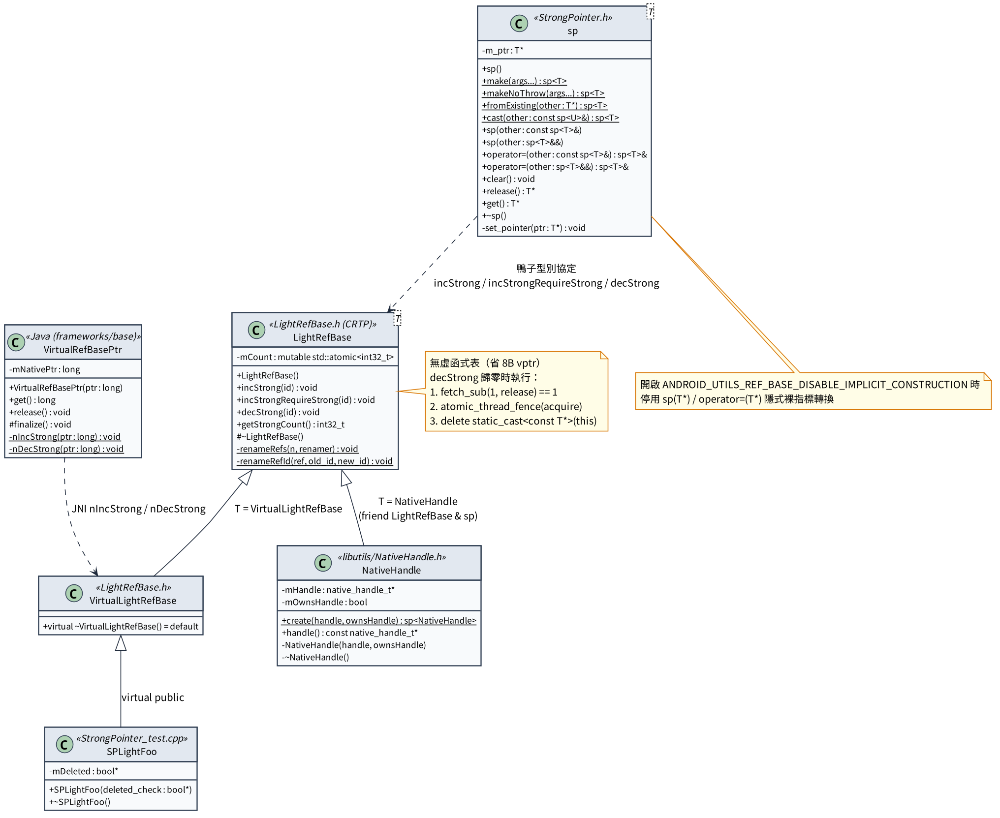
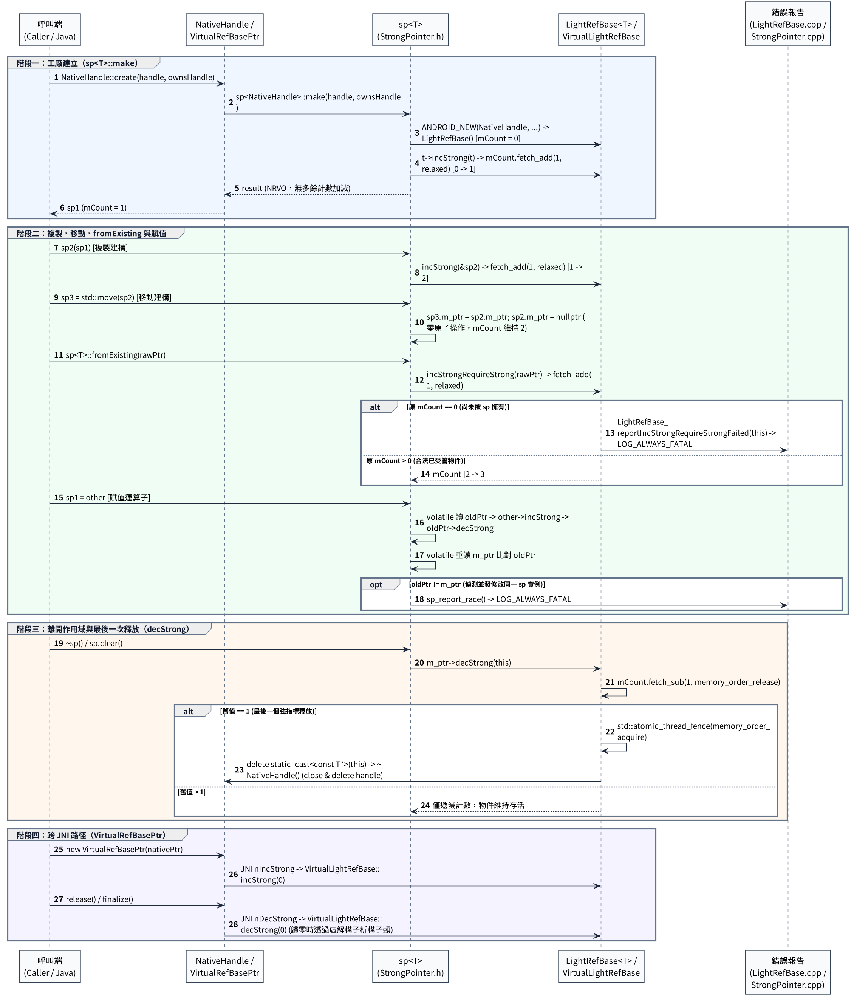

# 3.1 輕量級指標（`LightRefBase`、`VirtualLightRefBase` 與 `sp<>` 基礎）

- **情景說明**：在 Android 17 原生 C++ 系統程式碼中，只要物件不需要弱引用（不存在循環強引用或延遲生命週期需求），就會採用輕量級引用計數基底 `LightRefBase<T>` 搭配強指標 `sp<T>` 來自動管理記憶體。本節以兩條 AOSP 17 真實情景貫穿整條呼叫鏈：
  1. **純 C++ 情景（`NativeHandle`）**：呼叫端透過 `NativeHandle::create(handle, ownsHandle)` 經由 `sp<NativeHandle>::make(...)` 建立 `LightRefBase` 衍生對象，再依序經歷複製、移動（`std::move`）、`fromExisting`、重新賦值、`release()` 與離開作用域自動釋放，最後在 `LightRefBase::decStrong` 將計數歸零並安全關閉底層 `native_handle_t`；
  2. **跨 JNI 情景（`VirtualRefBasePtr`）**：Java 層透過 `VirtualRefBasePtr` 持有非模板基底類 `VirtualLightRefBase` 的原生指標，經由 JNI `nIncStrong` / `nDecStrong` 直接維護輕量級引用計數；最後再以官方單元測試 `StrongPointer_test.cpp` 驗證 `sp<T>` 與 `LightRefBase` 的所有邊界契約。
- **對應原書**：第 3 章引言（p.57–58）、3.1.1 節〈实现原理分析〉（p.58–61）與 3.1.2 節〈应用实例分析〉（p.61–62）
- **涉及專案與版本基準**：
  - `platform/system/core` 〔`android-17.0.0_r1`，commit `545d248`〕
  - `platform/frameworks/base` 〔`android-17.0.0_r1`，commit `94b4c163b`〕

---

## 3.1.1 輕量級指標的定位、模組拆分與設計架構

> 對應原書第 3 章引言（p.57–58）與 3.1.1 開頭（p.58–59）。Android 原生層以侵入式引用計數（intrusive reference counting）管理 C++ 物件生命週期：由物件本身繼承基底類提供計數器，再由外部智能指標物件（`sp<T>` / `wp<T>`）在建構、賦值與解構時自動增減計數。當物件關係為有向無環（DAG）、不需弱指標打破循環引用時，採用單一 32 位元原子計數器的 `LightRefBase<T>` 可免去 `RefBase` 額外堆配置 `weakref_impl` 的記憶體與快取開銷。
>
> 值得注意的是，**`sp<T>` 採用鴨子型別（protocol）設計**：只要模板參數 `T` 實作了 `incStrong`、`incStrongRequireStrong`、`decStrong`（以及給 `ProcessState` 專用的 `forceIncStrong`），就能搭配 `sp<T>` 使用——因此 `sp<T>` 既可作為 `LightRefBase<T>` 的「輕量級指標」，也能作為 `RefBase` 的「強指標」（見 3.2 節）。



### Step 1：`libutils` 與 `libutils_binder` 的模組拆分與安全編譯旗標
**位置**：`platform/system/core/libutils/Android.bp` 〔`android-17.0.0_r1`，lines 58–75、130–160〕、`platform/system/core/libutils/binder/Android.bp` 〔`android-17.0.0_r1`，lines 33–59、89–93〕

```bp
cc_defaults {
    name: "libutils_defaults_nodeps",
    ...
    cflags: [
        "-Wall",
        "-Werror",
        "-Wno-exit-time-destructors",
        "-DANDROID_UTILS_REF_BASE_DISABLE_IMPLICIT_CONSTRUCTION",
        "-Wthread-safety",
    ],
...
cc_defaults {
    name: "libutils_impl_defaults",
    ...
    whole_static_libs: ["libutils_binder"],
    ...
    srcs: [
        "FileMap.cpp",
        "JenkinsHash.cpp",
        "LightRefBase.cpp",
        "NativeHandle.cpp",
        ...
    ],
```

```bp
cc_defaults {
    name: "libutils_binder_impl_defaults_nodeps_no_apex",
    ...
    export_include_dirs: ["include"],
    srcs: [
        "Errors.cpp",
        "RefBase.cpp",
        "SharedBuffer.cpp",
        "String16.cpp",
        "String8.cpp",
        "StrongPointer.cpp",
        "Unicode.cpp",
        "VectorImpl.cpp",
    ],
    ...
}
...
cc_library {
    name: "libutils_binder",
    defaults: ["libutils_binder_impl_defaults"],
    cmake_snapshot_supported: false,
}
```

Android 17 將 `libutils` 中供 Binder 與系統底層共用的最小核心（`RefBase.cpp`、`StrongPointer.cpp` 等）抽離到子模組 `libutils_binder`（`system/core/libutils/binder/`），再由 `libutils` 透過 `whole_static_libs: ["libutils_binder"]` 整併對外提供；同時在 `libutils/include/utils/` 保留指向 `../../binder/include/utils/` 的符號連結（`LightRefBase.h`、`StrongPointer.h`、`RefBase.h`），確保既有的 `#include <utils/RefBase.h>` 與 `#include <utils/StrongPointer.h>` 皆可無痛相容。而 `LightRefBase.cpp` 留在 `libutils` 頂層（因為 `libbinder` 本身不使用 `LightRefBase`）。

另一項極具代表性的現代設定是 `libutils_defaults_nodeps`（以及 `frameworks/native/libs/binder/Android.bp`）預設開啟了 `-DANDROID_UTILS_REF_BASE_DISABLE_IMPLICIT_CONSTRUCTION`，直接於編譯期封鎖裸指標隱式轉為 `sp<T>`／`wp<T>`，強迫新程式碼使用安全的工廠方法 `sp<T>::make` 與 `sp<T>::fromExisting`。

> 〔與 2.3 差異〕搬家 + 拆分 + 新增：原書 2.3（p.58、p.62）使用 `Android.mk` 建置，所有智能指標皆集中在 `frameworks/base/include/utils/RefBase.h` 與 `frameworks/base/libs/utils/RefBase.cpp`；Android 17 改用 Soong `Android.bp`，遷至 `platform/system/core/libutils/` 並拆出獨立標頭 `LightRefBase.h`、`StrongPointer.h`、`RefBase.h` 與子函式庫 `libutils_binder`。

---

### Step 2：`LightRefBase<T>` 模板類別與原子記憶體序
**位置**：`platform/system/core/libutils/binder/include/utils/LightRefBase.h` 〔`android-17.0.0_r1`，lines 31–67〕、`platform/system/core/libutils/LightRefBase.cpp` 〔`android-17.0.0_r1`，lines 25–27〕

```cpp
void LightRefBase_reportIncStrongRequireStrongFailed(const void* thiz);

template <class T>
class LightRefBase
{
public:
    inline LightRefBase() : mCount(0) { }
    inline void incStrong(__attribute__((unused)) const void* id) const {
        mCount.fetch_add(1, std::memory_order_relaxed);
    }
    inline void incStrongRequireStrong(__attribute__((unused)) const void* id) const {
        if (0 == mCount.fetch_add(1, std::memory_order_relaxed)) {
            LightRefBase_reportIncStrongRequireStrongFailed(this);
        }
    }
    inline void decStrong(__attribute__((unused)) const void* id) const {
        if (mCount.fetch_sub(1, std::memory_order_release) == 1) {
            std::atomic_thread_fence(std::memory_order_acquire);
            delete static_cast<const T*>(this);
        }
    }
    //! DEBUGGING ONLY: Get current strong ref count.
    inline int32_t getStrongCount() const {
        return mCount.load(std::memory_order_relaxed);
    }

protected:
    inline ~LightRefBase() { }

private:
    friend class ReferenceMover;
    inline static void renameRefs(size_t /*n*/, const ReferenceRenamer& /*renamer*/) { }
    inline static void renameRefId(T* /*ref*/, const void* /*old_id*/ , const void* /*new_id*/) { }

private:
    mutable std::atomic<int32_t> mCount;
};
```

```cpp
void LightRefBase_reportIncStrongRequireStrongFailed(const void* thiz) {
    LOG_ALWAYS_FATAL("incStrongRequireStrong() called on %p which isn't already owned", thiz);
}
```

逐項拆解 `LightRefBase<T>` 的四個關鍵設計：

1. **CRTP（Curiously Recurring Template Pattern）零虛表銷毀**：`LightRefBase<T>` 刻意不宣告 `virtual ~LightRefBase()`，而是將 `~LightRefBase()` 設為 `protected` 防止外部誤用 `delete` 基底類指標，並在 `decStrong()` 中透過 `delete static_cast<const T*>(this)` 編譯期靜態向下轉型至實際衍生類別 `T`。如此一來，繼承 `LightRefBase<T>` 的物件不需額外承擔 vptr（8 位元組）與虛函式間接分派成本，整個基底類僅佔 4 位元組（單一 `mCount`）。也因為 `mCount` 宣告為 `mutable`，`const T` 物件依然可正常遞增／遞減引用計數。
2. **精準的 C++11 原子記憶體序**：
   - `incStrong()` 使用 **`std::memory_order_relaxed`**：遞增計數時呼叫端已經持有合法物件參考，無須在遞增點施加記憶體屏障，避免在 ARM64 弱記憶體模型上產生無謂的 `dmb` / `ldar` 同步開銷。
   - `decStrong()` 使用 **`std::memory_order_release`**：確保本執行緒在釋放指標前對物件成員做的所有讀寫，都 happens-before 本次計數遞減。
   - 當 `fetch_sub` 回傳的舊值為 `1`（代表本執行緒把計數減到 `0`，負責執行 `delete`）時，才補上一道 **`std::atomic_thread_fence(std::memory_order_acquire)`**。透過 C++11 的 **release sequence** 規則，先前所有執行緒的 `fetch_sub(release)` 都與這最後一次減至 0 的操作同步，再由這道 `acquire` 柵欄保證「其他執行緒對該物件的全部操作」都嚴格 happens-before `delete` 與解構子執行——同時在非最終遞減的熱路徑上完全免除 `acquire` 成本。
3. **`incStrongRequireStrong()` 防呆契約**：專供 `sp<T>::fromExisting(T*)` 呼叫。它先執行 `fetch_add(1, relaxed)`，若回傳的舊值為 `0`，代表該物件原本**並未被任何 `sp<>` 擁有**（例如裸指標剛 `new` 出來、或是棧上物件／受其他配置器管理），直接呼叫獨立非內聯的 `LightRefBase_reportIncStrongRequireStrongFailed()` 觸發 `LOG_ALWAYS_FATAL` 中止程序，藉此減少模板膨脹並第一時間攔截雙重擁有錯誤。
4. **`ReferenceMover` 友元空操作**：`renameRefs` 與 `renameRefId` 是配合 `Vector<sp<T>>` 搬移元素時的追蹤介面（詳見 3.4 節 `DEBUG_REFS`）；由於 `LightRefBase` 不記錄追蹤表，提供空內聯函式讓編譯器直接消除。

> 〔與 2.3 差異〕邏輯改變 + 新增：原書 2.3（p.58–59）使用 `mutable volatile int32_t mCount` 搭配 `android_atomic_inc` / `android_atomic_dec`，沒有明確區分 relaxed / release / acquire fence，也沒有 `incStrongRequireStrong()` 與 `ReferenceMover` 靜態介面。

---

### Step 3：`VirtualLightRefBase` 虛擬解構子封裝
**位置**：`platform/system/core/libutils/binder/include/utils/LightRefBase.h` 〔`android-17.0.0_r1`，lines 69–74〕

```cpp
// This is a wrapper around LightRefBase that simply enforces a virtual
// destructor to eliminate the template requirement of LightRefBase
class VirtualLightRefBase : public LightRefBase<VirtualLightRefBase> {
public:
    virtual ~VirtualLightRefBase() = default;
};
```

CRTP 雖然省下 vptr，卻有一個根本限制：不同衍生類 `LightRefBase<A>` 與 `LightRefBase<B>` 沒有共同的非模板基底類別，無法放進異質容器或由通用 JNI 函式統一透過基底指標做 `incStrong` / `decStrong`。`VirtualLightRefBase` 正是為了解決這個痛點而新增的橋接類：它自身繼承 `LightRefBase<VirtualLightRefBase>` 並宣告 `virtual ~VirtualLightRefBase() = default`。當 `decStrong` 執行 `delete static_cast<const VirtualLightRefBase*>(this)` 時，便會透過虛解構子正確派發至最終子類的解構子（見下方 Step 9 的 `VirtualRefBasePtr` 實例）。

> 〔與 2.3 差異〕新增：原書 2.3（p.58–59）不存在 `VirtualLightRefBase`，若需多型基底只能被迫改用較重的 `RefBase`。

---

## 3.1.2 `sp<T>` 模板類別：現代建立、複製、移動、賦值與釋放全鏈路

> 對應原書 3.1.1 後半（p.59–61）。原書僅展示 `sp<T>` 類別宣告、裸指標建構子、複製建構子與解構子四段程式碼；在 Android 17 中，`sp<T>` 已演進為現代 C++ 所有權智慧指標，補齊了工廠建構（`make` / `makeNoThrow` / `fromExisting`）、移動語意（`sp(sp&&)` / `operator=(sp&&)`）、明確釋放所有權（`release()`）、條件式封鎖隱式裸指標轉換，以及賦值時的執行期資料競爭啟發偵測（`sp_report_race`）。

### Step 4：`sp<T>` 類別定義與編譯期隱式轉換封鎖
**位置**：`platform/system/core/libutils/binder/include/utils/StrongPointer.h` 〔`android-17.0.0_r1`，lines 32–139〕

```cpp
template<typename T>
class sp {
public:
    inline constexpr sp() : m_ptr(nullptr) { }

    template <typename... Args>
    static inline sp<T> make(Args&&... args);

    // Same as the above, but this will return nullptr if the allocation fails.
    template <typename... Args>
    static inline sp<T> makeNoThrow(Args&&... args);

    // if nullptr, returns nullptr
    //
    // if a strong pointer is already available, this will retrieve it,
    // otherwise, this will abort
    static inline sp<T> fromExisting(T* other);

    // for more information about this macro and correct RefBase usage, see
    // the comment at the top of utils/RefBase.h
#if defined(ANDROID_UTILS_REF_BASE_DISABLE_IMPLICIT_CONSTRUCTION)
    sp(std::nullptr_t) : sp() {}
#else
    sp(T* other);  // NOLINT(implicit)
    template <typename U>
    sp(U* other);  // NOLINT(implicit)
    sp& operator=(T* other);
    template <typename U>
    sp& operator=(U* other);
#endif

    sp(const sp<T>& other);
    sp(sp<T>&& other) noexcept;

    template<typename U> sp(const sp<U>& other);  // NOLINT(implicit)
    template<typename U> sp(sp<U>&& other);  // NOLINT(implicit)

    template <typename U>
    static inline sp<T> cast(const sp<U>& other);

    ~sp();

    // Assignment

    sp& operator = (const sp<T>& other);
    sp& operator=(sp<T>&& other) noexcept;

    template<typename U> sp& operator = (const sp<U>& other);
    template<typename U> sp& operator = (sp<U>&& other);

    //! Special optimization for use by ProcessState (and nobody else).
    void force_set(T* other);

    // Reset

    void clear();

    [[nodiscard]] inline T* release() noexcept {
        auto ret = m_ptr;
        m_ptr = nullptr;
        return ret;
    }

    // Accessors

    inline T&       operator* () const     { return *m_ptr; }
    inline T*       operator-> () const    { return m_ptr;  }
    inline T*       get() const            { return m_ptr; }
    inline explicit operator bool () const { return m_ptr != nullptr; }
    ...
private:
    template<typename Y> friend class sp;
    template<typename Y> friend class wp;
    void set_pointer(T* ptr);
    T* m_ptr;
};
```

對照原書 2.3，類別骨架有五個關鍵變化：
1. **徹底與 `RefBase::weakref_type` 解耦**：原書 `sp<T>` 內部含有 `typedef typename RefBase::weakref_type weakref_type;` 與私有建構子 `sp(T* p, weakref_type* refs)`；17 已將兩者移除，改由 `private` 成員 `set_pointer(T* ptr)` 給友元 `wp<Y>::promote()` 使用，使 `StrongPointer.h` 完全不需依賴 `RefBase.h`。
2. **`ANDROID_UTILS_REF_BASE_DISABLE_IMPLICIT_CONSTRUCTION`**：當編譯旗標開啟時，四個接受裸指標 `T*` / `U*` 的建構子與賦值運算子全部停用，只留下 `sp(std::nullptr_t)`。這能從根源消除原書寫法 `sp<Foo> f = new Foo()` 或將棧上物件／`std::unique_ptr` 管理的裸指標誤傳給 `void bar(sp<Foo>)` 所引發的隱性雙重釋放（double-free）。
3. **空建構子 `constexpr` 與 `explicit operator bool()`**：允許 `static constinit sp<T>`（例如 `RefBase_test.cpp` 的全域測試變數），並支援 `if (ptr)` 語法而不致發生隱式轉 `int`。
4. **比較運算子改為非成員模板 + `std::less` 等函子**（`StrongPointer.h:141-198`）：支援 `sp` 與 `nullptr`、裸指標或跨型別 `sp<U>` 比較，其中 `<` / `>` / `<=` / `>=` 透過 `std::common_type` 與 `std::less` 避免比較無關指標時的 C++ 未定義行為（UB）。
5. **保留唯一成員 `T* m_ptr`**：`sizeof(sp<T>) == sizeof(T*)`，與原書同樣維持零額外空間開銷。

> 〔與 2.3 差異〕邏輯改變 + 新增：原書 2.3（p.59–60）將 `sp` 寫在 `RefBase.h` 中且強耦合 `weakref_type`，無 `make` / `makeNoThrow` / `fromExisting` / `cast` / `release` / 移動語意 / `operator bool` 與隱式建構封鎖巨集。

---

### Step 5：`sp<T>::make`、`makeNoThrow` 與 `fromExisting`
**位置**：`platform/system/core/libutils/binder/include/utils/StrongPointer.h` 〔`android-17.0.0_r1`，lines 208–239〕

```cpp
// TODO: Ideally we should find a way to increment the reference count before running the
// constructor, so that generating an sp<> to this in the constructor is no longer dangerous.
template <typename T>
template <typename... Args>
sp<T> sp<T>::make(Args&&... args) {
    T* t = ANDROID_NEW(T, std::forward<Args>(args)...);
    sp<T> result;
    result.m_ptr = t;
    t->incStrong(t);
    return result;
}

template <typename T>
template <typename... Args>
sp<T> sp<T>::makeNoThrow(Args&&... args) {
    T* t = ANDROID_NEW_NOTHROW(T, std::forward<Args>(args)...);
    sp<T> result;
    result.m_ptr = t;
    if (t != nullptr) {
        t->incStrong(t);
    }
    return result;
}

template <typename T>
sp<T> sp<T>::fromExisting(T* other) {
    if (other) {
        other->incStrongRequireStrong(other);
        sp<T> result;
        result.m_ptr = other;
        return result;
    }
    return nullptr;
}
```

這三個靜態工廠函式取代了傳統的裸指標建構：
- **`sp<T>::make(...)`**：以完美轉發呼叫 `ANDROID_NEW(T, ...)`（預設展開為 `new T(...)`，若開啟 `ANDROID_UTILS_CUSTOM_ALLOCATOR` 則走 `AllocatorTracker`，詳見 3.4 節），隨即建立 `sp<T> result`、填入 `m_ptr` 並呼叫 `t->incStrong(t)`。注意此時傳入 `incStrong` 的追蹤 `id` 是物件位址 `t`（而非局部變數 `&result`），且編譯器會透過 NRVO（Named Return Value Optimization）直接在呼叫端空間建構 `result`，不產生多餘計數加減。標頭上方註解亦提醒：因 `incStrong` 發生在 `T` 建構子返回之後，故仍**切忌在建構子內對 `this` 建立 `sp<>`**。
- **`sp<T>::makeNoThrow(...)`**：使用 `ANDROID_NEW_NOTHROW`（預設 `new (std::nothrow)`），記憶體不足時安全回傳空 `sp<T>`（`nullptr`），不拋出例外也不觸發 abort。
- **`sp<T>::fromExisting(T* other)`**：用於物件成員函式內部需要從 `this` 取得 `sp<T>` 的場景（`sp<Foo>::fromExisting(this)`）。不同於舊版隱式 `sp<Foo>(this)` 會盲目遞增計數（萬一 `this` 其實在棧上或未被 `sp` 擁有就會在離開時誤刪），`fromExisting` 改呼叫 `incStrongRequireStrong()`——對 `LightRefBase` 而言，只要原 `mCount == 0` 就會立即 `LOG_ALWAYS_FATAL`。

> 〔與 2.3 差異〕新增：原書 2.3（p.60–61）僅使用 `sp<T>::sp(T* other)` 搭配 `new T()` 隱式轉換；Android 17 以 `sp<T>::make` / `makeNoThrow` / `fromExisting` 建立「建立即受管、取用必驗證已受管」的現代所有權規範。

---

### Step 6：`sp<T>` 複製建構、移動建構與 `sp<T>::cast`
**位置**：`platform/system/core/libutils/binder/include/utils/StrongPointer.h` 〔`android-17.0.0_r1`，lines 271–300〕

```cpp
template<typename T>
sp<T>::sp(const sp<T>& other)
        : m_ptr(other.m_ptr) {
    if (m_ptr)
        m_ptr->incStrong(this);
}

template <typename T>
sp<T>::sp(sp<T>&& other) noexcept : m_ptr(other.m_ptr) {
    other.m_ptr = nullptr;
}

template<typename T> template<typename U>
sp<T>::sp(const sp<U>& other)
        : m_ptr(other.m_ptr) {
    if (m_ptr)
        m_ptr->incStrong(this);
}

template<typename T> template<typename U>
sp<T>::sp(sp<U>&& other)
        : m_ptr(other.m_ptr) {
    other.m_ptr = nullptr;
}

template <typename T>
template <typename U>
sp<T> sp<T>::cast(const sp<U>& other) {
    return sp<T>::fromExisting(static_cast<T*>(other.get()));
}
```

- **複製建構子**（同型別與可隱式轉型的子類 `U` → 父類 `T`）：與原書相同，拷貝指標後若非空則呼叫 `m_ptr->incStrong(this)`，對 `LightRefBase` 即執行一次 `mCount.fetch_add(1, relaxed)`。
- **移動建構子**（`sp(sp<T>&&)` 與 `sp(sp<U>&&)`）：直接接手 `other.m_ptr` 並將 `other.m_ptr` 置為 `nullptr`，**完全不觸碰原子引用計數**（零 `incStrong`、零 `decStrong`），在容器擴容（`std::vector<sp<T>>`）與函式傳回值傳遞時顯著降低多核快取線爭用（cache-line bouncing）。
- **`sp<T>::cast(const sp<U>&)`**：針對向下轉型（`static_cast<T*>`）提供的顯式輔助方法，內部走 `fromExisting`，既避免寫出裸指標隱式轉 `sp`，又保留計數合法性檢查。

> 〔與 2.3 差異〕新增：原書 2.3（p.60）為 C++98 時代，沒有右值參考移動建構子（`sp(sp&&)`）與 `sp<T>::cast`。

---

### Step 7：`sp<T>` 賦值運算子、`clear()`、`release()`、`~sp()` 與 `sp_report_race()`
**位置**：`platform/system/core/libutils/binder/include/utils/StrongPointer.h` 〔`android-17.0.0_r1`，lines 302–377〕、`platform/system/core/libutils/binder/StrongPointer.cpp` 〔`android-17.0.0_r1`，lines 21–24〕

```cpp
template<typename T>
sp<T>::~sp() {
    if (m_ptr)
        m_ptr->decStrong(this);
}

template<typename T>
sp<T>& sp<T>::operator =(const sp<T>& other) {
    // Force m_ptr to be read twice, to heuristically check for data races.
    T* oldPtr(*const_cast<T* volatile*>(&m_ptr));
    T* otherPtr(other.m_ptr);
    if (otherPtr) otherPtr->incStrong(this);
    if (oldPtr) oldPtr->decStrong(this);
    if (oldPtr != *const_cast<T* volatile*>(&m_ptr)) sp_report_race();
    m_ptr = otherPtr;
    return *this;
}

template <typename T>
sp<T>& sp<T>::operator=(sp<T>&& other) noexcept {
    T* oldPtr(*const_cast<T* volatile*>(&m_ptr));
    if (oldPtr) oldPtr->decStrong(this);
    if (oldPtr != *const_cast<T* volatile*>(&m_ptr)) sp_report_race();
    m_ptr = other.m_ptr;
    other.m_ptr = nullptr;
    return *this;
}
...
template<typename T>
void sp<T>::clear() {
    T* oldPtr(*const_cast<T* volatile*>(&m_ptr));
    if (oldPtr) {
        oldPtr->decStrong(this);
        if (oldPtr != *const_cast<T* volatile*>(&m_ptr)) sp_report_race();
        m_ptr = nullptr;
    }
}
```

```cpp
namespace android {

void sp_report_race() { LOG_ALWAYS_FATAL("sp<> assignment detected data race"); }
}
```

這段實作藏著三個對理解 Android 17 `sp<T>` 行為極其關鍵的細節：

1. **先 `incStrong` 新指標、後 `decStrong` 舊指標**：在複製賦值 `operator=(const sp<T>&)` 中，先增加 `otherPtr` 計數再減少 `oldPtr` 計數，天然免疫**自我賦值**（`a = a`）與**父子間接自我銷毀**（當 `oldPtr` 是唯一持有 `otherPtr` 的所有者時，若先 `decStrong(oldPtr)` 會把 `otherPtr` 一併銷毀導致懸垂指標）。
2. **`volatile` 雙讀與 `sp_report_race()` 資料競爭啟發偵測**：`sp<T>` 本身的執行緒安全模型等同於 `std::shared_ptr`／裸指標 `T*`——不同執行緒可以安全並發讀寫各自指向同一物件的「不同 `sp<T>` 實例」，但**絕不可在無鎖保護下並發修改同一個 `sp<T>` 實例**。`operator=` 與 `clear()` 特意在函式入口以 `*const_cast<T* volatile*>(&m_ptr)` 強制從記憶體讀取一次 `oldPtr`，在執行 `incStrong`/`decStrong` 後、寫入新值前再透過 `volatile` 重讀一次 `m_ptr`；若兩次讀值不一致（表示其他執行緒在無鎖狀態下修改了同一個 `sp<T>`，或 `decStrong` 觸發的解構子重入改寫了這個 `sp<T>`），立刻呼叫非內聯的 `sp_report_race()` 觸發 `LOG_ALWAYS_FATAL`。
   - **細微注意（移動賦值的自我移動風險）**：`operator=(sp<T>&&)` 先 `decStrong(oldPtr)` 再轉移 `other.m_ptr` 並清零 `other.m_ptr`，不特別處理 `a = std::move(a)` 自我移動賦值（一般標準程式應避免自我移動）；此外 `release()`（見 Step 4）僅取出 `m_ptr` 並置空自己、**不呼叫 `decStrong`**，把呼叫 `decStrong` 的責任移交給呼叫端（常用於跨越 C API / JNI 邊界移交所有權）。
3. **解構子 `~sp()`**：當 `sp` 離開作用域時若 `m_ptr != nullptr`，呼叫 `m_ptr->decStrong(this)`；對 `LightRefBase<T>` 來說，當計數從 `1` 減為 `0` 即觸發 `acquire` 柵欄並 `delete static_cast<const T*>(this)`。

> 〔與 2.3 差異〕邏輯改變 + 新增：原書 2.3（p.59–60）未實作移動賦值、`release()`，亦無 `volatile` 雙讀與 `sp_report_race()`（該錯誤回報函式獨立置於 `StrongPointer.cpp` 以避免每個模板實例內聯 `LOG_ALWAYS_FATAL`）。

---

## 3.1.3 AOSP 17 真實應用實例與單元測試驗證

> 對應原書 3.1.2 節〈应用实例分析〉（p.61–62）。原書透過自行在 `external/lightpointer/` 撰寫簡易測試程式與 `Android.mk` 來示範 `LightRefBase`；在 Android 17 中，我們直接閱讀 AOSP 原始碼內最標準的兩個真實類別（`NativeHandle` 與 `VirtualRefBasePtr`）以及官方 GoogleTest 測試套件 `StrongPointer_test.cpp`，既驗證所有機制，又能直接對齊實際系統程式寫法。

### Step 8：純 C++ 實例——`NativeHandle`（`LightRefBase` + `sp::make` + 私有建構／解構子慣用法）
**位置**：`platform/system/core/libutils/include/utils/NativeHandle.h` 〔`android-17.0.0_r1`，lines 27–54〕、`platform/system/core/libutils/NativeHandle.cpp` 〔`android-17.0.0_r1`，lines 22–36〕

```cpp
class NativeHandle : public LightRefBase<NativeHandle> {
public:
    static sp<NativeHandle> create(native_handle_t* handle, bool ownsHandle);

    const native_handle_t* handle() const {
        return mHandle;
    }

private:
    // for access to the destructor
    friend class LightRefBase<NativeHandle>;
    // for access to the constructor
    friend class sp<NativeHandle>;

    NativeHandle(native_handle_t* handle, bool ownsHandle);
    ~NativeHandle();

    native_handle_t* mHandle;
    bool mOwnsHandle;

    // non-copyable
    NativeHandle(const NativeHandle&);
    NativeHandle& operator=(const NativeHandle&);
};
```

```cpp
sp<NativeHandle> NativeHandle::create(native_handle_t* handle, bool ownsHandle) {
    return handle ? sp<NativeHandle>::make(handle, ownsHandle) : nullptr;
}

NativeHandle::NativeHandle(native_handle_t* handle, bool ownsHandle)
        : mHandle(handle), mOwnsHandle(ownsHandle) {

}

NativeHandle::~NativeHandle() {
    if (mOwnsHandle) {
        native_handle_close(mHandle);
        native_handle_delete(mHandle);
    }
}
```

`NativeHandle` 是 Android 17 編寫 `LightRefBase` 衍生類的**教科書級範本**（`frameworks/native/libs/ui/include/ui/Fence.h` 與 `GraphicBuffer.h` 亦採相同模式）：
1. **私有建構子 + `friend class sp<NativeHandle>`**：徹底封死外部直接 `new NativeHandle(...)` 或在棧上宣告 `NativeHandle h(...)` 的可能，強迫唯一建立入口為靜態工廠 `NativeHandle::create()` → `sp<NativeHandle>::make(...)`。
2. **私有非虛擬解構子 + `friend class LightRefBase<NativeHandle>`**：防止外部誤寫 `delete ptr`，唯一銷毀路徑必定是最後一個 `sp<NativeHandle>` 離開作用域 → `~sp()` → `LightRefBase<NativeHandle>::decStrong()` → `delete static_cast<const NativeHandle*>(this)` → `~NativeHandle()` 關閉並釋放 `mHandle` 內的檔案描述符與記憶體。
3. **執行期計數軌跡**：`NativeHandle::create()` 返回的 `sp<NativeHandle>` 持有 `mCount == 1`；若傳遞給其他模組複製則遞增至 `2`，若以 `std::move` 移交則維持 `1`；直到所有 `sp` 銷毀、`fetch_sub(1, release)` 回傳 `1` 時觸發 `acquire` fence 並執行 `~NativeHandle()`。

> 〔與 2.3 差異〕實作範式演進：原書 3.1.2（p.61）的 `LightClass` 將建構子與虛擬解構子皆設為 `public`，並用 `LightClass* p = new LightClass(); sp<LightClass> lpOut = p;` 隱式轉換；Android 17 在開啟 `ANDROID_UTILS_REF_BASE_DISABLE_IMPLICIT_CONSTRUCTION` 後，改採「私有建構／解構子 + `friend class sp<T>` + `friend class LightRefBase<T>` + `sp<T>::make`」從編譯期徹底杜絕生命週期誤用。

---

### Step 9：跨 JNI 實例——`VirtualRefBasePtr` 與 `VirtualLightRefBase`
**位置**：`platform/frameworks/base/core/java/com/android/internal/util/VirtualRefBasePtr.java` 〔`android-17.0.0_r1`，lines 26–65〕、`platform/frameworks/base/core/jni/com_android_internal_util_VirtualRefBasePtr.cpp` 〔`android-17.0.0_r1`，lines 23–31〕

```java
public final class VirtualRefBasePtr {
    // TODO(b/231729094): Convert to NativeAllocationRegistry?
    private long mNativePtr;

    public VirtualRefBasePtr(long ptr) {
        mNativePtr = ptr;
        nIncStrong(mNativePtr);
    }
    ...
    public void release() {
        if (mNativePtr != 0) {
            nDecStrong(mNativePtr);
            mNativePtr = 0;
        }
    }

    @Override
    protected void finalize() throws Throwable {
        try {
            release();
        } finally {
            super.finalize();
        }
    }

    private static native void nIncStrong(long ptr);
    private static native void nDecStrong(long ptr);
}
```

```cpp
static void incStrong(JNIEnv* env, jobject clazz, jlong objPtr) {
    VirtualLightRefBase* obj = reinterpret_cast<VirtualLightRefBase*>(objPtr);
    obj->incStrong(0);
}

static void decStrong(JNIEnv* env, jobject clazz, jlong objPtr) {
    VirtualLightRefBase* obj = reinterpret_cast<VirtualLightRefBase*>(objPtr);
    obj->decStrong(0);
}
```

這裡清楚呈現了 Step 3 `VirtualLightRefBase` 的實戰價值：Java 層（例如 RenderNode / 繪圖動畫屬性等原生資源）只需要透過單一通用封裝類 `VirtualRefBasePtr`，把原生指標存為 `long mNativePtr`，建構時呼叫 `nIncStrong`、主動 `release()` 或 GC `finalize()` 時呼叫 `nDecStrong`。JNI 端無須知道具體衍生型別，直接將 `jlong` 轉回 `VirtualLightRefBase*` 呼叫 `decStrong(0)`；當計數歸零時，由 `VirtualLightRefBase` 的虛解構子透過 vtable 正確銷毀最終子類。

> 〔與 2.3 差異〕新增：原書 2.3（p.58–62）無 `VirtualLightRefBase` 與 `VirtualRefBasePtr`，跨 JNI 管理原生輕量級引用計數物件是 Android 後續版本新增的基礎設施。

---

### Step 10：AOSP 17 官方單元測試 `StrongPointer_test.cpp`
**位置**：`platform/system/core/libutils/binder/StrongPointer_test.cpp` 〔`android-17.0.0_r1`，lines 52–60、87–160〕

```cpp
class SPLightFoo : virtual public VirtualLightRefBase {
  public:
    explicit SPLightFoo(bool* deleted_check) : mDeleted(deleted_check) { *mDeleted = false; }

    ~SPLightFoo() { *mDeleted = true; }

  private:
    bool* mDeleted;
};
...
using RefBaseTypes = ::testing::Types<SPFoo, SPLightFoo>;
...
TYPED_TEST_CASE(StrongPointer, RefBaseTypes);

TYPED_TEST(StrongPointer, move) {
    bool isDeleted;
    sp<TypeParam> sp1 = sp<TypeParam>::make(&isDeleted);
    TypeParam* foo = sp1.get();
    ASSERT_EQ(1, foo->getStrongCount());
    {
        sp<TypeParam> sp2 = std::move(sp1);
        ASSERT_EQ(1, foo->getStrongCount()) << "std::move failed, incremented refcnt";
        ASSERT_EQ(nullptr, sp1.get()) << "std::move failed, sp1 is still valid";
        sp1 = std::move(sp2);
    }
    ASSERT_FALSE(isDeleted) << "deleted too early! still has a reference!";
    {
        sp<TypeParam> sp2 = std::move(sp1);
    }
    ASSERT_TRUE(isDeleted) << "foo was leaked!";
}
...
TYPED_TEST(StrongPointer, Deleted) {
    bool isDeleted;
    sp<TypeParam> foo = sp<TypeParam>::make(&isDeleted);

    auto foo2 = sp<TypeParam>::fromExisting(foo.get());

    EXPECT_FALSE(isDeleted);
    foo = nullptr;
    EXPECT_FALSE(isDeleted);
    foo2 = nullptr;
    EXPECT_TRUE(isDeleted);
}

TYPED_TEST(StrongPointer, AssertStrongRefExists) {
    bool isDeleted;
    TypeParam* foo = new TypeParam(&isDeleted);
    EXPECT_DEATH(sp<TypeParam>::fromExisting(foo), "");
    delete foo;
}

TYPED_TEST(StrongPointer, release) {
    bool isDeleted = false;
    TypeParam* foo = nullptr;
    {
        sp<TypeParam> sp1 = sp<TypeParam>::make(&isDeleted);
        ASSERT_EQ(1, sp1->getStrongCount());
        foo = sp1.release();
    }
    ASSERT_FALSE(isDeleted) << "release failed, deleted anyway when sp left scope";
    ASSERT_EQ(1, foo->getStrongCount()) << "release mismanaged refcount";
    foo->decStrong(nullptr);
    ASSERT_TRUE(isDeleted) << "foo was leaked!";
}
```

`StrongPointer_test.cpp`（定義於 `libutils_binder_test`，支援 `host_supported: true` 直接在主機或裝置執行）以 GoogleTest 型別參數化測試 `TYPED_TEST` 同時驗證 `SPFoo`（繼承 `RefBase`）與 `SPLightFoo`（繼承 `VirtualLightRefBase`），直接驗證了 `sp<T>` 的鴨子型別契約：
1. **`move`**：`sp<T>::make` 初始 `getStrongCount() == 1`；`std::move(sp1)` 後計數維持 `1` 且 `sp1.get() == nullptr`；第二個內層區塊把 `sp1` 移入局部變數 `sp2`，離開作用域時觸發 `~sp()` → `decStrong()` → `isDeleted == true`。
2. **`Deleted` 與 `AssertStrongRefExists`**：已由 `sp::make` 擁有的物件可安全透過 `sp::fromExisting(foo.get())` 取得第二個強指標（計數 `1 → 2`）；反之直接 `new TypeParam` 尚未被 `sp` 擁有的裸指標呼叫 `fromExisting` 時，由 `incStrongRequireStrong` 偵測舊計數為 `0` 並觸發死亡測試（`EXPECT_DEATH`）。
3. **`release`**：`sp1.release()` 將所有權轉出並把 `sp1.m_ptr` 清零，因此 `sp1` 離開作用域時不會呼叫 `decStrong`（`isDeleted == false`、`getStrongCount() == 1`），直到呼叫端顯式執行 `foo->decStrong(nullptr)` 才釋放物件。

> 〔與 2.3 差異〕取代：原書 3.1.2（p.61–62）手寫 `external/lightpointer/lightpointer.cpp` 並需編進 `system.img` 開模擬器手動執行驗證；Android 17 改由 Soong `cc_test`（`libutils_binder_test`）在 host／device 自動化驗證複製、移動、`fromExisting` 死亡斷言、`release` 與 `makeNoThrow`（自訂配置器 OOM 測試）。

---

## 3.1.4 本節總結與呼叫鏈時序圖



### 關鍵要點回顧

| 面向 | Android 2.3（原書 p.58–62） | Android 17（`android-17.0.0_r1`） |
|---|---|---|
| **檔案位置** | `frameworks/base/include/utils/RefBase.h` | `system/core/libutils/binder/include/utils/{LightRefBase.h,StrongPointer.h}` + `LightRefBase.cpp` + `StrongPointer.cpp` |
| **計數與記憶體序** | `volatile int32_t` + `android_atomic_inc/dec` | `std::atomic<int32_t>` + `relaxed` 遞增、`release` 遞減、歸零前 `atomic_thread_fence(acquire)` |
| **多型輕量基底** | 無（只能改用 `RefBase`） | 新增 `VirtualLightRefBase`（供 `VirtualRefBasePtr` 等跨 JNI／異質容器使用） |
| **物件建立與取用** | 隱式 `sp<T> p = new T()` | `sp<T>::make` / `makeNoThrow` / `fromExisting`（`incStrongRequireStrong` 檢核）+ `-DANDROID_UTILS_REF_BASE_DISABLE_IMPLICIT_CONSTRUCTION` |
| **效能與安全防線** | 僅複製語意、無競爭偵測 | 新增移動建構／移動賦值（零原子開銷）、`release()`、`volatile` 雙讀 + `sp_report_race()` |
