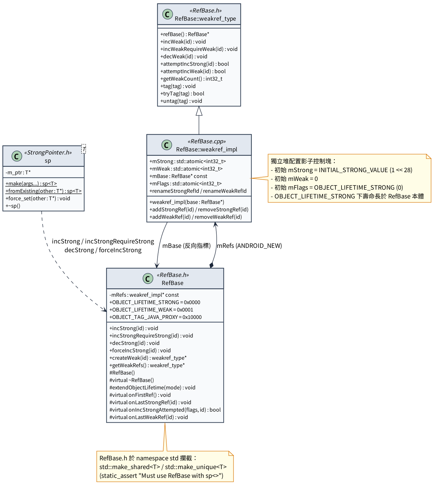
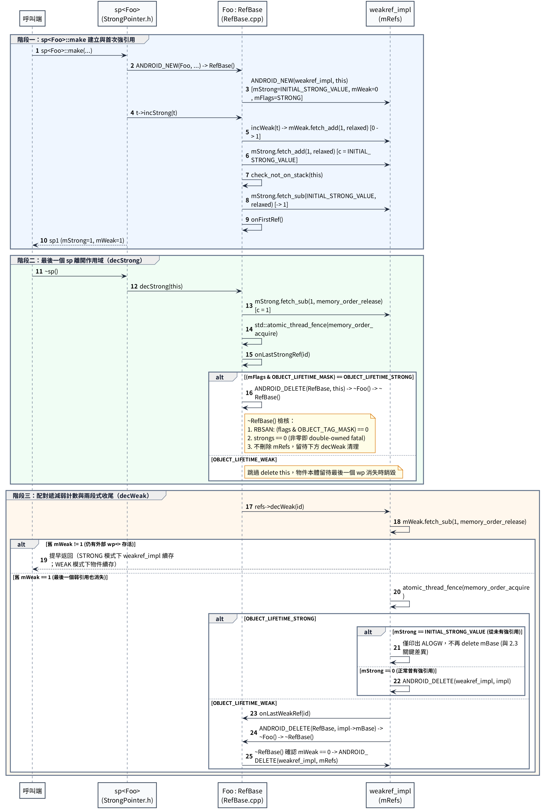

# 3.2 強指標與 `RefBase` 生命週期（`RefBase`、`weakref_impl` 與記憶體序）

- **情景說明**：當系統物件需要被快取鍵觀察、打破「父↔子」循環引用，或像 Binder 代理物件那樣在強引用歸零後仍須維持存活（`OBJECT_LIFETIME_WEAK`）時，物件必須繼承 `RefBase` 而非 `LightRefBase`。本節以 `sp<Foo>::make(...)` 建立繼承 `RefBase` 的物件為主線，完整追蹤：
  1. `RefBase` 建構時如何配置獨立的影子引用計數器 `weakref_impl`（`mStrong = INITIAL_STRONG_VALUE`、`mWeak = 0`）；
  2. 強引用遞增（`incStrong`、`incStrongRequireStrong`、`forceIncStrong`）如何維護 `mWeak >= mStrong` 不變量、執行 `check_not_on_stack` 並觸發首次引用回呼 `onFirstRef()`；
  3. 強引用歸零與兩段式銷毀（`decStrong` → `~RefBase` → `decWeak`）在 **`OBJECT_LIFETIME_STRONG`** 與 **`OBJECT_LIFETIME_WEAK`** 兩種模式下的分流、C++11 release-acquire 記憶體序如何保證跨核析構可見性，以及編譯期如何封鎖 `std::make_shared` / `std::make_unique` 混用。
- **對應原書**：3.2 節引言與 3.2.1 節〈强指针的实现原理分析〉（p.62–69）
- **涉及專案與版本基準**：
  - `platform/system/core` 〔`android-17.0.0_r1`，commit `545d248`〕

---

## 3.2.1 `RefBase`、`weakref_type` 與 `weakref_impl` 雙層架構

> 對應原書 3.2.1 前半（p.63–65）。與 `LightRefBase` 直接把計數器嵌在物件本體不同，`RefBase` 必須支援「**物件本體已經銷毀，但仍有外部 `wp<>` 指向它**」的情景。因此 `RefBase` 把實際的強／弱計數器與旗標外置到獨立堆配置的 `weakref_impl`（對外以抽象介面類 `weakref_type` 暴露）：`RefBase` 本體內僅持有指標 `weakref_impl* const mRefs`，讓 `weakref_impl` 的生命週期得以長於 `RefBase` 本體，直到最後一個弱引用也消失才釋放。



### Step 1：`RefBase` 與 `weakref_type` 介面定義與生命週期旗標
**位置**：`platform/system/core/libutils/binder/include/utils/RefBase.h` 〔`android-17.0.0_r1`，lines 282–433〕

```cpp
class RefBase
{
public:
            void            incStrong(const void* id) const;
            void            incStrongRequireStrong(const void* id) const;
            void            decStrong(const void* id) const;
    
            void            forceIncStrong(const void* id) const;

            //! DEBUGGING ONLY: Get current strong ref count.
            int32_t         getStrongCount() const;

    class weakref_type
    {
    public:
        RefBase*            refBase() const;

        void                incWeak(const void* id);
        void                incWeakRequireWeak(const void* id);
        void                decWeak(const void* id);

        // acquires a strong reference if there is already one.
        bool                attemptIncStrong(const void* id);

        // acquires a weak reference if there is already one.
        // This is not always safe. see ProcessState.cpp and BpBinder.cpp
        // for proper use.
        bool                attemptIncWeak(const void* id);

        //! DEBUGGING ONLY: Get current weak ref count.
        int32_t             getWeakCount() const;
        ...
        void tag(int32_t tag);
        void untag(int32_t tag);
        [[nodiscard]] bool tryTag(int32_t tag);
    };

            weakref_type*   createWeak(const void* id) const;
            
            weakref_type*   getWeakRefs() const;
    ...
    enum {
        // for extendObjectLifetime
        OBJECT_LIFETIME_STRONG = 0x0000,
        OBJECT_LIFETIME_WEAK = 0x0001,
        OBJECT_LIFETIME_MASK = 0x0001,

        // A few free bits.

        // for "RefBase" SAN - RBSAN. This is used as a bitfield, since
        // RefBase objects (especially binder objects) are often shared
        // among unrelated code in the same process, so code needs to be
        // able to check tags independently.
        OBJECT_TAG_JAVA_PROXY = 0x10000,
        OBJECT_TAG_MASK = 0x10000,
    };
    static_assert((OBJECT_LIFETIME_MASK & OBJECT_TAG_MASK) == 0, "conflicting values");

  protected:
                            RefBase();
    virtual                 ~RefBase();

    void extendObjectLifetime(int32_t mode);

    //! Flags for onIncStrongAttempted()
    enum {
        FIRST_INC_STRONG = 0x0001
    };
    
    virtual void            onFirstRef();
    virtual void            onLastStrongRef(const void* id);
    virtual bool            onIncStrongAttempted(uint32_t flags, const void* id);
    virtual void            onLastWeakRef(const void* id);

private:
    friend class weakref_type;
    class weakref_impl;
    
                            RefBase(const RefBase& o);
            RefBase&        operator=(const RefBase& o);

private:
    friend class ReferenceMover;

    static void renameRefs(size_t n, const ReferenceRenamer& renamer);

    static void renameRefId(weakref_type* ref,
            const void* old_id, const void* new_id);

    static void renameRefId(RefBase* ref,
            const void* old_id, const void* new_id);

        weakref_impl* const mRefs;
};
```

對照原書 2.3，現代 `RefBase` 介面層最顯著的三大變化如下：
1. **`OBJECT_LIFETIME_FOREVER` 已徹底移除**：生命週期列舉由 `protected` 提升為 `public`，且只剩 `OBJECT_LIFETIME_STRONG`（`0x0000`，預設）與 `OBJECT_LIFETIME_WEAK`（`0x0001`）兩種模式，並以 `OBJECT_LIFETIME_MASK`（`0x0001`）切出低位元區段。原本讓智能指標退化成手動 `delete` 的 `OBJECT_LIFETIME_FOREVER` 已廢止。
2. **新增 RBSAN（RefBase Sanitizer）標籤機制**：高位元 `OBJECT_TAG_JAVA_PROXY = 0x10000` 與 `OBJECT_TAG_MASK = 0x10000` 共用 `mFlags` 原子欄位（並以 `static_assert` 靜態保證不與生命週期旗標重疊），搭配 `weakref_type::tag` / `tryTag` / `untag` 在物件仍被外部元件（如 Java `BinderProxy`）關聯時禁止析構（詳見 3.4 節）。
3. **強化現有引用檢核與容器搬移**：新增 `incStrongRequireStrong`（供 `sp::fromExisting`）與 `incWeakRequireWeak`（供 `wp::fromExisting`），以及供 `ReferenceMover` 呼叫的私有 `renameRefs` / `renameRefId`（供 `DEBUG_REFS` 模式在 `Vector` 搬移 `sp`/`wp` 後更新追蹤 `id`）。

> 〔與 2.3 差異〕已移除 + 新增：原書 2.3（p.63–64）宣告 `OBJECT_LIFETIME_WEAK = 0x0001` 與 `OBJECT_LIFETIME_FOREVER = 0x0003`；Android 17 刪除 `OBJECT_LIFETIME_FOREVER`，補入 `OBJECT_LIFETIME_STRONG` / `MASK`、RBSAN `OBJECT_TAG_*` 與 `incStrongRequireStrong` / `incWeakRequireWeak` / `ReferenceMover` 友元介面。

---

### Step 2：`RefBase::weakref_impl`、`RefBase::RefBase()` 與異常計數防護巨集
**位置**：`platform/system/core/libutils/binder/RefBase.cpp` 〔`android-17.0.0_r1`，lines 146–160、186–212、812〕

```cpp
#define INITIAL_STRONG_VALUE (1<<28)

#define MAX_COUNT 0xfffff

// Test whether the argument is a clearly invalid strong reference count.
// Used only for error checking on the value before an atomic decrement.
// Intended to be very cheap.
// Note that we cannot just check for excess decrements by comparing to zero
// since the object would be deallocated before that.
#define BAD_STRONG(c) \
        ((c) == 0 || ((c) & (~(MAX_COUNT | INITIAL_STRONG_VALUE))) != 0)

// Same for weak counts.
#define BAD_WEAK(c) ((c) == 0 || ((c) & (~MAX_COUNT)) != 0)
```

```cpp
class RefBase::weakref_impl : public RefBase::weakref_type
{
public:
    std::atomic<int32_t>    mStrong;
    std::atomic<int32_t>    mWeak;
    RefBase* const          mBase;
    std::atomic<int32_t>    mFlags;

#if !DEBUG_REFS

    explicit weakref_impl(RefBase* base)
        : mStrong(INITIAL_STRONG_VALUE)
        , mWeak(0)
        , mBase(base)
        , mFlags(OBJECT_LIFETIME_STRONG)
    {
    }

    void addStrongRef(const void* /*id*/) { }
    void removeStrongRef(const void* /*id*/) { }
    void renameStrongRefId(const void* /*old_id*/, const void* /*new_id*/) { }
    void addWeakRef(const void* /*id*/) { }
    void removeWeakRef(const void* /*id*/) { }
    void renameWeakRefId(const void* /*old_id*/, const void* /*new_id*/) { }
    void printRefs() const { }
    void trackMe(bool, bool) { }
```

```cpp
RefBase::RefBase() : mRefs(ANDROID_NEW(weakref_impl, this)) {}
```

當 `sp<Foo>::make(...)` 執行 `ANDROID_NEW(Foo, ...)` 進入基底類建構子 `RefBase::RefBase()` 時，會立刻再配置一個 `weakref_impl` 並初始化四個核心成員：
- **`mStrong = INITIAL_STRONG_VALUE`（`1 << 28` = `0x10000000`）**：不是 `0`！這是一個經典的哨兵值，用來區分兩種截然不同的狀態——「**從未被任何強指標引用過**（`INITIAL_STRONG_VALUE`）」與「**曾有強引用但目前已全部釋放**（`0`）」。這項區分在 `incStrong`（決定何時觸發 `onFirstRef`）、`decWeak`、`~RefBase` 與 `attemptIncStrong` 中都扮演核心角色。
- **`mWeak = 0`**：弱計數初始為 0；整個生命週期內只要系統處於穩態，**`mWeak` 恆包含所有強引用與弱引用（`mWeak >= 實際強引用數`）**。
- **`mBase = this`**：反向指向所屬的 `RefBase` 物件本體。
- **`mFlags = OBJECT_LIFETIME_STRONG`（`0`）**：預設為強引用控制生命週期。
- **`BAD_STRONG(c)` 與 `BAD_WEAK(c)`**：合法引用上限為 `MAX_COUNT`（`0xfffff` = 1,048,575）。這兩個位元遮罩巨集能在一次位元運算內同時偵測「計數為 0（重複釋放）」、「負值下溢（高位元皆為 1）」與「異常暴衝超過 100 萬（引用洩漏）」，以極低成本在 `incStrong` / `decStrong` / `incWeak` / `decWeak` 觸發 `LOG_ALWAYS_FATAL`。

> 〔與 2.3 差異〕邏輯改變 + 新增：原書 2.3（p.64、p.66）的 `mStrong`/`mWeak`/`mFlags` 皆為 `volatile int32_t`，僅靠 `LOG_ASSERT`（release build 會編譯消除）檢查計數下溢，且直接使用 `new weakref_impl(this)`；17 全面改用 `std::atomic<int32_t>`、`ANDROID_NEW` 巨集與 release build 仍生效的 `BAD_STRONG`/`BAD_WEAK` + `LOG_ALWAYS_FATAL_IF`。

---

### Step 3：`RefBase::extendObjectLifetime` 與 `check_not_on_stack` 棧物件偵測
**位置**：`platform/system/core/libutils/binder/RefBase.cpp` 〔`android-17.0.0_r1`，lines 162–182、858–865〕

```cpp
// name kept because prebuilts used to use it from inlining sp<> code
void sp_report_stack_pointer() { LOG_ALWAYS_FATAL("RefBase used with stack pointer argument"); }

static void check_not_on_stack(const void* ptr) {
    static constexpr int MIN_PAGE_SIZE = 0x1000;  // 4K. Safer than including sys/user.h.
    static constexpr uintptr_t MIN_PAGE_MASK = ~static_cast<uintptr_t>(MIN_PAGE_SIZE - 1);
    uintptr_t my_frame_address =
            reinterpret_cast<uintptr_t>(__builtin_frame_address(0 /* this frame */));
    if (((reinterpret_cast<uintptr_t>(ptr) ^ my_frame_address) & MIN_PAGE_MASK) == 0) {
        sp_report_stack_pointer();
    }
}
```

```cpp
void RefBase::extendObjectLifetime(int32_t mode)
{
    check_not_on_stack(this);

    // Must be happens-before ordered with respect to construction or any
    // operation that could destroy the object.
    mRefs->mFlags.fetch_or(mode, std::memory_order_relaxed);
}
```

`RefBase` 物件絕不可配置於呼叫棧（stack）上，否則離開函式作用域與 `decStrong` 的 `delete this` 會引發立即的堆損毀。`check_not_on_stack(ptr)` 採用極輕量的啟發檢查：以 `__builtin_frame_address(0)` 取得目前函式棧框位址，與 `ptr` 做 XOR 後遮罩低 12 位元（最小分頁 4 KiB）；若兩者落在同一個 4 KiB 分頁（因 `malloc` 堆記憶體絕不會與執行緒棧共用分頁），立即呼叫 `sp_report_stack_pointer()` 中止程序。

若子類需要將生命週期延長至最後一個弱引用消失（典型案例為 `BpBinder`），須在建構子中（即任何可能觸發銷毀的操作 happens-before 之前）呼叫 `extendObjectLifetime(OBJECT_LIFETIME_WEAK)`，以 `fetch_or(mode, memory_order_relaxed)` 設下旗標（使用 `fetch_or` 可避免覆寫同時存在的 RBSAN 標籤位元）。

> 〔與 2.3 差異〕邏輯改變 + 新增：原書 2.3（p.64）無 `check_not_on_stack` 偵測，且 `extendObjectLifetime` 使用 `android_atomic_or`；17 加上棧分頁檢查並改用 `std::atomic::fetch_or(relaxed)`。

---

## 3.2.2 強引用遞增路徑：`incStrong`、`incStrongRequireStrong` 與 `forceIncStrong`

> 對應原書 3.2.1 中段（p.65–67）。在 3.1 節已知 `sp<T>::make` / 複製建構 / `fromExisting` 會分別呼叫目標物件的 `incStrong` 或 `incStrongRequireStrong`；當模板參數 `T` 繼承自 `RefBase` 時，便進入本段呼叫鏈。

### Step 4：`RefBase::incStrong` 與 `weakref_type::incWeak`
**位置**：`platform/system/core/libutils/binder/RefBase.cpp` 〔`android-17.0.0_r1`，lines 453–478、567–576〕

```cpp
void RefBase::incStrong(const void* id) const
{
    weakref_impl* const refs = mRefs;
    refs->incWeak(id);

    refs->addStrongRef(id);
    const int32_t c = refs->mStrong.fetch_add(1, std::memory_order_relaxed);
    ALOG_ASSERT(c > 0, "incStrong() called on %p after last strong ref", refs);
    LOG_ALWAYS_FATAL_IF(BAD_STRONG(c),
                        "incStrong() called on %p too many times,"
                        " strong refs = %d ",
                        refs, c);
#if PRINT_REFS
    ALOGD("incStrong of %p from %p: cnt=%d\n", this, id, c);
#endif
    if (c != INITIAL_STRONG_VALUE)  {
        return;
    }

    check_not_on_stack(this);

    int32_t old __unused = refs->mStrong.fetch_sub(INITIAL_STRONG_VALUE, std::memory_order_relaxed);
    // A decStrong() must still happen after us.
    ALOG_ASSERT(old > INITIAL_STRONG_VALUE, "0x%x too small", old);
    refs->mBase->onFirstRef();
}
```

```cpp
void RefBase::weakref_type::incWeak(const void* id)
{
    weakref_impl* const impl = static_cast<weakref_impl*>(this);
    impl->addWeakRef(id);
    const int32_t c __unused = impl->mWeak.fetch_add(1,
            std::memory_order_relaxed);
    ALOG_ASSERT(c >= 0, "incWeak called on %p after last weak ref", this);
    LOG_ALWAYS_FATAL_IF(c != 0 && BAD_WEAK(c),
                        "incWeak called on %p too many times, weak refs = %d", this, c);
}
```

沿著 `sp<Foo>::make(...)` → `t->incStrong(t)` 逐步追蹤：
1. **先增弱計數（`refs->incWeak(id)`）**：將 `mWeak` 以 `memory_order_relaxed` 從 `0` 加到 `1`（並於 `c != 0` 時以 `BAD_WEAK(c)` 檢查是否溢位）。這維持了關鍵不變量：**每次強引用必定伴隨一次弱引用**，因此 `mWeak` 永遠不會先於 `mStrong` 歸零。
2. **再增強計數（`refs->mStrong.fetch_add(1, relaxed)`）**：回傳加 1 前的舊值 `c`。首次強引用時 `c == INITIAL_STRONG_VALUE`，此時 `mStrong` 短暫變為 `INITIAL_STRONG_VALUE + 1`；若已有其他強引用（如 `c == 1`），則 `c != INITIAL_STRONG_VALUE`，直接 `return` 走快速路徑。
3. **首次強引用專屬收尾**：
   - 執行 `check_not_on_stack(this)`：僅在首次強引用時檢查一次，零熱路徑負擔。
   - 呼叫 `refs->mStrong.fetch_sub(INITIAL_STRONG_VALUE, relaxed)` 把計數修正回真實值（單執行緒即從 `INITIAL_STRONG_VALUE + 1` 變為 `1`；即便此時恰有另一執行緒並發呼叫 `incStrong`，因使用原子 `fetch_sub`，最終結果仍精確等於 `2`）。
   - 呼叫虛函式 `refs->mBase->onFirstRef()`：通知衍生類第一次獲得強引用（例如 `BpBinder::onFirstRef()` 會藉此向 Binder 驅動發送 `BC_ACQUIRE` 增加遠端強引用）。

> 〔與 2.3 差異〕邏輯改變 + 新增：原書 2.3（p.66）在 `incStrong` 開頭多呼叫一次多餘的 `refs->addWeakRef(id)`（`incWeak` 裡已呼叫過一次），使用 `android_atomic_inc`/`android_atomic_add`，且沒有 `BAD_STRONG`/`BAD_WEAK` 的 `LOG_ALWAYS_FATAL_IF` 與 `check_not_on_stack(this)`。

---

### Step 5：`RefBase::incStrongRequireStrong` 與 `RefBase::forceIncStrong`
**位置**：`platform/system/core/libutils/binder/RefBase.cpp` 〔`android-17.0.0_r1`，lines 480–492、531–554〕

```cpp
void RefBase::incStrongRequireStrong(const void* id) const {
    weakref_impl* const refs = mRefs;
    refs->incWeak(id);

    refs->addStrongRef(id);
    const int32_t c = refs->mStrong.fetch_add(1, std::memory_order_relaxed);

    LOG_ALWAYS_FATAL_IF(c <= 0 || c == INITIAL_STRONG_VALUE,
                        "incStrongRequireStrong() called on %p which isn't already owned", refs);
#if PRINT_REFS
    ALOGD("incStrong (requiring strong) of %p from %p: cnt=%d\n", this, id, c);
#endif
}
```

```cpp
void RefBase::forceIncStrong(const void* id) const
{
    // Allows initial mStrong of 0 in addition to INITIAL_STRONG_VALUE.
    // TODO: Better document assumptions.
    weakref_impl* const refs = mRefs;
    refs->incWeak(id);

    refs->addStrongRef(id);
    const int32_t c = refs->mStrong.fetch_add(1, std::memory_order_relaxed);
    ALOG_ASSERT(c >= 0, "forceIncStrong called on %p after ref count underflow",
               refs);
#if PRINT_REFS
    ALOGD("forceIncStrong of %p from %p: cnt=%d\n", this, id, c);
#endif

    switch (c) {
    case INITIAL_STRONG_VALUE:
        refs->mStrong.fetch_sub(INITIAL_STRONG_VALUE,
                std::memory_order_relaxed);
        [[fallthrough]];
    case 0:
        refs->mBase->onFirstRef();
    }
}
```

這兩個方法分別服務於兩個截然相反的進階需求：
- **`incStrongRequireStrong(id)`**（由 `sp<T>::fromExisting(T*)` 呼叫）：要求呼叫當下物件**必須已經存在至少一個強引用**，因此只要加 1 前的舊值 `c <= 0` 或 `c == INITIAL_STRONG_VALUE` 就立即 `LOG_ALWAYS_FATAL`。這也順帶封堵了「從未有強引用或強引用已歸零的 `OBJECT_LIFETIME_WEAK` 物件被誤以 `fromExisting` 復活」的錯誤。
- **`forceIncStrong(id)`**（僅供 `sp<T>::force_set` 呼叫，全 AOSP 主要用於 `ProcessState::getStrongProxyForHandle`，詳見 3.4 節）：允許在 `mStrong == 0`（對象為 `OBJECT_LIFETIME_WEAK` 且已透過 `attemptIncWeak` 確保物件仍活著）時強制把強計數從 `0` 拉回 `1`，並且透過 `[[fallthrough]]` 確保不論是從 `INITIAL_STRONG_VALUE` 還是從 `0` 升上來，都會觸發 `onFirstRef()` 重新向 Binder 驅動取得強引用。

> 〔與 2.3 差異〕新增 + 邏輯改變：`incStrongRequireStrong` 為 Android 17 新增；`forceIncStrong` 在 2.3 已宣告（原書 p.63 未展開實作），17 改用 `std::atomic` 與 C++17 `[[fallthrough]]`。

---

## 3.2.3 強引用遞減、兩段式銷毀與 C++11 原子記憶體序

> 對應原書 3.2.1 後半（p.67–69）。當最後一個 `sp<Foo>` 離開作用域或被清空時，`~sp()` 呼叫 `decStrong()`，觸發「物件本體」與「`weakref_impl`」兩者的銷毀協調。這一段也是 Android 17 相較於原書 2.3 **邏輯改動最深、最容易踩坑**的地方。

### Step 6：`RefBase::decStrong` 與跨核記憶體序（Release Sequence + Acquire Fence）
**位置**：`platform/system/core/libutils/binder/RefBase.cpp` 〔`android-17.0.0_r1`，lines 494–529〕

```cpp
void RefBase::decStrong(const void* id) const
{
    weakref_impl* const refs = mRefs;
    refs->removeStrongRef(id);
    const int32_t c = refs->mStrong.fetch_sub(1, std::memory_order_release);
#if PRINT_REFS
    ALOGD("decStrong of %p from %p: cnt=%d\n", this, id, c);
#endif
    LOG_ALWAYS_FATAL_IF(
            BAD_STRONG(c),
            "decStrong() called on %p too many times, possible memory corruption. Consider "
            "compiling with ANDROID_UTILS_REF_BASE_DISABLE_IMPLICIT_CONSTRUCTION for better errors",
            refs);
    if (c == 1) {
        std::atomic_thread_fence(std::memory_order_acquire);
        refs->mBase->onLastStrongRef(id);
        const int32_t flags = refs->mFlags.load(std::memory_order_relaxed);

        if ((flags&OBJECT_LIFETIME_MASK) == OBJECT_LIFETIME_STRONG) {
            // The destructor does not delete refs in this case.
            ANDROID_DELETE(RefBase, this);
        }
    }
    refs->decWeak(id);
}
```

細看 `decStrong` 的四個關鍵步驟：
1. **先抓出區域指標 `weakref_impl* const refs = mRefs`**：絕對不能在 `ANDROID_DELETE(RefBase, this)` 之後才讀 `this->mRefs`，因為在 `OBJECT_LIFETIME_STRONG` 模式下 `this` 已經被釋放！提前存成區域變數 `refs`，才能在末尾安全執行 `refs->decWeak(id)`。
2. **`fetch_sub(1, memory_order_release)` + `atomic_thread_fence(memory_order_acquire)`**：
   - 假設執行緒 T1 與 T2 同時持有 `sp<Foo>`，各自修改 `Foo` 欄位後依序釋放。
   - T1 先執行 `fetch_sub(1, release)`（`2 → 1`），把 T1 對 `Foo` 的全部寫入發布到 `mStrong` 的 release sequence 上。
   - T2 隨後執行 `fetch_sub(1, release)`（`1 → 0`，回傳 `c == 1`），進入 `if (c == 1)` 後立刻執行 `std::atomic_thread_fence(std::memory_order_acquire)`。根據 C++ 標準（`[atomics.fences]`），這道 `acquire` 柵欄與 T1 的 `release` 形成 **synchronizes-with**，從而保證 T1 的所有物件存取嚴格 **happens-before** T2 執行 `onLastStrongRef` 與 `~Foo()`（`RefBase_test.cpp::RacingDestructors` 即專測此事，見 3.4 節）。
3. **依 `OBJECT_LIFETIME_MASK` 決定是否在此銷毀物件本體**：
   - 若為預設 `OBJECT_LIFETIME_STRONG`：先呼叫 `onLastStrongRef(id)`，接著執行 `ANDROID_DELETE(RefBase, this)` 觸發 `~Foo()` 與 `~RefBase()`。注意此時 `this->mRefs`（`weakref_impl`）**不會**在 `~RefBase()` 中被釋放，因為下方緊接著還要跑 `refs->decWeak(id)`！
   - 若為 `OBJECT_LIFETIME_WEAK`：呼叫 `onLastStrongRef(id)` 後**跳過 `delete this`**，讓物件本體存活到最後一個弱引用歸零才於 `decWeak` 銷毀。
4. **統一執行 `refs->decWeak(id)`**：配對 `incStrong` 當初呼叫的 `refs->incWeak(id)`。如果同時沒有其他 `wp<>` 存活，這裡就會把 `mWeak` 從 `1` 減到 `0`，進而釋放 `weakref_impl`（`STRONG` 模式）或釋放 `RefBase` + `weakref_impl`（`WEAK` 模式）。

> 〔與 2.3 差異〕邏輯改變：原書 2.3（p.67）使用 `android_atomic_dec` 與 `delete this`，且多呼叫一次冗餘的 `refs->removeWeakRef(id)`；17 明確分離 `release` 遞減與 `acquire` 柵欄，加入 `BAD_STRONG(c)` fatal 檢查，改以 `OBJECT_LIFETIME_MASK` 比對 `OBJECT_LIFETIME_STRONG`，並改用 `ANDROID_DELETE(RefBase, this)` 支援自訂配置器。

---

### Step 7：`RefBase::~RefBase()` 析構防線（RBSAN、雙重擁有與 `weakref_impl` 清理職責）
**位置**：`platform/system/core/libutils/binder/RefBase.cpp` 〔`android-17.0.0_r1`，lines 814–856〕

```cpp
RefBase::~RefBase()
{
    const int32_t flags = mRefs->mFlags.load(std::memory_order_acquire);

    // NOTE: if 'c' is 2 and 2 tags are set, we could also crash. However, we don't
    // currently as this would require adding additional atomic reads.
    const int32_t tags = flags & OBJECT_TAG_MASK;
    LOG_ALWAYS_FATAL_IF(tags != 0, "RBSAN: Object is deleted, but it is tagged: %" PRId32, tags);

    // Life-time of this object is extended to WEAK, in
    // which case weakref_impl doesn't out-live the object and we
    // can free it now.
    if ((flags & OBJECT_LIFETIME_MASK) == OBJECT_LIFETIME_WEAK) {
        // It's possible that the weak count is not 0 if the object
        // re-acquired a weak reference in its destructor
        if (mRefs->mWeak.load(std::memory_order_relaxed) == 0) {
            ANDROID_DELETE(weakref_impl, mRefs);
        }
    } else {
        int32_t strongs = mRefs->mStrong.load(std::memory_order_relaxed);

        if (strongs == INITIAL_STRONG_VALUE) {
            // We never acquired a strong reference on this object.
            ALOGW("RefBase: Explicit destruction, weak count = %d (in %p). Use sp<> to manage this "
                  "object. Note - if weak count is 0, this leaks mRefs (weakref_impl).",
                  mRefs->mWeak.load(), this);

#if ANDROID_UTILS_CALLSTACK_ENABLED
            CallStack::logStack(LOG_TAG);
#endif
        } else if (strongs != 0) {
            LOG_ALWAYS_FATAL("RefBase: object %p with strong count %d deleted. Double owned?", this,
                             strongs);
        }
    }
    // For debugging purposes, clear mRefs.  Ineffective against outstanding wp's.
    const_cast<weakref_impl*&>(mRefs) = nullptr;
}
```

對比原書 2.3 只有 3 行（`if (mRefs->mWeak == 0) delete mRefs;`），Android 17 的 `~RefBase()` 徹底重構為三層防線：
1. **RBSAN 檢查（第 816–821 行）**：以 `memory_order_acquire` 讀取 `mFlags`（與 `tag`/`untag` 的 `acq_rel` 配對）。若仍有任何 `OBJECT_TAG_MASK` 位元未清除（例如 `OBJECT_TAG_JAVA_PROXY` 還掛著，代表 Java 端還以為這個原生 Binder 物件活著），直接 `LOG_ALWAYS_FATAL` 抓出 UAF 前兆。
2. **`OBJECT_LIFETIME_WEAK` 分支（第 826–831 行）**：此模式下 `~RefBase()` 是從 `decWeak` 歸零時被呼叫的，`weakref_impl` 不再需要比物件活得更久，因此確認 `mWeak == 0` 後就在這裡直接 `ANDROID_DELETE(weakref_impl, mRefs)`。
3. **`OBJECT_LIFETIME_STRONG` 分支（第 832–853 行）**：此模式下 `~RefBase()` **絕不刪除 `mRefs`**（統一留給緊接著執行的 `decWeak` 刪除），轉而驗證 `mStrong`：
   - 正常由 `decStrong` 呼叫時，`mStrong` 必為 `0`，安全通過；
   - 若 `strongs == INITIAL_STRONG_VALUE`：代表這是一個從未交給 `sp<>` 管理卻被手動 `delete` 或配置在棧上的物件（如 `delete new Foo()`）。因歷史遺留碼仍偶有棧上 `RefBase`，此處印出 `ALOGW` 與呼叫堆疊（且特意**不**釋放 `mRefs`，避免萬一存在殘留 `wp` 時引發 UAF，代價是 `mWeak == 0` 時洩漏一個 `weakref_impl`）；
   - 若 `strongs != 0`（且非初始值）：代表還有活著的 `sp<>` 卻遭人手動 `delete`（典型的 double-ownership，例如同時交給 `unique_ptr` 與 `sp`），立刻 `LOG_ALWAYS_FATAL`！

> 〔與 2.3 差異〕邏輯改變 + 新增：原書 2.3（p.68）的 `~RefBase()` 不分生命週期一律看 `mWeak == 0` 就 `delete mRefs`，沒有 RBSAN、沒有雙重擁有偵測、也沒有棧上／手動析構警告；17 明確規定 `OBJECT_LIFETIME_STRONG` 由 `decWeak` 釋放 `mRefs`、`OBJECT_LIFETIME_WEAK` 由 `~RefBase` 釋放 `mRefs`，並補齊多項安全斷言。

---

### Step 8：`RefBase::weakref_type::decWeak` 與「從未強引用不再自動銷毀」變更
**位置**：`platform/system/core/libutils/binder/RefBase.cpp` 〔`android-17.0.0_r1`，lines 587–627〕

```cpp
void RefBase::weakref_type::decWeak(const void* id)
{
    weakref_impl* const impl = static_cast<weakref_impl*>(this);
    impl->removeWeakRef(id);
    const int32_t c = impl->mWeak.fetch_sub(1, std::memory_order_release);
    LOG_ALWAYS_FATAL_IF(
            BAD_WEAK(c),
            "decWeak called on %p too many times, possible memory corruption. Consider compiling "
            "with ANDROID_UTILS_REF_BASE_DISABLE_IMPLICIT_CONSTRUCTION for better errors",
            this);
    if (c != 1) return;
    atomic_thread_fence(std::memory_order_acquire);

    int32_t flags = impl->mFlags.load(std::memory_order_relaxed);
    if ((flags&OBJECT_LIFETIME_MASK) == OBJECT_LIFETIME_STRONG) {
        // This is the regular lifetime case. The object is destroyed
        // when the last strong reference goes away. Since weakref_impl
        // outlives the object, it is not destroyed in the dtor, and
        // we'll have to do it here.
        if (impl->mStrong.load(std::memory_order_relaxed)
                == INITIAL_STRONG_VALUE) {
            // Decrementing a weak count to zero when object never had a strong
            // reference.  We assume it acquired a weak reference early, e.g.
            // in the constructor, and will eventually be properly destroyed,
            // usually via incrementing and decrementing the strong count.
            // Thus we no longer do anything here.  We log this case, since it
            // seems to be extremely rare, and should not normally occur. We
            // used to deallocate mBase here, so this may now indicate a leak.
            ALOGW("RefBase: Object at %p lost last weak reference "
                    "before it had a strong reference", impl->mBase);
        } else {
            // ALOGV("Freeing refs %p of old RefBase %p\n", this, impl->mBase);
            ANDROID_DELETE(weakref_impl, impl);
        }
    } else {
        // This is the OBJECT_LIFETIME_WEAK case. The last weak-reference
        // is gone, we can destroy the object.
        impl->mBase->onLastWeakRef(id);
        ANDROID_DELETE(RefBase, impl->mBase);
    }
}
```

與 `decStrong` 同理，`decWeak` 使用 `fetch_sub(1, memory_order_release)` + `BAD_WEAK(c)` 檢查，只有把 `mWeak` 從 `1` 減至 `0` 的最後一個執行緒才會通過 `if (c != 1) return;` 並執行 `atomic_thread_fence(memory_order_acquire)`。接著依生命週期分兩大分支：

1. **`OBJECT_LIFETIME_STRONG` 分支**：
   - **一般情況（曾經有過強引用，`mStrong == 0`）**：物件本體早已在 `decStrong` 中銷毀，這裡只需 `ANDROID_DELETE(weakref_impl, impl)` 回收影子計數器，完成兩段式銷毀的最後一步。
   - **重大行為變更（從未有過強引用，`mStrong == INITIAL_STRONG_VALUE`）**：在原書 2.3（p.68–69）中，這段會執行 `delete impl->mBase;` 把物件刪掉；但這會造成一個極隱蔽的炸彈——若物件在建構子裡暫時建立了指向自己的 `wp<T>(this)` 並於建構子結束前銷毀該 `wp`，`mWeak` 會從 `1` 歸零並**在建構子尚未返回前就把自己 `delete` 掉**！因此 Android 17（如註解明述）改為**什麼都不刪除、僅印出 `ALOGW` 警告**，假設呼叫端稍後會透過 `sp<>` 正常管理並釋放該物件（亦即 `RefBase_test.cpp::WeakCopies` 所驗證的新契約）。
2. **`OBJECT_LIFETIME_WEAK` 分支**：
   - 因 `OBJECT_LIFETIME_FOREVER` 已移除，無需再做第二層判斷，直接呼叫 `impl->mBase->onLastWeakRef(id)` 並執行 `ANDROID_DELETE(RefBase, impl->mBase)`——這會觸發 `~Foo()` 與 `~RefBase()`，而 `~RefBase()` 見到 `OBJECT_LIFETIME_WEAK && mWeak == 0` 便順勢把 `weakref_impl` 一併回收。

> 〔與 2.3 差異〕邏輯改變 + 已移除：
> 1. 原書 2.3（p.68–69）在 `OBJECT_LIFETIME_STRONG` 且 `mStrong == INITIAL_STRONG_VALUE` 時執行 `delete impl->mBase`；Android 17 改為不刪除、僅印 `ALOGW` 警告，防止建構子內短暫建立 `wp(this)` 引發提前銷毀。
> 2. 原書 2.3（p.68–69）在 `else` 分支仍須檢查 `(impl->mFlags & OBJECT_LIFETIME_FOREVER) != OBJECT_LIFETIME_FOREVER`；Android 17 已徹底移除 `OBJECT_LIFETIME_FOREVER`，`OBJECT_LIFETIME_WEAK` 歸零時一律銷毀 `impl->mBase`。

---

## 3.2.4 編譯期反雙重擁有防線：`std::make_shared` / `std::make_unique` 封鎖

### Step 9：`RefBase.h` 對 STL 智慧指標工廠的 `static_assert` 攔截
**位置**：`platform/system/core/libutils/binder/include/utils/RefBase.h` 〔`android-17.0.0_r1`，lines 818–850〕

```cpp
namespace libutilsinternal {
template <typename T, typename = void>
struct is_complete_type : std::false_type {};

template <typename T>
struct is_complete_type<T, decltype(void(sizeof(T)))> : std::true_type {};
}  // namespace libutilsinternal

namespace std {

// Define `RefBase` specific versions of `std::make_shared` and
// `std::make_unique` to block people from using them. Using them to allocate
// `RefBase` objects results in double ownership. Use
// `sp<T>::make(...)` instead.
//
// Note: We exclude incomplete types because `std::is_base_of` is undefined in
// that case.

template <typename T, typename... Args,
          typename std::enable_if<libutilsinternal::is_complete_type<T>::value, bool>::value = true,
          typename std::enable_if<std::is_base_of<android::RefBase, T>::value, bool>::value = true>
shared_ptr<T> make_shared(Args...) {  // SEE COMMENT ABOVE.
    static_assert(!std::is_base_of<android::RefBase, T>::value, "Must use RefBase with sp<>");
}

template <typename T, typename... Args,
          typename std::enable_if<libutilsinternal::is_complete_type<T>::value, bool>::value = true,
          typename std::enable_if<std::is_base_of<android::RefBase, T>::value, bool>::value = true>
unique_ptr<T> make_unique(Args...) {  // SEE COMMENT ABOVE.
    static_assert(!std::is_base_of<android::RefBase, T>::value, "Must use RefBase with sp<>");
}

}  // namespace std
```

現代 C++ 開發者常習慣隨手寫 `std::make_shared<MyBinder>()` 或 `std::make_unique<MyRefBase>()`，但 `RefBase` 屬於侵入式計數模型，一旦該物件指標又在某處被包成 `sp<T>`（例如傳入 Binder 介面），就會造成兩套獨立控制塊各自執行 `delete` 的災難性雙重擁有。`RefBase.h` 在 `namespace std` 中利用 SFINAE（並以 `is_complete_type` 避免對前置宣告的不完整型別呼叫 `std::is_base_of` 觸發 UB）針對所有 `RefBase` 子類重載 `make_shared` 與 `make_unique`，直接以 `static_assert(..., "Must use RefBase with sp<>")` 在編譯期把錯誤擋下。

> 〔與 2.3 差異〕新增：原書 2.3（p.63–69）尚未採用 C++11 標準庫智慧指標，無此編譯期封鎖機制；Android 17 透過 `static_assert` 從編譯期強制隔離 `std::shared_ptr`/`std::unique_ptr` 與 `RefBase`/`sp<>`。

---

## 3.2.5 本節總結與呼叫鏈時序圖



### 兩種生命週期下的銷毀責任矩陣（Android 17）

| 生命週期模式 | 最後一個 `sp` 釋放（`decStrong`，`mStrong: 1 → 0`） | 最後一個 `wp` 釋放（`decWeak`，`mWeak: 1 → 0`） | `~RefBase()` 執行動作 |
|---|---|---|---|
| **`OBJECT_LIFETIME_STRONG`（預設 `0x0000`）** | 1. `acquire` fence<br>2. 呼叫 `onLastStrongRef`<br>3. **`ANDROID_DELETE(RefBase, this)` 銷毀物件本體**<br>4. 呼叫 `refs->decWeak` | 1. `acquire` fence<br>2. 若曾有強引用（`mStrong == 0`）：**`ANDROID_DELETE(weakref_impl, impl)`**<br>3. 若從未有強引用（`mStrong == INITIAL_STRONG_VALUE`）：僅印 `ALOGW`，**不銷毀 `mBase` 亦不釋放 `impl`** | 1. 檢核 RBSAN `OBJECT_TAG_MASK`<br>2. 不刪除 `mRefs`<br>3. `mStrong == INITIAL_STRONG_VALUE` 印 `ALOGW`；`mStrong != 0` 觸發 `LOG_ALWAYS_FATAL` |
| **`OBJECT_LIFETIME_WEAK`（`0x0001`）** | 1. `acquire` fence<br>2. 呼叫 `onLastStrongRef`<br>3. **不銷毀物件本體**<br>4. 呼叫 `refs->decWeak` | 1. `acquire` fence<br>2. 呼叫 `onLastWeakRef`<br>3. **`ANDROID_DELETE(RefBase, impl->mBase)` 銷毀物件本體** | 1. 檢核 RBSAN `OBJECT_TAG_MASK`<br>2. 若 `mWeak == 0`，**`ANDROID_DELETE(weakref_impl, mRefs)`** |
| ~~`OBJECT_LIFETIME_FOREVER`~~ | **Android 17 已移除**（原書 2.3 p.69 存在） | — | — |
