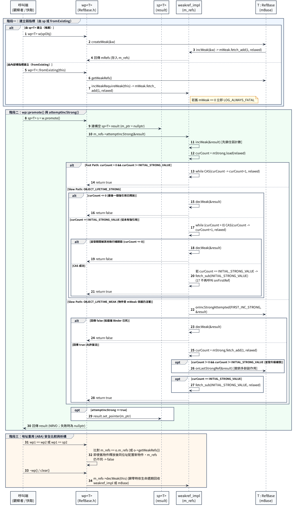

# 3.3 弱指標與安全升級（`wp<>`、`promote`、`attemptIncStrong` 與 ABA 防護）

- **情景說明**：在框架實作中，物件 A 以 `sp<B>` 擁有物件 B，而物件 B（或快取容器如 `HeapCache`、死亡通知回呼 `DeathRecipient`）以弱指標 `wp<A>` 回指 A 以避免循環強引用。因為 `wp<A>` 不阻止 A 銷毀，當 B 需要存取 A 的成員時，必須先呼叫 `wp<A>::promote()` 嘗試把弱指標原子升級為強指標 `sp<A>`。本節完整追蹤：
  1. `wp<T>` 的雙指標結構（`m_ptr` + `m_refs`）、三大實作不變量、`createWeak` / `wp::fromExisting`（`incWeakRequireWeak`）與 `~wp`；
  2. `wp<T>::promote()` → `weakref_type::attemptIncStrong(&result)` 的完整四大分支（Fast Path 已有強引用 CAS、Slow Path `OBJECT_LIFETIME_STRONG` 歸零失敗 vs `INITIAL_STRONG_VALUE` 並發 CAS 防禦、`OBJECT_LIFETIME_WEAK` 呼叫 `onIncStrongAttempted` 復活與並發 `onLastStrongRef` 補償）；
  3. 專供 `ProcessState` 句柄表使用的 `weakref_type::attemptIncWeak()`；
  4. `wp<T>` 比較運算子如何以 `m_refs` 辨識物件真實身分，徹底解決舊物件釋放後同地址配置新物件的 ABA 誤判問題。
- **對應原書**：3.2.2 節〈弱指针的实现原理分析〉（p.69–75）
- **涉及專案與版本基準**：
  - `platform/system/core` 〔`android-17.0.0_r1`，commit `545d248`〕

---

## 3.3.1 `wp<T>` 的雙指標設計、建立與釋放

> 對應原書 3.2.2 前半（p.69–72）。與 `sp<T>` 只有一個 `T* m_ptr` 不同，`wp<T>` 同時保存 `T* m_ptr`（目標物件位址）與 `weakref_type* m_refs`（影子計數器 `weakref_impl` 位址），因此 `sizeof(wp<T>) == 2 * sizeof(void*)`。當 `OBJECT_LIFETIME_STRONG` 物件本體被銷毀時，`m_ptr` 已成為懸垂位址（絕不可解參考），但 `m_refs` 指向的 `weakref_impl` 仍然有效存活——這正是 `wp<T>` 能在物件死亡後安全判定升級失敗、並持續參與快取鍵比較的根本原因。

### Step 1：`wp<T>` 類別定義與三大實作不變量
**位置**：`platform/system/core/libutils/binder/include/utils/RefBase.h` 〔`android-17.0.0_r1`，lines 437–495、546–575〕

```cpp
template <typename T>
class wp
{
public:
    typedef typename RefBase::weakref_type weakref_type;

    inline constexpr wp() : m_ptr(nullptr), m_refs(nullptr) { }

    // if nullptr, returns nullptr
    //
    // if a weak pointer is already available, this will retrieve it,
    // otherwise, this will abort
    static inline wp<T> fromExisting(T* other);

    // for more information about this flag, see above
#if defined(ANDROID_UTILS_REF_BASE_DISABLE_IMPLICIT_CONSTRUCTION)
    wp(std::nullptr_t) : wp() {}
#else
    wp(T* other);  // NOLINT(implicit)
    template <typename U>
    wp(U* other);  // NOLINT(implicit)
    wp& operator=(T* other);
    template <typename U>
    wp& operator=(U* other);
#endif

    wp(const wp<T>& other);
    explicit wp(const sp<T>& other);

    template<typename U> wp(const sp<U>& other);  // NOLINT(implicit)
    template<typename U> wp(const wp<U>& other);  // NOLINT(implicit)

    ~wp();
    ...
    // promotion to sp

    sp<T> promote() const;

    // Reset

    void clear();

    // Accessors

    inline  weakref_type* get_refs() const { return m_refs; }

    inline  T* unsafe_get() const { return m_ptr; }
...
private:
    template<typename Y> friend class sp;
    template<typename Y> friend class wp;

    T*              m_ptr;
    weakref_type*   m_refs;
};
```

```cpp
// Implementation invariants:
// Either
// 1) m_ptr and m_refs are both null, or
// 2) m_refs == m_ptr->mRefs, or
// 3) *m_ptr is no longer live, and m_refs points to the weakref_type object that corresponded
//    to m_ptr while it was live. *m_refs remains live while a wp<> refers to it.
```

與原書 2.3 相比，`wp<T>` 介面修正了多處關鍵細節：
1. **預設建構子同時清零 `m_ptr` 與 `m_refs`**：原書 2.3（p.69）的 `inline wp() : m_ptr(0) { }` **漏掉了初始化 `m_refs`**，導致未初始化的 `m_refs` 留著棧上垃圾值，若與其他 `wp` 比較就可能出錯；Android 17 修正為 `inline constexpr wp() : m_ptr(nullptr), m_refs(nullptr) { }`（且 `RefBase_test.cpp::Comparisons` 還專門測試這點）。
2. **禁止直接解參考**：`wp<T>` 刻意不重載 `operator*` 與 `operator->`，僅提供明確標註危險的 `unsafe_get()`（註解強調除除錯外幾乎永遠是錯的），強制呼叫端透過 `promote()` 取得 `sp<T>` 後才操作物件。
3. **封鎖隱式裸指標轉換與 `explicit wp(const sp<T>&)`**：開啟 `ANDROID_UTILS_REF_BASE_DISABLE_IMPLICIT_CONSTRUCTION` 後，同樣停用 `wp(T*)` / `operator=(T*)`；從 `this` 取得弱指標須改用 `wp<T>::fromExisting(this)`。另外注意同型別 `wp(const sp<T>&)` 標註為 `explicit`（防止無意間把 `sp` 隱式轉為 `wp` 傳參）。

> 〔與 2.3 差異〕邏輯改變 + 新增：原書 2.3（p.69–70）預設建構子未初始化 `m_refs`、`wp(const sp<T>&)` 非 `explicit`，且無 `wp::fromExisting(T*)` 與 `ANDROID_UTILS_REF_BASE_DISABLE_IMPLICIT_CONSTRUCTION` 保護。

---

### Step 2：弱指標的建立（`createWeak` / `fromExisting`）、複製與銷毀
**位置**：`platform/system/core/libutils/binder/include/utils/RefBase.h` 〔`android-17.0.0_r1`，lines 576–587、623–660、728–736〕、`platform/system/core/libutils/binder/RefBase.cpp` 〔`android-17.0.0_r1`，lines 578–585、801–810〕

```cpp
template <typename T>
wp<T> wp<T>::fromExisting(T* other) {
    if (!other) return nullptr;

    auto refs = other->getWeakRefs();
    refs->incWeakRequireWeak(other);

    wp<T> ret;
    ret.m_ptr = other;
    ret.m_refs = refs;
    return ret;
}
...
template<typename T>
wp<T>::wp(const wp<T>& other)
    : m_ptr(other.m_ptr), m_refs(other.m_refs)
{
    if (m_ptr) m_refs->incWeak(this);
}

template<typename T>
wp<T>::wp(const sp<T>& other)
    : m_ptr(other.m_ptr)
{
    m_refs = m_ptr ? m_ptr->createWeak(this) : nullptr;
}
...
template<typename T>
wp<T>::~wp()
{
    if (m_ptr) m_refs->decWeak(this);
}
...
template<typename T>
void wp<T>::clear()
{
    if (m_ptr) {
        m_refs->decWeak(this);
        m_refs = nullptr;
        m_ptr = nullptr;
    }
}
```

```cpp
void RefBase::weakref_type::incWeakRequireWeak(const void* id)
{
    weakref_impl* const impl = static_cast<weakref_impl*>(this);
    impl->addWeakRef(id);
    const int32_t c __unused = impl->mWeak.fetch_add(1,
            std::memory_order_relaxed);
    LOG_ALWAYS_FATAL_IF(c <= 0, "incWeakRequireWeak called on %p which has no weak refs", this);
}
```

```cpp
RefBase::weakref_type* RefBase::createWeak(const void* id) const
{
    mRefs->incWeak(id);
    return mRefs;
}

RefBase::weakref_type* RefBase::getWeakRefs() const
{
    return mRefs;
}
```

追蹤三條建立弱指標的管道與析構行為：
1. **由 `sp<T>` 建立（推薦）**：`wp<T>(const sp<T>&)` 呼叫 `m_ptr->createWeak(this)` → `mRefs->incWeak(this)`（`mWeak.fetch_add(1, relaxed)`），並將 `mRefs` 存入 `wp::m_refs`；若 `other` 為空，明確將 `m_refs` 設為 `nullptr`（維持不變量 1）。
2. **由既有弱指標複製（`wp(const wp<T>&)`）**：直接拷貝 `other.m_ptr` 與 `other.m_refs` 並呼叫 `m_refs->incWeak(this)`。**注意這裡絕不能透過 `m_ptr->createWeak()` 存取目標物件**，因為 `*m_ptr` 可能早已銷毀，只能透過依然存活的 `other.m_refs` 遞增 `mWeak`！
3. **由物件內部裸指標建立（`wp<T>::fromExisting(this)`）**：例如 `BpBinder::reportOneDeath()` 需把自身作為 `wp<BpBinder>` 傳給 `DeathRecipient::binderDied()`。它呼叫 `other->getWeakRefs()->incWeakRequireWeak(other)`：若遞增前 `mWeak <= 0`（代表該物件從未被任何 `sp` 或 `wp` 擁有），直接 `LOG_ALWAYS_FATAL`，防止對無主物件建立可被意外 `promote()` 接管的弱指標。
4. **析構與清空（`~wp()` / `clear()`）**：僅呼叫 `m_refs->decWeak(this)`（邏輯已於 3.2 節 Step 8 詳述），若為最後一個弱引用則回收 `weakref_impl`（`STRONG` 模式）或銷毀物件本體＋`weakref_impl`（`WEAK` 模式）。

> 〔與 2.3 差異〕邏輯改變 + 新增：原書 2.3（p.71）的 `wp(T* other)` 在 `other == nullptr` 時未將 `m_refs` 歸零（`if (other) m_refs = other->createWeak(this);`）；17 全面改用三元運算子補設 `nullptr`，並新增 `wp::fromExisting()` + `incWeakRequireWeak()`。

---

## 3.3.2 弱指標升級全鏈路：`wp::promote()` 與 `attemptIncStrong()`

> 對應原書 3.2.2 後半（p.72–75）。弱指標升級為強指標是整套 `RefBase` 機制中最複雜、並發競態最密集的核心函式。與原書 2.3 相比，Android 17 在 `promote()` 介面、`OBJECT_LIFETIME_STRONG` 下對 `INITIAL_STRONG_VALUE` 的 CAS 競爭防禦，以及是否呼叫 `onFirstRef()` 三個關鍵點上都做了重大修正。

### Step 3：`wp<T>::promote()` 與 `sp<T>::set_pointer()`
**位置**：`platform/system/core/libutils/binder/include/utils/RefBase.h` 〔`android-17.0.0_r1`，lines 718–726〕、`platform/system/core/libutils/binder/include/utils/StrongPointer.h` 〔`android-17.0.0_r1`，lines 379–382〕

```cpp
template<typename T>
sp<T> wp<T>::promote() const
{
    sp<T> result;
    if (m_ptr && m_refs->attemptIncStrong(&result)) {
        result.set_pointer(m_ptr);
    }
    return result;
}
```

```cpp
template<typename T>
void sp<T>::set_pointer(T* ptr) {
    m_ptr = ptr;
}
```

`wp<T>::promote()` 先在棧上建構一個空的 `sp<T> result`，接著檢查 `m_ptr != nullptr` 並把 `&result` 作為引用追蹤 `id` 傳入 `m_refs->attemptIncStrong(&result)`。只有當 `attemptIncStrong` 回傳 `true`（代表強引用與配對弱引用皆已成功加 1）時，才透過友元私有函式 `result.set_pointer(m_ptr)` 把位址寫入 `result` 並藉由 NRVO 直接回傳；失敗時回傳空的 `result`（`nullptr`）。

> 〔與 2.3 差異〕邏輯改變：原書 2.3（p.72）是 `return sp<T>(m_ptr, m_refs);`，在 `sp<T>` 內額外定義了耦合 `weakref_type*` 的私有建構子 `sp(T* p, weakref_type* refs)`；17 移除該建構子，改由 `promote()` 直接操作 `result.set_pointer(m_ptr)`，讓 `StrongPointer.h` 與 `RefBase.h` 徹底解耦。

---

### Step 4：`weakref_type::attemptIncStrong` — Fast Path（已有強引用之 CAS 迴圈）
**位置**：`platform/system/core/libutils/binder/RefBase.cpp` 〔`android-17.0.0_r1`，lines 629–648〕

```cpp
bool RefBase::weakref_type::attemptIncStrong(const void* id)
{
    incWeak(id);

    weakref_impl* const impl = static_cast<weakref_impl*>(this);
    int32_t curCount = impl->mStrong.load(std::memory_order_relaxed);

    ALOG_ASSERT(curCount >= 0,
            "attemptIncStrong called on %p after underflow", this);

    while (curCount > 0 && curCount != INITIAL_STRONG_VALUE) {
        // we're in the easy/common case of promoting a weak-reference
        // from an existing strong reference.
        if (impl->mStrong.compare_exchange_weak(curCount, curCount+1,
                std::memory_order_relaxed)) {
            break;
        }
        // the strong count has changed on us, we need to re-assert our
        // situation. curCount was updated by compare_exchange_weak.
    }
```

`attemptIncStrong` 的每一步都建立在嚴密的並發假設上：
1. **入口先執行 `incWeak(id)`**：首先確保「即使待會升級成功，對應新強引用的配對弱引用已經就位」；更重要的是，在 `OBJECT_LIFETIME_WEAK` 模式下，只要 `mWeak` 被拉高（原本呼叫端的 `wp` 加上這一次至少為 2），就能保住 `weakref_impl` 與目標物件本體在整個 `attemptIncStrong` 執行期間不被其他執行緒銷毀。若後續升級失敗，所有失敗出口都必須成對呼叫 `decWeak(id)` 退還。
2. **為何必須用 CAS（`compare_exchange_weak`）而不能直接 `fetch_add(1)`？**
   - 假如直接對 `mStrong` 執行 `fetch_add(1)`，而恰好另一執行緒正把 `mStrong` 從 `1` 減到 `0` 並開始執行 `delete this`，盲目 `fetch_add(1)` 會把計數從 `0` 復活成 `1`，回傳指向**正在銷毀中記憶體**的 `sp<T>`（致命 UAF）！
   - 透過 `while (curCount > 0 && curCount != INITIAL_STRONG_VALUE)` 搭配 `compare_exchange_weak(curCount, curCount + 1, relaxed)`，只有在「確認 `mStrong` 仍大於 0 且非初始哨兵值」的原子條件下才允許遞增 1。若同時被別的執行緒減到 0，`compare_exchange_weak` 失敗並自動把最新的 `0` 寫回 `curCount`，迴圈自然跳出並進入下方的 Slow Path！
   - 順帶修正原書 2.3（p.73–74）的一個說法：原書以為用 `cmpxchg` 只是因為某些 CPU 效率較高；**事實上使用 CAS 是並發正確性的絕對必要條件**（條件式遞增 `count > 0`），絕非單純效能優化。

> 〔與 2.3 差異〕邏輯改變：原書 2.3（p.72–74）使用 `android_atomic_cmpxchg`（隱含 release 語意）並於失敗後手動重讀 `curCount = impl->mStrong`；17 改用 C++11 `compare_exchange_weak(..., memory_order_relaxed)`，失敗時由標準原子操作自動更新 `curCount`，效能與語意皆更精準。

---

### Step 5：`weakref_type::attemptIncStrong` — Slow Path 之一（`OBJECT_LIFETIME_STRONG` 歸零攔截與 `INITIAL_STRONG_VALUE` 並發 CAS）
**位置**：`platform/system/core/libutils/binder/RefBase.cpp` 〔`android-17.0.0_r1`，lines 650–684〕

```cpp
    if (curCount <= 0 || curCount == INITIAL_STRONG_VALUE) {
        // we're now in the harder case of either:
        // - there never was a strong reference on us
        // - or, all strong references have been released
        int32_t flags = impl->mFlags.load(std::memory_order_relaxed);
        if ((flags&OBJECT_LIFETIME_MASK) == OBJECT_LIFETIME_STRONG) {
            // this object has a "normal" life-time, i.e.: it gets destroyed
            // when the last strong reference goes away
            if (curCount <= 0) {
                // the last strong-reference got released, the object cannot
                // be revived.
                decWeak(id);
                return false;
            }

            // here, curCount == INITIAL_STRONG_VALUE, which means
            // there never was a strong-reference, so we can try to
            // promote this object; we need to do that atomically.
            while (curCount > 0) {
                if (impl->mStrong.compare_exchange_weak(curCount, curCount+1,
                        std::memory_order_relaxed)) {
                    break;
                }
                // the strong count has changed on us, we need to re-assert our
                // situation (e.g.: another thread has inc/decStrong'ed us)
                // curCount has been updated.
            }

            if (curCount <= 0) {
                // promote() failed, some other thread destroyed us in the
                // meantime (i.e.: strong count reached zero).
                decWeak(id);
                return false;
            }
        } else {
```

當 Fast Path 跳出且 `curCount <= 0 || curCount == INITIAL_STRONG_VALUE` 時，表示物件目前沒有活著的強引用，必須先檢視 `OBJECT_LIFETIME_MASK`：

在預設的 **`OBJECT_LIFETIME_STRONG`** 分支中：
1. **若 `curCount <= 0`**：最後一個強引用已經釋放，物件本體已銷毀（或正在銷毀），絕不可復活。立刻呼叫 `decWeak(id)` 退還開頭增加的弱引用並回傳 `false`。
2. **若 `curCount == INITIAL_STRONG_VALUE`（從未有過強引用）**：
   - 在原書 2.3（p.73）中，判斷 `allow = true` 後是直接盲目呼叫 `android_atomic_inc(&impl->mStrong)`——這存在一個嚴重的並發漏洞：就在本執行緒剛讀到 `INITIAL_STRONG_VALUE` 與執行 `inc` 之間的空窗，另一執行緒可能已經對同一物件執行完「首次 `incStrong`（扣除 `INITIAL_STRONG_VALUE`）→ 使用完畢 → `decStrong` 歸零並 `delete this`」！
   - **Android 17 徹底修復此競態**：使用第二道 `while (curCount > 0)` + `compare_exchange_weak(curCount, curCount + 1, relaxed)` 迴圈。只要另一執行緒在這段期間把物件釋放至 `0`，CAS 失敗、更新 `curCount = 0`、跳出迴圈並落入 `if (curCount <= 0)` 退還 `decWeak(id)` 回傳 `false`；反之若另一執行緒只是升到 `1`（仍存活），下輪 CAS 會安全把 `1` 升到 `2` 成功升級！（`RefBase_test.cpp::RacingPromotions` 即專門高壓測試這條路徑。）

> 〔與 2.3 差異〕邏輯改變（關鍵並發缺陷修復）：原書 2.3（p.72–73）在 `OBJECT_LIFETIME_STRONG` 面對 `INITIAL_STRONG_VALUE` 時直接執行無條件 `android_atomic_inc`，存在與並發 `decStrong` 交錯造成 UAF 的競態；17 改為 `while (curCount > 0)` CAS 迴圈徹底封堵。

---

### Step 6：`weakref_type::attemptIncStrong` — Slow Path 之二（`OBJECT_LIFETIME_WEAK` 復活與收尾）
**位置**：`platform/system/core/libutils/binder/RefBase.cpp` 〔`android-17.0.0_r1`，lines 684–726、875–878〕

```cpp
        } else {
            // this object has an "extended" life-time, i.e.: it can be
            // revived from a weak-reference only.
            // Ask the object's implementation if it agrees to be revived
            if (!impl->mBase->onIncStrongAttempted(FIRST_INC_STRONG, id)) {
                // it didn't so give-up.
                decWeak(id);
                return false;
            }
            // grab a strong-reference, which is always safe due to the
            // extended life-time.
            curCount = impl->mStrong.fetch_add(1, std::memory_order_relaxed);
            // If the strong reference count has already been incremented by
            // someone else, the implementor of onIncStrongAttempted() is holding
            // an unneeded reference.  So call onLastStrongRef() here to remove it.
            // (No, this is not pretty.)  Note that we MUST NOT do this if we
            // are in fact acquiring the first reference.
            if (curCount != 0 && curCount != INITIAL_STRONG_VALUE) {
                impl->mBase->onLastStrongRef(id);
            }
        }
    }

    impl->addStrongRef(id);

#if PRINT_REFS
    ALOGD("attemptIncStrong of %p from %p: cnt=%d\n", this, id, curCount);
#endif

    // curCount is the value of mStrong before we incremented it.
    // Now we need to fix-up the count if it was INITIAL_STRONG_VALUE.
    // This must be done safely, i.e.: handle the case where several threads
    // were here in attemptIncStrong().
    // curCount > INITIAL_STRONG_VALUE is OK, and can happen if we're doing
    // this in the middle of another incStrong.  The subtraction is handled
    // by the thread that started with INITIAL_STRONG_VALUE.
    if (curCount == INITIAL_STRONG_VALUE) {
        impl->mStrong.fetch_sub(INITIAL_STRONG_VALUE,
                std::memory_order_relaxed);
    }

    return true;
}
```

```cpp
bool RefBase::onIncStrongAttempted(uint32_t flags, const void* /*id*/)
{
    return (flags&FIRST_INC_STRONG) ? true : false;
}
```

進入 **`OBJECT_LIFETIME_WEAK`** 分支時，由於開頭的 `incWeak(id)` 已鎖住 `mWeak >= 1`，物件本體 `impl->mBase` **保證仍活著**，因此可以安全呼叫虛函式詢問物件是否同意復活：
1. **呼叫 `impl->mBase->onIncStrongAttempted(FIRST_INC_STRONG, id)`**：
   - `RefBase` 預設實作對 `FIRST_INC_STRONG` 直接回傳 `true`（允許升級復活）。
   - 子類可覆寫此回呼執行遠端協商——最經典的就是 `BpBinder::onIncStrongAttempted()`（見 3.4 節 Step 4）：它向核心 Binder 驅動發送 `BC_ATTEMPT_ACQUIRE`（`attemptIncStrongHandle`）；若遠端服務早已死亡則驅動拒絕並回傳 `false`，此處便執行 `decWeak(id)` 並回傳 `false`（此外 RPC Binder 亦直接回傳 `false`）。
2. **`fetch_add(1)` 與並發 `onLastStrongRef(id)` 補償**：
   - 一旦 `onIncStrongAttempted` 回傳 `true`，就以 `fetch_add(1, relaxed)` 取得強引用（因物件受 `mWeak` 保護不會被銷毀，無須 CAS）。
   - 考慮極端競態：執行緒 T1 與 T2 同時看到 `mStrong == 0`，雙雙進入 `onIncStrongAttempted()` 並各自向驅動成功取得一次強引用。當 T1 先執行 `fetch_add(1)`（舊值 `curCount == 0`），隨後 T2 執行 `fetch_add(1)` 時得到的舊值 `curCount` 將是 `1`（既非 `0` 也非 `INITIAL_STRONG_VALUE`）！此時驅動端其實被多加了一次強引用，因此第 701–703 行刻意呼叫一次 `impl->mBase->onLastStrongRef(id)` 來撤銷這多餘的副作用（對 `BpBinder` 而言即發送一次 `BC_RELEASE` 抵銷）。
3. **收尾修正 `INITIAL_STRONG_VALUE`（且不再呼叫 `onFirstRef()`）**：
   - 只有真正把 `mStrong` 從 `INITIAL_STRONG_VALUE` 推到 `INITIAL_STRONG_VALUE + 1` 的那個執行緒（其區域變數 `curCount == INITIAL_STRONG_VALUE`）會執行 `fetch_sub(INITIAL_STRONG_VALUE, relaxed)`，確保即便多執行緒同時 `promote()` 也只會減去一次 `INITIAL_STRONG_VALUE`。
   - **與原書 2.3 的重要差異**：原書 2.3（p.73 line 59）在此 `if (curCount == INITIAL_STRONG_VALUE)` 內還會呼叫 `impl->mBase->onFirstRef()`；**Android 17 已將 `onFirstRef()` 呼叫從 `attemptIncStrong` 移除**（對 `OBJECT_LIFETIME_STRONG` 而言，`promote` 只是從建構子期或未持有強引用的 `wp` 提升；而對 `OBJECT_LIFETIME_WEAK` 而言，初始化邏輯已由 `onIncStrongAttempted` 承擔）。

> 〔與 2.3 差異〕邏輯改變：
> 1. 原書 2.3（p.73 line 50）在尾端多呼叫一次多餘的 `impl->addWeakRef(id)`（開頭 `incWeak` 已記錄過）；17 已刪除。
> 2. 原書 2.3（p.73 line 45）並發補償條件為 `if (curCount > 0 && curCount < INITIAL_STRONG_VALUE)`，17 改寫為 `if (curCount != 0 && curCount != INITIAL_STRONG_VALUE)`（語意更清晰，若發生同時對 `INITIAL_STRONG_VALUE` 的雙重 `onIncStrongAttempted` 也能一併補償）。
> 3. 原書 2.3（p.73 line 59）在 `curCount == INITIAL_STRONG_VALUE` 時會呼叫 `impl->mBase->onFirstRef()`；Android 17 已**移除**此處的 `onFirstRef()` 呼叫。

---

### Step 7：`weakref_type::attemptIncWeak` — 在外部鎖保護下條件式增加弱引用
**位置**：`platform/system/core/libutils/binder/RefBase.cpp` 〔`android-17.0.0_r1`，lines 728–748〕

```cpp
bool RefBase::weakref_type::attemptIncWeak(const void* id)
{
    weakref_impl* const impl = static_cast<weakref_impl*>(this);

    int32_t curCount = impl->mWeak.load(std::memory_order_relaxed);
    ALOG_ASSERT(curCount >= 0, "attemptIncWeak called on %p after underflow",
               this);
    while (curCount > 0) {
        if (impl->mWeak.compare_exchange_weak(curCount, curCount+1,
                std::memory_order_relaxed)) {
            break;
        }
        // curCount has been updated.
    }

    if (curCount > 0) {
        impl->addWeakRef(id);
    }

    return curCount > 0;
}
```

`attemptIncWeak` 僅在 `mWeak > 0` 時以 CAS 遞增 `mWeak`。為什麼標頭檔註解特別警告它「**不總是安全**，請見 `ProcessState.cpp` 與 `BpBinder.cpp`」？
因為一旦 `mWeak` 降為 `0`，`weakref_impl` 本身就會被釋放，直接存取 `this->mWeak` 就會成為 UAF！因此呼叫端必須透過**外部互斥鎖**保證 `weakref_impl` 不會在我呼叫 `attemptIncWeak` 時被釋放——例如 `ProcessState` 持有 `mLock` 保護句柄表 `mHandleToObject`，而 `BpBinder`（採用 `OBJECT_LIFETIME_WEAK`）在 `~BpBinder()` 呼叫 `expungeHandle()` 時也必須搶同把 `mLock` 把表項清掉之後、`~RefBase()` 才會釋放 `mRefs`（詳見 3.4 節 Step 4）。

> 〔與 2.3 差異〕註解與實作更新：原書 2.3（p.63）的標頭註解稱「This is only safe if you have set `OBJECT_LIFETIME_FOREVER`」；隨著 `OBJECT_LIFETIME_FOREVER` 移除，17 改註明須配合 `ProcessState` / `BpBinder` 的鎖協議使用，並改以 `std::atomic::compare_exchange_weak(relaxed)` 實作。

---

## 3.3.3 `wp<T>` 比較運算子與地址重用（ABA）防護

### Step 8：以 `m_refs` 辨識物件真實身分的現代比較實作
**位置**：`platform/system/core/libutils/binder/include/utils/RefBase.h` 〔`android-17.0.0_r1`，lines 504–545〕

```cpp
    template<typename U>
    inline bool operator == (const wp<U>& o) const {
        return m_refs == o.m_refs;  // Implies m_ptr == o.mptr; see invariants below.
    }

    template<typename U>
    inline bool operator == (const sp<U>& o) const {
        // Just comparing m_ptr fields is often dangerous, since wp<> may refer to an older
        // object at the same address.
        if (o == nullptr) {
          return m_ptr == nullptr;
        } else {
          return m_refs == o->getWeakRefs();  // Implies m_ptr == o.mptr.
        }
    }

    template<typename U>
    inline bool operator != (const sp<U>& o) const {
        return !(*this == o);
    }

    template<typename U>
    inline bool operator > (const wp<U>& o) const {
        if (m_ptr == o.m_ptr) {
            return _wp_compare_<std::greater>(m_refs, o.m_refs);
        } else {
            return _wp_compare_<std::greater>(m_ptr, o.m_ptr);
        }
    }

    template<typename U>
    inline bool operator < (const wp<U>& o) const {
        if (m_ptr == o.m_ptr) {
            return _wp_compare_<std::less>(m_refs, o.m_refs);
        } else {
            return _wp_compare_<std::less>(m_ptr, o.m_ptr);
        }
    }
    template<typename U> inline bool operator != (const wp<U>& o) const { return !operator == (o); }
    template<typename U> inline bool operator <= (const wp<U>& o) const { return !operator > (o); }
    template<typename U> inline bool operator >= (const wp<U>& o) const { return !operator < (o); }
```

這段程式碼解決了一個非常經典的 C++ 快取鍵陷阱（**記憶體地址重用／ABA 問題**）：
1. 假設物件 A 配置在堆位址 `0x1000`，我們把 `wp1(A)` 放進 `std::map<wp<IBinder>, CacheEntry>`（例如第 6 章的 `HeapCache`）。
2. 稍後物件 A 的最後一個強引用釋放，物件 A 銷毀，位址 `0x1000` 歸還給分配器；但 `wp1` 仍在 map 裡，所以 A 對應的 `weakref_impl`（位址 `0x2000`）依然活著。
3. 接著系統配置了新物件 B，分配器恰好重用了剛釋放的位址 `0x1000`！但因為 `0x2000` 仍被 `wp1` 佔用，新物件 B 配置的 `weakref_impl` 位址必然是一個**截然不同的位址**（例如 `0x3000`）。
4. 現在拿新物件的 `wp2(B)` 或 `sp2(B)` 去查 map：
   - **`wp1 == wp2`** 直接比較 `m_refs == o.m_refs`（`0x2000 != 0x3000` → **`false`**）；
   - **`wp1 == sp2`**（以及 `StrongPointer.h:124-132` 轉發過來的 `sp2 == wp1`）比較 `m_refs == o->getWeakRefs()`（`0x2000 != 0x3000` → **`false`**）；
   - **`wp1 < wp2`** 先比 `m_ptr`（`0x1000 == 0x1000` 平手），再以 `_wp_compare_<std::less>(m_refs, o.m_refs)` 比較 `0x2000 < 0x3000`，既維持與普通指標一致的偏序，又在地址重用時嚴格滿足紅黑樹／有序容器所需的**嚴格弱序（Strict Weak Ordering）**，完全不會誤把 B 當成已死的 A！

> 〔與 2.3 差異〕邏輯改變（重大錯誤修正）：原書 2.3（p.70 lines 66–69）的跨型別 `template<typename U> operator==(const wp<U>&)` **只比較了 `m_ptr == o.m_ptr`**，且完全沒有 `wp == sp` 的 `getWeakRefs()` 安全比較，遇到地址重用會把新舊物件誤判相等；Android 17 統一改以 `m_refs` 判等、補齊 `wp == sp` 並改用 `std::less`/`std::greater` 避免 UB。

---

## 3.3.4 本節總結與呼叫鏈時序圖



### `attemptIncStrong()` 全狀態決策矩陣（Android 17）

| 入口讀取之 `mStrong` 狀態 | 物件生命週期模式 | 執行動作 | 結果 |
|---|---|---|---|
| `curCount > 0 && != INITIAL_STRONG_VALUE` | 任一 | Fast Path：`compare_exchange_weak(curCount, curCount + 1, relaxed)` | 成功 → `true`（`mStrong + 1`、`mWeak + 1`）；若競態歸零則落入下方 Slow Path |
| `curCount <= 0` | `OBJECT_LIFETIME_STRONG` | 物件已銷毀，呼叫 `decWeak(id)` 退還開頭弱計數 | **`false`**（不可復活） |
| `curCount == INITIAL_STRONG_VALUE` | `OBJECT_LIFETIME_STRONG` | Slow Path CAS 迴圈 `while (curCount > 0)` 原子加 1；成功且 `curCount == INITIAL_STRONG_VALUE` 則 `fetch_sub(INITIAL_STRONG_VALUE)`（**不呼叫 `onFirstRef()`**） | 成功 → **`true`**；若期間遭別的執行緒釋放歸零 → `decWeak(id)` 回傳 **`false`** |
| `curCount <= 0` 或 `INITIAL_STRONG_VALUE` | `OBJECT_LIFETIME_WEAK` | 詢問 `onIncStrongAttempted(FIRST_INC_STRONG, id)`；若同意則 `fetch_add(1)`，並發時補呼 `onLastStrongRef(id)` 撤銷重複副作用，初值則扣 `INITIAL_STRONG_VALUE` | 同意 → **`true`**；拒絕 → `decWeak(id)` 回傳 **`false`** |
