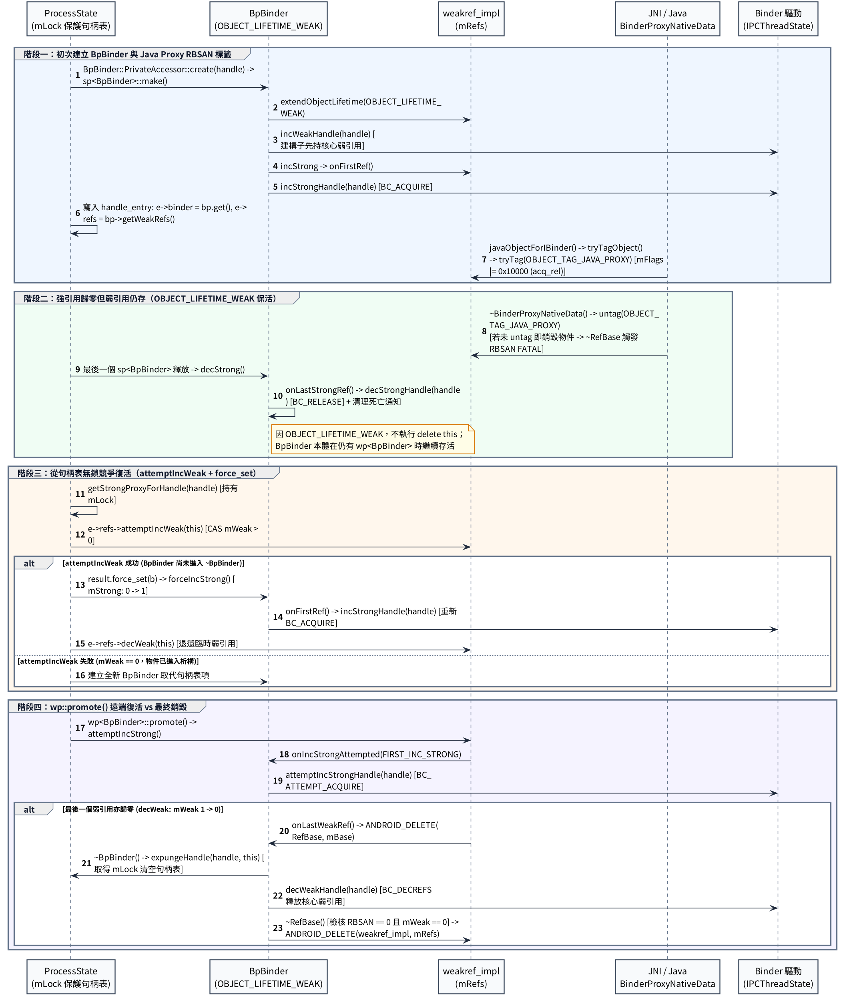

# 3.4 實戰情景、安全防線與測試驗證（`RefBase_test`、Binder 整合、RBSAN 與自訂配置器）

- **情景說明**：原書 3.2.3 透過手寫 `weightpointer.cpp` 驗證 `StrongClass`、`WeakClass` 與 `ForeverClass`；到了 Android 17，`OBJECT_LIFETIME_FOREVER` 已被移除，取而代之的是一整套涵蓋並發記憶體序、ABA 地址重用、雙重擁有攔截、RBSAN 標籤防護與可插拔配置器的現代安全機制。本節以兩條實戰主線完成全章收尾：
  1. **官方驗證套件（`RefBase_test.cpp`）**：沿著 `RefBaseBothLifetimes` 參數化測試、`WeakCopies`、`ReplacedComparison`、`DoubleOwnershipDeath`、`StackOwnershipDeath` 與雙核並發壓測 `RacingDestructors` / `RacingPromotions`，逐項實證 3.2–3.3 節推導的所有生命週期與記憶體序契約；
  2. **AOSP 17 框架真實整合與安全防線**：串聯 `ProcessState::getStrongProxyForHandle` + `BpBinder`（`OBJECT_LIFETIME_WEAK` + `attemptIncWeak` + `sp::force_set` + `onIncStrongAttempted`）、`BinderProxyNativeData` 的 **RBSAN**（`tryTag(OBJECT_TAG_JAVA_PROXY)` / `untag`）、`DEBUG_REFS` + `ReferenceMover`（容器搬移時自動改名追蹤 `id`）以及 Android 17 新導入的 **`AllocatorTracker`**（`ANDROID_UTILS_CUSTOM_ALLOCATOR`）。
- **對應原書**：3.2.3 節〈应用实例分析〉（p.75–79）
- **涉及專案與版本基準**：
  - `platform/system/core` 〔`android-17.0.0_r1`，commit `545d248`〕
  - `platform/frameworks/native` 〔`android-17.0.0_r1`，commit `ae266dc`〕
  - `platform/frameworks/base` 〔`android-17.0.0_r1`，commit `94b4c163b`〕

---

## 3.4.1 官方單元測試實證：`RefBase_test.cpp`（取代原書 `weightpointer.cpp`）

> 對應原書 3.2.3（p.75–79）。原書在 `external/weightpointer/weightpointer.cpp` 定義了 `StrongClass`、`WeakClass`、`ForeverClass` 並手動燒錄到模擬器觀察 `printf` 輸出。在 Android 17 中，`platform/system/core/libutils/binder/RefBase_test.cpp`（收錄於 `libutils_binder_test`）直接用 GoogleTest 參數化測試同時跑過兩種有效生命週期（`OBJECT_LIFETIME_STRONG` 與 `OBJECT_LIFETIME_WEAK`），並以死亡測試與雙核壓測把所有邊界行為鎖死在 CI 裡。

### Step 1：雙生命週期參數化測試與 `WeakCopies` / `NoStrongCountPromoteFromWeak`
**位置**：`platform/system/core/libutils/binder/RefBase_test.cpp` 〔`android-17.0.0_r1`，lines 38–68、148–192、354–380〕

```cpp
class Foo : public RefBase {
  public:
    Foo(bool* deleted_check) : mDeleted(deleted_check) { *mDeleted = false; }
    Foo(bool* deleted_check, bool weak) : Foo(deleted_check) {
        if (weak) {
            extendObjectLifetime(RefBase::OBJECT_LIFETIME_WEAK);
        }
    }

    ~Foo() { *mDeleted = true; }

    void doTag() { getWeakRefs()->tag(RefBase::OBJECT_TAG_JAVA_PROXY); }
    void doUntag() { getWeakRefs()->untag(RefBase::OBJECT_TAG_JAVA_PROXY); }

  private:
    bool* mDeleted;
};

class RefBaseBothLifetimes : public ::testing::TestWithParam<bool> {
  protected:
    void SetUp() override {
        mWeakLifetime = GetParam();
        foo = new Foo(&isDeleted, mWeakLifetime);
    }

    void TearDown() override { EXPECT_TRUE(isDeleted) << "Foo leaked!"; }

    bool mWeakLifetime;
    bool isDeleted;
    Foo* foo;
};
```

```cpp
TEST_P(RefBaseBothLifetimes, StrongMoves) {
    ASSERT_EQ(INITIAL_STRONG_VALUE, foo->getStrongCount());
    ASSERT_FALSE(isDeleted) << "Already deleted...?";
    sp<Foo> sp1(foo);
    wp<Foo> wp1(sp1);
    ASSERT_EQ(1, foo->getStrongCount());
    // Weak count includes both strong and weak references.
    ASSERT_EQ(2, foo->getWeakRefs()->getWeakCount());
    {
        sp<Foo> sp2 = std::move(sp1);
        ASSERT_EQ(1, foo->getStrongCount())
                << "std::move failed, incremented refcnt";
        ASSERT_EQ(nullptr, sp1.get()) << "std::move failed, sp1 is still valid";
        sp1 = std::move(sp2);
    }
    ...
    {
        // Now let's double check it deletes on time
        sp<Foo> sp2 = std::move(sp1);
    }
    ASSERT_NE(mWeakLifetime, isDeleted) << "foo was leaked!";
}

TEST(RefBase, WeakCopies) {
    bool isDeleted;
    Foo* foo = new Foo(&isDeleted);
    EXPECT_EQ(0, foo->getWeakRefs()->getWeakCount());
    ASSERT_FALSE(isDeleted) << "Foo (weak) already deleted...?";
    wp<Foo> wp1(foo);
    EXPECT_EQ(1, foo->getWeakRefs()->getWeakCount());
    {
        wp<Foo> wp2 = wp1;
        ASSERT_EQ(2, foo->getWeakRefs()->getWeakCount());
    }
    EXPECT_EQ(1, foo->getWeakRefs()->getWeakCount());
    ASSERT_FALSE(isDeleted) << "deleted too early! still has a reference!";
    wp1 = nullptr;
    ASSERT_FALSE(isDeleted) << "Deletion on wp destruction should no longer occur";
}
```

```cpp
TEST_P(RefBaseBothLifetimes, NoStrongCountPromoteFromWeak) {
    wp<Foo> weakFoo = wp<Foo>(foo);

    EXPECT_FALSE(isDeleted);

    {
        sp<Foo> strongFoo = weakFoo.promote();
        EXPECT_EQ(strongFoo, foo);
    }
    ...
    EXPECT_NE(mWeakLifetime, isDeleted);
}
```

這三個測試精準對應了 3.2 與 3.3 節推導出的核心差異：
1. **`StrongMoves`**：初始 `getStrongCount() == INITIAL_STRONG_VALUE`；建完 `sp1` 與 `wp1` 後，強計數為 `1`、弱計數為 `2`；經 `std::move` 不改動計數；當 `sp1` 最後釋放但 `wp1` 仍在作用域中時，`ASSERT_NE(mWeakLifetime, isDeleted)` 一行驗證兩種模式——`STRONG`（`mWeakLifetime == false`）此時已被銷毀（`isDeleted == true`），`WEAK`（`mWeakLifetime == true`）此時仍存活（`isDeleted == false`，直到函式結束 `wp1` 析構才銷毀並通過 `TearDown` 的防洩漏檢查）。
2. **`WeakCopies`**：對預設 `OBJECT_LIFETIME_STRONG` 的物件僅建立 `wp1` / `wp2` 後全部清成 `nullptr`（`mWeak: 0 → 1 → 2 → 1 → 0`，始終未曾有強引用），最後明確斷言 **`ASSERT_FALSE(isDeleted)`**——印證 3.2 節 Step 8「`decWeak` 見到 `INITIAL_STRONG_VALUE` 不再自動銷毀 `mBase`」的現代語意！
3. **`NoStrongCountPromoteFromWeak`**：展示為何不該在建構子隨意建立 `wp(this)` 並允許外部 `promote()`——一旦原本無強引用的物件被 `weakFoo.promote()` 短暫升格成局部 `strongFoo` 又馬上離開區塊，原本 `INITIAL_STRONG_VALUE` 會變成 `1 → 0`，在 `OBJECT_LIFETIME_STRONG` 模式下立刻把尚未交給正式 `sp` 的物件給銷毀掉。

> 〔與 2.3 差異〕邏輯改變 + 取代：原書 3.2.3（p.76–79）測試 `StrongClass` / `WeakClass` / `ForeverClass`；Android 17 以參數化 `RefBaseBothLifetimes` 覆蓋現存的兩種生命週期（`ForeverClass` 已不存在），並新增 `WeakCopies` 明確驗證 17 的新 `decWeak` 語意。

---

### Step 2：地址重用 ABA 測試（`ReplacedComparison`）與所有權死亡防線測試
**位置**：`platform/system/core/libutils/binder/RefBase_test.cpp` 〔`android-17.0.0_r1`，lines 277–304、383–402〕

```cpp
// Check whether comparison against dead wp works, even if the object referenced
// by the new wp happens to be at the same address.
TEST(RefBase, ReplacedComparison) {
    bool isDeleted, isDeleted2;
    FooFixedAlloc* foo = new FooFixedAlloc(&isDeleted);
    sp<FooFixedAlloc> sp1(foo);
    wp<FooFixedAlloc> wp1(sp1);
    ASSERT_TRUE(wp1 == sp1);
    sp1.clear();  // Deallocates the object.
    ASSERT_TRUE(isDeleted);
    FooFixedAlloc* foo2 = new FooFixedAlloc(&isDeleted2);
    ASSERT_FALSE(isDeleted2);
    ASSERT_EQ(foo, foo2);  // Not technically a legal comparison, but ...
    sp<FooFixedAlloc> sp2(foo2);
    wp<FooFixedAlloc> wp2(sp2);
    ASSERT_TRUE(sp2 == wp2);
    ASSERT_FALSE(sp2 != wp2);
    ASSERT_TRUE(sp2 != wp1);
    ASSERT_FALSE(sp2 == wp1);
    ASSERT_FALSE(sp2 == sp1);  // sp1 is null.
    ASSERT_FALSE(wp1 == wp2);  // wp1 refers to old object.
    ASSERT_TRUE(wp1 != wp2);
    ASSERT_TRUE(wp1 > wp2 || wp1 < wp2);
    ASSERT_TRUE(wp1 >= wp2 || wp1 <= wp2);
    ASSERT_FALSE(wp1 >= wp2 && wp1 <= wp2);
    ASSERT_FALSE(wp1 == nullptr);
    wp1 = sp2;
    ASSERT_TRUE(wp1 == wp2);
    ASSERT_FALSE(wp1 != wp2);
}
```

```cpp
TEST(RefBase, DoubleOwnershipDeath) {
    bool isDeleted;
    sp<Foo> foo = sp<Foo>::make(&isDeleted);

    // if something else thinks it owns foo, should die
    EXPECT_DEATH(delete foo.get(), "object .* with strong count 1 deleted. Double owned?");
}

TEST(RefBase, StackOwnershipDeath) {
    bool isDeleted;

    EXPECT_DEATH(
            {
                Foo foo(&isDeleted);
                foo.incStrong(nullptr);
            },
            "(RefBase used with stack pointer argument|object .* with strong count 1 deleted. Double owned?)");
}
```

- **`ReplacedComparison`**：透過自訂 `operator new` 固定回傳同一塊位址 `theMemory` 的 `FooFixedAlloc`，強制製造 `foo == foo2` 的 ABA 情境，驗證即便地址完全相同，因 `wp1.m_refs != wp2.m_refs`，`sp2 == wp1` 與 `wp1 == wp2` 皆為 `false` 且滿足嚴格弱序（`wp1 > wp2 || wp1 < wp2`）。
- **`DoubleOwnershipDeath` 與 `StackOwnershipDeath`**：分別透過 GoogleTest `EXPECT_DEATH` 驗證 3.2 節的兩道執行期致命防線——對已有 `sp` 擁有的物件手動 `delete` 必觸發 `~RefBase()` 的 `Double owned?` 崩潰；在棧上建構 `Foo` 並呼叫 `incStrong` 必觸發 `check_not_on_stack()` 或 `~RefBase()` 崩潰。

> 〔與 2.3 差異〕新增：原書 3.2.3（p.75–79）無 ABA 位址重用測試、無雙重擁有與棧物件死亡防線驗證。

---

### Step 3：雙核並發壓測 `RacingDestructors` 與 `RacingPromotions`
**位置**：`platform/system/core/libutils/binder/RefBase_test.cpp` 〔`android-17.0.0_r1`，lines 407–422、460–502、512–568〕

```cpp
class Bar : public RefBase {
public:
    Bar(std::atomic<int>* delete_count) : mVisited1(false), mVisited2(false),
            mDeleteCount(delete_count) {
    }

    ~Bar() {
        EXPECT_TRUE(mVisited1);
        EXPECT_TRUE(mVisited2);
        (*mDeleteCount)++;
    }
    bool mVisited1;
    bool mVisited2;
private:
    std::atomic<int>* mDeleteCount;
};
```

```cpp
static void visit2AndRemove() {
    ...
    for (int i = 0; i < NITERS; ++i) {
        waitFor(true);
        buffer->mVisited2 = true;
        buffer = nullptr;
        bufferFull = false;
    }
}

TEST(RefBase, RacingDestructors) {
    ...
        for (int i = 0; i < NITERS; ++i) {
            waitFor(false);
            Bar* bar = new Bar(&deleteCount);
            sp<Bar> sp3(bar);
            buffer = sp3;
            bufferFull = true;
            ASSERT_TRUE(bar->getStrongCount() >= 1);
            ASSERT_TRUE(bar->getWeakRefs()->getWeakCount() >= 1);
            sp3->mVisited1 = true;
            sp3 = nullptr;
        }
        t.join();
        ...
        ASSERT_EQ(NITERS, deleteCount) << "Deletions missed!";
}
```

```cpp
static void visit3AndRemove() {
    ...
    for (int i = 0; i < NITERS; ++i) {
        wpWaitFor(true);
        {
            sp<Bar> sp1 = wpBuffer.promote();
            // We implicitly check that sp1 != NULL
            sp1->mVisited2 = true;
        }
        wpBuffer = nullptr;
        wpBufferFull = false;
    }
}

TEST(RefBase, RacingPromotions) {
    ...
        for (int i = 0; i < NITERS; ++i) {
            Bar* bar = new Bar(&deleteCount);
            wp<Bar> wp1(bar);
            bar->mVisited1 = true;
            if (i % (NITERS / 10) == 0) {
                // Do this rarely, since it generates a log message.
                wp1 = nullptr;  // No longer destroys the object.
                wp1 = bar;
            }
            wpBuffer = wp1;
            ASSERT_EQ(bar->getWeakRefs()->getWeakCount(), 2);
            wpBufferFull = true;
            // Promotion races with that in visit3AndRemove.
            sp<Bar> sp1 = wp1.promote();
            wpWaitFor(false);  // Waits for other thread to drop strong pointer.
            sp1 = nullptr;
            // No strong pointers here.
            sp1 = wp1.promote();
            ASSERT_EQ(sp1.get(), nullptr) << "Dead wp promotion succeeded!";
        }
        t.join();
        ...
        ASSERT_EQ(NITERS, deleteCount) << "Deletions missed!";
}
```

這兩個測試將主執行緒與工作執行緒分別透過 `sched_setaffinity` 綁定到**偶數核心與奇數核心**上，連續迭代 `NITERS = 500,000` 次：
- **`RacingDestructors`**：兩核各自寫入普通（非原子）布林欄位 `mVisited1` / `mVisited2` 後同時執行 `sp = nullptr`，在 `~Bar()` 中檢核 `mVisited1 && mVisited2` 必皆為 `true`——在 ARM64 弱記憶體序硬體上，只要 `decStrong()` 漏掉 `memory_order_release` 或最終的 `atomic_thread_fence(memory_order_acquire)`，`~Bar()` 就會讀到未同步的 `false` 而立刻失敗！
- **`RacingPromotions`**：針對從未有強引用（`INITIAL_STRONG_VALUE`）的 `Bar` 物件，兩核同時呼叫 `wp.promote()` 搶佔首次強引用並交錯釋放，驗證 3.3 節 Step 5 新增的 `INITIAL_STRONG_VALUE` CAS 迴圈與單次減去 `INITIAL_STRONG_VALUE` 在 50 萬次真實多核競爭下既不漏刪、也不讓死掉的 `wp` 誤升成功。

> 〔與 2.3 差異〕新增：原書 3.2.3（p.75–79）僅有單執行緒示範，無跨核記憶體序與並發 `promote()` 壓力測試。

---

## 3.4.2 AOSP 17 框架高階實戰與安全防線

### Step 4：Binder 實戰整合——`ProcessState` 與 `BpBinder` 的 `OBJECT_LIFETIME_WEAK` 協作
**位置**：`platform/frameworks/native/libs/binder/BpBinder.cpp` 〔`android-17.0.0_r1`，lines 259–268、838–851、910–925〕、`platform/frameworks/native/libs/binder/ProcessState.cpp` 〔`android-17.0.0_r1`，lines 348–401〕

```cpp
BpBinder::BpBinder(Handle&& handle)
      : mStability(0),
        mHandle(handle),
        mAlive(true),
        mObitsSent(false),
        mObituaries(nullptr),
        mDescriptorCache(kDescriptorUninit),
        mTrackedUid(-1) {
    extendObjectLifetime(OBJECT_LIFETIME_WEAK);
}
...
void BpBinder::onFirstRef() {
    if (isRpcBinder()) [[unlikely]] {
        return;
    }
    ...
    IPCThreadState* ipc = IPCThreadState::self();
    if (ipc) ipc->incStrongHandle(binderHandle(), this);
}
...
bool BpBinder::onIncStrongAttempted(uint32_t /*flags*/, const void* /*id*/)
{
    // RPC binder doesn't currently support inc from weak binders
    if (isRpcBinder()) [[unlikely]] {
        return false;
    }
    ...
    IPCThreadState* ipc = IPCThreadState::self();
    return ipc ? ipc->attemptIncStrongHandle(binderHandle()) == NO_ERROR : false;
}
```

```cpp
    handle_entry* e = lookupHandleLocked(handle);

    if (e != nullptr) {
        // attemptIncWeak() is safe because we know the BpBinder destructor will always
        // call expungeHandle(), which acquires the same lock we are holding now.
        IBinder* b = e->binder;
        if (b == nullptr || !e->refs->attemptIncWeak(this)) {
            ...
            sp<BpBinder> bp = BpBinder::PrivateAccessor::create(handle, &postTask);
            e->binder = bp.get();
            if (bp) e->refs = bp->getWeakRefs();
            result = bp;
        } else {
            // This little bit of nastyness is to allow us to add a primary
            // reference to the remote proxy when this team doesn't have one
            // but another team is sending the handle to us.
            result.force_set(b);
            e->refs->decWeak(this);
        }
    }
```

這正是 `RefBase` 所有進階魔術功能（`OBJECT_LIFETIME_WEAK`、`onFirstRef`、`onLastStrongRef`、`onIncStrongAttempted`、`attemptIncWeak`、`sp::force_set`）在 AOSP 中的**真正主戰場**（呼應第 5 章 5.4 節）：
1. **`BpBinder` 採用 `OBJECT_LIFETIME_WEAK`**：當進程內最後一個 `sp<BpBinder>` 釋放時，只觸發 `BpBinder::onLastStrongRef` 向驅動送出 `BC_RELEASE` 與清理死亡通知，只要還存在 `wp<BpBinder>`（例如 `HeapCache` 或 `DeathRecipient` 保留的弱引用），`BpBinder` 本體就不銷毀；之後呼叫 `wp<BpBinder>::promote()` 會走到 `BpBinder::onIncStrongAttempted()` 向驅動送出 `BC_ATTEMPT_ACQUIRE` 嘗試復活。
2. **`ProcessState::getStrongProxyForHandle()` 的無縫接管**：句柄表 `handle_entry` 僅存裸指標 `e->binder` 與 `e->refs`（不持有弱引用，以免句柄永遠無法回收）。在持有 `mLock` 期間呼叫 `e->refs->attemptIncWeak(this)`——這之所以安全，全靠 `BpBinder::~BpBinder()` 會呼叫 `expungeHandle()` 搶同一把 `mLock` 清空 `e->binder`/`e->refs` 後，`~RefBase()` 才刪除 `mRefs`！一旦 `attemptIncWeak` 成功，表示這個 `BpBinder` 還活著（可能 `mStrong == 0` 僅剩弱引用），隨即呼叫 `result.force_set(b)` → `RefBase::forceIncStrong`（3.2 節 Step 5）把強計數從 `0` 強制拉到 `1` 並觸發 `onFirstRef()`，最後 `e->refs->decWeak(this)` 釋放剛剛臨時搶到的弱引用。

> 〔與 2.3 差異〕邏輯一致 + 現代化更新：核心生命週期協議自 2.3 延續至 17，但 17 的 `BpBinder` 已全面開啟 `ANDROID_UTILS_REF_BASE_DISABLE_IMPLICIT_CONSTRUCTION`、改以 `BpBinder::PrivateAccessor::create`（內部 `sp<BpBinder>::make`）建構，並對 RPC Binder 在 `onIncStrongAttempted` 直接回傳 `false`。

---

### Step 5：RBSAN（RefBase Sanitizer）——`tag` / `tryTag` / `untag` 與 `BinderProxyNativeData`
**位置**：`platform/system/core/libutils/binder/RefBase.cpp` 〔`android-17.0.0_r1`，lines 767–799〕、`platform/frameworks/base/core/jni/android_util_Binder.cpp` 〔`android-17.0.0_r1`，lines 985–1004〕、`platform/system/core/libutils/binder/RefBase_test.cpp` 〔`android-17.0.0_r1`，lines 346–352〕

```cpp
static int32_t tryTagOldTags(int32_t tag, std::atomic<int32_t>* mFlags) {
    LOG_ALWAYS_FATAL_IF((tag & ~RefBase::OBJECT_TAG_MASK) != 0,
                        "RBSAN: Invalid RefBase tag to tag: %" PRId32, tag);

    int32_t oldFlags = mFlags->fetch_or(tag, std::memory_order_acq_rel);
    int32_t oldTags = oldFlags & RefBase::OBJECT_TAG_MASK;
    return oldTags;
}

void RefBase::weakref_type::tag(int32_t tag) {
    int32_t oldTags = tryTagOldTags(tag, &(static_cast<weakref_impl*>(this)->mFlags));
    const bool tookTagOwnership = (oldTags & tag) == 0;
    LOG_ALWAYS_FATAL_IF(!tookTagOwnership,
                        "RBSAN: Can't set flag %" PRId32 " when it's set: %" PRId32, oldTags, tag);
}

bool RefBase::weakref_type::tryTag(int32_t tag) {
    int32_t oldTags = tryTagOldTags(tag, &(static_cast<weakref_impl*>(this)->mFlags));
    const bool tookTagOwnership = (oldTags & tag) == 0;
    return tookTagOwnership;
}

void RefBase::weakref_type::untag(int32_t tag) {
    LOG_ALWAYS_FATAL_IF((tag & ~OBJECT_TAG_MASK) != 0,
                        "RBSAN: Invalid RefBase tag to untag: %" PRId32, tag);

    int32_t oldFlags =
            static_cast<weakref_impl*>(this)->mFlags.fetch_and(~tag, std::memory_order_acq_rel);
    int32_t oldTags = oldFlags & OBJECT_TAG_MASK;
    LOG_ALWAYS_FATAL_IF((oldTags & tag) == 0,
                        "RBSAN: Can't unset flag %" PRId32 " when it's not set: %" PRId32, tag,
                        oldTags);
}
```

```cpp
    void tryTagObject() {
        mOwnsObjectTag = mObject->getWeakRefs()->tryTag(RefBase::OBJECT_TAG_JAVA_PROXY);
    }

    ~BinderProxyNativeData() {
        if (mOwnsObjectTag) {
            mObject->getWeakRefs()->untag(RefBase::OBJECT_TAG_JAVA_PROXY);
        }
    }
```

```cpp
TEST_P(RefBaseBothLifetimes, DieIfDeletedWithTag) {
    foo->incStrong(nullptr);
    foo->doTag();
    EXPECT_DEATH(foo->decStrong(nullptr), "RBSAN: Object is deleted, but it is tagged: 65536");
    foo->doUntag();
    foo->decStrong(nullptr);
}
```

**RBSAN** 是 Android 近年新增的輕量執行期消毒器，用以捕獲跨語言（Java ↔ C++）引用計數不配對引發的過早釋放：
- Java `BinderProxy` 關聯原生 `IBinder` 時，會為其建立 `BinderProxyNativeData` 並透過 `tryTag(RefBase::OBJECT_TAG_JAVA_PROXY)` 在 `mFlags` 設下 bit 16（`0x10000`）；直到 Java 端 GC 回收 `BinderProxy` 觸發 `~BinderProxyNativeData()` 才以 `untag()` 清除。
- 只要這段期間有任何程式碼誤多呼叫了一次 `decStrong` 導致底層 `IBinder` 進入 `RefBase::~RefBase()`（3.2 節 Step 7），`mFlags.load(acquire) & OBJECT_TAG_MASK` 非零，立刻在銷毀現場以 `RBSAN: Object is deleted, but it is tagged: 65536` 中止，避免靜默產生跨語言 UAF。因各元件可定義獨立位元且不共享計數器，一個元件的 bug 也不會干擾其他元件的標籤。

> 〔與 2.3 差異〕新增：RBSAN（`tag` / `tryTag` / `untag` 與 `OBJECT_TAG_JAVA_PROXY`）為現代 Android 新增的安全防線，原書 2.3 不存在。

---

### Step 6：`DEBUG_REFS` 引用追蹤與 `ReferenceMover`（容器搬移 `renameRefId`）
**位置**：`platform/system/core/libutils/binder/RefBase.cpp` 〔`android-17.0.0_r1`，lines 344–420、886–907〕、`platform/system/core/libutils/binder/include/utils/RefBase.h` 〔`android-17.0.0_r1`，lines 742–787〕

```cpp
    struct ref_entry
    {
        ref_entry* next;
        const void* id;
#if DEBUG_REFS_CALLSTACK_ENABLED && ANDROID_UTILS_CALLSTACK_ENABLED
        CallStack::CallStackUPtr stack;
#endif
        int32_t ref;
    };

    void addRef(ref_entry** refs, const void* id, int32_t mRef)
    {
        if (mTrackEnabled) {
            std::lock_guard<std::mutex> _l(mMutex);

            ref_entry* ref = ANDROID_NEW(ref_entry);

            ref->ref = mRef;
            ref->id = id;
#if DEBUG_REFS_CALLSTACK_ENABLED && ANDROID_UTILS_CALLSTACK_ENABLED
            ref->stack = CallStack::getCurrent(2);
#endif
            ref->next = *refs;
            *refs = ref;
        }
    }
```

```cpp
class ReferenceMover {
public:
    template<typename TYPE> static inline
    void move_references(sp<TYPE>* dest, sp<TYPE> const* src, size_t n) {

        class Renamer : public ReferenceRenamer {
            sp<TYPE>* d_;
            sp<TYPE> const* s_;
            virtual void operator()(size_t i) const {
                // The id are known to be the sp<>'s this pointer
                TYPE::renameRefId(d_[i].get(), &s_[i], &d_[i]);
            }
        public:
            Renamer(sp<TYPE>* d, sp<TYPE> const* s) : d_(d), s_(s) { }
            virtual ~Renamer() { }
        };

        memmove(static_cast<void*>(dest), src, n * sizeof(sp<TYPE>));
        TYPE::renameRefs(n, Renamer(dest, src));
    }
```

```cpp
#if DEBUG_REFS
void RefBase::renameRefs(size_t n, const ReferenceRenamer& renamer) {
    for (size_t i=0 ; i<n ; i++) {
        renamer(i);
    }
}
#else
void RefBase::renameRefs(size_t /*n*/, const ReferenceRenamer& /*renamer*/) { }
#endif
```

編譯時加上 `-DDEBUG_REFS=1`（`libutils_binder_test_compile` 專門確保此模式常年可編譯）並對疑似洩漏物件呼叫 `obj->trackMe(true, false)` 後，每次 `incStrong`/`decStrong`/`incWeak`/`decWeak` 都會以呼叫端 `sp`/`wp` 物件本身的位址作為 `id`，把當前 `CallStack` 記進 `mStrongRefs`/`mWeakRefs` 鏈表；呼叫 `printRefs()` 即輸出所有尚未配對釋放的引用堆疊至 `/data/debug/<this>.stack`。

這也就解釋了為何 `sp<T>` / `wp<T>` 每個函式都帶有一個看似神秘的 `const void* id` 參數，以及為何需要 `ReferenceMover`：當 `android::Vector<sp<T>>` 擴容做 `memmove` 時，每個 `sp<T>` 實例在記憶體中的位址從 `&s_[i]` 搬到了 `&d_[i]`；若非 `DEBUG_REFS`，`renameRefs` 是空函式零開銷；若開啟 `DEBUG_REFS`，`ReferenceMover` 會順帶呼叫 `renameRefId` 把追蹤表中紀錄的舊 `id` 改成新位址，防止稍後 `~sp()` 用新位址 `removeRef` 時找不到對應紀錄！

> 〔與 2.3 差異〕邏輯擴充：原書 2.3（p.64）直接略過 `DEBUG_REFS` 且尚未出現 `ReferenceMover` / `renameRefId`；Android 17 改用 `std::mutex` + `CallStack::CallStackUPtr` + `ANDROID_NEW(ref_entry)` 並透過 `ReferenceMover` 讓 `Vector<sp/wp>` 的 `memmove` 最佳化與 `DEBUG_REFS` 追蹤無縫相容。

---

### Step 7：Android 17 新增 `AllocatorTracker` 可插拔配置器
**位置**：`platform/system/core/libutils/binder/include/utils/AllocatorTracker.h` 〔`android-17.0.0_r1`，lines 31–49、76–131、173–187〕、`platform/system/core/libutils/binder/RefBase_test.cpp` 〔`android-17.0.0_r1`，lines 573–605〕

```cpp
class Allocator {
  public:
    virtual ~Allocator() = default;
    virtual void* allocate(size_t size, size_t alignment) = 0;
    virtual void deallocate(void* ptr) = 0;
    virtual void* reallocate(void* ptr, size_t size) = 0;
    virtual void abort() = 0;
};
...
class AllocatorTracker {
  public:
    ...
    Allocator* getAllocator() { return mAllocator; }
    void setAllocator(Allocator* allocator) { mAllocator = allocator; }

    static Allocator& getAllocatorOrDefault() {
        Allocator* allocator = getInstance().getAllocator();
        if (allocator == nullptr) {
            allocator = &DefaultAllocator::getInstance();
        }
        return *allocator;
    }

    static bool hasAllocator() {
      return getInstance().getAllocator() != nullptr;
    }

    static AllocatorTracker& getInstance() {
      [[clang::no_destroy]] static AllocatorTracker sInstance;
      return sInstance;
    }
```

```cpp
#define ANDROID_NEW(T, ...)                                                                        \
    (::android::AllocatorTracker::hasAllocator()                                                   \
     ? [&]() -> T* {                                                                               \
           static_assert(!std::is_array<T>::value, "Array types are not supported.");              \
           ::android::Allocator& allocator = ::android::AllocatorTracker::getAllocatorOrDefault(); \
           void* ptr = allocator.allocate(sizeof(T), alignof(T));                                  \
           if (ptr == nullptr) {                                                                   \
               allocator.abort();                                                                  \
           }                                                                                       \
           return new (ptr) T(__VA_ARGS__);                                                        \
       }()                                                                                         \
     : [&]() -> T* {                                                                               \
           static_assert(!std::is_array<T>::value, "Array types are not supported.");              \
           return new T(__VA_ARGS__);                                                              \
       }())
...
#define ANDROID_DELETE(T, ptr)                                                     \
    do {                                                                           \
        static_assert(!std::is_array<T>::value, "Array types are not supported."); \
        if (ptr != nullptr) {                                                      \
            if (::android::AllocatorTracker::hasAllocator()) {                     \
                if constexpr (!std::is_trivially_destructible_v<T>) {              \
                    ptr->~T();                                                     \
                }                                                                  \
                ::android::AllocatorTracker::getAllocatorOrDefault().deallocate(   \
                        const_cast<T*>(ptr));                                      \
            } else {                                                               \
                delete ptr;                                                        \
            }                                                                      \
        }                                                                          \
    } while (0)
```

```cpp
TEST(RefBase, CustomAllocator) {
    TestAllocator allocator;  // Use the mock allocator
    android::AllocatorTracker::getInstance().setAllocator(&allocator);
    ...
    sp<Foo> foo = sp<Foo>::make(&isDeleted);
    EXPECT_FALSE(isDeleted);

    // Expect deallocate to be called twice when the object is deleted -
    // refs first then the pointer.
    EXPECT_CALL(allocator, deallocate(allocated_ptrs[1]));
    EXPECT_CALL(allocator, deallocate(allocated_ptrs[0]));

    foo = nullptr;
    EXPECT_TRUE(isDeleted);
    android::AllocatorTracker::getInstance().setAllocator(nullptr);
}
```

`AllocatorTracker.h` 是 Android 17（Copyright 2025）最新合入 `libutils_binder` 的基礎設施（編譯目標 `libutils_binder_custom_allocator` 加上 `-DANDROID_UTILS_CUSTOM_ALLOCATOR`）。在一般 Android 系統建置下未定義此巨集，`ANDROID_NEW`/`ANDROID_DELETE` 零開銷直接退化為標準 `new`/`delete`；而在使用自訂記憶體池的特殊環境（如 RpcBinder 跨隔離域應用）下，開機初始化呼叫 `AllocatorTracker::getInstance().setAllocator(&myAlloc)` 後，透過 `sp<T>::make`（配置 `Foo`）與 `RefBase::RefBase()`（配置 `weakref_impl`）所進行的兩次配置，以及 `decStrong` / `decWeak` 透過 `ANDROID_DELETE` 觸發的顯式解構子（`ptr->~T()`，利用 `RefBase` 的虛解構子正確多型派發，如 `CustomAllocatorCallsRightDestructor` 所測）與兩次 `deallocate()`，全數都能路由至自訂配置器管理。

> 〔與 2.3 差異〕新增：`AllocatorTracker` 與 `ANDROID_NEW` / `ANDROID_NEW_NOTHROW` / `ANDROID_DELETE` 為 Android 17（2025 年後）全新導入的機制，原書 2.3 不存在。

---

## 3.4.3 本節總結與實戰呼叫鏈時序圖



### 原書 3.2.3 vs Android 17 實戰與安全驗證對照總表

| 驗證面向 | Android 2.3（原書 3.2.3，p.75–79） | Android 17（`android-17.0.0_r1`） |
|---|---|---|
| **生命週期測試方式** | 手寫 `external/weightpointer/weightpointer.cpp`（`StrongClass` / `WeakClass` / `ForeverClass`）燒錄模擬器人工檢視 | `libutils_binder_test`（`RefBase_test.cpp`）以 `RefBaseBothLifetimes` 自動參數化驗證 `STRONG` 與 `WEAK`（`FOREVER` 已移除），並以 `WeakCopies` 實證 `INITIAL_STRONG_VALUE` 歸零不刪除 |
| **ABA 位址重用驗證** | 無（2.3 跨型別 `wp::operator==` 存在 ABA 缺陷） | `ReplacedComparison` 以固定位址配置器 `FooFixedAlloc` 嚴格驗證 `m_refs` 判等與嚴格弱序 |
| **並發記憶體序驗證** | 無（僅單執行緒示範） | `RacingDestructors` / `RacingPromotions` 綁定奇偶 CPU 核心各跑 50 萬次迭代驗證 release-acquire 與並發 `promote()` |
| **所有權誤用攔截** | 無執行期攔截（僅 debug build `LOG_ASSERT`） | `DoubleOwnershipDeath`、`StackOwnershipDeath`、`AssertWeakRefExistsDeath`、編譯期 `std::make_shared`/`make_unique` `static_assert`、`ANDROID_UTILS_REF_BASE_DISABLE_IMPLICIT_CONSTRUCTION` |
| **跨語言安全防線** | 無 | **RBSAN**（`BinderProxyNativeData` 使用 `tryTag(OBJECT_TAG_JAVA_PROXY)` / `untag`，`DieIfDeletedWithTag` 測試驗證） |
| **記憶體配置擴展** | 寫死全域 `new` / `delete` | `AllocatorTracker`（`ANDROID_UTILS_CUSTOM_ALLOCATOR`、`libutils_binder_test_custom_allocator`） |
