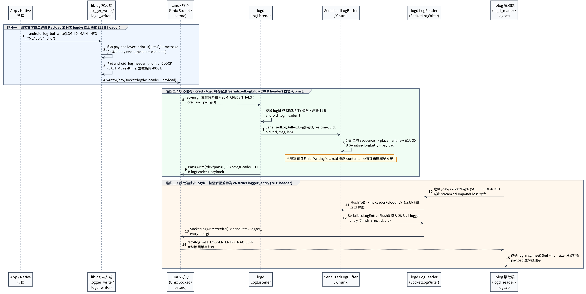

# 4.1 日誌緩衝區與記錄格式

- **情景說明**：從 Android 17 的日誌架構全景出發，釐清系統如何以 8 類日誌緩衝區（`log_id_t`）與 9 級優先級（`android_LogPriority`）組織所有系統與應用日誌，並追蹤一條文字日誌或二進位事件日誌在「寫入線上封包（`/dev/socket/logdw` 與 `/dev/pmsg0`）→ `logd` 記憶體緊湊壓縮塊（`SerializedLogEntry` / `SerializedLogChunk`）→ 讀取端輸出格式（`/dev/socket/logdr` 的 v4 `struct logger_entry`）」三階段的二進位結構與欄位轉換。
- **對應原書**：第 4 章前言與 4.1 節〈Logger 日志格式〉（p.82–84），並涵蓋原書 4.2.1 節中 `struct logger_entry` 基礎記錄結構（p.85）
- **涉及專案與版本基準**：
  - `platform/system/logging` 〔`android-17.0.0_r1`，commit `d35ba62`〕

---

## 4.1.1 第 4 章總覽：從核心 Logger 驅動到使用者空間 `logd` + `liblog`

> 對應原書第 4 章前言（p.82–83，圖 4-1）。原書將 Logger 日誌系統歸類於「第 2 篇 Android 專用驅動系統」，原因是 Android 2.3 將日誌緩衝區實作在 Linux 核心的 `drivers/staging/android/logger.c` 中，透過 4 個 misc 字元裝置節點（`/dev/log/{main,system,radio,events}`）直接以核心記憶體環形緩衝區儲存日誌。
>
> 在 Android 17 中，核心 Logger 驅動早已完全移除，整個日誌系統已演進為**純使用者空間守護行程 `/system/bin/logd` + 執行期函式庫 `liblog`** 架構，原始碼也從早期的 `system/core` 獨立拆分為單獨的 AOSP 專案 `platform/system/logging`。

Android 17 日誌系統在開機階段由 `init` 依據 `logd.rc` 啟動 `/system/bin/logd` 並代建三組 Unix Domain Socket，取代早期核心驅動的所有裝置節點：

**位置**：`platform/system/logging/logd/logd.rc` 〔`android-17.0.0_r1`，lines 1–12〕

```rc
service logd /system/bin/logd
    socket logd stream 0666 logd logd
    socket logdr seqpacket 0666 logd logd
    socket logdw dgram+passcred 0222 logd logd
    file /proc/kmsg r
    file /dev/kmsg w
    user logd
    group logd system package_info readproc
    capabilities SYSLOG AUDIT_CONTROL
    priority 10
    task_profiles ServiceCapacityLow
    onrestart setprop logd.ready false
```

這三組 Socket 與兩組核心輔助檔案共同構成 Android 17 日誌系統的 I/O 邊界：
1. **`/dev/socket/logdw`（`SOCK_DGRAM` + `SO_PASSCRED`，權限 `0222` 唯寫）**：所有應用程式與系統服務透過 `liblog` 將日誌以資料報送往 `logd`。`dgram+passcred` 讓核心在接收時自動附帶不可偽造的 `struct ucred`（`pid`、`uid`、`gid`），防止行程冒充其他身分寫入日誌。
2. **`/dev/socket/logdr`（`SOCK_SEQPACKET`，權限 `0666`）**：`logcat` 或透過 `android_logger_list_*` 讀取日誌的客戶端連線此通道，先送出查詢命令（`stream` 或 `dumpAndClose`），隨後 `logd` 以保持邊界的封包逐條回傳 `struct logger_entry`。
3. **`/dev/socket/logd`（`SOCK_STREAM`，權限 `0666`）**：控制命令通道，由 `CommandListener` 處理查詢緩衝區大小、清空日誌、讀取統計與調整 `PruneList` 等管理指令。
4. **`/proc/kmsg` 與 `/dev/pmsg0`**：`logd` 內的 `LogKlog` 從 `/proc/kmsg` 擷取核心日誌進入 `LOG_ID_KERNEL` 緩衝區；同時 `LogListener` 在收到關鍵日誌後會透過 `PmsgWrite` 同步寫入 Linux pstore 字元裝置 `/dev/pmsg0`，使系統異常重啟後仍可從 pstore 還原重啟前日誌。

| 面向 | Android 2.3（原書 p.82–85） | Android 17（`android-17.0.0_r1`） |
|---|---|---|
| 緩衝區駐留空間 | Linux 核心空間（`drivers/staging/android/logger.c`） | 使用者空間守護行程 `/system/bin/logd` |
| 系統介面 | 4 個 misc 字元裝置 `/dev/log/{main,system,radio,events}` | 3 組 Unix Socket `/dev/socket/{logdw,logdr,logd}` + `/dev/pmsg0` |
| 緩衝區種類 | 4 類（`main`、`system`、`radio`、`events`） | 8 類（新增 `crash`、`stats`、`security`、`kernel`） |
| 記憶體儲存方式 | 未壓縮固定大小環形緩衝區（`struct logger_entry` v1） | `SerializedLogBuffer` 分塊 + **zstd 壓縮**（`SerializedLogChunk`） |
| 跨行程身分驗證 | 核心驅動直接讀取 `current->tgid` / `current->pid` | `logdw` 啟用 `SO_PASSCRED` 取得核心附帶 `ucred`（含 `uid`/`pid`） |
| 專案位置 | `kernel/goldfish` + `system/core/{liblog,logcat}` | `platform/system/logging/{logd,liblog,logcat,rust}` |

> 〔與 2.3 差異〕**已移除並重寫**：原書 4.1–4.2 所依賴的核心 Logger 驅動與 `/dev/log/*` 裝置節點已全面移除，改為使用者空間 `logd` 透過三組 Unix Domain Socket 統一承載寫入、讀取與控制操作（原書 p.82–83）。

---

## 4.1.2 8 類日誌緩衝區（`log_id_t`）與優先級（`android_LogPriority`）

為了避免不同重要程度與輸出頻率的日誌在有限的環形緩衝區內彼此覆蓋，Android 依據用途將日誌切分為獨立緩衝區，並為文字日誌定義統一的嚴重度優先級。

### Step 1：`android_LogPriority` 與 `log_id_t` 枚舉定義
**位置**：`platform/system/logging/liblog/include/android/log.h` 〔`android-17.0.0_r1`，lines 72–134〕

```c
/**
 * Android log priority values, in increasing order of priority.
 */
typedef enum android_LogPriority {
  /** For internal use only.  */
  ANDROID_LOG_UNKNOWN = 0,
  /** The default priority, for internal use only.  */
  ANDROID_LOG_DEFAULT, /* only for SetMinPriority() */
  /** Verbose logging. Should typically be disabled for a release apk. */
  ANDROID_LOG_VERBOSE,
  /** Debug logging. Should typically be disabled for a release apk. */
  ANDROID_LOG_DEBUG,
  /** Informational logging. Should typically be disabled for a release apk. */
  ANDROID_LOG_INFO,
  /** Warning logging. For use with recoverable failures. */
  ANDROID_LOG_WARN,
  /** Error logging. For use with unrecoverable failures. */
  ANDROID_LOG_ERROR,
  /** Fatal logging. For use when aborting. */
  ANDROID_LOG_FATAL,
  /** For internal use only.  */
  ANDROID_LOG_SILENT, /* only for SetMinPriority(); must be last */
} android_LogPriority;

/**
 * Identifies a specific log buffer for __android_log_buf_write()
 * and __android_log_buf_print().
 */
typedef enum log_id {
  /** For internal use only.  */
  LOG_ID_MIN = 0,

  /** The main log buffer. This is the only log buffer available to apps. */
  LOG_ID_MAIN = 0,
  /** The radio log buffer. */
  LOG_ID_RADIO = 1,
  /** The event log buffer. */
  LOG_ID_EVENTS = 2,
  /** The system log buffer. */
  LOG_ID_SYSTEM = 3,
  /** The crash log buffer. */
  LOG_ID_CRASH = 4,
  /** The statistics log buffer. */
  LOG_ID_STATS = 5,
  /** The security log buffer. */
  LOG_ID_SECURITY = 6,
  /** The kernel log buffer. */
  LOG_ID_KERNEL = 7,

  /** For internal use only.  */
  LOG_ID_MAX,

  /**
   * Let the logging library choose the best log target in cases where it's
   * unclear. This is useful if you're generic library code that can't know
   * which log your caller should use.
   */
  LOG_ID_DEFAULT = 0x7FFFFFFF
} log_id_t;

static inline bool __android_log_id_is_valid(log_id_t log_id) {
  return log_id >= LOG_ID_MIN && log_id < LOG_ID_MAX;
}
```

### Step 2：緩衝區名稱映射與二進位緩衝區判定
**位置**：`platform/system/logging/liblog/logger_name.cpp` 〔`android-17.0.0_r1`，lines 22–72〕

```cpp
/* In the future, we would like to make this list extensible */
static const char* LOG_NAME[LOG_ID_MAX] = {
    /* clang-format off */
  [LOG_ID_MAIN] = "main",
  [LOG_ID_RADIO] = "radio",
  [LOG_ID_EVENTS] = "events",
  [LOG_ID_SYSTEM] = "system",
  [LOG_ID_CRASH] = "crash",
  [LOG_ID_STATS] = "stats",
  [LOG_ID_SECURITY] = "security",
  [LOG_ID_KERNEL] = "kernel",
    /* clang-format on */
};

const char* android_log_id_to_name(log_id_t log_id) {
  if (!__android_log_id_is_valid(log_id)) {
    log_id = LOG_ID_MAIN;
  }
  return LOG_NAME[log_id];
}

static_assert(std::is_same<std::underlying_type<log_id_t>::type, uint32_t>::value,
              "log_id_t must be an uint32_t");

static_assert(std::is_same<std::underlying_type<android_LogPriority>::type, uint32_t>::value,
              "log_id_t must be an uint32_t");

log_id_t android_name_to_log_id(const char* logName) {
  const char* b;
  unsigned int ret;

  if (!logName) {
    return static_cast<log_id_t>(LOG_ID_MAX);
  }

  b = strrchr(logName, '/');
  if (!b) {
    b = logName;
  } else {
    ++b;
  }

  for (ret = LOG_ID_MIN; ret < LOG_ID_MAX; ++ret) {
    const char* l = LOG_NAME[ret];
    if (l && !strcmp(b, l)) {
      return static_cast<log_id_t>(ret);
    }
  }

  return static_cast<log_id_t>(LOG_ID_MAX);
}
```

而在 `logd` 內部，系統透過 `IsBinary()` 明確區分哪些緩衝區承載二進位事件格式、哪些承載文字日誌格式：

**位置**：`platform/system/logging/logd/LogUtils.h` 〔`android-17.0.0_r1`，lines 63–75〕

```cpp
// Returns true if the log buffer is meant for binary logs.
static inline bool IsBinary(log_id_t log_id) {
    return log_id == LOG_ID_EVENTS || log_id == LOG_ID_STATS || log_id == LOG_ID_SECURITY;
}

// Returns the numeric log tag for binary log messages.
static inline uint32_t MsgToTag(const char* msg, uint16_t msg_len) {
    if (msg_len < sizeof(android_event_header_t)) {
        return 0;
    }

    return reinterpret_cast<const android_event_header_t*>(msg)->tag;
}
```

#### 8 類日誌緩衝區完整對照

| `log_id_t` | 數值 | 名稱 | Payload 格式 | 主要用途與寫入／存取特性 | Android 2.3 對應 |
|---|---|---|---|---|---|
| `LOG_ID_MAIN` | `0` | `"main"` | 文字 | 應用程式級日誌；一般 App 唯一可直接寫入的文字緩衝區（`Log.*` / `ALOG*`） | `/dev/log/main` |
| `LOG_ID_RADIO` | `1` | `"radio"` | 文字 | 數據機／通訊協定（RIL、Telephony）相關高吞吐日誌（`RLOG*`），獨立隔離避免沖刷 `main` | `/dev/log/radio` |
| `LOG_ID_EVENTS` | `2` | `"events"` | **二進位** | 系統事件診斷日誌（`EventLog` / `LOG_EVENT_*`），採數值標籤 + 型別編碼 | `/dev/log/events` |
| `LOG_ID_SYSTEM` | `3` | `"system"` | 文字 | 系統框架與核心服務日誌（`Slog.*` / `SLOG*`），與 App 隔離保護 | `/dev/log/system` |
| `LOG_ID_CRASH` | `4` | `"crash"` | 文字 | 專屬當機堆疊與例外紀錄（Java 未捕獲例外、Native tombstone 摘要），避免在當機瞬間被大量 `main` 日誌覆蓋 | 新增 |
| `LOG_ID_STATS` | `5` | `"stats"` | **二進位** | 供 `statsd` 等系統遙測使用之二進位統計事件（`__android_log_stats_bwrite`） | 新增 |
| `LOG_ID_SECURITY` | `6` | `"security"` | **二進位** | 企業裝置安全稽核日誌；僅在 Device Owner 啟用且具 `AID_SYSTEM`/`AID_ROOT`/`AID_LOG`/`AID_SECURITY_LOG_WRITER` 權限時允許寫入，走**阻塞式** `logdw` socket 確保不丟失，且僅 `AID_SYSTEM` 可讀 | 新增 |
| `LOG_ID_KERNEL` | `7` | `"kernel"` | 文字 | 由 `logd` 內建 `LogKlog` 從 `/proc/kmsg` 擷取的核心訊息；**禁止**任何使用者行程經由 `logdw` 寫入（`write_to_log` 與 `LogListener` 皆顯式拒絕） | 新增（2.3 僅能用 `dmesg`） |

幾點設計細節值得留意：
- **`LOG_ID_DEFAULT = 0x7FFFFFFF`**：保留給與業務無關的通用函式庫（如 `libbase`）在無法判斷呼叫者目標緩衝區時使用，`__android_log_logd_logger_with_timestamp` 會將其映射回 `LOG_ID_MAIN`。
- **路徑前綴相容性**：`android_name_to_log_id()` 仍會執行 `strrchr(logName, '/')` 擷取最後一段檔名，因此傳入舊式路徑 `"/dev/log/main"` 或純名稱 `"main"` 皆能解析為 `LOG_ID_MAIN`。
- **9 級 `android_LogPriority`**：實際可供日誌條目使用的有效等級為 `2`（`VERBOSE`）至 `7`（`FATAL`）共 6 級，與原書 p.83 一致；`0`（`UNKNOWN`）、`1`（`DEFAULT`）與 `8`（`SILENT`）則專供過濾規則與 `__android_log_set_minimum_priority()` 控制使用。

> 〔與 2.3 差異〕**邏輯改變**：2.3 僅有 `main`、`system`、`radio`、`events` 四個核心裝置節點（且僅 `events` 為二進位格式）；Android 17 擴充為 8 類 `log_id_t`，新增 `crash`、`stats`、`security`、`kernel` 四組緩衝區，並將 `events`、`stats`、`security` 三者統一納入二進位格式管理（原書 p.82–83）。

---

## 4.1.3 三種核心傳輸與儲存格式

在 Android 2.3 中，應用程式呼叫 `writev()` 寫入 `/dev/log/*` 時只傳送 payload，核心驅動當場加上 20-byte `struct logger_entry` 存入環形緩衝區，讀取端也原樣讀回同一份 `struct logger_entry`（原書 p.85）。

到了 Android 17，由於寫入、儲存、重啟留存與讀取拆分為多條通道並引入壓縮，系統實際使用**三種核心格式**（加上 `pmsg` 變體）：

1. **寫入線上格式（Client → `logd` via `/dev/socket/logdw`）**：`android_log_header_t`（11 B）+ payload；寫入 `/dev/pmsg0` 時再於前端疊加 `android_pmsg_log_header_t`（7 B）。
2. **讀取輸出格式（`logd` → Client via `/dev/socket/logdr`）**：v4 `struct logger_entry`（28 B）+ payload，封裝於 `struct log_msg` 緩衝區。
3. **`logd` 記憶體緊湊儲存格式**：`SerializedLogEntry`（30 B）+ payload 緊密排列於 `SerializedLogChunk`，寫滿後以 zstd 整塊壓縮。

### 格式一：Client → `logd` 寫入線上格式（`logdw` 與 `pmsg`）

#### Step 3：`log_time`、`android_log_header_t` 與 `android_pmsg_log_header_t`
**位置**：`platform/system/logging/liblog/include/log/log_time.h` 〔`android-17.0.0_r1`，lines 35–47, 150–160〕

```cpp
struct log_time {
 public:
  uint32_t tv_sec = 0; /* good to Feb 5 2106 */
  uint32_t tv_nsec = 0;

  static constexpr timespec EPOCH = {0, 0};

  log_time() {}
  explicit log_time(const timespec& T)
      : tv_sec(static_cast<uint32_t>(T.tv_sec)), tv_nsec(static_cast<uint32_t>(T.tv_nsec)) {}
  explicit log_time(uint32_t sec, uint32_t nsec = 0)
      : tv_sec(sec), tv_nsec(nsec) {
  }
...
  /* Add %#q for the fraction of a second to the standard library functions */
  char* strptime(const char* s, const char* format);
} __attribute__((__packed__));
}

#else /* __cplusplus */

typedef struct log_time {
  uint32_t tv_sec;
  uint32_t tv_nsec;
} __attribute__((__packed__)) log_time;
```

**位置**：`platform/system/logging/liblog/include/private/android_logger.h` 〔`android-17.0.0_r1`，lines 34–53〕

```c
#define LOGGER_MAGIC 'l'

#if defined(__cplusplus)
extern "C" {
#endif

/* Header Structure to pstore */
typedef struct __attribute__((__packed__)) {
  uint8_t magic;
  uint16_t len;
  uint16_t uid;
  uint16_t pid;
} android_pmsg_log_header_t;

/* Header Structure to logd, and second header for pstore */
typedef struct __attribute__((__packed__)) {
  uint8_t id;
  uint16_t tid;
  log_time realtime;
} android_log_header_t;
```

兩組標頭皆加上 `__attribute__((__packed__))`，消除 32/64 位元架構間的對齊填補差異，其精確位元組佈局如下：

**1. `logdw` 資料報封包格式（Header 固定 11 Bytes）**

| 偏移（Byte） | 大小 | 欄位 | 型別 | 說明 |
|---|---|---|---|---|
| `0` | 1 B | `id` | `uint8_t` | 目標緩衝區編號（`log_id_t` 值 `0..7`） |
| `1..2` | 2 B | `tid` | `uint16_t` | 寫入執行緒 ID（`gettid()`，低 16 位元） |
| `3..6` | 4 B | `realtime.tv_sec` | `uint32_t` | `CLOCK_REALTIME` 秒數（無號 32 位元，可用至 2106 年） |
| `7..10` | 4 B | `realtime.tv_nsec` | `uint32_t` | `CLOCK_REALTIME` 奈秒數 |
| `11..` | 變長（≤ 4068 B） | `payload` | 文字或二進位 | 見 4.1.4 節 |

**為何 `android_log_header_t` 不包含 `uid` 與 `pid`？**
因為 `logdw` 在 `logd.rc` 宣告了 `dgram+passcred`（對應 `SO_PASSCRED` 選項），Linux 核心會在每次 `recvmsg()` 時經由輔助資料 `SCM_CREDENTIALS` 傳遞由核心填寫的 `struct ucred`（內含發送端行程的真實 `pid`、`uid`、`gid`）。因此客戶端只需上報 `tid`（執行緒 ID）與 `realtime` 時間戳，無權也無法在封包中偽造 `uid` 與 `pid`。

**2. `/dev/pmsg0` 跨重啟留存格式（雙層標頭共 7 + 11 = 18 Bytes）**

| 偏移（Byte） | 大小 | 結構 / 欄位 | 型別 | 說明 |
|---|---|---|---|---|
| `0` | 1 B | `pmsgHeader.magic` | `uint8_t` | 固定為 `LOGGER_MAGIC`（`'l'` = `0x6C`），供重啟後在 pstore 串流中同步邊界 |
| `1..2` | 2 B | `pmsgHeader.len` | `uint16_t` | 整筆記錄總長度（`sizeof(pmsgHeader) + sizeof(header) + payloadSize`） |
| `3..4` | 2 B | `pmsgHeader.uid` | `uint16_t` | 行程 UID（`/dev/pmsg0` 為純字元串流，無 `ucred`，故必須顯式編碼） |
| `5..6` | 2 B | `pmsgHeader.pid` | `uint16_t` | 行程 PID |
| `7..17` | 11 B | `header` | `android_log_header_t` | 第二層標頭（`id`、`tid`、`realtime`） |
| `18..` | 變長（≤ 4068 B） | `payload` | 文字或二進位 | 與 `logdw` 完全相同 |

在 Android 17 中，一般文字與事件日誌是由 `logd` 的 `LogListener::ProcessBuffer` 在驗證完 `ucred` 後代為呼叫 `PmsgWrite()` 寫入 `/dev/pmsg0`（非 debuggable 建置僅留存 `LOG_ID_SECURITY` 與 `SNET_EVENT_LOG_TAG` 事件；完整流程見 4.2 與 4.3 節）。

---

### 格式二：`logd` → Client `logdr` 讀取輸出格式（v4 `struct logger_entry`）

當 `logcat` 或原生程式透過 `liblog` 的 `android_logger_list_read()` 從 `/dev/socket/logdr` 讀取日誌時，`logd` 會將每條日誌還原為標準化的 **v4 `struct logger_entry`** 搭配緊接其後的 payload，以 `SOCK_SEQPACKET` 單一封包送出。

#### Step 4：`struct logger_entry`、`LOGGER_ENTRY_MAX_LEN` 與 `struct log_msg`
**位置**：`platform/system/logging/liblog/include/log/log_read.h` 〔`android-17.0.0_r1`，lines 39–78〕

```cpp
struct logger_entry {
  uint16_t len;      /* length of the payload */
  uint16_t hdr_size; /* sizeof(struct logger_entry) */
  int32_t pid;       /* generating process's pid */
  uint32_t tid;      /* generating process's tid */
  uint32_t sec;      /* seconds since Epoch */
  uint32_t nsec;     /* nanoseconds */
  uint32_t lid;      /* log id of the payload, bottom 4 bits currently */
  uint32_t uid;      /* generating process's uid */
};

/*
 * The maximum size of a log entry which can be read.
 * An attempt to read less than this amount may result
 * in read() returning EINVAL.
 */
#define LOGGER_ENTRY_MAX_LEN (5 * 1024)

struct log_msg {
  union {
    unsigned char buf[LOGGER_ENTRY_MAX_LEN + 1];
    struct logger_entry entry;
  } __attribute__((aligned(4)));
#ifdef __cplusplus
  uint64_t nsec() const {
    return static_cast<uint64_t>(entry.sec) * NS_PER_SEC + entry.nsec;
  }
  log_id_t id() {
    return static_cast<log_id_t>(entry.lid);
  }
  char* msg() {
    unsigned short hdr_size = entry.hdr_size;
    if (hdr_size >= sizeof(struct log_msg) - sizeof(entry)) {
      return nullptr;
    }
    return reinterpret_cast<char*>(buf) + hdr_size;
  }
  unsigned int len() { return entry.hdr_size + entry.len; }
#endif
};
```

配合有效負載上限巨集定義於 `log.h`：

**位置**：`platform/system/logging/liblog/include/log/log.h` 〔`android-17.0.0_r1`，lines 66–71〕

```c
/*
 * The maximum size of the log entry payload that can be
 * written to the logger. An attempt to write more than
 * this amount will result in a truncated log entry.
 */
#define LOGGER_ENTRY_MAX_PAYLOAD 4068
```

**v4 `struct logger_entry`（28 Bytes）與 2.3 v1（20 Bytes）欄位對照**

| 偏移（Byte） | 大小 | Android 17 v4 欄位 | Android 2.3 v1 欄位（原書 p.85） | 說明 |
|---|---|---|---|---|
| `0..1` | 2 B | `uint16_t len` | `__u16 len` | 有效負載（payload）長度（不含標頭），上限 `4068` |
| `2..3` | 2 B | `uint16_t hdr_size` | `__u16 __pad` | 標頭長度，固定填 `sizeof(struct logger_entry)` = `28`（2.3 僅作對齊填補，無意義） |
| `4..7` | 4 B | `int32_t pid` | `__s32 pid` | 產生日誌的行程 PID（TGID） |
| `8..11` | 4 B | `uint32_t tid` | `__s32 tid` | 產生日誌的執行緒 TID |
| `12..15` | 4 B | `uint32_t sec` | `__s32 sec` | Epoch 秒數（改為無號，避開 2038 年溢位） |
| `16..19` | 4 B | `uint32_t nsec` | `__s32 nsec` | 奈秒數 |
| `20..23` | 4 B | `uint32_t lid` | *（無）* | 本筆日誌所屬 `log_id_t`（讓單一 `logdr` 連線能混流多組緩衝區） |
| `24..27` | 4 B | `uint32_t uid` | *（無）* | 產生日誌的行程 UID（支援 `logcat --uid` 與權限隔離） |
| `28..` | `len` B | 透過 `log_msg::msg()` 定位 | `char msg[0]` | 有效負載起始位址；改以 `buf + entry.hdr_size` 定位，使未來擴充標頭欄位不破壞舊讀取端 |

關於長度上限常數的演進：
- **`LOGGER_ENTRY_MAX_PAYLOAD = 4068`**：恰好等於 `4096 - 28`（4 KB 減去 v4 `logger_entry` 標頭大小）。寫入端（`LogdWrite`、`PmsgWrite`）與 `logd`（`SerializedLogBuffer::Log`）皆會將超過 4068 位元組的 payload 強制截斷。
- **`LOGGER_ENTRY_MAX_LEN = 5 * 1024`（5120 B）**：相較 2.3 的 `4 * 1024` 刻意多預留約 1 KB 空間，供讀取緩衝區 `struct log_msg::buf[LOGGER_ENTRY_MAX_LEN + 1]` 容納未來可能的標頭擴充與結尾 NUL 安全字元。
- `liblog/logd_reader.cpp` 中的 `android_logger_get_log_version()` 已標記棄用並固定回傳 `4`，代表整個系統已完全統一在 v4 結構。

> 〔與 2.3 差異〕**邏輯改變**：2.3 的 `struct logger_entry`（v1）僅 20 bytes，將第 2–3 位元組當作 `__pad`，且缺少 `lid` 與 `uid`（因此 2.3 `logcat` 必須分別開啟多個 `/dev/log/*` fd 並自行 `select()` 合併）；Android 17 統一升級為 28 bytes 的 v4 結構，以 `hdr_size` 取代 `__pad`、新增 `lid` 與 `uid`，並將 `LOGGER_ENTRY_MAX_LEN` 自 4 KB 提高至 5 KB（原書 p.85）。

---

### 格式三：`logd` 記憶體緊湊儲存與 zstd 壓縮塊預覽

在 Android 17 中，`logd` 預設使用 `SerializedLogBuffer` 管理全部 8 類緩衝區（`std::list<SerializedLogChunk> logs_[LOG_ID_MAX]`）。為降低記憶體開銷並加速整塊壓縮，`logd` 不再以個別 `new` 物件鏈結日誌，而是把每條日誌以無填補的 `SerializedLogEntry` 緊密串接在一塊連續記憶體 `SerializedLogChunk` 中，寫滿即以 zstd 壓縮並釋放未壓縮緩衝區。

#### Step 5：`SerializedLogEntry` 與 `SerializedLogChunk`
**位置**：`platform/system/logging/logd/SerializedLogEntry.h` 〔`android-17.0.0_r1`，lines 29–98〕

```cpp
// These structs are packed into a single chunk of memory for each log type within a
// SerializedLogChunk object.  Their message is contained immediately at the end of the struct.  The
// address of the next log in the buffer is *this + sizeof(SerializedLogEntry) + msg_len_.  If that
// value would overflow the chunk of memory associated with the SerializedLogChunk object, then a
// new SerializedLogChunk must be allocated to contain the next SerializedLogEntry.
class __attribute__((packed)) SerializedLogEntry {
  public:
    SerializedLogEntry(uid_t uid, pid_t pid, pid_t tid, uint64_t sequence, log_time realtime,
                       uint16_t len)
        : uid_(uid),
          pid_(pid),
          tid_(tid),
          sequence_(sequence),
          realtime_(realtime),
          msg_len_(len) {}
    SerializedLogEntry(const SerializedLogEntry& elem) = delete;
    SerializedLogEntry& operator=(const SerializedLogEntry& elem) = delete;
    ~SerializedLogEntry() {
        // Never place anything in this destructor.  This class is in place constructed and never
        // destructed.
    }

    LogStatisticsElement ToLogStatisticsElement(log_id_t log_id) const {
        return LogStatisticsElement{
                .uid = uid(),
                .pid = pid(),
                .tid = tid(),
                .tag = IsBinary(log_id) ? MsgToTag(msg(), msg_len()) : 0,
                .realtime = realtime(),
                .msg = msg(),
                .msg_len = msg_len(),
                .log_id = log_id,
                .total_len = total_len(),
        };
    }

    bool Flush(LogWriter* writer, log_id_t log_id) const {
        struct logger_entry entry = {};

        entry.hdr_size = sizeof(struct logger_entry);
        entry.lid = log_id;
        entry.pid = pid();
        entry.tid = tid();
        entry.uid = uid();
        entry.sec = realtime().tv_sec;
        entry.nsec = realtime().tv_nsec;
        entry.len = msg_len();

        return writer->Write(entry, msg());
    }

    uid_t uid() const { return uid_; }
    pid_t pid() const { return pid_; }
    pid_t tid() const { return tid_; }
    uint16_t msg_len() const { return msg_len_; }
    uint64_t sequence() const { return sequence_; }
    log_time realtime() const { return realtime_; }

    char* msg() { return reinterpret_cast<char*>(this) + sizeof(*this); }
    const char* msg() const { return reinterpret_cast<const char*>(this) + sizeof(*this); }
    uint16_t total_len() const { return sizeof(*this) + msg_len_; }

  private:
    const uint32_t uid_;
    const uint32_t pid_;
    const uint32_t tid_;
    const uint64_t sequence_;
    const log_time realtime_;
    const uint16_t msg_len_;
};
```

**`SerializedLogEntry` 緊湊記憶體佈局（固定 30 Bytes + 緊鄰 payload）**

| 偏移（Byte） | 大小 | 成員 | 型別 | 說明 |
|---|---|---|---|---|
| `0..3` | 4 B | `uid_` | `uint32_t` | 來自 `logdw` `ucred->uid` |
| `4..7` | 4 B | `pid_` | `uint32_t` | 來自 `logdw` `ucred->pid` |
| `8..11` | 4 B | `tid_` | `uint32_t` | 來自 `android_log_header_t.tid` |
| `12..19` | 8 B | `sequence_` | `uint64_t` | `SerializedLogBuffer` 全域單調遞增序號，用以在多緩衝區合併讀取時維持嚴格先後順序（即使系統時鐘被回撥） |
| `20..27` | 8 B | `realtime_` | `log_time` | 寫入端時間戳（`tv_sec` + `tv_nsec`） |
| `28..29` | 2 B | `msg_len_` | `uint16_t` | 緊跟在後的 payload 位元組數 |
| `30..` | `msg_len_` B | `msg()` | 原始 payload | 下一筆條目緊接於 `this + 30 + msg_len_` |

注意到 `SerializedLogEntry` **沒有儲存 `log_id`**——因為每個 `log_id_t` 各自擁有一條獨立的 `std::list<SerializedLogChunk>`，只有在呼叫 `Flush(writer, log_id)` 轉為 v4 `logger_entry` 送給讀取端時才填入 `entry.lid = log_id`，省下每條日誌 4 bytes 空間。

以下預覽 `SerializedLogChunk` 如何承載與壓縮這些連續的 `SerializedLogEntry`（完整壓縮、淘汰與讀取生命週期將於 4.2 節展開）：

**位置**：`platform/system/logging/logd/SerializedLogChunk.h` 〔`android-17.0.0_r1`，lines 58–106〕

```cpp
    explicit SerializedLogChunk(size_t size) : contents_(size) {}
    SerializedLogChunk(SerializedLogChunk&& other) noexcept = default;
    ~SerializedLogChunk();

    void FinishWriting() REQUIRES(logd_lock);
    void IncReaderRefCount() REQUIRES(logd_lock);
    void DecReaderRefCount() REQUIRES(logd_lock);
    void AttachReader(SerializedFlushToState* reader) REQUIRES(logd_lock);
    void DetachReader(SerializedFlushToState* reader) REQUIRES(logd_lock);

    void NotifyReadersOfPrune(log_id_t log_id) REQUIRES(logd_lock);

    bool CanLog(size_t len) REQUIRES(logd_lock);
    SerializedLogEntry* Log(uint64_t sequence, log_time realtime, uid_t uid, pid_t pid, pid_t tid,
                            const char* msg, uint16_t len) REQUIRES(logd_lock);

    // If this buffer has been compressed, we only consider its compressed size when accounting for
    // memory consumption for pruning.  This is since the uncompressed log is only by used by
    // readers, and thus not a representation of how much these logs cost to keep in memory.
    size_t PruneSize() const {
        return sizeof(*this) + (compressed_log_.size() ?: contents_.size());
    }

    const SerializedLogEntry* log_entry(int offset) const {
        CHECK(writer_active_ || reader_ref_count_ > 0);
        return reinterpret_cast<const SerializedLogEntry*>(data() + offset);
    }
    const uint8_t* data() const { return contents_.data(); }
    int write_offset() const { return write_offset_; }
    uint64_t highest_sequence_number() const { return highest_sequence_number_; }

    LogEntryIterator begin() { return LogEntryIterator(*this, 0); }

    LogEntryIterator end() { return LogEntryIterator(*this, write_offset_); }

    // Exposed for testing
    uint32_t reader_ref_count() const { return reader_ref_count_; }

  private:
    // The decompressed contents of this log buffer.  Deallocated when the ref_count reaches 0 and
    // writer_active_ is false.
    SerializedData contents_;
    int write_offset_ = 0;
    uint32_t reader_ref_count_ = 0;
    bool writer_active_ = true;
    uint64_t highest_sequence_number_ = 1;
    SerializedData compressed_log_;
    std::vector<SerializedFlushToState*> readers_;
};
```

**位置**：`platform/system/logging/logd/SerializedLogChunk.cpp` 〔`android-17.0.0_r1`，lines 28–48, 80–92〕

```cpp
void SerializedLogChunk::FinishWriting() {
    writer_active_ = false;
    CHECK_EQ(compressed_log_.size(), 0U);
    CompressionEngine::GetInstance().Compress(contents_, write_offset_, compressed_log_);
    LOG(VERBOSE) << "Compressed Log, buffer max size: " << contents_.size()
                 << " size used: " << write_offset_
                 << " compressed size: " << compressed_log_.size();
    if (reader_ref_count_ == 0) {
        contents_.Resize(0);
    }
}

// TODO: Develop a better reference counting strategy to guard against the case where the writer is
// much faster than the reader, and we needlessly compess / decompress the logs.
void SerializedLogChunk::IncReaderRefCount() {
    if (++reader_ref_count_ != 1 || writer_active_) {
        return;
    }
    contents_.Resize(write_offset_);
    CompressionEngine::GetInstance().Decompress(compressed_log_, contents_);
}
...
bool SerializedLogChunk::CanLog(size_t len) {
    return write_offset_ + len <= contents_.size();
}

SerializedLogEntry* SerializedLogChunk::Log(uint64_t sequence, log_time realtime, uid_t uid,
                                            pid_t pid, pid_t tid, const char* msg, uint16_t len) {
    auto new_log_address = contents_.data() + write_offset_;
    auto* entry = new (new_log_address) SerializedLogEntry(uid, pid, tid, sequence, realtime, len);
    memcpy(entry->msg(), msg, len);
    write_offset_ += entry->total_len();
    highest_sequence_number_ = sequence;
    return entry;
}
```

運作機制一覽：
- 每個 `SerializedLogChunk` 預設配置 `max_size_[log_id] / kChunkSizeDivisor`（`kChunkSizeDivisor = 4`，即該緩衝區總配額的 1/4）的連續位元組陣列 `contents_`。
- 新日誌抵達時，`SerializedLogChunk::Log` 直接在 `contents_.data() + write_offset_` 處以 placement `new` 建構 30-byte `SerializedLogEntry`，再 `memcpy` payload 至 `entry->msg()` 並推進 `write_offset_`。
- 當 `CanLog(sizeof(SerializedLogEntry) + len)` 回傳 `false`，代表本塊已寫滿：`FinishWriting()` 呼叫預設的 `ZstdCompressionEngine::Compress`（壓縮等級 1）將整塊未壓縮日誌壓入 `compressed_log_`，若當下沒有正在讀取的 reader（`reader_ref_count_ == 0`），立即透過 `contents_.Resize(0)` 釋放原始記憶體；計算配額上限（`PruneSize()`）時也僅計入壓縮後大小，使相同 RAM 能留存數倍時間跨度的日誌。
- 當讀取端需要掃描已壓縮的舊塊時，`IncReaderRefCount()` 按需將 `compressed_log_` 解壓回 `contents_`，讀取完畢 `DecReaderRefCount()` 歸零後再次釋放。

> 〔與 2.3 差異〕**已移除並重寫**：2.3 核心 Logger 驅動直接在預分配的固定陣列 `unsigned char *buffer` 中循序循環覆寫未壓縮的 `struct logger_entry`（無壓縮、無全域序號）；Android 17 改採使用者空間 `SerializedLogEntry`（30 B packed，含 64-bit `sequence_`）+ `SerializedLogChunk` 分塊與 zstd 壓縮／按需解壓機制（原書 p.85）。

---

## 4.1.4 有效負載（Payload）編碼格式：文字日誌 vs 二進位事件日誌

無論日誌處於 `logdw`、`pmsg`、`SerializedLogEntry` 還是 `logdr`，其**有效負載（payload）本身保持完全一致**，且依據緩衝區種類區分為兩套編碼協定，官方於 `README.protocol.md` 明確記載如下：

**位置**：`platform/system/logging/liblog/README.protocol.md` 〔`android-17.0.0_r1`，lines 1–18, 63–87〕

```markdown
# liblog -> logd

The data that liblog sends to logd is represented below.

    struct {
        android_log_header_t header;
        union {
           struct {
                char     prio;
                char     tag[...];
                char     message[...];
            } string;
            struct {
                android_event_header_t event_header;
                android_event_*_t      payload[...];
            } binary;
        };
    };
...
The payload, excluding the header, has a max size of LOGGER_ENTRY_MAX_PAYLOAD.

## header

The header is added immediately before sending the log message to logd.

## `string` payload

The `string` part of the union is for normal buffers (main, system, radio, etc) and consists of a
single character priority, followed by a variable length null terminated string for the tag, and
finally a variable length null terminated string for the message.

This payload is used for the `__android_log_buf_write()` family of functions.

## `binary` payload

The `binary` part of the union is for binary buffers (events, security, etc) and consists of an
android_event_header_t struct followed by a variable number of android_event_*_t
(android_event_list_t, android_event_int_t, etc) structs.

If multiple android_event_*_t elements are present, then they must be in a list and the first
element in payload must be an android_event_list_t.

This payload is used for the `__android_log_bwrite()` family of functions. It is additionally used
for `android_log_write_list()` and the related functions that manipulate event lists.
```

### 一、文字日誌 Payload（`MAIN` / `RADIO` / `SYSTEM` / `CRASH` / `KERNEL`）

#### Step 6：文字日誌 `iovec` 組裝
**位置**：`platform/system/logging/liblog/logger_write.cpp` 〔`android-17.0.0_r1`，lines 336–352〕

```cpp
void __android_log_logd_logger_with_timestamp(const struct __android_log_message* log_message,
                                              const struct timespec* timestamp) {
  if (log_to_file_if_overridden(log_message)) return;

  int buffer_id = log_message->buffer_id == LOG_ID_DEFAULT ? LOG_ID_MAIN : log_message->buffer_id;

  struct iovec vec[3];
  vec[0].iov_base =
      const_cast<unsigned char*>(reinterpret_cast<const unsigned char*>(&log_message->priority));
  vec[0].iov_len = 1;
  vec[1].iov_base = const_cast<void*>(static_cast<const void*>(log_message->tag));
  vec[1].iov_len = strlen(log_message->tag) + 1;
  vec[2].iov_base = const_cast<void*>(static_cast<const void*>(log_message->message));
  vec[2].iov_len = strlen(log_message->message) + 1;

  write_to_log(static_cast<log_id_t>(buffer_id), vec, 3, timestamp);
}
```

文字日誌的 payload 由連續三段組成，無任何額外分隔符或長度前綴：
1. **`priority`（1 Byte）**：取 `log_message->priority` 的低位元組（`ANDROID_LOG_VERBOSE=2` .. `ANDROID_LOG_FATAL=7`）。
2. **`tag`（`strlen(tag) + 1` Bytes）**：以 `\0` 結尾的 C 字串。若呼叫端未提供 tag，`__android_log_write_log_message` 會自動補上 `GetDefaultTag()`（預設為 `getprogname()`）。
3. **`message`（`strlen(message) + 1` Bytes）**：以 `\0` 結尾的日誌本文。需區分兩道截斷門檻：透過 `__android_log_print` / `__android_log_buf_print` 格式化時，暫存緩衝區 `LOG_BUF_SIZE` 為 **1024 Bytes**（見 `logger_write.cpp:66`）；直接呼叫 `__android_log_buf_write` 時則可達 `LOGGER_ENTRY_MAX_PAYLOAD`（**4068 Bytes**，包含 1 B `priority` 與 `tag\0`）。

### 二、二進位事件日誌 Payload（`EVENTS` / `STATS` / `SECURITY`）

#### Step 7：`AndroidEventLogType` 與 `android_event_*_t` 線上結構
**位置**：`platform/system/logging/liblog/include/log/log.h` 〔`android-17.0.0_r1`，lines 93–107〕

```c
/*
 * Event log entry types.
 */
typedef enum {
  /* Special markers for android_log_list_element type */
  EVENT_TYPE_LIST_STOP = '\n', /* declare end of list  */
  EVENT_TYPE_UNKNOWN = '?',    /* protocol error       */

  /* must match with declaration in java/android/android/util/EventLog.java */
  EVENT_TYPE_INT = 0,  /* int32_t */
  EVENT_TYPE_LONG = 1, /* int64_t */
  EVENT_TYPE_STRING = 2,
  EVENT_TYPE_LIST = 3,
  EVENT_TYPE_FLOAT = 4,
} AndroidEventLogType;
```

**位置**：`platform/system/logging/liblog/include/private/android_logger.h` 〔`android-17.0.0_r1`，lines 55–120〕

```c
/* Event Header Structure to logd */
typedef struct __attribute__((__packed__)) {
  int32_t tag;  // Little Endian Order
} android_event_header_t;

// Event payload EVENT_TYPE_LIST
typedef struct __attribute__((__packed__)) {
  int8_t type;  // EVENT_TYPE_LIST
  int8_t element_count;
} android_event_list_t;

// Event payload EVENT_TYPE_FLOAT
typedef struct __attribute__((__packed__)) {
  int8_t type;  // EVENT_TYPE_FLOAT
  float data;
} android_event_float_t;

/* Event payload EVENT_TYPE_INT */
typedef struct __attribute__((__packed__)) {
  int8_t type;   // EVENT_TYPE_INT
  int32_t data;  // Little Endian Order
} android_event_int_t;

/* Event with single EVENT_TYPE_INT */
typedef struct __attribute__((__packed__)) {
  android_event_header_t header;
  android_event_int_t payload;
} android_log_event_int_t;

/* Event payload EVENT_TYPE_LONG */
typedef struct __attribute__((__packed__)) {
  int8_t type;   // EVENT_TYPE_LONG
  int64_t data;  // Little Endian Order
} android_event_long_t;

/* Event with single EVENT_TYPE_LONG */
typedef struct __attribute__((__packed__)) {
  android_event_header_t header;
  android_event_long_t payload;
} android_log_event_long_t;

/*
 * Event payload EVENT_TYPE_STRING
 *
 * Danger: do not embed this structure into another structure.
 * This structure uses a flexible array member, and when
 * compiled using g++, __builtin_object_size(data, 1) returns
 * a bad value. This is possibly a g++ bug, or a bug due to
 * the fact that flexible array members are not supported
 * in C++.
 * http://stackoverflow.com/questions/4412749/are-flexible-array-members-valid-in-c
 */

typedef struct __attribute__((__packed__)) {
  int8_t type;     // EVENT_TYPE_STRING;
  int32_t length;  // Little Endian Order
  char data[];
} android_event_string_t;

/* Event with single EVENT_TYPE_STRING */
typedef struct __attribute__((__packed__)) {
  android_event_header_t header;
  int8_t type;     // EVENT_TYPE_STRING;
  int32_t length;  // Little Endian Order
  char data[];
} android_log_event_string_t;
```

二進位事件 payload 固定以 4-byte Little-Endian 的 **`android_event_header_t`（`int32_t tag`）** 開頭（這也是 `write_to_log()` 在 `logger_write.cpp:210,223` 強制檢查 `vec[0].iov_len >= 4` 的原因），其後接續一個（或以 `EVENT_TYPE_LIST` 包裹的多個）自描述元素，全部採用 Little-Endian 與 packed 編碼：

| 線上型別枚舉 | 線上數值 | 結構體 | 總長度 | 編碼內容 |
|---|---|---|---|---|
| `EVENT_TYPE_INT` | `0` | `android_event_int_t` | 5 B | `1 B type (0)` + `4 B int32_t data` |
| `EVENT_TYPE_LONG` | `1` | `android_event_long_t` | 9 B | `1 B type (1)` + `8 B int64_t data` |
| `EVENT_TYPE_STRING` | `2` | `android_event_string_t` | `5 + length` B | `1 B type (2)` + `4 B int32_t length` + `length B UTF-8 字元`（**不帶結尾 `\0`**） |
| `EVENT_TYPE_LIST` | `3` | `android_event_list_t` | `2 B` + 子元素 | `1 B type (3)` + `1 B element_count`，緊接 `element_count` 個元素，最多巢狀 `ANDROID_MAX_LIST_NEST_DEPTH`（`8` 層，定義於 `log_event_list.h:34`） |
| `EVENT_TYPE_FLOAT` | `4` | `android_event_float_t` | 5 B | `1 B type (4)` + `4 B IEEE 754 float data` |

另外兩個枚舉值 `EVENT_TYPE_LIST_STOP = '\n'` 與 `EVENT_TYPE_UNKNOWN = '?'` **不會出現在線上封包中**，僅用於 `android_log_read_next()` 解析列表結尾或回報格式錯誤。

#### 實例拆解：事件 `2722 battery_level` 的二進位編碼

沿用原書 p.84 所舉的經典事件標籤定義：
```text
2722 battery_level (level|1|6),(voltage|1|1),(temperature|1|1)
```
假設系統上報電量 `level = 85`、電壓 `voltage = 4120`、溫度 `temperature = 310`，因為包含 3 個欄位，依 `README.protocol.md` 規則必須以 `EVENT_TYPE_LIST` 包裹，整個 `payload` 共 **21 Bytes**（十六進位 Little-Endian）：
- `A2 0A 00 00`（4 B）：`android_event_header_t.tag = 2722`（`0x00000AA2`）
- `03 03`（2 B）：`android_event_list_t`（`type = EVENT_TYPE_LIST (3)`，`element_count = 3`）
- `00 55 00 00 00`（5 B）：`android_event_int_t`（`type = 0`，`data = 85`）
- `00 18 10 00 00`（5 B）：`android_event_int_t`（`type = 0`，`data = 4120`）
- `00 36 01 00 00`（5 B）：`android_event_int_t`（`type = 0`，`data = 310`）

#### 事件標籤映射檔：`EventTagMap` 雙來源機制

由於二進位事件只攜帶 32 位元整數 `tag`，`logcat` 與 `logd` 透過 `EventTagMap` 將整數還原為可讀名稱與欄位格式。在 Android 17 中，映射檔除了原書 p.84 所述的靜態 `/system/etc/event-log-tags` 外，還新增了由 `logd` 管理的動態 `/dev/event-log-tags`：

**位置**：`platform/system/logging/liblog/event_tag_map.cpp` 〔`android-17.0.0_r1`，lines 217–219〕

```cpp
static const char* eventTagFiles[NUM_MAPS] = {
  EVENT_TAG_MAP_FILE, "/dev/event-log-tags",
};
```

> 留意一個易混淆的編號差異：`event-log-tags` 描述檔中的 `(name|data type|data unit)` 沿用 1-based 編號（`1`=int、`2`=long、`3`=string、`4`=list、`5`=float，原書 p.84 記錄了 2.3 時期的 `1~4`），但真正寫入二進位線上封包的 `AndroidEventLogType` 則是 **0-based**（`EVENT_TYPE_INT = 0` .. `EVENT_TYPE_FLOAT = 4`）。

> 〔與 2.3 差異〕**邏輯改變**：2.3 的事件型別僅包含 `INT`/`LONG`/`STRING`/`LIST` 四種且僅讀取靜態 `/system/etc/event-log-tags`（原書 p.83–84）；Android 17 新增 `EVENT_TYPE_FLOAT = 4`、將二進位編碼擴及 `LOG_ID_STATS` 與 `LOG_ID_SECURITY`，並引入由 `logd` 動態維護的 `/dev/event-log-tags` 與 `android_log_context` 列表編解碼器。

---

## 4.1.5 情景演練：單條日誌跨三種格式的完整轉換軌跡

為了將上述格式串成具體的執行期畫面，我們追蹤一條最常見的文字日誌呼叫：
```cpp
__android_log_buf_write(LOG_ID_MAIN, ANDROID_LOG_INFO, "MyApp", "hello");
```
假設發送行程為 `uid = 10123`、`pid = 4200`、`tid = 4215`，當下時間戳為 `sec = 1700000000`、`nsec = 123456789`，`SerializedLogBuffer` 分配序號 `sequence = 98765`。

### 階段一：`liblog` 封裝並透過 `/dev/socket/logdw` 送出（24 Bytes）

`__android_log_logd_logger_with_timestamp`（Step 6）先將文字有效負載組裝為 3 段 `iovec`：
- `vec[0]`：`0x04`（`ANDROID_LOG_INFO`，1 B）
- `vec[1]`：`"MyApp\0"`（6 B）
- `vec[2]`：`"hello\0"`（6 B）
- **Payload 合計 = 13 Bytes**。

隨後 `write_to_log()` 取得 `CLOCK_REALTIME` 並交給 `LogdWrite()`，在前端掛上 11 Bytes 的 `android_log_header_t`：

**位置**：`platform/system/logging/liblog/logd_writer.cpp` 〔`android-17.0.0_r1`，lines 146–194〕

```cpp
  header.tid = gettid();
  header.realtime.tv_sec = ts->tv_sec;
  header.realtime.tv_nsec = ts->tv_nsec;

  newVec[0].iov_base = (unsigned char*)&header;
  newVec[0].iov_len = sizeof(header);
...
  header.id = logId;

  for (payloadSize = 0, i = headerLength; i < nr + headerLength; i++) {
    newVec[i].iov_base = vec[i - headerLength].iov_base;
    payloadSize += newVec[i].iov_len = vec[i - headerLength].iov_len;

    if (payloadSize > LOGGER_ENTRY_MAX_PAYLOAD) {
      newVec[i].iov_len -= payloadSize - LOGGER_ENTRY_MAX_PAYLOAD;
      if (newVec[i].iov_len) {
        ++i;
      }
      break;
    }
  }

  // EAGAIN occurs if logd is overloaded, other errors indicate that something went wrong with
  // the connection, so we reset it and try again.
  ret = TEMP_FAILURE_RETRY(writev(logd_socket.sock(), newVec, i));
  if (ret < 0 && errno != EAGAIN) {
    logd_socket.Reconnect();

    ret = TEMP_FAILURE_RETRY(writev(logd_socket.sock(), newVec, i));
  }
```

一次 `writev()` 原子送出 **11 + 13 = 24 Bytes** 的 Unix DGRAM 資料報至 `/dev/socket/logdw`。

### 階段二：`logd` 驗證 `ucred`、寫入 `SerializedLogChunk`（43 Bytes）並旁路 `/dev/pmsg0`（31 Bytes）

`logd.writer` 執行緒從 `logdw` 收到資料報與核心附帶的 `SCM_CREDENTIALS`（`ucred`），進入 `LogListener::ProcessBuffer`：

**位置**：`platform/system/logging/logd/LogListener.cpp` 〔`android-17.0.0_r1`，lines 139–181〕

```cpp
void LogListener::ProcessBuffer(struct ucred* cred, void* buffer, ssize_t n) {
    if (cred == nullptr) {
        return;
    }

    if (cred->uid == AID_LOGD) {
        // ignore log messages we send to ourself.
        // Such log messages are often generated by libraries we depend on
        // which use standard Android logging.
        return;
    }

    android_log_header_t* header =
        reinterpret_cast<android_log_header_t*>(buffer);
    log_id_t logId = static_cast<log_id_t>(header->id);
    if (!__android_log_id_is_valid(logId) || logId == LOG_ID_KERNEL) {
        return;
    }

    if (logId == LOG_ID_SECURITY) {
        if (!__android_log_security()) {
            return;
        }
        if (!clientCanWriteSecurityLog(cred->uid, cred->gid, cred->pid)) {
            return;
        }
    }

    char* msg = ((char*)buffer) + sizeof(android_log_header_t);
    n -= sizeof(android_log_header_t);

    // NB: hdr.msg_flags & MSG_TRUNC is not tested, silently passing a
    // truncated message to the logs.

    logbuf_->Log(logId, header->realtime, cred->uid, cred->pid, header->tid, msg,
                 ((size_t)n <= UINT16_MAX) ? (uint16_t)n : UINT16_MAX);

    iovec vec = {.iov_base = msg, .iov_len = static_cast<size_t>(n)};
    timespec ts = {.tv_sec = static_cast<time_t>(header->realtime.tv_sec),
                   .tv_nsec = static_cast<long>(header->realtime.tv_nsec)};

    PmsgWrite(logId, &ts, &vec, 1, cred->uid, cred->pid, header->tid);
}
```

此處完成兩次格式轉換：
1. **剝離 `android_log_header_t` → 寫入 `SerializedLogChunk`**：`msg` 跳過前 11 bytes、`n` 成為 `13`。`SerializedLogBuffer::Log()` 透過 `sequence_.fetch_add(1)` 取得 `sequence = 98765`，在 `logs_[LOG_ID_MAIN].back()` 內以 placement `new` 寫入 **30 B `SerializedLogEntry` + 13 B payload = 43 Bytes**。該塊寫滿時整塊經 `ZstdCompressionEngine::Compress` 壓縮。
2. **旁路寫入 `/dev/pmsg0`**：`PmsgWrite()`（`liblog/pmsg_writer.cpp:71-162`）在 debuggable 建置下將 `7 B android_pmsg_log_header_t`（`magic='l'`, `len=31`, `uid=10123`, `pid=4200`）+ `11 B android_log_header_t` + `13 B payload` 共 **31 Bytes** 以 `writev` 寫入 `/dev/pmsg0`。

### 階段三：`logd` 還原 v4 `logger_entry` 並經 `/dev/socket/logdr` 傳給 `logcat`（41 Bytes）

當 `logcat` 透過 `android_logger_list_read()` 讀取時，`SerializedLogEntry::Flush()`（Step 5）將 30 B 內部條目轉填為 28 B `struct logger_entry`（`hdr_size = 28`、`lid = LOG_ID_MAIN`、`len = 13`），再交由 `SocketLogWriter::Write()` 以兩段 `iovec` 零拷貝送出：

**位置**：`platform/system/logging/logd/LogReader.cpp` 〔`android-17.0.0_r1`，lines 79–87〕

```cpp
    bool Write(const logger_entry& entry, const char* msg) override {
        struct iovec iovec[2];
        iovec[0].iov_base = const_cast<logger_entry*>(&entry);
        iovec[0].iov_len = entry.hdr_size;
        iovec[1].iov_base = const_cast<char*>(msg);
        iovec[1].iov_len = entry.len;

        return client_->sendDatav(iovec, 1 + (entry.len != 0)) == 0;
    }
```

客戶端 `LogdRead()` 在 `/dev/socket/logdr`（`SOCK_SEQPACKET`）上呼叫一次 `recv()` 即可精準收下這筆 41 Bytes 封包，填入 `struct log_msg`：

**位置**：`platform/system/logging/liblog/logd_reader.cpp` 〔`android-17.0.0_r1`，lines 370–387〕

```cpp
/* Read from the selected logs */
int LogdRead(struct logger_list* logger_list, struct log_msg* log_msg) {
  int ret = logdOpen(logger_list);
  if (ret < 0) {
    return ret;
  }

  /* NOTE: SOCK_SEQPACKET guarantees we read exactly one full entry */
  ret = TEMP_FAILURE_RETRY(recv(ret, log_msg, LOGGER_ENTRY_MAX_LEN, 0));
  if ((logger_list->mode & ANDROID_LOG_NONBLOCK) && ret == 0) {
    return -EAGAIN;
  }

  if (ret == -1) {
    return -errno;
  }
  return ret;
}
```

隨後 `logcat` 透過 `log_msg.msg()` 取得偏移 `28` 處的原始 13 B payload（`0x04 | "MyApp\0" | "hello\0"`），即可解析優先級、標籤與訊息本文並格式化輸出。

#### 單條日誌四種表示法對照總表（以 `MyApp` / `"hello"` 為例）

| 階段與通道 | 標頭結構 | 標頭大小 | Payload 大小 | 封包／記錄總大小 | 額外中繼資料來源 |
|---|---|---|---|---|---|
| 1. Client → `logd`（`/dev/socket/logdw`） | `android_log_header_t` | 11 B | 13 B | **24 B** | `uid`/`pid` 由核心經 `SCM_CREDENTIALS` 獨立附帶 |
| 2a. `logd` 記憶體（`SerializedLogChunk`） | `SerializedLogEntry` | 30 B | 13 B | **43 B**（滿塊後 zstd 壓縮） | 新增 8 B 全域 `sequence_`；省去 `log_id`（依鏈表分槽） |
| 2b. `logd` → pstore（`/dev/pmsg0`） | `android_pmsg_log_header_t` + `android_log_header_t` | 7 + 11 = 18 B | 13 B | **31 B** | 顯式寫入 `magic='l'`、`len`、`uid`、`pid` 供重啟復原 |
| 3. `logd` → Client（`/dev/socket/logdr`） | `struct logger_entry`（v4） | 28 B | 13 B | **41 B** | 補回 `hdr_size=28` 與 `lid`，由 `SOCK_SEQPACKET` 保持邊界 |

---

## 整節呼叫鏈與資料格式轉換總結

以下時序圖總結單條日誌從應用程式 `liblog` 寫入、經 `logd` 壓縮儲存與 pstore 留存，到最終由 `logcat` 讀回並還原為 `struct log_msg` 的完整格式演變：


