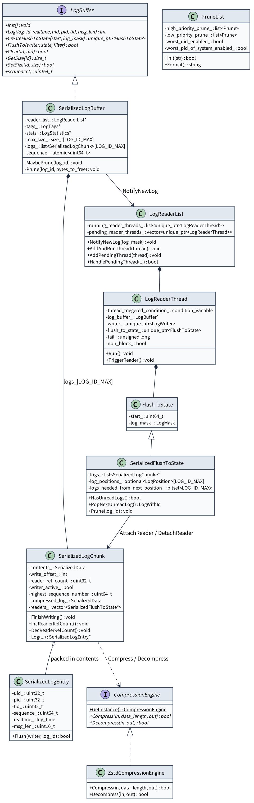
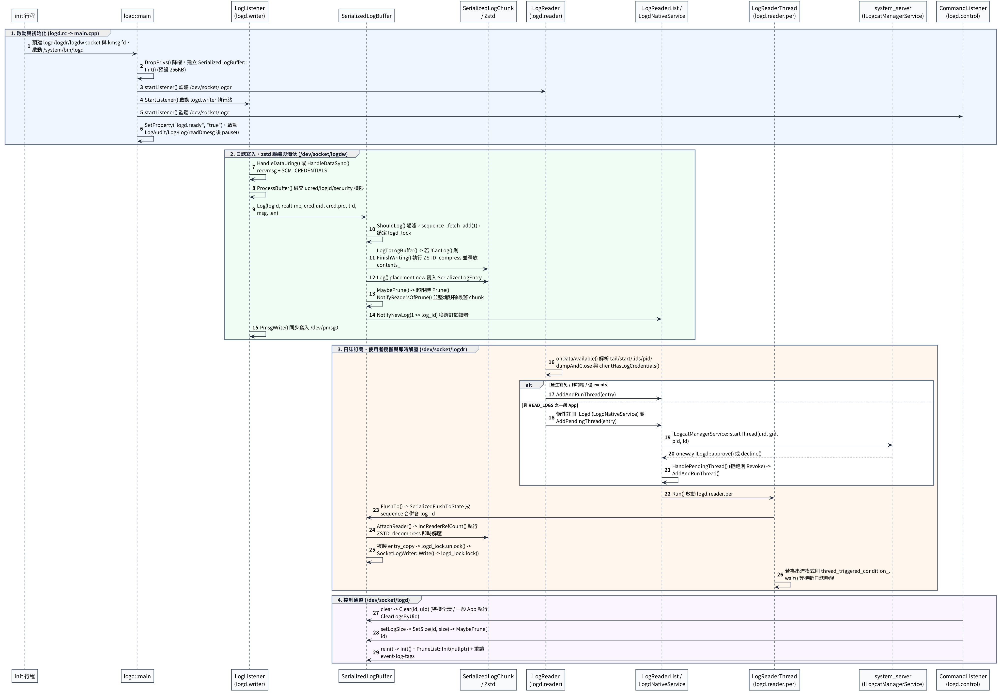

# 4.2 `logd` 守護行程與壓縮緩衝區

- **情景說明**：系統開機時由 `init` 啟動 `/system/bin/logd` 並預建三組 Unix Domain Socket（`logd`、`logdr`、`logdw`）與核心日誌檔案描述符；應用程式透過 `/dev/socket/logdw` 送出日誌，經 `LogListener` 驗證不可偽造的行程憑證後寫入 `SerializedLogBuffer`，滿塊時以 zstd 壓縮並在超限時整塊淘汰；`logcat` 或應用程式透過 `/dev/socket/logdr` 訂閱日誌，經權限與使用者授權檢查後由專屬 `LogReaderThread` 按全域序號合併、即時解壓並串流回傳；同時控制通道（`CommandListener`）、核心日誌（`LogKlog`）、稽核日誌（`LogAudit`）與 Binder 授權服務（`LogdNativeService`）協同運作。
- **對應原書**：第 4 章 4.2 節〈Logger 日志驱动程序〉（p.84–100，含 4.2.1 p.85、4.2.2 p.86、4.2.3 p.91、4.2.4 p.92、4.2.5 p.96）
- **涉及專案與版本基準**：
  - `platform/system/logging` 〔`android-17.0.0_r1`，commit `d35ba62`〕

---

## 4.2.1 `logd` 核心資料結構

> 對應原書 4.2.1〈基础数据结构〉（p.85–86）。原書的 Linux 核心驅動以 `logger_entry`、`logger_log`、`logger_reader` 三個 C 結構管理定長未壓縮環形緩衝區；Android 17 的使用者空間守護行程 `logd` 則將「緩衝區抽象」「分塊壓縮儲存」「讀者追蹤與解壓狀態」「淘汰規則」拆分為清晰的 C++ 類別階層，核心類別關係如下：



### Step 1：`LogBuffer` 抽象介面與 `FlushToState`
**位置**：`platform/system/logging/logd/LogBuffer.h` 〔`android-17.0.0_r1`，lines 31–79〕

```cpp
// A mask to represent which log buffers a reader is watching, values are (1 << LOG_ID_MAIN), etc.
using LogMask = uint32_t;
constexpr uint32_t kLogMaskAll = 0xFFFFFFFF;

// State that a LogBuffer may want to persist across calls to FlushTo().
class FlushToState {
  public:
    FlushToState(uint64_t start, LogMask log_mask) : start_(start), log_mask_(log_mask) {}
    virtual ~FlushToState() {}

    uint64_t start() const { return start_; }
    void set_start(uint64_t start) { start_ = start; }

    LogMask log_mask() const { return log_mask_; }

  private:
    uint64_t start_;
    LogMask log_mask_;
};

// Enum for the return values of the `filter` function passed to FlushTo().
enum class FilterResult {
    kSkip,
    kStop,
    kWrite,
};

class LogBuffer {
  public:
    virtual ~LogBuffer() {}

    virtual void Init() = 0;

    virtual int Log(log_id_t log_id, log_time realtime, uid_t uid, pid_t pid, pid_t tid,
                    const char* msg, uint16_t len) = 0;

    virtual std::unique_ptr<FlushToState> CreateFlushToState(uint64_t start, LogMask log_mask)
            REQUIRES(logd_lock) = 0;
    virtual bool FlushTo(
            LogWriter* writer, FlushToState& state,
            const std::function<FilterResult(log_id_t log_id, pid_t pid, uint64_t sequence,
                                             log_time realtime)>& filter) REQUIRES(logd_lock) = 0;

    virtual bool Clear(log_id_t id, uid_t uid) = 0;
    virtual size_t GetSize(log_id_t id) = 0;
    virtual bool SetSize(log_id_t id, size_t size) = 0;

    virtual uint64_t sequence() const = 0;
};
```

`LogBuffer` 是 `logd` 內部所有緩衝區後端的抽象介面（Android 17 提供預設壓縮版 `SerializedLogBuffer` 與無壓縮鏈結串列版 `SimpleLogBuffer`）。它與全域互斥鎖 `logd_lock`（定義於 `logd/LogdLock.h`，`extern std::mutex logd_lock;`）配合，透過 Clang thread-safety annotation（`REQUIRES(logd_lock)`、`GUARDED_BY(logd_lock)`）在編譯期約束讀寫同步：
- `Log()` 負責寫入一條日誌並分配全域遞增序號（`sequence`）。
- `CreateFlushToState()` 與 `FlushTo()` 搭配，由每個讀者持有自己的 `FlushToState` 跨多次呼叫續讀，其中 `start_` 記錄已讀到的序號，`log_mask_` 以位元遮罩標示訂閱的 `log_id_t` 集合；`filter` 回呼回傳 `kSkip`、`kStop` 或 `kWrite` 讓呼叫者決定略過、中止或送出。

### Step 2：`SerializedLogBuffer`、`SerializedLogChunk` 與 `SerializedData`
**位置**：`platform/system/logging/logd/SerializedLogBuffer.h` 〔`android-17.0.0_r1`，lines 37–76〕

```cpp
class SerializedLogBuffer final : public LogBuffer {
  public:
    // Create SerializedLogChunk's with size = max_size_[log_id] / kChunkSizeDivisor.
    static constexpr size_t kChunkSizeDivisor = 4;

    SerializedLogBuffer(LogReaderList* reader_list, LogTags* tags, LogStatistics* stats);
...
  private:
    bool ShouldLog(log_id_t log_id, const char* msg, uint16_t len);
    void MaybePrune(log_id_t log_id) REQUIRES(logd_lock);
    void Prune(log_id_t log_id, size_t bytes_to_free) REQUIRES(logd_lock);
    void UidClear(log_id_t log_id, uid_t uid) REQUIRES(logd_lock);
    void RemoveChunkFromStats(log_id_t log_id, SerializedLogChunk& chunk) REQUIRES(logd_lock);
    size_t GetSizeUsed(log_id_t id) REQUIRES(logd_lock);

    LogReaderList* reader_list_;
    LogTags* tags_;
    LogStatistics* stats_;

    size_t max_size_[LOG_ID_MAX] GUARDED_BY(logd_lock) = {};
    std::list<SerializedLogChunk> logs_[LOG_ID_MAX] GUARDED_BY(logd_lock);

    std::atomic<uint64_t> sequence_ = 1;
};
```

`SerializedLogBuffer` 為每個 `log_id_t`（共 `LOG_ID_MAX` 個，見 4.1 節）維護一條雙向鏈結串列 `logs_[LOG_ID_MAX]`，串列中的節點是 `SerializedLogChunk`。每塊 chunk 的未壓縮容量預設為 `max_size_[log_id] / kChunkSizeDivisor`（即緩衝區上限的 1/4；預設 256 KB 緩衝區即每塊 64 KB）。`sequence_` 為跨全部緩衝區共用的原子遞增序號（從 1 起算），這讓跨 `main`/`system`/`events` 等多個緩衝區的日誌能嚴格依寫入先後合併排序。

接著看單一壓縮塊 `SerializedLogChunk` 的結構定義：

**位置**：`platform/system/logging/logd/SerializedLogChunk.h` 〔`android-17.0.0_r1`，lines 33–106〕

```cpp
class SerializedLogChunk {
  public:
...
    explicit SerializedLogChunk(size_t size) : contents_(size) {}
    SerializedLogChunk(SerializedLogChunk&& other) noexcept = default;
    ~SerializedLogChunk();

    void FinishWriting() REQUIRES(logd_lock);
    void IncReaderRefCount() REQUIRES(logd_lock);
    void DecReaderRefCount() REQUIRES(logd_lock);
    void AttachReader(SerializedFlushToState* reader) REQUIRES(logd_lock);
    void DetachReader(SerializedFlushToState* reader) REQUIRES(logd_lock);

    void NotifyReadersOfPrune(log_id_t log_id) REQUIRES(logd_lock);

    bool CanLog(size_t len) REQUIRES(logd_lock);
    SerializedLogEntry* Log(uint64_t sequence, log_time realtime, uid_t uid, pid_t pid, pid_t tid,
                            const char* msg, uint16_t len) REQUIRES(logd_lock);

    // If this buffer has been compressed, we only consider its compressed size when accounting for
    // memory consumption for pruning.  This is since the uncompressed log is only by used by
    // readers, and thus not a representation of how much these logs cost to keep in memory.
    size_t PruneSize() const {
        return sizeof(*this) + (compressed_log_.size() ?: contents_.size());
    }

    const SerializedLogEntry* log_entry(int offset) const {
        CHECK(writer_active_ || reader_ref_count_ > 0);
        return reinterpret_cast<const SerializedLogEntry*>(data() + offset);
    }
    const uint8_t* data() const { return contents_.data(); }
    int write_offset() const { return write_offset_; }
    uint64_t highest_sequence_number() const { return highest_sequence_number_; }
...
  private:
    // The decompressed contents of this log buffer.  Deallocated when the ref_count reaches 0 and
    // writer_active_ is false.
    SerializedData contents_;
    int write_offset_ = 0;
    uint32_t reader_ref_count_ = 0;
    bool writer_active_ = true;
    uint64_t highest_sequence_number_ = 1;
    SerializedData compressed_log_;
    std::vector<SerializedFlushToState*> readers_;
};
```

`SerializedLogChunk` 的記憶體生命週期設計極為精巧：
1. **寫入中（`writer_active_ == true`）**：新日誌以 placement `new` 緊密寫入 `contents_` 緩衝區並推進 `write_offset_`，同時更新 `highest_sequence_number_`（方便讀者快速跳過整塊舊 chunk）。此時 `compressed_log_` 為空。
2. **封塊壓縮（`writer_active_ == false`）**：當 chunk 空間不足以容納下一條日誌時，呼叫 `FinishWriting()` 將 `contents_[0..write_offset_)` 壓縮至 `compressed_log_`；若當下 `reader_ref_count_ == 0`，隨即 `contents_.Resize(0)` 歸還未壓縮記憶體。
3. **按需解壓（`reader_ref_count_`）**：讀者定位到此 chunk 時呼叫 `AttachReader()` → `IncReaderRefCount()`，當 `reader_ref_count_` 由 0 變 1 且 `!writer_active_` 時才配置 `contents_` 並即時解壓；所有讀者離開後（`DecReaderRefCount()` 歸 0）再次釋放 `contents_`。
4. **淘汰計費（`PruneSize()`）**：一旦完成壓縮，只計算 `sizeof(*this) + compressed_log_.size()`，暫時供讀者解壓的 `contents_` 不計入緩衝區配額。
5. **精確歸還記憶體（`SerializedData`）**：`SerializedData`（`logd/SerializedData.h`，lines 27–55）直接封裝 `std::unique_ptr<uint8_t[]>` 而非 `std::vector`，確保 `Resize(0)` 時呼叫 `data_.reset()` 立刻釋放堆積記憶體，避免 `std::vector::clear()` 保留容量造成 RSS 膨脹。

### Step 3：`CompressionEngine` 與 `ZstdCompressionEngine`
**位置**：`platform/system/logging/logd/CompressionEngine.h` 〔`android-17.0.0_r1`，lines 23–45〕

```cpp
class CompressionEngine {
  public:
    static CompressionEngine& GetInstance();

    virtual ~CompressionEngine(){};

    virtual bool Compress(SerializedData& in, size_t data_length, SerializedData& out) = 0;
    // Decompress the contents of `in` into `out`.  `out.size()` must be set to the decompressed
    // size of the contents.
    virtual bool Decompress(SerializedData& in, SerializedData& out) = 0;
};

class ZlibCompressionEngine : public CompressionEngine {
  public:
    bool Compress(SerializedData& in, size_t data_length, SerializedData& out) override;
    bool Decompress(SerializedData& in, SerializedData& out) override;
};

class ZstdCompressionEngine : public CompressionEngine {
  public:
    bool Compress(SerializedData& in, size_t data_length, SerializedData& out) override;
    bool Decompress(SerializedData& in, SerializedData& out) override;
};
```

**位置**：`platform/system/logging/logd/CompressionEngine.cpp` 〔`android-17.0.0_r1`，lines 25–28, 82–104〕

```cpp
CompressionEngine& CompressionEngine::GetInstance() {
    static CompressionEngine* engine = new ZstdCompressionEngine();
    return *engine;
}
...
bool ZstdCompressionEngine::Compress(SerializedData& in, size_t data_length, SerializedData& out) {
    CHECK_LE(data_length, in.size());

    size_t compress_bound = ZSTD_compressBound(data_length);
    out.Resize(compress_bound);

    size_t out_size = ZSTD_compress(out.data(), out.size(), in.data(), data_length, 1);
    if (ZSTD_isError(out_size)) {
        LOG(FATAL) << "ZSTD_compress failed: " << ZSTD_getErrorName(out_size);
    }
    out.Resize(out_size);

    return true;
}

bool ZstdCompressionEngine::Decompress(SerializedData& in, SerializedData& out) {
    size_t result = ZSTD_decompress(out.data(), out.size(), in.data(), in.size());
    if (ZSTD_isError(result)) {
        LOG(FATAL) << "ZSTD_decompress failed: " << ZSTD_getErrorName(result);
    }
    CHECK_EQ(result, out.size());
    return true;
}
```

`CompressionEngine::GetInstance()` 固定使用單例 `ZstdCompressionEngine`，以 zstd 壓縮等級 `1`（偏重吞吐速度）執行整塊壓縮，壓縮後立刻將 `out` 縮減為實際大小 `out_size`；解壓時由 `SerializedLogChunk` 預先將 `contents_` 設為 `write_offset_`，再透過 `ZSTD_decompress` 一次還原。

### Step 4：`SerializedLogEntry`
**位置**：`platform/system/logging/logd/SerializedLogEntry.h` 〔`android-17.0.0_r1`，lines 34–98〕

```cpp
class __attribute__((packed)) SerializedLogEntry {
  public:
    SerializedLogEntry(uid_t uid, pid_t pid, pid_t tid, uint64_t sequence, log_time realtime,
                       uint16_t len)
        : uid_(uid),
          pid_(pid),
          tid_(tid),
          sequence_(sequence),
          realtime_(realtime),
          msg_len_(len) {}
...
    bool Flush(LogWriter* writer, log_id_t log_id) const {
        struct logger_entry entry = {};

        entry.hdr_size = sizeof(struct logger_entry);
        entry.lid = log_id;
        entry.pid = pid();
        entry.tid = tid();
        entry.uid = uid();
        entry.sec = realtime().tv_sec;
        entry.nsec = realtime().tv_nsec;
        entry.len = msg_len();

        return writer->Write(entry, msg());
    }
...
    char* msg() { return reinterpret_cast<char*>(this) + sizeof(*this); }
    const char* msg() const { return reinterpret_cast<const char*>(this) + sizeof(*this); }
    uint16_t total_len() const { return sizeof(*this) + msg_len_; }

  private:
    const uint32_t uid_;
    const uint32_t pid_;
    const uint32_t tid_;
    const uint64_t sequence_;
    const log_time realtime_;
    const uint16_t msg_len_;
};
```

`SerializedLogEntry` 加上 `__attribute__((packed))` 後標頭固定佔 30 bytes（`4+4+4+8+8+2`），其後緊接 `msg_len_` bytes 的日誌負載（見 4.1 節）。它以 placement `new` 建構在 `SerializedLogChunk::contents_` 裡且永不呼叫解構子；送往讀者時透過 `Flush()` 轉換成對外線路的 v4 `struct logger_entry`（28 bytes）並交由 `LogWriter::Write()` 送出。

### Step 5：`LogReaderList`、`LogReaderThread` 與 `LogWriter`
**位置**：`platform/system/logging/logd/LogReaderList.h` 〔`android-17.0.0_r1`，lines 27–45〕

```cpp
class LogReaderList {
  public:
    void NotifyNewLog(LogMask log_mask) const REQUIRES(logd_lock);

    void AddAndRunThread(std::unique_ptr<LogReaderThread> thread) REQUIRES(logd_lock);
    void RemoveRunningThread(LogReaderThread* thread) REQUIRES(logd_lock);
    void AddPendingThread(std::unique_ptr<LogReaderThread> thread) REQUIRES(logd_lock);
    bool HandlePendingThread(uid_t uid, gid_t gid, pid_t pid, int32_t fd, bool approve);
    bool ReleaseThreadByName(const std::string& cli_name) REQUIRES(logd_lock);

    const std::list<std::unique_ptr<LogReaderThread>>& running_reader_threads() const
            REQUIRES(logd_lock) {
        return running_reader_threads_;
    }

  private:
    std::list<std::unique_ptr<LogReaderThread>> running_reader_threads_ GUARDED_BY(logd_lock);
    std::vector<std::unique_ptr<LogReaderThread>> pending_reader_threads_ GUARDED_BY(logd_lock);
};
```

**位置**：`platform/system/logging/logd/LogReaderThread.h` 〔`android-17.0.0_r1`，lines 36–141〕

```cpp
struct PendingReaderThreadKey {
    uid_t uid;
    gid_t gid;
    pid_t pid;
    int32_t fd;
    bool operator==(const PendingReaderThreadKey& rhs) const {
        return uid == rhs.uid && gid == rhs.gid && pid == rhs.pid && fd == rhs.fd;
    }
};

class LogReaderList;

class LogReaderThread {
  public:
...
  private:
...
    std::condition_variable thread_triggered_condition_;
    LogBuffer* log_buffer_;
    LogReaderList* reader_list_;
    std::unique_ptr<LogWriter> writer_ GUARDED_BY(logd_lock);

    PendingReaderThreadKey pending_reader_thread_key_ GUARDED_BY(logd_lock);
    // Set to true to indicate the thread has finished.
    bool finished_ GUARDED_BY(logd_lock) = false;
    // Set to true to indicate the thread is tracked by AppOps.
    bool tracked_ GUARDED_BY(logd_lock) = false;

    // Set to true to cause the thread to end and the LogReaderThread to delete itself.
    bool release_ GUARDED_BY(logd_lock) = false;

    // If set to non-zero, only pids equal to this are read by the reader.
    const pid_t pid_;
    // When a reader is referencing (via start_) old elements in the log buffer, and the log
    // buffer's size grows past its memory limit, the log buffer may request the reader to skip
    // ahead a specified number of logs.
    unsigned int skip_ahead_[LOG_ID_MAX] GUARDED_BY(logd_lock);
    // LogBuffer::FlushTo() needs to store state across subsequent calls.
    std::unique_ptr<FlushToState> flush_to_state_ GUARDED_BY(logd_lock);

    // These next three variables are used for reading only the most recent lines aka `adb logcat
    // -t` / `adb logcat -T`.
    // tail_ is the number of most recent lines to print.
    unsigned long tail_;
    // count_ is the result of a first pass through the log buffer to determine how many total
    // messages there are.
    unsigned long count_;
    // index_ is used along with count_ to only start sending lines once index_ > (count_ - tail_)
    // and to disconnect the reader (if it is dumpAndClose, `adb logcat -t`), when index_ >= count_.
    unsigned long index_;

    // When a reader requests logs starting from a given timestamp, its stored here for the first
    // pass, such that logs before this time stamp that are accumulated in the buffer are ignored.
    log_time start_time_;
    // CLOCK_MONOTONIC based deadline used for log wrapping.  If this deadline expires before logs
    // wrap, then wake up and send the logs to the reader anyway.
    std::chrono::steady_clock::time_point deadline_ GUARDED_BY(logd_lock);
    // If this reader is 'dumpAndClose' and will disconnect once it has read its intended logs.
    const bool non_block_;
};
```

`LogReaderList` 取代原書 `logger_log.readers` 鏈結串列，集中管理全體正在執行的讀者（`running_reader_threads_`）與等待使用者同意授權的暫止讀者（`pending_reader_threads_`）。每個 `LogReaderThread` 對應一條 `/dev/socket/logdr` 連線，持有專屬的 `FlushToState`（讀取游標）、`std::condition_variable`（阻塞等待新日誌或 wrap deadline）與 `LogWriter`（封裝底層 socket 輸出與 `privileged_` 旗標，見 `logd/LogWriter.h`，lines 24–44；呼叫 `revoke()` 會將 `privileged_` 設為 `false`，使該讀者只能看到自身 UID 的日誌）。

### Step 6：`PruneList` 與 `Prune`
**位置**：`platform/system/logging/logd/PruneList.h` 〔`android-17.0.0_r1`，lines 26–66〕

```cpp
class Prune {
  public:
    static const uid_t UID_ALL = (uid_t)-1;
    static const pid_t PID_ALL = (pid_t)-1;

    Prune(uid_t uid, pid_t pid) : uid_(uid), pid_(pid) {}

    bool Matches(LogBufferElement* element) const;
    std::string Format() const;

    uid_t uid() const { return uid_; }
    pid_t pid() const { return pid_; }

  private:
    const uid_t uid_;
    const pid_t pid_;
};

class PruneList {
  public:
    PruneList();

    bool Init(const char* str);
    std::string Format() const;

    bool IsHighPriority(LogBufferElement* element) const;
    bool IsLowPriority(LogBufferElement* element) const;

    bool HasHighPriorityPruneRules() const { return !high_priority_prune_.empty(); }
    bool HasLowPriorityPruneRules() const { return !low_priority_prune_.empty(); }

    bool worst_uid_enabled() const { return worst_uid_enabled_; }
    bool worst_pid_of_system_enabled() const { return worst_pid_of_system_enabled_; }

  private:
    std::list<Prune> high_priority_prune_;
    std::list<Prune> low_priority_prune_;

    bool worst_uid_enabled_;
    bool worst_pid_of_system_enabled_;
};
```

`PruneList` 記錄高優先淘汰（黑名單，`~uid` / `~uid/pid` / `~/pid`，置於 `high_priority_prune_`）、低優先淘汰（白名單，`uid` / `uid/pid` / `/pid`，置於 `low_priority_prune_`）以及兩個特殊旗標：`worst_uid_enabled_`（`~!`）與 `worst_pid_of_system_enabled_`（`~1000/!`）。值得注意的是，在 Android 17 原始碼中，原本會消費 `PruneList` 的 `ChattyLogBuffer` 已被完全移除；`main.cpp` 仍建立 `PruneList` 並交給 `CommandListener`，以保持 `getPruneList` / `setPruneList` / `reinit` 控制指令與 `ro.logd.filter` / `persist.logd.filter` 屬性的相容性，但實際的 `SerializedLogBuffer` 淘汰已改採壓縮後 FIFO 整塊移除（詳見 4.2.4 Step 4）。

> 〔與 2.3 差異〕**已移除並重寫**：原書 4.2.1（p.85–86）的 `struct logger_log` 持有定長未壓縮位元組陣列 `buffer`、單一 `w_off` / `head` 偏移量、Linux 等待佇列 `wait_queue_head_t wq` 與 `struct logger_reader` 鏈結串列；Android 17 徹底移至使用者空間，以 `SerializedLogBuffer` + `SerializedLogChunk`（zstd 壓縮分塊）取代固定環形陣列，以全域單調 `sequence_` + `SerializedFlushToState` 取代位元組偏移 `r_off`，並以 `LogReaderList` + `LogReaderThread`（條件變數）取代核心等待佇列 `wq`。

---

## 4.2.2 `logd` 啟動與初始化流程

> 對應原書 4.2.2〈日志设备的初始化过程〉（p.86–91）。原書由核心模組進入點 `logger_init` 呼叫 `misc_register` 註冊 `/dev/log/{main,events,radio}` 三個 misc 字元裝置；Android 17 則由 `init` 解析 `logd.rc` 建立三組 Unix Socket 與核心檔案描述符，再啟動 `/system/bin/logd` 執行 `main()` 完成降權、緩衝區建立與各執行緒監聽。

### Step 1：`logd.rc` 服務定義與 Socket 預建
**位置**：`platform/system/logging/logd/logd.rc` 〔`android-17.0.0_r1`，lines 1–39〕

```rc
service logd /system/bin/logd
    socket logd stream 0666 logd logd
    socket logdr seqpacket 0666 logd logd
    socket logdw dgram+passcred 0222 logd logd
    file /proc/kmsg r
    file /dev/kmsg w
    user logd
    group logd system package_info readproc
    capabilities SYSLOG AUDIT_CONTROL
    priority 10
    task_profiles ServiceCapacityLow
    onrestart setprop logd.ready false

service logd-reinit /system/bin/logd --reinit
    oneshot
    disabled
    user logd
    group logd
    task_profiles ServiceCapacityLow

# Limit SELinux denial generation, defaulting to 5/second
service logd-auditctl /system/bin/auditctl -r ${persist.logd.audit.rate:-5}
    oneshot
    disabled
    user logd
    group logd
    capabilities AUDIT_CONTROL

on fs
    write /dev/event-log-tags "# content owned by logd
"
    chown logd logd /dev/event-log-tags
    chmod 0644 /dev/event-log-tags

on property:sys.boot_completed=1
    start logd-auditctl

on property:persist.logd.audit.rate=*
    start logd-auditctl
```

`logd.rc` 由 `init` 在開機早期載入，其關鍵配置包含：
1. **三組 Unix Domain Socket**（掛載於 `/dev/socket/`，檔案描述符透過環境變數 `ANDROID_SOCKET_*` 傳入 `logd`，行程內以 `android_get_control_socket()` 領取）：
   - `logd`（`SOCK_STREAM`，`0666`）：控制指令通道，供 `CommandListener` 處理 `clear`、`getLogSize`、`setLogSize`、`reinit` 等指令。
   - `logdr`（`SOCK_SEQPACKET`，`0666`）：日誌讀取通道，保留封包邊界且有序，供 `LogReader` 接收查詢參數並逐筆回傳 `logger_entry`。
   - `logdw`（`SOCK_DGRAM` + `SO_PASSCRED`，`0222` 只寫不讀）：日誌寫入通道，`passcred` 旗標由 `init` 預先開啟 `SO_PASSCRED`，確保核心為每個 datagram 附加不可偽造的 `SCM_CREDENTIALS`（`pid`/`uid`/`gid`）。
2. **核心日誌檔案描述符**：由高權限的 `init` 預先開啟 `/proc/kmsg`（唯讀）與 `/dev/kmsg`（唯寫），傳入後由 `logd` 呼叫 `android_get_control_file()` 領取，避免 `logd` 降權後無法開檔。
3. **最低權限與資源隔離**：以 `user logd`、附屬群組 `logd system package_info readproc` 執行（`readproc` 用於讀取 `/proc/<pid>/status` 查群組或行程名），僅保留 `CAP_SYSLOG` 與 `CAP_AUDIT_CONTROL` 兩項 Linux capabilities；`priority 10`（較低 nice 優先權）與 `ServiceCapacityLow` 確保大量日誌不會搶佔前台 UI CPU。若崩潰重啟，`onrestart setprop logd.ready false` 會先撤銷就緒旗標。
4. **輔助服務**：`logd-reinit` 以 `/system/bin/logd --reinit` 觸發線上重讀屬性與 `/data/misc/logd/event-log-tags`（通常在 `/data` 掛載後由 `init` 觸發）；`logd-auditctl` 在開機完成或屬性變更時呼叫 `/system/bin/auditctl -r` 限制 SELinux denial 速率（預設每秒 5 條）。

### Step 2：`main()` 前置準備、`--reinit` 分支與 `DropPrivs()`
**位置**：`platform/system/logging/logd/main.cpp` 〔`android-17.0.0_r1`，lines 76–108, 154–230〕

```cpp
static void DropPrivs(bool klogd, bool auditd) {
    if (set_sched_policy(0, SP_BACKGROUND) < 0) {
        PLOG(FATAL) << "failed to set background scheduling policy";
    }

    if (!GetBoolProperty("ro.debuggable", false)) {
        if (prctl(PR_SET_DUMPABLE, 0) == -1) {
            PLOG(FATAL) << "failed to clear PR_SET_DUMPABLE";
        }
    }

    std::unique_ptr<struct _cap_struct, int (*)(void*)> caps(cap_init(), cap_free);
    if (cap_clear(caps.get()) < 0) {
        PLOG(FATAL) << "cap_clear() failed";
    }
    if (klogd) {
        cap_value_t cap_syslog = CAP_SYSLOG;
        if (cap_set_flag(caps.get(), CAP_PERMITTED, 1, &cap_syslog, CAP_SET) < 0 ||
            cap_set_flag(caps.get(), CAP_EFFECTIVE, 1, &cap_syslog, CAP_SET) < 0) {
            PLOG(FATAL) << "Failed to set CAP_SYSLOG";
        }
    }
    if (auditd) {
        cap_value_t cap_audit_control = CAP_AUDIT_CONTROL;
        if (cap_set_flag(caps.get(), CAP_PERMITTED, 1, &cap_audit_control, CAP_SET) < 0 ||
            cap_set_flag(caps.get(), CAP_EFFECTIVE, 1, &cap_audit_control, CAP_SET) < 0) {
            PLOG(FATAL) << "Failed to set CAP_AUDIT_CONTROL";
        }
    }
    if (cap_set_proc(caps.get()) < 0) {
        PLOG(FATAL) << "cap_set_proc() failed";
    }
}
...
static int issueReinit() {
    int sock = TEMP_FAILURE_RETRY(socket_local_client(
        "logd", ANDROID_SOCKET_NAMESPACE_RESERVED, SOCK_STREAM));
    if (sock < 0) return -errno;

    static const char reinitStr[] = "reinit";
    ssize_t ret = TEMP_FAILURE_RETRY(write(sock, reinitStr, sizeof(reinitStr)));
    if (ret < 0) return -errno;
...
}
...
int main(int argc, char* argv[]) {
    // We want EPIPE when a reader disconnects, not to terminate logd.
    signal(SIGPIPE, SIG_IGN);
    // logd is written under the assumption that the timezone is UTC.
    // If TZ is not set, persist.sys.timezone is looked up in some time utility
    // libc functions, including mktime. It confuses the logd time handling,
    // so here explicitly set TZ to UTC, which overrides the property.
    setenv("TZ", "UTC", 1);
    // issue reinit command. KISS argument parsing.
    if ((argc > 1) && argv[1] && !strcmp(argv[1], "--reinit")) {
        return issueReinit();
    }

    android::base::InitLogging(
            argv, [](android::base::LogId log_id, android::base::LogSeverity severity,
                     const char* tag, const char* file, unsigned int line, const char* message) {
                if (tag && strcmp(tag, "logd") != 0) {
                    auto prefixed_message = android::base::StringPrintf("%s: %s", tag, message);
                    android::base::KernelLogger(log_id, severity, "logd", file, line,
                                                prefixed_message.c_str());
                } else {
                    android::base::KernelLogger(log_id, severity, "logd", file, line, message);
                }
            });

    static const char dev_kmsg[] = "/dev/kmsg";
    int fdDmesg = android_get_control_file(dev_kmsg);
    if (fdDmesg < 0) {
        fdDmesg = TEMP_FAILURE_RETRY(open(dev_kmsg, O_WRONLY | O_CLOEXEC));
    }

    int fdPmesg = -1;
    bool klogd_default =
            GetBoolProperty("ro.debuggable", false) && !GetBoolProperty("ro.config.low_ram", false);
    bool klogd = GetBoolProperty("ro.logd.kernel", klogd_default);
    if (klogd) {
        SetProperty("ro.logd.kernel", "true");
        static const char proc_kmsg[] = "/proc/kmsg";
        fdPmesg = android_get_control_file(proc_kmsg);
        if (fdPmesg < 0) {
            fdPmesg = TEMP_FAILURE_RETRY(
                open(proc_kmsg, O_RDONLY | O_NDELAY | O_CLOEXEC));
        }
        if (fdPmesg < 0) PLOG(ERROR) << "Failed to open " << proc_kmsg;
    }

    bool auditd = GetBoolProperty("ro.logd.auditd", true);
    DropPrivs(klogd, auditd);
```

啟動早期做了五件關鍵設定：
1. **忽略 `SIGPIPE` 並鎖定 `TZ=UTC`**：防止讀者異常斷線導致整個 `logd` 被殺死；強制 UTC 避免 `mktime` 查 `persist.sys.timezone` 干擾核心時間校正。
2. **`--reinit` 快速路徑**：若由 `logd-reinit` 呼叫，僅透過 `issueReinit()` 連上 `/dev/socket/logd` 送出 `"reinit"` 並等待 `"success"` 即退出。
3. **自身日誌導向核心 `KernelLogger`**：`logd` 不能把自己的 `LOG()` 寫回 `/dev/socket/logdw`（避免死鎖或遞迴），故重導至 `/dev/kmsg`。
4. **依屬性決定是否啟用 `klogd` 與 `auditd`**：`ro.logd.kernel` 僅在 `ro.debuggable=true` 且非 `ro.config.low_ram` 時預設開啟；`ro.logd.auditd` 預設為 `true`。
5. **`DropPrivs()` 進一步收緊權限**：設定 `SP_BACKGROUND` 排程群組、在 user 版本清除 `PR_SET_DUMPABLE` 禁止 ptrace/core dump，並依實際是否開啟 `klogd` / `auditd` 僅保留對應的 `CAP_SYSLOG` / `CAP_AUDIT_CONTROL`。

### Step 3：建立 `LogBuffer` 與緩衝區大小初始化
**位置**：`platform/system/logging/logd/main.cpp` 〔`android-17.0.0_r1`，lines 231–253〕

```cpp
    // A cache of event log tags
    LogTags log_tags;

    // Pruning configuration.
    PruneList prune_list;

    std::string buffer_type = GetProperty("logd.buffer_type", "serialized");

    LogStatistics log_statistics(buffer_type == "serialized");

    // Serves the purpose of managing the last logs times read on a socket connection, and as a
    // reader lock on a range of log entries.
    LogReaderList reader_list;

    // LogBuffer is the object which is responsible for holding all log entries.
    LogBuffer* log_buffer = nullptr;
    if (buffer_type == "serialized") {
        log_buffer = new SerializedLogBuffer(&reader_list, &log_tags, &log_statistics);
    } else if (buffer_type == "simple") {
        log_buffer = new SimpleLogBuffer(&reader_list, &log_tags, &log_statistics);
    } else {
        LOG(FATAL) << "buffer_type must be one of 'serialized' or 'simple'";
    }
```

此處讀取 `logd.buffer_type`（預設 `"serialized"`），僅支援 `SerializedLogBuffer`（zstd 壓縮分塊）與 `SimpleLogBuffer`（無壓縮 `std::list<LogBufferElement>`）兩種後端。另外提醒：與持久化日誌相關的 `logd.logpersistd` / `persist.logd.logpersistd` 屬性（見 `logd/README.property.md`，lines 13–22）並非由 `logd` 內部直接消費，而是由 `init` 監聽屬性並另行拉起 `logcatd`（以 `logcat -f` 輪轉寫檔）實現。

`SerializedLogBuffer` 建構時立即呼叫 `Init()`，針對每個 `log_id_t` 向 `GetBufferSizeFromProperties()` 查詢大小並透過 `SetSize()` 設定：

**位置**：`platform/system/logging/logd/SerializedLogBuffer.cpp` 〔`android-17.0.0_r1`，lines 94–112〕

```cpp
SerializedLogBuffer::SerializedLogBuffer(LogReaderList* reader_list, LogTags* tags,
                                         LogStatistics* stats)
    : reader_list_(reader_list), tags_(tags), stats_(stats) {
    Init();
}

void SerializedLogBuffer::Init() {
    log_id_for_each(i) {
        if (!SetSize(i, GetBufferSizeFromProperties(i))) {
            SetSize(i, kLogBufferMinSize);
        }
    }

    // Release any sleeping reader threads to dump their current content.
    auto lock = std::lock_guard{logd_lock};
    for (const auto& reader_thread : reader_list_->running_reader_threads()) {
        reader_thread->TriggerReader();
    }
}
```

`LogSize.cpp` 則嚴格限制各緩衝區在 `kLogBufferMinSize`（64 KB）到 `kLogBufferMaxSize`（256 MB）之間，預設值 `kDefaultLogBufferSize` 為 **256 KB**；且為避免壓縮緩衝區塞進百萬行日誌導致 bugreport 逾時（註解中引用 `b/196856709`），只有 debuggable 的 automotive 或 `android-desktop` 裝置才允許透過 `persist.logd.size.<buffer>` / `ro.logd.size.<buffer>` / `persist.logd.size` / `ro.logd.size` 屬性覆寫預設大小；非 debuggable 的 `low_ram` 裝置則直接降至 64 KB：

**位置**：`platform/system/logging/logd/LogSize.cpp` 〔`android-17.0.0_r1`，lines 66–107〕

```cpp
static bool isAllowedToOverrideBufferSize() {
    const auto hwType = android::base::GetProperty("ro.hardware.type", "");
    const auto hardware = android::base::GetProperty("ro.hardware", "");
    /* Allow automotive and desktop devices to optionally override the default. */
    return (hwType == "automotive" || hardware == "android-desktop");
}

size_t GetBufferSizeFromProperties(log_id_t log_id) {
...
    static const bool isDebuggable = android::base::GetBoolProperty("ro.debuggable", false);
    if (isDebuggable) {
        static const bool mayOverride = isAllowedToOverrideBufferSize();
        if (mayOverride) {
            if (auto size = GetBufferSizePropertyOverride(log_id)) {
                return *size;
            }
        }
    } else {
        static const bool isLowRam = android::base::GetBoolProperty("ro.config.low_ram", false);
        /*
         * For non-debuggable low_ram devices, we want to save memory here and
         * use the minimum size.
         */
        if (isLowRam) {
            return kLogBufferMinSize;
        }
    }

    return kDefaultLogBufferSize;
}
```

### Step 4：啟動監聽執行緒、回報就緒與事件迴圈
**位置**：`platform/system/logging/logd/main.cpp` 〔`android-17.0.0_r1`，lines 255–310〕

```cpp
    // LogReader listens on /dev/socket/logdr. When a client
    // connects, log entries in the LogBuffer are written to the client.
    LogReader* reader = new LogReader(log_buffer, &reader_list);
    if (reader->startListener()) {
        return EXIT_FAILURE;
    }

    // LogListener listens on /dev/socket/logdw for client
    // initiated log messages. New log entries are added to LogBuffer
    // and LogReader is notified to send updates to connected clients.
    LogListener* swl = new LogListener(log_buffer);
    if (!swl->StartListener()) {
        return EXIT_FAILURE;
    }

    // Command listener listens on /dev/socket/logd for incoming logd
    // administrative commands.
    CommandListener* cl = new CommandListener(log_buffer, &log_tags, &prune_list, &log_statistics);
    if (cl->startListener()) {
        return EXIT_FAILURE;
    }

    // Notify that others can now interact with logd
    SetProperty("logd.ready", "true");

    // LogAudit listens on NETLINK_AUDIT socket for selinux
    // initiated log messages. New log entries are added to LogBuffer
    // and LogReader is notified to send updates to connected clients.
    LogAudit* al = nullptr;
    if (auditd) {
        int dmesg_fd = GetBoolProperty("ro.logd.auditd.dmesg", true) ? fdDmesg : -1;
        al = new LogAudit(log_buffer, dmesg_fd);
    }

    LogKlog* kl = nullptr;
    if (klogd) {
        kl = new LogKlog(log_buffer, fdDmesg, fdPmesg, al != nullptr, &log_statistics);
    }

    readDmesg(al, kl);

    // failure is an option ... messages are in dmesg (required by standard)
    if (kl && kl->startListener()) {
        delete kl;
    }

    if (al && al->startListener()) {
        delete al;
    }

    TrustyLog::create(log_buffer);

    TEMP_FAILURE_RETRY(pause());

    return EXIT_SUCCESS;
}
```

啟動順序有明確的相依考量：
1. 先後啟動三條核心 Socket 執行緒：`LogReader`（`SocketListener`，執行緒名 `logd.reader`）、`LogListener`（自建 detached `std::thread`，執行緒名 `logd.writer`）、`CommandListener`（`FrameworkListener`，執行緒名 `logd.control`）。任一失敗即回傳 `EXIT_FAILURE` 讓 `init` 重啟。
2. 立刻設定系統屬性 `logd.ready=true`，讓其他系統服務能開始連線。
3. 接著才初始化 `LogAudit`、`LogKlog`，並先呼叫 `readDmesg(al, kl)` 透過 `klogctl(KLOG_READ_ALL)` 把開機早期已留在核心 ring buffer 裡的 dmesg 與早期 audit 記錄補灌進 `LogBuffer`，再啟動 `kl->startListener()`（`logd.klogd`）與 `al->startListener()`（`logd.auditd`）接手後續即時串流，以及嘗試開啟 Trusty TEE 日誌裝置（`TrustyLog::create`）。
4. 注意 `LogdNativeService`（Binder 服務 `"logd"`）**並未在 `main()` 中建立**——因為 `logd` 在 `servicemanager` 之前啟動，若於此時註冊會阻塞開機；因此它被延後至 `LogReader::onDataAvailable` 中首次遇到需要使用者同意的應用讀者時，透過 `GetLogdBinderServiceStatus()` 惰性註冊並呼叫 `ProcessState::self()->startThreadPool()`（見 4.2.3 Step 2 與 4.2.5 Step 4）。
5. 最後主執行緒以 `TEMP_FAILURE_RETRY(pause())` 進入永久休眠，所有工作交由上述各背景執行緒持續服務。

> 〔與 2.3 差異〕**已移除並重寫**：原書 4.2.2（p.86–91）在核心啟動期以 `device_initcall(logger_init)` 靜態配置 `_buf_log_main`（64 KB）、`_buf_log_events`（256 KB）、`_buf_log_radio`（64 KB）並呼叫 `misc_register` 建立 `/dev/log/*`；Android 17 改由 `init` 依 `logd.rc` 建立三組 Unix Socket 與檔案描述符，啟動使用者空間多執行緒守護行程 `/system/bin/logd`，並動態為 8 類 `log_id_t` 配置 256 KB（或 `low_ram` 64 KB）的壓縮緩衝區配額，同時整合核心 dmesg、SELinux audit 與 Trusty 日誌匯入。

---

## 4.2.3 日誌讀取與訂閱流程（`LogReader` / `LogReaderThread`）

> 對應原書 4.2.3〈日志设备文件的打开过程〉（p.91–92，`logger_open`）與 4.2.4〈日志记录的读取过程〉（p.92–96，`logger_read`）。原書中讀寫端透過 `open("/dev/log/...")` 開啟不同裝置並以 `read()` 逐筆讀取單一緩衝區；Android 17 的讀取端統一連向 `/dev/socket/logdr`，先送出一行文字查詢命令，再由 `logd` 派發獨立執行緒將多個緩衝區的日誌按全域序號合併並即時解壓後推回。

### Step 1：`LogReader::onDataAvailable` 解析讀取命令
**位置**：`platform/system/logging/logd/LogReader.cpp` 〔`android-17.0.0_r1`，lines 103–195〕

```cpp
LogReader::LogReader(LogBuffer* logbuf, LogReaderList* reader_list)
    : SocketListener(getLogSocket(), true), log_buffer_(logbuf), reader_list_(reader_list) {}

// Note returning false will release the SocketClient instance.
bool LogReader::onDataAvailable(SocketClient* cli) {
    static bool name_set;
    if (!name_set) {
        prctl(PR_SET_NAME, "logd.reader");
        name_set = true;
    }

    char buffer[255];

    int len = read(cli->getSocket(), buffer, sizeof(buffer) - 1);
    if (len <= 0) {
        DoSocketDelete(cli);
        return false;
    }
    buffer[len] = '\0';

    // Clients are only allowed to send one command, disconnect them if they send another.
    if (DoSocketDelete(cli)) {
        return false;
    }

    unsigned long tail = 0;
    static const char _tail[] = " tail=";
    char* cp = strstr(buffer, _tail);
    if (cp) {
        tail = atol(cp + sizeof(_tail) - 1);
    }

    log_time start(log_time::EPOCH);
    static const char _start[] = " start=";
    cp = strstr(buffer, _start);
    if (cp) {
        // Parse errors will result in current time
        start.strptime(cp + sizeof(_start) - 1, "%s.%q");
    }

    std::chrono::steady_clock::time_point deadline = {};
    static const char _timeout[] = " timeout=";
    cp = strstr(buffer, _timeout);
    if (cp) {
        long timeout_seconds = atol(cp + sizeof(_timeout) - 1);
        deadline = std::chrono::steady_clock::now() + std::chrono::seconds(timeout_seconds);
    }

    unsigned int logMask = -1;
    static const char _logIds[] = " lids=";
    cp = strstr(buffer, _logIds);
    if (cp) {
        logMask = 0;
        cp += sizeof(_logIds) - 1;
        while (*cp != '\0') {
            int val = 0;
            while (isdigit(*cp)) {
                val = val * 10 + *cp - '0';
                ++cp;
            }
            logMask |= 1 << val;
            if (*cp != ',') {
                break;
            }
            ++cp;
        }
    }

    pid_t pid = 0;
    static const char _pid[] = " pid=";
    cp = strstr(buffer, _pid);
    if (cp) {
        pid = atol(cp + sizeof(_pid) - 1);
    }

    bool nonBlock = false;
    if (!fastcmp<strncmp>(buffer, "dumpAndClose", 12)) {
        // Allow writer to get some cycles, and wait for pending notifications
        sched_yield();
        logd_lock.lock();
        logd_lock.unlock();
        sched_yield();
        nonBlock = true;
    }

    bool privileged = clientHasLogCredentials(cli);
    bool can_read_security = CanReadSecurityLogs(cli);
    if (!can_read_security) {
        logMask &= ~(1 << LOG_ID_SECURITY);
    }

    std::unique_ptr<LogWriter> socket_log_writer(new SocketLogWriter(this, cli, privileged));
```

當 `liblog`（如 `logcat` 或 `EventLog.readEvents`）連上 `/dev/socket/logdr` 並送出請求字串（例如 `dumpAndClose lids=0,3 tail=100 pid=1234` 或 `stream lids=0,1,3,4`）時，`SocketListener` 觸發 `LogReader::onDataAvailable`：
1. **單次指令保護**：同一條 `logdr` 連線只允許發送一次訂閱指令；若斷線（`len <= 0`）或重複送指令，立刻呼叫 `DoSocketDelete(cli)` 透過 `reader_list_->ReleaseThreadByName()` 終止對應 `LogReaderThread` 並回傳 `false` 關閉連線。
2. **解析查詢參數**：支援 `tail=<N>`（僅輸出最後 N 條）、`start=<sec>.<nsec>`（起始時間戳）、`timeout=<sec>`（log wrap 喚醒逾時）、`lids=<id1>,<id2>,...`（訂閱的緩衝區位元遮罩，未給則為 `-1` 即全部）、`pid=<P>`（限定單一行程），以及命令開頭為 `"dumpAndClose"` 時設 `nonBlock = true`（傾印現有日誌後關閉，並刻意先 `sched_yield` + 搶放 `logd_lock` 讓剛送出的寫入有機會落地）。
3. **時間戳轉序號（lines 196–231）**：若指定了 `start=`，先以一個不輸出資料的 lambda `log_find_start` 呼叫一次 `log_buffer_->FlushTo()`，找出第一條時間大於等於 `start` 的 `sequence` 作為起始序號；若緩衝區內尚無比 `start` 新的日誌，`nonBlock` 模式直接結束，阻塞模式則從 `log_buffer_->sequence()` 開始等待新日誌。
4. **注意 `uid` 過濾機制**：指令列上並不接受任意 `uid=` 參數，而是由 `LogReader` 強制以 `clientHasLogCredentials(cli)` 決定 `SocketLogWriter::privileged_`——未具權限的讀者會在 `FlushTo` 中強制只看 `entry->uid() == writer->uid()`。

### Step 2：權限校驗與使用者同意（User Consent）分流
**位置**：`platform/system/logging/logd/LogPermissions.cpp` 〔`android-17.0.0_r1`，lines 46–48, 145–188〕

```cpp
static bool UserIsPrivileged(int id) {
    return id == AID_ROOT || id == AID_SYSTEM || id == AID_LOG;
}
...
bool clientHasLogCredentials(SocketClient* cli) {
    if (UserIsPrivileged(cli->getUid()) || UserIsPrivileged(cli->getGid())) {
        return true;
    }

    // Kernel version 4.13 added SO_PEERGROUPS to return the supplemental groups of a peer socket,
    // so try that first then fallback to the above racy checking of /proc/<pid>/status if the
    // kernel is too old.  Per
    // https://source.android.com/devices/architecture/kernel/android-common, the fallback can be
    // removed no earlier than 2024.
    auto supplemental_groups = std::vector<gid_t>(16, -1);
    socklen_t groups_size = supplemental_groups.size() * sizeof(gid_t);

    int result = getsockopt(cli->getSocket(), SOL_SOCKET, SO_PEERGROUPS, supplemental_groups.data(),
                            &groups_size);

    if (result != 0) {
        if (errno != ERANGE) {
            return clientHasLogCredentials(cli->getUid(), cli->getGid(), cli->getPid());
        }

        supplemental_groups.resize(groups_size / sizeof(gid_t), -1);
        result = getsockopt(cli->getSocket(), SOL_SOCKET, SO_PEERGROUPS, supplemental_groups.data(),
                            &groups_size);

        // There is still some error after resizing supplemental_groups, fallback.
        if (result != 0) {
            return clientHasLogCredentials(cli->getUid(), cli->getGid(), cli->getPid());
        }
    }

    supplemental_groups.resize(groups_size / sizeof(gid_t), -1);
    for (const auto& gid : supplemental_groups) {
        if (UserIsPrivileged(gid)) {
            return true;
        }
    }

    return false;
}

bool clientIsExemptedFromUserConsent(SocketClient* cli) {
    return cli->getUid() < AID_APP_START;
}
```

**位置**：`platform/system/logging/logd/LogReader.cpp` 〔`android-17.0.0_r1`，lines 243–279〕

```cpp
    auto lock = std::lock_guard{logd_lock};
    auto entry = std::make_unique<LogReaderThread>(log_buffer_, reader_list_,
                                                   std::move(socket_log_writer), nonBlock, tail,
                                                   logMask, pid, start, sequence, deadline);
    // release client and entry reference counts once done
    cli->incRef();

    entry->set_pending_reader_thread_key(cli->getUid(), cli->getGid(), cli->getPid(),
                                         cli->getSocket());

    bool only_read_event_logs = (logMask ^ (1 << LOG_ID_EVENTS)) == 0;

    // The logd access will be granted when any of the following three
    // conditions is satisfied:
    // 1. the client (native processes) is exempted from user consent check.
    // 2. the client doesn't have log credentials and so can only access its own log data anyway
    // 3. the client (for EventLog API) only wants to access the event log.
    if (clientIsExemptedFromUserConsent(cli) || !clientHasLogCredentials(cli) ||
        only_read_event_logs) {
        reader_list_->AddAndRunThread(std::move(entry));
    } else {
        if (GetLogdBinderServiceStatus(reader_list_)) {
            reader_list_->AddPendingThread(std::move(entry));
        } else {
            // The logd binder service is not available, we are not able to
            // check user consent. So we revoke the privileges.
            entry->Revoke();
            reader_list_->AddAndRunThread(std::move(entry));
        }
    }

    // Set acceptable upper limit to wait for slow reader processing b/27242723
    struct timeval t = { LOGD_SNDTIMEO, 0 };
    setsockopt(cli->getSocket(), SOL_SOCKET, SO_SNDTIMEO, (const char*)&t,
               sizeof(t));

    return true;
}
```

這裡形成三層安全防線：
1. **緩衝區特權隔離**：只有 `AID_SYSTEM`（UID 或 GID）能讀取 `LOG_ID_SECURITY`（`CanReadSecurityLogs`），其餘客戶端直接清除該位元。
2. **跨 UID 讀取憑證（`clientHasLogCredentials`）**：若 peer 的 UID、GID 或透過核心 `getsockopt(..., SO_PEERGROUPS)` 取得的附屬群組包含 `AID_ROOT`、`AID_SYSTEM` 或 `AID_LOG`（例如持有 `READ_LOGS` 權限的 App 或 `adb shell`），即判定為 `privileged = true`；若核心不支援 `SO_PEERGROUPS` 才退回最多重試 3 次讀取 `/proc/<pid>/status`（同時核對 Uid/Gid 防 PID 重用）。不具憑證者仍可讀取，但只能看見自己 UID 的日誌。
3. **使用者同意把關（Android 13+ 隱私保護）**：若讀取端是一般應用行程（`uid >= AID_APP_START`，不在 `clientIsExemptedFromUserConsent` 豁免範圍）、擁有 `AID_LOG` 跨 UID 權限且不只讀 `LOG_ID_EVENTS`，則不立刻啟動，而是先以 `GetLogdBinderServiceStatus()` 確保 `LogdNativeService` 已向 `servicemanager` 註冊，再呼叫 `reader_list_->AddPendingThread()` 通知 `system_server` 中的 `ILogcatManagerService::startThread` 跳出授權對話框；若 Binder 服務不可用，則保守執行 `entry->Revoke()` 降權為僅看自己 UID 後放行。
4. 最後為 socket 設定 `SO_SNDTIMEO`（`LOGD_SNDTIMEO`），防止卡死的慢速讀者無限期佔用執行緒。

### Step 3：`LogReaderThread::ThreadFunction` 執行與喚醒迴圈
**位置**：`platform/system/logging/logd/LogReaderThread.cpp` 〔`android-17.0.0_r1`，lines 48–165〕

```cpp
void LogReaderThread::Run() {
    auto thread = std::thread{&LogReaderThread::ThreadFunction, this};
    thread.detach();
}

void LogReaderThread::ThreadFunction() {
    prctl(PR_SET_NAME, "logd.reader.per");

    auto lock = std::unique_lock{logd_lock};
    auto lock_assertion = android::base::ScopedLockAssertion{logd_lock};

    while (!release_) {
        if (deadline_.time_since_epoch().count() != 0) {
            if (thread_triggered_condition_.wait_until(lock, deadline_) ==
                std::cv_status::timeout) {
                deadline_ = {};
            }
            if (release_) {
                break;
            }
        }

        if (tail_) {
            auto first_pass_state = log_buffer_->CreateFlushToState(flush_to_state_->start(),
                                                                    flush_to_state_->log_mask());
            log_buffer_->FlushTo(writer_.get(), *first_pass_state,
                                 [this](log_id_t log_id, pid_t pid, uint64_t sequence,
                                        log_time realtime) REQUIRES(logd_lock) {
                                     return FilterFirstPass(log_id, pid, sequence, realtime);
                                 });
        }
        bool flush_success = log_buffer_->FlushTo(
                writer_.get(), *flush_to_state_,
                [this](log_id_t log_id, pid_t pid, uint64_t sequence, log_time realtime) REQUIRES(
                        logd_lock) { return FilterSecondPass(log_id, pid, sequence, realtime); });
...
        start_time_.tv_sec = 0;
        start_time_.tv_nsec = 0;

        if (!flush_success) {
            break;
        }

        if (non_block_ || release_) {
            break;
        }

        CleanSkip();

        if (deadline_.time_since_epoch().count() == 0) {
            thread_triggered_condition_.wait(lock);
        }
    }

    writer_->Release();
    reader_list_->RemoveRunningThread(this);
}

// A first pass to count the number of elements
FilterResult LogReaderThread::FilterFirstPass(log_id_t, pid_t pid, uint64_t, log_time realtime) {
    if ((!pid_ || pid_ == pid) && (start_time_ == log_time::EPOCH || start_time_ <= realtime)) {
        ++count_;
    }

    return FilterResult::kSkip;
}

// A second pass to send the selected elements
FilterResult LogReaderThread::FilterSecondPass(log_id_t log_id, pid_t pid, uint64_t,
                                               log_time realtime) {
    if (skip_ahead_[log_id]) {
        skip_ahead_[log_id]--;
        return FilterResult::kSkip;
    }

    // Truncate to close race between first and second pass
    if (non_block_ && tail_ && index_ >= count_) {
        return FilterResult::kStop;
    }

    if (pid_ && pid_ != pid) {
        return FilterResult::kSkip;
    }

    if (start_time_ != log_time::EPOCH && realtime <= start_time_) {
        return FilterResult::kSkip;
    }

    if (release_) {
        return FilterResult::kStop;
    }

    if (!tail_) {
        goto ok;
    }

    ++index_;

    if (count_ > tail_ && index_ <= (count_ - tail_)) {
        return FilterResult::kSkip;
    }

    if (!non_block_) {
        tail_ = 0;
    }

ok:
    if (!skip_ahead_[log_id]) {
        return FilterResult::kWrite;
    }
    return FilterResult::kSkip;
}
```

`LogReaderList::AddAndRunThread()` 將物件放進 `running_reader_threads_` 並呼叫 `Run()` 啟動名為 `logd.reader.per` 的獨立執行緒：
1. **Wrapped reader 等待**：若設定了 `deadline_`（`logcat --wrap` 搭配 `timeout=`），會先在 `thread_triggered_condition_.wait_until(lock, deadline_)` 睡眠，直到有 chunk 即將被淘汰（由 `Prune()` 呼叫 `TriggerReader()` 喚醒）或逾時才一次把累積的日誌傾印出來。
2. **兩趟掃描支援 `tail`**：當指定 `tail_`（如 `logcat -t 50`）時，第一趟建立臨時 `first_pass_state` 搭配 `FilterFirstPass` 僅計數（永遠回傳 `kSkip`，不寫出 socket）得出總筆數 `count_`；第二趟在 `FilterSecondPass` 略過前 `count_ - tail_` 筆並從第 `count_ - tail_ + 1` 筆起回傳 `kWrite`；若非阻塞模式且 `index_ >= count_` 則以 `kStop` 截斷，避免兩趟之間新寫入的日誌造成筆數超出。
3. **串流阻塞與結束清理**：若是 `dumpAndClose`（`non_block_ == true`）或寫入失敗（`!flush_success`，如 client 斷線收到 `EPIPE`），跳出迴圈呼叫 `writer_->Release()` 關閉 socket 並從 `reader_list_->RemoveRunningThread(this)` 移除自身（若 `tracked_ == true` 還會通知 `ILogcatManagerService::finishThread`）；否則進入 `thread_triggered_condition_.wait(lock)` 休眠，等待寫入端透過 `NotifyNewLog()` 喚醒進入下一輪 `FlushTo`。

### Step 4：`SerializedLogBuffer::FlushTo`、多緩衝區排序合併與即時解壓
**位置**：`platform/system/logging/logd/SerializedLogBuffer.cpp` 〔`android-17.0.0_r1`，lines 251–299〕

```cpp
bool SerializedLogBuffer::FlushTo(
        LogWriter* writer, FlushToState& abstract_state,
        const std::function<FilterResult(log_id_t log_id, pid_t pid, uint64_t sequence,
                                         log_time realtime)>& filter) {
    auto& state = reinterpret_cast<SerializedFlushToState&>(abstract_state);

    while (state.HasUnreadLogs()) {
        LogWithId top = state.PopNextUnreadLog();
        auto* entry = top.entry;
        auto log_id = top.log_id;

        if (entry->sequence() < state.start()) {
            continue;
        }
        state.set_start(entry->sequence());

        if (!writer->privileged() && entry->uid() != writer->uid()) {
            continue;
        }

        if (filter) {
            auto ret = filter(log_id, entry->pid(), entry->sequence(), entry->realtime());
            if (ret == FilterResult::kSkip) {
                continue;
            }
            if (ret == FilterResult::kStop) {
                break;
            }
        }

        // We copy the log entry such that we can flush it without the lock.  We never block pruning
        // waiting for this Flush() to complete.
        constexpr size_t kMaxEntrySize = sizeof(*entry) + LOGGER_ENTRY_MAX_PAYLOAD + 1;
        unsigned char entry_copy[kMaxEntrySize] __attribute__((uninitialized));
        CHECK_LT(entry->msg_len(), LOGGER_ENTRY_MAX_PAYLOAD + 1);
        memcpy(entry_copy, entry, sizeof(*entry) + entry->msg_len());
        logd_lock.unlock();

        if (!reinterpret_cast<SerializedLogEntry*>(entry_copy)->Flush(writer, log_id)) {
            logd_lock.lock();
            return false;
        }

        logd_lock.lock();
    }

    state.set_start(state.start() + 1);
    return true;
}
```

**位置**：`platform/system/logging/logd/SerializedFlushToState.cpp` 〔`android-17.0.0_r1`，lines 42–146〕

```cpp
void SerializedFlushToState::CreateLogPosition(log_id_t log_id) {
    CHECK(!logs_[log_id].empty());
    LogPosition log_position;
    auto it = logs_[log_id].begin();
    while (it != logs_[log_id].end() && start() > it->highest_sequence_number()) {
        ++it;
    }
    if (it == logs_[log_id].end()) {
        --it;
    }
    it->AttachReader(this);
    log_position.buffer_it = it;

    // Find the offset of the first log with sequence number >= start().
    int read_offset = 0;
    while (read_offset < it->write_offset()) {
        const auto* entry = it->log_entry(read_offset);
        if (entry->sequence() >= start()) {
            break;
        }
        read_offset += entry->total_len();
    }
    log_position.read_offset = read_offset;

    log_positions_[log_id].emplace(log_position);
}

void SerializedFlushToState::UpdateLogsNeeded(log_id_t log_id) {
    auto& buffer_it = log_positions_[log_id]->buffer_it;
    auto read_offset = log_positions_[log_id]->read_offset;

    // If there is another log to read in this buffer, let it be read.
    if (read_offset < buffer_it->write_offset()) {
        logs_needed_from_next_position_[log_id] = false;
    } else if (read_offset == buffer_it->write_offset()) {
        // If there are no more logs to read in this buffer and it's the last buffer, then
        // set logs_needed_from_next_position_ to wait until more logs get logged.
        if (buffer_it == std::prev(logs_[log_id].end())) {
            logs_needed_from_next_position_[log_id] = true;
        } else {
            // Otherwise, if there is another buffer piece, move to that and do the same check.
            buffer_it->DetachReader(this);
            ++buffer_it;
            buffer_it->AttachReader(this);
            log_positions_[log_id]->read_offset = 0;
            if (buffer_it->write_offset() == 0) {
                logs_needed_from_next_position_[log_id] = true;
            } else {
                logs_needed_from_next_position_[log_id] = false;
            }
        }
    } else {
        // read_offset > buffer_it->write_offset() should never happen.
        LOG(FATAL) << "read_offset (" << read_offset << ") > buffer_it->write_offset() ("
                   << buffer_it->write_offset() << ")";
    }
}
...
LogWithId SerializedFlushToState::PopNextUnreadLog() {
    uint64_t min_sequence = std::numeric_limits<uint64_t>::max();
    log_id_t log_id;
    const SerializedLogEntry* entry = nullptr;
    log_id_for_each(i) {
        if (!log_positions_[i] || logs_needed_from_next_position_[i]) {
            continue;
        }
        if (log_positions_[i]->log_entry()->sequence() < min_sequence) {
            log_id = i;
            entry = log_positions_[i]->log_entry();
            min_sequence = entry->sequence();
        }
    }
    CHECK_NE(nullptr, entry);

    log_positions_[log_id]->read_offset += entry->total_len();

    logs_needed_from_next_position_[log_id] = true;

    return {log_id, entry};
}
```

**位置**：`platform/system/logging/logd/SerializedLogChunk.cpp` 〔`android-17.0.0_r1`，lines 42–70〕

```cpp
void SerializedLogChunk::IncReaderRefCount() {
    if (++reader_ref_count_ != 1 || writer_active_) {
        return;
    }
    contents_.Resize(write_offset_);
    CompressionEngine::GetInstance().Decompress(compressed_log_, contents_);
}

void SerializedLogChunk::DecReaderRefCount() {
    CHECK_NE(reader_ref_count_, 0U);
    if (--reader_ref_count_ != 0) {
        return;
    }
    if (!writer_active_) {
        contents_.Resize(0);
    }
}

void SerializedLogChunk::AttachReader(SerializedFlushToState* reader) {
    readers_.emplace_back(reader);
    IncReaderRefCount();
}

void SerializedLogChunk::DetachReader(SerializedFlushToState* reader) {
    auto it = std::find(readers_.begin(), readers_.end(), reader);
    CHECK(readers_.end() != it);
    readers_.erase(it);
    DecReaderRefCount();
}
```

整條讀取與解壓鏈路有四個關鍵設計：
1. **快速定位與按需解壓**：`CreateLogPosition()` 先靠每塊 chunk 的 `highest_sequence_number()` 跳過無關的舊壓縮塊（完全不必解壓它們！），直到命中目標塊才呼叫 `AttachReader()` → `IncReaderRefCount()` 觸發 `ZstdCompressionEngine::Decompress()`。讀完一塊換到下一塊時，`UpdateLogsNeeded()` 先 `DetachReader()` 遞減舊塊參照計數（歸 0 立即釋放 `contents_`），再 `AttachReader()` 解壓新塊。
2. **多緩衝區合併排序**：`PopNextUnreadLog()` 在所有已就緒的 `log_id_t` 當前游標中挑選 `sequence()` 最小者彈出，因此客戶端只需開一條 `/dev/socket/logdr` 連線就能直接拿到已依時間／序號排好序的多緩衝區串流。
3. **無鎖 Socket 發送防卡死**：`FlushTo()` 刻意把單條 `SerializedLogEntry`（含負載）複製到堆疊陣列 `entry_copy` 後**立刻 `logd_lock.unlock()`**，再呼叫 `entry_copy->Flush(writer, log_id)` → `SocketLogWriter::Write()`（以 `sendDatav` 透過 `SOCK_SEQPACKET` 送出 28-byte `logger_entry` 標頭與負載，見 `logd/LogReader.cpp`，lines 79–87），完成後重新上鎖。如此即使某個讀者端阻塞於 socket 緩衝區滿，也絕不會拖住寫入端或阻塞 `Prune()`！
4. **UID 存取控制強制落地**：第 267 行 `if (!writer->privileged() && entry->uid() != writer->uid()) continue;` 確保未授權讀者絕不可能讀到其他 App 的日誌。

> 〔與 2.3 差異〕**邏輯改變**：原書 4.2.3–4.2.4（p.91–96）中，每個緩衝區是獨立字元裝置，`logger_open` 配置 `logger_reader` 指向 `log->head`，`logger_read` 透過 `wait_event_interruptible` 睡眠並持有 `log->mutex` 直接執行 `copy_to_user`，客戶端想同時讀多個緩衝區必須自行 `select()` 合併，且沒有跨 UID 隔離或使用者同意機制；Android 17 改由單一 `logdr` seqpacket 通道承載多緩衝區查詢，由 `logd` 服務端依 `sequence` 合併、按塊即時解壓、在釋放 `logd_lock` 後傳送，並加入 `SO_PEERGROUPS` 權限驗證與 `ILogcatManagerService` 使用者授權把關。

---

## 4.2.4 日誌寫入、壓縮與淘汰流程（`LogListener` → `SerializedLogBuffer::Log`）

> 對應原書 4.2.5〈日志记录的写入过程〉（p.96–101，`logger_aio_write`）。原書以核心 `aio_write` 將 `iovec` 拷貝至環形緩衝區、呼叫 `fix_up_readers` 修正被覆蓋的讀者偏移並 `wake_up_interruptible(&log->wq)`；Android 17 則由 `LogListener` 接收 datagram 與核心憑證，寫入 `SerializedLogBuffer` 的活動 chunk，寫滿即壓縮、超限則整塊淘汰並喚醒訂閱中的讀者。

### Step 1：`LogListener` 接收日誌與 `SCM_CREDENTIALS` 驗證（支援 `io_uring` 與同步雙路徑）
**位置**：`platform/system/logging/logd/LogListener.cpp` 〔`android-17.0.0_r1`，lines 41–137, 183–197〕

```cpp
LogListener::LogListener(LogBuffer* buf) : socket_(GetLogSocket()), logbuf_(buf) {}

bool LogListener::StartListener() {
    if (socket_ <= 0) {
        return false;
    }
    auto thread = std::thread(&LogListener::ThreadFunction, this);
    thread.detach();
    return true;
}

bool LogListener::InitializeUring() {
    if (!IOUringSocketHandler::IsIouringSupported()) {
        return false;
    }

    const int numBuffers = 32;

    auto temp_listener = std::make_unique<IOUringSocketHandler>(socket_);
    if (!temp_listener->SetupIoUring(numBuffers)) {
        return false;
    }

    if (!temp_listener->AllocateAndRegisterBuffers(
                numBuffers, sizeof(android_log_header_t) + LOGGER_ENTRY_MAX_PAYLOAD + 1)) {
        return false;
    }

    if (!temp_listener->EnqueueMultishotRecvmsg()) {
        return false;
    }

    uring_listener_ = std::move(temp_listener);
    return true;
}

void LogListener::ThreadFunction() {
    prctl(PR_SET_NAME, "logd.writer");

    const bool use_uring_ = android::logd::flags::use_iouring() && InitializeUring();

    while (true) {
        if (use_uring_) {
            HandleDataUring();
        } else {
            HandleDataSync();
        }
    }
}

void LogListener::HandleDataUring() {
    void* payload = nullptr;
    size_t payload_len = 0;
    struct ucred* cred = nullptr;

    uring_listener_->ReceiveData(&payload, payload_len, &cred);
    if ((payload != nullptr) && (payload_len > (ssize_t)(sizeof(android_log_header_t)))) {
        ProcessBuffer(cred, payload, payload_len);
    }
    uring_listener_->ReleaseBuffer();
}

void LogListener::HandleDataSync() {
    // + 1 to ensure null terminator if MAX_PAYLOAD buffer is received
    __attribute__((uninitialized)) char
            buffer[sizeof(android_log_header_t) + LOGGER_ENTRY_MAX_PAYLOAD + 1];
    struct iovec iov = {buffer, sizeof(buffer) - 1};

    alignas(4) char control[CMSG_SPACE(sizeof(struct ucred))];
    struct msghdr hdr = {
        nullptr, 0, &iov, 1, control, sizeof(control), 0,
    };

    ssize_t n = recvmsg(socket_, &hdr, 0);
    if (n <= (ssize_t)(sizeof(android_log_header_t))) {
        return;
    }

    // To clear the entire buffer would be safe, but this contributes to 1.68%
    // overhead under logging load. We are safe because we check counts, but
    // still need to clear null terminator
    buffer[n] = 0;

    struct ucred* cred = nullptr;

    struct cmsghdr* cmsg = CMSG_FIRSTHDR(&hdr);
    while (cmsg != nullptr) {
        if (cmsg->cmsg_level == SOL_SOCKET &&
            cmsg->cmsg_type == SCM_CREDENTIALS) {
            cred = (struct ucred*)CMSG_DATA(cmsg);
            break;
        }
        cmsg = CMSG_NXTHDR(&hdr, cmsg);
    }

    ProcessBuffer(cred, buffer, n);
}
...
int LogListener::GetLogSocket() {
    static const char socketName[] = "logdw";
    int sock = android_get_control_socket(socketName);

    if (sock < 0) {  // logd started up in init.sh
        sock = socket_local_server(
            socketName, ANDROID_SOCKET_NAMESPACE_RESERVED, SOCK_DGRAM);

        int on = 1;
        if (setsockopt(sock, SOL_SOCKET, SO_PASSCRED, &on, sizeof(on))) {
            return -1;
        }
    }
    return sock;
}
```

與 `LogReader` / `CommandListener` 繼承 `SocketListener` 不同，`LogListener` 為了極致寫入效能直接啟動單一常駐執行緒 `logd.writer`，在無窮迴圈中消費 `/dev/socket/logdw` 的 datagram：
- **Android 17 新增 `io_uring` 快速路徑**：當 aconfig 旗標 `android::logd::flags::use_iouring()`（定義於 `logd/flags/logd_flags.aconfig`）開啟且核心支援時，`InitializeUring()` 會預先註冊 32 個緩衝區並提交 `EnqueueMultishotRecvmsg()`，透過 `HandleDataUring()` 減少系統呼叫開銷。
- **同步標準路徑（`HandleDataSync`）**：以單次 `recvmsg()` 讀取封包主體與輔助控制訊息（`CMSG_SPACE(sizeof(struct ucred))`），從中抽出核心填寫的 `SCM_CREDENTIALS`（`struct ucred`，包含不可偽造的 `pid`、`uid`、`gid`）；並僅將 `buffer[n] = 0` 而不整塊歸零（註解說明整塊清零在高負載下會增加 1.68% 成本）。

### Step 2：`LogListener::ProcessBuffer` 驗證、寫入緩衝區與同步落盤 `pmsg`
**位置**：`platform/system/logging/logd/LogListener.cpp` 〔`android-17.0.0_r1`，lines 139–181〕

```cpp
void LogListener::ProcessBuffer(struct ucred* cred, void* buffer, ssize_t n) {
    if (cred == nullptr) {
        return;
    }

    if (cred->uid == AID_LOGD) {
        // ignore log messages we send to ourself.
        // Such log messages are often generated by libraries we depend on
        // which use standard Android logging.
        return;
    }

    android_log_header_t* header =
        reinterpret_cast<android_log_header_t*>(buffer);
    log_id_t logId = static_cast<log_id_t>(header->id);
    if (!__android_log_id_is_valid(logId) || logId == LOG_ID_KERNEL) {
        return;
    }

    if (logId == LOG_ID_SECURITY) {
        if (!__android_log_security()) {
            return;
        }
        if (!clientCanWriteSecurityLog(cred->uid, cred->gid, cred->pid)) {
            return;
        }
    }

    char* msg = ((char*)buffer) + sizeof(android_log_header_t);
    n -= sizeof(android_log_header_t);

    // NB: hdr.msg_flags & MSG_TRUNC is not tested, silently passing a
    // truncated message to the logs.

    logbuf_->Log(logId, header->realtime, cred->uid, cred->pid, header->tid, msg,
                 ((size_t)n <= UINT16_MAX) ? (uint16_t)n : UINT16_MAX);

    iovec vec = {.iov_base = msg, .iov_len = static_cast<size_t>(n)};
    timespec ts = {.tv_sec = static_cast<time_t>(header->realtime.tv_sec),
                   .tv_nsec = static_cast<long>(header->realtime.tv_nsec)};

    PmsgWrite(logId, &ts, &vec, 1, cred->uid, cred->pid, header->tid);
}
```

`ProcessBuffer` 依序完成五步檢查與寫入：
1. 拒絕無 `ucred` 的訊息與 `cred->uid == AID_LOGD` 的自發訊息（避免所連結程式庫的日誌造成回環）。
2. 解析開頭 11 bytes 的 `android_log_header_t`（`id`、`tid`、`realtime`，見 4.1 節），拒絕非法 `logId` 或來自使用者空間偽造的 `LOG_ID_KERNEL`。
3. 若目標是 `LOG_ID_SECURITY`，須同時確認系統已啟用安全日誌（`__android_log_security()`）且發送者通過 `clientCanWriteSecurityLog()`（`AID_ROOT` / `AID_SYSTEM` / `AID_LOG` 或附屬群組含 `AID_SECURITY_LOG_WRITER` / `AID_LOG`，見 `logd/LogPermissions.cpp`，lines 129–135）。
4. 呼叫 `logbuf_->Log(...)`：注意 **`uid` 與 `pid` 採信核心給的 `cred->uid` / `cred->pid`**，僅 `tid` 與 `realtime` 取自客戶端標頭 `header`。
5. 隨後立刻呼叫 `PmsgWrite()`（將同條日誌寫入 `/dev/pmsg0` 核心 pstore RAM 緩衝區，供異常重啟後以 `logcat -L` 讀回，詳見 4.3 節）。

### Step 3：`SerializedLogBuffer::Log` 寫入 active chunk 與滿塊壓縮
**位置**：`platform/system/logging/logd/SerializedLogBuffer.cpp` 〔`android-17.0.0_r1`，lines 30–45, 114–162〕

```cpp
static SerializedLogEntry* LogToLogBuffer(std::list<SerializedLogChunk>& log_buffer,
                                          size_t max_size, uint64_t sequence, log_time realtime,
                                          uid_t uid, pid_t pid, pid_t tid, const char* msg,
                                          uint16_t len) REQUIRES(logd_lock) {
    if (log_buffer.empty()) {
        log_buffer.push_back(SerializedLogChunk(max_size / SerializedLogBuffer::kChunkSizeDivisor));
    }

    auto total_len = sizeof(SerializedLogEntry) + len;
    if (!log_buffer.back().CanLog(total_len)) {
        log_buffer.back().FinishWriting();
        log_buffer.push_back(SerializedLogChunk(max_size / SerializedLogBuffer::kChunkSizeDivisor));
    }

    return log_buffer.back().Log(sequence, realtime, uid, pid, tid, msg, len);
}
...
bool SerializedLogBuffer::ShouldLog(log_id_t log_id, const char* msg, uint16_t len) {
    if (log_id == LOG_ID_SECURITY) {
        return true;
    }

    int prio = ANDROID_LOG_INFO;
    const char* tag = nullptr;
    size_t tag_len = 0;
    if (IsBinary(log_id)) {
        int32_t tag_int = MsgToTag(msg, len);
        tag = tags_->tagToName(tag_int);
        if (tag) {
            tag_len = strlen(tag);
        }
    } else {
        prio = *msg;
        tag = msg + 1;
        tag_len = strnlen(tag, len - 1);
    }
    return __android_log_is_loggable_len(prio, tag, tag_len, ANDROID_LOG_VERBOSE);
}

int SerializedLogBuffer::Log(log_id_t log_id, log_time realtime, uid_t uid, pid_t pid, pid_t tid,
                             const char* msg, uint16_t len) {
    if (!__android_log_id_is_valid(log_id) || len == 0) {
        return -EINVAL;
    }

    if (len > LOGGER_ENTRY_MAX_PAYLOAD) {
        len = LOGGER_ENTRY_MAX_PAYLOAD;
    }

    if (!ShouldLog(log_id, msg, len)) {
        stats_->AddTotal(log_id, len);
        return -EACCES;
    }

    auto sequence = sequence_.fetch_add(1, std::memory_order_relaxed);

    auto lock = std::lock_guard{logd_lock};
    auto entry = LogToLogBuffer(logs_[log_id], max_size_[log_id], sequence, realtime, uid, pid, tid,
                                msg, len);
    stats_->Add(entry->ToLogStatisticsElement(log_id));

    MaybePrune(log_id);

    reader_list_->NotifyNewLog(1 << log_id);
    return len;
}
```

**位置**：`platform/system/logging/logd/SerializedLogChunk.cpp` 〔`android-17.0.0_r1`，lines 28–38, 80–92〕

```cpp
void SerializedLogChunk::FinishWriting() {
    writer_active_ = false;
    CHECK_EQ(compressed_log_.size(), 0U);
    CompressionEngine::GetInstance().Compress(contents_, write_offset_, compressed_log_);
    LOG(VERBOSE) << "Compressed Log, buffer max size: " << contents_.size()
                 << " size used: " << write_offset_
                 << " compressed size: " << compressed_log_.size();
    if (reader_ref_count_ == 0) {
        contents_.Resize(0);
    }
}
...
bool SerializedLogChunk::CanLog(size_t len) {
    return write_offset_ + len <= contents_.size();
}

SerializedLogEntry* SerializedLogChunk::Log(uint64_t sequence, log_time realtime, uid_t uid,
                                            pid_t pid, pid_t tid, const char* msg, uint16_t len) {
    auto new_log_address = contents_.data() + write_offset_;
    auto* entry = new (new_log_address) SerializedLogEntry(uid, pid, tid, sequence, realtime, len);
    memcpy(entry->msg(), msg, len);
    write_offset_ += entry->total_len();
    highest_sequence_number_ = sequence;
    return entry;
}
```

寫入核心流程一目了然：
1. **服務端二次過濾（`ShouldLog`）**：除 `LOG_ID_SECURITY` 必收外，對二進位緩衝區透過 `LogTags::tagToName()` 查出標籤名、文字緩衝區取出首 byte 優先級與 tag 字串，呼叫 `__android_log_is_loggable_len(..., ANDROID_LOG_VERBOSE)` 檢查 `log.tag.<tag>` / `persist.log.tag` 屬性；被過濾者僅計入 `stats_->AddTotal()` 並回傳 `-EACCES`。
2. **原子分配序號並上鎖寫入**：`sequence_.fetch_add(1)` 取得全域遞增序號，持有 `logd_lock` 後進入 `LogToLogBuffer()`：
   - 若緩衝區為空或尾端 active chunk 的剩餘空間不足（`!CanLog(total_len)`），先呼叫 `FinishWriting()` 將舊塊以 zstd 壓縮（若當下無讀者指向它則立刻 `contents_.Resize(0)` 釋放原始記憶體），再配置一塊新的 `max_size / 4` 未壓縮 chunk 接在串列尾端。
   - 在新塊尾端執行 placement `new` 建構 `SerializedLogEntry`、拷貝負載並推進 `write_offset_` 與 `highest_sequence_number_`。
3. 更新統計 `stats_->Add(...)`，接著呼叫 `MaybePrune(log_id)` 檢查配額，最後以 `reader_list_->NotifyNewLog(1 << log_id)` 喚醒訂閱該緩衝區且未設 `deadline_` 的全部 `LogReaderThread`（見 `logd/LogReaderList.cpp`，lines 44–54）。

### Step 4：空間淘汰（`MaybePrune` / `Prune`）與 `PruneList` 演進說明
**位置**：`platform/system/logging/logd/SerializedLogBuffer.cpp` 〔`android-17.0.0_r1`，lines 164–230〕

```cpp
void SerializedLogBuffer::MaybePrune(log_id_t log_id) {
    size_t total_size = GetSizeUsed(log_id);
    size_t after_size = total_size;
    if (total_size > max_size_[log_id]) {
        Prune(log_id, total_size - max_size_[log_id]);
        after_size = GetSizeUsed(log_id);
        LOG(VERBOSE) << "Pruned Logs from log_id: " << log_id << ", previous size: " << total_size
                     << " after size: " << after_size;
    }

    stats_->set_overhead(log_id, after_size);
}
...
void SerializedLogBuffer::Prune(log_id_t log_id, size_t bytes_to_free) {
    auto& log_buffer = logs_[log_id];
    auto it = log_buffer.begin();
    while (it != log_buffer.end()) {
        for (const auto& reader_thread : reader_list_->running_reader_threads()) {
            if (!reader_thread->IsWatching(log_id)) {
                continue;
            }

            if (reader_thread->deadline().time_since_epoch().count() != 0) {
                ...
                reader_thread->TriggerReader();
            }

            // Some readers may be still reading from this log chunk, log a warning that they are
            // about to lose logs.
            // TODO: We should forcefully disconnect the reader instead, such that the reader itself
            // has an indication that they've lost logs.
            if (reader_thread->start() <= it->highest_sequence_number()) {
                LOG(WARNING) << "Skipping entries from slow reader, " << reader_thread->name()
                             << ", from LogBuffer::Prune()";
            }
        }

        // Increment ahead of time since we're going to erase this iterator from the list.
        auto it_to_prune = it++;

        // Readers may have a reference to the chunk to track their last read log_position.
        // Notify them to delete the reference.
        it_to_prune->NotifyReadersOfPrune(log_id);

        size_t buffer_size = it_to_prune->PruneSize();
        RemoveChunkFromStats(log_id, *it_to_prune);
        log_buffer.erase(it_to_prune);
        if (buffer_size >= bytes_to_free) {
            return;
        }
        bytes_to_free -= buffer_size;
    }
}
```

**位置**：`platform/system/logging/logd/SerializedFlushToState.cpp` 〔`android-17.0.0_r1`，lines 148–160〕

```cpp
void SerializedFlushToState::Prune(log_id_t log_id) {
    CHECK(log_positions_[log_id].has_value());

    // Decrease the ref count since we're deleting our reference.
    log_positions_[log_id]->buffer_it->DetachReader(this);

    // Delete in the reference.
    log_positions_[log_id].reset();

    // Finally set logs_needed_from_next_position_, so CheckForNewLogs() will re-create the
    // log_position_ object during the next read.
    logs_needed_from_next_position_[log_id] = true;
}
```

當某個緩衝區所有 chunk 的 `PruneSize()` 總和超過 `max_size_[log_id]` 時，`Prune()` 從最舊的 chunk（`logs_[log_id].begin()`）逐塊淘汰：
1. 若有設 `deadline_` 的 wrapped reader，立刻呼叫 `TriggerReader()` 喚醒它趁早取走日誌；若有慢速讀者仍落後於該 chunk 的 `highest_sequence_number()`，記錄告警日誌。
2. 呼叫 `it_to_prune->NotifyReadersOfPrune(log_id)` → 逐一呼叫該 chunk 上所有讀者的 `SerializedFlushToState::Prune()`，執行 `DetachReader()` 釋放對該迭代器的參照並將 `log_positions_[log_id]` 重設（同時標記 `logs_needed_from_next_position_[log_id] = true`，下次 `CheckForNewLogs()` 會自動重新定位到目前最舊存活塊），避免懸空迭代器！
3. 透過 `RemoveChunkFromStats()` 扣除該塊內每條日誌的統計，然後 `log_buffer.erase(it_to_prune)` 徹底釋放 chunk，直到釋放總量 `>= bytes_to_free`。

#### 補充：為何 `PruneList`（白名單／黑名單／worst-UID）在 Android 17 不再介入實際淘汰？
在 Android 12 之前，`logd` 使用 `ChattyLogBuffer` 搭配 `PruneList`（`logd/PruneList.cpp`，lines 49–165）做細粒度淘汰：解析 `ro.logd.filter` / `persist.logd.filter`（預設 `"~! ~1000/!"`），將無前綴規則放入白名單 `low_priority_prune_`（保護免於優先淘汰）、`~` 前綴放入黑名單 `high_priority_prune_`（優先刪除），並以 `~!` 淘汰佔用超過 1/8 緩衝區的最吵 UID、以 `~1000/!` 淘汰 `AID_SYSTEM` 下最吵 PID，甚至把連續重複日誌折疊成 `"chatty: identical N lines"`。

然而官方設計文件 `platform/system/logging/logd/README.compression.md` 指出，實測中 Chatty 機制造成開發者困惑（日誌憑空缺失）、CPU 成本高昂且實際記憶體遠超配額；改採 zstd 壓縮的 `SerializedLogBuffer` 後，相同緩衝區內平均可多存 **3.5 倍**日誌，且 CPU 與記憶體用量各減半。因此到 Android 17，`ChattyLogBuffer` 已被完全移除，`SerializedLogBuffer` 與 `SimpleLogBuffer` 皆採**嚴格 FIFO 淘汰**；`PruneList` 僅保留給 `CommandListener`（`getPruneList` / `setPruneList`）維持外部工具相容性。

> 〔與 2.3 差異〕**邏輯改變**：原書 4.2.5（p.96–101）的 `logger_aio_write` 在核心內將標頭與使用者空間 `iovec` 直接循環寫入固定大小陣列，並以 `fix_up_readers` + `clock_interval` 推進被覆蓋的 `log->head` 與 `reader->r_off`，再 `wake_up_interruptible` 喚醒讀者；Android 17 改由 `LogListener` 經 `logdw`（支援 `io_uring` 與 `recvmsg`+`SCM_CREDENTIALS`）收包、雙寫至 `SerializedLogBuffer` 與 `/dev/pmsg0`，寫滿 chunk 時以 zstd 壓縮，超限時以 `Prune()` 整塊淘汰最舊 chunk 並透過 `NotifyReadersOfPrune()` 解除讀者迭代器綁定，最後以條件變數 `NotifyNewLog()` 喚醒讀者。

---

## 4.2.5 控制通道與核心/稽核來源（`CommandListener`、`LogKlog`、`LogAudit`、`LogdNativeService`）

> 原書 4.2 僅在 `logger_fops` 註冊了簡短的 `logger_ioctl`（提供清空緩衝區、查詢大小等少數 ioctl，原書未展開），且核心日誌（`dmesg`）與稽核日誌皆與 Logger 驅動完全分離。Android 17 的 `logd` 則整合了統一控制通道、核心／稽核日誌匯入與 Binder 授權服務四大子系統。

### Step 1：`CommandListener` 控制指令通道（`/dev/socket/logd`）
**位置**：`platform/system/logging/logd/CommandListener.cpp` 〔`android-17.0.0_r1`，lines 44–58, 87–134, 193–221, 267–288〕

```cpp
CommandListener::CommandListener(LogBuffer* buf, LogTags* tags, PruneList* prune,
                                 LogStatistics* stats)
    : FrameworkListener(getLogSocket()), buf_(buf), tags_(tags), prune_(prune), stats_(stats) {
    registerCmd(new ClearCmd(this));
    registerCmd(new GetBufSizeCmd(this));
    registerCmd(new SetBufSizeCmd(this));
    registerCmd(new GetBufSizeReadableCmd(this));
    registerCmd(new GetBufSizeUsedCmd(this));
    registerCmd(new GetStatisticsCmd(this));
    registerCmd(new SetPruneListCmd(this));
    registerCmd(new GetPruneListCmd(this));
    registerCmd(new GetEventTagCmd(this));
    registerCmd(new ReinitCmd(this));
    registerCmd(new ExitCmd(this));
}
...
int CommandListener::ClearCmd::runCommand(SocketClient* cli, int argc, char** argv) {
    uid_t uid = cli->getUid();
    if (clientHasLogCredentials(cli)) {
        uid = AID_ROOT;
    }

    return LogIdCommand(cli, argc, argv, [&](log_id_t id) {
        cli->sendMsg(buf()->Clear(id, uid) ? "success" : "busy");
    });
}
...
int CommandListener::SetBufSizeCmd::runCommand(SocketClient* cli, int argc,
                                               char** argv) {
    if (!clientHasLogCredentials(cli)) {
        cli->sendMsg("Permission Denied");
        return 0;
    }

    if (argc < 3) {
        cli->sendMsg("Missing Argument");
        return 0;
    }
    size_t size = atol(argv[2]);

    return LogIdCommand(cli, argc, argv, [&](log_id_t log_id) {
        cli->sendMsg(buf()->SetSize(log_id, size) ? "success" : "busy");
    });
}
...
int CommandListener::GetPruneListCmd::runCommand(SocketClient* cli, int, char**) {
    setname();
    cli->sendMsg(PackageString(prune()->Format()).c_str());
    return 0;
}

int CommandListener::SetPruneListCmd::runCommand(SocketClient* cli, int argc, char** argv) {
    setname();
    if (!clientHasLogCredentials(cli)) {
        cli->sendMsg("Permission Denied");
        return 0;
    }

    std::string str;
    for (int i = 1; i < argc; ++i) {
        if (str.length()) {
            str += " ";
        }
        str += argv[i];
    }

    if (!prune()->Init(str.c_str())) {
        cli->sendMsg("Invalid");
        return 0;
    }

    cli->sendMsg("success");
    return 0;
}
...
int CommandListener::ReinitCmd::runCommand(SocketClient* cli, int, char**) {
    setname();

    LOG(INFO) << "logd reinit";
    buf()->Init();
    prune()->Init(nullptr);
...
    if (__android_log_is_debuggable()) {
        tags()->ReadFileEventLogTags(tags()->debug_event_log_tags);
    }

    cli->sendMsg("success");

    return 0;
}
```

`CommandListener` 繼承自 `FrameworkListener`（執行緒名 `logd.control`），在 `/dev/socket/logd`（`SOCK_STREAM`）上共註冊 11 個指令，其中最核心者為：
- **`clear <log_id>`**（對應 `logcat -c`）：若呼叫者具特權（`clientHasLogCredentials`）則傳入 `uid = AID_ROOT`（0），呼叫 `SerializedLogBuffer::Clear()` → `Prune(id, ULONG_MAX)` 清空整個緩衝區；若是一般應用則傳入其自身 `uid`，觸發 `UidClear()` → `ClearLogsByUid()`（見 `logd/SerializedLogBuffer.cpp`，lines 51–92），逐塊解壓並將非該 UID 的日誌重新壓縮寫入新串列，僅移除呼叫者自己的日誌而不影響其他行程。
- **`getLogSize <id>` / `getLogSizeReadable <id>` / `getLogSizeUsed <id>` / `setLogSize <id> <bytes>`**（對應 `logcat -g` / `-G`）：查詢配額、可讀大小或實際佔用；`setLogSize` 須具 `clientHasLogCredentials`，並於 `SetSize()` 檢查範圍後呼叫 `MaybePrune(id)` 立即縮容。
- **`getPruneList` / `setPruneList` / `getStatistics` / `getEventTag`**（對應 `logcat -p` / `-P` / `-S` 與動態 event tag 查詢）：多行回傳值統一以 `PackageString()` 封裝為 `<total_len>\n<data>\n\f` 格式。
- **`reinit`**（由 `logd-reinit` 服務觸發）：重新執行 `buf()->Init()`、`prune()->Init(nullptr)`，並在 debuggable 版本於 `/data` 掛載後重讀 `/data/misc/logd/event-log-tags`。

### Step 2：`LogKlog` 核心日誌匯入（`/proc/kmsg` 與 `readDmesg`）
**位置**：`platform/system/logging/logd/main.cpp` 〔`android-17.0.0_r1`，lines 110–152〕

```cpp
static void readDmesg(LogAudit* al, LogKlog* kl) {
    if (!al && !kl) {
        return;
    }

    int rc = klogctl(KLOG_SIZE_BUFFER, nullptr, 0);
    if (rc <= 0) {
        return;
    }

    // Margin for additional input race or trailing nul
    ssize_t len = rc + 1024;
    std::unique_ptr<char[]> buf(new char[len]);

    // Drop old logs in /proc/kmsg to avoid duplicate print.
    rc = klogctl(KLOG_SIZE_UNREAD, nullptr, 0);
    if (rc > 0)
        rc = klogctl(KLOG_READ, buf.get(), rc);


    rc = klogctl(KLOG_READ_ALL, buf.get(), len);
    if (rc <= 0) {
        return;
    }

    if (rc < len) {
        len = rc + 1;
    }
    buf[--len] = '\0';

    ssize_t sublen;
    for (char *ptr = nullptr, *tok = buf.get();
         (rc >= 0) && !!(tok = android::log_strntok_r(tok, len, ptr, sublen));
         tok = nullptr) {
        if ((sublen <= 0) || !*tok) continue;
        if (al) {
            rc = al->log(tok, sublen);
        }
        if (kl) {
            rc = kl->log(tok, sublen);
        }
    }
}
```

**位置**：`platform/system/logging/logd/LogKlog.cpp` 〔`android-17.0.0_r1`，lines 217–258, 490–510, 702–748〕

```cpp
bool LogKlog::onDataAvailable(SocketClient* cli) {
    if (!initialized) {
        prctl(PR_SET_NAME, "logd.klogd");
        initialized = true;
    }

    char buffer[LOGGER_ENTRY_MAX_PAYLOAD];
    ssize_t len = 0;

    for (;;) {
        ssize_t retval = 0;
        if (len < (ssize_t)(sizeof(buffer) - 1)) {
            retval =
                read(cli->getSocket(), buffer + len, sizeof(buffer) - 1 - len);
        }
        if ((retval == 0) && (len <= 0)) {
            break;
        }
        if (retval < 0) {
            return false;
        }
        len += retval;
        bool full = len == (sizeof(buffer) - 1);
        char* ep = buffer + len;
        *ep = '\0';
        ssize_t sublen;
        for (char *ptr = nullptr, *tok = buffer;
             !!(tok = android::log_strntok_r(tok, len, ptr, sublen));
             tok = nullptr) {
            if (((tok + sublen) >= ep) && (retval != 0) && full) {
                if (sublen > 0) memmove(buffer, tok, sublen);
                len = sublen;
                break;
            }
            if ((sublen > 0) && *tok) {
                log(tok, sublen);
            }
        }
    }

    return true;
}
...
int LogKlog::log(const char* buf, ssize_t len) {
    if (auditd && android::strnstr(buf, len, auditStr)) {
        return 0;
    }

    const char* p = buf;
    int pri = parseKernelPrio(p, len);

    log_time now = sniffTime(p, len - (p - buf), false);
    const char* start;

    // Parse pid, tid and uid
    const pid_t pid = sniffPid(p, len - (p - buf));
    const pid_t tid = pid;
    uid_t uid = AID_ROOT;
    if (pid) {
        uid = stats_->PidToUid(pid);
    }
...
    char newstr[n];
    char* np = newstr;

    // Convert priority into single-byte Android logger priority
    *np = convertKernelPrioToAndroidPrio(pri);
    ++np;

    // Copy parsed tag following priority
    memcpy(np, tag, taglen);
    np += taglen;
    *np = '\0';
    ++np;

    // Copy main message to the remainder
    memcpy(np, p, b);
    np[b] = '\0';
...
    // Log message
    int rc = logbuf->Log(LOG_ID_KERNEL, now, uid, pid, tid, newstr, (uint16_t)n);

    return rc;
}
```

`LogKlog` 讓開發者能直接透過 `logcat -b kernel` 檢視與使用者空間對齊時間軸的核心日誌：
1. 開機初由 `readDmesg()` 先讀空 `/proc/kmsg` 未讀佇列（避免稍後重複），再以 `klogctl(KLOG_READ_ALL)` 補讀完整歷史並拆行餵給 `al->log()` 與 `kl->log()`。
2. 之後 `LogKlog`（`SocketListener` 監聽 `/proc/kmsg`，執行緒名 `logd.klogd`）持續讀取新核心訊息，若 `auditd` 同時啟用則略過含 `" audit("` 的行以避免重複。
3. `LogKlog::log()` 依序解析 `<PRI>` 轉為 Android 優先級（`convertKernelPrioToAndroidPrio`）、透過 `sniffTime()` 依據休眠／喚醒記錄動態維護 `CLOCK_MONOTONIC` 與 `CLOCK_REALTIME` 的差值 `correction` 將核心時間轉成牆上時間、從 Linux 5.10+ 格式 `[    T1]` 擷取 PID 並反查 UID，最後組裝成 `<prio><tag>\0<msg>\0` 寫入 `LOG_ID_KERNEL`。

### Step 3：`LogAudit` 接收 `NETLINK_AUDIT` SELinux 稽核日誌
**位置**：`platform/system/logging/logd/LogAudit.cpp` 〔`android-17.0.0_r1`，lines 87–109, 289–309, 340–358, 395–412, 450–460〕

```cpp
bool LogAudit::onDataAvailable(SocketClient* cli) {
    if (!initialized) {
        prctl(PR_SET_NAME, "logd.auditd");
        initialized = true;
    }

    struct audit_message rep;

    rep.nlh.nlmsg_type = 0;
    rep.nlh.nlmsg_len = 0;
    rep.data[0] = '\0';

    if (audit_get_reply(cli->getSocket(), &rep, GET_REPLY_BLOCKING, 0) < 0) {
        SLOGE("Failed on audit_get_reply with error: %s", strerror(errno));
        return false;
    }

    if (logPrint("type=%d %.*s", rep.nlh.nlmsg_type, rep.nlh.nlmsg_len, rep.data) >= 0) {
        logDecodedPath(rep.data);
    }

    return true;
}
...
    bool info = strstr(str, " permissive=1") || strstr(str, " policy loaded ") ||
                strstr(str, kDecodedPathPrefix);
    static std::string denial_metadata;
    if ((fdDmesg >= 0) && initialized) {
        struct iovec iov[4];
        static const char log_info[] = { KMSG_PRIORITY(LOG_INFO) };
        static const char log_warning[] = { KMSG_PRIORITY(LOG_WARNING) };
        static const char newline[] = "\n";

        denial_metadata = auditParse(str, uid);
        iov[0].iov_base = info ? const_cast<char*>(log_info) : const_cast<char*>(log_warning);
        iov[0].iov_len = info ? sizeof(log_info) : sizeof(log_warning);
        iov[1].iov_base = str;
        iov[1].iov_len = strlen(str);
        iov[2].iov_base = const_cast<char*>(denial_metadata.c_str());
        iov[2].iov_len = denial_metadata.length();
        iov[3].iov_base = const_cast<char*>(newline);
        iov[3].iov_len = strlen(newline);

        writev(fdDmesg, iov, arraysize(iov));
    }
...
    if (events) {  // begin scope for event buffer
        uint32_t buffer[(message_len + sizeof(uint32_t) - 1) / sizeof(uint32_t)];

        android_log_event_string_t* event =
            reinterpret_cast<android_log_event_string_t*>(buffer);
        event->header.tag = htole32(AUDITD_LOG_TAG);
        event->type = EVENT_TYPE_STRING;
        event->length = htole32(str_len);
        memcpy(event->data, str, str_len - denial_metadata.length());
        memcpy(event->data + str_len - denial_metadata.length(),
               denial_metadata.c_str(), denial_metadata.length());

        rc = logbuf->Log(LOG_ID_EVENTS, now, uid, pid, tid, reinterpret_cast<char*>(event),
                         (message_len <= UINT16_MAX) ? (uint16_t)message_len : UINT16_MAX);
        if (rc >= 0) {
            notify |= 1 << LOG_ID_EVENTS;
        }
        // end scope for event buffer
    }
...
    if (main) {  // begin scope for main buffer
        char newstr[message_len];

        *newstr = info ? ANDROID_LOG_INFO : ANDROID_LOG_WARN;
        strlcpy(newstr + 1, comm, str_len);
        strncpy(newstr + 1 + str_len, str, prefix_len);
        strncpy(newstr + 1 + str_len + prefix_len, ecomm, suffix_len);
        strncpy(newstr + 1 + str_len + prefix_len + suffix_len,
                denial_metadata.c_str(), denial_metadata.length());

        rc = logbuf->Log(LOG_ID_MAIN, now, uid, pid, tid, newstr,
                         (message_len <= UINT16_MAX) ? (uint16_t)message_len : UINT16_MAX);

        if (rc >= 0) {
            notify |= 1 << LOG_ID_MAIN;
        }
        // end scope for main buffer
    }
...
int LogAudit::getLogSocket() {
    int fd = audit_open();
    if (fd < 0) {
        return fd;
    }
    if (audit_setup(fd, getpid()) < 0) {
        audit_close(fd);
        fd = -1;
    }
    return fd;
}
```

`LogAudit` 透過 `audit_open()` / `audit_setup(fd, getpid())`（需 `CAP_AUDIT_CONTROL`）向核心 `kauditd` 註冊為使用者空間稽核守護者（執行緒名 `logd.auditd`）。每當收到一條 SELinux AVC denial：
1. 呼叫 `auditParse()` 對照 `/system_ext/etc/selinux/bug_map`、`/vendor/etc/selinux/selinux_denial_metadata`、`/system/etc/selinux/bug_map`，為符合 `(scontext, tcontext, tclass)` 的拒絕紀錄自動補上 `bug=<id>` 與 `app=<pkg>` 元資料。
2. 同步扇出至三個目的地（皆可由 `ro.logd.auditd.{dmesg,events,main}` 控制）：寫入 `/dev/kmsg`、打包成 `AUDITD_LOG_TAG` 字串事件寫入 `LOG_ID_EVENTS`、以及以行程名 `comm` 作為 tag 寫入 `LOG_ID_MAIN`（permissive 或 decoded path 為 `INFO`，其餘為 `WARN`）。
3. 若 denial 內含未加雙引號的十六進位編碼 `path=...`，`logDecodedPath()` 會額外解碼並輸出人類可讀路徑輔助除錯。

### Step 4：`LogdNativeService`（`ILogd` Binder 授權回呼服務）
**位置**：`platform/system/logging/logd/binder/android/os/ILogd.aidl` 〔`android-17.0.0_r1`，lines 17–42〕

```aidl
package android.os;

/** @hide */
oneway interface ILogd {
    /**
     * The function is called by LogcatManagerService on system_server
     * to approve the privileged log data access request.
     *
     * @param uid The UID of client who makes the request.
     * @param gid The GID of client who makes the request.
     * @param pid The PID of client who makes the request.
     * @param fd  The FD (Socket) of client who makes the request.
     */
    void approve(in int uid, in int gid, in int pid, in int fd);

    /**
     * The function is called by LogcatManagerService on system_server
     * to decline the privileged log data access request.
     *
     * @param uid The UID of client who makes the request.
     * @param gid The GID of client who makes the request.
     * @param pid The PID of client who makes the request.
     * @param fd  The FD (Socket) of client who makes the request.
     */
    void decline(in int uid, in int gid, in int pid, in int fd);
}
```

**位置**：`platform/system/logging/logd/LogdNativeService.cpp` 〔`android-17.0.0_r1`，lines 21–32〕

```cpp
LogdNativeService::LogdNativeService(LogReaderList* reader_list) : reader_list_(reader_list) {}
android::binder::Status LogdNativeService::approve(int32_t uid, int32_t gid, int32_t pid,
                                                   int32_t fd) {
    reader_list_->HandlePendingThread(uid, gid, pid, fd, true);
    return android::binder::Status::ok();
}

android::binder::Status LogdNativeService::decline(int32_t uid, int32_t gid, int32_t pid,
                                                   int32_t fd) {
    reader_list_->HandlePendingThread(uid, gid, pid, fd, false);
    return android::binder::Status::ok();
}
```

**位置**：`platform/system/logging/logd/LogReaderList.cpp` 〔`android-17.0.0_r1`，lines 56–81, 112–126〕

```cpp
bool LogReaderList::HandlePendingThread(uid_t uid, gid_t gid, pid_t pid, int32_t fd, bool approve) {
    auto lock = std::lock_guard{logd_lock};
    PendingReaderThreadKey key = {
            .uid = uid,
            .gid = gid,
            .pid = pid,
            .fd = fd,
    };
    auto iter = std::find_if(pending_reader_threads_.begin(), pending_reader_threads_.end(),
                             [&key](const auto& other) REQUIRES(logd_lock) {
                                 return other->pending_reader_thread_key() == key;
                             });
    if (iter == pending_reader_threads_.end()) {
        return false;
    }

    auto entry = std::move(*iter);
    pending_reader_threads_.erase(iter);
    if (!approve) {
        entry->Revoke();
    } else {
        entry->set_track_flag();
    }
    AddAndRunThread(std::move(entry));
    return true;
}
...
void LogReaderList::AddPendingThread(std::unique_ptr<LogReaderThread> thread) {
    auto service = GetLogcatService();

    // If the logcat binder service is not available, we will be not able to
    // check the user consent. So we revoke the privileges.
    if (service == nullptr) {
        thread->Revoke();
        AddAndRunThread(std::move(thread));
        return;
    }

    const PendingReaderThreadKey key = thread->pending_reader_thread_key();
    service->startThread(key.uid, key.gid, key.pid, key.fd);
    pending_reader_threads_.emplace_back(std::move(thread));
}
```

整套跨行程授權閉環運作如下：
1. `LogReader::onDataAvailable` 遇到需審批的 App 讀者時，首次透過 `InitLogdBinderServiceStatus()`（`logd/LogReader.cpp`，lines 56–67）以 `defaultServiceManager()->addService(String16("logd"), service)` 惰性註冊 `LogdNativeService` 並呼叫 `ProcessState::self()->startThreadPool()` 啟動 Binder 執行緒池。
2. `LogReaderList::AddPendingThread()` 透過 `ILogcatManagerService`（服務名 `"logcat"`，位於 `system_server`）呼叫 `startThread(uid, gid, pid, fd)`，並將尚未啟動的 `LogReaderThread` 暫存於 `pending_reader_threads_`。
3. 使用者在系統彈窗同意或拒絕後，`LogcatManagerService` 以 `oneway` Binder 交易回呼 `ILogd::approve` 或 `ILogd::decline`，進入 `LogReaderList::HandlePendingThread()`：
   - **同意（`approve == true`）**：標記 `entry->set_track_flag()`（讓執行緒結束時於 `RemoveRunningThread` 回報 `service->finishThread()` 給 AppOps 追蹤），保留 `privileged_ = true` 並呼叫 `AddAndRunThread()` 正式開始推送全系統日誌。
   - **拒絕（`approve == false`）**：呼叫 `entry->Revoke()` 將 `SocketLogWriter::privileged_` 降為 `false`，接著仍呼叫 `AddAndRunThread()`，該 App 僅能讀到自己 UID 的日誌，不致崩潰且無資訊外洩。

> 〔與 2.3 差異〕**新增**：原書 4.2（p.84–100）的核心 Logger 驅動沒有任何控制 socket、`klogd`/`auditd` 整合或 Binder 服務；Android 17 在 `logd` 內統一納入 `CommandListener`（`/dev/socket/logd`）、`LogKlog`（`/proc/kmsg`）、`LogAudit`（`NETLINK_AUDIT`）以及惰性註冊的 `LogdNativeService`（`ILogd` Binder 服務），將日誌收集、權限治理與線上維運全部收斂至同一守護行程。

---

## 整節呼叫鏈總結

以下時序圖串聯 `logd` 的啟動初始化、日誌寫入壓縮淘汰、日誌訂閱授權即時解壓，以及控制通道互動的完整流程：


