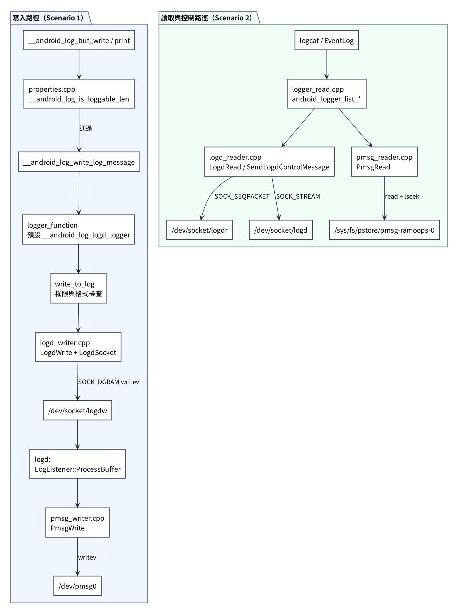
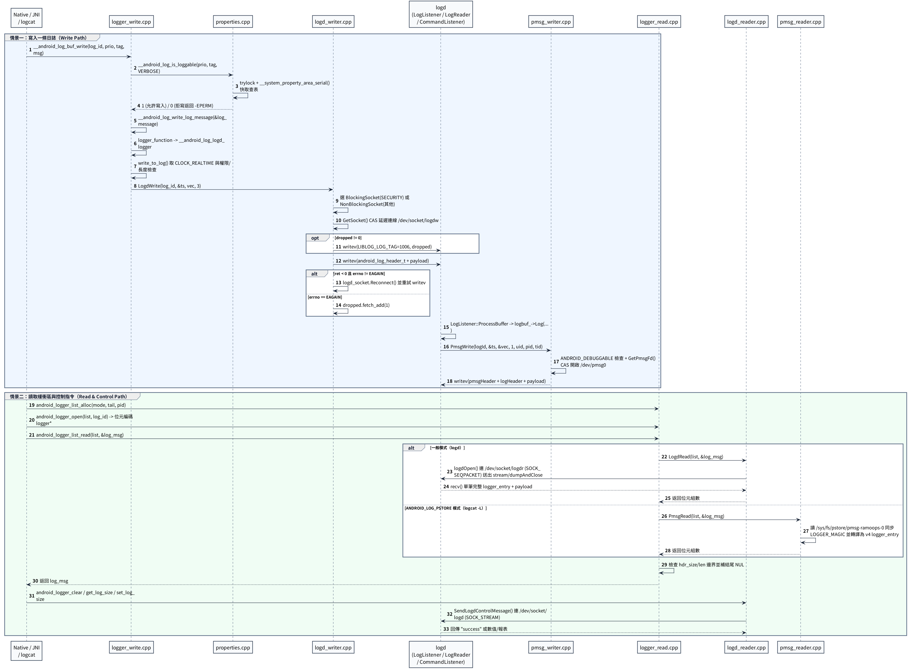

# 4.3 執行期日誌函式庫（`liblog`）

- **情景說明**：本節以兩個核心執行情景串起 Android 17 執行期日誌函式庫 `liblog` 的全貌：
  1. **寫入情景**：任意原生行程透過 `__android_log_buf_write` / `__android_log_write_log_message`（或二進位事件寫入 API）發出一條日誌，經由系統屬性快取過濾（`properties.cpp`）、可插拔 logger 分派（`logger_write.cpp`）、無鎖雙通道 Unix Domain Socket（`logd_writer.cpp`）寫入 `/dev/socket/logdw`，並進一步追蹤 `logd` 如何回呼 `liblog` 的 `PmsgWrite`（`pmsg_writer.cpp`）寫入 `/dev/pmsg0` 以實現跨重啟留存。
  2. **讀取與控制情景**：`logcat` 或系統工具透過 `android_logger_list_alloc` / `android_logger_open` / `android_logger_list_read`（`logger_read.cpp`）經 `/dev/socket/logdr` 串流讀取日誌、經 `/dev/socket/logd` 下發清空或調整緩衝區大小等控制指令（`logd_reader.cpp`），以及從 `/sys/fs/pstore/pmsg-ramoops-0` 讀回上次開機殘留的日誌（`pmsg_reader.cpp`）。
- **對應原書**：第 4 章 4.3 節〈运行时库层日志库〉（p.101–108）
- **涉及專案與版本基準**：
  - `platform/system/logging` 〔`android-17.0.0_r1`，commit `d35ba62`〕

---

## 4.3.1 從 Android 2.3 到 Android 17 的 `liblog` 架構演進

> 對應原書 4.3（p.101–104，圖 4-7）。在 Android 2.3 中，`liblog` 位於 `system/core/liblog/logd_write.c`，職責極為單純：它僅維護一個靜態函式指標 `write_to_log`（初始指向 `__write_to_log_init`）與固定長度陣列 `log_fds[LOG_ID_MAX]`。首次寫入時，`__write_to_log_init` 直接 `open("/dev/log/{main,radio,events,system}", O_WRONLY)` 並將 `write_to_log` 重導至 `__write_to_log_kernel`（若開啟失敗則退回 `__write_to_log_null`）；後續所有寫入都只是把 `prio`/`tag`/`msg` 組成 `iovec[3]` 直接 `writev` 進對應核心字元裝置，且 `liblog` 本身不負責系統屬性過濾，也不提供統一的跨緩衝區讀取 API。

到了 Android 17，隨著核心 Logger 驅動完全移除並由使用者空間 `logd` 取代，`liblog` 已獨立遷移至 `platform/system/logging/liblog/`，並演進為一個同時涵蓋**寫入、屬性過濾、可插拔後端、`pstore` 留存、讀取與控制**的完整執行期函式庫（同時作為 NDK/LLNDK 穩定 ABI 匯出給所有系統元件與第三方 App）：

| 維度 | Android 2.3（原書 p.101–108） | Android 17（`android-17.0.0_r1`） |
|---|---|---|
| **原始碼位置** | `system/core/liblog/logd_write.c` | `platform/system/logging/liblog/{logger_write,logd_writer,pmsg_writer,properties,logger_read,logd_reader,pmsg_reader}.cpp` |
| **寫入目標** | 4 個核心裝置 `/dev/log/{main,radio,events,system}` | 單一 Unix Domain DGRAM Socket `/dev/socket/logdw`（以 `android_log_header_t.id` 區分緩衝區）；跨重啟留存由 `logd` 呼叫 `PmsgWrite` 統一寫入 `/dev/pmsg0` |
| **初始化與連線** | 單一函式指標 `write_to_log` 延遲初始化 `log_fds[]` | `LogdSocket` 雙單例（阻塞 / 非阻塞）以 `std::atomic<int> sock_` 搭配 `compare_exchange_strong` 無鎖延遲建立，並於斷線時呼叫 `connect()` 重連 |
| **可擴充性** | 寫死核心驅動與 `FAKE_LOG_DEVICE` 編譯巨集 | 導入 `__android_log_write_log_message` + `__android_log_set_logger` / `__android_log_set_aborter` 執行期回呼，並支援 `ro.log.file_logger.path`（如 Microdroid） |
| **等級過濾** | 寫入路徑無屬性過濾；舊版 `tag` 含 `"RIL"`/`"AT"` 等字串會被硬編碼轉導至 `LOG_ID_RADIO` | 徹底移除 `"RIL"` 標籤劫持；寫入入口統一經 `properties.cpp::__android_log_is_loggable_len` 查表 `persist.log.tag.*` / `log.tag.*` 與行程最小等級，並以 `__system_property_area_serial` 快取 |
| **過載保護** | 核心環形緩衝區直接覆寫舊資料，寫端無丟棄計數 | 非阻塞 socket 遇 `EAGAIN` 不阻塞呼叫端，改遞增 `dropped` 原子計數器，待恢復時送出 `LIBLOG_LOG_TAG`（1006）事件回報丟失筆數 |
| **讀取與控制** | 原書 `liblog` 不含讀取協定，由 `logcat` 直接 `open`/`read`/`ioctl` 核心裝置 | 新增 `logger_read.cpp` + `logd_reader.cpp` + `pmsg_reader.cpp`，以位元編碼句柄 `struct logger*` 與 `struct logger_list` 統一封裝 `/dev/socket/logdr`、`/dev/socket/logd` 與 `/sys/fs/pstore/pmsg-ramoops-0` |



---

## 4.3.2 情景一：寫入一條日誌（從公開 API、屬性過濾到 `logdw` 與 `pmsg0`）

本情景假設一個原生行程呼叫 `__android_log_buf_write(LOG_ID_MAIN, ANDROID_LOG_INFO, "MyTag", "hello")`（或透過 `libbase` 直接組裝 `__android_log_message` 呼叫 `__android_log_write_log_message`），我們沿著 `liblog` 的實際執行路徑一步步拆解。

### Step 1：公開文字寫入 API 與 `__android_log_message` 結構

先看 NDK 公開標頭中定義的統一訊息封裝結構與回呼原型：

**位置**：`platform/system/logging/liblog/include/android/log.h` 〔`android-17.0.0_r1`，lines 223–255〕

```cpp
struct __android_log_message {
  /** Must be set to `sizeof(__android_log_message)` and is used for versioning. */
  size_t struct_size;

  /** {@link log_id_t} values. */
  int32_t buffer_id;

  /** {@link android_LogPriority} values. */
  int32_t priority;

  /** The tag for the log message. */
  const char* tag;

  /** Optional file name, may be set to nullptr. */
  const char* file;

  /** Optional line number, ignore if file is nullptr. */
  uint32_t line;

  /** The log message itself. */
  const char* message;
};

/**
 * Prototype for the 'logger' function that is called for every log message.
 */
typedef void (*__android_logger_function)(const struct __android_log_message* log_message);

/**
 * Prototype for the 'abort' function that is called when liblog will abort due to
 * __android_log_assert() failures.
 */
typedef void (*__android_aborter_function)(const char* abort_message);
```

接著追蹤傳統 C 寫入 API 在 `logger_write.cpp` 中的實作：

**位置**：`platform/system/logging/liblog/logger_write.cpp` 〔`android-17.0.0_r1`，lines 354–458〕

```cpp
int __android_log_write(int prio, const char* tag, const char* msg) {
  return __android_log_buf_write(LOG_ID_MAIN, prio, tag, msg);
}
...
int __android_log_buf_write(int log_id, int prio, const char* tag, const char* msg) {
  ErrnoRestorer errno_restorer;

  if (!__android_log_is_loggable(prio, tag, ANDROID_LOG_VERBOSE)) {
    return -EPERM;
  }

  __android_log_message log_message = {
      sizeof(__android_log_message), log_id, prio, tag, nullptr, 0, msg};
  __android_log_write_log_message(&log_message);
  return 1;
}

static int __android_log_buf_vprint(int log_id, int prio,
                                    const char* tag, const char* fmt, va_list ap) {
  ErrnoRestorer errno_restorer;

  if (!__android_log_is_loggable(prio, tag, ANDROID_LOG_VERBOSE)) {
    return -EPERM;
  }

  __attribute__((uninitialized)) char buf[LOG_BUF_SIZE];

  vsnprintf(buf, LOG_BUF_SIZE, fmt, ap);

  __android_log_message log_message = {
      sizeof(__android_log_message), log_id, prio, tag, nullptr, 0, buf};
  __android_log_write_log_message(&log_message);
  return 1;
}

int __android_log_vprint(int prio, const char* tag, const char* fmt, va_list ap) {
  return __android_log_buf_vprint(LOG_ID_MAIN, prio, tag, fmt, ap);
}

int __android_log_print(int prio, const char* tag, const char* fmt, ...) {
  va_list ap;
  va_start(ap, fmt);
  int result = __android_log_buf_vprint(LOG_ID_MAIN, prio, tag, fmt, ap);
  va_end(ap);
  return result;
}

int __android_log_buf_print(int log_id, int prio, const char* tag, const char* fmt, ...) {
  va_list ap;
  va_start(ap, fmt);
  int result = __android_log_buf_vprint(log_id, prio, tag, fmt, ap);
  va_end(ap);
  return result;
}

void __android_log_assert(const char* cond, const char* tag, const char* fmt, ...) {
  __attribute__((uninitialized)) char buf[LOG_BUF_SIZE];

  if (fmt) {
    va_list ap;
    va_start(ap, fmt);
    vsnprintf(buf, LOG_BUF_SIZE, fmt, ap);
    va_end(ap);
  } else {
    /* Msg not provided, log condition.  N.B. Do not use cond directly as
     * format string as it could contain spurious '%' syntax (e.g.
     * "%d" in "blocks%devs == 0").
     */
    if (cond)
      snprintf(buf, LOG_BUF_SIZE, "Assertion failed: %s", cond);
    else
      strcpy(buf, "Unspecified assertion failed");
  }

  // Log assertion failures to stderr for the benefit of "adb shell" users
  // and gtests (http://b/23675822).
  TEMP_FAILURE_RETRY(write(2, buf, strlen(buf)));
  TEMP_FAILURE_RETRY(write(2, "\n", 1));

  __android_log_write(ANDROID_LOG_FATAL, tag, buf);
  __android_log_call_aborter(buf);
  abort();
}
```

這組入口函式展現了幾個關鍵工程細節：
1. **`ErrnoRestorer` 保護呼叫端 `errno`**：日誌函式內部會呼叫系統屬性讀取、socket `connect`/`writev` 等系統呼叫，可能覆寫執行緒區域的 `errno`。透過 RAII 類別 `ErrnoRestorer`，函式返回前一定還原進入時的 `errno`，確保像 `ALOGE("open failed: %s", strerror(errno))` 後續再檢查 `errno` 不會被污染。
2. **先過濾再格式化**：`__android_log_buf_vprint` 在配置堆疊緩衝區 `buf[LOG_BUF_SIZE]`（1024 bytes，標註 `__attribute__((uninitialized))` 避免編譯器自動清零成本）並執行昂貴的 `vsnprintf` 之前，就先呼叫 `__android_log_is_loggable(prio, tag, ANDROID_LOG_VERBOSE)`；若不允許輸出，立刻返回 `-EPERM`。
3. **統一匯流至 `__android_log_write_log_message`**：所有舊版文字 API（`__android_log_write`、`__android_log_buf_write`、`__android_log_print`、`__android_log_vprint`、`__android_log_buf_print`）全部收斂為組裝 `struct __android_log_message`（帶 `struct_size` 版本欄位），再交給 `__android_log_write_log_message`，並且成功固定返回 `1`（不再暴露底層 `writev` 的位元組數）。
4. **`__android_log_assert` 雙寫 stderr 並觸發可替換 aborter**：除了寫入 `ANDROID_LOG_FATAL`，會先透過 `write(2, ...)` 輸出到 stderr 方便 `adb shell` 與單元測試觀察，再呼叫 `__android_log_call_aborter(buf)`（預設內部會設定 Bionic `android_set_abort_message` 讓 tombstone/debuggerd 記錄致命訊息，隨後 `abort()`）。

> 〔與 2.3 差異〕**邏輯改變 + 已移除**：原書 4.3（p.104–107）中，`__android_log_write` 與 `__android_log_buf_write` 會硬編碼檢查 `tag` 是否以 `"RIL"` 開頭或等於 `"HTC_RIL"`、`"AT"`、`"GSM"`、`"STK"`、`"CDMA"`、`"PHONE"`、`"SMS"`，符合就強制將緩衝區改為 `LOG_ID_RADIO`（註解標著 `/* XXX: This needs to go! */`）；Android 17 已徹底移除這段標籤劫持邏輯。此外，2.3 的 `__android_log_write` 沒有屬性過濾且直接回傳 `writev` 結果，而 `__android_log_assert` 結尾呼叫 `__builtin_trap()`；17 改為先做 `__android_log_is_loggable` 檢查、透過 `__android_log_write_log_message` 委派、並改以可客製的 `aborter_function` 搭配 `android_set_abort_message` + `abort()` 終止行程。

---

### Step 2：執行期等級過濾與系統屬性快取（`properties.cpp`）

在 `__android_log_buf_write` 呼叫 `__android_log_is_loggable` 時，控制權進入 `properties.cpp`。由於每一條日誌幾乎都會走過這裡，它是整條路徑上最敏感的效能熱點（hotspot）。

**位置**：`platform/system/logging/liblog/properties.cpp` 〔`android-17.0.0_r1`，lines 36–92〕

```cpp
static pthread_mutex_t lock_loggable = PTHREAD_MUTEX_INITIALIZER;

static bool trylock() {
  /*
   * If we trigger a signal handler in the middle of locked activity and the
   * signal handler logs a message, we could get into a deadlock state.
   */
  /*
   *  Any contention, and we can turn around and use the non-cached method
   * in less time than the system call associated with a mutex to deal with
   * the contention.
   */
  return pthread_mutex_trylock(&lock_loggable) == 0;
}

static void unlock() {
  pthread_mutex_unlock(&lock_loggable);
}

struct cached_char {
  const prop_info* pinfo;
  uint32_t serial;
  unsigned char c;
};

static int check_cache(cached_char* cache) {
  return cache->pinfo && __system_property_serial(cache->pinfo) != cache->serial;
}

#define BOOLEAN_TRUE 0xFF
#define BOOLEAN_FALSE 0xFE

static void refresh_cache(cached_char* cache, const char* key) {
  if (!cache->pinfo) {
    cache->pinfo = __system_property_find(key);
    if (!cache->pinfo) {
      return;
    }
  }
  cache->serial = __system_property_serial(cache->pinfo);

  // __system_property_read() can't fail because we're using an existing prop_info*.
  char buf[PROP_VALUE_MAX] __attribute__((__uninitialized__));
  __system_property_read(cache->pinfo, 0, buf);
  switch (buf[0]) {
    case 't':
    case 'T':
      cache->c = strcasecmp(buf + 1, "rue") ? buf[0] : BOOLEAN_TRUE;
      break;
    case 'f':
    case 'F':
      cache->c = strcasecmp(buf + 1, "alse") ? buf[0] : BOOLEAN_FALSE;
      break;
    default:
      cache->c = buf[0];
  }
}
```

接著是核心查表邏輯 `__android_log_level` 與最終判定函式 `__android_log_is_loggable_len`：

**位置**：`platform/system/logging/liblog/properties.cpp` 〔`android-17.0.0_r1`，lines 94–265〕

```cpp
static int __android_log_level(const char* tag, size_t tag_len) {
  if (tag == nullptr || tag_len == 0) {
    auto& tag_string = GetDefaultTag();
    tag = tag_string.c_str();
    tag_len = tag_string.size();
  }

  /*
   * Single layer cache of four properties. Priorities are:
   *    persist.log.tag.<tag>
   *    log.tag.<tag>
   *    persist.log.tag
   *    log.tag
   * Where the missing tag matches all tags and becomes the
   * system global default. We do not support ro.log.tag* .
   */
  static std::string* last_tag = new std::string;
  static uint32_t global_serial;
  uint32_t current_global_serial;
  static cached_char tag_cache[2];
  static cached_char global_cache[2];
...
  static const char log_namespace[] = "persist.log.tag.";
  char key[strlen(log_namespace) + tag_len + 1] __attribute__((__uninitialized__));
  __builtin_memcpy(key, log_namespace, strlen(log_namespace));

  bool locked = trylock();
  bool change_detected, global_change_detected;
  global_change_detected = change_detected = !locked;

  char c = 0;
  if (locked) {
    // Check all known serial numbers for changes.
    for (size_t i = 0; i < arraysize(tag_cache); ++i) {
      if (check_cache(&tag_cache[i])) {
        change_detected = true;
      }
    }
    for (size_t i = 0; i < arraysize(global_cache); ++i) {
      if (check_cache(&global_cache[i])) {
        global_change_detected = true;
      }
    }

    current_global_serial = __system_property_area_serial();
    if (current_global_serial != global_serial) {
      global_change_detected = change_detected = true;
    }
  }

  if (tag_len != 0) {
    bool local_change_detected = change_detected;
    if (locked) {
      // compare() rather than == because tag isn't guaranteed 0-terminated.
      if (last_tag->compare(0, last_tag->size(), tag, tag_len) != 0) {
        // Invalidate log.tag.<tag> cache.
        for (size_t i = 0; i < arraysize(tag_cache); ++i) {
          tag_cache[i].pinfo = nullptr;
          tag_cache[i].c = '\0';
        }
        last_tag->assign(tag, tag_len);
        local_change_detected = true;
      }
    }
    __builtin_memcpy(key + strlen(log_namespace), tag, tag_len);
    key[strlen(log_namespace) + tag_len] = '\0';

    for (size_t i = 0; i < arraysize(tag_cache); ++i) {
      cached_char* cache = &tag_cache[i];
      cached_char temp_cache;

      if (!locked) {
        temp_cache.pinfo = nullptr;
        temp_cache.c = '\0';
        cache = &temp_cache;
      }
      if (local_change_detected) {
        refresh_cache(cache, i == 0 ? key : key + strlen("persist."));
      }

      if (cache->c) {
        c = cache->c;
        break;
      }
    }
  }

  switch (toupper(c)) { /* if invalid, resort to global */
    case 'V':
    case 'D':
    case 'I':
    case 'W':
    case 'E':
    case 'F': /* Not officially supported */
    case 'A':
    case 'S':
    case BOOLEAN_FALSE: /* Not officially supported */
      break;
    default:
      /* clear '.' after log.tag */
      key[strlen(log_namespace) - 1] = '\0';

      for (size_t i = 0; i < arraysize(global_cache); ++i) {
        cached_char* cache = &global_cache[i];
        cached_char temp_cache;

        if (!locked) {
          temp_cache = *cache;
          if (temp_cache.pinfo != cache->pinfo) {  // check atomic
            temp_cache.pinfo = nullptr;
            temp_cache.c = '\0';
          }
          cache = &temp_cache;
        }
        if (global_change_detected) {
          refresh_cache(cache, i == 0 ? key : key + strlen("persist."));
        }

        if (cache->c) {
          c = cache->c;
          break;
        }
      }
      break;
  }

  if (locked) {
    global_serial = current_global_serial;
    unlock();
  }

  switch (toupper(c)) {
    /* clang-format off */
    case 'V': return ANDROID_LOG_VERBOSE;
    case 'D': return ANDROID_LOG_DEBUG;
    case 'I': return ANDROID_LOG_INFO;
    case 'W': return ANDROID_LOG_WARN;
    case 'E': return ANDROID_LOG_ERROR;
    case 'F': /* FALLTHRU */ /* Not officially supported */
    case 'A': return ANDROID_LOG_FATAL;
    case BOOLEAN_FALSE: /* FALLTHRU */ /* Not Officially supported */
    case 'S': return ANDROID_LOG_SILENT;
      /* clang-format on */
  }
  return -1;
}

int __android_log_is_loggable_len(int prio, const char* tag, size_t len, int default_prio) {
  int minimum_log_priority = __android_log_get_minimum_priority();
  int property_log_level = __android_log_level(tag, len);

  if (property_log_level >= 0 && minimum_log_priority != ANDROID_LOG_DEFAULT) {
    return prio >= std::min(property_log_level, minimum_log_priority);
  } else if (property_log_level >= 0) {
    return prio >= property_log_level;
  } else if (minimum_log_priority != ANDROID_LOG_DEFAULT) {
    return prio >= minimum_log_priority;
  } else {
    return prio >= default_prio;
  }
}

int __android_log_is_loggable(int prio, const char* tag, int default_prio) {
  auto len = tag ? strlen(tag) : 0;
  return __android_log_is_loggable_len(prio, tag, len, default_prio);
}
```

這段程式碼雖然精簡，但內藏四個極具代表性的 Android 底層設計技巧：
1. **四級優先順序查表**：依序檢查 `persist.log.tag.<tag>` → `log.tag.<tag>`（指標位移 `key + strlen("persist.")` 即可重用同一塊堆疊緩衝區！）→ `persist.log.tag` → `log.tag`（把第 15 位元的 `'.'` 覆寫為 `'\0'` 即完成截斷）。而且 `strlen("persist.log.tag.")` 剛好是 16 bytes，在 arm64 上 `__builtin_memcpy` 只需兩道指令。
2. **兩層序號快取避免反覆遍歷屬性樹**：Bionic 系統屬性區（`__system_property_area_serial()`）在任何屬性被新增或修改時會遞增全域序號，而每一個已找到的 `const prop_info*` 又有自己的 `__system_property_serial(pinfo)`。平時只要 `last_tag` 相同、個別 `serial` 沒變、且全域 `global_serial` 沒變，就完全跳過 `__system_property_find` 與 `__system_property_read`，僅憑記憶體比較即可在數個 CPU 週期內完成判定。
3. **非阻塞 `trylock()` 防死鎖與避競爭**：若執行緒持有 `lock_loggable` 期間收到訊號、且訊號處理常式又寫日誌，使用阻塞 `pthread_mutex_lock` 會立刻死鎖。因此 `trylock()` 搶不到鎖時乾脆不阻塞，改用堆疊區域變數 `temp_cache` 直接向 Bionic 屬性區查詢，既絕不死鎖，也在高併發下省去 futex 系統呼叫。
4. **屬性等級與行程最小等級取 `std::min`**：呼叫端可以透過 `__android_log_set_minimum_priority` 設定行程級門檻；當屬性等級 `property_log_level` 與行程門檻 `minimum_log_priority` 同時存在時，取兩者中**較寬鬆（數值較小）**者為準。若兩者皆未設定，才退回呼叫端傳入的 `default_prio`（在 `__android_log_buf_write` 裡為 `ANDROID_LOG_VERBOSE`，在 Java `Log.isLoggable` 裡則為 `ANDROID_LOG_INFO`）。

此外，`properties.cpp` 還提供 `LOG_ID_SECURITY` 所需的開關查詢函式 `__android_log_security()`（快取 `persist.logd.security` 屬性），以及透過 `include/log/log_properties.h` 匯出的 `__android_log_is_debuggable()`（檢查 `ro.debuggable == "1"`）：

**位置**：`platform/system/logging/liblog/properties.cpp` 〔`android-17.0.0_r1`，lines 267–301〕

```cpp
int __android_log_is_debuggable() {
  static int is_debuggable = [] {
    char value[PROP_VALUE_MAX] = {};
    return __system_property_get("ro.debuggable", value) > 0 && !strcmp(value, "1");
  }();

  return is_debuggable;
}

int __android_log_security() {
  static pthread_mutex_t security_lock = PTHREAD_MUTEX_INITIALIZER;
  static cached_char security_prop = {nullptr, 0xFFFFFFFF, BOOLEAN_FALSE};
  static uint32_t security_serial = 0;

  if (pthread_mutex_trylock(&security_lock)) {
    /* We are willing to accept some race in this context */
    return security_prop.c == BOOLEAN_TRUE;
  }

  int change_detected = check_cache(&security_prop);
  uint32_t current_serial = __system_property_area_serial();
  if (current_serial != security_serial) {
    change_detected = 1;
  }
  if (change_detected) {
    refresh_cache(&security_prop, "persist.logd.security");
    security_serial = current_serial;
  }

  int res = security_prop.c == BOOLEAN_TRUE;

  pthread_mutex_unlock(&security_lock);

  return res;
}
```

> 〔與 2.3 差異〕**新增**：Android 2.3 的 `liblog` 完全沒有 `properties.cpp` 與 `__android_log_is_loggable_len`；當時僅在 Java 層 `Log.isLoggable` 的 JNI 中臨時查詢 `log.tag.<tag>`，原生 C/C++ 寫入路徑沒有動態屬性過濾與序號快取機制。

---

### Step 3：可插拔 `logger_function` 與 `__android_log_write_log_message`

通過等級過濾後，呼叫鏈進入 `logger_write.cpp` 的核心派發層。先看行程級的全域狀態與回呼設定：

**位置**：`platform/system/logging/liblog/logger_write.cpp` 〔`android-17.0.0_r1`，lines 149–194〕

```cpp
std::string& GetDefaultTag() {
  static std::string* default_tag = new std::string(getprogname());
  return *default_tag;
}

void __android_log_set_default_tag(const char* tag) {
  GetDefaultTag().assign(tag, 0, LOGGER_ENTRY_MAX_PAYLOAD);
}

static std::atomic<int32_t> minimum_log_priority = ANDROID_LOG_DEFAULT;
int32_t __android_log_set_minimum_priority(int32_t priority) {
  return minimum_log_priority.exchange(priority, std::memory_order_relaxed);
}

int32_t __android_log_get_minimum_priority() {
  return minimum_log_priority;
}

#ifdef __ANDROID__
static __android_logger_function logger_function = __android_log_logd_logger;
#else
static __android_logger_function logger_function = __android_log_stderr_logger;
#endif

void __android_log_set_logger(__android_logger_function logger) {
  logger_function = logger;
}

void __android_log_default_aborter(const char* abort_message) {
#ifdef __ANDROID__
  android_set_abort_message(abort_message);
#else
  UNUSED(abort_message);
#endif
  abort();
}

static __android_aborter_function aborter_function = __android_log_default_aborter;

void __android_log_set_aborter(__android_aborter_function aborter) {
  aborter_function = aborter;
}

void __android_log_call_aborter(const char* abort_message) {
  aborter_function(abort_message);
}
```

注意 `GetDefaultTag()` 刻意以 `new std::string(getprogname())` 配置於堆積而不釋放（`Android.bp` 開啟了 `-Wexit-time-destructors`），避免行程結束時其他靜態解構子寫日誌而撞上已銷毀的 `std::string`。

接著看 `__android_log_write_log_message` 與預設裝置端後端 `__android_log_logd_logger`：

**位置**：`platform/system/logging/liblog/logger_write.cpp` 〔`android-17.0.0_r1`，lines 282–378〕

```cpp
static const char* get_file_logger_path() {
#ifdef __ANDROID__
  static const char* file_logger_path = []() {
    static char path[PROP_VALUE_MAX] = {};
    if (__system_property_get("ro.log.file_logger.path", path) > 0) {
      return path;
    }
    return static_cast<char*>(nullptr);  // means file_logger should not be used
  }();
  return file_logger_path;
#else
  return nullptr;
#endif
}
...
static bool log_to_file_if_overridden(const struct __android_log_message* log_message) {
  const char* file_logger_path = get_file_logger_path();
  if (file_logger_path == nullptr) return false;

  static FILE* stream = [&file_logger_path]() {
    FILE* f = fopen(file_logger_path, "ae");
    if (f != nullptr) return f;
    using namespace std::string_literals;
    std::string err_msg = "Cannot open "s + file_logger_path + " for logging: (" + strerror(errno) +
                          "). Falling back to stderr";
    __android_log_message m = {sizeof(__android_log_message),
                               LOG_ID_DEFAULT,
                               ANDROID_LOG_WARN,
                               "liblog",
                               __FILE__,
                               __LINE__,
                               err_msg.c_str()};
    filestream_logger(&m, stderr);
    return stderr;
  }();
  filestream_logger(log_message, stream);
  return true;
}

void __android_log_stderr_logger(const struct __android_log_message* log_message) {
  filestream_logger(log_message, stderr);
}

void __android_log_logd_logger(const struct __android_log_message* log_message) {
  __android_log_logd_logger_with_timestamp(log_message, nullptr);
}

void __android_log_logd_logger_with_timestamp(const struct __android_log_message* log_message,
                                              const struct timespec* timestamp) {
  if (log_to_file_if_overridden(log_message)) return;

  int buffer_id = log_message->buffer_id == LOG_ID_DEFAULT ? LOG_ID_MAIN : log_message->buffer_id;

  struct iovec vec[3];
  vec[0].iov_base =
      const_cast<unsigned char*>(reinterpret_cast<const unsigned char*>(&log_message->priority));
  vec[0].iov_len = 1;
  vec[1].iov_base = const_cast<void*>(static_cast<const void*>(log_message->tag));
  vec[1].iov_len = strlen(log_message->tag) + 1;
  vec[2].iov_base = const_cast<void*>(static_cast<const void*>(log_message->message));
  vec[2].iov_len = strlen(log_message->message) + 1;

  write_to_log(static_cast<log_id_t>(buffer_id), vec, 3, timestamp);
}
...
void __android_log_write_log_message(__android_log_message* log_message) {
  ErrnoRestorer errno_restorer;

  if (log_message->buffer_id != LOG_ID_DEFAULT && log_message->buffer_id != LOG_ID_MAIN &&
      log_message->buffer_id != LOG_ID_SYSTEM && log_message->buffer_id != LOG_ID_RADIO &&
      log_message->buffer_id != LOG_ID_CRASH) {
    return;
  }

  if (log_message->tag == nullptr) {
    log_message->tag = GetDefaultTag().c_str();
  }

#if __BIONIC__
  if (log_message->priority == ANDROID_LOG_FATAL) {
    android_set_abort_message(log_message->message);
  }
#endif

  logger_function(log_message);
}
```

解析這一段的關鍵設計：
1. **刻意不做重複過濾**：`__android_log_write_log_message` 假設呼叫端（如 `__android_log_buf_write` 或 `libbase` 的 `LOG(INFO)`）已經先檢查過 `__android_log_is_loggable`，避免重複查表。
2. **嚴格白名單限定文字緩衝區**：只允許 `LOG_ID_DEFAULT`、`LOG_ID_MAIN`、`LOG_ID_SYSTEM`、`LOG_ID_RADIO`、`LOG_ID_CRASH` 進入文字通道；二進位緩衝區（`EVENTS`/`STATS`/`SECURITY`）或唯讀的 `KERNEL` 會直接被丟棄返回。
3. **檔案覆寫機制（Microdroid 支援）**：在沒有 `logd` 的輕量虛擬機（如 Microdroid）中，系統可設定 `ro.log.file_logger.path`，`log_to_file_if_overridden()` 便會改用 `fopen(..., "ae")`（append + `O_CLOEXEC`）以文字格式輸出（若無法開啟檔案則退回 `stderr`）。
4. **API 37 新增自訂時間戳入口**：Android 17（API level 37）在 `include/android/log.h` 正式匯出 `__android_log_logd_logger_with_timestamp`，允許上層傳入明確的 `CLOCK_REALTIME` 時間戳，而預設的 `__android_log_logd_logger` 只是以 `timestamp = nullptr` 轉呼叫它。
5. **文字負載 `iovec[3]` 封裝**：與原書 2.3（p.105）保持相同的線上 payload 格式——`vec[0]` 是 1 byte 的 `priority`，`vec[1]` 是含結尾 `'\0'` 的 `tag`，`vec[2]` 是含結尾 `'\0'` 的 `message`。

> 〔與 2.3 差異〕**新增 + 邏輯改變**：原書 4.3（p.102–104）中的 `write_to_log` 函式指標是寫死的內部初始化切換技巧，無法讓上層替換日誌目的地，也不支援 `file`/`line` 欄位與檔案覆寫模式。Android 17 透過 `__android_log_write_log_message` 與 `__android_log_set_logger` 解耦了「前端組裝」與「後端輸出」（裝置端預設 `logd`，主機端預設 `stderr`，Microdroid 可導向檔案）。

---

### Step 4：`write_to_log` 權限檢查與二進位事件寫入入口

無論是文字日誌（經 `__android_log_logd_logger_with_timestamp`）還是二進位事件日誌（`__android_log_bwrite` / `__android_log_btwrite` / `__android_log_bswrite` 等），最終都會匯聚到 `logger_write.cpp` 內的 `write_to_log`：

**位置**：`platform/system/logging/liblog/logger_write.cpp` 〔`android-17.0.0_r1`，lines 68–109〕

```cpp
#if defined(__ANDROID__)
static int check_log_uid_permissions() {
  uid_t uid = getuid();

  /* Matches clientCanWriteSecurityLog() in logd */
  if ((uid != AID_SYSTEM) && (uid != AID_ROOT) && (uid != AID_LOG)) {
    uid = geteuid();
    if ((uid != AID_SYSTEM) && (uid != AID_ROOT) && (uid != AID_LOG)) {
      gid_t gid = getgid();
      if ((gid != AID_SYSTEM) && (gid != AID_ROOT) && (gid != AID_LOG)) {
        gid = getegid();
        if ((gid != AID_SYSTEM) && (gid != AID_ROOT) && (gid != AID_LOG)) {
          int num_groups;
          gid_t* groups;

          num_groups = getgroups(0, NULL);
          if (num_groups <= 0) {
            return -EPERM;
          }
          groups = static_cast<gid_t*>(calloc(num_groups, sizeof(gid_t)));
          if (!groups) {
            return -ENOMEM;
          }
          num_groups = getgroups(num_groups, groups);
          while (num_groups > 0) {
            if (groups[num_groups - 1] == AID_LOG ||
                groups[num_groups - 1] == AID_SECURITY_LOG_WRITER) {
              break;
            }
            --num_groups;
          }
          free(groups);
          if (num_groups <= 0) {
            return -EPERM;
          }
        }
      }
    }
  }
  return 0;
}
#endif
```

**位置**：`platform/system/logging/liblog/logger_write.cpp` 〔`android-17.0.0_r1`，lines 196–229〕

```cpp
#ifdef __ANDROID__
static int write_to_log(log_id_t log_id, struct iovec* vec, size_t nr,
                        const struct timespec* timestamp = nullptr) {
  if (log_id == LOG_ID_KERNEL) {
    return -EINVAL;
  }

  struct timespec ts;
  if (LIKELY(timestamp == nullptr)) {
    clock_gettime(CLOCK_REALTIME, &ts);
    timestamp = &ts;
  }

  if (log_id == LOG_ID_SECURITY) {
    if (vec[0].iov_len < 4) {
      return -EINVAL;
    }

    int ret = check_log_uid_permissions();
    if (ret < 0) {
      return ret;
    }
    if (!__android_log_security()) {
      /* If only we could reset downstream logd counter */
      return -EPERM;
    }
  } else if (log_id == LOG_ID_EVENTS || log_id == LOG_ID_STATS) {
    if (vec[0].iov_len < 4) {
      return -EINVAL;
    }
  }

  return LogdWrite(log_id, timestamp, vec, nr);
}
#else
```

同時一併列出二進位事件寫入家族（對應原書 p.107–108 的 `__android_log_bwrite` 與 `__android_log_btwrite`，並新增 `stats`、`security` 與單字串 `bswrite` 變體）：

**位置**：`platform/system/logging/liblog/logger_write.cpp` 〔`android-17.0.0_r1`，lines 460–528〕

```cpp
static int __android_log_buf_bwrite(log_id_t log, int32_t tag, const void* payload, size_t len) {
  ErrnoRestorer errno_restorer;

  iovec vec[2];
  vec[0].iov_base = &tag;
  vec[0].iov_len = sizeof(tag);
  vec[1].iov_base = const_cast<void*>(payload);
  vec[1].iov_len = len;

  return write_to_log(log, vec, 2);
}

int __android_log_bwrite(int32_t tag, const void* payload, size_t len) {
  return __android_log_buf_bwrite(LOG_ID_EVENTS, tag, payload, len);
}

int __android_log_stats_bwrite(int32_t tag, const void* payload, size_t len) {
  return __android_log_buf_bwrite(LOG_ID_STATS, tag, payload, len);
}

int __android_log_security_bwrite(int32_t tag, const void* payload, size_t len) {
  return __android_log_buf_bwrite(LOG_ID_SECURITY, tag, payload, len);
}

/*
 * Like __android_log_bwrite, but takes the type as well.  Doesn't work
 * for the general case where we're generating lists of stuff, but very
 * handy if we just want to dump an integer into the log.
 */
int __android_log_btwrite(int32_t tag, char type, const void* payload, size_t len) {
  ErrnoRestorer errno_restorer;

  iovec vec[3];
  vec[0].iov_base = &tag;
  vec[0].iov_len = sizeof(tag);
  vec[1].iov_base = &type;
  vec[1].iov_len = sizeof(type);
  vec[2].iov_base = const_cast<void*>(payload);
  vec[2].iov_len = len;

  return write_to_log(LOG_ID_EVENTS, vec, 3);
}

static int __android_log_buf_bswrite(log_id_t log, int32_t tag, const char* str) {
  ErrnoRestorer errno_restorer;

  char type = EVENT_TYPE_STRING;
  uint32_t len = strlen(str);

  iovec vec[4];
  vec[0].iov_base = &tag;
  vec[0].iov_len = sizeof(tag);
  vec[1].iov_base = &type;
  vec[1].iov_len = sizeof(type);
  vec[2].iov_base = &len;
  vec[2].iov_len = sizeof(len);
  vec[3].iov_base = const_cast<void*>(reinterpret_cast<const void*>(str));
  vec[3].iov_len = len;

  return write_to_log(log, vec, 4);
}

int __android_log_bswrite(int32_t tag, const char* str) {
  return __android_log_buf_bswrite(LOG_ID_EVENTS, tag, str);
}

int __android_log_security_bswrite(int32_t tag, const char* str) {
  return __android_log_buf_bswrite(LOG_ID_SECURITY, tag, str);
}
```

`write_to_log` 執行四項把關後直接委派給 `LogdWrite`：
1. **拒絕使用者空間偽造核心日誌**：`log_id == LOG_ID_KERNEL` 直接返回 `-EINVAL`（核心日誌僅由 `logd` 內的 `LogKlog` 讀取 `/dev/kmsg` 注入）。
2. **客戶端打上 `CLOCK_REALTIME` 時間戳**：若未指定外部 `timestamp`，在客戶端就先呼叫 `clock_gettime(CLOCK_REALTIME, &ts)`，確保記錄反映事件發生當下的時間，而非排隊等待 `logd` 處理的時間。
3. **`LOG_ID_SECURITY` 前置檢查**：檢查首個 `iovec` 至少包含 4-byte `tag`、以 `check_log_uid_permissions()` 預檢行程 UID/EUID/GID/EGID 或附加群組（需符合 `AID_SYSTEM`、`AID_ROOT`、`AID_LOG` 或 `AID_SECURITY_LOG_WRITER`），再確認 `persist.logd.security` 已開啟（`__android_log_security()`）。這能避免無權限呼叫浪費一次 socket 傳輸；真正具強制力的權限驗證仍會由 `logd` 透過核心提供的 `SO_PASSCRED`（`ucred`）再次把關。
4. **`LOG_ID_EVENTS` / `LOG_ID_STATS` 最小長度檢查**：確保 `vec[0].iov_len >= 4`（對應 32-bit `android_event_header_t.tag`）。

> 〔與 2.3 差異〕**邏輯改變**：原書 4.3（p.102–104）的 `write_to_log` 是函式指標，首次呼叫會 `open` 四個裝置節點；Android 17 的 `write_to_log` 改為一般靜態函式，不再自行管理 fd，而是專責時間戳與安全/格式前置校驗，並統一呼叫 `LogdWrite`。此外，二進位寫入端也從 2.3 的 `bwrite`/`btwrite` 擴充出 `bswrite` 及 `stats`/`security` 專屬入口。

---

### Step 5：`LogdSocket` 雙通道與無鎖 CAS 延遲連線（`logd_writer.cpp`）

進入 `logd_writer.cpp` 後，首先看到管理 `/dev/socket/logdw` 連線的 `LogdSocket` 類別：

**位置**：`platform/system/logging/liblog/logd_writer.cpp` 〔`android-17.0.0_r1`，lines 42–118〕

```cpp
class LogdSocket {
 public:
  static LogdSocket& BlockingSocket() {
    static LogdSocket logd_socket(true);
    return logd_socket;
  }
  static LogdSocket& NonBlockingSocket() {
    static LogdSocket logd_socket(false);
    return logd_socket;
  }

  void Reconnect() { LogdConnect(sock_); }

  // Zygote uses this to clean up open FD's after fork() and before specialization.  It is single
  // threaded at this point and therefore this function is explicitly not thread safe.  It sets
  // sock_ to kUninitialized, so future logs will be safely initialized whenever they happen.
  void Close() {
    if (sock_ != kUninitialized) {
      close(sock_);
    }
    sock_ = kUninitialized;
  }

  int sock() {
    GetSocket();
    return sock_;
  }

 private:
  LogdSocket(bool blocking) : blocking_(blocking) {}

  // Note that it is safe to call connect() multiple times on DGRAM Unix domain sockets, so this
  // function is used to reconnect to logd without requiring a new socket.
  static void LogdConnect(int sock) {
    sockaddr_un un = {};
    un.sun_family = AF_UNIX;
    strcpy(un.sun_path, "/dev/socket/logdw");
    TEMP_FAILURE_RETRY(connect(sock, reinterpret_cast<sockaddr*>(&un), sizeof(sockaddr_un)));
  }

  // sock_ should only be opened once.  If we see that sock_ is uninitialized, we
  // create a new socket and attempt to exchange it into the atomic sock_.  If the
  // compare/exchange was successful, then that will be the socket used for the duration of the
  // program, otherwise a different thread has already opened and written the socket to the atomic,
  // so close the new socket and return.
  void GetSocket() {
    if (sock_ != kUninitialized) {
      return;
    }

    int flags = SOCK_DGRAM | SOCK_CLOEXEC;
    if (!blocking_) {
      flags |= SOCK_NONBLOCK;
    }
    int new_socket = TEMP_FAILURE_RETRY(socket(PF_UNIX, flags, 0));
    if (new_socket < 0) {
      return;
    }

    LogdConnect(new_socket);

    int uninitialized_value = kUninitialized;
    if (!sock_.compare_exchange_strong(uninitialized_value, new_socket)) {
      close(new_socket);
      return;
    }
  }

  static const int kUninitialized = -1;
  std::atomic<int> sock_ = kUninitialized;
  bool blocking_;
};

void LogdClose() {
  LogdSocket::BlockingSocket().Close();
  LogdSocket::NonBlockingSocket().Close();
}
```

`LogdSocket` 的設計極為精巧，解決了多執行緒初始化、Zygote `fork` 清理、過載防阻塞與 `logd` 重啟恢復四個系統難題：
1. **阻塞與非阻塞雙單例分流**：
   - `BlockingSocket()`（`SOCK_DGRAM | SOCK_CLOEXEC`）：專供 `LOG_ID_SECURITY` 使用。安全稽核事件屬於法規與企業管理（Device Owner）強需求，寧可短暫阻塞等待 `logd` 消化，也不可輕易因 `EAGAIN` 丟失。
   - `NonBlockingSocket()`（`SOCK_DGRAM | SOCK_CLOEXEC | SOCK_NONBLOCK`）：供 `MAIN`、`SYSTEM`、`RADIO`、`EVENTS`、`CRASH`、`STATS` 等所有一般緩衝區使用，確保 `logd` 偶發卡頓時絕不會拖慢 App UI 執行緒或系統關鍵服務。
2. **無鎖 CAS 延遲初始化（`GetSocket()`）**：將 `sock_` 宣告為 `std::atomic<int>`（初值 `kUninitialized = -1`）。多條執行緒同時第一次寫日誌時，不需要任何互斥鎖——各自建立 socket 並呼叫 `LogdConnect`，再以 `sock_.compare_exchange_strong(uninitialized_value, new_socket)` 搶先寫入；失敗者直接 `close(new_socket)` 退出，既執行緒安全又避免訊號處理常式中的死鎖風險。
3. **DGRAM Unix Socket 原地重連（`Reconnect()`）**：Linux 允許對已建立的 `AF_UNIX` `SOCK_DGRAM` socket 重複呼叫 `connect("/dev/socket/logdw")`。當 `logd` 崩潰重啟並重新 bind `/dev/socket/logdw` 時，客戶端不需關閉重建 fd（避免併發執行緒踩到被回收復用的 fd 號碼），直接對原 `sock_` 呼叫 `connect()` 即可重新關聯至新的 `logd` 監聽端點。
4. **`__android_log_close()` → `LogdClose()` 供 Zygote 清理 fd**：Zygote 在 `fork()` 出新 App 行程後、進入單執行緒特化前會呼叫 `__android_log_close()` 關閉兩個 socket fd 並將 `sock_` 重設為 `-1`，避免所有子行程共享同一個 open file description，且不讓未宣告的 fd 遺漏到安全檢查（fd table whitelist）中。

---

### Step 6：`LogdWrite` 封包組裝、丟失計數回報與斷線重連

接下來進入實際把日誌送進 `/dev/socket/logdw` 的 `LogdWrite`：

**位置**：`platform/system/logging/liblog/logd_writer.cpp` 〔`android-17.0.0_r1`，lines 120–207〕

```cpp
int LogdWrite(log_id_t logId, const struct timespec* ts, const struct iovec* vec, size_t nr) {
  ssize_t ret;
  static const unsigned headerLength = 1;
  struct iovec newVec[nr + headerLength];
  android_log_header_t header;
  size_t i, payloadSize;
  static std::atomic<int> dropped;

  LogdSocket& logd_socket =
      logId == LOG_ID_SECURITY ? LogdSocket::BlockingSocket() : LogdSocket::NonBlockingSocket();

  if (logd_socket.sock() < 0) {
    return -EBADF;
  }

  static bool is_logd = (getuid() == AID_LOGD);
  /* logd, after initialization and priv drop */
  if (is_logd) {
    /*
     * ignore log messages we send to ourself (logd).
     * Such log messages are often generated by libraries we depend on
     * which use standard Android logging.
     */
    return 0;
  }

  header.tid = gettid();
  header.realtime.tv_sec = ts->tv_sec;
  header.realtime.tv_nsec = ts->tv_nsec;

  newVec[0].iov_base = (unsigned char*)&header;
  newVec[0].iov_len = sizeof(header);

  int32_t snapshot = dropped.exchange(0, std::memory_order_relaxed);
  if (snapshot && __android_log_is_loggable_len(ANDROID_LOG_INFO, "liblog", strlen("liblog"),
                                                ANDROID_LOG_VERBOSE)) {
    android_log_event_int_t buffer;

    header.id = LOG_ID_EVENTS;
    buffer.header.tag = LIBLOG_LOG_TAG;
    buffer.payload.type = EVENT_TYPE_INT;
    buffer.payload.data = snapshot;

    newVec[headerLength].iov_base = &buffer;
    newVec[headerLength].iov_len = sizeof(buffer);

    ret = TEMP_FAILURE_RETRY(writev(logd_socket.sock(), newVec, 2));
    if (ret != (ssize_t)(sizeof(header) + sizeof(buffer))) {
      dropped.fetch_add(snapshot, std::memory_order_relaxed);
    }
  }

  header.id = logId;

  for (payloadSize = 0, i = headerLength; i < nr + headerLength; i++) {
    newVec[i].iov_base = vec[i - headerLength].iov_base;
    payloadSize += newVec[i].iov_len = vec[i - headerLength].iov_len;

    if (payloadSize > LOGGER_ENTRY_MAX_PAYLOAD) {
      newVec[i].iov_len -= payloadSize - LOGGER_ENTRY_MAX_PAYLOAD;
      if (newVec[i].iov_len) {
        ++i;
      }
      break;
    }
  }

  // EAGAIN occurs if logd is overloaded, other errors indicate that something went wrong with
  // the connection, so we reset it and try again.
  ret = TEMP_FAILURE_RETRY(writev(logd_socket.sock(), newVec, i));
  if (ret < 0 && errno != EAGAIN) {
    logd_socket.Reconnect();

    ret = TEMP_FAILURE_RETRY(writev(logd_socket.sock(), newVec, i));
  }

  if (ret < 0) {
    ret = -errno;
  }

  if (ret > (ssize_t)sizeof(header)) {
    ret -= sizeof(header);
  } else if (ret < 0) {
    dropped.fetch_add(1, std::memory_order_relaxed);
  }

  return ret;
}
```

逐段拆解 `LogdWrite` 的六個關鍵動作：
1. **雙通道選擇與自遞迴防護**：第 128–129 行依據 `logId == LOG_ID_SECURITY` 選擇阻塞或非阻塞 socket；第 135–144 行檢測若當前行程就是降權後的 `logd` 自身（`getuid() == AID_LOGD`），直接靜默返回 `0`，避免 `logd` 相依函式庫寫日誌時自己往自己的 `/dev/socket/logdw` 塞封包造成無限遞迴或死鎖。
2. **前置 11-byte 線上標頭（`android_log_header_t`）**：於 `newVec[0]` 填入 `tid`（2 bytes）與 `realtime`（`tv_sec` + `tv_nsec` 共 8 bytes），以及後續填入的 `id`（1 byte）。至於 `uid` 與 `pid`，客戶端**不會**填寫，而是由核心在 `AF_UNIX` 傳輸時透過 `SO_PASSCRED` 附加不可偽造的 `struct ucred` 交給 `logd`。
3. **丟失日誌計數回報（`dropped` + `LIBLOG_LOG_TAG`）**：
   - 第 153 行以 `dropped.exchange(0, std::memory_order_relaxed)` 原子取出累積的丟棄次數 `snapshot` 並歸零。
   - 若 `snapshot != 0` 且 `"liblog"` 的 INFO 等級允許記錄，先搶在本次真正日誌之前，組裝一條 `LOG_ID_EVENTS` 的整數事件（`android_log_event_int_t`）：`tag = LIBLOG_LOG_TAG`（在 `Android.bp` 與 `event.logtags` 定義為 `1006`，對應 `1006 liblog (dropped|1)`），值為 `snapshot`，透過 `writev` 送出。
   - 若這條回報事件本身也發送失敗，第 168 行再用 `dropped.fetch_add(snapshot, std::memory_order_relaxed)` 把計數加回去，留待下一次日誌寫入再補報。
4. **負載截斷保護（`LOGGER_ENTRY_MAX_PAYLOAD`）**：第 174–185 行將呼叫端傳入的 `vec[0..nr-1]` 搬進 `newVec[1..]`，並即時累計 `payloadSize`，超過 `LOGGER_ENTRY_MAX_PAYLOAD`（4068 bytes，見 4.1 節）即裁剪最後一段 `iov_len` 並中止迴圈，避免單個 datagram 超限而整包被拒。
5. **區分 `EAGAIN` 與連線異常的智慧重試**：
   - 第一次 `writev` 若失敗且 `errno != EAGAIN`（常見於 `logd` 重啟導致的 `ECONNREFUSED`、`ENOTCONN`、`EPIPE`、`EBADF`），立刻呼叫 `logd_socket.Reconnect()` 重新 `connect("/dev/socket/logdw")` 並重送一次 `writev`。
   - 若 `errno == EAGAIN`，代表 `logd` 的核心 socket 接收佇列已滿（過載），此時重連於事無補，直接放棄本次寫入，並於第 203 行遞增 `dropped.fetch_add(1)`，讓上層即時返回不卡死。
6. **扣除標頭長度回傳**：寫入成功時扣除 `sizeof(header)`，回傳實際寫入的 payload 位元組數。

> 〔與 2.3 差異〕**邏輯改變**：原書 4.3（p.104）的 `__write_to_log_kernel` 只需單純對 `log_fds[log_id]` 執行 `do { ret = writev(...); } while (ret < 0 && errno == EINTR);`，既不需封裝 `android_log_header_t`，也沒有非阻塞過載計數（`dropped` / `LIBLOG_LOG_TAG`）、自遞迴防護或 `Reconnect()` 斷線重連機制。

---

### Step 7：`/dev/pmsg0` 重啟留存寫入路徑（`pmsg_writer.cpp` 與 `LogListener` 協作）

在 Android 裝置發生異常重啟（kernel panic、watchdog reset）時，存在 `logd` 記憶體中的日誌會全部消失。為此，Linux 核心的 `pstore` 子系統提供了使用者空間寫入節點 `/dev/pmsg0`，寫入其中的資料會保留在斷電不遺失的 RAM 保留區（ramoops），待下次開機後掛載為 `/sys/fs/pstore/pmsg-ramoops-0` 供讀取。

**特別值得注意的 Android 17 架構事實**：在現代 Android（含 Android 17）中，**一般 App 透過 `liblog` 呼叫 `write_to_log()` 時並不會直接寫入 `/dev/pmsg0`**（一般 App 也沒有開啟 `/dev/pmsg0` 的 SELinux 權限）。相反地，`liblog` 透過標頭 `include/log/pmsg_writer.h` 匯出 `PmsgWrite()`，改由 **`logd` 服務端在 `LogListener::ProcessBuffer()` 收到客戶端封包並完成 `ucred` 校驗與寫入 `LogBuffer` 之後，統一代表客戶端呼叫 `PmsgWrite()`**！

先看 `logd` 呼叫 `PmsgWrite` 的匯流點：

**位置**：`platform/system/logging/logd/LogListener.cpp` 〔`android-17.0.0_r1`，lines 173–181〕

```cpp
    logbuf_->Log(logId, header->realtime, cred->uid, cred->pid, header->tid, msg,
                 ((size_t)n <= UINT16_MAX) ? (uint16_t)n : UINT16_MAX);

    iovec vec = {.iov_base = msg, .iov_len = static_cast<size_t>(n)};
    timespec ts = {.tv_sec = static_cast<time_t>(header->realtime.tv_sec),
                   .tv_nsec = static_cast<long>(header->realtime.tv_nsec)};

    PmsgWrite(logId, &ts, &vec, 1, cred->uid, cred->pid, header->tid);
}
```

再進入 `liblog/pmsg_writer.cpp` 檢視 `GetPmsgFd` 與 `PmsgWrite` 的實作：

**位置**：`platform/system/logging/liblog/pmsg_writer.cpp` 〔`android-17.0.0_r1`，lines 33–162〕

```cpp
static std::atomic<int> pmsg_fd;

static void GetPmsgFd() {
  // Note if open() fails and returns -1, that value is stored into pmsg_fd as an indication that
  // pmsg is not available and open() should not be retried.
  if (pmsg_fd != 0) {
    return;
  }

  int new_fd = TEMP_FAILURE_RETRY(open("/dev/pmsg0", O_WRONLY | O_CLOEXEC));

  // Unlikely that new_fd is 0, but that is synonymous with our uninitialized value, and we'd prefer
  // STDIN_FILENO != stdin, so we call open() to get a new fd value in this case.
  if (new_fd == 0) {
    new_fd = TEMP_FAILURE_RETRY(open("/dev/pmsg0", O_WRONLY | O_CLOEXEC));
    close(0);
  }

  // pmsg_fd should only be opened once.  If we see that pmsg_fd is uninitialized, we open
  // "/dev/pmsg0" then attempt to compare/exchange it into pmsg_fd.  If the compare/exchange was
  // successful, then that will be the fd used for the duration of the program, otherwise a
  // different thread has already opened and written the fd to the atomic, so close the new fd and
  // return.
  int uninitialized_value = 0;
  if (!pmsg_fd.compare_exchange_strong(uninitialized_value, new_fd)) {
    if (new_fd != -1) {
      close(new_fd);
    }
  }
}

void PmsgClose() {
  if (pmsg_fd > 0) {
    close(pmsg_fd);
  }
  pmsg_fd = 0;
}

int PmsgWrite(log_id_t logId, const struct timespec* ts, const struct iovec* vec, size_t nr,
              uint16_t uid, uint16_t pid, uint16_t tid) {
  static const unsigned headerLength = 2;
  struct iovec newVec[nr + headerLength];
  android_log_header_t header;
  android_pmsg_log_header_t pmsgHeader;
  size_t i, payloadSize;
  ssize_t ret;

  if (!ANDROID_DEBUGGABLE) {
    if (logId != LOG_ID_EVENTS && logId != LOG_ID_SECURITY) {
      return -1;
    }

    if (logId == LOG_ID_EVENTS) {
      if (vec[0].iov_len < 4) {
        return -EINVAL;
      }

      if (SNET_EVENT_LOG_TAG != *static_cast<uint32_t*>(vec[0].iov_base)) {
        return -EPERM;
      }
    }
  }

  GetPmsgFd();

  if (pmsg_fd <= 0) {
    return -EBADF;
  }
...
  pmsgHeader.magic = LOGGER_MAGIC;
  pmsgHeader.len = sizeof(pmsgHeader) + sizeof(header);
  pmsgHeader.uid = uid;
  pmsgHeader.pid = pid;

  header.id = logId;
  header.tid = tid;
  header.realtime.tv_sec = ts->tv_sec;
  header.realtime.tv_nsec = ts->tv_nsec;

  newVec[0].iov_base = (unsigned char*)&pmsgHeader;
  newVec[0].iov_len = sizeof(pmsgHeader);
  newVec[1].iov_base = (unsigned char*)&header;
  newVec[1].iov_len = sizeof(header);

  for (payloadSize = 0, i = headerLength; i < nr + headerLength; i++) {
    newVec[i].iov_base = vec[i - headerLength].iov_base;
    payloadSize += newVec[i].iov_len = vec[i - headerLength].iov_len;

    if (payloadSize > LOGGER_ENTRY_MAX_PAYLOAD) {
      newVec[i].iov_len -= payloadSize - LOGGER_ENTRY_MAX_PAYLOAD;
      if (newVec[i].iov_len) {
        ++i;
      }
      payloadSize = LOGGER_ENTRY_MAX_PAYLOAD;
      break;
    }
  }
  pmsgHeader.len += payloadSize;

  ret = TEMP_FAILURE_RETRY(writev(pmsg_fd, newVec, i));
  if (ret < 0) {
    ret = errno ? -errno : -ENOTCONN;
  }

  if (ret > (ssize_t)(sizeof(header) + sizeof(pmsgHeader))) {
    ret -= sizeof(header) - sizeof(pmsgHeader);
  }

  return ret;
}
```

解析 `PmsgWrite` 的四個重點：
1. **編譯期 `ANDROID_DEBUGGABLE` 過濾策略**：在 `liblog/Android.bp` 中，一般發行版（`user` build）編譯時 `-DANDROID_DEBUGGABLE=0`，只有 `userdebug`/`eng` build 才透過 `product_variables.debuggable` 設為 `1`。因此：
   - 在 `user` build 上，`PmsgWrite` **只允許** `LOG_ID_SECURITY` 以及 tag 等於 `SNET_EVENT_LOG_TAG`（`1397638484`，即 ASCII `"SNET"` 安全事件）的 `LOG_ID_EVENTS` 寫入 `/dev/pmsg0`，避免隱私敏感的一般日誌殘留在跨重啟 RAM 區中。
   - 在 `userdebug`/`eng` build 上，所有緩衝區都會經由 `logd` 鏡像寫入 `/dev/pmsg0`，供 `logcat -L` 除錯分析。
2. **失敗快取與 `0` 哨兵值處理**：`pmsg_fd` 以 `0` 表示「尚未初始化」，若 `/dev/pmsg0` 不存在或無權限開啟，就把 `-1` 存入 `pmsg_fd`，往後直接返回 `-EBADF` 而不反覆 `open()`。若剛好拿到 fd 0，還會再 `open` 一次並關閉 0 以免與哨兵值衝突。
3. **雙層標頭封裝**：由於 `/dev/pmsg0` 只是原始位元組串流字元裝置（不像 `logdw` 有 `SO_PASSCRED` 幫你帶入 `uid`/`pid`），`PmsgWrite` 必須先在 `newVec[0]` 寫入 7-byte 的 `android_pmsg_log_header_t`（`magic = 'l'`、`len` 總長、`uid`、`pid`），再於 `newVec[1]` 寫入 11-byte 的 `android_log_header_t`（`id`、`tid`、`realtime`），最後才是 payload，一口氣 `writev` 送入核心 `pstore`。（附帶一提，第 158 行回傳值扣除標頭時寫成 `ret -= sizeof(header) - sizeof(pmsgHeader);`，在 AOSP 原始碼中屬於歷史遺留的符號寫誤，不過其主要呼叫者 `LogListener::ProcessBuffer` 並未使用回傳值。）
4. **虛擬 pmsg 檔案介面（`__android_log_pmsg_file_write`）**：除一般日誌外，`pmsg_writer.cpp` 後半段（lines 185–257）還實作了 `__android_log_pmsg_file_write(logId, prio, filename, buf, len)`，讓特定系統元件（例如 recovery 或關機日誌留存）將整份檔案切片後透過 `PmsgWrite` 塞入 `/dev/pmsg0`：它會把 `filename` 轉成 `<basedir>:<basefile>` 作為 tag，依 `\n` 換行邊界將內容切成不超過 `LOGGER_ENTRY_MAX_PAYLOAD` 的片段，並**借用 `ts.tv_nsec` 欄位**以 `ANDROID_LOG_PMSG_FILE_SEQUENCE`（1000）為步長遞增充當片段序號（最多 `ANDROID_LOG_PMSG_FILE_MAX_SEQUENCE = 256` 段，約 1 MB）。

> 〔與 2.3 差異〕**新增**：Android 2.3 沒有 `/dev/pmsg0` 與 `pstore` 跨重啟日誌留存機制；重啟後核心環形緩衝區內容即完全歸零。

---

## 4.3.3 情景二：讀取緩衝區與控制指令（`logger_read.cpp`、`logd_reader.cpp`、`pmsg_reader.cpp`）

在 Android 2.3 中，讀取日誌需要由 `logcat` 自行 `open("/dev/log/main", O_RDONLY)` 等多個裝置並用 `select()` 輪詢排序，控制緩衝區大小或清空日誌則是直接對裝置 fd 下 `ioctl(fd, LOGGER_FLUSH_LOG)`。在 Android 17 中，這些操作全部由 `liblog` 封裝為統一的 `android_logger_*` / `android_logger_list_*` C API。

本情景假設 `logcat` 開啟 `main` 與 `system` 緩衝區讀取日誌，並查詢/清空緩衝區大小，或加上 `-L` 旗標從 `pstore` 讀回上次開機的日誌。

### Step 8：`logger_list`、位元編碼 `struct logger*` 與統一讀取入口

先看 `logger.h` 定義的內部結構：

**位置**：`platform/system/logging/liblog/logger.h` 〔`android-17.0.0_r1`，lines 27–48〕

```cpp
struct logger_list {
  std::atomic<int> fd;
  int mode;
  unsigned int tail;
  log_time start;
  pid_t pid;
  uint32_t log_mask;
};

// Format for a 'logger' entry: uintptr_t where only the bottom 32 bits are used.
// bit 31: Set if this 'logger' is for logd.
// bit 30: Set if this 'logger' is for pmsg
// bits 0-2: the decimal value of the log buffer.
// Other bits are unused.

#define LOGGER_LOGD (1U << 31)
#define LOGGER_PMSG (1U << 30)
#define LOGGER_LOG_ID_MASK ((1U << 3) - 1)

inline bool android_logger_is_logd(struct logger* logger) {
  return reinterpret_cast<uintptr_t>(logger) & LOGGER_LOGD;
}
```

這裡有個非常巧妙的**零配置（zero-allocation）不透明指標技巧**：對外宣告的 `struct logger*` 實際上**從未在 heap 上配置記憶體**，而是直接把後端類型（bit 31 = `LOGGER_LOGD`，bit 30 = `LOGGER_PMSG`）與緩衝區編號（bits 0–2 = `log_id_t`）位元編碼進指標數值本身，因此不需要額外的 `free(logger)` 釋放函式。

接著看 `logger_read.cpp` 如何串起配置、開啟、讀取與釋放：

**位置**：`platform/system/logging/liblog/logger_read.cpp` 〔`android-17.0.0_r1`，lines 35–149〕

```cpp
/* method for getting the associated sublog id */
log_id_t android_logger_get_id(struct logger* logger) {
  return static_cast<log_id_t>(reinterpret_cast<uintptr_t>(logger) & LOGGER_LOG_ID_MASK);
}

static struct logger_list* android_logger_list_alloc_internal(int mode, unsigned int tail,
                                                              log_time start, pid_t pid) {
  auto* logger_list = static_cast<struct logger_list*>(calloc(1, sizeof(struct logger_list)));
  if (!logger_list) {
    return nullptr;
  }

  logger_list->mode = mode;
  logger_list->start = start;
  logger_list->tail = tail;
  logger_list->pid = pid;

  return logger_list;
}

struct logger_list* android_logger_list_alloc(int mode, unsigned int tail, pid_t pid) {
  return android_logger_list_alloc_internal(mode, tail, log_time(0, 0), pid);
}

struct logger_list* android_logger_list_alloc_time(int mode, log_time start, pid_t pid) {
  return android_logger_list_alloc_internal(mode, 0, start, pid);
}

/* Open the named log and add it to the logger list */
struct logger* android_logger_open(struct logger_list* logger_list, log_id_t log_id) {
  if (!logger_list || !__android_log_id_is_valid(log_id)) {
    return nullptr;
  }

  logger_list->log_mask |= 1 << log_id;

  uintptr_t logger = log_id;
  logger |= (logger_list->mode & ANDROID_LOG_PSTORE) ? LOGGER_PMSG : LOGGER_LOGD;
  return reinterpret_cast<struct logger*>(logger);
}
...
int android_logger_list_read(struct logger_list* logger_list, struct log_msg* log_msg) {
  if (logger_list == nullptr || logger_list->log_mask == 0) {
    return -EINVAL;
  }

  int ret = 0;

#ifdef __ANDROID__
  if (logger_list->mode & ANDROID_LOG_PSTORE) {
    ret = PmsgRead(logger_list, log_msg);
  } else {
    ret = LogdRead(logger_list, log_msg);
  }
#endif

  if (ret <= 0) {
    return ret;
  }

  if (ret > LOGGER_ENTRY_MAX_LEN) {
    ret = LOGGER_ENTRY_MAX_LEN;
  }

  if (ret < static_cast<int>(sizeof(log_msg->entry))) {
    return -EINVAL;
  }

  if (log_msg->entry.hdr_size < sizeof(log_msg->entry) ||
      log_msg->entry.hdr_size >= LOGGER_ENTRY_MAX_LEN - sizeof(log_msg->entry)) {
    return -EINVAL;
  }

  if (log_msg->entry.len > ret - log_msg->entry.hdr_size) {
    return -EINVAL;
  }

  log_msg->buf[log_msg->entry.len + log_msg->entry.hdr_size] = '\0';

  return ret;
}

/* Close all the logs */
void android_logger_list_free(struct logger_list* logger_list) {
  if (logger_list == NULL) {
    return;
  }

#ifdef __ANDROID__
  if (logger_list->mode & ANDROID_LOG_PSTORE) {
    PmsgClose(logger_list);
  } else {
    LogdClose(logger_list);
  }
#endif

  free(logger_list);
}
```

呼叫流程要點：
1. **延遲連線語意**：`android_logger_list_alloc` 僅配置並記錄查詢參數（`mode`、`tail`、`start`、`pid`），`android_logger_open` 也只把對應位元寫進 `logger_list->log_mask |= 1 << log_id`。真正向 `logd` 建立 socket 連線或開啟 `/sys/fs/pstore/pmsg-ramoops-0`，是在**第一次呼叫 `android_logger_list_read`** 時才發生。這樣 `logcat` 就可以先多次呼叫 `android_logger_open` 組合多個 `log_id`（例如 `main` + `system` + `crash`），最後透過**單一一條 socket** 交由 `logd` 服務端依時間戳合併輸出。
2. **讀取後的防禦性邊界檢查與結尾補 `'\0'`**：第 112–129 行確認回傳長度不小於 `sizeof(logger_entry)`（28 bytes）、`hdr_size` 合法、`entry.len` 不越界，並在 `log_msg->buf[len + hdr_size]` 強制寫入 `'\0'`（這也是 `struct log_msg` 的 `buf` 大小宣告為 `LOGGER_ENTRY_MAX_LEN + 1` 的原因），確保上層格式化字串時絕不越界讀取。

---

### Step 9：透過 `/dev/socket/logdr` 串流與傾印讀取（`logd_reader.cpp`）

當 `mode` 未帶 `ANDROID_LOG_PSTORE` 時，`android_logger_list_read` 呼叫 `LogdRead`，後者先經由 `logdOpen` 與 `/dev/socket/logdr` 建立 `SOCK_SEQPACKET` 連線並送出查詢指令：

**位置**：`platform/system/logging/liblog/logd_reader.cpp` 〔`android-17.0.0_r1`，lines 42–79〕

```cpp
// Socket timeout in seconds. Accounts for tail operation which can take longer.
#define LIBLOG_SOCK_TIMEOUT_S 5

// Connects to /dev/socket/<name> and returns the associated fd or returns -1 on error.
// O_CLOEXEC is always set.
static int socket_local_client(const std::string& name, int type, bool timeout) {
  sockaddr_un addr = {.sun_family = AF_LOCAL};

  std::string path = "/dev/socket/" + name;
  if (path.size() + 1 > sizeof(addr.sun_path)) {
    return -1;
  }
  strlcpy(addr.sun_path, path.c_str(), sizeof(addr.sun_path));

  int fd = socket(AF_LOCAL, type | SOCK_CLOEXEC, 0);
  if (fd == -1) {
    return -1;
  }

  if (timeout) {
    // Sending and receiving messages should be instantaneous, but we don't want to wait forever if
    // logd is hung, so we set a timeout.
    struct timeval t = {LIBLOG_SOCK_TIMEOUT_S, 0};
    if (setsockopt(fd, SOL_SOCKET, SO_SNDTIMEO, &t, sizeof(t)) == -1) {
      return -1;
    }
    if (setsockopt(fd, SOL_SOCKET, SO_RCVTIMEO, &t, sizeof(t)) == -1) {
      return -1;
    }
  }

  if (connect(fd, reinterpret_cast<sockaddr*>(&addr), sizeof(addr)) == -1) {
    close(fd);
    return -1;
  }

  return fd;
}
```

**位置**：`platform/system/logging/liblog/logd_reader.cpp` 〔`android-17.0.0_r1`，lines 277–395〕

```cpp
static int logdOpen(struct logger_list* logger_list) {
  char buffer[256], *cp, c;
  int ret, remaining, sock;
  bool set_timeout;

  sock = logger_list->fd.load();
  if (sock > 0) {
    return sock;
  }

  /* Set timeouts for non-blocking mode but not if wrapping mode is also set.
   * Wrapping mode intructs logd to wake the client when the log is about to
   * wrap(get pruned) to minimize CPU usage so the socket should stay open for
   * up to 2hours.*/
  set_timeout = (logger_list->mode & ANDROID_LOG_NONBLOCK) &&
                !(logger_list->mode & ANDROID_LOG_WRAP);

  sock = socket_local_client("logdr", SOCK_SEQPACKET, set_timeout);

  if (sock <= 0) {
    if ((sock == -1) && errno) {
      return -errno;
    }
    return sock;
  }

  strcpy(buffer, (logger_list->mode & ANDROID_LOG_NONBLOCK) ? "dumpAndClose" : "stream");
  cp = buffer + strlen(buffer);

  strcpy(cp, " lids");
  cp += 5;
  c = '=';
  remaining = sizeof(buffer) - (cp - buffer);

  for (size_t log_id = 0; log_id < LOG_ID_MAX; ++log_id) {
    if ((1 << log_id) & logger_list->log_mask) {
      ret = snprintf(cp, remaining, "%c%zu", c, log_id);
      ret = MIN(ret, remaining);
      remaining -= ret;
      cp += ret;
      c = ',';
    }
  }

  if (logger_list->tail) {
    ret = snprintf(cp, remaining, " tail=%u", logger_list->tail);
    ret = MIN(ret, remaining);
    remaining -= ret;
    cp += ret;
  }

  if (logger_list->start.tv_sec || logger_list->start.tv_nsec) {
    if (logger_list->mode & ANDROID_LOG_WRAP) {
      // ToDo: alternate API to allow timeout to be adjusted.
      ret = snprintf(cp, remaining, " timeout=%u", ANDROID_LOG_WRAP_DEFAULT_TIMEOUT);
      ret = MIN(ret, remaining);
      remaining -= ret;
      cp += ret;
    }
    ret = snprintf(cp, remaining, " start=%" PRIu32 ".%09" PRIu32, logger_list->start.tv_sec,
                   logger_list->start.tv_nsec);
    ret = MIN(ret, remaining);
    remaining -= ret;
    cp += ret;
  }

  if (logger_list->pid) {
    ret = snprintf(cp, remaining, " pid=%u", logger_list->pid);
    ret = MIN(ret, remaining);
    cp += ret;
  }

  ret = TEMP_FAILURE_RETRY(write(sock, buffer, cp - buffer));
  int write_errno = errno;

  if (ret <= 0) {
    close(sock);
    if (ret == -1) {
      return -write_errno;
    }
    if (ret == 0) {
      return -EIO;
    }
    return ret;
  }

  ret = logger_list->fd.exchange(sock);
  if ((ret > 0) && (ret != sock)) {
    close(ret);
  }
  return sock;
}

/* Read from the selected logs */
int LogdRead(struct logger_list* logger_list, struct log_msg* log_msg) {
  int ret = logdOpen(logger_list);
  if (ret < 0) {
    return ret;
  }

  /* NOTE: SOCK_SEQPACKET guarantees we read exactly one full entry */
  ret = TEMP_FAILURE_RETRY(recv(ret, log_msg, LOGGER_ENTRY_MAX_LEN, 0));
  if ((logger_list->mode & ANDROID_LOG_NONBLOCK) && ret == 0) {
    return -EAGAIN;
  }

  if (ret == -1) {
    return -errno;
  }
  return ret;
}

/* Close all the logs */
void LogdClose(struct logger_list* logger_list) {
  int sock = logger_list->fd.exchange(-1);
  if (sock > 0) {
    close(sock);
  }
}
```

這段讀取協定的設計細節相當清晰：
1. **為何選用 `SOCK_SEQPACKET`**：它兼具 `SOCK_STREAM` 的連線導向與可靠有序性，以及 `SOCK_DGRAM` 的訊息邊界保留特性——每次 `recv(sock, log_msg, LOGGER_ENTRY_MAX_LEN, 0)` 保證精準讀回**完整的一筆 `logger_entry` + payload**，不會發生拆包或黏包，省去客戶端自行組幀的複雜度。
2. **文字查詢協定**：連線 `/dev/socket/logdr` 後，組裝單行查詢命令寫入 socket，例如：
   - 串流模式：`stream lids=0,3 tail=100 pid=1234`（持續接收新日誌直到關閉）；
   - 一次性傾印（`ANDROID_LOG_NONBLOCK`，如 `logcat -d`）：`dumpAndClose lids=0,3`，`logd` 吐完現有條目後直接關閉連線，`recv` 返回 `0`，`LogdRead` 將之轉譯為 `-EAGAIN` 通知上層讀完。
   - 省電迴繞等待（`ANDROID_LOG_WRAP`，如 `logcat --wrap`）：附上 `timeout=7200`（`ANDROID_LOG_WRAP_DEFAULT_TIMEOUT`，2 小時）與 `start=<sec>.<nsec>`，且刻意**不設定** 5 秒的 `SO_RCVTIMEO`，讓 `logd` 在緩衝區快被淘汰迴繞前才喚醒客戶端批量讀取。

---

### Step 10：透過 `/dev/socket/logd` 下發緩衝區控制指令（`logd_reader.cpp`）

除了讀取日誌，`logd_reader.cpp` 還封裝了所有透過 `/dev/socket/logd`（`SOCK_STREAM`）與 `logd` 內 `CommandListener` 通訊的管理控制 API：

**位置**：`platform/system/logging/liblog/logd_reader.cpp` 〔`android-17.0.0_r1`，lines 81–275〕

```cpp
/* worker for sending the command to the logger */
ssize_t SendLogdControlMessage(char* buf, size_t buf_size) {
  ssize_t ret;
  size_t len;
  char* cp;
  int errno_save = 0;
  int sock = socket_local_client("logd", SOCK_STREAM, true);
  if (sock < 0) {
    return sock;
  }

  len = strlen(buf) + 1;
  ret = TEMP_FAILURE_RETRY(write(sock, buf, len));
  if (ret <= 0) {
    goto done;
  }

  len = buf_size;
  cp = buf;
  while ((ret = TEMP_FAILURE_RETRY(read(sock, cp, len))) > 0) {
    if ((size_t)ret == len) {
      break;
    }

    len -= ret;
    cp += ret;

    // Give other side 20ms to refill pipe.
    struct pollfd p = {.fd = sock, .events = POLLIN};
    ret = TEMP_FAILURE_RETRY(poll(&p, 1, 20));

    if (ret <= 0) {
      break;
    }

    if (!(p.revents & POLLIN)) {
      ret = 0;
      break;
    }
  }

  if (ret >= 0) {
    ret += buf_size - len;
  }

done:
  if ((ret == -1) && errno) {
    errno_save = errno;
  }
  close(sock);
  if (errno_save) {
    errno = errno_save;
  }
  return ret;
}

static int check_log_success(char* buf, ssize_t ret) {
  if (ret < 0) {
    return ret;
  }

  if (strncmp(buf, "success", 7)) {
    errno = EINVAL;
    return -1;
  }

  return 0;
}

int android_logger_clear(struct logger* logger) {
  if (!android_logger_is_logd(logger)) {
    return -EINVAL;
  }
  uint32_t log_id = android_logger_get_id(logger);
  char buf[512];
  snprintf(buf, sizeof(buf), "clear %" PRIu32, log_id);

  return check_log_success(buf, SendLogdControlMessage(buf, sizeof(buf)));
}

enum class LogSizeType : uint32_t {
  kAllotted = 0,
  kReadable,
  kConsumed,
};

static long GetLogSize(struct logger* logger, LogSizeType type) {
  if (!android_logger_is_logd(logger)) {
    return -EINVAL;
  }

  uint32_t log_id = android_logger_get_id(logger);
  char buf[512];
  switch (type) {
    case LogSizeType::kAllotted:
      snprintf(buf, sizeof(buf), "getLogSize %" PRIu32, log_id);
      break;
    case LogSizeType::kReadable:
      snprintf(buf, sizeof(buf), "getLogSizeReadable %" PRIu32, log_id);
      break;
    case LogSizeType::kConsumed:
      snprintf(buf, sizeof(buf), "getLogSizeUsed %" PRIu32, log_id);
      break;
    default:
      abort();
  }

  ssize_t ret = SendLogdControlMessage(buf, sizeof(buf));
  if (ret < 0) {
    return ret;
  }

  long size;
  if (!android::base::ParseInt(buf, &size)) {
    return -1;
  }

  return size;
}

long android_logger_get_log_size(struct logger* logger) {
  return GetLogSize(logger, LogSizeType::kAllotted);
}

long android_logger_get_log_readable_size(struct logger* logger) {
  return GetLogSize(logger, LogSizeType::kReadable);
}

long android_logger_get_log_consumed_size(struct logger* logger) {
  return GetLogSize(logger, LogSizeType::kConsumed);
}

int android_logger_set_log_size(struct logger* logger, unsigned long size) {
  if (!android_logger_is_logd(logger)) {
    return -EINVAL;
  }

  uint32_t log_id = android_logger_get_id(logger);
  char buf[512];
  snprintf(buf, sizeof(buf), "setLogSize %" PRIu32 " %lu", log_id, size);

  return check_log_success(buf, SendLogdControlMessage(buf, sizeof(buf)));
}

int android_logger_get_log_version(struct logger*) {
  return 4;
}

ssize_t android_logger_get_statistics(struct logger_list* logger_list, char* buf, size_t len) {
  if (logger_list->mode & ANDROID_LOG_PSTORE) {
    return -EINVAL;
  }

  char* cp = buf;
  size_t remaining = len;
  size_t n;

  n = snprintf(cp, remaining, "getStatistics");
  n = MIN(n, remaining);
  remaining -= n;
  cp += n;

  for (size_t log_id = 0; log_id < LOG_ID_MAX; ++log_id) {
    if ((1 << log_id) & logger_list->log_mask) {
      n = snprintf(cp, remaining, " %zu", log_id);
      n = MIN(n, remaining);
      remaining -= n;
      cp += n;
    }
  }

  if (logger_list->pid) {
    snprintf(cp, remaining, " pid=%u", logger_list->pid);
  }

  return SendLogdControlMessage(buf, len);
}
ssize_t android_logger_get_prune_list(struct logger_list* logger_list, char* buf, size_t len) {
  if (logger_list->mode & ANDROID_LOG_PSTORE) {
    return -EINVAL;
  }

  snprintf(buf, len, "getPruneList");
  return SendLogdControlMessage(buf, len);
}

int android_logger_set_prune_list(struct logger_list* logger_list, const char* buf, size_t len) {
  if (logger_list->mode & ANDROID_LOG_PSTORE) {
    return -EINVAL;
  }

  std::string cmd = "setPruneList " + std::string{buf, len};

  return check_log_success(cmd.data(), SendLogdControlMessage(cmd.data(), cmd.size()));
}
```

控制通道採用**短生命週期 Request-Response 模式**：每次操作建立一條帶 5 秒逾時的 `SOCK_STREAM` 連線至 `/dev/socket/logd`，送出含 `'\0'` 結尾的文字指令，並透過 `read` + 20 ms `poll` 迴圈收齊完整回應（例如 `getStatistics` 可能跨多個封包）後立刻關閉 socket：

| `liblog` 控制 API | 下發至 `/dev/socket/logd` 指令 | 用途（對應 `logcat` 選項） |
|---|---|---|
| `android_logger_clear` | `clear <lid>` | 清空指定緩衝區（`logcat -c`） |
| `android_logger_get_log_size` | `getLogSize <lid>` | 查詢配額大小（`logcat -g`） |
| `android_logger_get_log_readable_size` | `getLogSizeReadable <lid>` | 查詢解壓後可讀大小（`logcat -g`） |
| `android_logger_get_log_consumed_size` | `getLogSizeUsed <lid>` | 查詢 zstd 壓縮後實際記憶體佔用（`logcat -g`） |
| `android_logger_set_log_size` | `setLogSize <lid> <size>` | 動態調整緩衝區配額（`logcat -G`） |
| `android_logger_get_statistics` | `getStatistics <lids...> [pid=...]` | 取得各 UID/PID 統計報表（`logcat -S`） |
| `android_logger_get_prune_list` / `set_prune_list` | `getPruneList` / `setPruneList <spec>` | 查詢或更新 `PruneList` 黑白名單（`logcat -p` / `-P`） |

此外，`android_logger_get_log_version` 已廢棄，固定回傳 `4`（對應 28-byte 的 v4 `struct logger_entry`）。

---

### Step 11：從 `/sys/fs/pstore/pmsg-ramoops-0` 讀回跨重啟日誌（`pmsg_reader.cpp`）

當呼叫端在 `android_logger_list_alloc` 傳入 `ANDROID_LOG_PSTORE`（例如 `logcat -L`）時，`android_logger_list_read` 會改走 `PmsgRead`，直接解析核心 `pstore` 掛載的跨重啟緩衝區檔案：

**位置**：`platform/system/logging/liblog/pmsg_reader.cpp` 〔`android-17.0.0_r1`，lines 31–153〕

```cpp
int PmsgRead(struct logger_list* logger_list, struct log_msg* log_msg) {
  ssize_t ret;
  off_t current, next;
  struct __attribute__((__packed__)) {
    android_pmsg_log_header_t p;
    android_log_header_t l;
    uint8_t prio;
  } buf;
  static uint8_t preread_count;

  memset(log_msg, 0, sizeof(*log_msg));

  if (logger_list->fd.load() <= 0) {
    int i, fd = open("/sys/fs/pstore/pmsg-ramoops-0", O_RDONLY | O_CLOEXEC);

    if (fd < 0) {
      return -errno;
    }
    if (fd == 0) { /* Argggg */
      fd = open("/sys/fs/pstore/pmsg-ramoops-0", O_RDONLY | O_CLOEXEC);
      close(0);
      if (fd < 0) {
        return -errno;
      }
    }
    i = logger_list->fd.exchange(fd);
    if ((i > 0) && (i != fd)) {
      close(i);
    }
    preread_count = 0;
  }

  while (1) {
    int fd;

    if (preread_count < sizeof(buf)) {
      fd = logger_list->fd.load();
      if (fd <= 0) {
        return -EBADF;
      }
      ret = TEMP_FAILURE_RETRY(read(fd, &buf.p.magic + preread_count, sizeof(buf) - preread_count));
      if (ret < 0) {
        return -errno;
      }
      preread_count += ret;
    }
    if (preread_count != sizeof(buf)) {
      return preread_count ? -EIO : -EAGAIN;
    }
    if ((buf.p.magic != LOGGER_MAGIC) || (buf.p.len <= sizeof(buf)) ||
        (buf.p.len > (sizeof(buf) + LOGGER_ENTRY_MAX_PAYLOAD)) ||
        !__android_log_id_is_valid(static_cast<log_id_t>(buf.l.id)) ||
        (buf.l.realtime.tv_nsec >= NS_PER_SEC) ||
        ((buf.l.id != LOG_ID_EVENTS) && (buf.l.id != LOG_ID_SECURITY) &&
         ((buf.prio == ANDROID_LOG_UNKNOWN) || (buf.prio == ANDROID_LOG_DEFAULT) ||
          (buf.prio >= ANDROID_LOG_SILENT)))) {
      do {
        memmove(&buf.p.magic, &buf.p.magic + 1, --preread_count);
      } while (preread_count && (buf.p.magic != LOGGER_MAGIC));
      continue;
    }
    preread_count = 0;

    if ((logger_list->log_mask & (1 << buf.l.id)) &&
        ((!logger_list->start.tv_sec && !logger_list->start.tv_nsec) ||
         ((logger_list->start.tv_sec <= buf.l.realtime.tv_sec) &&
          ((logger_list->start.tv_sec != buf.l.realtime.tv_sec) ||
           (logger_list->start.tv_nsec <= buf.l.realtime.tv_nsec)))) &&
        (!logger_list->pid || (logger_list->pid == buf.p.pid))) {
      char* msg = reinterpret_cast<char*>(&log_msg->entry) + sizeof(log_msg->entry);
      *msg = buf.prio;
      fd = logger_list->fd.load();
      if (fd <= 0) {
        return -EBADF;
      }
      ret = TEMP_FAILURE_RETRY(read(fd, msg + sizeof(buf.prio), buf.p.len - sizeof(buf)));
      if (ret < 0) {
        return -errno;
      }
      if (ret != (ssize_t)(buf.p.len - sizeof(buf))) {
        return -EIO;
      }

      log_msg->entry.len = buf.p.len - sizeof(buf) + sizeof(buf.prio);
      log_msg->entry.hdr_size = sizeof(log_msg->entry);
      log_msg->entry.pid = buf.p.pid;
      log_msg->entry.tid = buf.l.tid;
      log_msg->entry.sec = buf.l.realtime.tv_sec;
      log_msg->entry.nsec = buf.l.realtime.tv_nsec;
      log_msg->entry.lid = buf.l.id;
      log_msg->entry.uid = buf.p.uid;

      return ret + sizeof(buf.prio) + log_msg->entry.hdr_size;
    }

    fd = logger_list->fd.load();
    if (fd <= 0) {
      return -EBADF;
    }
    current = TEMP_FAILURE_RETRY(lseek(fd, (off_t)0, SEEK_CUR));
    if (current < 0) {
      return -errno;
    }
    fd = logger_list->fd.load();
    if (fd <= 0) {
      return -EBADF;
    }
    next = TEMP_FAILURE_RETRY(lseek(fd, (off_t)(buf.p.len - sizeof(buf)), SEEK_CUR));
    if (next < 0) {
      return -errno;
    }
    if ((next - current) != (ssize_t)(buf.p.len - sizeof(buf))) {
      return -EIO;
    }
  }
}

void PmsgClose(struct logger_list* logger_list) {
  int fd = logger_list->fd.exchange(0);
  if (fd > 0) {
    close(fd);
  }
}
```

`PmsgRead` 的關鍵設計在於**容錯重新同步（resynchronization）與格式轉譯**：
1. **環形覆寫造成的半截開頭恢復**：`pstore` 內的 `pmsg-ramoops-0` 是一個固定大小的環形緩衝區，重啟後檔案開頭很可能正好落在一條舊日誌的中間。因此 `PmsgRead` 每次預讀 19 bytes（`pmsgHeader` 7B + `logHeader` 11B + `prio` 1B），嚴格檢驗 `magic == 'l'`、`len` 範圍、`log_id`、`tv_nsec < NS_PER_SEC` 與 `prio`；只要任一條件不符，便透過第 87–89 行的 `memmove` 逐位元組滑動，直到重新對齊下一個 `LOGGER_MAGIC`（`'l'`）。
2. **過濾與 `lseek` 跳轉**：不符合 `log_mask`、`start` 時間戳或 `pid` 的條目，不需讀進記憶體，直接以 `lseek(fd, buf.p.len - sizeof(buf), SEEK_CUR)` 跨過；命中者則將雙層 `pmsg` 標頭轉譯為標準 v4 `struct logger_entry`（28 bytes）填入 `log_msg`，讓上層 `logcat` 無縫重用同一套解碼與輸出管線。
3. **虛擬檔案重組（`__android_log_pmsg_file_read`）**：與 `pmsg_writer.cpp` 的 `__android_log_pmsg_file_write` 成對，`pmsg_reader.cpp`（lines 163–468）會反覆呼叫 `PmsgRead` 收集符合 `<dirbase>:<filebase>` 格式的碎片，依 `entry.nsec` 序號排序重組（若中間有片段遭環形覆寫遺失，則插入 `'\f'` 標記缺口），再依日誌輪轉倒序（舊檔優先）逐一交給呼叫端回呼 `fn`。

> 〔與 2.3 差異〕**新增**：原書 4.3（p.101–108）僅涵蓋 `logd_write.c` 的寫入介面；Android 17 的 `liblog` 將讀取（`logdr` + `pstore`）與控制（`logd`）協定全面內建化，使 `logcat`、`EventLog.readEvents` 與系統診斷工具都共享同一套型別安全且帶邊界防護的介面。

---

## 4.3.4 總結與完整呼叫時序圖

從 Android 2.3 到 Android 17，`liblog` 已從「開啟四個 `/dev/log/*` 裝置並 `writev` 的薄包裝層」，蛻變為具備**系統屬性雙層序號快取、可插拔 logger/aborter 後端、無鎖雙通道 `LogdSocket`（阻塞安全通道 vs 非阻塞過載回報通道）、`/dev/pmsg0` 跨重啟留存與統一 `android_logger_list_*` 讀取控制層**的現代系統基礎庫。


