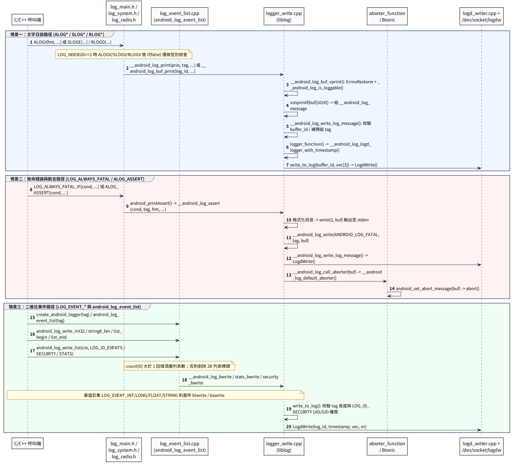

# 4.4 C/C++ 日誌寫入介面

- **情景說明**：原生 C/C++ 系統服務或 NDK 模組分別透過三條典型路徑向 Android 17 日誌系統寫入資料——（一）使用 `ALOGV` / `ALOGI` / `SLOGE` / `RLOGD` 巨集與 `IF_ALOG*` 條件守門輸出文字日誌；（二）在不可恢復錯誤或斷言失敗時觸發 `LOG_ALWAYS_FATAL` / `ALOG_ASSERT` 寫入 `ANDROID_LOG_FATAL` 並透過可替換 aborter 終止行程；（三）使用 `LOG_EVENT_*` 單值巨集與 `android_log_event_list`（C/C++ 結構化事件列表 API）向 `LOG_ID_EVENTS` / `LOG_ID_SECURITY` / `LOG_ID_STATS` 寫入二進位事件記錄。本節亦附帶對照 Android 17 在 `system/logging/rust/` 提供的 Rust 日誌綁定。
- **對應原書**：第 4 章 4.4 節〈C/C++日志写入接口〉（p.108–112）
- **涉及專案與版本基準**：
  - `platform/system/logging` 〔`android-17.0.0_r1`，commit `d35ba62`〕

---

## 4.4.1 標頭檔重組與巨集命名演進（2.3 → 17）

> 對應原書 4.4（p.108–109）。原書 Android 2.3 的 C/C++ 日誌巨集全部集中在 `system/core/include/cutils/log.h` 單一標頭檔中，並以 `LOGV`/`LOGD`/`LOGI`/`LOGW`/`LOGE` 命名。然而 `LOG` 巨集容易與標準數學函式庫（`<math.h>`）或其他第三方程式碼衝突，且日誌系統自 `system/core` 獨立拆至 `platform/system/logging` 後，標頭檔亦依職責與 ABI 穩定性重新切分為**平台內部標頭（`<log/*.h>`）**與**NDK 公開標頭（`<android/*.h>`）**兩大體系：

| 標頭檔（`platform/system/logging/liblog/include/`） | 定位與對象 | 主要提供的巨集 / API |
|---|---|---|
| `log/log.h` | 平台 C/C++ 統一入口 | 聚合引入 `android/log.h`、`log_id.h`、`log_main.h`、`log_radio.h`、`log_safetynet.h`、`log_system.h`、`log_time.h`；定義 `LOG_TAG`、`LOG_NDEBUG`、`LOGGER_ENTRY_MAX_PAYLOAD`、`AndroidEventLogType`、`LOG_EVENT_*`、`__android_log_close` |
| `log/log_main.h` | `main` 緩衝區與斷言巨集 | `ALOGV/D/I/W/E`、`ALOG*_IF`、`IF_ALOG*`、`ALOG`、`LOG_PRI`、`LOG_PRI_VA`、`LOG_ALWAYS_FATAL[_IF]`、`LOG_FATAL[_IF]`、`ALOG_ASSERT`、`android_testLog` |
| `log/log_system.h` | `system` 緩衝區巨集 | `SLOGV/D/I/W/E`、`SLOG*_IF`（指定 `LOG_ID_SYSTEM`） |
| `log/log_radio.h` | `radio` 緩衝區巨集 | `RLOGV/D/I/W/E`、`RLOG*_IF`（指定 `LOG_ID_RADIO`） |
| `log/log_safetynet.h` | SafetyNet 安全錯誤事件 | `android_errorWriteLog`、`android_errorWriteWithInfoLog`、`__android_log_error_write` |
| `log/log_event_list.h` | 結構化二進位事件（須顯式 `#include`） | `android_log_context`、`create_android_logger`、`android_log_write_*`、C++ 類別 `android_log_event_list` |
| `android/log.h` | **NDK 穩定 C ABI** | `android_LogPriority`、`log_id_t`、`__android_log_write/print/vprint/buf_write/buf_print/assert`、API 30+ `__android_log_message` 與 logger/aborter/priority 控制介面、API 37 `__android_log_logd_logger_with_timestamp` |
| `android/log_macros.h` | **NDK 輕量巨集標頭** | 以 C23/C++20 `__VA_OPT__` 定義 `ALOGE/W/I/D/V`，直接轉呼叫 `__android_log_print` |

### Step 1：`<log/log.h>` 聚合入口、`LOG_TAG` 與 `LOG_NDEBUG`
**位置**：`platform/system/logging/liblog/include/log/log.h` 〔`android-17.0.0_r1`，lines 28–71〕

```cpp
#include <android/log.h>
#include <log/log_id.h>
#include <log/log_main.h>
#include <log/log_radio.h>
#include <log/log_safetynet.h>
#include <log/log_system.h>
#include <log/log_time.h>
...
#ifndef LOG_TAG
#define LOG_TAG NULL
#endif

/*
 * Normally we strip the effects of ALOGV (VERBOSE messages),
 * LOG_FATAL and LOG_FATAL_IF (FATAL assert messages) from the
 * release builds be defining NDEBUG.  You can modify this (for
 * example with "#define LOG_NDEBUG 0" at the top of your source
 * file) to change that behavior.
 */

#ifndef LOG_NDEBUG
#ifdef NDEBUG
#define LOG_NDEBUG 1
#else
#define LOG_NDEBUG 0
#endif
#endif

/*
 * The maximum size of the log entry payload that can be
 * written to the logger. An attempt to write more than
 * this amount will result in a truncated log entry.
 */
#define LOGGER_ENTRY_MAX_PAYLOAD 4068
```

AOSP 平台原生模組慣例在每個 `.cpp` 檔最頂端先寫 `#define LOG_TAG "MyModule"`（必要時加上 `#define LOG_NDEBUG 0` 強制開啟 `ALOGV`），接著才 `#include <log/log.h>`。若呼叫端未定義 `LOG_TAG`，預設為 `NULL`；與 2.3 不同的是，在 Android 17 中傳入 `NULL` 給 `liblog` 時，`__android_log_write_log_message` 會自動以行程名稱 `getprogname()`（或透過 `__android_log_set_default_tag` 設定的預設標籤）補上。

另外值得注意：`log/log_main.h`、`log/log_system.h`、`log/log_radio.h` 各自都獨立包含一次 `LOG_NDEBUG` 的預設推導（由編譯旗標 `NDEBUG` 決定是否為 `1`），因此即使某些檔案只單獨引入 `<log/log_main.h>` 或 `<log/log_system.h>`，編譯期裁切規則仍能正確生效。

### Step 2：NDK 公開標頭 `<android/log.h>` 與 `<android/log_macros.h>`
**位置**：`platform/system/logging/liblog/include/android/log.h` 〔`android-17.0.0_r1`，lines 75–130〕

```cpp
typedef enum android_LogPriority {
  /** For internal use only.  */
  ANDROID_LOG_UNKNOWN = 0,
  /** The default priority, for internal use only.  */
  ANDROID_LOG_DEFAULT, /* only for SetMinPriority() */
  /** Verbose logging. Should typically be disabled for a release apk. */
  ANDROID_LOG_VERBOSE,
  /** Debug logging. Should typically be disabled for a release apk. */
  ANDROID_LOG_DEBUG,
  /** Informational logging. Should typically be disabled for a release apk. */
  ANDROID_LOG_INFO,
  /** Warning logging. For use with recoverable failures. */
  ANDROID_LOG_WARN,
  /** Error logging. For use with unrecoverable failures. */
  ANDROID_LOG_ERROR,
  /** Fatal logging. For use when aborting. */
  ANDROID_LOG_FATAL,
  /** For internal use only.  */
  ANDROID_LOG_SILENT, /* only for SetMinPriority(); must be last */
} android_LogPriority;

/**
 * Identifies a specific log buffer for __android_log_buf_write()
 * and __android_log_buf_print().
 */
typedef enum log_id {
  /** For internal use only.  */
  LOG_ID_MIN = 0,

  /** The main log buffer. This is the only log buffer available to apps. */
  LOG_ID_MAIN = 0,
  /** The radio log buffer. */
  LOG_ID_RADIO = 1,
  /** The event log buffer. */
  LOG_ID_EVENTS = 2,
  /** The system log buffer. */
  LOG_ID_SYSTEM = 3,
  /** The crash log buffer. */
  LOG_ID_CRASH = 4,
  /** The statistics log buffer. */
  LOG_ID_STATS = 5,
  /** The security log buffer. */
  LOG_ID_SECURITY = 6,
  /** The kernel log buffer. */
  LOG_ID_KERNEL = 7,

  /** For internal use only.  */
  LOG_ID_MAX,

  /**
   * Let the logging library choose the best log target in cases where it's
   * unclear. This is useful if you're generic library code that can't know
   * which log your caller should use.
   */
  LOG_ID_DEFAULT = 0x7FFFFFFF
} log_id_t;
```

**位置**：`platform/system/logging/liblog/include/android/log_macros.h` 〔`android-17.0.0_r1`，lines 29–43〕

```cpp
#ifndef LOG_TAG
#define LOG_TAG NULL
#endif

#define ALOGE(fmt, ...) \
  ((void)__android_log_print(ANDROID_LOG_ERROR, (LOG_TAG), (fmt)__VA_OPT__(, ) __VA_ARGS__))
#define ALOGW(fmt, ...) \
  ((void)__android_log_print(ANDROID_LOG_WARN, (LOG_TAG), (fmt)__VA_OPT__(, ) __VA_ARGS__))
#define ALOGI(fmt, ...) \
  ((void)__android_log_print(ANDROID_LOG_INFO, (LOG_TAG), (fmt)__VA_OPT__(, ) __VA_ARGS__))
#define ALOGD(fmt, ...) \
  ((void)__android_log_print(ANDROID_LOG_DEBUG, (LOG_TAG), (fmt)__VA_OPT__(, ) __VA_ARGS__))
#define ALOGV(fmt, ...) \
  ((void)__android_log_print(ANDROID_LOG_VERBOSE, (LOG_TAG), (fmt)__VA_OPT__(, ) __VA_ARGS__))
```

`<android/log_macros.h>` 是 Android 較新加入的 NDK 便利標頭（註解版權年份 2024），讓第三方 NDK 開發者不必手動包一層 `__android_log_print` 巨集就能直接使用熟悉的 `ALOGE`～`ALOGV` 語法，並利用標準 `__VA_OPT__(, )` 處理無可變參數的情況（不依賴 GNU `, ##__VA_ARGS__` 擴展）。但要留意它與平台 `<log/log_main.h>` 有一項重要差異：**`<android/log_macros.h>` 的 `ALOGV` 不受 `LOG_NDEBUG` 裁切**，在 release 建置仍會呼叫 `__android_log_print` 並交由執行期屬性判斷。

> 〔與 2.3 差異〕**改名搬家 + 新增**：2.3 僅有 `system/core/include/cutils/log.h`（定義 `LOGV`～`LOGE`）與 `system/core/include/android/log.h`（僅定義 `android_LogPriority` 與基礎函式宣告，無 `log_id_t` 公開列舉，亦無 `<android/log_macros.h>`）（原書 p.108–110）。Android 17 遷至 `platform/system/logging/liblog/include/`，將巨集更名為 `ALOG*` 並按緩衝區拆分標頭，同時在 `<android/log.h>` 正式納入 8 種 `log_id_t`、API 30 可插拔 logger/aborter/priority 控制 API 與 API 37 帶時間戳的 `__android_log_logd_logger_with_timestamp`。

---

## 4.4.2 情景一：文字日誌巨集展開與緩衝區分流（`ALOG*` / `SLOG*` / `RLOG*`）

> 對應原書 4.4（p.109–111）。當原生程式寫下 `ALOGV("idx=%d", i)`、`ALOGI("service ready: %s", name)`、`SLOGE("init failed: %d", err)` 或 `RLOGD("ril req %u", token)` 時，前處理器如何展開巨集、如何避免未啟用日誌造成參數語法腐化或不必要的格式字串組裝，以及最終如何匯流進入 `liblog`？我們沿呼叫鏈逐步拆解。

### Step 1：`ALOGV` 的編譯期裁切（`LOG_NDEBUG`）與 `IF_ALOG*` 執行期守門
**位置**：`platform/system/logging/liblog/include/log/log_main.h` 〔`android-17.0.0_r1`，lines 62–80〕

```cpp
#ifdef __clang_analyzer__
#ifdef __cplusplus
extern "C++" {
template <typename... Ts>
constexpr int __fake_use_va_args(Ts...) {
  return 0;
}
}
#else
extern int __fake_use_va_args(int, ...);
#endif /* __cplusplus */
#define __FAKE_USE_VA_ARGS(...) ((void)__fake_use_va_args(0, ##__VA_ARGS__))
#else
#define __FAKE_USE_VA_ARGS(...) ((void)(0))
#endif /* __clang_analyzer__ */

#ifndef __predict_false
#define __predict_false(exp) __builtin_expect((exp) != 0, 0)
#endif
```

**位置**：`platform/system/logging/liblog/include/log/log_main.h` 〔`android-17.0.0_r1`，lines 197–221〕

```cpp
#ifndef ALOGV
#define __ALOGV(...) ((void)ALOG(LOG_VERBOSE, LOG_TAG, __VA_ARGS__))
#if LOG_NDEBUG
#define ALOGV(...)                   \
  do {                               \
    __FAKE_USE_VA_ARGS(__VA_ARGS__); \
    if (false) {                     \
      __ALOGV(__VA_ARGS__);          \
    }                                \
  } while (false)
#else
#define ALOGV(...) __ALOGV(__VA_ARGS__)
#endif
#endif

#ifndef ALOGV_IF
#if LOG_NDEBUG
#define ALOGV_IF(cond, ...) __FAKE_USE_VA_ARGS(__VA_ARGS__)
#else
#define ALOGV_IF(cond, ...)                                                               \
  ((__predict_false(cond))                                                                \
       ? (__FAKE_USE_VA_ARGS(__VA_ARGS__), (void)ALOG(LOG_VERBOSE, LOG_TAG, __VA_ARGS__)) \
       : ((void)0))
#endif
#endif
```

這段設計有三個工程細節值得特別注意：
1. **`if (false) { __ALOGV(__VA_ARGS__); }` 保留型別檢查**：原書 2.3 在 `LOG_NDEBUG` 為 1 時直接將 `LOGV(...)` 定義為 `((void)0)`，導致僅在 `LOGV` 中引用的變數或過時的 `printf` 格式符在 release 建置不會被編譯器檢查，一旦改開 debug 建置便大量報錯。Android 17 改寫成 `do { ... if (false) { __ALOGV(__VA_ARGS__); } } while (false)`：編譯器前端依然會對 `__android_log_print` 的 `__attribute__((__format__(printf, 3, 4)))` 與參數型別做完整檢查，而最佳化階段則會將恆假分支整段消除，達成「零執行期成本 + 編譯期防腐化」。
2. **`__FAKE_USE_VA_ARGS` 抑制靜態分析誤報**：當 Clang Static Analyzer 執行時，將 `...` 參數傳入空函式 `__fake_use_va_args`（C++ 下標為 `constexpr` 使其可用於 `constexpr` 函式內），避免產生大量 dead-store / unused-variable 警告。
3. **`__predict_false(cond)` 分支預測提示**：所有 `ALOG*_IF` 巨集皆以 `__builtin_expect((cond) != 0, 0)` 告訴編譯器條件日誌屬於冷路徑，改善熱路徑的指令快取佈局。

此外，若產生日誌內容本身需要較昂貴的運算（例如走訪陣列拼接字串），呼叫端可使用 `IF_ALOGV()`～`IF_ALOGE()` 預先測試：

**位置**：`platform/system/logging/liblog/include/log/log_main.h` 〔`android-17.0.0_r1`，lines 285–363〕

```cpp
#ifndef IF_ALOGV
#if LOG_NDEBUG
#define IF_ALOGV() if (false)
#else
#define IF_ALOGV() IF_ALOG(LOG_VERBOSE, LOG_TAG)
#endif
#endif
...
#ifndef IF_ALOGI
#define IF_ALOGI() IF_ALOG(LOG_INFO, LOG_TAG)
#endif
...
#ifndef ALOG
#define ALOG(priority, tag, ...) LOG_PRI(ANDROID_##priority, tag, __VA_ARGS__)
#endif

/*
 * Conditional given a desired logging priority and tag.
 */
#ifndef IF_ALOG
#define IF_ALOG(priority, tag) if (android_testLog(ANDROID_##priority, tag))
#endif
...
#if LOG_NDEBUG /* Production */
#define android_testLog(prio, tag) \
  (__android_log_is_loggable_len(prio, tag, (tag) ? strlen(tag) : 0, ANDROID_LOG_DEBUG) != 0)
#else
#define android_testLog(prio, tag) \
  (__android_log_is_loggable_len(prio, tag, (tag) ? strlen(tag) : 0, ANDROID_LOG_VERBOSE) != 0)
#endif
```

`IF_ALOGV()` 在 `LOG_NDEBUG == 1` 時直接成為編譯期恆假 `if (false)`；其餘等級（以及 debug 建置下的 `IF_ALOGV()`）則展開為 `android_testLog`，呼叫 4.3 節分析過的 `__android_log_is_loggable_len` 查詢 `log.tag.<tag>` / `persist.log.tag.<tag>` 系統屬性與行程最低等級。若未設定屬性，production 建置預設門檻為 `ANDROID_LOG_DEBUG`，debug 建置則放寬至 `ANDROID_LOG_VERBOSE`。

### Step 2：`ALOGI` 展開鏈：`ALOGI` → `ALOG` → `LOG_PRI` → `android_printLog`
**位置**：`platform/system/logging/liblog/include/log/log_main.h` 〔`android-17.0.0_r1`，lines 82–103〕

```cpp
#define android_writeLog(prio, tag, text) __android_log_write(prio, tag, text)

#define android_printLog(prio, tag, ...) \
  __android_log_print(prio, tag, __VA_ARGS__)

#define android_vprintLog(prio, cond, tag, ...) \
  __android_log_vprint(prio, tag, __VA_ARGS__)

/*
 * Log macro that allows you to specify a number for the priority.
 */
#ifndef LOG_PRI
#define LOG_PRI(priority, tag, ...) android_printLog(priority, tag, __VA_ARGS__)
#endif

/*
 * Log macro that allows you to pass in a varargs ("args" is a va_list).
 */
#ifndef LOG_PRI_VA
#define LOG_PRI_VA(priority, tag, fmt, args) \
  android_vprintLog(priority, NULL, tag, fmt, args)
#endif
```

**位置**：`platform/system/logging/liblog/include/log/log_main.h` 〔`android-17.0.0_r1`，lines 226–277〕

```cpp
#ifndef ALOGD
#define ALOGD(...) ((void)ALOG(LOG_DEBUG, LOG_TAG, __VA_ARGS__))
#endif
...
#ifndef ALOGI
#define ALOGI(...) ((void)ALOG(LOG_INFO, LOG_TAG, __VA_ARGS__))
#endif
...
#ifndef ALOGW
#define ALOGW(...) ((void)ALOG(LOG_WARN, LOG_TAG, __VA_ARGS__))
#endif
...
#ifndef ALOGE
#define ALOGE(...) ((void)ALOG(LOG_ERROR, LOG_TAG, __VA_ARGS__))
#endif
```

以 `ALOGI("service ready: %s", name)` 為例，前處理器依序執行四層展開：
1. `ALOGI("service ready: %s", name)` → `((void)ALOG(LOG_INFO, LOG_TAG, "service ready: %s", name))`
2. `ALOG(LOG_INFO, ...)` → `LOG_PRI(ANDROID_LOG_INFO, LOG_TAG, "service ready: %s", name)`（透過 token pasting `ANDROID_##priority` 拼出 `android_LogPriority` 列舉常數）
3. `LOG_PRI(...)` → `android_printLog(ANDROID_LOG_INFO, LOG_TAG, "service ready: %s", name)`
4. `android_printLog(...)` → `__android_log_print(ANDROID_LOG_INFO, LOG_TAG, "service ready: %s", name)`

若呼叫端已經持有 `va_list`，則透過 `LOG_PRI_VA(ANDROID_LOG_INFO, LOG_TAG, fmt, args)` → `android_vprintLog(...)` → `__android_log_vprint(...)` 進入 `liblog`。

### Step 3：`SLOG*` 與 `RLOG*` 直接指定緩衝區
**位置**：`platform/system/logging/liblog/include/log/log_system.h` 〔`android-17.0.0_r1`，lines 44–138〕

```cpp
#ifndef SLOGV
#define __SLOGV(...)                                                          \
  ((void)__android_log_buf_print(LOG_ID_SYSTEM, ANDROID_LOG_VERBOSE, LOG_TAG, \
                                 __VA_ARGS__))
#if LOG_NDEBUG
#define SLOGV(...)          \
  do {                      \
    if (0) {                \
      __SLOGV(__VA_ARGS__); \
    }                       \
  } while (0)
#else
#define SLOGV(...) __SLOGV(__VA_ARGS__)
#endif
#endif
...
#ifndef SLOGD
#define SLOGD(...)                                                          \
  ((void)__android_log_buf_print(LOG_ID_SYSTEM, ANDROID_LOG_DEBUG, LOG_TAG, \
                                 __VA_ARGS__))
#endif
...
#ifndef SLOGI
#define SLOGI(...)                                                         \
  ((void)__android_log_buf_print(LOG_ID_SYSTEM, ANDROID_LOG_INFO, LOG_TAG, \
                                 __VA_ARGS__))
#endif
...
#ifndef SLOGW
#define SLOGW(...)                                                         \
  ((void)__android_log_buf_print(LOG_ID_SYSTEM, ANDROID_LOG_WARN, LOG_TAG, \
                                 __VA_ARGS__))
#endif
...
#ifndef SLOGE
#define SLOGE(...)                                                          \
  ((void)__android_log_buf_print(LOG_ID_SYSTEM, ANDROID_LOG_ERROR, LOG_TAG, \
                                 __VA_ARGS__))
#endif
```

**位置**：`platform/system/logging/liblog/include/log/log_radio.h` 〔`android-17.0.0_r1`，lines 46–140〕

```cpp
#ifndef RLOGV
#define __RLOGV(...)                                                         \
  ((void)__android_log_buf_print(LOG_ID_RADIO, ANDROID_LOG_VERBOSE, LOG_TAG, \
                                 __VA_ARGS__))
#if LOG_NDEBUG
#define RLOGV(...)          \
  do {                      \
    if (0) {                \
      __RLOGV(__VA_ARGS__); \
    }                       \
  } while (0)
#else
#define RLOGV(...) __RLOGV(__VA_ARGS__)
#endif
#endif
...
#ifndef RLOGD
#define RLOGD(...)                                                         \
  ((void)__android_log_buf_print(LOG_ID_RADIO, ANDROID_LOG_DEBUG, LOG_TAG, \
                                 __VA_ARGS__))
#endif
...
#ifndef RLOGE
#define RLOGE(...)                                                         \
  ((void)__android_log_buf_print(LOG_ID_RADIO, ANDROID_LOG_ERROR, LOG_TAG, \
                                 __VA_ARGS__))
#endif
```

與 `ALOG*` 經過 `ALOG`/`LOG_PRI`/`android_printLog` 轉呼叫 `__android_log_print`（寫入 `LOG_ID_MAIN`）不同，`SLOG*`（系統框架元件專用）與 `RLOG*`（RIL / Telephony 原生元件專用）直接展開為 `__android_log_buf_print`，分別寫入 `LOG_ID_SYSTEM` 與 `LOG_ID_RADIO` 緩衝區；兩者同樣提供 `SLOG*_IF` / `RLOG*_IF` 條件版本，並在 `LOG_NDEBUG` 為 1 時以 `do { if (0) { ... } } while (0)` 保留 `SLOGV`/`RLOGV` 的編譯期格式檢查。

### Step 4：`liblog` 格式化入口：`__android_log_print` / `__android_log_vprint` / `__android_log_buf_print` 匯流至 `__android_log_buf_vprint`
**位置**：`platform/system/logging/liblog/logger_write.cpp` 〔`android-17.0.0_r1`，lines 66–66〕

```cpp
#define LOG_BUF_SIZE 1024
```

**位置**：`platform/system/logging/liblog/logger_write.cpp` 〔`android-17.0.0_r1`，lines 393–429〕

```cpp
static int __android_log_buf_vprint(int log_id, int prio,
                                    const char* tag, const char* fmt, va_list ap) {
  ErrnoRestorer errno_restorer;

  if (!__android_log_is_loggable(prio, tag, ANDROID_LOG_VERBOSE)) {
    return -EPERM;
  }

  __attribute__((uninitialized)) char buf[LOG_BUF_SIZE];

  vsnprintf(buf, LOG_BUF_SIZE, fmt, ap);

  __android_log_message log_message = {
      sizeof(__android_log_message), log_id, prio, tag, nullptr, 0, buf};
  __android_log_write_log_message(&log_message);
  return 1;
}

int __android_log_vprint(int prio, const char* tag, const char* fmt, va_list ap) {
  return __android_log_buf_vprint(LOG_ID_MAIN, prio, tag, fmt, ap);
}

int __android_log_print(int prio, const char* tag, const char* fmt, ...) {
  va_list ap;
  va_start(ap, fmt);
  int result = __android_log_buf_vprint(LOG_ID_MAIN, prio, tag, fmt, ap);
  va_end(ap);
  return result;
}

int __android_log_buf_print(int log_id, int prio, const char* tag, const char* fmt, ...) {
  va_list ap;
  va_start(ap, fmt);
  int result = __android_log_buf_vprint(log_id, prio, tag, fmt, ap);
  va_end(ap);
  return result;
}
```

對照原書 4.3（p.106–107），Android 17 在這裡做了相當精細的重構與最佳化：
1. **統一匯流至 `__android_log_buf_vprint`**：`__android_log_print`、`__android_log_vprint`（兩者傳入 `LOG_ID_MAIN`）與 `__android_log_buf_print`（傳入呼叫端指定的 `log_id`，如 `LOG_ID_SYSTEM` 或 `LOG_ID_RADIO`）不再各自配置堆疊緩衝區並呼叫 `__android_log_write`/`__android_log_buf_write`，而是全數交由內部靜態函式 `__android_log_buf_vprint` 統一處理。
2. **保存並還原 `errno`**：函式開頭宣告 `ErrnoRestorer errno_restorer`，確保寫日誌過程中的系統呼叫（屬性讀取、socket 操作）不會破壞呼叫端剛收到的 `errno`（例如 `ALOGE("open failed: %s", strerror(errno))` 後面仍需判斷 `errno` 的情境）。
3. **格式化前先檢查 `__android_log_is_loggable`**：若該 `tag` 與 `prio` 被系統屬性或行程最低等級過濾掉，直接回傳 `-EPERM`，完全略過 `vsnprintf` 與後續組裝。
4. **`LOG_BUF_SIZE = 1024` 與 `__attribute__((uninitialized))`**：單次 `printf` 格式化輸出上限仍是 1024 bytes（含結尾 `'\0'`，即最多 1023 bytes 文字；超過即由 `vsnprintf` 截斷，而非使用 `LOGGER_ENTRY_MAX_PAYLOAD` 的 4068 bytes，需特別留意；若直接呼叫 `__android_log_write` 則不受 1024 bytes 堆疊緩衝區限制）。加上 `__attribute__((uninitialized))` 是為了在啟用自動堆疊零初始化（`-ftrivial-auto-var-init=zero`）的建置中，免除每次印日誌都 `memset` 1 KB 的開銷。

### Step 5：統一寫入管線與可插拔 logger：`__android_log_write` / `__android_log_buf_write` → `__android_log_write_log_message` → `__android_log_logd_logger`
**位置**：`platform/system/logging/liblog/logger_write.cpp` 〔`android-17.0.0_r1`，lines 167–175〕

```cpp
#ifdef __ANDROID__
static __android_logger_function logger_function = __android_log_logd_logger;
#else
static __android_logger_function logger_function = __android_log_stderr_logger;
#endif

void __android_log_set_logger(__android_logger_function logger) {
  logger_function = logger;
}
```

**位置**：`platform/system/logging/liblog/logger_write.cpp` 〔`android-17.0.0_r1`，lines 332–391〕

```cpp
void __android_log_logd_logger(const struct __android_log_message* log_message) {
  __android_log_logd_logger_with_timestamp(log_message, nullptr);
}

void __android_log_logd_logger_with_timestamp(const struct __android_log_message* log_message,
                                              const struct timespec* timestamp) {
  if (log_to_file_if_overridden(log_message)) return;

  int buffer_id = log_message->buffer_id == LOG_ID_DEFAULT ? LOG_ID_MAIN : log_message->buffer_id;

  struct iovec vec[3];
  vec[0].iov_base =
      const_cast<unsigned char*>(reinterpret_cast<const unsigned char*>(&log_message->priority));
  vec[0].iov_len = 1;
  vec[1].iov_base = const_cast<void*>(static_cast<const void*>(log_message->tag));
  vec[1].iov_len = strlen(log_message->tag) + 1;
  vec[2].iov_base = const_cast<void*>(static_cast<const void*>(log_message->message));
  vec[2].iov_len = strlen(log_message->message) + 1;

  write_to_log(static_cast<log_id_t>(buffer_id), vec, 3, timestamp);
}

int __android_log_write(int prio, const char* tag, const char* msg) {
  return __android_log_buf_write(LOG_ID_MAIN, prio, tag, msg);
}

void __android_log_write_log_message(__android_log_message* log_message) {
  ErrnoRestorer errno_restorer;

  if (log_message->buffer_id != LOG_ID_DEFAULT && log_message->buffer_id != LOG_ID_MAIN &&
      log_message->buffer_id != LOG_ID_SYSTEM && log_message->buffer_id != LOG_ID_RADIO &&
      log_message->buffer_id != LOG_ID_CRASH) {
    return;
  }

  if (log_message->tag == nullptr) {
    log_message->tag = GetDefaultTag().c_str();
  }

#if __BIONIC__
  if (log_message->priority == ANDROID_LOG_FATAL) {
    android_set_abort_message(log_message->message);
  }
#endif

  logger_function(log_message);
}

int __android_log_buf_write(int log_id, int prio, const char* tag, const char* msg) {
  ErrnoRestorer errno_restorer;

  if (!__android_log_is_loggable(prio, tag, ANDROID_LOG_VERBOSE)) {
    return -EPERM;
  }

  __android_log_message log_message = {
      sizeof(__android_log_message), log_id, prio, tag, nullptr, 0, msg};
  __android_log_write_log_message(&log_message);
  return 1;
}
```

無論是格式化路徑（`__android_log_buf_vprint`）或直接寫字串路徑（`__android_log_write` → `__android_log_buf_write`），都會建立 `struct __android_log_message` 並進入 `__android_log_write_log_message`（API 30 引入；高階 C++ 日誌庫如 `libbase` 的 `LOG(INFO)` 則會先自行檢查 `__android_log_is_loggable`、附上 `file` 與 `line` 後直接呼叫此函式）：
1. **白名單校驗 `buffer_id`**：只允許文字類緩衝區（`LOG_ID_DEFAULT`、`MAIN`、`SYSTEM`、`RADIO`、`CRASH`）；嘗試把文字寫進 `LOG_ID_EVENTS` 或 `LOG_ID_KERNEL` 會直接靜默返回。
2. **補齊預設 `tag`**：若 `tag == nullptr`，填入 `GetDefaultTag().c_str()`（預設為 `getprogname()`，可由 `__android_log_set_default_tag` 修改）。
3. **Bionic 崩潰訊息掛鉤**：只要 `priority == ANDROID_LOG_FATAL`，即自動呼叫 `android_set_abort_message(log_message->message)`，讓後續可能發生的崩潰在 tombstone 中留下最後一條致命訊息。
4. **分派至 `logger_function`**：預設在裝置上呼叫 `__android_log_logd_logger` → `__android_log_logd_logger_with_timestamp(log_message, nullptr)`（若 Microdroid 等無 `logd` 環境設了 `ro.log.file_logger.path`，會轉寫入檔案或 `stderr`；否則打包 3 段 `iovec` 交給 `write_to_log` → `LogdWrite`，進入 4.3 節分析的 `/dev/socket/logdw` + `/dev/pmsg0` 雙路寫入）。單元測試或主機端工具則可透過 `__android_log_set_logger` 替換成自訂 callback 或 `__android_log_stderr_logger`。

> 〔與 2.3 差異〕**邏輯改變**：2.3 的 `LOGV`/`SLOGV` 在 `LOG_NDEBUG` 為 1 時直接展開為 `((void)0)`，沒有編譯期格式檢查；且 `__android_log_print` 內部呼叫 `__android_log_write` 直接組 `iovec` 寫入 `/dev/log/*`，沒有 `ErrnoRestorer`、`__android_log_is_loggable` 短路、沒有 `struct __android_log_message` 與可插拔 `__android_log_set_logger`（原書 p.106–111）。Android 17 透過 `__android_log_buf_vprint` 與 `__android_log_write_log_message` 統一文字管線，並原生支援 host 端 `stderr` 與 Microdroid 檔案重導向。

---

## 4.4.3 情景二：致命錯誤與斷言路徑（`LOG_ALWAYS_FATAL` / `ALOG_ASSERT`）

> 對應原書 4.3（p.106–107）與 4.4 延伸。除了五級一般日誌，AOSP 原生程式碼大量使用 `LOG_ALWAYS_FATAL`、`LOG_ALWAYS_FATAL_IF` 與 `ALOG_ASSERT` 處理不可恢復的不變量違反；這條路徑同時牽動 C 巨集可變參數技巧、`stderr` 輸出、`ANDROID_LOG_FATAL` 記錄以及可替換的行程終止鉤子（aborter）。

### Step 1：斷言巨集設計：`android_printAssert`、`LOG_ALWAYS_FATAL[_IF]`、`LOG_FATAL[_IF]` 與 `ALOG_ASSERT`
**位置**：`platform/system/logging/liblog/include/log/log_main.h` 〔`android-17.0.0_r1`，lines 115–176〕

```cpp
#define __android_second(dummy, second, ...) second

/* If passed multiple args, returns ',' followed by all but 1st arg, otherwise
 * returns nothing.
 */
#define __android_rest(first, ...) , ##__VA_ARGS__

#define android_printAssert(cond, tag, ...)                     \
  __android_log_assert(cond, tag,                               \
                       __android_second(0, ##__VA_ARGS__, NULL) \
                           __android_rest(__VA_ARGS__))

/*
 * Log a fatal error.  If the given condition fails, this stops program
 * execution like a normal assertion, but also generating the given message.
 * It is NOT stripped from release builds.  Note that the condition test
 * is -inverted- from the normal assert() semantics.
 */
#ifndef LOG_ALWAYS_FATAL_IF
#define LOG_ALWAYS_FATAL_IF(cond, ...)                                                    \
  ((__predict_false(cond)) ? (__FAKE_USE_VA_ARGS(__VA_ARGS__),                            \
                              ((void)android_printAssert(#cond, LOG_TAG, ##__VA_ARGS__))) \
                           : ((void)0))
#endif

#ifndef LOG_ALWAYS_FATAL
#define LOG_ALWAYS_FATAL(...) \
  (((void)android_printAssert(NULL, LOG_TAG, ##__VA_ARGS__)))
#endif

/*
 * Versions of LOG_ALWAYS_FATAL_IF and LOG_ALWAYS_FATAL that
 * are stripped out of release builds.
 */

#if LOG_NDEBUG

#ifndef LOG_FATAL_IF
#define LOG_FATAL_IF(cond, ...) __FAKE_USE_VA_ARGS(__VA_ARGS__)
#endif
#ifndef LOG_FATAL
#define LOG_FATAL(...) __FAKE_USE_VA_ARGS(__VA_ARGS__)
#endif

#else

#ifndef LOG_FATAL_IF
#define LOG_FATAL_IF(cond, ...) LOG_ALWAYS_FATAL_IF(cond, ##__VA_ARGS__)
#endif
#ifndef LOG_FATAL
#define LOG_FATAL(...) LOG_ALWAYS_FATAL(__VA_ARGS__)
#endif

#endif

/*
 * Assertion that generates a log message when the assertion fails.
 * Stripped out of release builds.  Uses the current LOG_TAG.
 */
#ifndef ALOG_ASSERT
#define ALOG_ASSERT(cond, ...) LOG_FATAL_IF(!(cond), ##__VA_ARGS__)
#endif
```

這組巨集解決了兩個實務痛點：
1. **允許省略格式字串**：開發者常只寫 `ALOG_ASSERT(ptr != nullptr)` 而不附帶 `fmt` 字串。`android_printAssert` 搭配 `__android_second` 與 `__android_rest` 的 GNU `, ##__VA_ARGS__` 技巧，在 `...` 為空時把第 3 個引數展開為 `NULL`（`__android_log_assert(cond, tag, NULL)`）；若有傳入 `"bad state %d", s`，則展開為 `__android_log_assert(cond, tag, "bad state %d", s)`。
2. **條件語意與發佈版本裁切的區別**：
   - `LOG_ALWAYS_FATAL_IF(cond, ...)`：條件為**真**時中止（與標準 `assert` 相反），且**永不**在 release 建置被裁切，適合防禦記憶體損毀或安全不變量。
   - `LOG_FATAL_IF(cond, ...)` / `LOG_FATAL(...)`：僅在 `LOG_NDEBUG == 0` 生效，release 建置縮減為空操作。
   - `ALOG_ASSERT(cond, ...)`：將條件取反傳給 `LOG_FATAL_IF(!(cond), ...)`，因此與標準 `assert(cond)` 相同（條件為**假**時觸發），同樣只在 debug 建置啟用。

### Step 2：`__android_log_assert` 與可替換 aborter 機制
**位置**：`platform/system/logging/liblog/logger_write.cpp` 〔`android-17.0.0_r1`，lines 177–194〕

```cpp
void __android_log_default_aborter(const char* abort_message) {
#ifdef __ANDROID__
  android_set_abort_message(abort_message);
#else
  UNUSED(abort_message);
#endif
  abort();
}

static __android_aborter_function aborter_function = __android_log_default_aborter;

void __android_log_set_aborter(__android_aborter_function aborter) {
  aborter_function = aborter;
}

void __android_log_call_aborter(const char* abort_message) {
  aborter_function(abort_message);
}
```

**位置**：`platform/system/logging/liblog/logger_write.cpp` 〔`android-17.0.0_r1`，lines 431–458〕

```cpp
void __android_log_assert(const char* cond, const char* tag, const char* fmt, ...) {
  __attribute__((uninitialized)) char buf[LOG_BUF_SIZE];

  if (fmt) {
    va_list ap;
    va_start(ap, fmt);
    vsnprintf(buf, LOG_BUF_SIZE, fmt, ap);
    va_end(ap);
  } else {
    /* Msg not provided, log condition.  N.B. Do not use cond directly as
     * format string as it could contain spurious '%' syntax (e.g.
     * "%d" in "blocks%devs == 0").
     */
    if (cond)
      snprintf(buf, LOG_BUF_SIZE, "Assertion failed: %s", cond);
    else
      strcpy(buf, "Unspecified assertion failed");
  }

  // Log assertion failures to stderr for the benefit of "adb shell" users
  // and gtests (http://b/23675822).
  TEMP_FAILURE_RETRY(write(2, buf, strlen(buf)));
  TEMP_FAILURE_RETRY(write(2, "\n", 1));

  __android_log_write(ANDROID_LOG_FATAL, tag, buf);
  __android_log_call_aborter(buf);
  abort();
}
```

`__android_log_assert` 的執行順序清楚分為四步：
1. **安全組裝失敗訊息**：若提供 `fmt` 則呼叫 `vsnprintf`；若未提供 `fmt` 但有 `cond`，特地以 `"Assertion failed: %s"` 格式化而非直接把 `cond` 當作格式字串（防止像 `blocks%devs == 0` 內含 `%d` 造成未定義行為）；兩者皆空則寫入 `"Unspecified assertion failed"`。
2. **直寫 `stderr`（fd 2）**：以 `TEMP_FAILURE_RETRY(write(2, ...))` 輸出，確保在 `adb shell` 命令列或 gtest 測試中即使未開 `logcat` 也能立刻看到斷言失敗原因。
3. **寫入 `ANDROID_LOG_FATAL` 日誌**：呼叫 `__android_log_write(ANDROID_LOG_FATAL, tag, buf)` 將訊息送進 `logd`（同時在 `__android_log_write_log_message` 中也觸發一次 `android_set_abort_message`）。
4. **呼叫 aborter 並保底 `abort()`**：呼叫 `__android_log_call_aborter(buf)`。預設 `__android_log_default_aborter` 在裝置端呼叫 Bionic 的 `android_set_abort_message(abort_message)`（供 `debuggerd` 寫入 tombstone 的 `Abort message:` 欄位），再呼叫 `abort()` 發出 `SIGABRT`。若測試程式透過 `__android_log_set_aborter` 註冊了自訂 aborter（例如在 gtest 中攔截斷言訊息）卻意外返回，函式末尾的 `abort()` 仍會強制滿足 `__attribute__((__noreturn__))` 契約。

> 〔與 2.3 差異〕**邏輯改變**：原書 2.3 的 `__android_log_assert` 寫完日誌後直接呼叫 `__builtin_trap()`，不會輸出到 `stderr`、不會透過 `android_set_abort_message` 留給 `debuggerd`，也沒有 `__android_log_set_aborter` / `__android_log_call_aborter` 可插拔機制（原書 p.106–107）。

---

## 4.4.4 情景三：二進位事件日誌 C/C++ API（單值巨集與結構化事件列表）

> 對應原書 4.4（p.111–112）。事件日誌緩衝區（`LOG_ID_EVENTS`，以及 17 新增的 `LOG_ID_SECURITY`、`LOG_ID_STATS`）不存放人類可讀的自由文字，而是存放以 32-bit 整數 `tag`（對應 `/system/etc/event-log-tags` 定義表）開頭、後接「型別位元組 + 二進位數值」的緊湊序列。原書 2.3 時代，`LOG_EVENT_STRING` 尚未實作（只是 `((void) 0)`），且完全沒有列表寫入巨集（標註著 `/* TODO: something for LIST */`），開發者要寫多欄位事件只能手動拼裝原始位元組交給 `__android_log_bwrite`。Android 17 不僅補齊了單值巨集，還提供了完整的結構化列表建構器 `log_event_list`（C API + C++ `android_log_event_list` 類別）。

### Step 1：單值事件巨集與 `AndroidEventLogType` 擴充
**位置**：`platform/system/logging/liblog/include/log/log.h` 〔`android-17.0.0_r1`，lines 81–134〕

```cpp
int __android_log_bwrite(int32_t tag, const void* payload, size_t len);
int __android_log_btwrite(int32_t tag, char type, const void* payload,
                          size_t len);
int __android_log_bswrite(int32_t tag, const char* payload);

int __android_log_stats_bwrite(int32_t tag, const void* payload, size_t len);

#define android_bWriteLog(tag, payload, len) \
  __android_log_bwrite(tag, payload, len)
#define android_btWriteLog(tag, type, payload, len) \
  __android_log_btwrite(tag, type, payload, len)

/*
 * Event log entry types.
 */
typedef enum {
  /* Special markers for android_log_list_element type */
  EVENT_TYPE_LIST_STOP = '\n', /* declare end of list  */
  EVENT_TYPE_UNKNOWN = '?',    /* protocol error       */

  /* must match with declaration in java/android/android/util/EventLog.java */
  EVENT_TYPE_INT = 0,  /* int32_t */
  EVENT_TYPE_LONG = 1, /* int64_t */
  EVENT_TYPE_STRING = 2,
  EVENT_TYPE_LIST = 3,
  EVENT_TYPE_FLOAT = 4,
} AndroidEventLogType;

#ifndef LOG_EVENT_INT
#define LOG_EVENT_INT(_tag, _value)                                          \
  {                                                                          \
    int intBuf = _value;                                                     \
    (void)android_btWriteLog(_tag, EVENT_TYPE_INT, &intBuf, sizeof(intBuf)); \
  }
#endif
#ifndef LOG_EVENT_LONG
#define LOG_EVENT_LONG(_tag, _value)                                            \
  {                                                                             \
    long long longBuf = _value;                                                 \
    (void)android_btWriteLog(_tag, EVENT_TYPE_LONG, &longBuf, sizeof(longBuf)); \
  }
#endif
#ifndef LOG_EVENT_FLOAT
#define LOG_EVENT_FLOAT(_tag, _value)                           \
  {                                                             \
    float floatBuf = _value;                                    \
    (void)android_btWriteLog(_tag, EVENT_TYPE_FLOAT, &floatBuf, \
                             sizeof(floatBuf));                 \
  }
#endif
#ifndef LOG_EVENT_STRING
#define LOG_EVENT_STRING(_tag, _value) \
  (void)__android_log_bswrite(_tag, _value);
#endif
```

**位置**：`platform/system/logging/liblog/logger_write.cpp` 〔`android-17.0.0_r1`，lines 460–528〕

```cpp
static int __android_log_buf_bwrite(log_id_t log, int32_t tag, const void* payload, size_t len) {
  ErrnoRestorer errno_restorer;

  iovec vec[2];
  vec[0].iov_base = &tag;
  vec[0].iov_len = sizeof(tag);
  vec[1].iov_base = const_cast<void*>(payload);
  vec[1].iov_len = len;

  return write_to_log(log, vec, 2);
}

int __android_log_bwrite(int32_t tag, const void* payload, size_t len) {
  return __android_log_buf_bwrite(LOG_ID_EVENTS, tag, payload, len);
}

int __android_log_stats_bwrite(int32_t tag, const void* payload, size_t len) {
  return __android_log_buf_bwrite(LOG_ID_STATS, tag, payload, len);
}

int __android_log_security_bwrite(int32_t tag, const void* payload, size_t len) {
  return __android_log_buf_bwrite(LOG_ID_SECURITY, tag, payload, len);
}

/*
 * Like __android_log_bwrite, but takes the type as well.  Doesn't work
 * for the general case where we're generating lists of stuff, but very
 * handy if we just want to dump an integer into the log.
 */
int __android_log_btwrite(int32_t tag, char type, const void* payload, size_t len) {
  ErrnoRestorer errno_restorer;

  iovec vec[3];
  vec[0].iov_base = &tag;
  vec[0].iov_len = sizeof(tag);
  vec[1].iov_base = &type;
  vec[1].iov_len = sizeof(type);
  vec[2].iov_base = const_cast<void*>(payload);
  vec[2].iov_len = len;

  return write_to_log(LOG_ID_EVENTS, vec, 3);
}

static int __android_log_buf_bswrite(log_id_t log, int32_t tag, const char* str) {
  ErrnoRestorer errno_restorer;

  char type = EVENT_TYPE_STRING;
  uint32_t len = strlen(str);

  iovec vec[4];
  vec[0].iov_base = &tag;
  vec[0].iov_len = sizeof(tag);
  vec[1].iov_base = &type;
  vec[1].iov_len = sizeof(type);
  vec[2].iov_base = &len;
  vec[2].iov_len = sizeof(len);
  vec[3].iov_base = const_cast<void*>(reinterpret_cast<const void*>(str));
  vec[3].iov_len = len;

  return write_to_log(log, vec, 4);
}

int __android_log_bswrite(int32_t tag, const char* str) {
  return __android_log_buf_bswrite(LOG_ID_EVENTS, tag, str);
}

int __android_log_security_bswrite(int32_t tag, const char* str) {
  return __android_log_buf_bswrite(LOG_ID_SECURITY, tag, str);
}
```

對照二進位封包佈局即可一目瞭然：
- **`__android_log_btwrite`**（供 `LOG_EVENT_INT`、`LOG_EVENT_LONG`、`LOG_EVENT_FLOAT` 使用）：用 3 段 `iovec` 拼出 `[4B tag][1B type][4B/8B payload]`。
- **`__android_log_bswrite`**（供 `LOG_EVENT_STRING` 使用）：因字串事件線上格式需要顯式長度欄位（不帶結尾 `'\0'`），改以 4 段 `iovec` 拼出 `[4B tag][1B EVENT_TYPE_STRING][4B uint32_t len][len B 字串內容]`。
- **`__android_log_buf_bwrite`**（供 `__android_log_bwrite` / `__android_log_stats_bwrite` / `__android_log_security_bwrite` 共用）：呼叫端已自行編碼好含型別位元組的 `payload`，此處只補上 4 bytes `tag` 便送入 `write_to_log`。
- 進入 `write_to_log`（`logger_write.cpp` lines 209–228）後，`LOG_ID_EVENTS` / `LOG_ID_STATS` / `LOG_ID_SECURITY` 都會校驗 `vec[0].iov_len >= 4`；其中 `LOG_ID_SECURITY` 還會額外執行 `check_log_uid_permissions()`（檢查呼叫者 UID/GID 或附屬群組是否屬於 `AID_SYSTEM`、`AID_ROOT`、`AID_LOG`、`AID_SECURITY_LOG_WRITER`）與 `__android_log_security()`（檢查裝置管理員是否啟用安全日誌），不符則直接回傳 `-EPERM`。

### Step 2：結構化事件列表介面與 C++ RAII 封裝 `android_log_event_list`
**位置**：`platform/system/logging/liblog/include/log/log_event_list.h` 〔`android-17.0.0_r1`，lines 34–98〕

```cpp
#define ANDROID_MAX_LIST_NEST_DEPTH 8

/*
 * The opaque context used to manipulate lists of events.
 */
typedef struct android_log_context_internal* android_log_context;
...
android_log_context create_android_logger(uint32_t tag);

/* All lists must be braced by a begin and end call */
/*
 * NB: If the first level braces are missing when specifying multiple
 *     elements, we will manufacturer a list to embrace it for your API
 *     convenience. For a single element, it will remain solitary.
 */
int android_log_write_list_begin(android_log_context ctx);
int android_log_write_list_end(android_log_context ctx);

int android_log_write_int32(android_log_context ctx, int32_t value);
int android_log_write_int64(android_log_context ctx, int64_t value);
int android_log_write_string8(android_log_context ctx, const char* value);
int android_log_write_string8_len(android_log_context ctx, const char* value,
                                  size_t maxlen);
int android_log_write_float32(android_log_context ctx, float value);

/* Submit the composed list context to the specified logger id */
/* NB: LOG_ID_EVENTS and LOG_ID_SECURITY only valid binary buffers */
int android_log_write_list(android_log_context ctx, log_id_t id);
...
/* Finished with reader or writer context */
int android_log_destroy(android_log_context* ctx);
```

在 C++ 程式碼中，`log_event_list.h` 進一步提供 RAII 類別 `android_log_event_list`，透過 `operator<<` 串接各型別元素，甚至允許以 `<< LOG_ID_EVENTS` 一行完成寫入並銷毀 context：

**位置**：`platform/system/logging/liblog/include/log/log_event_list.h` 〔`android-17.0.0_r1`，lines 103–208〕

```cpp
class android_log_event_list {
 private:
  android_log_context ctx;
  int ret;

  android_log_event_list(const android_log_event_list&) = delete;
  void operator=(const android_log_event_list&) = delete;

 public:
  explicit android_log_event_list(int tag) : ret(0) {
    ctx = create_android_logger(static_cast<uint32_t>(tag));
  }
  ~android_log_event_list() {
    android_log_destroy(&ctx);
  }
...
  android_log_event_list& operator<<(int32_t value) {
    int retval = android_log_write_int32(ctx, value);
    if (retval < 0) ret = retval;
    return *this;
  }
...
  android_log_event_list& operator<<(int64_t value) {
    int retval = android_log_write_int64(ctx, value);
    if (retval < 0) ret = retval;
    return *this;
  }
...
  android_log_event_list& operator<<(const std::string& value) {
    int retval =
        android_log_write_string8_len(ctx, value.data(), value.length());
    if (retval < 0) ret = retval;
    return *this;
  }

  android_log_event_list& operator<<(float value) {
    int retval = android_log_write_float32(ctx, value);
    if (retval < 0) ret = retval;
    return *this;
  }

  int write(log_id_t id = LOG_ID_EVENTS) {
    /* facilitate -EBUSY retry */
    if ((ret == -EBUSY) || (ret > 0)) ret = 0;
    int retval = android_log_write_list(ctx, id);
    /* existing errors trump transmission errors */
    if (!ret) ret = retval;
    return ret;
  }

  int operator<<(log_id_t id) {
    write(id);
    android_log_destroy(&ctx);
    return ret;
  }
```

### Step 3：序列編碼實作：`create_android_logger`、各型別寫入與 `android_log_write_list`
**位置**：`platform/system/logging/liblog/log_event_list.cpp` 〔`android-17.0.0_r1`，lines 28–80〕

```cpp
#define MAX_EVENT_PAYLOAD (LOGGER_ENTRY_MAX_PAYLOAD - sizeof(int32_t))

enum ReadWriteFlag {
  kAndroidLoggerRead = 1,
  kAndroidLoggerWrite = 2,
};

struct android_log_context_internal {
  uint32_t tag;
  unsigned pos;                                    /* Read/write position into buffer */
  unsigned count[ANDROID_MAX_LIST_NEST_DEPTH + 1]; /* Number of elements   */
  unsigned list[ANDROID_MAX_LIST_NEST_DEPTH + 1];  /* pos for list counter */
  unsigned list_nest_depth;
  unsigned len; /* Length or raw buffer. */
  bool overflow;
  bool list_stop; /* next call decrement list_nest_depth and issue a stop */
  ReadWriteFlag read_write_flag;
  uint8_t storage[LOGGER_ENTRY_MAX_PAYLOAD];
};

static void init_context(android_log_context_internal* context, uint32_t tag) {
  context->tag = tag;
  context->read_write_flag = kAndroidLoggerWrite;
  size_t needed = sizeof(android_event_list_t);
  if ((context->pos + needed) > MAX_EVENT_PAYLOAD) {
    context->overflow = true;
  }
  /* Everything is a list */
  context->storage[context->pos + 0] = EVENT_TYPE_LIST;
  context->list[0] = context->pos + 1;
  context->pos += needed;
}
...
android_log_context create_android_logger(uint32_t tag) {
  android_log_context_internal* context;

  context =
      static_cast<android_log_context_internal*>(calloc(1, sizeof(android_log_context_internal)));
  if (!context) {
    return NULL;
  }
  init_context(context, tag);

  return (android_log_context)context;
}
```

**位置**：`platform/system/logging/liblog/log_event_list.cpp` 〔`android-17.0.0_r1`，lines 133–316〕

```cpp
int android_log_write_list_begin(android_log_context context) {
  if (!context || (kAndroidLoggerWrite != context->read_write_flag)) {
    return -EBADF;
  }
  if (context->list_nest_depth > ANDROID_MAX_LIST_NEST_DEPTH) {
    context->overflow = true;
    return -EOVERFLOW;
  }
  size_t needed = sizeof(android_event_list_t);
  if ((context->pos + needed) > MAX_EVENT_PAYLOAD) {
    context->overflow = true;
    return -EIO;
  }
  context->count[context->list_nest_depth]++;
  context->list_nest_depth++;
  if (context->list_nest_depth > ANDROID_MAX_LIST_NEST_DEPTH) {
    context->overflow = true;
    return -EOVERFLOW;
  }
  if (context->overflow) {
    return -EIO;
  }
  auto* event_list = reinterpret_cast<android_event_list_t*>(&context->storage[context->pos]);
  event_list->type = EVENT_TYPE_LIST;
  event_list->element_count = 0;
  context->list[context->list_nest_depth] = context->pos + 1;
  context->count[context->list_nest_depth] = 0;
  context->pos += needed;
  return 0;
}

int android_log_write_int32(android_log_context context, int32_t value) {
  if (!context || (kAndroidLoggerWrite != context->read_write_flag)) {
    return -EBADF;
  }
  if (context->overflow) {
    return -EIO;
  }
  size_t needed = sizeof(android_event_int_t);
  if ((context->pos + needed) > MAX_EVENT_PAYLOAD) {
    context->overflow = true;
    return -EIO;
  }
  context->count[context->list_nest_depth]++;
  auto* event_int = reinterpret_cast<android_event_int_t*>(&context->storage[context->pos]);
  event_int->type = EVENT_TYPE_INT;
  event_int->data = value;
  context->pos += needed;
  return 0;
}
...
int android_log_write_string8_len(android_log_context context, const char* value, size_t maxlen) {
  if (!context || (kAndroidLoggerWrite != context->read_write_flag)) {
    return -EBADF;
  }
  if (context->overflow) {
    return -EIO;
  }
  if (!value) {
    value = "";
  }
  int32_t len = strnlen(value, maxlen);
  size_t needed = sizeof(android_event_string_t) + len;
  if ((context->pos + needed) > MAX_EVENT_PAYLOAD) {
    /* Truncate string for delivery */
    len = MAX_EVENT_PAYLOAD - context->pos - 1 - sizeof(int32_t);
    if (len <= 0) {
      context->overflow = true;
      return -EIO;
    }
  }
  context->count[context->list_nest_depth]++;
  auto* event_string = reinterpret_cast<android_event_string_t*>(&context->storage[context->pos]);
  event_string->type = EVENT_TYPE_STRING;
  event_string->length = len;
  if (len) {
    memcpy(&event_string->data, value, len);
  }
  context->pos += needed;
  return len;
}
...
int android_log_write_list_end(android_log_context context) {
  if (!context || (kAndroidLoggerWrite != context->read_write_flag)) {
    return -EBADF;
  }
  if (context->list_nest_depth > ANDROID_MAX_LIST_NEST_DEPTH) {
    context->overflow = true;
    context->list_nest_depth--;
    return -EOVERFLOW;
  }
  if (!context->list_nest_depth) {
    context->overflow = true;
    return -EOVERFLOW;
  }
  if (context->list[context->list_nest_depth] <= 0) {
    context->list_nest_depth--;
    context->overflow = true;
    return -EOVERFLOW;
  }
  context->storage[context->list[context->list_nest_depth]] =
      context->count[context->list_nest_depth];
  context->list_nest_depth--;
  return 0;
}

/*
 * Logs the list of elements to the event log.
 */
int android_log_write_list(android_log_context context, log_id_t id) {
  const char* msg;
  ssize_t len;

  if ((id != LOG_ID_EVENTS) && (id != LOG_ID_SECURITY) && (id != LOG_ID_STATS)) {
    return -EINVAL;
  }

  if (!context || (kAndroidLoggerWrite != context->read_write_flag)) {
    return -EBADF;
  }
  if (context->list_nest_depth) {
    return -EIO;
  }
  /* NB: if there was overflow, then log is truncated. Nothing reported */
  context->storage[1] = context->count[0];
  len = context->len = context->pos;
  msg = (const char*)context->storage;
  /* it's not a list */
  if (context->count[0] <= 1) {
    len -= sizeof(uint8_t) + sizeof(uint8_t);
    if (len < 0) {
      len = 0;
    }
    msg += sizeof(uint8_t) + sizeof(uint8_t);
  }
  return (id == LOG_ID_EVENTS)
             ? __android_log_bwrite(context->tag, msg, len)
             : ((id == LOG_ID_STATS) ? __android_log_stats_bwrite(context->tag, msg, len)
                                     : __android_log_security_bwrite(context->tag, msg, len));
}
```

`log_event_list.cpp` 的二進位序列化狀態機有四個關鍵設計：
1. **預留頂層列表標頭與單元素自動剝除**：`init_context` 一開始就在 `storage[0..1]` 預留一個 2-byte 的 `android_event_list_t`（`EVENT_TYPE_LIST` + `element_count` 佔位）。當呼叫者最後呼叫 `android_log_write_list` 時：
   - 若頂層累計寫入**多個**元素（`count[0] > 1`），便把 `count[0]` 回填至 `storage[1]`，整塊 payload 自動成為合法的 `EVENT_TYPE_LIST`，使用者完全不必手動在外層再包一對 `begin()`/`end()`。
   - 若頂層只有**單一**元素（`count[0] <= 1`），則將指標 `msg` 往後移 2 bytes、長度 `len` 減 2，直接以單一元素格式送出，避免多餘的列表包裝。
2. **巢狀列表計數回填**：每次呼叫 `android_log_write_list_begin` 時，在目前 `pos` 寫入 `EVENT_TYPE_LIST` 與 `element_count = 0`，並將計數器所在位元組索引記在 `list[list_nest_depth]`（最深 8 層，超過回 `-EOVERFLOW`）；等到對應的 `android_log_write_list_end` 被呼叫時，再把 `count[list_nest_depth]` 回填進該位元組。
3. **緊湊 packed 結構寫入**：各元素使用 `private/android_logger.h` 定義的 `__attribute__((__packed__))` 結構（`android_event_int_t` 5 B、`android_event_long_t` 9 B、`android_event_float_t` 5 B、`android_event_string_t` 5 B + 字串內容），總長上限為 `MAX_EVENT_PAYLOAD = 4068 - 4 = 4064` bytes（保留 4 bytes 給 `tag`）。其中字串超長時會主動截斷以盡可能送達，而固定長度數值超長則標記 `overflow = true` 並回傳 `-EIO`。
4. **三緩衝區分派**：`android_log_write_list` 僅接受 `LOG_ID_EVENTS`、`LOG_ID_SECURITY`、`LOG_ID_STATS` 三種二進位事件緩衝區，依 `id` 分派給 `__android_log_bwrite`、`__android_log_security_bwrite` 或 `__android_log_stats_bwrite`。

### Step 4：實務範例：SafetyNet 錯誤事件 `__android_log_error_write`
**位置**：`platform/system/logging/liblog/include/log/log_safetynet.h` 〔`android-17.0.0_r1`，lines 25–32〕

```cpp
#define android_errorWriteLog(tag, subTag) \
  __android_log_error_write(tag, subTag, -1, NULL, 0)

#define android_errorWriteWithInfoLog(tag, subTag, uid, data, dataLen) \
  __android_log_error_write(tag, subTag, uid, data, dataLen)

int __android_log_error_write(int tag, const char* subTag, int32_t uid,
                              const char* data, uint32_t dataLen);
```

**位置**：`platform/system/logging/liblog/log_event_write.cpp` 〔`android-17.0.0_r1`，lines 23–48〕

```cpp
#define MAX_SUBTAG_LEN 32

int __android_log_error_write(int tag, const char* subTag, int32_t uid, const char* data,
                              uint32_t dataLen) {
  int ret = -EINVAL;

  if (subTag && (data || !dataLen)) {
    android_log_context ctx = create_android_logger(tag);

    ret = -ENOMEM;
    if (ctx) {
      ret = android_log_write_string8_len(ctx, subTag, MAX_SUBTAG_LEN);
      if (ret >= 0) {
        ret = android_log_write_int32(ctx, uid);
        if (ret >= 0) {
          ret = android_log_write_string8_len(ctx, data, dataLen);
          if (ret >= 0) {
            ret = android_log_write_list(ctx, LOG_ID_EVENTS);
          }
        }
      }
      android_log_destroy(&ctx);
    }
  }
  return ret;
}
```

AOSP 系統元件（如 Binder、Media、Stagefright）在安全補丁中常見的 `android_errorWriteLog(0x534e4554, "...")`（SafetyNet 事件，ASCII `"SNET"` = `0x534e4554`），正是 `log_event_list` API 的標準實戰範例：建立 `ctx` → 依序寫入 `subTag`（上限 32 bytes）、`uid`、`data` 三個元素 → 呼叫 `android_log_write_list(ctx, LOG_ID_EVENTS)` 自動封裝成 3 元素 `EVENT_TYPE_LIST` 送進 `LOG_ID_EVENTS` → 最後 `android_log_destroy(&ctx)` 清除記憶體並釋放。

> 〔與 2.3 差異〕**邏輯改變 + 新增**：2.3 的 `AndroidEventLogType` 僅有 `INT`/`LONG`/`STRING`/`LIST` 4 種型別，缺少 `EVENT_TYPE_FLOAT`，且 `LOG_EVENT_STRING` 為空定義、完全沒有結構化列表寫入 API（原書 p.111–112）。Android 17 實作了 `LOG_EVENT_FLOAT` 與 `LOG_EVENT_STRING`（`__android_log_bswrite`），新增完整的 `log_event_list` C/C++ API（支援巢狀列表、自動單/多元素判定、三類二進位緩衝區分派）與 SafetyNet 安全事件封裝 `log_safetynet.h`。

---

## 4.4.5 現代生態補充：Android 17 Rust 日誌綁定（`system/logging/rust/`）

隨著 Android 系統原生服務逐步導入 Rust（如 Keystore 2、Bluetooth、UWB、Microdroid 元件），`platform/system/logging/rust/` 在既有 `liblog` 之上直接維護了兩套官方 Rust 介面：文字日誌初始化封裝 `liblogger`（crate 名 `logger`）與二進位結構化事件封裝 `liblog_event_list` / `libstructured_log`。

### Step 1：通用文字日誌初始化 `logger::init`
**位置**：`platform/system/logging/rust/src/lib.rs` 〔`android-17.0.0_r1`，lines 22–56〕

```rust
static LOGGER_INITIALIZED: AtomicBool = AtomicBool::new(false);

type FormatFn = Box<dyn Fn(&log::Record) -> String + Sync + Send>;

/// Logger configuration, opportunistically mapped to configuration parameters for android_logger
/// or env_logger where available.
#[derive(Default)]
pub struct Config<'a> {
    log_level: Option<log::LevelFilter>,
    custom_format: Option<FormatFn>,
    filter: Option<&'a str>,
    #[allow(dead_code)] // Field is only used on device, and ignored on host.
    tag: Option<CString>,
}
```

**位置**：`platform/system/logging/rust/src/lib.rs` 〔`android-17.0.0_r1`，lines 111–149〕

```rust
/// Initializes logging on device. Returns false if logging is already initialized.
#[cfg(target_os = "android")]
pub fn init(config: Config) -> bool {
    // Return immediately if the logger is already initialized.
    if LOGGER_INITIALIZED.fetch_or(true, Ordering::SeqCst) {
        return false;
    }

    // We do not have access to the private variables in android_logger::Config, so we have to use
    // the builder instead.
    let mut builder = android_logger::Config::default();
    if let Some(log_level) = config.log_level {
        builder = builder.with_max_level(log_level);
    } else {
        builder = builder.with_max_level(log::LevelFilter::Off);
    }
    if let Some(custom_format) = config.custom_format {
        builder = builder.format(move |f, r| {
            let formatted = custom_format(r);
            write!(f, "{formatted}")
        });
    }
    if let Some(filter_str) = config.filter {
        let filter = env_filter::Builder::new().parse(filter_str).build();
        builder = builder.with_filter(filter);
    }
    if let Some(tag) = config.tag {
        builder = builder.with_tag(tag);
    }

    android_logger::init_once(builder);
    true
}

/// C wrapper for initializing logging on device. Returns false if logging is already initialized.
#[no_mangle]
pub extern "C" fn rust_android_logger_init() -> bool {
    init(Config::default().with_max_level(log::LevelFilter::Trace))
}
```

Rust 原生元件統一使用社群標準 `log` crate 的 `info!` / `warn!` / `error!` 等巨集；呼叫 `logger::init(Config::default()...)` 後，在裝置端（`target_os = "android"`）將配置轉交給 `android_logger::init_once`（底層寫入 `liblog`），在主機測試端（`not(target_os = "android")`）則切換至 `env_logger` 並支援 `RUST_LOG` 環境變數。函式透過 `LOGGER_INITIALIZED.fetch_or(true, Ordering::SeqCst)` 保證全域僅初始化一次，並額外匯出 `extern "C" fn rust_android_logger_init()` 供 C/C++ 主程式初始化內嵌 Rust 靜態庫的日誌。

### Step 2：安全事件列表封裝 `LogContext` 與 `structured_log!` 巨集
**位置**：`platform/system/logging/rust/src/liblog_event_list.rs` 〔`android-17.0.0_r1`，lines 50–83〕

```rust
    /// Event log context.
    pub struct LogContext {
        ctx: log_bindgen::android_log_context,
        log_type: log_bindgen::log_id,
    }

    /// SAFETY: Log context is essentially a buffer with some associated state. All data that is
    /// appended to the context is copied into the buffers, no references are ever stored.
    unsafe impl Send for LogContext {}

    impl LogContext {
        /// Creates a context for a given event tag.
        pub fn new(log_type: log_bindgen::log_id, tag: u32) -> Option<LogContext> {
            if log_type == log_bindgen::log_id_LOG_ID_SECURITY && !security_log_enabled() {
                return None;
            }

            // SAFETY: The method returns a pointer that is stored and always freed exactly once via
            // Drop below.
            let ctx = unsafe { log_bindgen::create_android_logger(tag) };
            if !ctx.is_null() {
                Some(LogContext { ctx, log_type })
            } else {
                None
            }
        }

        /// Appends an i32 to the context.
        pub fn append_i32(self, data: i32) -> Result<Self, LogContextError> {
            // SAFETY: This will only be called on a non-null pointer returned from
            // create_android_logger previously, so should be safe.
            check_liblog_result(unsafe { log_bindgen::android_log_write_int32(self.ctx, data) })?;
            Ok(self)
        }
```

**位置**：`platform/system/logging/rust/src/liblog_event_list.rs` 〔`android-17.0.0_r1`，lines 132–148〕

```rust
        /// Writes the context to a given buffer type and consumes the context.
        pub fn write(self) -> Result<(), LogContextError> {
            // SAFETY: This will only be called on a non-null pointer returned from
            // create_android_logger previously, so should be safe.
            check_liblog_result(unsafe {
                log_bindgen::android_log_write_list(self.ctx, self.log_type)
            })
        }
    }

    impl Drop for LogContext {
        fn drop(&mut self) {
            // SAFETY: This will only be called on a non-null pointer returned from
            // create_android_logger previously, so should be safe.
            unsafe { log_bindgen::android_log_destroy(&mut self.ctx) };
        }
    }
```

**位置**：`platform/system/logging/rust/src/structured_logger.rs` 〔`android-17.0.0_r1`，lines 79–130〕

```rust
/// Events log buffer.
/// C++ implementation always logs to events, and used by default for consistent behavior between Rust and C++.
pub const LOG_ID_EVENTS: u32 = log_event_list_bindgen::log_id_LOG_ID_EVENTS;
/// Security log buffer.
pub const LOG_ID_SECURITY: u32 = log_event_list_bindgen::log_id_LOG_ID_SECURITY;
/// Statistics log buffer.
pub const LOG_ID_STATS: u32 = log_event_list_bindgen::log_id_LOG_ID_STATS;
...
#[doc(hidden)]
#[macro_export]
macro_rules! __structured_log_internal {
    ($log_id:expr, $tag:expr, $($entry:expr),+) => (
        {
            let mut ctx =
                log_event_list::__private_api::LogContext::new($log_id, $tag)
                    .ok_or(log_event_list::__private_api::LogContextError).map_err(|_|
                "Unable to create a log context");
            $(ctx = ctx.and_then(|c| $crate::Value::add_to_context(&$entry, c)
                .map_err(|_| "unable to log value"));)+;
            ctx.and_then(|c| c.write()
                .map_err(|_| "unable to write log message"))
        }
    )
}
...
#[macro_export]
macro_rules! structured_log {
    (log_id: $log_id:expr, $tag:expr, $($entry:expr),+) => (
        {
            $crate::__structured_log_internal!($log_id, $tag, $($entry),+)
        }
    );
    ($tag:expr, $($entry:expr),+) => (
        {
            $crate::__structured_log_internal!($crate::LOG_ID_EVENTS, $tag, $($entry),+)
        }
    )
}
```

`LogContext` 透過 `log_event_list_bindgen` 直接繫結 C 介面 `create_android_logger` / `android_log_write_*` / `android_log_write_list` / `android_log_destroy`，並利用 Rust 所有權與 `Drop` trait 保證絕不會洩漏或重複釋放底層 `android_log_context`；上層 `structured_log!` 巨集則配合 `Value` trait（實作於 `i32`、`i64`、`f32`、`&str`、`String` 與 `StructuredLogSection`）提供與 C++ `android_log_event_list` 等價且預設寫入 `LOG_ID_EVENTS` 的安全寫法。

> 〔與 2.3 差異〕**新增**：2.3 沒有 Rust 系統程式語言支援；Android 17 在 `platform/system/logging/rust/` 內建 `liblogger`、`liblog_event_list` 與 `libstructured_log`，讓 Rust 服務與 C/C++ 共享同一套 `liblog` 寫入協定與 `logd` 後端。

---

## 整節呼叫鏈總結

以下時序圖總結 Android 17 原生 C/C++ 三條主要日誌寫入路徑（文字巨集、致命斷言、二進位事件）如何從標頭巨集與物件封裝層逐步匯流至 `liblog` 與 `logd`：


