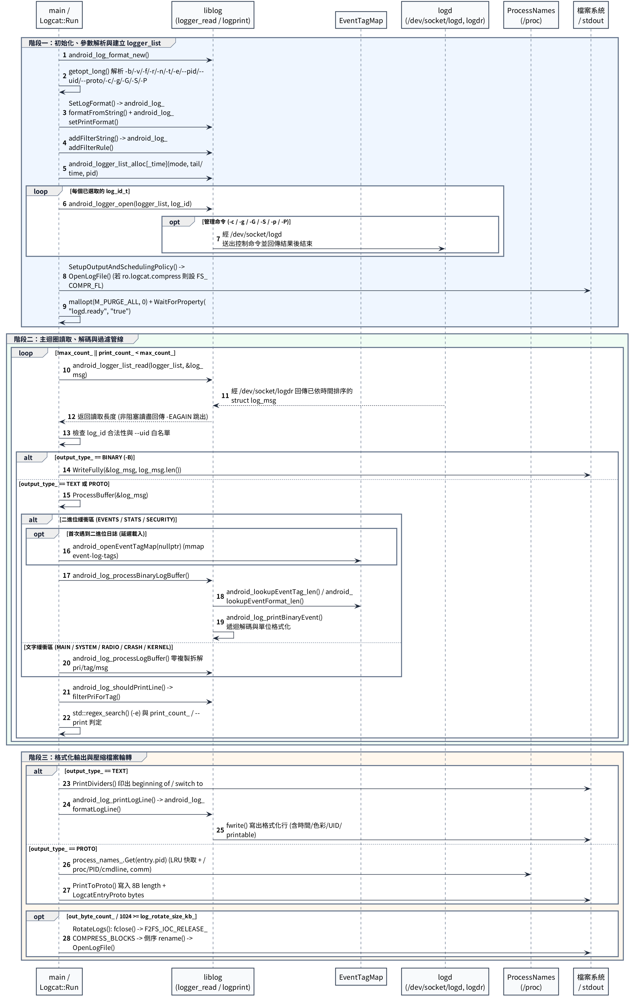

# 4.6 `logcat` 工具分析

- **情景說明**：開發者在終端機執行 `adb logcat -b main,system -v threadtime MyTag:D *:S`（或結合 `-f`/`-r`/`-n` 進行檔案輪轉、`-b events -v descriptive` 進行二進位事件解碼、`--proto` 輸出 Protobuf 串流、`-L` 讀取上次重啟前 `pstore` 日誌，以及 `-g`/`-G`/`-c`/`-S`/`-P` 控制 `logd`），追蹤 `/system/bin/logcat` 從啟動參數解析、建立 `liblog` 讀取器清單並連線 `logd`、主迴圈讀取與過濾，到格式化輸出與檔案輪轉的完整執行流程。
- **對應原書**：第 4 章 4.6 節〈Logcat 工具分析〉（p.118–151；4.6.1 p.119、4.6.2 p.123、4.6.3 p.135、4.6.4 p.140）
- **涉及專案與版本基準**：
  - `platform/system/logging` 〔`android-17.0.0_r1`，commit `d35ba62`〕

---

## 4.6.1 `logcat` 核心資料結構

> 對應原書 4.6.1〈基础数据结构〉（p.119–123）。在 Android 2.3 中，`logcat` 直接打開多個 `/dev/log/*` 字元裝置，因此在客戶端自行定義了 `struct queued_entry_t` 與 `struct log_device_t` 來維護每個裝置的排序佇列，並以大量全域變數保存執行狀態。Android 17 將多緩衝區的時間排序與多工串流下推至 `logd` 服務端（經 `liblog` 的 `logger_list` 暴露），`logcat` 本身則重構為單一的 `class Logcat`，並新增了 `OutputType`、`LogcatEntryProto` 與 `ProcessNames`，同時大幅擴充了 `liblog` 的 `AndroidLogFormat` 與 `EventTagMap`。

### Step 1：`OutputType` 與 `class Logcat`

**位置**：`platform/system/logging/logcat/logcat.cpp` 〔`android-17.0.0_r1`，lines 79–143〕

```cpp
namespace {
enum OutputType {
    TEXT,    // Human-readable formatted
    BINARY,  // Raw struct log_msg as obtained from logd
    PROTO    // Protobuffer format. See logcat.proto for details. Each message is prefixed with
             // 8 bytes (little endian) size of the message.
};
}  // namespace

class Logcat {
  public:
    int Run(int argc, char** argv);

  private:
    FILE* OpenLogFile(const char* path);
    void RotateLogs();
    void ProcessBuffer(struct log_msg* buf);
    LogcatPriorityProto GetProtoPriority(const AndroidLogEntry& entry);
    uint64_t PrintToProto(const AndroidLogEntry& entry);
    void PrintDividers(log_id_t log_id, bool print_dividers);
    void SetupOutputAndSchedulingPolicy(bool blocking);
    int SetLogFormat(const char* format_string);
    void WriteFully(const void* p, size_t n) {
        if (fwrite(p, 1, n, output_file_) != n) {
            error(EXIT_FAILURE, errno, "Write to output file failed");
        }
    }

    const bool kCompressLogcat = android::base::GetBoolProperty("ro.logcat.compress", false);

    // Used for all options
    std::unique_ptr<AndroidLogFormat, decltype(&android_log_format_free)> logformat_{
            android_log_format_new(), &android_log_format_free};
    // This isn't a unique_ptr because it's usually stdout;
    // stdio's atexit handler ensures we flush on exit.
    FILE* output_file_ = stdout;

    // For logging to a file and log rotation
    const char* output_file_name_ = nullptr;
    size_t log_rotate_size_kb_ = 0;                       // 0 means "no log rotation"
    size_t max_rotated_logs_ = DEFAULT_MAX_ROTATED_LOGS;  // 0 means "unbounded"
    uint64_t out_byte_count_ = 0;

    enum OutputType output_type_ = TEXT;

    // For binary log buffers
    std::unique_ptr<EventTagMap, decltype(&android_closeEventTagMap)> event_tag_map_{
            nullptr, &android_closeEventTagMap};
    bool has_opened_event_tag_map_ = false;

    // For the related --regex, --max-count, --print
    std::unique_ptr<std::regex> regex_;
    size_t max_count_ = 0;  // 0 means "infinite"
    size_t print_count_ = 0;
    bool print_it_anyway_ = false;

    // For PrintDividers()
    bool print_dividers_ = false;
    log_id_t last_printed_id_ = LOG_ID_MAX;
    bool printed_start_[LOG_ID_MAX] = {};

    bool debug_ = false;

    ProcessNames process_names_;
};
```

`class Logcat` 將原本散落於 `logcat.cpp` 全域空間的狀態完整收攏並改以 RAII 管理：
1. **三種輸出模式（`OutputType`）**：除傳統人類可讀的 `TEXT` 與原始二進位 `BINARY`（原書的 `g_printBinary`）外，新增 `PROTO`（`--proto`），供 Android Studio / 自動化工具直接消費結構化日誌串流，每筆訊息前會加上 8-byte little-endian 長度前綴。
2. **資源管理與輸出緩衝**：`logformat_` 與 `event_tag_map_` 改用附帶自訂 deleter 的 `std::unique_ptr`；輸出目標從 POSIX 原始檔案描述符 `int g_outFD` 改為 C 標準 I/O `FILE* output_file_ = stdout`，既減少高頻寫入時的 `write()` 系統呼叫次數，也能仰賴 stdio 的 `atexit` handler 在退出時自動 flush。
3. **檔案壓縮開關**：`kCompressLogcat` 讀取唯讀系統屬性 `ro.logcat.compress`（預設 `false`），決定輸出到檔案並輪轉時是否啟用 F2FS 檔案系統層壓縮（詳見 4.6.4）。
4. **延遲載入 `EventTagMap`**：`event_tag_map_` 初始為 `nullptr`，搭配 `has_opened_event_tag_map_` 旗標，直到真正讀到二進位緩衝區（`events`/`stats`/`security`）時才開啟一次，避免一般文字日誌查詢白白執行 `mmap` 與解析。
5. **進階過濾與分隔狀態**：`regex_`、`max_count_`、`print_count_`、`print_it_anyway_` 支撐 `-e`/`-m`/`--print` 組合；`printed_start_[LOG_ID_MAX]` 與 `last_printed_id_` 追蹤每個緩衝區是否已印出 `--------- beginning of <buf>` 或需印出 `--------- switch to <buf>`；`process_names_` 則在 Protobuf 輸出時負責將 PID 對應為行程名稱。

> 〔與 2.3 差異〕**已移除 + 邏輯改變**：原書 4.6.1 中的 `struct queued_entry_t`（p.119–120）與 `struct log_device_t`（p.120–121）已完全移除，不再由 `logcat` 維護每個裝置的檔案描述符與鏈結佇列；所有全域變數 `g_*`（原書 p.123）改為 `class Logcat` 的私有成員，且新增 `PROTO` 輸出、`std::regex`、F2FS 壓縮與 `ProcessNames`。

---

### Step 2：`AndroidLogPrintFormat` 與 `AndroidLogEntry`

**位置**：`platform/system/logging/liblog/include/log/logprint.h` 〔`android-17.0.0_r1`，lines 30–70〕

```cpp
typedef enum {
  /* Verbs */
  FORMAT_OFF = 0,
  FORMAT_BRIEF,
  FORMAT_PROCESS,
  FORMAT_TAG,
  FORMAT_THREAD,
  FORMAT_RAW,
  FORMAT_TIME,
  FORMAT_THREADTIME,
  FORMAT_LONG,
  /* Adverbs. The following are modifiers to above format verbs */
  FORMAT_MODIFIER_COLOR,     /* converts priority to color */
  FORMAT_MODIFIER_TIME_USEC, /* switches from msec to usec time precision */
  FORMAT_MODIFIER_PRINTABLE, /* converts non-printable to printable escapes */
  FORMAT_MODIFIER_YEAR,      /* Adds year to date */
  FORMAT_MODIFIER_ZONE,      /* Adds zone to date, + UTC */
  FORMAT_MODIFIER_EPOCH,     /* Print time as seconds since Jan 1 1970 */
  FORMAT_MODIFIER_MONOTONIC, /* Print cpu time as seconds since start */
  FORMAT_MODIFIER_UID,       /* Adds uid */
  FORMAT_MODIFIER_DESCRIPT,  /* Adds descriptive */
  /* private, undocumented */
  FORMAT_MODIFIER_TIME_NSEC, /* switches from msec to nsec time precision */
} AndroidLogPrintFormat;

typedef struct AndroidLogFormat_t AndroidLogFormat;

typedef struct AndroidLogEntry_t {
  time_t tv_sec;
  long tv_nsec;
  android_LogPriority priority;
  int32_t uid;
  int32_t pid;
  int32_t tid;
  const char* tag;
  size_t tagLen;
  // Message length does not include the null terminator in "message".
  size_t messageLen;
  // Must be null terminated.
  const char* message;
} AndroidLogEntry;
```

- **`AndroidLogPrintFormat`** 將格式選項區分為**動詞（Verbs）**與**副詞修飾子（Adverbs）**：同一時間只生效一種主要排版動詞（如 `FORMAT_THREADTIME`），但可自由疊加多個副詞修飾子（如 `color`、`usec`、`year`、`uid`、`printable`、`descriptive`、`zone`、`epoch`、`monotonic` 與未公開的 `nsec`）。
- **`AndroidLogEntry`** 代表解碼後的單筆日誌抽象結構：其中的 `tag` 與 `message` 指標通常直接指向原始 `logger_entry` payload 或二進位解碼緩衝區（零複製設計），並明確保存 `uid` 與 `tagLen`（配合 `EventTagMap` 改用非 NUL 結尾的 `std::string_view`）。

> 〔與 2.3 差異〕**改名搬家 + 擴充**：標頭檔由 `system/core/include/cutils/logprint.h` 搬遷至 `platform/system/logging/liblog/include/log/logprint.h`（原書 p.121–122）。`AndroidLogPrintFormat` 新增 10 個 `FORMAT_MODIFIER_*` 修飾子；`AndroidLogEntry` 新增 `int32_t uid`（來自 v4 `logger_entry`）與 `size_t tagLen`。

---

### Step 3：`FilterInfo` 與 `AndroidLogFormat_t`

**位置**：`platform/system/logging/liblog/logprint.cpp` 〔`android-17.0.0_r1`，lines 47–73〕

```cpp
typedef struct FilterInfo_t {
  char* mTag;
  android_LogPriority mPri;
  struct FilterInfo_t* p_next;
} FilterInfo;

struct AndroidLogFormat_t {
  android_LogPriority global_pri;
  FilterInfo* filters;
  AndroidLogPrintFormat format;
  bool colored_output;
  bool usec_time_output;
  bool nsec_time_output;
  bool printable_output;
  bool year_output;
  bool zone_output;
  bool epoch_output;
  bool monotonic_output;
  bool uid_output;
  bool descriptive_output;
};

/*
 * API issues prevent us from exposing "descriptive" in AndroidLogFormat_t
 * during android_log_processBinaryLogBuffer(), so we break layering.
 */
static bool descriptive_output = false;
```

`AndroidLogFormat_t` 對外是不透明結構（opaque struct），其內部維護三部分狀態：
1. **過濾器狀態**：`global_pri` 儲存萬用規則（`*:<pri>`，初始為 `ANDROID_LOG_VERBOSE`），`filters` 是單向鏈結串列，每個 `FilterInfo` 節點記錄一條 `<tag>:<pri>` 規則。
2. **主排版格式**：`format` 記錄當前生效的 verb。
3. **10 個布林修飾子旗標**：對應 `FORMAT_MODIFIER_*`。值得注意的是第 73 行的靜態全域變數 `static bool descriptive_output`：因為公開 C API `android_log_processBinaryLogBuffer()` 的參數列並不接收 `AndroidLogFormat*`，為了相容既有 ABI，`liblog` 只好額外維護一份檔內靜態布林值，在 `android_log_setPrintFormat(..., FORMAT_MODIFIER_DESCRIPT)` 時同步設為 `true`。

> 〔與 2.3 差異〕**搬家 + 擴充**：檔案由 `system/core/liblog/logprint.c` 改為 C++ 檔案 `platform/system/logging/liblog/logprint.cpp`（原書 p.122）。`FilterInfo_t` 結構維持不變；`AndroidLogFormat_t` 新增 10 個修飾子布林欄位與跨 API 層用的靜態 `descriptive_output`。

---

### Step 4：`EventTagMap`（二進位事件標籤對照表）

**位置**：`platform/system/logging/liblog/event_tag_map.cpp` 〔`android-17.0.0_r1`，lines 40–75〕

```cpp
typedef std::pair<std::string_view, std::string_view> TagFmt;

// Map
struct EventTagMap {
#define NUM_MAPS 2
  // memory-mapped source file; we get strings from here
  void* mapAddr[NUM_MAPS];
  size_t mapLen[NUM_MAPS];

 private:
  std::unordered_map<uint32_t, TagFmt> Idx2TagFmt;
  std::unordered_map<std::string_view, uint32_t> Tag2Idx;
  // protect unordered sets
  android::RWLock rwlock;

 public:
  EventTagMap() {
    memset(mapAddr, 0, sizeof(mapAddr));
    memset(mapLen, 0, sizeof(mapLen));
  }

  ~EventTagMap() {
    Idx2TagFmt.clear();
    Tag2Idx.clear();
    for (size_t which = 0; which < NUM_MAPS; ++which) {
      if (mapAddr[which]) {
        munmap(mapAddr[which], mapLen[which]);
        mapAddr[which] = 0;
      }
    }
  }

  bool emplaceUnique(uint32_t tag, const TagFmt& tagfmt, bool verbose = false);
  const TagFmt* find(uint32_t tag) const;
  int find(std::string_view tag) const;
};
```

`EventTagMap` 負責把二進位事件日誌裡的整數 `tagIndex` 映射回可讀的標籤名稱與欄位格式描述（例如 `30005 am_create_activity (User|1|5),(Token|1|5),...`）：
- **雙檔案記憶體映射（`NUM_MAPS = 2`）**：可同時 `mmap` 靜態檔案 `/system/etc/event-log-tags`（`EVENT_TAG_MAP_FILE`）與動態產生的 `/dev/event-log-tags`，在析構時統一 `munmap`。
- **零複製 `std::string_view` 與雙向雜湊表**：`TagFmt` 是 `pair<tag名稱, 格式描述>`，兩者的字元指標直接指向 `mmap` 映射區而無需額外配置字串記憶體；`Idx2TagFmt` 供讀取端以 O(1) 透過整數 tag 反查名稱與格式，`Tag2Idx` 則支援以名稱查整數 tag，並透過 `android::RWLock` 確保多執行緒讀寫安全。

> 〔與 2.3 差異〕**邏輯改變**：原書 4.6.1（p.122–123）的 `EventTagMap` 僅映射單一檔案，內部使用固定長度的 `EventTag* tagArray` 陣列，初始化時需要 `qsort` 排序，查詢時做 O(log N) 二分搜尋且不保存格式描述字串（`fmt`）；Android 17 改為雙 `mmap` + `std::unordered_map` O(1) 雙向查詢 + `RWLock` + 完整保留格式描述以支援 `-v descriptive`。

---

### Step 5：`LogcatEntryProto` 與 `ProcessNames`

**位置**：`platform/system/logging/logcat/logcat.proto` 〔`android-17.0.0_r1`，lines 1–29〕

```protobuf
syntax = "proto3";

package com.android.logcat.proto;
option java_multiple_files = true;
option optimize_for = LITE_RUNTIME;

enum LogcatPriorityProto {
  UNKNOWN = 0;
  DEFAULT = 1;
  VERBOSE = 2;
  DEBUG = 3;
  INFO = 4;
  WARN = 5;
  ERROR = 6;
  FATAL = 8;
  SILENT = 9;
}

message LogcatEntryProto {
  uint64 time_sec = 1;
  uint64 time_nsec = 2;
  LogcatPriorityProto priority = 3;
  uint64 uid = 4;
  uint64 pid = 5;
  uint64 tid = 6;
  bytes tag = 7;
  bytes message = 8;
  optional string process_name = 9;
}
```

使用 `--proto` 輸出時，`logcat` 會將 `AndroidLogEntry` 轉成 `LogcatEntryProto`（使用 `LITE_RUNTIME` 連結 `libprotobuf-cpp-lite` 以控制二進位體積）。由於原始 `logger_entry` 只帶 `pid` 而不含行程名稱，`logcat` 另外實作了 `ProcessNames` 快取類別：

**位置**：`platform/system/logging/logcat/process_names.h` 〔`android-17.0.0_r1`，lines 24–52〕

```cpp
// An interface to associate pid to a name. Implemented by looking up /proc/PID.
// To lower syscall impact, results are cached.
class ProcessNames {
  public:
    ProcessNames() : cache(kMaxCacheEntries) {}

    ~ProcessNames() = default;

    // Returns the executable name or in the case of an app, the package name associated
    // with a process pid.
    std::string Get(uint64_t pid);

  private:
    const std::string ReadCmdline(uint64_t pid);
    const std::string ReadComm(uint64_t pid);
    const std::string Resolve(uint64_t pid);

    // kMaxCacheEntries should be picked to keep the memory footprint low (1) and yield a
    // high cache hit rate (2).
...
    static const uint64_t kMaxCacheEntries = 100;
    android::LruCache<uint64_t, std::string> cache;
};
```

`ProcessNames` 內建容量為 100 筆的 `android::LruCache`（約 2 KiB 記憶體），大幅降低頻繁讀取 `/proc/<pid>/cmdline` 與 `/proc/<pid>/comm` 的系統呼叫開銷（實際解析與 Zygote 過渡態處理詳見 4.6.4）。

> 〔與 2.3 差異〕**新增**：`logcat.proto` 與 `ProcessNames` 均為 Android 17（現代 AOSP）新增功能，原書 2.3 沒有 Protobuf 輸出與行程名稱解析。

---

## 4.6.2 `logcat` 初始化與命令列參數解析

> 對應原書 4.6.2〈初始化过程〉（p.123–135）。原書的 `main()` 直接解析短選項、開啟 `/dev/log/*` 並對驅動執行 `ioctl(LOGGER_FLUSH_LOG)` / `LOGGER_GET_LOG_LEN`，最後預載 `EventTagMap` 進入 `readLogLines`。Android 17 的 `main()` 僅負責實例化 `Logcat` 並呼叫 `Logcat::Run(argc, argv)`，完整涵蓋長短選項解析、緩衝區 bitmask 建構、格式與過濾規則註冊、`liblog` `logger_list` 配置、`logd` 管理命令、輸出檔與背景排程初始化，以及等待 `logd.ready` 屬性。

### Step 1：入口函式 `main()` 與 `Logcat::Run()` 命令列解析

**位置**：`platform/system/logging/logcat/logcat.cpp` 〔`android-17.0.0_r1`，lines 1224–1227〕

```cpp
int main(int argc, char** argv) {
    Logcat logcat;
    return logcat.Run(argc, argv);
}
```

接著進入 `Logcat::Run()`，初始化控制旗標與 `getopt_long` 迴圈：

**位置**：`platform/system/logging/logcat/logcat.cpp` 〔`android-17.0.0_r1`，lines 613–745〕

```cpp
int Logcat::Run(int argc, char** argv) {
    bool hasSetLogFormat = false;
    bool clearLog = false;
    bool security_buffer_selected =
            false;  // Do not report errors on the security buffer unless it is explicitly named.
    bool getLogSize = false;
    bool getPruneList = false;
    bool printStatistics = false;
    unsigned long setLogSize = 0;
    const char* setPruneList = nullptr;
    const char* setId = nullptr;
    int mode = 0;
    std::string forceFilters;
    size_t tail_lines = 0;
    log_time tail_time(log_time::EPOCH);
    size_t pid = 0;
    bool got_t = false;
    unsigned id_mask = 0;
    std::set<uid_t> uids;

    if (argc == 2 && !strcmp(argv[1], "--help")) {
        show_help();
        return EXIT_SUCCESS;
    }

    // meant to catch comma-delimited values, but cast a wider
    // net for stability dealing with possible mistaken inputs.
    static const char delimiters[] = ",:; \t\n\r\f";

    optind = 0;
    while (true) {
        int option_index = 0;
        // list of long-argument only strings for later comparison
        static const char pid_str[] = "pid";
        static const char debug_str[] = "debug";
        static const char id_str[] = "id";
        static const char wrap_str[] = "wrap";
        static const char print_str[] = "print";
        static const char uid_str[] = "uid";
        static const char proto_str[] = "proto";
        // clang-format off
        static const struct option long_options[] = {
          { "binary",        no_argument,       nullptr, 'B' },
          { "buffer",        required_argument, nullptr, 'b' },
          { "buffer-size",   optional_argument, nullptr, 'g' },
          { "clear",         no_argument,       nullptr, 'c' },
          { debug_str,       no_argument,       nullptr, 0 },
          { "dividers",      no_argument,       nullptr, 'D' },
          { "file",          required_argument, nullptr, 'f' },
          { "format",        required_argument, nullptr, 'v' },
          // hidden and undocumented reserved alias for --regex
          { "grep",          required_argument, nullptr, 'e' },
          // hidden and undocumented reserved alias for --max-count
          { "head",          required_argument, nullptr, 'm' },
          { "help",          no_argument,       nullptr, 'h' },
          { id_str,          required_argument, nullptr, 0 },
          { "last",          no_argument,       nullptr, 'L' },
          { "max-count",     required_argument, nullptr, 'm' },
          { pid_str,         required_argument, nullptr, 0 },
          { print_str,       no_argument,       nullptr, 0 },
          { "prune",         optional_argument, nullptr, 'p' },
          { proto_str,         no_argument,       nullptr, 0 },
          { "regex",         required_argument, nullptr, 'e' },
          { "rotate-count",  required_argument, nullptr, 'n' },
          { "rotate-kbytes", required_argument, nullptr, 'r' },
          { "statistics",    no_argument,       nullptr, 'S' },
          // hidden and undocumented reserved alias for -t
          { "tail",          required_argument, nullptr, 't' },
          { uid_str,         required_argument, nullptr, 0 },
          // support, but ignore and do not document, the optional argument
          { wrap_str,        optional_argument, nullptr, 0 },
          { nullptr,         0,                 nullptr, 0 }
        };
        // clang-format on

        int c = getopt_long(argc, argv, ":cdDhLt:T:gG:sQf:r:n:v:b:BSpP:m:e:", long_options,
                            &option_index);
        if (c == -1) break;

        switch (c) {
            case 0:
                // only long options
                if (long_options[option_index].name == pid_str) {
                    if (pid != 0) {
                        error(EXIT_FAILURE, 0, "Only one --pid argument can be provided.");
                    }

                    if (!ParseUint(optarg, &pid) || pid < 1) {
                        error(EXIT_FAILURE, 0, "pid '%s' out of range.", optarg);
                    }
                    break;
                }
                if (long_options[option_index].name == wrap_str) {
                    mode |= ANDROID_LOG_WRAP | ANDROID_LOG_NONBLOCK;
...
                    break;
                }
                if (long_options[option_index].name == print_str) {
                    print_it_anyway_ = true;
                    break;
                }
                if (long_options[option_index].name == debug_str) {
                    debug_ = true;
                    break;
                }
                if (long_options[option_index].name == id_str) {
                    setId = (optarg && optarg[0]) ? optarg : nullptr;
                }
                if (long_options[option_index].name == uid_str) {
                    auto uid_strings = Split(optarg, delimiters);
                    for (const auto& uid_string : uid_strings) {
                        uid_t uid;
                        if (!ParseUint(uid_string, &uid)) {
                            error(EXIT_FAILURE, 0, "Unable to parse UID '%s'", uid_string.c_str());
                        }
                        uids.emplace(uid);
                    }
                    break;
                }
                if (long_options[option_index].name == proto_str) {
                    output_type_ = PROTO;
                    break;
                }
                break;
```

繼續看主要短選項的處理分支：

**位置**：`platform/system/logging/logcat/logcat.cpp` 〔`android-17.0.0_r1`，lines 746–923〕

```cpp
            case 's':
                // default to all silent
                android_log_addFilterRule(logformat_.get(), "*:s");
                break;

            case 'c':
                clearLog = true;
                break;

            case 'L':
                mode |= ANDROID_LOG_PSTORE | ANDROID_LOG_NONBLOCK;
                break;

            case 'd':
                mode |= ANDROID_LOG_NONBLOCK;
                break;

            case 't':
                got_t = true;
                mode |= ANDROID_LOG_NONBLOCK;
                FALLTHROUGH_INTENDED;
            case 'T':
                if (strspn(optarg, "0123456789") != strlen(optarg)) {
                    char* cp = parseTime(tail_time, optarg);
                    if (!cp) {
                        error(EXIT_FAILURE, 0, "-%c '%s' not in time format.", c, optarg);
                    }
...
                } else {
                    if (!ParseUint(optarg, &tail_lines) || tail_lines < 1) {
                        fprintf(stderr, "WARNING: -%c %s invalid, setting to 1\n", c, optarg);
                        tail_lines = 1;
                    }
                }
                break;

            case 'D':
                print_dividers_ = true;
                break;

            case 'e':
                regex_.reset(new std::regex(optarg));
                break;

            case 'm': {
                if (!ParseUint(optarg, &max_count_) || max_count_ < 1) {
                    error(EXIT_FAILURE, 0, "-%c '%s' isn't an integer greater than zero.", c,
                          optarg);
                }
            } break;

            case 'g':
                if (!optarg) {
                    getLogSize = true;
                    break;
                }
                FALLTHROUGH_INTENDED;

            case 'G': {
                if (!ParseByteCount(optarg, &setLogSize) || setLogSize < 1) {
                    error(EXIT_FAILURE, 0, "-G must be specified as <num><multiplier>.");
                }
            } break;

            case 'p':
                if (!optarg) {
                    getPruneList = true;
                    break;
                }
                FALLTHROUGH_INTENDED;

            case 'P':
                setPruneList = optarg;
                break;

            case 'b':
                for (const auto& buffer : Split(optarg, delimiters)) {
                    if (buffer == "default") {
                        id_mask |= (1 << LOG_ID_MAIN) | (1 << LOG_ID_SYSTEM) | (1 << LOG_ID_CRASH);
                    } else if (buffer == "all") {
                        id_mask = -1;
                    } else {
                        log_id_t log_id = android_name_to_log_id(buffer.c_str());
                        if (!__android_log_id_is_valid(log_id)) {
                            error(EXIT_FAILURE, 0, "Unknown -b buffer '%s'.", buffer.c_str());
                        }
                        if (log_id == LOG_ID_SECURITY) {
                            security_buffer_selected = true;
                        }
                        id_mask |= (1 << log_id);
                    }
                }
                break;

            case 'B':
                output_type_ = BINARY;
                break;

            case 'f':
                if ((tail_time == log_time::EPOCH) && !tail_lines) {
                    tail_time = lastLogTime(optarg);
                }
                // redirect output to a file
                output_file_name_ = optarg;
                break;

            case 'r':
                if (!ParseUint(optarg, &log_rotate_size_kb_) || log_rotate_size_kb_ < 1) {
                    error(EXIT_FAILURE, 0, "Invalid -r '%s'.", optarg);
                }
                break;

            case 'n':
                if (!ParseUint(optarg, &max_rotated_logs_) || max_rotated_logs_ < 1) {
                    error(EXIT_FAILURE, 0, "Invalid -n '%s'.", optarg);
                }
                break;

            case 'v':
                for (const auto& arg : Split(optarg, delimiters)) {
                    int err = SetLogFormat(arg.c_str());
                    if (err < 0) {
                        error(EXIT_FAILURE, 0, "Invalid -v '%s'.", arg.c_str());
                    }
                    if (err) hasSetLogFormat = true;
                }
                break;

            case 'S':
                printStatistics = true;
                break;
...
    }

    if (max_count_ && got_t) {
        error(EXIT_FAILURE, 0, "Cannot use -m (--max-count) and -t together.");
    }
...
    // If no buffers are specified, default to using these buffers.
    if (id_mask == 0) {
        id_mask = (1 << LOG_ID_MAIN) | (1 << LOG_ID_SYSTEM) | (1 << LOG_ID_CRASH) |
                  (1 << LOG_ID_KERNEL);
    }

    if (log_rotate_size_kb_ != 0 && !output_file_name_) {
        error(EXIT_FAILURE, 0, "-r requires -f as well.");
    }
```

上述參數解析體現了 Android 17 `logcat` 的幾個關鍵設計：
1. **緩衝區位元遮罩（`-b`）**：不再像 2.3 那樣組裝 `/dev/log/<name>` 路徑並即時建立 `log_device_t`，而是透過 `android_name_to_log_id()` 將緩衝區名稱轉成 `log_id_t` 並累積到 `id_mask`。未指定 `-b` 時預設同時開啟 `main`、`system`、`crash`、`kernel` 四個緩衝區（注意：`-b default` 只含 `main|system|crash`，不含 `kernel`）；而 `security` 緩衝區僅在顯式指定時才開啟錯誤上報（`security_buffer_selected`），避免非 Device Owner 環境下 `-b all` 報錯失敗。
2. **時間與行數尾端定位（`-t` / `-T`）**：`-t` 隱含 `-d`（`ANDROID_LOG_NONBLOCK`，印完即退），`-T` 則保持阻塞持續監聽；參數若全為數字視為行數 `tail_lines`，否則由 `parseTime()` 依序嘗試 `MM-DD HH:MM:SS.q`、`YYYY-MM-DD HH:MM:SS.q`、`s.q` 轉成 `tail_time`。
3. **跨重啟不重複續寫（`-f` + `lastLogTime`）**：當指定 `-f <file>` 且未給定 `-t`/`-T` 時，呼叫 `lastLogTime(optarg)` 掃描 `<file>` 與 `<file>.1` 中最後一行合法時間戳並向上進位一個精度單位（`retval += modulo`），設為 `tail_time`，讓持久記錄服務（如 `logpersist`/`logcatd`）重啟後能無縫續接，不會重複輸出舊日誌。
4. **`pstore` 重啟前日誌（`-L`）**：設入 `ANDROID_LOG_PSTORE | ANDROID_LOG_NONBLOCK`，使 `liblog` 改由 `pmsg_reader.cpp` 讀取 `/sys/fs/pstore/pmsg-ramoops-0` 而非連線 `logd`。
5. **PID 與 UID 過濾分層**：`--pid` 會直接傳給 `android_logger_list_alloc*`，由 `logd` 服務端在發送前過濾以節省 IPC 頻寬；`--uid` 則存入本地 `std::set<uid_t> uids`，在客戶端主迴圈中比對 `log_msg.entry.uid`。

---

### Step 2：格式解析（`-v`）與過濾規則註冊（`FILTERSPEC`）

當 `-v` 傳入逗號分隔的格式串（例如 `-v threadtime,uid,color,usec`）時，逐項呼叫 `Logcat::SetLogFormat()`：

**位置**：`platform/system/logging/logcat/logcat.cpp` 〔`android-17.0.0_r1`，lines 510–517〕

```cpp
int Logcat::SetLogFormat(const char* format_string) {
    AndroidLogPrintFormat format = android_log_formatFromString(format_string);

    // invalid string?
    if (format == FORMAT_OFF) return -1;

    return android_log_setPrintFormat(logformat_.get(), format);
}
```

`android_log_formatFromString()` 與 `android_log_setPrintFormat()` 位於 `liblog/logprint.cpp`：

**位置**：`platform/system/logging/liblog/logprint.cpp` 〔`android-17.0.0_r1`，lines 250–355〕

```cpp
int android_log_setPrintFormat(AndroidLogFormat* p_format, AndroidLogPrintFormat format) {
  switch (format) {
    case FORMAT_MODIFIER_COLOR:
      p_format->colored_output = true;
      return 0;
    case FORMAT_MODIFIER_TIME_USEC:
      p_format->usec_time_output = true;
      return 0;
    case FORMAT_MODIFIER_TIME_NSEC:
      p_format->nsec_time_output = true;
      return 0;
    case FORMAT_MODIFIER_PRINTABLE:
      p_format->printable_output = true;
      return 0;
    case FORMAT_MODIFIER_YEAR:
      p_format->year_output = true;
      return 0;
    case FORMAT_MODIFIER_ZONE:
      p_format->zone_output = !p_format->zone_output;
      return 0;
    case FORMAT_MODIFIER_EPOCH:
      p_format->epoch_output = true;
      return 0;
    case FORMAT_MODIFIER_MONOTONIC:
      p_format->monotonic_output = true;
      return 0;
    case FORMAT_MODIFIER_UID:
      p_format->uid_output = true;
      return 0;
    case FORMAT_MODIFIER_DESCRIPT:
      p_format->descriptive_output = true;
      descriptive_output = true;
      return 0;
    default:
      break;
  }
  p_format->format = format;
  return 1;
}
...
AndroidLogPrintFormat android_log_formatFromString(const char* formatString) {
  /* clang-format off */
  if (!strcmp(formatString, "brief")) return FORMAT_BRIEF;
  if (!strcmp(formatString, "process")) return FORMAT_PROCESS;
  if (!strcmp(formatString, "tag")) return FORMAT_TAG;
  if (!strcmp(formatString, "thread")) return FORMAT_THREAD;
  if (!strcmp(formatString, "raw")) return FORMAT_RAW;
  if (!strcmp(formatString, "time")) return FORMAT_TIME;
  if (!strcmp(formatString, "threadtime")) return FORMAT_THREADTIME;
  if (!strcmp(formatString, "long")) return FORMAT_LONG;
  if (!strcmp(formatString, "color")) return FORMAT_MODIFIER_COLOR;
  if (!strcmp(formatString, "colour")) return FORMAT_MODIFIER_COLOR;
  if (!strcmp(formatString, "usec")) return FORMAT_MODIFIER_TIME_USEC;
  if (!strcmp(formatString, "nsec")) return FORMAT_MODIFIER_TIME_NSEC;
  if (!strcmp(formatString, "printable")) return FORMAT_MODIFIER_PRINTABLE;
  if (!strcmp(formatString, "year")) return FORMAT_MODIFIER_YEAR;
  if (!strcmp(formatString, "zone")) return FORMAT_MODIFIER_ZONE;
  if (!strcmp(formatString, "epoch")) return FORMAT_MODIFIER_EPOCH;
  if (!strcmp(formatString, "monotonic")) return FORMAT_MODIFIER_MONOTONIC;
  if (!strcmp(formatString, "uid")) return FORMAT_MODIFIER_UID;
  if (!strcmp(formatString, "descriptive")) return FORMAT_MODIFIER_DESCRIPT;
    /* clang-format on */

#if !defined(__MINGW32__)
  // Check whether the format string is actually a time zone. If tzname[0]
  // is the empty string, that's tzset() signalling that it doesn't know
  // the requested timezone.
  TzSetter tz(formatString);
  if (!*tzname[0]) {
    tz.Reset();
  } else {
    // We keep the new time zone as a side effect!
    return FORMAT_MODIFIER_ZONE;
  }
#endif

  return FORMAT_OFF;
}
```

這裡有一個精巧的回傳值設計：`android_log_setPrintFormat()` 設定副詞修飾子時回傳 `0`，設定主要動詞時才回傳 `1`。因此在 `Logcat::Run()` 中，若使用者僅輸入 `logcat -v color,usec`（未指定主要動詞），`hasSetLogFormat` 仍為 `false`，接著便會套用預設格式：

**位置**：`platform/system/logging/logcat/logcat.cpp` 〔`android-17.0.0_r1`，lines 938–978〕

```cpp
    if (!hasSetLogFormat) {
        const char* logFormat = getenv("ANDROID_PRINTF_LOG");

        if (!!logFormat) {
            for (const auto& arg : Split(logFormat, delimiters)) {
                int err = SetLogFormat(arg.c_str());
                // environment should not cause crash of logcat
                if (err < 0) {
                    fprintf(stderr, "invalid format in ANDROID_PRINTF_LOG '%s'\n", arg.c_str());
                }
                if (err > 0) hasSetLogFormat = true;
            }
        }
        if (!hasSetLogFormat) {
            SetLogFormat("threadtime");
        }
    }

    if (forceFilters.size()) {
        if (!addFilterString(logformat_.get(), forceFilters)) {
            error(EXIT_FAILURE, 0, "Invalid filter expression '%s' in logcat args.",
                  forceFilters.c_str());
        }
    } else if (argc == optind) {
        // Add from environment variable
        const char* env_tags_orig = getenv("ANDROID_LOG_TAGS");

        if (!!env_tags_orig) {
            if (!addFilterString(logformat_.get(), env_tags_orig)) {
                error(EXIT_FAILURE, 0, "Invalid filter expression '%s' in ANDROID_LOG_TAGS.",
                      env_tags_orig);
            }
        }
    } else {
        // Add from commandline
        for (int i = optind ; i < argc ; i++) {
            if (!addFilterString(logformat_.get(), argv[i])) {
                error(EXIT_FAILURE, 0, "Invalid filter expression '%s'.", argv[i]);
            }
        }
    }
```

此外，若 `formatString` 不符合已知動詞或副詞，`android_log_formatFromString()` 還會以 `TzSetter` 嘗試將其當作時區名稱（如 `UTC` 或 `Asia/Taipei`）設定至 `$TZ` 並呼叫 `tzset()`；若成功則保留新時區並回傳 `FORMAT_MODIFIER_ZONE`。

過濾規則由 `logcat_utils.h` 的 `addFilterString()` 依空白或逗號切分後，逐條交給 `android_log_addFilterRule()`：

**位置**：`platform/system/logging/logcat/logcat_utils.h` 〔`android-17.0.0_r1`，lines 30–35〕

```cpp
static bool addFilterString(AndroidLogFormat* format, const std::string& filters) {
  for (const auto& filter : android::base::Split(filters, " \t,")) {
    if (!filter.empty() && android_log_addFilterRule(format, filter.c_str()) < 0) return false;
  }
  return true;
}
```

**位置**：`platform/system/logging/liblog/logprint.cpp` 〔`android-17.0.0_r1`，lines 366–428〕

```cpp
int android_log_addFilterRule(AndroidLogFormat* p_format, const char* filterExpression) {
  size_t tagNameLength;
  android_LogPriority pri = ANDROID_LOG_DEFAULT;

  tagNameLength = strcspn(filterExpression, ":");

  if (tagNameLength == 0) {
    goto error;
  }

  if (filterExpression[tagNameLength] == ':') {
    pri = filterCharToPri(filterExpression[tagNameLength + 1]);

    if (pri == ANDROID_LOG_UNKNOWN) {
      goto error;
    }
  }

  if (0 == strncmp("*", filterExpression, tagNameLength)) {
    /*
     * This filter expression refers to the global filter
     * The default level for this is DEBUG if the priority
     * is unspecified
     */
    if (pri == ANDROID_LOG_DEFAULT) {
      pri = ANDROID_LOG_DEBUG;
    }

    p_format->global_pri = pri;
  } else {
    /*
     * for filter expressions that don't refer to the global
     * filter, the default is verbose if the priority is unspecified
     */
    if (pri == ANDROID_LOG_DEFAULT) {
      pri = ANDROID_LOG_VERBOSE;
    }

    char* tagName;

/*
 * Presently HAVE_STRNDUP is never defined, so the second case is always taken
 * Darwin doesn't have strndup, everything else does
 */
#ifdef HAVE_STRNDUP
    tagName = strndup(filterExpression, tagNameLength);
#else
    /* a few extra bytes copied... */
    tagName = strdup(filterExpression);
    tagName[tagNameLength] = '\0';
#endif /*HAVE_STRNDUP*/

    FilterInfo* p_fi = filterinfo_new(tagName, pri);
    free(tagName);

    p_fi->p_next = p_format->filters;
    p_format->filters = p_fi;
  }

  return 0;
error:
  return -1;
}
```

規則語意與原書基本一致：
- `*` 單獨出現預設等級為 `DEBUG`，並覆寫 `p_format->global_pri`；
- 具名 `<tag>` 不帶 `:pri` 時預設等級為 `VERBOSE`，以**頭插法**插入 `p_format->filters`（因此命令列後方對同一 tag 的規則會優先命中）。

> 〔與 2.3 差異〕**邏輯改變**：原書 2.3 的預設輸出格式是 `FORMAT_BRIEF`（原書 p.124、`android_log_format_new` 之後未覆寫），Android 17 預設改為 `"threadtime"`（lines 951–953）；此外原書在 `liblog` 提供 `android_log_addFilterString()`（原書 p.129–130），Android 17 已將其簡化為 `logcat_utils.h` 中的 C++ 輔助函式 `addFilterString()`。

---

### Step 3：建立 `logger_list`、開啟緩衝區與執行管理操作

在處理完 `-L` / `-f` 搭配 `-c` 或 `--id` 的本機檔案清理後，`Logcat::Run()` 呼叫 `liblog` 讀取端介面配置 `logger_list` 並逐一開啟緩衝區：

**位置**：`platform/system/logging/logcat/logcat.cpp` 〔`android-17.0.0_r1`，lines 1033–1160〕

```cpp
    std::unique_ptr<logger_list, decltype(&android_logger_list_free)> logger_list{
            nullptr, &android_logger_list_free};
    if (tail_time != log_time::EPOCH) {
        logger_list.reset(android_logger_list_alloc_time(mode, tail_time, pid));
    } else {
        logger_list.reset(android_logger_list_alloc(mode, tail_lines, pid));
    }
    // We have three orthogonal actions below to clear, set log size and
    // get log size. All sharing the same iteration loop.
    std::vector<std::string> open_device_failures;
    std::vector<std::string> clear_failures;
    std::vector<std::string> set_size_failures;
    std::vector<std::string> get_size_failures;

    for (int i = LOG_ID_MIN; i < LOG_ID_MAX; ++i) {
        if (!(id_mask & (1 << i))) continue;
        const char* buffer_name = android_log_id_to_name(static_cast<log_id_t>(i));

        auto logger = android_logger_open(logger_list.get(), static_cast<log_id_t>(i));
        if (logger == nullptr) {
            ReportErrorName(buffer_name, security_buffer_selected, &open_device_failures);
            continue;
        }

        if (clearLog) {
            if (android_logger_clear(logger)) {
                ReportErrorName(buffer_name, security_buffer_selected, &clear_failures);
            }
        }

        if (setLogSize) {
            if (android_logger_set_log_size(logger, setLogSize)) {
                ReportErrorName(buffer_name, security_buffer_selected, &set_size_failures);
            }
        }

        if (getLogSize) {
            long size = android_logger_get_log_size(logger);
            long readable = android_logger_get_log_readable_size(logger);
            long consumed = android_logger_get_log_consumed_size(logger);

            if (size < 0 || readable < 0) {
                ReportErrorName(buffer_name, security_buffer_selected, &get_size_failures);
            } else {
                auto size_format = format_of_size(size);
                auto readable_format = format_of_size(readable);
                auto consumed_format = format_of_size(consumed);
                std::string str = android::base::StringPrintf(
                        "%s: ring buffer is %lu %sB (%lu %sB consumed, %lu %sB readable),"
                        " max entry is %d B, max payload is %d B\n",
                        buffer_name, size_format.first, size_format.second, consumed_format.first,
                        consumed_format.second, readable_format.first, readable_format.second,
                        (int)LOGGER_ENTRY_MAX_LEN, (int)LOGGER_ENTRY_MAX_PAYLOAD);
                WriteFully(str.data(), str.length());
            }
        }
    }

    // report any errors in the above loop and exit
    if (!open_device_failures.empty()) {
        error(EXIT_FAILURE, 0, "Unable to open log device%s '%s'.",
              open_device_failures.size() > 1 ? "s" : "", Join(open_device_failures, ",").c_str());
    }
    if (!clear_failures.empty()) {
        error(EXIT_FAILURE, 0, "failed to clear the '%s' log%s.", Join(clear_failures, ",").c_str(),
              clear_failures.size() > 1 ? "s" : "");
    }
    if (!set_size_failures.empty()) {
        error(EXIT_FAILURE, 0, "failed to set the '%s' log size%s.",
              Join(set_size_failures, ",").c_str(), set_size_failures.size() > 1 ? "s" : "");
    }
    if (!get_size_failures.empty()) {
        error(EXIT_FAILURE, 0, "failed to get the readable '%s' log size%s.",
              Join(get_size_failures, ",").c_str(), get_size_failures.size() > 1 ? "s" : "");
    }

    if (setPruneList) {
        size_t len = strlen(setPruneList);
        if (android_logger_set_prune_list(logger_list.get(), setPruneList, len)) {
            error(EXIT_FAILURE, 0, "Failed to set the prune list to '%s'.", setPruneList);
        }
        return EXIT_SUCCESS;
    }

    if (printStatistics || getPruneList) {
        std::string buf(8192, '\0');
        size_t ret_length = 0;
        int retry = 32;

        for (; retry >= 0; --retry) {
            if (getPruneList) {
                android_logger_get_prune_list(logger_list.get(), buf.data(), buf.size());
            } else {
                android_logger_get_statistics(logger_list.get(), buf.data(), buf.size());
            }

            ret_length = atol(buf.c_str());
            if (ret_length < 3) {
                error(EXIT_FAILURE, 0, "Failed to read data.");
            }

            if (ret_length < buf.size()) {
                break;
            }

            buf.resize(ret_length + 1);
        }

        if (retry < 0) {
            error(EXIT_FAILURE, 0, "Failed to read data.");
        }

        buf.resize(ret_length);
        if (buf.back() == '\f') {
            buf.pop_back();
        }

        // Remove the byte count prefix
        const char* cp = buf.c_str();
        while (isdigit(*cp)) ++cp;
        if (*cp == '\n') ++cp;

        WriteFully(cp, strlen(cp));
        return EXIT_SUCCESS;
    }

    if (getLogSize || setLogSize || clearLog) return EXIT_SUCCESS;
```

這段程式碼清楚呈現了 `logcat` 與 `liblog` / `logd` 的協作邊界：
- **建立讀取清單**：依是否指定時間戳呼叫 `android_logger_list_alloc_time()` 或 `android_logger_list_alloc()`，再對 `id_mask` 中每個位元呼叫 `android_logger_open()`（將對應 `log_id_t` 掛入 `logger_list`，真正連線 `/dev/socket/logdr` 會在首次 `android_logger_list_read()` 時惰性完成；詳見 4.3 節）。
- **管理操作經控制通道執行**：`-c`（`android_logger_clear`）、`-G`（`android_logger_set_log_size`）、`-g`（同時查詢配額 `size`、壓縮後實際佔用 `consumed` 與解壓後可讀量 `readable`）、`-P`（`android_logger_set_prune_list`）、`-p`（`android_logger_get_prune_list`）與 `-S`（`android_logger_get_statistics`）底層皆由 `liblog` 透過 `/dev/socket/logd` 向 `CommandListener` 送出文字指令，執行完畢隨即 `return EXIT_SUCCESS`。
- **統計資料動態緩衝重試**：由於 `logd` 統計輸出長度不固定，`logcat` 以 8192 bytes 起跳，解析回應開頭的十進位總長度前綴；若緩衝區不足則 `resize(ret_length + 1)` 重試（最多 32 次），最後剝離長度前綴與尾端 `\f` 換頁符後輸出。

---

### Step 4：輸出環境設定、背景排程與等待 `logd.ready`

若非管理命令，`Logcat::Run()` 進入最後的啟動準備階段：

**位置**：`platform/system/logging/logcat/logcat.cpp` 〔`android-17.0.0_r1`，lines 338–365〕

```cpp
void Logcat::SetupOutputAndSchedulingPolicy(bool blocking) {
    if (!output_file_name_) return;

    if (blocking) {
        // Lower priority and set to batch scheduling if we are saving
        // the logs into files and taking continuous content.
        if (set_sched_policy(0, SP_BACKGROUND) < 0) {
            fprintf(stderr, "failed to set background scheduling policy\n");
        }

        struct sched_param param = {};
        if (sched_setscheduler((pid_t)0, SCHED_BATCH, &param) < 0) {
            fprintf(stderr, "failed to set to batch scheduler\n");
        }

        if (setpriority(PRIO_PROCESS, 0, ANDROID_PRIORITY_BACKGROUND) < 0) {
            fprintf(stderr, "failed set to priority\n");
        }
    }

    output_file_ = OpenLogFile(output_file_name_);

    struct stat sb;
    if (fstat(fileno(output_file_), &sb) == -1) {
        error(EXIT_FAILURE, errno, "Couldn't stat output file");
    }
    out_byte_count_ = sb.st_size;
}
```

**位置**：`platform/system/logging/logcat/logcat.cpp` 〔`android-17.0.0_r1`，lines 1161–1171〕

```cpp
    bool blocking = !(mode & ANDROID_LOG_NONBLOCK);
    SetupOutputAndSchedulingPolicy(blocking);

    // Purge as much memory as possible before going into the log reading loop.
    // Do this before checking if logd is ready just in case logd isn't
    // ready and this call can be done without penalizing start up.
    mallopt(M_PURGE_ALL, 0);

    if (!WaitForProperty("logd.ready", "true", std::chrono::seconds(1))) {
        error(EXIT_FAILURE, 0, "Failed to wait for logd.ready to become true. logd not running?");
    }
```

這裡有三項工程優化值得注意：
1. **背景持久化排程降權**：當 `logcat` 帶 `-f` 持續阻塞寫檔（例如開機常駐的 `logcatd`）時，自動套用 `SP_BACKGROUND`、`SCHED_BATCH` 與 `ANDROID_PRIORITY_BACKGROUND`，避免日誌落盤搶佔前景 UI 執行緒 CPU。
2. **啟動期記憶體清理**：`mallopt(M_PURGE_ALL, 0)` 在進入長生命週期讀取迴圈前主動把啟動解析階段殘留的 allocator 頁面歸還給核心。
3. **確認 `logd` 就緒**：透過 `WaitForProperty("logd.ready", "true", 1s)` 等待 `logd` 完成啟動初始化（對照 4.2.2 節 `logd/main.cpp` 最後設定 `logd.ready=true`）。

> 〔與 2.3 差異〕**邏輯改變**：原書 4.6.2（p.127–135）直接對每個 `/dev/log/*` 呼叫 `open()` 與 `ioctl()`（`LOGGER_FLUSH_LOG`、`LOGGER_GET_LOG_LEN`），且在進入迴圈前便無條件載入 `/system/etc/event-log-tags`（p.132）；Android 17 全部改由 `liblog` 透過 Unix socket 與 `logd` 交談，新增 `-G`/`-p`/`-P`/`-S`/`-L`/`--wrap`/`--pid`/`--uid`/`--proto`，背景寫檔自動降為 `SCHED_BATCH`，並將 `EventTagMap` 改為延遲載入。

---

## 4.6.3 日誌讀取主迴圈與過濾管線

> 對應原書 4.6.3〈日志记录的读取过程〉（p.135–140）與 4.6.4 的解析過濾部分（p.140–150）。原書 2.3 的 `readLogLines()` 需要自行組裝 `fd_set`、呼叫 `select()` 監聽多個 `/dev/log/*` 裝置、讀出後插入各裝置的 `queued_entry_t` 佇列，再透過 `cmp()` 比較秒/奈秒找出全域最早的記錄並執行 `printNextEntry()` / `skipNextEntry()`。Android 17 將多緩衝區合併與時間排序完全移至 `logd` 服務端（`LogReaderThread` + `SerializedFlushToState`），客戶端主迴圈因而變得極度精簡。

### Step 1：主迴圈 `android_logger_list_read` 與 UID / 輸出型別分流

**位置**：`platform/system/logging/logcat/logcat.cpp` 〔`android-17.0.0_r1`，lines 1173–1222〕

```cpp
    while (!max_count_ || print_count_ < max_count_) {
        struct log_msg log_msg;
        int ret = android_logger_list_read(logger_list.get(), &log_msg);
        if (!ret) {
            error(EXIT_FAILURE, 0, R"init(Unexpected EOF!

This means that either the device shut down, logd crashed, or this instance of logcat was unable to read log
messages as quickly as they were being produced.

If you have enabled significant logging, look into using the -G option to increase log buffer sizes.)init");
        }

        if (ret < 0) {
            if (ret == -EAGAIN || ret == -EWOULDBLOCK || ret == -ETIMEDOUT) {
                // For non-blocking mode, a socket with a 2s timeout is used to read logs.
                // Either recv returned -EAGAIN or -EWOULDBLOCK (see man recv)
                // or connect returned -EAGAIN or -ETIMEOUT.
                // In either case, the caller should call logcat again at a later time.
                break;
            }
            if (ret == -EIO) {
                error(EXIT_FAILURE, 0, "Unexpected EOF!");
            }
            if (ret == -EINVAL) {
                error(EXIT_FAILURE, 0, "Unexpected length.");
            }
            error(EXIT_FAILURE, errno, "Logcat read failure");
        }

        if (!__android_log_id_is_valid(static_cast<log_id_t>(log_msg.id()))) {
            error(EXIT_FAILURE, 0, "Unexpected log id (%d) out of bounds.", log_msg.id());
        }

        if (!uids.empty() && uids.count(log_msg.entry.uid) == 0) {
            continue;
        }

        switch (output_type_) {
            case BINARY:
                WriteFully(&log_msg, log_msg.len());
                break;
            case TEXT:
            case PROTO:
                ProcessBuffer(&log_msg);
                break;
        }
        if (blocking && output_file_ == stdout) fflush(stdout);
    }
    return EXIT_SUCCESS;
}
```

主迴圈每輪只做五件事：
1. **單點阻塞／非阻塞讀取**：呼叫 `android_logger_list_read()` 從 `logd` 的 `/dev/socket/logdr`（或 `-L` 模式的 `pstore`）取出一條已依時間戳排序的 `struct log_msg`（內部為 v4 `struct logger_entry` 標頭 + payload）。
2. **終止與錯誤判斷**：
   - `ret == 0`：socket 對端關閉（常見原因是系統關機、`logd` 異常重啟，或 `logcat` 消費過慢導致被 `logd` 強制切斷連線）；
   - `-EAGAIN` / `-EWOULDBLOCK` / `-ETIMEDOUT`：在 `-d` / `-t` / `-L` 等非阻塞模式下代表資料已讀盡（或 `logdr` 連線逾時），直接 `break` 正常結束；
   - `-EIO` / `-EINVAL` 或其他負值則報錯退出。
3. **緩衝區 ID 與 UID 過濾**：先驗證 `log_msg.id()` 合法，若使用者指定了 `--uid`，立即比對 `log_msg.entry.uid`，不符者直接跳過（不經過任何解碼與正則比對）。
4. **輸出分流**：`BINARY` 模式直接把原始 `log_msg`（長度 `entry.hdr_size + entry.len`）整包寫出；`TEXT` 與 `PROTO` 則送入 `ProcessBuffer()` 執行解碼、過濾與格式化。
5. **即時重新整理**：若為阻塞互動模式且輸出至 `stdout`，每筆之後立即 `fflush(stdout)`，避免終端機看到輸出延遲。

> 〔與 2.3 差異〕**邏輯改變**：原書 4.6.3（p.135–139）整套 `select()` 多工輪詢、`dev->enqueue()` 插入排序、`cmp()` 跨裝置比時間、`printNextEntry()` 與 `skipNextEntry()` 皆已廢除，全部由 `android_logger_list_read()` 背後 `logd` 服務端排序取代；同時新增了 `-m`（`max_count_`）計數退出、`--uid` 過濾與 `PROTO` 分支。

---

### Step 2：`Logcat::ProcessBuffer()` 解碼分流與正則過濾

**位置**：`platform/system/logging/logcat/logcat.cpp` 〔`android-17.0.0_r1`，lines 217–268〕

```cpp
void Logcat::ProcessBuffer(struct log_msg* buf) {
    AndroidLogEntry entry;
    char binaryMsgBuf[1024] __attribute__((__uninitialized__));

    bool is_binary =
            buf->id() == LOG_ID_EVENTS || buf->id() == LOG_ID_STATS || buf->id() == LOG_ID_SECURITY;
    int err;
    if (is_binary) {
        if (!event_tag_map_ && !has_opened_event_tag_map_) {
            event_tag_map_.reset(android_openEventTagMap(nullptr));
            has_opened_event_tag_map_ = true;
        }
        // This causes entry to point to binaryMsgBuf!
        err = android_log_processBinaryLogBuffer(&buf->entry, &entry, event_tag_map_.get(),
                                                 binaryMsgBuf, sizeof(binaryMsgBuf));

        // printf(">>> pri=%d len=%d msg='%s'\n",
        //    entry.priority, entry.messageLen, entry.message);
    } else {
        err = android_log_processLogBuffer(&buf->entry, &entry);
    }
    if (err < 0 && !debug_) return;

    if (android_log_shouldPrintLine(logformat_.get(), std::string(entry.tag, entry.tagLen).c_str(),
                                    entry.priority)) {
        bool match = !regex_ ||
                     std::regex_search(entry.message, entry.message + entry.messageLen, *regex_);

        print_count_ += match;
        if (match || print_it_anyway_) {
            switch (output_type_) {
                case TEXT: {
                    PrintDividers(buf->id(), print_dividers_);
                    out_byte_count_ +=
                            android_log_printLogLine(logformat_.get(), output_file_, &entry);
                    break;
                }
                case PROTO: {
                    out_byte_count_ += PrintToProto(entry);
                    break;
                }
                case BINARY: {
                    error(EXIT_FAILURE, errno, "Binary output reached ProcessBuffer");
                }
            }
        }
    }

    if (log_rotate_size_kb_ > 0 && (out_byte_count_ / 1024) >= log_rotate_size_kb_) {
        RotateLogs();
    }
}
```

`ProcessBuffer()` 串起「解碼 → 標籤優先權過濾 → 正則過濾 → 輸出 → 輪轉檢查」整條管線：
1. **三種二進位緩衝區判定**：除原書已有的 `LOG_ID_EVENTS` 外，Android 17 亦將 `LOG_ID_STATS` 與 `LOG_ID_SECURITY` 納入二進位事件格式解碼路徑。首次進入時才呼叫 `android_openEventTagMap(nullptr)` 延遲載入標籤表。
2. **`--debug` 容錯**：解碼失敗（`err < 0`）預設直接丟棄，但若加上 `--debug` 則允許繼續輸出以利排查畸形日誌。
3. **兩階段過濾**：
   - 第一關：`android_log_shouldPrintLine()` 依 tag 與 priority 過濾（注意這裡因為 `entry.tag` 可能指向未以 NUL 結尾的 `string_view`，故先構造 `std::string(entry.tag, entry.tagLen)`）；
   - 第二關：若指定了 `-e` / `--regex`，對 `[entry.message, entry.message + entry.messageLen)` 執行 `std::regex_search()`。`print_count_` **只累計真正命中正則的筆數**；若同時啟用 `--print`（`print_it_anyway_`），未命中的訊息仍會印出，但一旦命中達 `max_count_` 筆便停止——非常適合「一直抓日誌直到出現第 N 次特定關鍵字為止」的除錯情景。

---

### Step 3：文字緩衝區解碼 `android_log_processLogBuffer()`

**位置**：`platform/system/logging/liblog/logprint.cpp` 〔`android-17.0.0_r1`，lines 437–516〕

```cpp
int android_log_processLogBuffer(struct logger_entry* buf, AndroidLogEntry* entry) {
  entry->message = NULL;
  entry->messageLen = 0;

  entry->tv_sec = buf->sec;
  entry->tv_nsec = buf->nsec;
  entry->uid = -1;
  entry->pid = buf->pid;
  entry->tid = buf->tid;

  /*
   * format: <priority:1><tag:N>\0<message:N>\0
   *
   * tag str
   *   starts at buf + buf->hdr_size + 1
   * msg
   *   starts at buf + buf->hdr_size + 1 + len(tag) + 1
   *
   * The message may have been truncated.  When that happens, we must null-terminate the message
   * ourselves.
   */
  if (buf->len < 3) {
    /*
     * An well-formed entry must consist of at least a priority
     * and two null characters
     */
    fprintf(stderr, "+++ LOG: entry too small\n");
    return -1;
  }

  int msgStart = -1;
  int msgEnd = -1;

  int i;
  if (buf->hdr_size < sizeof(logger_entry)) {
    fprintf(stderr, "+++ LOG: hdr_size must be at least as big as struct logger_entry\n");
    return -1;
  }
  char* msg = reinterpret_cast<char*>(buf) + buf->hdr_size;
  entry->uid = buf->uid;

  for (i = 1; i < buf->len; i++) {
    if (msg[i] == '\0') {
      if (msgStart == -1) {
        msgStart = i + 1;
      } else {
        msgEnd = i;
        break;
      }
    }
  }

  if (msgStart == -1) {
    /* +++ LOG: malformed log message, DYB */
    for (i = 1; i < buf->len; i++) {
      /* odd characters in tag? */
      if ((msg[i] <= ' ') || (msg[i] == ':') || (msg[i] >= 0x7f)) {
        msg[i] = '\0';
        msgStart = i + 1;
        break;
      }
    }
    if (msgStart == -1) {
      msgStart = buf->len - 1; /* All tag, no message, print truncates */
    }
  }
  if (msgEnd == -1) {
    /* incoming message not null-terminated; force it */
    msgEnd = buf->len - 1; /* may result in msgEnd < msgStart */
    msg[msgEnd] = '\0';
  }

  entry->priority = static_cast<android_LogPriority>(msg[0]);
  entry->tag = msg + 1;
  entry->tagLen = msgStart - 1;
  entry->message = msg + msgStart;
  entry->messageLen = (msgEnd < msgStart) ? 0 : (msgEnd - msgStart);

  return 0;
}
```

文字日誌的線格式仍維持 `<priority:1><tag:N>\0<message:N>\0`（詳見 4.1 節）。與原書（p.143）相比，Android 17 新增了兩項保護：
1. 以 `buf->hdr_size` 定位 payload 起點（不再直接寫死 `buf->msg` 彈性陣列），並驗證 `hdr_size >= sizeof(logger_entry)`，同時把 `buf->uid` 填入 `entry->uid`。
2. 當畸形日誌完全找不到第一個 `\0`（`msgStart == -1`）時，不再直接回傳 `-1` 丟棄，而是掃描非正常 tag 字元（控制字元、空白、`:` 或 `>= 0x7f`）強制切分 tag 與 message；若仍無則視為全 tag 空訊息，並確保 `msg[msgEnd] = '\0'`。

---

### Step 4：二進位緩衝區解碼與 `EventTagMap` 查表

當日誌來自 `LOG_ID_EVENTS`、`LOG_ID_STATS` 或 `LOG_ID_SECURITY` 時，`ProcessBuffer()` 先惰性開啟 `EventTagMap`，再呼叫 `android_log_processBinaryLogBuffer()`：

**位置**：`platform/system/logging/liblog/event_tag_map.cpp` 〔`android-17.0.0_r1`，lines 217–219〕

```cpp
static const char* eventTagFiles[NUM_MAPS] = {
  EVENT_TAG_MAP_FILE, "/dev/event-log-tags",
};
```

**位置**：`platform/system/logging/liblog/event_tag_map.cpp` 〔`android-17.0.0_r1`，lines 282–360〕

```cpp
EventTagMap* android_openEventTagMap(const char* fileName) {
  EventTagMap* newTagMap;
  off_t end[NUM_MAPS];
  int save_errno, fd[NUM_MAPS];
  size_t which;

  memset(fd, -1, sizeof(fd));
  memset(end, 0, sizeof(end));

  for (which = 0; which < NUM_MAPS; ++which) {
    const char* tagfile = fileName ? fileName : eventTagFiles[which];

    fd[which] = open(tagfile, O_RDONLY | O_CLOEXEC);
    if (fd[which] < 0) {
      if (!which) {
        save_errno = errno;
        fprintf(stderr, OUT_TAG ": unable to open map '%s': %s\n", tagfile,
                strerror(save_errno));
        goto fail_errno;
      }
      continue;
    }
    end[which] = lseek(fd[which], 0L, SEEK_END);
    save_errno = errno;
    (void)lseek(fd[which], 0L, SEEK_SET);
    if (!which && (end[0] < 0)) {
      fprintf(stderr, OUT_TAG ": unable to seek map '%s' %s\n", tagfile,
              strerror(save_errno));
      goto fail_close;
    }
    if (fileName) break;  // Only allow one as specified
  }

  newTagMap = new EventTagMap;
  if (newTagMap == NULL) {
    save_errno = errno;
    goto fail_close;
  }

  for (which = 0; which < NUM_MAPS; ++which) {
    if (fd[which] >= 0) {
      newTagMap->mapAddr[which] =
          mmap(NULL, end[which], which ? PROT_READ : PROT_READ | PROT_WRITE,
               which ? MAP_SHARED : MAP_PRIVATE, fd[which], 0);
      save_errno = errno;
      close(fd[which]); /* fd DONE */
      fd[which] = -1;
      if ((newTagMap->mapAddr[which] != MAP_FAILED) &&
          (newTagMap->mapAddr[which] != NULL)) {
        newTagMap->mapLen[which] = end[which];
      } else if (!which) {
        const char* tagfile = fileName ? fileName : eventTagFiles[which];

        fprintf(stderr, OUT_TAG ": mmap(%s) failed: %s\n", tagfile,
                strerror(save_errno));
        goto fail_unmap;
      }
    }
  }

  for (which = 0; which < NUM_MAPS; ++which) {
    if (parseMapLines(newTagMap, which) != 0) {
      delete newTagMap;
      return NULL;
    }
    /* See 'fd DONE' comments above and below, no need to clean up here */
  }

  return newTagMap;

fail_unmap:
  save_errno = EINVAL;
  delete newTagMap;
fail_close:
  for (which = 0; which < NUM_MAPS; ++which) close(fd[which]); /* fd DONE */
fail_errno:
  errno = save_errno;
  return NULL;
}
```

當 `fileName` 為 `nullptr`（即 `logcat` 的呼叫方式）時，`android_openEventTagMap()` 會依序開啟並 `mmap` `/system/etc/event-log-tags`（必要）與 `/dev/event-log-tags`（可選，若不存在或含重複條目則容錯忽略），再由 `parseMapLines()` → `scanTagLine()` 解析每行 `<tagIndex> <tagName> [<formatSpec>]`，呼叫 `emplaceUnique()` 寫入 `Idx2TagFmt` 與 `Tag2Idx`。查詢 API 直接透過 `RWLock` 讀鎖從雜湊表返回：

**位置**：`platform/system/logging/liblog/event_tag_map.cpp` 〔`android-17.0.0_r1`，lines 114–119〕

```cpp
const TagFmt* EventTagMap::find(uint32_t tag) const {
  android::RWLock::AutoRLock readLock(const_cast<android::RWLock&>(rwlock));
  auto it = Idx2TagFmt.find(tag);
  if (it == Idx2TagFmt.end()) return NULL;
  return &(it->second);
}
```

**位置**：`platform/system/logging/liblog/event_tag_map.cpp` 〔`android-17.0.0_r1`，lines 368–383〕

```cpp
// Look up an entry in the map.
const char* android_lookupEventTag_len(const EventTagMap* map, size_t* len, unsigned int tag) {
  if (len) *len = 0;
  const TagFmt* str = map->find(tag);
  if (!str) return NULL;
  if (len) *len = str->first.length();
  return str->first.data();
}

// Look up an entry in the map.
const char* android_lookupEventFormat_len(const EventTagMap* map, size_t* len, unsigned int tag) {
  if (len) *len = 0;
  const TagFmt* str = map->find(tag);
  if (!str) return NULL;
  if (len) *len = str->second.length();
  return str->second.data();
}
```

取得標籤表後，`android_log_processBinaryLogBuffer()` 負責拆解二進位事件標頭並呼叫遞迴解碼函式 `android_log_printBinaryEvent()`：

**位置**：`platform/system/logging/liblog/logprint.cpp` 〔`android-17.0.0_r1`，lines 909–1033〕

```cpp
int android_log_processBinaryLogBuffer(
    struct logger_entry* buf, AndroidLogEntry* entry,
    [[maybe_unused]] const EventTagMap* map, /* only on !__ANDROID__ */
    char* messageBuf, int messageBufLen) {
  size_t inCount;
  uint32_t tagIndex;
  const unsigned char* eventData;

  entry->message = NULL;
  entry->messageLen = 0;

  entry->tv_sec = buf->sec;
  entry->tv_nsec = buf->nsec;
  entry->priority = ANDROID_LOG_INFO;
  entry->uid = -1;
  entry->pid = buf->pid;
  entry->tid = buf->tid;

  if (buf->hdr_size < sizeof(logger_entry)) {
    fprintf(stderr, "+++ LOG: hdr_size must be at least as big as struct logger_entry\n");
    return -1;
  }
  eventData = reinterpret_cast<unsigned char*>(buf) + buf->hdr_size;
  if (buf->lid == LOG_ID_SECURITY) {
    entry->priority = ANDROID_LOG_WARN;
  }
  entry->uid = buf->uid;
  inCount = buf->len;
  if (inCount < sizeof(android_event_header_t)) return -1;
  auto* event_header = reinterpret_cast<const android_event_header_t*>(eventData);
  tagIndex = event_header->tag;
  eventData += sizeof(android_event_header_t);
  inCount -= sizeof(android_event_header_t);

  entry->tagLen = 0;
  entry->tag = NULL;
#ifdef __ANDROID__
  if (map != NULL) {
    entry->tag = android_lookupEventTag_len(map, &entry->tagLen, tagIndex);
  }
#endif

  /*
   * If we don't have a map, or didn't find the tag number in the map,
   * stuff a generated tag value into the start of the output buffer and
   * shift the buffer pointers down.
   */
  if (entry->tag == NULL) {
    size_t tagLen;

    tagLen = snprintf(messageBuf, messageBufLen, "[%" PRIu32 "]", tagIndex);
    if (tagLen >= (size_t)messageBufLen) {
      tagLen = messageBufLen - 1;
    }
    entry->tag = messageBuf;
    entry->tagLen = tagLen;
    messageBuf += tagLen + 1;
    messageBufLen -= tagLen + 1;
  }

  /*
   * Format the event log data into the buffer.
   */
  const char* fmtStr = NULL;
  size_t fmtLen = 0;
#ifdef __ANDROID__
  if (descriptive_output && map) {
    fmtStr = android_lookupEventFormat_len(map, &fmtLen, tagIndex);
  }
#endif

  char* outBuf = messageBuf;
  size_t outRemaining = messageBufLen - 1; /* leave one for nul byte */
  int result = 0;

  if ((inCount > 0) || fmtLen) {
    result = android_log_printBinaryEvent(&eventData, &inCount, &outBuf, &outRemaining, &fmtStr,
                                          &fmtLen);
  }
  if ((result == 1) && fmtStr) {
    /* We overflowed :-(, let's repaint the line w/o format dressings */
    eventData = reinterpret_cast<unsigned char*>(buf) + buf->hdr_size;
    eventData += 4;
    outBuf = messageBuf;
    outRemaining = messageBufLen - 1;
    result = android_log_printBinaryEvent(&eventData, &inCount, &outBuf, &outRemaining, NULL, NULL);
  }
  if (result < 0) {
    fprintf(stderr, "Binary log entry conversion failed\n");
  }
  if (result) {
    if (!outRemaining) {
      /* make space to leave an indicator */
      --outBuf;
      ++outRemaining;
    }
    *outBuf++ = (result < 0) ? '!' : '^'; /* Error or Truncation? */
    outRemaining--;
    /* pretend we ate all the data to prevent log stutter */
    inCount = 0;
    if (result > 0) result = 0;
  }

  /* eat the silly terminating '\n' */
  if (inCount == 1 && *eventData == '\n') {
    eventData++;
    inCount--;
  }

  if (inCount != 0) {
    fprintf(stderr, "Warning: leftover binary log data (%zu bytes)\n", inCount);
  }

  /*
   * Terminate the buffer.  The NUL byte does not count as part of
   * entry->messageLen.
   */
  *outBuf = '\0';
  entry->messageLen = outBuf - messageBuf;
  assert(entry->messageLen == (messageBufLen - 1) - outRemaining);

  entry->message = messageBuf;

  return result;
}
```

`android_log_printBinaryEvent()` 則遞迴解析 5 種事件欄位型別（`INT`、`LONG`、`FLOAT`、`STRING`、`LIST`）並在啟用 `-v descriptive` 時附加欄位名稱與單位：

**位置**：`platform/system/logging/liblog/logprint.cpp` 〔`android-17.0.0_r1`，lines 553–579〕

```cpp
static int android_log_printBinaryEvent(const unsigned char** pEventData, size_t* pEventDataLen,
                                        char** pOutBuf, size_t* pOutBufLen, const char** fmtStr,
                                        size_t* fmtLen) {
  const unsigned char* eventData = *pEventData;
  size_t eventDataLen = *pEventDataLen;
  char* outBuf = *pOutBuf;
  char* outBufSave = outBuf;
  size_t outBufLen = *pOutBufLen;
  size_t outBufLenSave = outBufLen;
  unsigned char type;
  size_t outCount = 0;
  int result = 0;
  const char* cp;
  size_t len;
  int64_t lval;

  if (eventDataLen < 1) return -1;

  type = *eventData;

  cp = NULL;
  len = 0;
  if (fmtStr && *fmtStr && fmtLen && *fmtLen && **fmtStr) {
    cp = *fmtStr;
    len = *fmtLen;
  }
```

**位置**：`platform/system/logging/liblog/logprint.cpp` 〔`android-17.0.0_r1`，lines 656–780〕

```cpp
  switch (type) {
    case EVENT_TYPE_INT:
      /* 32-bit signed int */
      {
        if (eventDataLen < sizeof(android_event_int_t)) return -1;
        auto* event_int = reinterpret_cast<const android_event_int_t*>(eventData);
        lval = event_int->data;
        eventData += sizeof(android_event_int_t);
        eventDataLen -= sizeof(android_event_int_t);
      }
      goto pr_lval;
    case EVENT_TYPE_LONG:
      /* 64-bit signed long */
      if (eventDataLen < sizeof(android_event_long_t)) {
        return -1;
      }
      {
        auto* event_long = reinterpret_cast<const android_event_long_t*>(eventData);
        lval = event_long->data;
      }
      eventData += sizeof(android_event_long_t);
      eventDataLen -= sizeof(android_event_long_t);
    pr_lval:
      outCount = snprintf(outBuf, outBufLen, "%" PRId64, lval);
      if (outCount < outBufLen) {
        outBuf += outCount;
        outBufLen -= outCount;
      } else {
        /* halt output */
        goto no_room;
      }
      break;
    case EVENT_TYPE_FLOAT:
      /* float */
      {
        if (eventDataLen < sizeof(android_event_float_t)) return -1;
        auto* event_float = reinterpret_cast<const android_event_float_t*>(eventData);
        float fval = event_float->data;
        eventData += sizeof(android_event_int_t);
        eventDataLen -= sizeof(android_event_int_t);

        outCount = snprintf(outBuf, outBufLen, "%f", fval);
        if (outCount < outBufLen) {
          outBuf += outCount;
          outBufLen -= outCount;
        } else {
          /* halt output */
          goto no_room;
        }
      }
      break;
    case EVENT_TYPE_STRING:
      /* UTF-8 chars, not NULL-terminated */
      {
        if (eventDataLen < sizeof(android_event_string_t)) return -1;
        auto* event_string = reinterpret_cast<const android_event_string_t*>(eventData);
        unsigned int strLen = event_string->length;
        eventData += sizeof(android_event_string_t);
        eventDataLen -= sizeof(android_event_string_t);
...
        break;
      }
    case EVENT_TYPE_LIST:
      /* N items, all different types */
      {
        if (eventDataLen < sizeof(android_event_list_t)) return -1;
        auto* event_list = reinterpret_cast<const android_event_list_t*>(eventData);

        int8_t count = event_list->element_count;
        eventData += sizeof(android_event_list_t);
        eventDataLen -= sizeof(android_event_list_t);

        if (outBufLen <= 0) goto no_room;

        *outBuf++ = '[';
        outBufLen--;

        for (int i = 0; i < count; i++) {
          result = android_log_printBinaryEvent(&eventData, &eventDataLen, &outBuf, &outBufLen,
                                                fmtStr, fmtLen);
          if (result != 0) goto bail;

          if (i < (count - 1)) {
            if (outBufLen <= 0) goto no_room;
            *outBuf++ = ',';
            outBufLen--;
          }
        }

        if (outBufLen <= 0) goto no_room;

        *outBuf++ = ']';
        outBufLen--;
      }
      break;
    default:
      fprintf(stderr, "Unknown binary event type %d\n", type);
      return -1;
  }
```

二進位解碼相比 2.3 有幾處重要演進：
1. **緩衝區差異化優先權**：`LOG_ID_SECURITY` 條目會被賦予 `ANDROID_LOG_WARN`，而 `LOG_ID_EVENTS` / `LOG_ID_STATS` 仍預設為 `ANDROID_LOG_INFO`。
2. **新增 `EVENT_TYPE_FLOAT`**：除 2.3 已有的 `INT`/`LONG`/`STRING`/`LIST` 外，支援浮點型別並以 `%f` 格式化。
3. **`-v descriptive` 欄位描述與自動回退**：從 `event-log-tags` 查出 `(<name>|<type>[|<unit>])` 後，會在值前輸出 `<name>=`，並依單位自動美化輸出（`TYPE_BYTES` 轉 `KB/MB/GB/TB`、`TYPE_MILLISECONDS` 滿 1000ms 轉秒、`TYPE_MONOTONIC` 轉 `d hh:mm:ss`、`TYPE_PERCENT` 加 `%`）。若加上描述字串後撐爆 1024-byte 的 `binaryMsgBuf`（回傳 `1`），`android_log_processBinaryLogBuffer()` 會重設指標並以 `fmtStr = NULL` **無修飾重畫一次**；若仍溢位或格式錯誤，則在尾端補上 `^`（截斷）或 `!`（錯誤）標記。

> 〔與 2.3 差異〕**邏輯改變**：原書 4.6.4（p.144–150）的 `android_log_processBinaryLogBuffer` 以手動 `get4LE()` 解碼、不支援 `EVENT_TYPE_FLOAT` 與 `LOG_ID_SECURITY`，也不支援 `-v descriptive` 的 `event-log-tags` 欄位名稱／單位展開與溢位重畫機制；`EventTagMap` 查表也由二分搜尋（p.145）升級為 O(1) 雜湊表。

---

### Step 5：過濾器匹配 `android_log_shouldPrintLine()`

解碼取得 `entry.tag` 與 `entry.priority` 後，`ProcessBuffer()` 呼叫 `android_log_shouldPrintLine()` 決定該筆日誌是否放行：

**位置**：`platform/system/logging/liblog/logprint.cpp` 〔`android-17.0.0_r1`，lines 178–201〕

```cpp
static android_LogPriority filterPriForTag(AndroidLogFormat* p_format, const char* tag) {
  FilterInfo* p_curFilter;

  for (p_curFilter = p_format->filters; p_curFilter != NULL; p_curFilter = p_curFilter->p_next) {
    if (0 == strcmp(tag, p_curFilter->mTag)) {
      if (p_curFilter->mPri == ANDROID_LOG_DEFAULT) {
        return p_format->global_pri;
      } else {
        return p_curFilter->mPri;
      }
    }
  }

  return p_format->global_pri;
}

/**
 * returns 1 if this log line should be printed based on its priority
 * and tag, and 0 if it should not
 */
int android_log_shouldPrintLine(AndroidLogFormat* p_format, const char* tag,
                                android_LogPriority pri) {
  return pri >= filterPriForTag(p_format, tag);
}
```

此處邏輯與原書 2.3 完全一致：沿 `filters` 鏈結串列從頭比對 `tag`，首個命中規則決定門檻（因此後加入的規則因頭插法而覆蓋先前規則），未命中則退回 `p_format->global_pri`，最後只要 `pri >= threshold` 即回傳 `1` 放行（當門檻為 `ANDROID_LOG_SILENT` 時任何正常日誌等級均小於它而被靜音）。

> 〔與 2.3 差異〕**不變**：`filterPriForTag()` 與 `android_log_shouldPrintLine()` 的演算法與原書 4.6.4（p.141）完全一致。

---

## 4.6.4 日誌格式化、Proto 輸出與檔案輪轉

> 對應原書 4.6.4〈日志记录的输出过程〉（p.140–151）。通過過濾的日誌依據 `output_type_` 走向不同輸出後端：`TEXT` 經 `PrintDividers()` 與 `android_log_printLogLine()` → `android_log_formatLogLine()` 產生高度可客製的文字行；`PROTO` 經 `PrintToProto()` 與 `ProcessNames` 寫出長度前綴的 Protobuf 串流；`BINARY` 則在主迴圈直接輸出原始 `log_msg`。當累計寫入達 `-r` 門檻時，由 `RotateLogs()` 執行輪轉並於啟用 `ro.logcat.compress` 時配合 F2FS 釋放壓縮區塊。

### Step 1：緩衝區分隔線與文字格式化輸出

當 `output_type_ == TEXT` 時，`ProcessBuffer()` 先呼叫 `PrintDividers()`，再呼叫 `android_log_printLogLine()`：

**位置**：`platform/system/logging/logcat/logcat.cpp` 〔`android-17.0.0_r1`，lines 323–336〕

```cpp
void Logcat::PrintDividers(log_id_t log_id, bool print_dividers) {
    if (log_id == last_printed_id_) {
        return;
    }
    if (!printed_start_[log_id] || print_dividers) {
        if (fprintf(output_file_, "--------- %s %s\n",
                    printed_start_[log_id] ? "switch to" : "beginning of",
                    android_log_id_to_name(log_id)) < 0) {
            error(EXIT_FAILURE, errno, "Output error");
        }
    }
    last_printed_id_ = log_id;
    printed_start_[log_id] = true;
}
```

與原書 2.3 的 `maybePrintStart()`（p.138，僅在 `g_devCount > 1` 且首次輸出某裝置時列印）相比，Android 17 無論開啟幾個緩衝區，首次印出該緩衝區時都會印出 `--------- beginning of <name>`；若使用者指定了 `-D`（`--dividers`），後續每次日誌在緩衝區間切換時還會印出 `--------- switch to <name>`。

接著 `android_log_printLogLine()` 在棧上配置 4096 bytes 預設緩衝區，呼叫 `android_log_formatLogLine()` 完成格式化並 `fwrite()` 寫入 `FILE* fp`：

**位置**：`platform/system/logging/liblog/logprint.cpp` 〔`android-17.0.0_r1`，lines 1626–1644〕

```cpp
size_t android_log_printLogLine(AndroidLogFormat* p_format, FILE* fp,
                                const AndroidLogEntry* entry) {
  char buf[4096] __attribute__((__uninitialized__));
  size_t line_length;
  char* line = android_log_formatLogLine(p_format, buf, sizeof(buf), entry, &line_length);
  if (!line) {
    fprintf(stderr, "android_log_formatLogLine failed\n");
    exit(1);
  }

  size_t bytesWritten = fwrite(line, 1, line_length, fp);
  if (bytesWritten != line_length) {
    perror("fwrite failed");
    exit(1);
  }

  if (line != buf) free(line);
  return bytesWritten;
}
```

深入看 `android_log_formatLogLine()` 的核心排版邏輯：

**位置**：`platform/system/logging/liblog/logprint.cpp` 〔`android-17.0.0_r1`，lines 1370–1547〕

```cpp
char* android_log_formatLogLine(AndroidLogFormat* p_format, char* defaultBuffer,
                                size_t defaultBufferSize, const AndroidLogEntry* entry,
                                size_t* p_outLength) {
  struct tm tmBuf;
  struct tm* ptm;
  /* good margin, 23+nul for msec, 26+nul for usec, 29+nul to nsec */
  char timeBuf[64];
  char prefixBuf[128], suffixBuf[128];
  char priChar;
  int prefixSuffixIsHeaderFooter = 0;
  char* ret;
  time_t now;
  unsigned long nsec;

  priChar = filterPriToChar(entry->priority);
  size_t prefixLen = 0, suffixLen = 0;
  size_t len;
...
  now = entry->tv_sec;
  nsec = entry->tv_nsec;
#if __ANDROID__
  if (p_format->monotonic_output) {
    struct timespec time;
    convertMonotonic(&time, entry);
    now = time.tv_sec;
    nsec = time.tv_nsec;
  }
#endif
  if (now < 0) {
    nsec = NS_PER_SEC - nsec;
  }
  if (p_format->epoch_output || p_format->monotonic_output) {
    ptm = NULL;
    snprintf(timeBuf, sizeof(timeBuf), p_format->monotonic_output ? "%6lld" : "%19lld",
             (long long)now);
  } else {
    ptm = localtime_r(&now, &tmBuf);
    strftime(timeBuf, sizeof(timeBuf), &"%Y-%m-%d %H:%M:%S"[p_format->year_output ? 0 : 3], ptm);
  }
  len = strlen(timeBuf);
  if (p_format->nsec_time_output) {
    len += snprintf(timeBuf + len, sizeof(timeBuf) - len, ".%09ld", nsec);
  } else if (p_format->usec_time_output) {
    len += snprintf(timeBuf + len, sizeof(timeBuf) - len, ".%06ld", nsec / US_PER_NSEC);
  } else {
    len += snprintf(timeBuf + len, sizeof(timeBuf) - len, ".%03ld", nsec / MS_PER_NSEC);
  }
  if (p_format->zone_output && ptm) {
    strftime(timeBuf + len, sizeof(timeBuf) - len, " %z", ptm);
  }

  /*
   * Construct a buffer containing the log header and log message.
   */
  if (p_format->colored_output) {
    prefixLen =
        snprintf(prefixBuf, sizeof(prefixBuf), "\x1B[%dm", colorFromPri(entry->priority));
    prefixLen = std::min(prefixLen, sizeof(prefixBuf));

    const char suffixContents[] = "\x1B[0m";
    strcpy(suffixBuf, suffixContents);
    suffixLen = strlen(suffixContents);
  }

  char uid[16];
  uid[0] = '\0';
  if (p_format->uid_output) {
    if (entry->uid >= 0) {
/*
 * This code is Android specific, bionic guarantees that
 * calls to non-reentrant getpwuid() are thread safe.
 */
#ifdef __ANDROID__
      struct passwd* pwd = getpwuid(entry->uid);
      if (pwd && (strlen(pwd->pw_name) <= 5)) {
        snprintf(uid, sizeof(uid), "%5s:", pwd->pw_name);
      } else
#endif
      {
        /* Not worth parsing package list, names all longer than 5 */
        snprintf(uid, sizeof(uid), "%5d:", entry->uid);
      }
    } else {
      snprintf(uid, sizeof(uid), "      ");
    }
  }

  switch (p_format->format) {
    case FORMAT_TAG:
      len = snprintf(prefixBuf + prefixLen, sizeof(prefixBuf) - prefixLen, "%c/%-8.*s: ", priChar,
                     (int)entry->tagLen, entry->tag);
      strcpy(suffixBuf + suffixLen, "\n");
      ++suffixLen;
      break;
    case FORMAT_PROCESS:
      len = snprintf(suffixBuf + suffixLen, sizeof(suffixBuf) - suffixLen, "  (%.*s)\n",
                     (int)entry->tagLen, entry->tag);
      suffixLen += std::min(len, sizeof(suffixBuf) - suffixLen);
      len = snprintf(prefixBuf + prefixLen, sizeof(prefixBuf) - prefixLen, "%c(%s%5d) ", priChar,
                     uid, entry->pid);
      break;
    case FORMAT_THREAD:
      len = snprintf(prefixBuf + prefixLen, sizeof(prefixBuf) - prefixLen, "%c(%s%5d:%5d) ",
                     priChar, uid, entry->pid, entry->tid);
      strcpy(suffixBuf + suffixLen, "\n");
      ++suffixLen;
      break;
    case FORMAT_RAW:
      prefixBuf[prefixLen] = 0;
      len = 0;
      strcpy(suffixBuf + suffixLen, "\n");
      ++suffixLen;
      break;
    case FORMAT_TIME:
      len = snprintf(prefixBuf + prefixLen, sizeof(prefixBuf) - prefixLen,
                     "%s %c/%-8.*s(%s%5d): ", timeBuf, priChar, (int)entry->tagLen, entry->tag, uid,
                     entry->pid);
      strcpy(suffixBuf + suffixLen, "\n");
      ++suffixLen;
      break;
    case FORMAT_THREADTIME:
      ret = strchr(uid, ':');
      if (ret) {
        *ret = ' ';
      }
      len = snprintf(prefixBuf + prefixLen, sizeof(prefixBuf) - prefixLen,
                     "%s %s%5d %5d %c %-8.*s: ", timeBuf, uid, entry->pid, entry->tid, priChar,
                     (int)entry->tagLen, entry->tag);
      strcpy(suffixBuf + suffixLen, "\n");
      ++suffixLen;
      break;
    case FORMAT_LONG:
      len = snprintf(prefixBuf + prefixLen, sizeof(prefixBuf) - prefixLen,
                     "[ %s %s%5d:%5d %c/%-8.*s ]\n", timeBuf, uid, entry->pid, entry->tid, priChar,
                     (int)entry->tagLen, entry->tag);
      strcpy(suffixBuf + suffixLen, "\n\n");
      suffixLen += 2;
      prefixSuffixIsHeaderFooter = 1;
      break;
    case FORMAT_BRIEF:
    default:
      len =
          snprintf(prefixBuf + prefixLen, sizeof(prefixBuf) - prefixLen,
                   "%c/%-8.*s(%s%5d): ", priChar, (int)entry->tagLen, entry->tag, uid, entry->pid);
      strcpy(suffixBuf + suffixLen, "\n");
      ++suffixLen;
      break;
  }
...
```

後半段負責計算行數、決定使用 `defaultBuffer` 或 `malloc`、以及逐行輸出與可列印字元轉義：

**位置**：`platform/system/logging/liblog/logprint.cpp` 〔`android-17.0.0_r1`，lines 1550–1624〕

```cpp
  size_t numLines = 1;
  if (!prefixSuffixIsHeaderFooter) {
    const char* pm = entry->message;
    numLines = 0;

    /*
     * The line-end finding here must match the line-end finding
     * in for ( ... numLines...) loop below
     */
    while (pm < (entry->message + entry->messageLen)) {
      if (*pm++ == '\n') numLines++;
    }
    /* plus one line for anything not newline-terminated at the end */
    if (pm > entry->message && *(pm - 1) != '\n') numLines++;
  }

  /*
   * this is an upper bound--newlines in message may be counted
   * extraneously
   */
  size_t bufferSize = (numLines * (prefixLen + suffixLen)) + 1;
  if (p_format->printable_output) {
    /* Calculate extra length to convert non-printable to printable */
    bufferSize += convertPrintable(NULL, entry->message, entry->messageLen);
  } else {
    bufferSize += entry->messageLen;
  }

  if (defaultBufferSize >= bufferSize) {
    ret = defaultBuffer;
  } else {
    ret = (char*)malloc(bufferSize);

    if (ret == NULL) {
      return ret;
    }
  }

  char* p = ret;

  auto emit_one_line = [&](const char* line, size_t line_length) {
    memcpy(p, prefixBuf, prefixLen);
    p += prefixLen;
    if (p_format->printable_output) {
      p += convertPrintable(p, line, line_length);
    } else {
      memcpy(p, line, line_length);
      p += line_length;
    }
    memcpy(p, suffixBuf, suffixLen);
    p += suffixLen;
  };

  if (prefixSuffixIsHeaderFooter) {
    emit_one_line(entry->message, entry->messageLen);
  } else {
    const char* pm = entry->message;
    const char* message_end = entry->message + entry->messageLen;
    do {
      // Find the next end-of-line in message.
      const char* lineStart = pm;
      while (pm < message_end && *pm != '\n') pm++;

      emit_one_line(lineStart, pm - lineStart);

      if (*pm == '\n') pm++;
    } while (pm < message_end);
  }

  if (p_outLength != NULL) {
    *p_outLength = p - ret;
  }

  return ret;
}
```

整個文字格式化管線由五個子階段組成：
1. **時間戳渲染**：預設透過 `localtime_r()` 轉本地時間（`%m-%d %H:%M:%S`），加上 `-v year` 則從索引 0 取 `%Y-%m-%d %H:%M:%S`；精度依序支援 `nsec`（9 位）、`usec`（6 位）或預設 `msec`（3 位）；若啟用 `-v monotonic`，甚至會執行 `popen("/system/bin/dmesg", "re")` 解析核心 `PM: suspend entry/exit` 標記建立時間校正點串列（`convertMonotonic()`），把 `CLOCK_REALTIME` 還原為近似的單調開機時間。
2. **ANSI 色彩包裹（`-v color`）**：在 `prefixBuf` 開頭寫入 ECMA-48 8-bit 前景色跳脫碼（`D`=藍、`I`=綠、`W`=黃、`E`/`F`=紅），並在 `suffixBuf` 寫入 `\x1B[0m` 重設終端色彩。
3. **UID 解析（`-v uid`）**：在 Android 上利用 bionic 執行緒安全的 `getpwuid()` 查詢名稱；若名稱長度不超過 5（如 `root`、`radio`、`shell`）則印出名稱，否則印出右對齊 5 欄位的數字 UID。
4. **動詞排版**：組裝各格式的前後綴，其中 `FORMAT_LONG` 設定 `prefixSuffixIsHeaderFooter = 1`，使多行訊息只包裹一次表頭與雙換行表尾；其餘格式（含預設 `FORMAT_THREADTIME`）則將多行訊息按 `\n` 拆分，每一行都重新加上前綴與後綴。
5. **非可列印字元轉義（`-v printable`）**：呼叫 `convertPrintable()`，保留可列印 ASCII、tab 與合法 UTF-8（以 `mbrtowc` 驗證），將控制字元轉為 C 跳脫序列（`\a`..`\r`、`\\`），其餘非法位元組以 `\xHH` 輸出。

> 〔與 2.3 差異〕**邏輯改變**：原書 4.6.4（p.150–151）的 `android_log_printLogLine()` 直接對 `int fd` 使用 512 bytes 棧緩衝區與 `write()`（遇到 `EINTR` 重試），且不支援任何 `FORMAT_MODIFIER_*`（色彩、UID、微秒/奈秒、年份、時區、epoch、monotonic、printable）；Android 17 改用 `FILE* fp` + 4096 bytes 棧緩衝區 + `fwrite()`，並完整實作全部 10 種副詞修飾子。

---

### Step 2：Protobuf 輸出（`PrintToProto` + `ProcessNames`）與原始二進位輸出

當命令列帶 `--proto`（`output_type_ == PROTO`）時，`ProcessBuffer()` 呼叫 `Logcat::PrintToProto()`：

**位置**：`platform/system/logging/logcat/logcat.cpp` 〔`android-17.0.0_r1`，lines 270–321〕

```cpp
LogcatPriorityProto Logcat::GetProtoPriority(const AndroidLogEntry& entry) {
    switch (entry.priority) {
        case ANDROID_LOG_UNKNOWN:
            return com::android::logcat::proto::UNKNOWN;
        case ANDROID_LOG_DEFAULT:
            return com::android::logcat::proto::DEFAULT;
        case ANDROID_LOG_VERBOSE:
            return com::android::logcat::proto::VERBOSE;
        case ANDROID_LOG_DEBUG:
            return com::android::logcat::proto::DEBUG;
        case ANDROID_LOG_INFO:
            return com::android::logcat::proto::INFO;
        case ANDROID_LOG_WARN:
            return com::android::logcat::proto::WARN;
        case ANDROID_LOG_ERROR:
            return com::android::logcat::proto::ERROR;
        case ANDROID_LOG_FATAL:
            return com::android::logcat::proto::FATAL;
        case ANDROID_LOG_SILENT:
            return com::android::logcat::proto::SILENT;
    }
    return com::android::logcat::proto::UNKNOWN;
}
uint64_t Logcat::PrintToProto(const AndroidLogEntry& entry) {
    // Convert AndroidLogEntry to LogcatEntryProto
    LogcatEntryProto proto;
    proto.set_time_sec(entry.tv_sec);
    proto.set_time_nsec(entry.tv_nsec);
    proto.set_priority(GetProtoPriority(entry));
    proto.set_uid(entry.uid);
    proto.set_pid(entry.pid);
    proto.set_tid(entry.tid);
    proto.set_tag(entry.tag, entry.tagLen);
    proto.set_message(entry.message, entry.messageLen);
    const std::string name = process_names_.Get(entry.pid);
    if (!name.empty()) {
        proto.set_process_name(name);
    }

    // Serialize
    std::string data;
    proto.SerializeToString(&data);

    uint64_t size = data.length();
    WriteFully(&size, sizeof(size));

    // Write proto
    WriteFully(data.data(), data.length());

    // Return how many bytes we wrote so log file rotation can happen
    return sizeof(size) + sizeof(data.length());
}
```

解析行程名稱的 `ProcessNames` 實作如下：

**位置**：`platform/system/logging/logcat/process_names.cpp` 〔`android-17.0.0_r1`，lines 21–83〕

```cpp
const std::string ProcessNames::ReadCmdline(uint64_t pid) {
    const std::string path = std::string("/proc/") + std::to_string(pid) + "/cmdline";

    std::string cmdline;
    if (!android::base::ReadFileToString(path, &cmdline)) {
        return "";
    }

    // We need to remove anything that would be part of an absolute path for the executable
    // but also the parameters. e.g.:
    // Input : /path/to/myProgram -D --ooo
    // Output: myProgram
    return android::base::Basename(cmdline.c_str());
}

const std::string ProcessNames::ReadComm(uint64_t pid) {
    const std::string path = std::string("/proc/") + std::to_string(pid) + "/comm";
    std::string cmdline;
    bool success = android::base::ReadFileToString(path, &cmdline);
    if (!success) {
        return "";
    }
    return cmdline;
}

const std::string ProcessNames::Resolve(uint64_t pid) {
    std::string name = ReadCmdline(pid);
    if (!name.empty()) {
        return name;
    }

    // Kernel threads do not have anything in /proc/PID/cmdline. e.g.:
    // migration/0
    // cpuhp/0
    // kworker/7:1-events
    //
    // To still have a somewhat relevant name, we check /proc/PID/comm, even though
    // the max length is 16 characters.
    name = ReadComm(pid);
    if (!name.empty()) {
        return name;
    }

    return "";
}

std::string ProcessNames::Get(uint64_t pid) {
    // Cache hit!
    const std::string& cached = cache.get(pid);
    if (!cached.empty()) {
        return cached;
    }

    // Cache miss!
    std::string name = Resolve(pid);
    // When an app starts, after it forks from zygote process, the process name remains
    // zygote/zygote64, then <pre-initialized>, then the package/process name is set.
    // We don't cache until we know the final value.
    if (name != "<pre-initialized>" && !name.starts_with("zygote")) {
        cache.put(pid, name);
    }
    return name;
}
```

關於 `PROTO` 與 `BINARY` 輸出有三個實作細節值得留意：
1. **Framing 格式**：`PrintToProto()` 先以 `WriteFully(&size, sizeof(size))` 寫出 8-byte little-endian 長度，再寫出 `proto.SerializeToString()` 的位元組內容，讓接收端能從連續 byte stream 精準切分每筆訊息。
2. **Zygote 啟動過渡態不快取**：App 行程剛從 Zygote fork 出來時，`/proc/<pid>/cmdline` 會依序呈現 `zygote`/`zygote64` → `<pre-initialized>` → 最終套件名稱。`ProcessNames::Get()` 特意濾掉前兩者不寫入 LRU 快取，避免新啟動 App 的行程名稱被錯誤鎖死；核心執行緒則因 `cmdline` 為空而自動回退至 `/proc/<pid>/comm`。
3. **輪轉位元組數回傳值細節**：閱讀 `logcat.cpp` line 320 可見 `return sizeof(size) + sizeof(data.length());`——此處在 `android-17.0.0_r1` 原始碼中寫的是 `sizeof(data.length())`（在 64 位元平台上恆為 8）而非 `data.length()`，因此 `--proto` 搭配 `-f`/`-r` 時，`out_byte_count_` 實際上每筆僅累加 16 bytes。
4. **原始二進位輸出（`-B`）**：如 4.6.3 Step 1 所示，`output_type_ == BINARY` 在主迴圈即直接 `WriteFully(&log_msg, log_msg.len())` 輸出完整 `struct logger_entry`（28 bytes 標頭 + payload），不會呼叫 `ProcessBuffer()`（亦不套用 tag/priority/regex 過濾或 `RotateLogs()`），這與原書 2.3 的 `printBinary()`（p.140）概念相仿但少了對 `RotateLogs` 的相依。

> 〔與 2.3 差異〕**新增 + 邏輯改變**：`--proto` 與 `ProcessNames` 為全新路徑；`-B` 二進位輸出從原書 `printBinary()`（p.140，以 `write(g_outFD, ...)` 分兩段寫標頭與 payload）簡化為主迴圈單次 `WriteFully(&log_msg, log_msg.len())`。

---

### Step 3：檔案開啟、F2FS 壓縮控制與日誌輪轉 `RotateLogs()`

當 `-f` 啟用檔案輸出且 `-r` 設定輪轉門檻（KiB）時，`ProcessBuffer()` 末尾檢查 `(out_byte_count_ / 1024) >= log_rotate_size_kb_`，達標即呼叫 `RotateLogs()`：

**位置**：`platform/system/logging/logcat/logcat.cpp` 〔`android-17.0.0_r1`，lines 145–215〕

```cpp
static void startCompMode(int fd) {
    // Ignore errors.
    long flag = FS_COMPR_FL;
    ioctl(fd, FS_IOC_SETFLAGS, &flag);
}

static void releaseCompBlocks(const char* pathname) {
    int fd = open(pathname, O_RDONLY);
    if (fd != -1) {
        // Ignore errors.
        unsigned long long blkcnt;
        ioctl(fd, F2FS_IOC_RELEASE_COMPRESS_BLOCKS, &blkcnt);
        close(fd);
    }
}

FILE* Logcat::OpenLogFile(const char* path) {
    int fd = open(path, O_WRONLY | O_APPEND | O_CREAT | O_CLOEXEC, S_IRUSR | S_IWUSR | S_IRGRP);
    if (fd == -1) {
        error(EXIT_FAILURE, errno, "couldn't open output file '%s'", path);
    }
    if (kCompressLogcat) {
        startCompMode(fd);
    }
    return fdopen(fd, "w");
}

void Logcat::RotateLogs() {
    // Can't rotate logs if we're not outputting to a file
    if (!output_file_name_) return;

    fclose(output_file_);
    output_file_ = nullptr;

    if (kCompressLogcat) {
        releaseCompBlocks(output_file_name_);
    }

    // Compute the maximum number of digits needed to count up to
    // maxRotatedLogs in decimal.  eg:
    // maxRotatedLogs == 30
    //   -> log10(30) == 1.477
    //   -> maxRotationCountDigits == 2
    int max_rotation_count_digits =
            max_rotated_logs_ > 0 ? (int)(floor(log10(max_rotated_logs_) + 1)) : 0;

    for (int i = max_rotated_logs_; i > 0; i--) {
        std::string file1 =
                StringPrintf("%s.%.*d", output_file_name_, max_rotation_count_digits, i);

        std::string file0;
        if (!(i - 1)) {
            file0 = output_file_name_;
        } else {
            file0 = StringPrintf("%s.%.*d", output_file_name_, max_rotation_count_digits, i - 1);
        }

        if (!file0.length() || !file1.length()) {
            perror("while rotating log files");
            break;
        }

        if (rename(file0.c_str(), file1.c_str()) == -1 && errno != ENOENT) {
            error(0, errno, "rename('%s', '%s') failed while rotating log files", file0.c_str(),
                  file1.c_str());
        }
    }

    output_file_ = OpenLogFile(output_file_name_);
    out_byte_count_ = 0;
}
```

Android 17 的檔案輪轉機制包含三項關鍵演進：
1. **F2FS 檔案系統層級透明壓縮（`kCompressLogcat`）**：需特別區分的是，不同於 `logd` 記憶體緩衝區內使用的使用者空間 zstd 壓縮（見 4.2.3），`logcat` 輸出檔的壓縮（由唯讀屬性 `ro.logcat.compress` 控制）並非在應用程式層呼叫 zstd/gzip 函式庫，而是直接借助 **Linux / F2FS 檔案系統壓縮 ioctl**：
   - 在 `OpenLogFile()` 開啟新檔時呼叫 `startCompMode()`，透過 `ioctl(fd, FS_IOC_SETFLAGS, &flag)` 設入 `FS_COMPR_FL`，使後續寫入由核心 F2FS 驅動透明壓縮（若底層檔案系統不支援則靜默忽略錯誤）；
   - 在 `RotateLogs()` 關閉當前檔案（`fclose`）之後、`rename` 之前呼叫 `releaseCompBlocks()`，以 `O_RDONLY` 重開該檔並下發 `ioctl(fd, F2FS_IOC_RELEASE_COMPRESS_BLOCKS, &blkcnt)`，主動把 F2FS 為允許就地覆寫而預留的未壓縮多餘磁碟區塊歸還給檔案系統，讓已輪轉歸檔的舊日誌真正省下儲存空間。
2. **補零對齊的輪轉編號**：透過 `floor(log10(max_rotated_logs_) + 1)` 計算位數 `max_rotation_count_digits`，並以 `%s.%.*d` 格式化（例如 `-n 30` 時檔名為 `log.01`～`log.30`），確保 `ls` 字典序與時間序一致。
3. **無條件輪轉重開與計數歸零**：由 `max_rotated_logs_` 倒序逐一 `rename`（`log.3 → log.4`、`log.2 → log.3`、`log.1 → log.2`、`log → log.1`），忽略尚不存在的 `ENOENT`，最後以 `OpenLogFile()` 建立全新檔案並將 `out_byte_count_` 歸零。

> 〔與 2.3 差異〕**邏輯改變**：原書 4.6.4 的 `rotateLogs()`（p.142–143）與 `openLogFile()`（p.128）操作裸 `int g_outFD`、檔名僅以固定長度 `file0[256]` / `%s.%d` 組合（無補零），且不含任何壓縮機制；Android 17 改以 `FILE*`、`std::string` 動態補零編號，並加入針對持久化寫檔場景的 F2FS `FS_COMPR_FL` 與 `F2FS_IOC_RELEASE_COMPRESS_BLOCKS` 透明壓縮流程。

---

## 整節呼叫鏈總結

以下時序圖以執行 `logcat -b main,events -v threadtime,descriptive -f /data/misc/logd/logcat -r 1024 MyTag:D *:S`（並一併標註 `--proto` 與 `-B` 分支）為例，總結 Android 17 `logcat` 從初始化、讀取過濾到格式化與輪轉的完整呼叫鏈：


