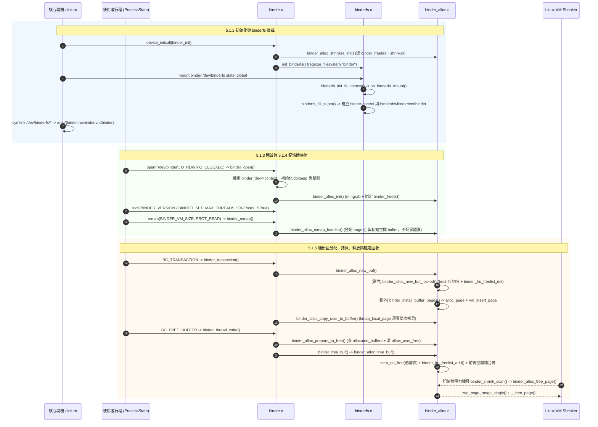

# 5.1 Binder 驅動程式

- **情景說明**：系統開機時載入 Binder 核心驅動並透過 `init.rc` 掛載 `/dev/binderfs` 建立多個隔離的 Binder 裝置節點（`binder`、`hwbinder`、`vndbinder`）；接著使用者空間行程初始化 `ProcessState`，依序 `open` 與 `mmap` `/dev/binder`；最後在一次跨行程交易中，核心為目標行程按需分配接收緩衝區、裝入實體頁並拷貝交易資料，並在目標行程處理完畢送出 `BC_FREE_BUFFER` 後將緩衝區歸還至空閒樹與 LRU shrinker 回收清單。
- **對應原書**：第 5 章 5.1 節〈Binder 驱动程序〉（p.153–190）
- **涉及專案與版本基準**：
  - `kernel/common` 〔`android17-6.18`，Linux 6.18，commit `028363aa3cfa`〕
  - `platform/system/core` 〔`android-17.0.0_r1`，commit `545d248`〕
  - `platform/frameworks/native` 〔`android-17.0.0_r1`，commit `ae266dc`〕

---

## 5.1.1 基礎資料結構與鎖模型

> 對應原書 5.1.1（p.154–172）。原書將所有結構定義集中於單一檔案 `drivers/staging/android/binder.c` 與 `binder.h`；在 Android 17（`android17-6.18`）中，驅動已移入主線 `drivers/android/`，並將內部結構拆至 `binder_internal.h` 與 `binder_alloc.h`，使用者態共用的 UAPI 結構則位於 `include/uapi/linux/android/binder.h`。

### 一、多 Domain 與 binderfs 結構（新增）

**位置**：`kernel/common/drivers/android/binder_internal.h` 〔`android17-6.18`〕

```c
struct binder_context {
	struct binder_node *binder_context_mgr_node;
	struct mutex context_mgr_node_lock;
	kuid_t binder_context_mgr_uid;
	const char *name;
};

struct binder_device {
	struct hlist_node hlist;
	struct miscdevice miscdev;
	struct binder_context context;
	struct inode *binderfs_inode;
	refcount_t ref;
};

struct binderfs_info {
	struct ipc_namespace *ipc_ns;
	struct dentry *control_dentry;
	kuid_t root_uid;
	kgid_t root_gid;
	struct binderfs_mount_opts mount_opts;
	int device_count;
	struct dentry *proc_log_dir;
};
```

- `binder_context` 封裝了一個獨立 Binder 通訊域（domain）的上下文管理者狀態：`binder_context_mgr_node` 指向該域的 `servicemanager` 實體節點，`binder_context_mgr_uid` 記錄其 UID。
- `binder_device` 對應一個裝置節點（如 `binder`、`hwbinder`、`vndbinder`），內嵌獨立的 `binder_context`，透過全域 `binder_devices` 雜湊鏈表管理。不同裝置節點擁有各自獨立的 Context Manager，因此 system 與 vendor 的 Binder 服務得以邏輯隔離。
- `binderfs_info` 掛在每個 `binderfs` 掛載實例的 `super_block->s_fs_info` 上，綁定其所屬的 `ipc_namespace`，並追蹤該掛載點內的 `binder-control` 節點與裝置配額上限。

> 〔與 2.3 差異〕**新增**：Android 2.3 只有全域單一的 `/dev/binder` 與全域變數 `binder_context_mgr_node` / `binder_context_mgr_uid`（原書 p.172、236）；17 將其封裝為 per-device 的 `binder_context`，並支援 `binderfs` 動態與 per-namespace 隔離。

---

### 二、核心內部資料結構

#### 1. `struct binder_work`
**位置**：`kernel/common/drivers/android/binder_internal.h` 〔`android17-6.18`〕

```c
struct binder_work {
	struct list_head entry;

	enum binder_work_type {
		BINDER_WORK_TRANSACTION = 1,
		BINDER_WORK_TRANSACTION_COMPLETE,
		BINDER_WORK_TRANSACTION_PENDING,
		BINDER_WORK_TRANSACTION_ONEWAY_SPAM_SUSPECT,
		BINDER_WORK_RETURN_ERROR,
		BINDER_WORK_NODE,
		BINDER_WORK_DEAD_BINDER,
		BINDER_WORK_DEAD_BINDER_AND_CLEAR,
		BINDER_WORK_CLEAR_DEATH_NOTIFICATION,
		BINDER_WORK_FROZEN_BINDER,
		BINDER_WORK_CLEAR_FREEZE_NOTIFICATION,
	} type;

	ANDROID_OEM_DATA(1);
};
```

代表掛入行程 `proc->todo`、執行緒 `thread->todo` 或節點 `node->async_todo` 的一項待處理工作。相較 2.3，新增了以下工作類型：
- `BINDER_WORK_TRANSACTION_PENDING`：目標行程處於凍結（frozen）狀態時，告知非同步交易發送端該筆交易已暫存待送（對應 `BR_TRANSACTION_PENDING_FROZEN`）。
- `BINDER_WORK_TRANSACTION_ONEWAY_SPAM_SUSPECT`：非同步緩衝區消耗超過門檻時的告警工作。
- `BINDER_WORK_RETURN_ERROR`：以 `struct binder_error` 封裝的錯誤回傳工作，取代舊版直接在 `binder_thread` 上用單一欄位記錄錯誤碼的做法。
- `BINDER_WORK_FROZEN_BINDER` / `BINDER_WORK_CLEAR_FREEZE_NOTIFICATION`：行程凍結狀態變更通知。

> 〔與 2.3 差異〕**邏輯改變**：保留原 6 種 `type`，新增凍結通知、oneway spam 偵測與錯誤回傳等 5 種型別，並加入 GKI `ANDROID_OEM_DATA(1)` ABI 預留欄位（原書 p.154）。

#### 2. `struct binder_node`
**位置**：`kernel/common/drivers/android/binder_internal.h` 〔`android17-6.18`〕

```c
struct binder_node {
	int debug_id;
	spinlock_t lock;
	struct binder_work work;
	union {
		struct rb_node rb_node;
		struct hlist_node dead_node;
	};
	struct binder_proc *proc;
	struct hlist_head refs;
	int internal_strong_refs;
	int local_weak_refs;
	int local_strong_refs;
	int tmp_refs;
	binder_uintptr_t ptr;
	binder_uintptr_t cookie;
	struct {
		u8 has_strong_ref:1;
		u8 pending_strong_ref:1;
		u8 has_weak_ref:1;
		u8 pending_weak_ref:1;
	};
	struct {
		u8 sched_policy:2;
		u8 inherit_rt:1;
		u8 accept_fds:1;
		u8 txn_security_ctx:1;
		u8 min_priority;
	};
	bool has_async_transaction;
	struct list_head async_todo;
};
```

描述一個 Server 端本地物件（`BBinder`）在核心中的 **Binder 實體物件**：
- `ptr`（對應 `RefBase::weakref_type*`）與 `cookie`（對應 `BBinder*`）由 `void __user *` 改為固定寬度的 `binder_uintptr_t`（64 位元平台上為 `__u64`），以支援 64 位元核心相容 32 位元使用者空間。
- `lock` 為節點專屬自旋鎖；`tmp_refs` 是核心在細粒度鎖下暫時固定節點、防止在放鎖期間被釋放的臨時引用計數。
- 初始化後不變的旗標新增了 `sched_policy`、`inherit_rt`（即時排程優先權繼承）以及 `txn_security_ctx`（要求每次交易附帶發送端的 SELinux 安全上下文，例如 `servicemanager` 就會透過 `setRequestingSid(true)` 開啟此旗標）。

> 〔與 2.3 差異〕**邏輯改變**：新增 `lock`、`tmp_refs`、`sched_policy`、`inherit_rt`、`txn_security_ctx`；移除 `async_todo` 以外未上鎖的位元欄競爭，將位元欄拆分為受 `proc->inner_lock` 保護的可變區與初始化後唯讀區（原書 p.154–156）。

#### 3. `struct binder_ref_death` 與 `struct binder_ref`
**位置**：`kernel/common/drivers/android/binder_internal.h` 〔`android17-6.18`〕

```c
struct binder_ref_death {
	struct binder_work work;
	binder_uintptr_t cookie;
};

struct binder_ref_data {
	int debug_id;
	uint32_t desc;
	int strong;
	int weak;
};

struct binder_ref {
	struct binder_ref_data data;
	struct rb_node rb_node_desc;
	struct rb_node rb_node_node;
	struct hlist_node node_entry;
	struct binder_proc *proc;
	struct binder_node *node;
	struct binder_ref_death *death;
	struct binder_ref_freeze *freeze;
};
```

描述 Client 行程對某個 `binder_node` 的 **Binder 引用物件**。由於 `binder_ref` 必須在持有 `proc->outer_lock` 時才能安全讀寫，驅動將 `debug_id`、`desc`（即使用者空間看到的 `handle`）、`strong`、`weak` 抽成 `struct binder_ref_data`，以便在解鎖後透過值拷貝安全回傳給呼叫端；另外新增 `freeze` 指標支援凍結狀態監聽。

> 〔與 2.3 差異〕**邏輯改變**：原 `debug_id`/`desc`/`strong`/`weak` 封裝進 `struct binder_ref_data`，並新增 `struct binder_ref_freeze *freeze`；存取須受 `proc->outer_lock` 保護（原書 p.156–157）。

#### 4. `struct binder_buffer` 與 `struct binder_alloc`
**位置**：`kernel/common/drivers/android/binder_alloc.h` 〔`android17-6.18`〕

```c
struct binder_buffer {
	struct list_head entry; /* free and allocated entries by address */
	struct rb_node rb_node; /* free entry by size or allocated entry by address */
	unsigned free:1;
	unsigned clear_on_free:1;
	unsigned allow_user_free:1;
	unsigned async_transaction:1;
	unsigned oneway_spam_suspect:1;
	unsigned debug_id:27;
	struct binder_transaction *transaction;
	struct binder_node *target_node;
	size_t data_size;
	size_t offsets_size;
	size_t extra_buffers_size;
	unsigned long user_data;
	int pid;
};

struct binder_alloc {
	struct mutex mutex;
	struct mm_struct *mm;
	unsigned long vm_start;
	struct list_head buffers;
	struct rb_root free_buffers;
	struct rb_root allocated_buffers;
	size_t free_async_space;
	struct page **pages;
	struct list_lru *freelist;
	size_t buffer_size;
	int pid;
	size_t pages_high;
	bool mapped;
	bool oneway_spam_detected;
	ANDROID_OEM_DATA(1);
};
```

這是相較 2.3 **結構性變化最大**的一組資料結構：
- `binder_buffer` **不再以彈性陣列 `uint8_t data[0]` 內嵌於共享映射記憶體中**，而是獨立 `kzalloc` 於核心 slab，以 `unsigned long user_data` 指向該緩衝區在目標行程使用者空間的虛擬位址。這樣做一來避免使用者空間誤寫或越界破壞核心 metadata，二來讓緩衝區可以完全不建立核心虛擬位址映射。
- 新增 `extra_buffers_size`（用於 scatter-gather `binder_buffer_object` 與 SELinux `security_ctx` 字串）、`clear_on_free`（對應 `TF_CLEAR_BUF`，釋放前主動清零敏感資料）、`oneway_spam_suspect` 與發送端 `pid`。
- `binder_alloc` 將原先散落在 `binder_proc` 內的記憶體管理欄位完整抽離：不再保存 `void *buffer`（核心 VA）、`ptrdiff_t user_buffer_offset` 或直接持有 `vm_area_struct *vma`；改為持有目標行程的 `struct mm_struct *mm`（透過 `mmgrab` 保活，使用時以 `mmget_not_zero` + per-VMA lock 查 VMA）、`vm_start`、`struct page **pages` 陣列，以及全域共用的 `list_lru *freelist`。

> 〔與 2.3 差異〕**拆分 + 邏輯改變**：`binder_alloc` 自 `binder_proc` 獨立；`binder_buffer` 改為核心獨立配置並以 `user_data` 取代內嵌 `data[0]`；移除核心虛擬位址映射欄位 `buffer`/`user_buffer_offset`（原書 p.157–160）。

#### 5. `struct binder_proc`、`struct binder_thread` 與 `struct binder_transaction`
**位置**：`kernel/common/drivers/android/binder_internal.h` 〔`android17-6.18`〕

```c
struct binder_proc {
	struct hlist_node proc_node;
	struct rb_root threads;
	struct rb_root nodes;
	struct rb_root refs_by_desc;
	struct rb_root refs_by_node;
	struct list_head waiting_threads;
	int pid;
	struct task_struct *tsk;
	const struct cred *cred;
	...
	int outstanding_txns;
	bool is_dead;
	bool is_frozen;
	bool sync_recv;
	bool async_recv;
	wait_queue_head_t freeze_wait;
	struct dbitmap dmap;
	struct list_head todo;
	struct binder_stats stats;
	struct list_head delivered_death;
	struct list_head delivered_freeze;
	u32 max_threads;
	int requested_threads;
	int requested_threads_started;
	int tmp_ref;
	struct binder_priority default_priority;
	struct dentry *debugfs_entry;
	struct binder_alloc alloc;
	struct binder_context *context;
	spinlock_t inner_lock;
	spinlock_t outer_lock;
	struct dentry *binderfs_entry;
	bool oneway_spam_detection_enabled;
	ANDROID_OEM_DATA(1);
};
```

```c
struct binder_thread {
	struct binder_proc *proc;
	struct rb_node rb_node;
	struct list_head waiting_thread_node;
	int pid;
	int looper;              /* only modified by this thread */
	bool looper_need_return; /* can be written by other thread */
	struct binder_transaction *transaction_stack;
	struct list_head todo;
	bool process_todo;
	struct binder_error return_error;
	struct binder_error reply_error;
	struct binder_extended_error ee;
	wait_queue_head_t wait;
	struct binder_stats stats;
	atomic_t tmp_ref;
	bool is_dead;
	struct task_struct *task;
	spinlock_t prio_lock;
	struct binder_priority prio_next;
	enum binder_prio_state prio_state;
	ANDROID_OEM_DATA(1);
};
```

```c
struct binder_transaction {
	int debug_id;
	struct binder_work work;
	struct binder_thread *from;
	pid_t from_pid;
	pid_t from_tid;
	struct binder_transaction *from_parent;
	struct binder_proc *to_proc;
	struct binder_thread *to_thread;
	struct binder_transaction *to_parent;
	unsigned is_async:1;
	unsigned is_reply:1;

	struct binder_buffer *buffer;
	unsigned int    code;
	unsigned int    flags;
	struct binder_priority priority;
	struct binder_priority saved_priority;
	bool set_priority_called;
	bool is_nested;
	kuid_t  sender_euid;
	ktime_t start_time;
	struct list_head fd_fixups;
	binder_uintptr_t security_ctx;
	spinlock_t lock;
	ANDROID_VENDOR_DATA(1);
	ANDROID_OEM_DATA(1);
};
```

幾個相較 2.3 值得注意的演進重點：
- **待機執行緒管理**：`binder_proc` 移除了單一的行程級等待佇列 `wait`（原書 p.159 讓所有空閒執行緒共用同一個 `wait_queue_head_t` 容易造成驚群或鎖競爭），改用 `waiting_threads` 鏈表串接空閒的 `binder_thread->waiting_thread_node`，需要分派工作時直接精準喚醒佇列頭部的 `thread->wait`。
- **不再持有 `files_struct`**：原書 `binder_proc->files` 已移除；在跨行程傳遞 fd 時，核心不再直接往目標行程的 fd table 插入檔案，而是記錄在 `binder_transaction->fd_fixups`（`struct binder_txn_fd_fixup`），延後到目標執行緒自己執行 `binder_thread_read` 時，在目標行程的 context 中安裝 fd。
- **Descriptor 分配**：`binder_proc` 新增 `struct dbitmap dmap`（`drivers/android/dbitmap.h`），取代原先線性掃描 `refs_by_desc` 紅黑樹尋找空缺 `desc` 的 O(N) 做法。
- **憑證與凍結**：`binder_proc->cred` 保存 `open` 時的 `filp->f_cred` 用於安全檢查；`is_frozen`/`outstanding_txns`/`freeze_wait` 支援 Android Cached Apps Freezer；`binder_transaction` 新增 `security_ctx`、`struct binder_priority`（同時包含排程策略與優先權）與自身 `spinlock_t lock`。

> 〔與 2.3 差異〕**邏輯改變**：移除 `proc->files`、`proc->wait`、`proc->ready_threads` 與緩衝區欄位；新增 `waiting_threads`、`dmap`、`alloc`、`context`、`inner_lock`/`outer_lock`、凍結狀態、fd fixup 與 `security_ctx`（原書 p.158–164）。

---

### 三、三級細粒度鎖模型（取代全域 `binder_lock`）

**位置**：`kernel/common/drivers/android/binder.c` 〔`android17-6.18`，lines 9–41〕

Android 2.3 的驅動使用單一全域互斥鎖 `binder_lock()` 串行化整個系統所有行程的 Binder 操作，在多核心裝置上成為嚴重的效能瓶頸。Android 17 改用三把細粒度自旋鎖，且嚴格規定由外而內的加鎖順序：

1. **`proc->outer_lock`**（`binder_proc_lock` / `binder_proc_unlock`）：保護 `proc->refs_by_desc`、`proc->refs_by_node`、`proc->dmap` 與 `binder_ref`。
2. **`node->lock`**（`binder_node_lock` / `binder_node_unlock`）：保護 `binder_node` 的大部分欄位與 `node->refs`、`ref->death`、`ref->freeze`。
3. **`proc->inner_lock`**（`binder_inner_proc_lock` / `binder_inner_proc_unlock`）：保護 `proc->threads`、`proc->waiting_threads`、`proc->nodes`、各類 `todo` 鏈表（`proc->todo`、`thread->todo`、`proc->delivered_death`、`node->async_todo`）與 `thread->transaction_stack`。

此外，`binder.c` 以函式名後綴明確約束呼叫者必須先持有的鎖：
- `*_olocked()`：需持有 `proc->outer_lock`
- `*_nlocked()`：需持有 `node->lock`
- `*_ilocked()`：需持有 `proc->inner_lock`
- `*_nilocked()`：需同時持有 `node->lock` 與 `proc->inner_lock`
- 不同行程間禁止同層或反向嵌套，且記憶體分配器 `proc->alloc` 另有獨立的 `alloc->mutex`（不能在持有上述 spinlock 時獲取，因為可能睡眠）。

> 〔與 2.3 差異〕**已移除 / 邏輯改變**：原書全域 `binder_lock` 已徹底移除，改為三級 spinlock 階層搭配 `tmp_ref` 保護跨鎖期間的物件存活。

---

### 四、內外共用 UAPI 結構與命令/回傳協議

**位置**：`kernel/common/include/uapi/linux/android/binder.h` 〔`android17-6.18`〕

```c
#ifdef BINDER_IPC_32BIT
typedef __u32 binder_size_t;
typedef __u32 binder_uintptr_t;
#define BINDER_CURRENT_PROTOCOL_VERSION 7
#else
typedef __u64 binder_size_t;
typedef __u64 binder_uintptr_t;
#define BINDER_CURRENT_PROTOCOL_VERSION 8
#endif

struct binder_object_header {
	__u32        type;
};

struct flat_binder_object {
	struct binder_object_header	hdr;
	__u32				flags;
	union {
		binder_uintptr_t	binder;	/* local object */
		__u32			handle;	/* remote object */
	};
	binder_uintptr_t	cookie;
};

struct binder_transaction_data {
	union {
		__u32	handle;
		binder_uintptr_t ptr;
	} target;
	binder_uintptr_t	cookie;
	__u32		code;
	__u32	        flags;
	__kernel_pid_t	sender_pid;
	__kernel_uid32_t	sender_euid;
	binder_size_t	data_size;
	binder_size_t	offsets_size;
	union {
		struct {
			binder_uintptr_t	buffer;
			binder_uintptr_t	offsets;
		} ptr;
		__u8	buf[8];
	} data;
};

struct binder_transaction_data_secctx {
	struct binder_transaction_data transaction_data;
	binder_uintptr_t secctx;
};

struct binder_transaction_data_sg {
	struct binder_transaction_data transaction_data;
	binder_size_t buffers_size;
};
```

幾個關鍵演進：
- **64 位元協議版本 8**：指標與長度統一為 `binder_uintptr_t` / `binder_size_t`（64 位元），協議版本自 2.3 的 `7` 升級為 `8`。
- **多態 Binder 物件**：將開頭抽為 `struct binder_object_header { __u32 type; }`，除了 `flat_binder_object`（`BINDER_TYPE_BINDER` / `WEAK_BINDER` / `HANDLE` / `WEAK_HANDLE`），還拆分出 `binder_fd_object`（`BINDER_TYPE_FD`）、`binder_buffer_object`（`BINDER_TYPE_PTR`，scatter-gather 緩衝區）與 `binder_fd_array_object`（`BINDER_TYPE_FDA`）。
- **新增協議碼與 ioctl**：
  - `enum binder_driver_command_protocol`（原 `BinderDriverCommandProtocol`）：新增 `BC_TRANSACTION_SG`、`BC_REPLY_SG`（scatter-gather 交易）、`BC_REQUEST_FREEZE_NOTIFICATION`、`BC_CLEAR_FREEZE_NOTIFICATION`、`BC_FREEZE_NOTIFICATION_DONE`。
  - `enum binder_driver_return_protocol`（原 `BinderDriverReturnProtocol`）：新增 `BR_TRANSACTION_SEC_CTX`（夾帶 `binder_transaction_data_secctx`）、`BR_FROZEN_REPLY`、`BR_ONEWAY_SPAM_SUSPECT`、`BR_TRANSACTION_PENDING_FROZEN`、`BR_FROZEN_BINDER`、`BR_CLEAR_FREEZE_NOTIFICATION_DONE`。
  - 新增 ioctl：`BINDER_SET_CONTEXT_MGR_EXT`（傳入 `flat_binder_object` 以開啟 `FLAT_BINDER_FLAG_TXN_SECURITY_CTX`）、`BINDER_GET_NODE_DEBUG_INFO`、`BINDER_GET_NODE_INFO_FOR_REF`（供 `servicemanager` 查詢強引用數以判斷 Lazy Service 是否無客戶端）、`BINDER_FREEZE`、`BINDER_GET_FROZEN_INFO`、`BINDER_ENABLE_ONEWAY_SPAM_DETECTION`、`BINDER_GET_EXTENDED_ERROR`。

> 〔與 2.3 差異〕**邏輯改變 + 新增**：協議升級至 v8（64 位元欄位）；列舉更名為小寫底線 `binder_driver_command_protocol` / `binder_driver_return_protocol`；新增 secctx、scatter-gather、freeze 與 extended error 等結構與協議碼（原書 p.164–171）。

---

## 5.1.2 Binder 裝置初始化與 binderfs 掛載

> 對應原書 5.1.2（p.172–173）。原書中 `binder_init` 直接呼叫一次 `misc_register` 建立單一 `/dev/binder` 與 `/proc/binder`；在 Android 17 中，核心初始化註冊 `binder` 偽檔案系統（`binderfs`）與記憶體回收 shrinker，實際的 `/dev/binderfs/{binder,hwbinder,vndbinder}` 裝置節點則是在開機 `init.rc` 掛載 `binderfs` 時建立，再透過符號連結對應至 `/dev/*`。

#### Step 1：`binder_init`
**位置**：`kernel/common/drivers/android/binder.c` 〔`android17-6.18`，lines 7388–7445, 7474〕

```c
char *binder_devices_param = CONFIG_ANDROID_BINDER_DEVICES;
module_param_named(devices, binder_devices_param, charp, 0444);
...
static int __init binder_init(void)
{
	int ret;
	...
	ret = binder_alloc_shrinker_init();
	if (ret)
		return ret;

	atomic_set(&binder_transaction_log.cur, ~0U);
	atomic_set(&binder_transaction_log_failed.cur, ~0U);

	binder_debugfs_dir_entry_root = debugfs_create_dir("binder", NULL);
	binder_for_each_debugfs_entry(db_entry)
		debugfs_create_file(db_entry->name, db_entry->mode,
					binder_debugfs_dir_entry_root,
					db_entry->data, db_entry->fops);
	binder_debugfs_dir_entry_proc = debugfs_create_dir("proc",
						binder_debugfs_dir_entry_root);

	if (!IS_ENABLED(CONFIG_ANDROID_BINDERFS) &&
	    strcmp(binder_devices_param, "") != 0) {
		...
		while ((device_name = strsep(&device_tmp, ","))) {
			ret = init_binder_device(device_name);
			if (ret)
				goto err_init_binder_device_failed;
		}
	}

	ret = genl_register_family(&binder_nl_family);
	if (ret)
		goto err_init_binder_device_failed;

	ret = init_binderfs();
	if (ret)
		goto err_init_binderfs_failed;

	return ret;
}
device_initcall(binder_init);
```

核心開機執行 `device_initcall(binder_init)` 時完成四件事：
1. 呼叫 `binder_alloc_shrinker_init()` 初始化全域閒置頁 LRU 串列並向核心 VM 註冊 shrinker。
2. 在 `debugfs` 建立 `/sys/kernel/debug/binder/` 及 `proc` 子目錄（取代舊版 `/proc/binder`）。
3. 只有在**未啟用** `CONFIG_ANDROID_BINDERFS` 時，才解析 `binder_devices_param`（預設值為 Kconfig `CONFIG_ANDROID_BINDER_DEVICES`，即 `"binder,hwbinder,vndbinder"`）呼叫 `init_binder_device()` 以傳統 `misc_register` 建立裝置；在 Android GKI 啟用 `CONFIG_ANDROID_BINDERFS` 的情境下，這段略過，改由後續 `binderfs` 掛載時建立。
4. 註冊 Generic Netlink 家族 `binder_nl_family`（用於 `binder_netlink.c` 回報交易報告），並呼叫 `init_binderfs()` 註冊 `binder` 檔案系統。

> 〔與 2.3 差異〕**邏輯改變**：`/proc/binder` 改為 `debugfs`（且掛載 `binderfs` 時可透過 `stats=global` 改置於 `/dev/binderfs/binder_logs/`）；由單一 `misc_register` 演進為支援多裝置與 `binderfs`，並新增 shrinker 與 netlink 註冊（原書 p.172–173）。

#### Step 2：`binder_alloc_shrinker_init`
**位置**：`kernel/common/drivers/android/binder_alloc.c` 〔`android17-6.18`，lines 1273–1293〕

```c
int binder_alloc_shrinker_init(void)
{
	int ret;

	ret = list_lru_init(&binder_freelist);
	if (ret)
		return ret;

	binder_shrinker = shrinker_alloc(0, "android-binder");
	if (!binder_shrinker) {
		list_lru_destroy(&binder_freelist);
		return -ENOMEM;
	}

	binder_shrinker->count_objects = binder_shrink_count;
	binder_shrinker->scan_objects = binder_shrink_scan;

	shrinker_register(binder_shrinker);

	return 0;
}
```

初始化跨行程共用的 `binder_freelist`（`struct list_lru`），並註冊名為 `"android-binder"` 的核心 shrinker。往後各行程釋放緩衝區時不再立刻還頁給系統，而是將已裝入但目前閒置的實體頁掛入 `binder_freelist`，直到記憶體吃緊時由核心 VM 呼叫 `binder_shrink_scan` 批次回收。

> 〔與 2.3 差異〕**新增**：2.3 沒有緩衝區頁面快取與 shrinker，釋放緩衝區時立即解除映射並還頁（原書 p.186）。

#### Step 3：`init_binderfs`
**位置**：`kernel/common/drivers/android/binderfs.c` 〔`android17-6.18`，lines 794–831〕

```c
static struct file_system_type binder_fs_type = {
	.name			= "binder",
	.init_fs_context	= binderfs_init_fs_context,
	.parameters		= binderfs_fs_parameters,
	.kill_sb		= binderfs_kill_super,
	.fs_flags		= FS_USERNS_MOUNT,
};

int __init init_binderfs(void)
{
	int ret;
	const char *name;
	size_t len;

	/* Verify that the default binderfs device names are valid. */
	name = binder_devices_param;
	for (len = strcspn(name, ","); len > 0; len = strcspn(name, ",")) {
		if (len > BINDERFS_MAX_NAME)
			return -E2BIG;
		name += len;
		if (*name == ',')
			name++;
	}

	/* Allocate new major number for binderfs. */
	ret = alloc_chrdev_region(&binderfs_dev, 0, BINDERFS_MAX_MINOR,
				  "binder");
	if (ret)
		return ret;

	ret = register_filesystem(&binder_fs_type);
	if (ret) {
		unregister_chrdev_region(binderfs_dev, BINDERFS_MAX_MINOR);
		return ret;
	}

	return ret;
}
```

先校驗 `binder_devices_param` 各裝置名稱長度不超過 `BINDERFS_MAX_NAME`，再透過 `alloc_chrdev_region` 申請一組字元裝置主編號 `binderfs_dev`，最後向 VFS 註冊名為 `"binder"` 的檔案系統型別 `binder_fs_type`。

> 〔與 2.3 差異〕**新增**：2.3 沒有 `binderfs`。

#### Step 4：`init.rc` 掛載 `/dev/binderfs` 與建立符號連結
**位置**：`platform/system/core/rootdir/init.rc` 〔`android-17.0.0_r1`，lines 231–245〕

```rc
    # Mount binderfs
    mkdir /dev/binderfs
    mount binder binder /dev/binderfs stats=global
    chmod 0755 /dev/binderfs
    ...
    symlink /dev/binderfs/binder /dev/binder
    symlink /dev/binderfs/hwbinder /dev/hwbinder
    symlink /dev/binderfs/vndbinder /dev/vndbinder

    chmod 0666 /dev/binderfs/hwbinder
    chmod 0666 /dev/binderfs/binder
    chmod 0666 /dev/binderfs/vndbinder
```

開機早期階段，`init` 行程掛載 `binder` 檔案系統至 `/dev/binderfs`（帶入 `stats=global` 參數使核心一併建立 `/dev/binderfs/binder_logs/`），接著建立 `/dev/binder`、`/dev/hwbinder`、`/dev/vndbinder` 三條符號連結指向對應的 binderfs 裝置節點並設為 `0666` 權限，讓使用者空間沿用原本路徑開啟。

> 〔與 2.3 差異〕**新增**：2.3 直接使用核心 `misc_register` 產生的 `/dev/binder` 裝置節點（原書 p.172）。

#### Step 5：`binderfs_init_fs_context` → `binderfs_fill_super` → `binderfs_binder_device_create`
**位置**：`kernel/common/drivers/android/binderfs.c` 〔`android17-6.18`，lines 153–211, 653–737, 758–776〕

```c
static int binderfs_init_fs_context(struct fs_context *fc)
{
	struct binderfs_mount_opts *ctx;

	if (on_binderfs_mount())
		return -EINVAL;
	...
	fc->ops = &binderfs_fs_context_ops;
	return 0;
}

static int binderfs_fill_super(struct super_block *sb, struct fs_context *fc)
{
	...
	sb->s_magic = BINDERFS_SUPER_MAGIC;
	sb->s_op = &binderfs_super_ops;
	...
	info->ipc_ns = get_ipc_ns(current->nsproxy->ipc_ns);
	...
	ret = binderfs_binder_ctl_create(sb);
	if (ret)
		return ret;

	name = binder_devices_param;
	for (len = strcspn(name, ","); len > 0; len = strcspn(name, ",")) {
		strscpy(device_info.name, name, len + 1);
		ret = binderfs_binder_device_create(inode, NULL, &device_info);
		if (ret)
			return ret;
		name += len;
		if (*name == ',')
			name++;
	}

	ret = init_binder_features(sb);
	if (ret)
		return ret;

	if (info->mount_opts.stats_mode == binderfs_stats_mode_global)
		return init_binder_logs(sb);

	return 0;
}
```

在 `binderfs_binder_device_create` 中，為每個預設名稱配置一個 `struct binder_device` 與對應字元裝置 inode：

```c
	init_special_inode(inode, S_IFCHR | 0600,
			   MKDEV(MAJOR(binderfs_dev), minor));
	inode->i_fop = &binder_fops;
	...
	refcount_set(&device->ref, 1);
	device->binderfs_inode = inode;
	device->context.binder_context_mgr_uid = INVALID_UID;
	device->context.name = name;
	...
	mutex_init(&device->context.context_mgr_node_lock);
	...
	inode->i_private = device;
	d_instantiate(dentry, inode);
	...
	binder_add_device(device);
```

關鍵細節：
- **C / Rust 驅動擇一鎖定**：`binderfs_init_fs_context` 一開始呼叫 `on_binderfs_mount()`（`drivers/android/binder_pick.c`）。在 `android17-6.18` 中，若未設定 `binder.impl=rust` 或在 Rust 模組載入前就先掛載了 C 版 binderfs，此處會鎖定採用 C 版驅動並禁止後續卸載；若已由 Rust 版載入則回傳 `-EINVAL`。
- **`binder-control` 節點**：`binderfs_binder_ctl_create` 建立 `/dev/binderfs/binder-control`，使用者空間往後可對其執行 `BINDER_CTL_ADD` ioctl 動態建立新的 Binder 裝置節點（`binder_ctl_ioctl` → `binderfs_binder_device_create`）。
- **預設三裝置與特性旗標**：`binderfs_fill_super` 迴圈依 `binder_devices_param` 建立 `binder`、`hwbinder`、`vndbinder`，將各自的 `struct binder_device *` 存入 `inode->i_private`，並將 `inode->i_fop` 指向 `binder_fops`；接著透過 `init_binder_features` 建立 `/dev/binderfs/features/{oneway_spam_detection,extended_error,freeze_notification,transaction_report}` 供 `libbinder` 探測核心能力，並因 `stats=global` 建立 `/dev/binderfs/binder_logs/`。

> 〔與 2.3 差異〕**新增**：完整取代 2.3 單一靜態 misc 裝置的初始化路徑；每個裝置透過 `inode->i_private` 攜帶自己的 `binder_device` 與 `binder_context`。

---

## 5.1.3 Binder 裝置檔的開啟過程

> 對應原書 5.1.3（p.173–174）。任何使用 Binder 的行程，首次存取 `ProcessState::self()`（或 `ProcessState::initWithDriver(driver)`）時都會開啟對應的 Binder 裝置檔，觸發核心 `binder_open` 為該行程建立 `struct binder_proc`。

#### Step 1：`ProcessState::open_driver`
**位置**：`platform/frameworks/native/libs/binder/ProcessState.cpp` 〔`android-17.0.0_r1`，lines 572–604〕

```cpp
static unique_fd open_driver(const char* driver, String8* error) {
    auto fd = unique_fd(open(driver, O_RDWR | O_CLOEXEC));
    if (!fd.ok()) {
        ...
        return {};
    }
    int vers = 0;
    int result = ioctl(fd.get(), BINDER_VERSION, &vers);
    ...
    if (result != 0 || vers != BINDER_CURRENT_PROTOCOL_VERSION) {
        ...
        return {};
    }
    size_t maxThreads = DEFAULT_MAX_BINDER_THREADS;
    result = ioctl(fd.get(), BINDER_SET_MAX_THREADS, &maxThreads);
    ...
    uint32_t enable = DEFAULT_ENABLE_ONEWAY_SPAM_DETECTION;
    result = ioctl(fd.get(), BINDER_ENABLE_ONEWAY_SPAM_DETECTION, &enable);
    ...
    return fd;
}
```

開啟 `/dev/binder`（編譯給 VNDK 時 `kDefaultDriver` 預設為 `/dev/vndbinder`）時加上 `O_CLOEXEC` 避免跨越 `exec` 洩漏；開啟成功後立刻做三項基本協定交握：
1. `BINDER_VERSION`：驗證核心協議版本與使用者態 `BINDER_CURRENT_PROTOCOL_VERSION`（64 位元為 8）一致。
2. `BINDER_SET_MAX_THREADS`：設定核心按需透過 `BR_SPAWN_LOOPER` 拉起的執行緒上限，預設 `DEFAULT_MAX_BINDER_THREADS = 15`。
3. `BINDER_ENABLE_ONEWAY_SPAM_DETECTION`：預設開啟（`1`）非同步呼叫氾濫偵測。

> 〔與 2.3 差異〕**邏輯改變**：2.3 固定寫死開啟 `/dev/binder` 且無 `O_CLOEXEC` 與 oneway spam 偵測；17 支援依建置環境或 `initWithDriver` 指定不同裝置，並以 `unique_fd` 管理生命週期。

#### Step 2：`binder_open`
**位置**：`kernel/common/drivers/android/binder.c` 〔`android17-6.18`，lines 6327–6429, 7283–7292〕

```c
const struct file_operations binder_fops = {
	.owner = THIS_MODULE,
	.poll = binder_poll,
	.unlocked_ioctl = binder_ioctl,
	.compat_ioctl = compat_ptr_ioctl,
	.mmap = binder_mmap,
	.open = binder_open,
	.flush = binder_flush,
	.release = binder_release,
};

static int binder_open(struct inode *nodp, struct file *filp)
{
	struct binder_proc *proc, *itr;
	struct binder_device *binder_dev;
	struct binderfs_info *info;
	struct dentry *binder_binderfs_dir_entry_proc = NULL;
	bool existing_pid = false;

	proc = kzalloc(sizeof(*proc), GFP_KERNEL);
	if (proc == NULL)
		return -ENOMEM;

	dbitmap_init(&proc->dmap);
	spin_lock_init(&proc->inner_lock);
	spin_lock_init(&proc->outer_lock);
	get_task_struct(current->group_leader);
	proc->tsk = current->group_leader;
	proc->cred = get_cred(filp->f_cred);
	INIT_LIST_HEAD(&proc->todo);
	init_waitqueue_head(&proc->freeze_wait);
	if (binder_supported_policy(current->policy)) {
		proc->default_priority.sched_policy = current->policy;
		proc->default_priority.prio = current->normal_prio;
	} else {
		proc->default_priority.sched_policy = SCHED_NORMAL;
		proc->default_priority.prio = NICE_TO_PRIO(0);
	}

	/* binderfs stashes devices in i_private */
	if (is_binderfs_device(nodp)) {
		binder_dev = nodp->i_private;
		info = nodp->i_sb->s_fs_info;
		binder_binderfs_dir_entry_proc = info->proc_log_dir;
	} else {
		binder_dev = container_of(filp->private_data,
					  struct binder_device, miscdev);
	}
	refcount_inc(&binder_dev->ref);
	proc->context = &binder_dev->context;
	binder_alloc_init(&proc->alloc);

	binder_stats_created(BINDER_STAT_PROC);
	proc->pid = current->group_leader->pid;
	INIT_LIST_HEAD(&proc->delivered_death);
	INIT_LIST_HEAD(&proc->delivered_freeze);
	INIT_LIST_HEAD(&proc->waiting_threads);
	filp->private_data = proc;

	mutex_lock(&binder_procs_lock);
	hlist_for_each_entry(itr, &binder_procs, proc_node) {
		if (itr->pid == proc->pid) {
			existing_pid = true;
			break;
		}
	}
	hlist_add_head(&proc->proc_node, &binder_procs);
	mutex_unlock(&binder_procs_lock);
	...
	if (binder_binderfs_dir_entry_proc && !existing_pid) {
		...
		binderfs_entry = binderfs_create_file(binder_binderfs_dir_entry_proc,
			strbuf, &proc_fops, (void *)(unsigned long)proc->pid);
		...
	}

	return 0;
}
```

重點解析：
- **綁定通訊域**：若從 `binderfs` 開啟（`is_binderfs_device(nodp)` 檢查 `inode->i_sb->s_magic == BINDERFS_SUPER_MAGIC`），直接從 `nodp->i_private` 取出對應的 `binder_device`；否則（傳統 misc 裝置）由 `filp->private_data` 反推。遞增 `binder_dev->ref` 後將 `proc->context` 指向 `&binder_dev->context`。這保證同一行程若同時開啟 `/dev/binder` 與 `/dev/hwbinder`，會各自擁有獨立的 `binder_proc` 與 `binder_context`。
- **保存憑證與排程基準**：`proc->cred = get_cred(filp->f_cred)` 鎖定開啟時的行程憑證；`default_priority` 同時記錄排程策略（`SCHED_NORMAL`/`BATCH`/`FIFO`/`RR`）與 `normal_prio`。
- **跨 context 共用除錯檔**：一個行程可能開啟多個 Binder 裝置，因此加入 `binder_procs` 前會先檢查 `existing_pid`，只在首次開啟時於 `debugfs` 與 `/dev/binderfs/binder_logs/proc/<pid>` 建立一次紀錄檔，讀取時會一併列印該 PID 在所有 context 的狀態。

> 〔與 2.3 差異〕**邏輯改變**：2.3 沒有 `binder_context`、`dbitmap`、`inner_lock`/`outer_lock`、`cred` 與 `binder_alloc_init`，且以全域 `binder_lock` 保護 `binder_procs`、在 `/proc/binder/proc/<pid>` 建檔（原書 p.173–174）。

#### Step 3：`binder_alloc_init`
**位置**：`kernel/common/drivers/android/binder_alloc.c` 〔`android17-6.18`，lines 1249–1271〕

```c
VISIBLE_IF_KUNIT void __binder_alloc_init(struct binder_alloc *alloc,
					  struct list_lru *freelist)
{
	alloc->pid = current->group_leader->pid;
	alloc->mm = current->mm;
	mmgrab(alloc->mm);
	mutex_init(&alloc->mutex);
	INIT_LIST_HEAD(&alloc->buffers);
	alloc->freelist = freelist;
}

void binder_alloc_init(struct binder_alloc *alloc)
{
	__binder_alloc_init(alloc, &binder_freelist);
}
```

在此先抓取當前行程的 `mm_struct` 結構體引用（`mmgrab` 只保活 `mm_struct` 本身，不妨礙行程退出時釋放位址空間），並將 `alloc->freelist` 指向全域 `binder_freelist`。

> 〔與 2.3 差異〕**新增**：將 `binder_alloc` 的初始化自 `binder_open` 抽離至 `binder_alloc.c`。

---

## 5.1.4 Binder 裝置檔的記憶體映射過程

> 對應原書 5.1.4（p.174–180）。原書中「Binder 只需一次拷貝」的實現方式，是在 `binder_mmap` 中透過 `get_vm_area` 配置一塊核心虛擬位址 `proc->buffer`，與使用者空間 `vma` 映射到**同一批實體頁**（兩者差一個固定偏移 `proc->user_buffer_offset`），且在 `mmap` 當下立刻預配 1 個實體頁。
>
> **在 Android 17 中，這套做法已經徹底改變**：核心**完全不再配置核心虛擬位址映射**，也不在 `mmap` 時預配任何實體頁！發送交易時，核心直接查表取出目標行程的 `struct page *`，以短暫的 `kmap_local_page` 逐頁寫入資料，仍然保持「只需一次從發送端使用者空間拷貝到目標實體頁」的零額外拷貝優勢，同時徹底省下核心 vmalloc 空間並消除跨行程 `mmap_lock` 長時間鎖競爭。

#### Step 1：`ProcessState::ProcessState` 呼叫 `mmap`
**位置**：`platform/frameworks/native/libs/binder/ProcessState.cpp` 〔`android-17.0.0_r1`，lines 48, 621–633〕

```cpp
#define BINDER_VM_SIZE ((1 * 1024 * 1024) - sysconf(_SC_PAGE_SIZE) * 2)
...
    unique_fd opened = open_driver(driver, &error);

    if (opened.ok()) {
        // mmap the binder, providing a chunk of virtual address space to receive transactions.
        mVMStart = mmap(nullptr, BINDER_VM_SIZE, PROT_READ, MAP_PRIVATE | MAP_NORESERVE,
                        opened.get(), 0);
        ...
    }
```

使用者空間請求映射 `1MB - 2 * PAGE_SIZE`（4KB 頁下為 `1016KB`；16KB 頁下為 `992KB`）的唯讀私有虛擬位址空間（`PROT_READ`、`MAP_PRIVATE | MAP_NORESERVE`）。這塊區域僅供行程**接收**交易資料，使用者空間無權寫入。

> 〔與 2.3 差異〕**邏輯改變**：保留 `1MB - 2 pages` 的經典大小，但改以執行期 `sysconf(_SC_PAGE_SIZE)` 取代編譯期常數 `4096`，以相容 Android 15+ 支援的 16KB 頁面裝置（原書 p.174、249）。

#### Step 2：`binder_mmap`
**位置**：`kernel/common/drivers/android/binder.c` 〔`android17-6.18`，lines 6277–6325〕

```c
static void binder_vma_close(struct vm_area_struct *vma)
{
	struct binder_proc *proc = vma->vm_private_data;
	...
	binder_alloc_vma_close(&proc->alloc);
}

VISIBLE_IF_KUNIT vm_fault_t binder_vm_fault(struct vm_fault *vmf)
{
	return VM_FAULT_SIGBUS;
}

static const struct vm_operations_struct binder_vm_ops = {
	.open = binder_vma_open,
	.close = binder_vma_close,
	.fault = binder_vm_fault,
};

static int binder_mmap(struct file *filp, struct vm_area_struct *vma)
{
	struct binder_proc *proc = filp->private_data;

	if (proc->tsk != current->group_leader)
		return -EINVAL;

	if (vma->vm_flags & FORBIDDEN_MMAP_FLAGS) {
		pr_err("%s: %d %lx-%lx %s failed %d\n", __func__,
		       proc->pid, vma->vm_start, vma->vm_end, "bad vm_flags", -EPERM);
		return -EPERM;
	}
	vm_flags_mod(vma, VM_DONTCOPY | VM_MIXEDMAP, VM_MAYWRITE);

	vma->vm_ops = &binder_vm_ops;
	vma->vm_private_data = proc;

	return binder_alloc_mmap_handler(&proc->alloc, vma);
}
```

重點解析：
- **禁止跨行程與禁止寫入**：檢查 `proc->tsk == current->group_leader` 防止透過傳遞 fd 替別的行程做 mmap；檢查 `FORBIDDEN_MMAP_FLAGS`（`VM_WRITE`）拒絕可寫映射；並透過 `vm_flags_mod` 清除 `VM_MAYWRITE`（禁止事後 `mprotect` 改為可寫）、加上 `VM_DONTCOPY`（`fork` 時不複製給子行程）與 `VM_MIXEDMAP`（允許後續用 `vm_insert_page` 直接塞入實體頁）。
- **`binder_vm_fault` 恆回 `VM_FAULT_SIGBUS`**：Binder 的實體頁必須由驅動在分配交易緩衝區時主動安裝（`vm_insert_page`），不允許使用者空間透過 page fault 任意觸發缺頁配置，越界存取會直接收到 `SIGBUS`。
- 接著將實際記憶體結構初始化委派給 `binder_alloc_mmap_handler(&proc->alloc, vma)`。

> 〔與 2.3 差異〕**邏輯改變**：原 `binder_mmap` 內聯了 `get_vm_area`、頁陣列分配、`binder_update_page_range` 預配 1 頁與插入初始空閒 `binder_buffer`；17 將 `binder_mmap` 精簡為 VMA 檢查與設定，把核心邏輯移入 `binder_alloc_mmap_handler`（原書 p.174–180）。

#### Step 3：`binder_alloc_mmap_handler`
**位置**：`kernel/common/drivers/android/binder_alloc.c` 〔`android17-6.18`，lines 910–961〕

```c
int binder_alloc_mmap_handler(struct binder_alloc *alloc,
			      struct vm_area_struct *vma)
{
	struct binder_buffer *buffer;
	const char *failure_string;
	int ret;

	if (unlikely(vma->vm_mm != alloc->mm)) {
		ret = -EINVAL;
		failure_string = "invalid vma->vm_mm";
		goto err_invalid_mm;
	}

	mutex_lock(&binder_alloc_mmap_lock);
	if (alloc->buffer_size) {
		ret = -EBUSY;
		failure_string = "already mapped";
		goto err_already_mapped;
	}
	alloc->buffer_size = min_t(unsigned long, vma->vm_end - vma->vm_start,
				   SZ_4M);
	mutex_unlock(&binder_alloc_mmap_lock);

	alloc->vm_start = vma->vm_start;

	alloc->pages = kvcalloc(alloc->buffer_size / PAGE_SIZE,
				sizeof(alloc->pages[0]),
				GFP_KERNEL);
	if (!alloc->pages) {
		ret = -ENOMEM;
		failure_string = "alloc page array";
		goto err_alloc_pages_failed;
	}

	buffer = kzalloc(sizeof(*buffer), GFP_KERNEL);
	if (!buffer) {
		ret = -ENOMEM;
		failure_string = "alloc buffer struct";
		goto err_alloc_buf_struct_failed;
	}

	buffer->user_data = alloc->vm_start;
	list_add(&buffer->entry, &alloc->buffers);
	buffer->free = 1;
	binder_insert_free_buffer(alloc, buffer);
	alloc->free_async_space = alloc->buffer_size / 2;

	/* Signal binder_alloc is fully initialized */
	binder_alloc_set_mapped(alloc, true);

	return 0;
}
```

逐行解讀這段極為精煉的初始化流程：
1. **單次映射保證與 4MB 上限**：以 `binder_alloc_mmap_lock` 確保同一個 `binder_alloc` 只能 `mmap` 一次（若 `alloc->buffer_size` 非零則回 `-EBUSY`），並將大小截斷於 `SZ_4M`（4MB）。
2. **僅配頁指標陣列，不配實體頁**：記錄 `alloc->vm_start = vma->vm_start`，呼叫 `kvcalloc` 配置長度為 `buffer_size / PAGE_SIZE` 的 `struct page *` 陣列（全為 `NULL`）。**此時尚未分配任何實體頁，也未呼叫 `get_vm_area` 配置核心虛擬位址**。
3. **建立初始空閒 `binder_buffer`**：從核心 slab `kzalloc` 一個 `struct binder_buffer`，設 `buffer->user_data = alloc->vm_start`、`buffer->free = 1`，掛入 `alloc->buffers` 雙向鏈表，再由 `binder_insert_free_buffer` 插入 `alloc->free_buffers` 紅黑樹（其大小由 `binder_alloc_buffer_size` 算得為整個 `alloc->buffer_size`）。
4. **切分非同步交易配額**：設定 `alloc->free_async_space = alloc->buffer_size / 2`（最多允許一半空間給 `TF_ONE_WAY` 交易，避免大量單向呼叫塞滿緩衝區餓死同步呼叫）。
5. **發布就緒狀態**：呼叫 `binder_alloc_set_mapped(alloc, true)`（內部使用 `smp_store_release`），與其他執行緒檢查 `binder_alloc_is_mapped` 的 `smp_load_acquire` 配對，確保看到 `mapped == true` 時前述欄位皆已完成寫入。

> 〔與 2.3 差異〕**邏輯改變**：
> | 項目 | Android 2.3（原書 p.174–180） | Android 17（`android17-6.18`） |
> |---|---|---|
> | 核心虛擬位址映射 | 呼叫 `get_vm_area` 配置，並以 `user_buffer_offset` 換算位址 | **已移除**，完全不佔用核心 vmalloc 空間 |
> | `mmap` 時是否配實體頁 | 立即呼叫 `binder_update_page_range` 配 1 頁 | **不預配**，直到第一次分配交易緩衝區才按需裝頁 |
> | `struct binder_buffer` 存放位置 | 直接強轉為映射區域起始位址（內嵌在共享記憶體） | 獨立 `kzalloc` 於核心堆，以 `user_data` 指向使用者位址 |
> | `vma` 指標保存 | 直接存 `proc->vma` 並在 `vma_close` 清空 | 不長期持有 `vma`，改保存 `alloc->mm` 並於裝頁/回收時鎖 VMA 查詢 |

---

## 5.1.5 核心緩衝區管理

> 對應原書 5.1.5（p.181–190）。核心緩衝區的管理涵蓋三個環節：**分配與按需裝頁**（交易發送端在目標行程配置接收空間）、**無核心 VA 映射的資料拷貝**，以及**查詢、釋放與 LRU Shrinker 延遲回收**（接收端處理完送出 `BC_FREE_BUFFER`）。

### 5.1.5.1 分配核心緩衝區與按需裝頁

#### Step 1：`binder_transaction` 呼叫 `binder_alloc_new_buf`
**位置**：`kernel/common/drivers/android/binder.c` 〔`android17-6.18`，lines 3612–3654〕

```c
	t->buffer = binder_alloc_new_buf(&target_proc->alloc, tr->data_size,
		tr->offsets_size, extra_buffers_size,
		!reply && (t->flags & TF_ONE_WAY));
	if (IS_ERR(t->buffer)) {
		...
		return_error_param = PTR_ERR(t->buffer);
		return_error = return_error_param == -ESRCH ?
			BR_DEAD_REPLY : BR_FAILED_REPLY;
		...
		t->buffer = NULL;
		goto err_binder_alloc_buf_failed;
	}
	if (lsmctx.context) {
		size_t buf_offset = ALIGN(tr->data_size, sizeof(void *)) +
				    ALIGN(tr->offsets_size, sizeof(void *)) +
				    ALIGN(extra_buffers_size, sizeof(void *)) -
				    ALIGN(lsmctx.len, sizeof(u64));

		t->security_ctx = t->buffer->user_data + buf_offset;
		err = binder_alloc_copy_to_buffer(&target_proc->alloc,
						  t->buffer, buf_offset,
						  lsmctx.context, lsmctx.len);
		...
	}
	t->buffer->debug_id = t->debug_id;
	t->buffer->transaction = t;
	t->buffer->target_node = target_node;
	t->buffer->clear_on_free = !!(t->flags & TF_CLEAR_BUF);
```

一次交易在目標行程的 `binder_buffer` 內部規劃為三段（皆向 `sizeof(void *)` 對齊）：
1. **Payload 資料區**（`data_size`）：存放 Parcel 序列化的交易內容。
2. **Offsets 陣列區**（`offsets_size`）：記錄 payload 中每個 Binder 物件的位移。
3. **額外緩衝區**（`extra_buffers_size`）：存放 scatter-gather 緩衝區（`BC_TRANSACTION_SG`）以及尾端的 SELinux `security_ctx` 字串（若目標節點開啟 `txn_security_ctx`）。

> 〔與 2.3 差異〕**改名搬家 + 邏輯改變**：原呼叫 `binder_alloc_buf`（僅有 `data_size` 與 `offsets_size`），17 改為 `binder_alloc_new_buf` 並新增 `extra_buffers_size` 與 `clear_on_free`；錯誤回傳由 `NULL` 改為 `ERR_PTR` 以區分目標已死（`-ESRCH` → `BR_DEAD_REPLY`）與空間/記憶體不足（`-ENOSPC`/`-ENOMEM` → `BR_FAILED_REPLY`）（原書 p.181–182）。

#### Step 2：`binder_alloc_new_buf` 與 `sanitized_size`
**位置**：`kernel/common/drivers/android/binder_alloc.c` 〔`android17-6.18`，lines 627–715〕

```c
static inline size_t sanitized_size(size_t data_size,
				    size_t offsets_size,
				    size_t extra_buffers_size)
{
	size_t total, tmp;

	/* Align to pointer size and check for overflows */
	tmp = ALIGN(data_size, sizeof(void *)) +
		ALIGN(offsets_size, sizeof(void *));
	if (tmp < data_size || tmp < offsets_size)
		return 0;
	total = tmp + ALIGN(extra_buffers_size, sizeof(void *));
	if (total < tmp || total < extra_buffers_size)
		return 0;

	/* Pad 0-sized buffers so they get a unique address */
	total = max(total, sizeof(void *));

	return total;
}

struct binder_buffer *binder_alloc_new_buf(struct binder_alloc *alloc,
					   size_t data_size,
					   size_t offsets_size,
					   size_t extra_buffers_size,
					   int is_async)
{
	struct binder_buffer *buffer, *next;
	size_t size;
	int ret;

	if (!binder_alloc_is_mapped(alloc))
		return ERR_PTR(-ESRCH);

	size = sanitized_size(data_size, offsets_size, extra_buffers_size);
	if (unlikely(!size))
		return ERR_PTR(-EINVAL);

	/* Preallocate the next buffer */
	next = kzalloc(sizeof(*next), GFP_KERNEL);
	if (!next)
		return ERR_PTR(-ENOMEM);

	mutex_lock(&alloc->mutex);
	buffer = binder_alloc_new_buf_locked(alloc, next, size, is_async);
	if (IS_ERR(buffer)) {
		mutex_unlock(&alloc->mutex);
		goto out;
	}

	buffer->data_size = data_size;
	buffer->offsets_size = offsets_size;
	buffer->extra_buffers_size = extra_buffers_size;
	buffer->pid = current->tgid;
	mutex_unlock(&alloc->mutex);

	ret = binder_install_buffer_pages(alloc, buffer, size);
	if (ret) {
		binder_alloc_free_buf(alloc, buffer);
		buffer = ERR_PTR(ret);
	}
out:
	return buffer;
}
```

這段設計有兩個值得細品的工程細節：
1. **鎖外預配與鎖外裝頁**：在取得 `alloc->mutex` **之前**就先 `kzalloc` 準備好切分用的 `next`（若剛好完全吻合不用切分，則在 `binder_alloc_new_buf_locked` 內釋放）；在釋放 `alloc->mutex` **之後**才呼叫 `binder_install_buffer_pages()` 配置與插入實體頁。這讓 `alloc->mutex` 的臨界區極短，只涵蓋紅黑樹與 LRU 指標操作，不會因為 `alloc_page` 或 `mmap_lock` 阻塞同一目標行程的其他併發交易。
2. **0 位元組緩衝區保底**：`sanitized_size` 確保即使 `data_size == offsets_size == extra_buffers_size == 0`，也至少配置 `sizeof(void *)` 大小，使每筆交易的 `buffer->user_data` 都有唯一位址（否則 `allocated_buffers` 紅黑樹以 `user_data` 為鍵會撞鍵）。

> 〔與 2.3 差異〕**邏輯改變**：2.3 在單一全域 `binder_lock` 下直接做 `binder_update_page_range` 分配實體頁；17 將「切分虛擬空間」與「實際安裝實體頁」拆成鎖內/鎖外兩階段，並先鎖外預配 `next`（原書 p.181–185）。

#### Step 3：`binder_alloc_new_buf_locked`
**位置**：`kernel/common/drivers/android/binder_alloc.c` 〔`android17-6.18`，lines 520–624〕

```c
static struct binder_buffer *binder_alloc_new_buf_locked(
				struct binder_alloc *alloc,
				struct binder_buffer *new_buffer,
				size_t size,
				int is_async)
{
	struct rb_node *n = alloc->free_buffers.rb_node;
	struct rb_node *best_fit = NULL;
	struct binder_buffer *buffer;
	unsigned long next_used_page;
	unsigned long curr_last_page;
	...
	if (is_async && alloc->free_async_space < size) {
		buffer = ERR_PTR(-ENOSPC);
		goto out;
	}

	while (n) {
		buffer = rb_entry(n, struct binder_buffer, rb_node);
		BUG_ON(!buffer->free);
		buffer_size = binder_alloc_buffer_size(alloc, buffer);

		if (size < buffer_size) {
			best_fit = n;
			n = n->rb_left;
		} else if (size > buffer_size) {
			n = n->rb_right;
		} else {
			best_fit = n;
			break;
		}
	}

	if (unlikely(!best_fit)) {
		debug_no_space_locked(alloc);
		buffer = ERR_PTR(-ENOSPC);
		goto out;
	}

	if (buffer_size != size) {
		/* Found an oversized buffer and needs to be split */
		buffer = rb_entry(best_fit, struct binder_buffer, rb_node);
		buffer_size = binder_alloc_buffer_size(alloc, buffer);

		new_buffer->user_data = buffer->user_data + size;
		list_add(&new_buffer->entry, &buffer->entry);
		new_buffer->free = 1;
		binder_insert_free_buffer(alloc, new_buffer);
		new_buffer = NULL;
	}

	next_used_page = (buffer->user_data + buffer_size) & PAGE_MASK;
	curr_last_page = PAGE_ALIGN(buffer->user_data + size);
	binder_lru_freelist_del(alloc, PAGE_ALIGN(buffer->user_data),
				min(next_used_page, curr_last_page));

	rb_erase(&buffer->rb_node, &alloc->free_buffers);
	buffer->free = 0;
	buffer->allow_user_free = 0;
	binder_insert_allocated_buffer_locked(alloc, buffer);
	buffer->async_transaction = is_async;
	buffer->oneway_spam_suspect = false;
	if (is_async) {
		alloc->free_async_space -= size;
		if (debug_low_async_space_locked(alloc))
			buffer->oneway_spam_suspect = true;
	}

out:
	kfree(new_buffer);
	return buffer;
}
```

重點解析：
1. **Best-fit 搜尋與切分**：`free_buffers` 紅黑樹依塊大小排序，搜尋最小且 `>= size` 的 `best_fit`。若 `buffer_size > size`，將預配的 `new_buffer` 切出來代表後半段剩餘空間（`new_buffer->user_data = buffer->user_data + size`），插入 `alloc->buffers` 鏈表的 `buffer` 之後並插回 `free_buffers` 樹。
2. **從 LRU 回收清單摘除（保護即將使用的已裝頁面）**：
   - 若 `buffer->user_data` 不是頁對齊，代表它與前一個正在使用中的 `binder_buffer` 共用首頁（該頁原本就不在 LRU 上），因此起始頁取 `PAGE_ALIGN(buffer->user_data)`。
   - 若原空閒塊尾端 `buffer->user_data + buffer_size` 不是頁對齊，代表該尾頁被下一個使用中的緩衝區共用，已不在 LRU 上，因此上限取 `min(next_used_page, curr_last_page)`。
   - 對這段範圍內「已經裝入且目前掛在 `binder_freelist` 上」的實體頁，呼叫 `binder_lru_freelist_del` 將其自 LRU 移出，避免後續使用時被 shrinker 回收；若該槽位為 `NULL`（尚未裝頁），則只更新高水位 `alloc->pages_high`，實際裝頁留待鎖外的 Step 4。
3. **非同步空間扣減與 Oneway Spam 偵測**：若是 `is_async`，扣除 `free_async_space`；當剩餘非同步空間低於總緩衝區的 10%（即非同步空間剩不到 20%）時，`debug_low_async_space_locked` 會掃描當前發送端 `current->tgid` 佔用的非同步交易數是否超過 50 筆或總大小超過總緩衝區 25%，超過就標記 `oneway_spam_suspect = true`（驅動隨後回送 `BR_ONEWAY_SPAM_SUSPECT` 警告發送端）。

> 〔與 2.3 差異〕**邏輯改變**：Best-fit 紅黑樹切分演算法延續 2.3，但移除了內嵌結構所需的 `sizeof(struct binder_buffer)` 額外開銷判斷，將原本的 `binder_update_page_range` 換成 `binder_lru_freelist_del`，並加入 oneway spam 偵測與 vendor hook（原書 p.182–185）。

#### Step 4：`binder_install_buffer_pages` → `binder_install_single_page` → `binder_page_insert`
**位置**：`kernel/common/drivers/android/binder_alloc.c` 〔`android17-6.18`，lines 259–394〕

```c
static int binder_install_buffer_pages(struct binder_alloc *alloc,
				       struct binder_buffer *buffer,
				       size_t size)
{
	unsigned long start, final;
	unsigned long page_addr;

	start = buffer->user_data & PAGE_MASK;
	final = PAGE_ALIGN(buffer->user_data + size);

	for (page_addr = start; page_addr < final; page_addr += PAGE_SIZE) {
		unsigned long index;
		int ret;

		index = (page_addr - alloc->vm_start) / PAGE_SIZE;
		if (binder_get_installed_page(alloc, index))
			continue;

		ret = binder_install_single_page(alloc, index, page_addr);
		if (ret)
			return ret;
	}

	return 0;
}
```

```c
static int binder_install_single_page(struct binder_alloc *alloc,
				      unsigned long index,
				      unsigned long addr)
{
	struct page *page;
	int ret;

	if (!mmget_not_zero(alloc->mm))
		return -ESRCH;

	page = binder_page_alloc(alloc, index);
	if (!page) {
		ret = -ENOMEM;
		goto out;
	}

	ret = binder_page_insert(alloc, addr, page);
	switch (ret) {
	case -EBUSY:
		/* 併發執行緒剛好先裝好了同一個共用頁的 PTE */
		ret = 0;
		binder_free_page(page);
		page = binder_page_lookup(alloc, addr);
		if (!page) {
			ret = -ESRCH;
			break;
		}
		fallthrough;
	case 0:
		binder_set_installed_page(alloc, index, page);
		break;
	default:
		binder_free_page(page);
		break;
	}
out:
	mmput_async(alloc->mm);
	return ret;
}

static int binder_page_insert(struct binder_alloc *alloc,
			      unsigned long addr,
			      struct page *page)
{
	struct mm_struct *mm = alloc->mm;
	struct vm_area_struct *vma;
	int ret = -ESRCH;

	/* attempt per-vma lock first */
	vma = lock_vma_under_rcu(mm, addr);
	if (vma) {
		if (binder_alloc_is_mapped(alloc))
			ret = vm_insert_page(vma, addr, page);
		vma_end_read(vma);
		return ret;
	}

	/* fall back to mmap_lock */
	mmap_read_lock(mm);
	vma = vma_lookup(mm, addr);
	if (vma && binder_alloc_is_mapped(alloc))
		ret = vm_insert_page(vma, addr, page);
	mmap_read_unlock(mm);

	return ret;
}
```

這段在鎖外執行的按需裝頁機制非常巧妙：
- `binder_page_alloc` 使用 `alloc_page(GFP_KERNEL | __GFP_HIGHMEM | __GFP_ZERO)` 分配清零實體頁，並配置 `struct binder_shrinker_mdata` 掛在 `page->private` 上（記錄 `alloc` 與 `page_index` 供日後 shrinker 反查）。
- `binder_page_insert` 優先嘗試 Linux 6.x 的 **per-VMA RCU lock**（`lock_vma_under_rcu`），失敗才回退到 `mmap_read_lock(mm)`，再用 `vm_insert_page` 把實體頁塞進目標行程的頁表。
- **無鎖併發競態處理**：由於這段不在 `alloc->mutex` 內，兩個併發交易若剛好切到共用同一個實體頁的相鄰兩塊緩衝區，可能同時進入 `binder_install_single_page`。後到者在 `vm_insert_page` 會收到 `-EBUSY`——這並非錯誤，只要丟棄自己多配的頁，再透過 `binder_page_lookup`（`get_user_pages_remote(..., FOLL_NOFAULT, ...)`）取回先到者裝好的頁並以 `smp_store_release` 寫入 `alloc->pages[index]` 即可。
- 若裝頁中途失敗（如目標行程正在退出導致 `mmget_not_zero` 回 0），`binder_alloc_new_buf` 會立刻呼叫 `binder_alloc_free_buf` 回收剛切出的 `binder_buffer` 並回傳錯誤。

> 〔與 2.3 差異〕**新增 / 邏輯改變**：完全取代原書 5.1.4 的 `binder_update_page_range`（不再呼叫 `map_vm_area` 映射至核心空間，改為鎖外 per-VMA lock + `vm_insert_page` 並處理 `-EBUSY` 併發裝頁）（原書 p.177–179）。

---

### 5.1.5.2 無核心 VA 映射下的資料拷貝

#### Step 5：`binder_alloc_copy_user_to_buffer` 與 `binder_alloc_get_page`
**位置**：`kernel/common/drivers/android/binder_alloc.c` 〔`android17-6.18`，lines 827–840, 1345–1375〕

```c
static struct page *binder_alloc_get_page(struct binder_alloc *alloc,
					  struct binder_buffer *buffer,
					  binder_size_t buffer_offset,
					  pgoff_t *pgoffp)
{
	binder_size_t buffer_space_offset = buffer_offset +
		(buffer->user_data - alloc->vm_start);
	pgoff_t pgoff = buffer_space_offset & ~PAGE_MASK;
	size_t index = buffer_space_offset >> PAGE_SHIFT;

	*pgoffp = pgoff;

	return alloc->pages[index];
}

unsigned long
binder_alloc_copy_user_to_buffer(struct binder_alloc *alloc,
				 struct binder_buffer *buffer,
				 binder_size_t buffer_offset,
				 const void __user *from,
				 size_t bytes)
{
	if (!check_buffer(alloc, buffer, buffer_offset, bytes))
		return bytes;

	while (bytes) {
		unsigned long size;
		unsigned long ret;
		struct page *page;
		pgoff_t pgoff;
		void *kptr;

		page = binder_alloc_get_page(alloc, buffer,
					     buffer_offset, &pgoff);
		size = min_t(size_t, bytes, PAGE_SIZE - pgoff);
		kptr = kmap_local_page(page) + pgoff;
		ret = copy_from_user(kptr, from, size);
		kunmap_local(kptr);
		if (ret)
			return bytes - size + ret;
		bytes -= size;
		from += size;
		buffer_offset += size;
	}
	return 0;
}
```

既然不再有連續的核心虛擬位址，發送端交易資料如何一次拷貝進目標行程？答案就在這裡：
- `check_buffer` 先驗證位移、長度、32 位元對齊以及緩衝區確實處於核心可寫狀態（`!buffer->free && (!buffer->allow_user_free || !buffer->transaction)`）。
- 迴圈逐頁透過 `binder_alloc_get_page` 算出 `alloc->pages[index]` 與頁內偏移 `pgoff`，以極輕量的 `kmap_local_page(page)` 取得暫時核心指標，直接執行 `copy_from_user(kptr, from, size)` 將發送端使用者空間資料**一步寫入目標行程已映射好的實體頁**，隨即 `kunmap_local`。
- 若來源是核心記憶體（例如 `security_ctx` 或轉譯後的 `flat_binder_object`），則呼叫 `binder_alloc_copy_to_buffer` / `binder_alloc_copy_from_buffer`（內部使用 `memcpy_to_page` / `memcpy_from_page`）。

> 〔與 2.3 差異〕**新增 / 邏輯改變**：2.3 直接對連續的核心虛擬位址 `t->buffer->data` 執行一次 `copy_from_user`；17 透過 `kmap_local_page` 逐頁拷貝，維持「全路徑僅一次拷貝」的同時省下整個核心 vmalloc 區段。

---

### 5.1.5.3 查詢、釋放緩衝區與 LRU Shrinker 回收

#### Step 6：`BC_FREE_BUFFER` 與 `binder_alloc_prepare_to_free`
**位置**：`kernel/common/drivers/android/binder.c` 〔`android17-6.18`，lines 4538–4570〕及 `drivers/android/binder_alloc.c` 〔lines 129–175〕

```c
		case BC_FREE_BUFFER: {
			binder_uintptr_t data_ptr;
			struct binder_buffer *buffer;

			if (get_user(data_ptr, (binder_uintptr_t __user *)ptr))
				return -EFAULT;
			ptr += sizeof(binder_uintptr_t);

			buffer = binder_alloc_prepare_to_free(&proc->alloc,
							      data_ptr);
			if (IS_ERR_OR_NULL(buffer)) {
				...
				break;
			}
			binder_free_buf(proc, thread, buffer, false);
			break;
		}
```

```c
static struct binder_buffer *binder_alloc_prepare_to_free_locked(
		struct binder_alloc *alloc,
		unsigned long user_ptr)
{
	struct rb_node *n = alloc->allocated_buffers.rb_node;
	struct binder_buffer *buffer;

	while (n) {
		buffer = rb_entry(n, struct binder_buffer, rb_node);
		BUG_ON(buffer->free);

		if (user_ptr < buffer->user_data) {
			n = n->rb_left;
		} else if (user_ptr > buffer->user_data) {
			n = n->rb_right;
		} else {
			if (!buffer->allow_user_free)
				return ERR_PTR(-EPERM);
			buffer->allow_user_free = 0;
			return buffer;
		}
	}
	return NULL;
}

struct binder_buffer *binder_alloc_prepare_to_free(struct binder_alloc *alloc,
						   unsigned long user_ptr)
{
	guard(mutex)(&alloc->mutex);
	return binder_alloc_prepare_to_free_locked(alloc, user_ptr);
}
```

目標行程讀完交易並送出 `BC_FREE_BUFFER`（附帶其收到的使用者空間緩衝區指標 `data_ptr`）時：
- `binder_alloc_prepare_to_free` 在持有 `alloc->mutex` 下以 `user_ptr` 直接搜尋 `allocated_buffers` 紅黑樹（以 `buffer->user_data` 排序），不需要再做 `user_ptr - proc->user_buffer_offset` 換算。
- **原子性防雙重釋放（UAF 防護）**：只有在驅動已將該緩衝區交付給使用者空間（`allow_user_free == 1`）時才允許釋放，且立刻在鎖內將 `allow_user_free` 清為 `0`。若惡意或錯誤的使用者空間連續送兩次相同的 `BC_FREE_BUFFER`，第二次會直接收到 `-EPERM`。

> 〔與 2.3 差異〕**改名搬家 + 邏輯改變**：原書 5.1.5.3 的 `binder_buffer_lookup`（先減 `user_buffer_offset` 再搜尋 `allocated_buffers`）更名並移入 `binder_alloc.c` 為 `binder_alloc_prepare_to_free`，並將 `allow_user_free` 檢查與清零收攏於同一把鎖內（原書 p.190–191）。

#### Step 7：`binder_free_buf` → `binder_alloc_free_buf` → `binder_free_buf_locked`
**位置**：`kernel/common/drivers/android/binder.c` 〔`android17-6.18`，lines 4326–4367〕及 `drivers/android/binder_alloc.c` 〔lines 728–806, 876–894〕

```c
static void
binder_free_buf(struct binder_proc *proc,
		struct binder_thread *thread,
		struct binder_buffer *buffer, bool is_failure)
{
	...
	binder_inner_proc_lock(proc);
	if (buffer->transaction) {
		buffer->transaction->buffer = NULL;
		buffer->transaction = NULL;
		has_transaction = true;
	}
	binder_inner_proc_unlock(proc);
	if (buffer->async_transaction && buffer->target_node) {
		...
		w = binder_dequeue_work_head_ilocked(&buf_node->async_todo);
		if (!w) {
			buf_node->has_async_transaction = false;
		} else {
			...
			binder_enqueue_work_ilocked(w, &proc->todo);
			binder_wakeup_proc_ilocked(proc);
		}
		binder_node_inner_unlock(buf_node);
	}
	binder_release_entire_buffer(proc, thread, buffer, is_failure);
	binder_alloc_free_buf(&proc->alloc, buffer);
}
```

`binder_free_buf` 先解除與 `transaction` 的連結；若是該 `binder_node` 的非同步交易，則從 `buf_node->async_todo` 取出下一筆排隊中的非同步交易推進 `proc->todo` 並喚醒處理（維持單一節點非同步交易的序列執行語意）；接著透過 `binder_release_entire_buffer` 清理緩衝區內的 Binder 物件引用與待補 fd，最後呼叫 `binder_alloc_free_buf`：

```c
void binder_alloc_free_buf(struct binder_alloc *alloc,
			    struct binder_buffer *buffer)
{
	if (buffer->clear_on_free) {
		binder_alloc_clear_buf(alloc, buffer);
		buffer->clear_on_free = false;
	}
	mutex_lock(&alloc->mutex);
	binder_free_buf_locked(alloc, buffer);
	mutex_unlock(&alloc->mutex);
}

static void binder_free_buf_locked(struct binder_alloc *alloc,
				   struct binder_buffer *buffer)
{
	size_t size, buffer_size;

	buffer_size = binder_alloc_buffer_size(alloc, buffer);
	...
	if (buffer->async_transaction)
		alloc->free_async_space += buffer_size;

	binder_lru_freelist_add(alloc, PAGE_ALIGN(buffer->user_data),
				(buffer->user_data + buffer_size) & PAGE_MASK);

	rb_erase(&buffer->rb_node, &alloc->allocated_buffers);
	buffer->free = 1;
	if (!list_is_last(&buffer->entry, &alloc->buffers)) {
		struct binder_buffer *next = binder_buffer_next(buffer);

		if (next->free) {
			rb_erase(&next->rb_node, &alloc->free_buffers);
			binder_delete_free_buffer(alloc, next);
		}
	}
	if (alloc->buffers.next != &buffer->entry) {
		struct binder_buffer *prev = binder_buffer_prev(buffer);

		if (prev->free) {
			binder_delete_free_buffer(alloc, buffer);
			rb_erase(&prev->rb_node, &alloc->free_buffers);
			buffer = prev;
		}
	}
	binder_insert_free_buffer(alloc, buffer);
}
```

釋放與合併邏輯解析：
1. **敏感資料清零**：若交易帶有 `TF_CLEAR_BUF`（`buffer->clear_on_free`），在**未持 `alloc->mutex`** 的狀態下先呼叫 `binder_alloc_clear_buf`（逐頁 `memset_page(..., 0, ...)`）清零，避免大緩衝區清零拖慢鎖競爭。
2. **歸還非同步配額與掛入 LRU**：若是 `async_transaction`，把 `buffer_size` 加回 `alloc->free_async_space`。接著呼叫 `binder_lru_freelist_add`，只把**完全屬於本緩衝區、未與前後相鄰緩衝區共用**的完整頁面範圍 `[PAGE_ALIGN(user_data), (user_data + buffer_size) & PAGE_MASK)` 掛入全域 `binder_freelist`。
3. **前後合併與邊界頁釋放**：先從 `allocated_buffers` 移除並設 `free = 1`；若下一個 `next` 或上一個 `prev` 也是空閒塊，則合併之並呼叫 `binder_delete_free_buffer` 銷毀被併吞的節點。若被銷毀節點的起始位址落在某個頁的中間，且合併後前後鄰居都不再佔用這一頁，`binder_delete_free_buffer` 會補把這張原先共用的邊界頁也送進 `binder_lru_freelist_add`，確保不會漏收任何一頁！最後把合併後的大空閒塊重新插入 `free_buffers` 紅黑樹。

> 〔與 2.3 差異〕**改名搬家 + 邏輯改變**：前後合併與邊界頁判斷的思想延續原書 5.1.5.2（`binder_free_buf` + `binder_delete_free_buffer`），但 17 不再立刻透過 `binder_update_page_range(..., allocate=0)` 解除頁表與釋放實體頁，而是改以 `binder_lru_freelist_add` 放入快取 LRU 等待複用或 shrinker 回收；同時新增鎖外 `clear_on_free` 清零機制（原書 p.186–190）。

#### Step 8：Shrinker 延遲回收 `binder_shrink_scan` → `binder_alloc_free_page`
**位置**：`kernel/common/drivers/android/binder_alloc.c` 〔`android17-6.18`，lines 1151–1245〕

```c
enum lru_status binder_alloc_free_page(struct list_head *item,
				       struct list_lru_one *lru,
				       void *cb_arg)
{
	struct binder_shrinker_mdata *mdata = container_of(item, typeof(*mdata), lru);
	struct binder_alloc *alloc = mdata->alloc;
	struct mm_struct *mm = alloc->mm;
	struct vm_area_struct *vma;
	struct page *page_to_free;
	unsigned long page_addr;
	int mm_locked = 0;
	size_t index;

	if (!mmget_not_zero(mm))
		goto err_mmget;

	index = mdata->page_index;
	page_addr = alloc->vm_start + index * PAGE_SIZE;

	vma = lock_vma_under_rcu(mm, page_addr);
	if (!vma) {
		if (!mmap_read_trylock(mm))
			goto err_mmap_read_lock_failed;
		mm_locked = 1;
		vma = vma_lookup(mm, page_addr);
	}

	if (!mutex_trylock(&alloc->mutex))
		goto err_get_alloc_mutex_failed;

	if (vma && !binder_alloc_is_mapped(alloc))
		goto err_invalid_vma;

	page_to_free = alloc->pages[index];
	binder_set_installed_page(alloc, index, NULL);

	list_lru_isolate(lru, item);
	spin_unlock(&lru->lock);

	if (vma)
		zap_page_range_single(vma, page_addr, PAGE_SIZE, NULL);

	mutex_unlock(&alloc->mutex);
	if (mm_locked)
		mmap_read_unlock(mm);
	else
		vma_end_read(vma);
	mmput_async(mm);
	binder_free_page(page_to_free);

	return LRU_REMOVED_RETRY;
	...
}

static unsigned long
binder_shrink_scan(struct shrinker *shrink, struct shrink_control *sc)
{
	return list_lru_walk(&binder_freelist, binder_alloc_free_page,
			    NULL, sc->nr_to_scan);
}
```

當系統面臨記憶體壓力，核心 VM 呼叫 `binder_shrink_scan` 遍歷全域 `binder_freelist`，對每張閒置頁執行 `binder_alloc_free_page`：
1. 透過 `page->private` 的 `binder_shrinker_mdata` 反查出 `alloc` 與 `page_index`，嘗試非阻塞取得 per-VMA lock（或 `mmap_read_trylock`）與 `mutex_trylock(&alloc->mutex)`（避免在回收路徑上死鎖，拿不到鎖就回 `LRU_SKIP` 跳過）。
2. 將 `alloc->pages[index]` 設為 `NULL` 並自 LRU 隔離後釋放 `lru->lock`。
3. 呼叫 `zap_page_range_single` 清除目標行程該頁的使用者空間 PTE。
4. 解開所有鎖後，呼叫 `binder_free_page` 釋放 `mdata` 與 `__free_page`，把實體頁歸還給 Linux buddy allocator。

只要在 shrinker 回收之前又有新交易分配到同一個區段，`binder_lru_freelist_del` 就會直接把這張熱頁從 LRU 拿回來複用，省下反覆 `alloc_page`、`vm_insert_page` 與 TLB flush 的昂貴開銷。

> 〔與 2.3 差異〕**新增**：2.3 沒有 LRU 緩衝頁複用與 shrinker 機制，每次釋放緩衝區都即時解除頁表並還頁，高頻 IPC 時會造成頻繁的頁面配置與 TLB 抖動。

---

## 整節呼叫鏈總結


