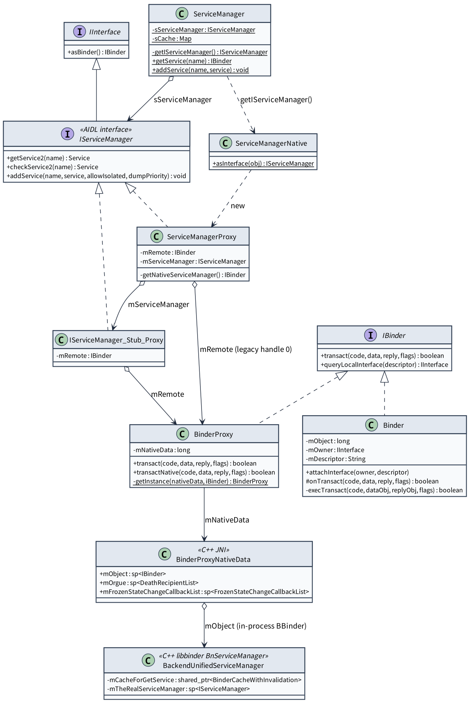
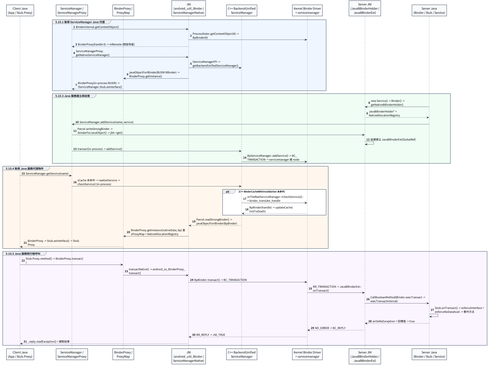

# 5.10 Binder 進程間通信機制的 Java 介面

- **情景說明**：從 Java 層完整貫通 Binder 進程間通信的五大核心情景——（1）透過 `ServiceManager.getIServiceManager()` 取得 ServiceManager 的 Java 代理物件，並經由 JNI 橋接複用 C++ `BackendUnifiedServiceManager`；（2）以 AIDL 定義 Java 服務介面，解析 `aidl --lang=java` 生成的頂層介面、`Default`、`Stub` 與 `Stub.Proxy`；（3）建構 Java 服務物件（`Binder` → `JavaBBinderHolder` + `NativeAllocationRegistry`）並經 `ServiceManager.addService()` 與 `JavaBBinderExt` 向 ServiceManager 註冊；（4）Client 端呼叫 `ServiceManager.getService()`，依序經 `sCache`、`BackendUnifiedServiceManager` 快取／跨行程查詢與 `BinderProxy.getInstance()`（`ProxyMap` + `NativeAllocationRegistry`）取得型別化代理；（5）透過 `Stub.Proxy` 發起遠端呼叫，經 `BinderProxy.transactNative()` 與核心驅動送達 Server 端，再由 `JavaBBinderExt::onTransact()` 回呼 `Binder.execTransact()` → `execTransactInternal()` → `Stub.onTransact()` 執行業務邏輯並將結果寫回。
- **對應原書**：第 5 章 5.10 節〈Binder 进程间通信机制的 Java 接口〉（p.308–334）
- **涉及專案與版本基準**：
  - `platform/frameworks/base` 〔`android-17.0.0_r1`，commit `94b4c16`〕
  - `platform/frameworks/native` 〔`android-17.0.0_r1`，commit `ae266dc`〕
  - `platform/system/tools/aidl` 〔`android-17.0.0_r1`，commit `9a94664`〕

---

## 5.10.1 ServiceManager 的 Java 代理物件取得過程

> 對應原書 5.10.1（p.308–318，圖 5-25 與圖 5-26）。在 Android 2.3 中，Java 層的 `ServiceManagerProxy` 持有一個包裝了 handle 0 `BpBinder` 的 `BinderProxy`（`mRemote`），由 Java 端自行打包 `Parcel` 並直接向核心 handle 0 發起交易。到了 Android 17，為了讓 Java 與 C++ 行程共用同一份 client-side 服務快取（`BinderCacheWithInvalidation`）並對齊 AIDL 介面，`ServiceManagerProxy` 在建構時會透過 JNI `getNativeServiceManager()` 取得同行程內 C++ `BackendUnifiedServiceManager`（繼承自 `BnServiceManager` / `BBinder`）的 Java `BinderProxy` 包裝，再交由 AIDL 生成的 `IServiceManager.Stub.asInterface()` 封裝為 `mServiceManager`。原本由 `BinderInternal.getContextObject()` 取回的 handle 0 `BinderProxy` 僅保留在 `mRemote` 欄位以相容舊 App 反射存取。



### Step 1：`ServiceManager.getIServiceManager()`
**位置**：`platform/frameworks/base/core/java/android/os/ServiceManager.java` 〔`android-17.0.0_r1`，lines 50–59, 129–139〕

```java
    @UnsupportedAppUsage
    private static IServiceManager sServiceManager;

    /**
     * Cache for the "well known" services, such as WM and AM.
     */
    // NOTE: this cache is designed to be populated exactly once at process
    // start to avoid any overhead from locking
    @UnsupportedAppUsage
    private static Map<String, IBinder> sCache = new ArrayMap<String, IBinder>();
```

```java
    @UnsupportedAppUsage
    private static IServiceManager getIServiceManager() {
        if (sServiceManager != null) {
            return sServiceManager;
        }

        // Find the service manager
        sServiceManager = ServiceManagerNative
                .asInterface(Binder.allowBlocking(BinderInternal.getContextObject()));
        return sServiceManager;
    }
```

**解說**：
1. `ServiceManager` 以靜態欄位 `sServiceManager` 單例快取行程內的 ServiceManager Java 代理；若已建立則直接回傳。
2. 首次呼叫時依序執行三個步驟：
   - 呼叫 `BinderInternal.getContextObject()`，經 JNI 向底層 `ProcessState` 取得 handle 0 的 `BpBinder` 並轉為 `BinderProxy`。
   - 呼叫 `Binder.allowBlocking(...)`（`Binder.java` lines 234–245），將該 `BinderProxy` 的 `mWarnOnBlocking` 旗標設為 `false`，避免在開啟阻塞警告的系統行程（如 `system_server`）中存取 ServiceManager 時觸發 `Log.wtf`。
   - 交由 `ServiceManagerNative.asInterface(...)` 包裝成 `IServiceManager` 實作（即 `ServiceManagerProxy`）。
3. 註解亦明確指出，`sCache` 改以 `ArrayMap` 實作且設計為僅在行程啟動初期單執行緒透過 `initServiceCache()` 一次性填入常見核心服務（如 `activity`、`window`），因此 `getService()` 讀取 `sCache` 時完全無須加鎖。

> 〔與 2.3 差異〕**邏輯改變**：外層先以 `Binder.allowBlocking(...)` 關閉阻塞交易警告，且 `sCache` 改為 `ArrayMap` 並由行程啟動期一次性注入（原書 p.310）。

---

### Step 2：`BinderInternal.getContextObject()` 與 JNI `android_os_BinderInternal_getContextObject()`
**位置**：`platform/frameworks/base/core/java/com/android/internal/os/BinderInternal.java` 〔`android-17.0.0_r1`，lines 179–180〕與 `platform/frameworks/base/core/jni/android_util_Binder.cpp` 〔`android-17.0.0_r1`，lines 1434–1438〕

```java
    @UnsupportedAppUsage
    public static final native IBinder getContextObject();
```

```cpp
static jobject android_os_BinderInternal_getContextObject(JNIEnv* env, jobject clazz)
{
    sp<IBinder> b = ProcessState::self()->getContextObject(NULL);
    return javaObjectForIBinder(env, b);
}
```

**解說**：
1. `BinderInternal.getContextObject()` 透過 `gBinderInternalMethods` 註冊對應到 `android_os_BinderInternal_getContextObject()`。
2. `ProcessState::self()->getContextObject(NULL)` 在 5.7 節已追蹤過：它透過 `getStrongProxyForHandle(0)` 建立指向全域 Context Manager（handle 0）的 C++ `BpBinder(0)`。
3. 接著呼叫 `javaObjectForIBinder(env, b)` 將這個 `BpBinder(0)` 包裝成一個 Java `BinderProxy` 回傳。需特別注意，在 Android 17 中這個 handle 0 的 `BinderProxy` 只會存入 `ServiceManagerProxy.mRemote` 供舊版非公開 API 相容，真正的 `addService`/`getService2` 呼叫將走下方 Step 3–4 的 `BackendUnifiedServiceManager` 路徑。

> 〔與 2.3 差異〕**不變（呼叫端角色退化為相容保留）**：JNI 實作逐行未變，但取回的 handle 0 `BinderProxy` 在 17 中僅保留於 `ServiceManagerProxy.mRemote`，不再是主要交易通道（原書 p.311）。

---

### Step 3：`ServiceManagerNative.asInterface()` 與 `ServiceManagerProxy` 建構子
**位置**：`platform/frameworks/base/core/java/android/os/ServiceManagerNative.java` 〔`android-17.0.0_r1`，lines 27–59, 141–152〕

```java
public final class ServiceManagerNative {
    private ServiceManagerNative() {}

    /**
     * Cast a Binder object into a service manager interface, generating
     * a proxy if needed.
     *
     * TODO: delete this method and have clients use
     *     IServiceManager.Stub.asInterface instead
     */
    @UnsupportedAppUsage
    public static IServiceManager asInterface(IBinder obj) {
        if (obj == null) {
            return null;
        }

        // ServiceManager is never local
        return new ServiceManagerProxy(obj);
    }
}

// This class should be deleted and replaced with IServiceManager.Stub whenever
// mRemote is no longer used
class ServiceManagerProxy implements IServiceManager {
    public ServiceManagerProxy(IBinder remote) {
        mRemote = remote;
        mServiceManager = IServiceManager.Stub.asInterface(
            Binder.allowBlocking(this.getNativeServiceManager()));
    }

    public IBinder asBinder() {
        return mRemote;
    }
...
    /**
     * Same as mServiceManager but used by apps.
     *
     * Once this can be removed, ServiceManagerProxy should be removed entirely.
     */
    @UnsupportedAppUsage
    private IBinder mRemote;

    private IServiceManager mServiceManager;

    private native IBinder getNativeServiceManager();
}
```

**解說**：
1. `ServiceManagerNative` 不再繼承 `Binder` 也不再實作 `IServiceManager`，退化為純靜態工廠類；且因 `servicemanager` 永遠位於獨立系統行程，直接省去 `obj.queryLocalInterface()` 檢查而回傳 `new ServiceManagerProxy(obj)`。
2. `ServiceManagerProxy` 建構子揭示了 Android 17 最核心的重構：
   - `mRemote = remote;` 僅是為了標有 `@UnsupportedAppUsage` 的歷史 App 相容而留存。
   - 真正執行所有服務查詢與註冊的是 `mServiceManager`，由 `this.getNativeServiceManager()` 取得底層 `IBinder`、經 `Binder.allowBlocking(...)` 關閉阻塞警告，再交給 AIDL 編譯 `IServiceManager.aidl` 生成的 `IServiceManager.Stub.asInterface(...)` 封裝為 `IServiceManager.Stub.Proxy`。

> 〔與 2.3 差異〕**邏輯改變**：2.3 的 `ServiceManagerNative` 為 `abstract class ServiceManagerNative extends Binder implements IServiceManager`，而 `ServiceManagerProxy` 直接對 `mRemote` 手動打包交易；17 全面轉向 AIDL `IServiceManager.Stub` 與 `native getNativeServiceManager()`（原書 p.309, p.318）。

---

### Step 4：JNI `getNativeServiceManager()` 與 `IServiceManagerFFI` 橋接 `BackendUnifiedServiceManager`
**位置**：`platform/frameworks/base/core/jni/android_os_ServiceManagerNative.cpp` 〔`android-17.0.0_r1`，lines 23–41〕與 `platform/frameworks/native/libs/binder/IServiceManagerFFI.cpp` 〔`android-17.0.0_r1`，lines 23–29〕

```cpp
jobject JNICALL Java_android_os_ServiceManagerProxy_getNativeServiceManager(JNIEnv *env,
                                                                            jobject obj) {
    sp<IBinder> service = IInterface::asBinder(
            impl::getJavaServicemanagerImplPrivateDoNotUseExceptInTheOnePlaceItIsUsed());
    return javaObjectForIBinder(env, service);
}

// ----------------------------------------------------------------------------

static const JNINativeMethod serviceManagerNativeMethods[] = {
        /* name, signature, funcPtr */
        {"getNativeServiceManager", "()Landroid/os/IBinder;",
         (void *)Java_android_os_ServiceManagerProxy_getNativeServiceManager}};

int register_android_os_ServiceManagerNative(JNIEnv *env) {
    return jniRegisterNativeMethods(env, "android/os/ServiceManagerProxy",
                                    serviceManagerNativeMethods,
                                    NELEM(serviceManagerNativeMethods));
}
```

```cpp
namespace android::impl {
sp<android::os::IServiceManager>
getJavaServicemanagerImplPrivateDoNotUseExceptInTheOnePlaceItIsUsed() {
    return getBackendUnifiedServiceManager();
}

} // namespace android::impl
```

**解說**：
1. `ServiceManagerProxy.getNativeServiceManager()` 呼叫獨立 JNI 檔案 `android_os_ServiceManagerNative.cpp`，再透過 `libbinder` 匯出的受限 FFI 入口 `getJavaServicemanagerImplPrivateDoNotUseExceptInTheOnePlaceItIsUsed()` 取得行程全域單例 `BackendUnifiedServiceManager`（見 5.7 節 `BackendUnifiedServiceManager.cpp` lines 510–549）。
2. 此處有一個極精巧的物件型別轉換：
   - 檢視 `BackendUnifiedServiceManager.h`（line 119），`BackendUnifiedServiceManager` 繼承自 `android::os::BnServiceManager`（亦即是一個**同行程內的 C++ `BBinder`**），而非 `BpBinder`！
   - `IInterface::asBinder(...)` 取出的 `sp<IBinder>` 指向該 C++ `BBinder`。
   - 傳入 `javaObjectForIBinder(env, service)` 時，由於 `BackendUnifiedServiceManager` 並非 `JavaBBinderExt`，`javaObjectForIBinder` 會為這個**行程內 C++ `BBinder`** 建立一個 Java `BinderProxy`！
   - 回傳給 `IServiceManager.Stub.asInterface(...)` 後，因 `BinderProxy.queryLocalInterface()` 恆回傳 `null`，便包裝成 `IServiceManager.Stub.Proxy`。
3. 如此設計的威力在於：往後 Java 呼叫 `mServiceManager.checkService2(name)` 時，雖然走過 `IServiceManager.Stub.Proxy` → `BinderProxy.transactNative()` → `target->transact(...)`，但 `target` 指向的是同行程的 C++ `BBinder`（`BackendUnifiedServiceManager`），因此 `BBinder::transact()` **直接在行程內同步呼叫 `BnServiceManager::onTransact()`**（不經核心驅動！），先查 `BinderCacheWithInvalidation` 快取；唯有快取未命中或執行 `addService` 時，才由 `BackendUnifiedServiceManager` 透過 `mTheRealServiceManager`（`BpServiceManager` / `BpBinder(0)`）真正跨行程進入 `/dev/binder`。

> 〔與 2.3 差異〕**新增**：2.3 並無 `android_os_ServiceManagerNative.cpp` 與 `IServiceManagerFFI.cpp`，Java 與 C++ 各自獨立向 handle 0 請求且 Java 端僅靠靜態 `sCache`；17 透過此 FFI 橋樑讓 Java 與 C++ 共享同一份支援死亡失效的 `BackendUnifiedServiceManager`（原書無，對照 p.318）。

---

### Step 5：JNI 偏移表與 `javaObjectForIBinder()` 的現代實作
**位置**：`platform/frameworks/base/core/jni/android_util_Binder.cpp` 〔`android-17.0.0_r1`，lines 75–88, 120–130, 965–1049, 1386–1405, 1897–1924〕

```cpp
static struct bindernative_offsets_t
{
    // Class state.
    jclass mClass;
    jmethodID mExecTransact;
    jmethodID mGetInterfaceDescriptor;
    jmethodID mTransactionCallback;
    jmethodID mGetExtension;
    jmethodID mGetTransactionName;

    // Object state.
    jfieldID mObject;

} gBinderOffsets;
```

```cpp
static struct binderproxy_offsets_t
{
    // Class state.
    jclass mClass;
    jmethodID mGetInstance;
    jmethodID mSendDeathNotice;
    jmethodID mInvokeFrozenStateChangeCallback;

    // Object state.
    jfieldID mNativeData;  // Field holds native pointer to BinderProxyNativeData.
} gBinderProxyOffsets;
```

```cpp
struct BinderProxyNativeData {
    // Both fields are constant and not null once javaObjectForIBinder returns this as
    // part of a BinderProxy.

    // The native IBinder proxied by this BinderProxy.
    sp<IBinder> mObject;

    // Death recipients for mObject. Reference counted only because DeathRecipients
    // hold a weak reference that can be temporarily promoted.
    sp<DeathRecipientList> mOrgue;  // Death recipients for mObject.

    // Frozen state change callbacks for mObject. Reference counted only because
    // JavaFrozenStateChangeCallback hold a weak reference that can be
    // temporarily promoted.
    sp<FrozenStateChangeCallbackList> mFrozenStateChangeCallbackList;

private:
    bool mOwnsObjectTag = false;

public:
    void tryTagObject() {
...
        mOwnsObjectTag = mObject->getWeakRefs()->tryTag(RefBase::OBJECT_TAG_JAVA_PROXY);
    }

    ~BinderProxyNativeData() {
        if (mOwnsObjectTag) {
            mObject->getWeakRefs()->untag(RefBase::OBJECT_TAG_JAVA_PROXY);
        }
    }
};

BinderProxyNativeData* getBPNativeData(JNIEnv* env, jobject obj) {
    return (BinderProxyNativeData *) env->GetLongField(obj, gBinderProxyOffsets.mNativeData);
}

// If the argument is a JavaBBinderExt, return the Java object that was used to create it.
// Otherwise return a BinderProxy for the IBinder. If a previous call was passed the
// same IBinder, and the original BinderProxy is still alive, return the same BinderProxy.
jobject javaObjectForIBinder(JNIEnv* env, const sp<IBinder>& val)
{
    // N.B. This function is called from a @FastNative JNI method, so don't take locks around
    // calls to Java code or block the calling thread for a long time for any reason.

    if (val == NULL) return NULL;

    if (val->checkSubclass(android::internal::JavaBBinderBase::getExtSubclassID())) {
        // It's a JavaBBinderExt created by ibinderForJavaObject. Already has Java object.
        jobject object = static_cast<JavaBBinderExt*>(val.get())->object();
        LOG_DEATH_FREEZE("objectForBinder %p: it's our own %p!\n", val.get(), object);
        return object;
    }

    BinderProxyNativeData* nativeData = new BinderProxyNativeData;
    nativeData->mOrgue = sp<DeathRecipientList>::make();
    nativeData->mFrozenStateChangeCallbackList = sp<FrozenStateChangeCallbackList>::make();
    nativeData->mObject = val;

    jobject object = env->CallStaticObjectMethod(gBinderProxyOffsets.mClass,
            gBinderProxyOffsets.mGetInstance, (jlong) nativeData, (jlong) val.get());
    if (env->ExceptionCheck()) {
        // In the exception case, getInstance still took ownership of nativeData.
        return NULL;
    }
    BinderProxyNativeData* actualNativeData = getBPNativeData(env, object);

    const bool createdOwningObject = actualNativeData == nativeData;
    if (createdOwningObject) {
        nativeData->tryTagObject();
    } else {
        // another thread created the de facto native data object
        delete nativeData;
    }

    return object;
}
```

而在 JNI 初始化函式 `int_register_android_os_Binder()` 與 `int_register_android_os_BinderProxy()` 中（lines 1386–1405, 1905–1916），可確認各欄位與方法簽名皆已全面升級為 64-bit `J`（`long`）：

```cpp
    gBinderOffsets.mClass = MakeGlobalRefOrDie(env, clazz);
    gBinderOffsets.mExecTransact = GetMethodIDOrDie(env, clazz, "execTransact", "(IJJI)Z");
...
    gBinderOffsets.mObject = GetFieldIDOrDie(env, clazz, "mObject", "J");
```

```cpp
    gBinderProxyOffsets.mClass = MakeGlobalRefOrDie(env, clazz);
    gBinderProxyOffsets.mGetInstance = GetStaticMethodIDOrDie(env, clazz, "getInstance",
            "(JJ)Landroid/os/BinderProxy;");
...
    gBinderProxyOffsets.mNativeData = GetFieldIDOrDie(env, clazz, "mNativeData", "J");
```

**解說**：
1. `javaObjectForIBinder()` 是 C++ `IBinder` 轉為 Java `IBinder` 的唯一樞紐：
   - **本地 Java 服務回轉**：若 `val->checkSubclass(JavaBBinderBase::getExtSubclassID())` 為真，代表該 `IBinder` 正是本行程某個 Java `Binder` 對應的 `JavaBBinderExt`，直接取出其 `mObject`（原本的 Java `Binder` 實例）回傳，不重複包裝。
   - **遠端 `BpBinder` 或純 C++ `BBinder`**：（例如 `BpBinder(0)` 或 `BackendUnifiedServiceManager`）先預先配置一份 `BinderProxyNativeData`，聚合保存 `sp<IBinder> mObject`、`sp<DeathRecipientList> mOrgue` 與 `sp<FrozenStateChangeCallbackList> mFrozenStateChangeCallbackList`，接著呼叫 Java 靜態工廠 `BinderProxy.getInstance((jlong)nativeData, (jlong)val.get())`。
2. **為何不在 C++ 端持鎖查找快取？** 註解點明 `javaObjectForIBinder` 會由 `@FastNative` JNI 方法呼叫，在持 native mutex 的情況下回呼 Java 容易導致與 GC 或其他執行緒死鎖。因此改由 Java 端 `BinderProxy.sProxyMap`（見 5.10.4 Step 4）以 `synchronized (sProxyMap)` 統一管理 `IBinder* → WeakReference<BinderProxy>` 映射。
3. 若 `BinderProxy.getInstance()` 查表命中既有的 `BinderProxy`，回傳物件的 `mNativeData` 不會等於剛配置的新 `nativeData`（`actualNativeData != nativeData`），此時由呼叫端直接 `delete nativeData` 回收多餘配置；若確為新建，則透過 `tryTagObject()` 在底層 `RefBase` 弱引用上標記 `OBJECT_TAG_JAVA_PROXY` 供除錯追蹤。

> 〔與 2.3 差異〕**邏輯改變**：2.3 使用 32-bit `int mObject`、`gWeakReferenceOffsets`、全域 `mProxyLock`，並透過 `BpBinder::ObjectManager`（`attachObject`/`findObject`/`detachObject`）在 C++ 端掛載 `WeakReference<BinderProxy>`；17 徹底廢除 `BpBinder::ObjectManager` 映射路徑與 `gWeakReferenceOffsets`，改以 `BinderProxyNativeData` 聚合原生狀態並移至 Java 端 `BinderProxy.sProxyMap` 查表去重，且以 `JavaBBinderBase::getExtSubclassID()` 取代 `&gBinderOffsets` 辨識 Java 本地物件（原書 p.311–318）。

---

## 5.10.2 Java 服務介面的定義和解析

> 對應原書 5.10.2（p.318–321）。Android 應用程式與系統服務皆以 `.aidl` 檔案宣告 Java 服務介面，建置時由 `aidl --lang=java`（實作於 `system/tools/aidl/generate_java_binder.cpp`）產生對應的 `.java` 原始碼。以下沿用 5.3 節選用的 `system/tools/aidl` 官方測試介面 `ICppJavaTests.aidl` 及其真實預先產生的 Java golden output `ICppJavaTests.java`，逐段解析 Android 17 Java AIDL 骨架的結構與演進。

### Step 1：AIDL 介面定義（`ICppJavaTests.aidl`）
**位置**：`platform/system/tools/aidl/tests/android/aidl/tests/ICppJavaTests.aidl` 〔`android-17.0.0_r1`，lines 17–44〕

```java
package android.aidl.tests;

import android.aidl.tests.BadParcelable;
import android.aidl.tests.GenericStructuredParcelable;
import android.aidl.tests.IntEnum;
import android.aidl.tests.StructuredParcelable;
import android.aidl.tests.Union;
import android.os.PersistableBundle;

// Tests that are only supported by the C++/Java backends, not NDK/Rust
interface ICppJavaTests {
    BadParcelable RepeatBadParcelable(in BadParcelable input);

    GenericStructuredParcelable<int, StructuredParcelable, IntEnum> RepeatGenericParcelable(
            in GenericStructuredParcelable<int, StructuredParcelable, IntEnum> input,
            out GenericStructuredParcelable<int, StructuredParcelable, IntEnum> repeat);
    PersistableBundle RepeatPersistableBundle(in PersistableBundle input);

    PersistableBundle[] ReversePersistableBundles(
            in PersistableBundle[] input, out PersistableBundle[] repeated);
    Union ReverseUnion(in Union input, out Union repeated);
    // Test that List<T> types work correctly.
    List<IBinder> ReverseNamedCallbackList(in List<IBinder> input, out List<IBinder> repeated);

    FileDescriptor RepeatFileDescriptor(in FileDescriptor read);
    FileDescriptor[] ReverseFileDescriptorArray(
            in FileDescriptor[] input, out FileDescriptor[] repeated);
}
```

**解說**：
1. AIDL 支援非基本型別的資料流方向標註（`in`、`out`、`inout`），並原生支援結構化 `Parcelable`、泛型 `Parcelable`、`Union`、`List<IBinder>` 與 `FileDescriptor`。
2. `aidl --lang=java` 會將此檔案編譯為單一 `ICppJavaTests.java`，內含四個角色：頂層介面 `ICppJavaTests`、預設空實作 `Default`、服務端抽象骨架 `Stub`、以及客戶端代理 `Stub.Proxy`。

> 〔與 2.3 差異〕**改名搬家（實例替換）**：原書使用自訂的 `IFregService.aidl`（僅含 `setVal`/`getVal`）；本筆記改以 `system/tools/aidl` 官方測試介面 `ICppJavaTests.aidl` 及其真實編譯輸出為據（原書 p.319）。

---

### Step 2：生成的頂層介面 `ICppJavaTests` 與 `Default` 類別
**位置**：`platform/system/tools/aidl/tests/golden_output/aidl-cpp-java-test-interface-java-source/gen/android/aidl/tests/ICppJavaTests.java` 〔`android-17.0.0_r1`，lines 9–31, 49–53, 434–445〕

```java
package android.aidl.tests;
// Tests that are only supported by the C++/Java backends, not NDK/Rust
public interface ICppJavaTests extends android.os.IInterface
{
  /** Default implementation for ICppJavaTests. */
  public static class Default implements android.aidl.tests.ICppJavaTests
  {
    @Override public android.aidl.tests.BadParcelable RepeatBadParcelable(android.aidl.tests.BadParcelable input) throws android.os.RemoteException
    {
      return null;
    }
    @Override public android.aidl.tests.GenericStructuredParcelable<Integer,android.aidl.tests.StructuredParcelable,Integer> RepeatGenericParcelable(android.aidl.tests.GenericStructuredParcelable<Integer,android.aidl.tests.StructuredParcelable,Integer> input, android.aidl.tests.GenericStructuredParcelable<Integer,android.aidl.tests.StructuredParcelable,Integer> repeat) throws android.os.RemoteException
    {
      return null;
    }
    @Override public android.os.PersistableBundle RepeatPersistableBundle(android.os.PersistableBundle input) throws android.os.RemoteException
    {
      return null;
    }
    @Override public android.os.PersistableBundle[] ReversePersistableBundles(android.os.PersistableBundle[] input, android.os.PersistableBundle[] repeated) throws android.os.RemoteException
    {
      return null;
    }
...
    @Override
    public android.os.IBinder asBinder() {
      return null;
    }
  }
...
  /** @hide */
  public static final java.lang.String DESCRIPTOR = "android.aidl.tests.ICppJavaTests";
  public android.aidl.tests.BadParcelable RepeatBadParcelable(android.aidl.tests.BadParcelable input) throws android.os.RemoteException;
  public android.aidl.tests.GenericStructuredParcelable<Integer,android.aidl.tests.StructuredParcelable,Integer> RepeatGenericParcelable(android.aidl.tests.GenericStructuredParcelable<Integer,android.aidl.tests.StructuredParcelable,Integer> input, android.aidl.tests.GenericStructuredParcelable<Integer,android.aidl.tests.StructuredParcelable,Integer> repeat) throws android.os.RemoteException;
  public android.os.PersistableBundle RepeatPersistableBundle(android.os.PersistableBundle input) throws android.os.RemoteException;
  public android.os.PersistableBundle[] ReversePersistableBundles(android.os.PersistableBundle[] input, android.os.PersistableBundle[] repeated) throws android.os.RemoteException;
  public android.aidl.tests.Union ReverseUnion(android.aidl.tests.Union input, android.aidl.tests.Union repeated) throws android.os.RemoteException;
  // Test that List<T> types work correctly.
  public java.util.List<android.os.IBinder> ReverseNamedCallbackList(java.util.List<android.os.IBinder> input, java.util.List<android.os.IBinder> repeated) throws android.os.RemoteException;
  public java.io.FileDescriptor RepeatFileDescriptor(java.io.FileDescriptor read) throws android.os.RemoteException;
  public java.io.FileDescriptor[] ReverseFileDescriptorArray(java.io.FileDescriptor[] input, java.io.FileDescriptor[] repeated) throws android.os.RemoteException;
}
```

**解說**：
1. 頂層介面 `ICppJavaTests` 繼承 `android.os.IInterface`，宣告所有遠端方法（皆可能拋出 `android.os.RemoteException`），並將介面描述字串 `DESCRIPTOR` 提升為介面的 `public static final` 常數。
2. `Default` 靜態內部類為所有方法提供空實作（回傳 `null`／`0`／`false`，`asBinder()` 回傳 `null`），用途與 5.3 節 C++ 端的 `I<Name>Default` 相同：當介面新增方法或測試撰寫假物件時，實作端可繼承 `Default` 避免編譯破壞。

> 〔與 2.3 差異〕**新增 + 邏輯改變**：新增 `Default` 內部類；`DESCRIPTOR` 由原 `Stub` 內的 `private static final` 改為頂層介面的 `public static final` 常數（原書 p.319, p.321）。

---

### Step 3：服務端骨架 `Stub`（建構子、`asInterface`、`getTransactionName` 與 `onTransact`）
**位置**：`platform/system/tools/aidl/tests/golden_output/aidl-cpp-java-test-interface-java-source/gen/android/aidl/tests/ICppJavaTests.java` 〔`android-17.0.0_r1`，lines 55–90, 125–146, 203–215, 246–252, 425–433〕、`platform/system/tools/aidl/generate_java_binder.cpp` 〔`android-17.0.0_r1`，lines 209–221, 627–630〕與 `platform/frameworks/base/core/java/android/os/Parcel.java` 〔`android-17.0.0_r1`，lines 1172–1187〕

```java
  /** Local-side IPC implementation stub class. */
  public static abstract class Stub extends android.os.Binder implements android.aidl.tests.ICppJavaTests
  {
    /** Construct the stub and attach it to the interface. */
    @SuppressWarnings("this-escape")
    public Stub()
    {
      this.attachInterface(this, DESCRIPTOR);
    }
    /**
     * Cast an IBinder object into an android.aidl.tests.ICppJavaTests interface,
     * generating a proxy if needed.
     */
    public static android.aidl.tests.ICppJavaTests asInterface(android.os.IBinder obj)
    {
      if ((obj==null)) {
        return null;
      }
      android.os.IInterface iin = obj.queryLocalInterface(DESCRIPTOR);
      if (((iin!=null)&&(iin instanceof android.aidl.tests.ICppJavaTests))) {
        return ((android.aidl.tests.ICppJavaTests)iin);
      }
      return new android.aidl.tests.ICppJavaTests.Stub.Proxy(obj);
    }
    @Override public android.os.IBinder asBinder()
    {
      return this;
    }
    /** @hide */
    public static java.lang.String getDefaultTransactionName(int transactionCode)
    {
      switch (transactionCode)
      {
        case TRANSACTION_RepeatBadParcelable:
        {
          return "RepeatBadParcelable";
        }
...
    /** @hide */
    public java.lang.String getTransactionName(int transactionCode)
    {
      return this.getDefaultTransactionName(transactionCode);
    }
    @Override public boolean onTransact(int code, android.os.Parcel data, android.os.Parcel reply, int flags) throws android.os.RemoteException
    {
      if (code >= android.os.IBinder.FIRST_CALL_TRANSACTION && code <= android.os.IBinder.LAST_CALL_TRANSACTION) {
        data.enforceInterface(DESCRIPTOR);
      }
      switch (code)
      {
        case TRANSACTION_RepeatBadParcelable:
        {
          android.aidl.tests.BadParcelable _arg0;
          _arg0 = data.readTypedObject(android.aidl.tests.BadParcelable.CREATOR);
          data.enforceNoDataAvail();
          android.aidl.tests.BadParcelable _result = this.RepeatBadParcelable(_arg0);
          reply.writeNoException();
          reply.writeTypedObject(_result, android.os.Parcelable.PARCELABLE_WRITE_RETURN_VALUE);
          break;
        }
...
        case TRANSACTION_ReverseNamedCallbackList:
        {
          java.util.List<android.os.IBinder> _arg0;
          _arg0 = data.createBinderArrayList();
          java.util.List<android.os.IBinder> _arg1;
          _arg1 = new java.util.ArrayList<android.os.IBinder>();
          data.enforceNoDataAvail();
          java.util.List<android.os.IBinder> _result = this.ReverseNamedCallbackList(_arg0, _arg1);
          reply.writeNoException();
          reply.writeBinderList(_result);
          reply.writeBinderList(_arg1);
          break;
        }
...
        default:
        {
          return super.onTransact(code, data, reply, flags);
        }
      }
      return true;
    }
...
    static final int TRANSACTION_RepeatBadParcelable = (android.os.IBinder.FIRST_CALL_TRANSACTION + 0);
    static final int TRANSACTION_RepeatGenericParcelable = (android.os.IBinder.FIRST_CALL_TRANSACTION + 1);
    static final int TRANSACTION_RepeatPersistableBundle = (android.os.IBinder.FIRST_CALL_TRANSACTION + 2);
    static final int TRANSACTION_ReversePersistableBundles = (android.os.IBinder.FIRST_CALL_TRANSACTION + 3);
    static final int TRANSACTION_ReverseUnion = (android.os.IBinder.FIRST_CALL_TRANSACTION + 4);
    static final int TRANSACTION_ReverseNamedCallbackList = (android.os.IBinder.FIRST_CALL_TRANSACTION + 5);
    static final int TRANSACTION_RepeatFileDescriptor = (android.os.IBinder.FIRST_CALL_TRANSACTION + 6);
    static final int TRANSACTION_ReverseFileDescriptorArray = (android.os.IBinder.FIRST_CALL_TRANSACTION + 7);
  }
```

對應 `aidl` 編譯器的產生規則（`generate_java_binder.cpp`）與 `Parcel` 的驗證實作（`Parcel.java`）：

```cpp
  // Interface token validation is done for user-defined transactions.
  if (case_count > 0) {
    auto ifStatement = std::make_shared<IfStatement>();
    ifStatement->expression = std::make_shared<LiteralExpression>(
        "code >= android.os.IBinder.FIRST_CALL_TRANSACTION && "
        "code <= android.os.IBinder.LAST_CALL_TRANSACTION");
    ifStatement->statements = std::make_shared<StatementBlock>();
    ifStatement->statements->Add(std::make_shared<MethodCall>(
        this->transact_data, "enforceInterface",
        std::vector<std::shared_ptr<Expression>>{
            std::make_shared<LiteralExpression>("DESCRIPTOR")}));
    transact_statements->Add(ifStatement);
  }
```

```cpp
  // EOF check
  if (!method.GetArguments().empty() && options.GetMinSdkVersion() > 32u) {
    statements->Add(std::make_shared<MethodCall>(transact_data, "enforceNoDataAvail"));
  }
```

```java
    public final void enforceInterface(@NonNull String interfaceName) {
        nativeEnforceInterface(mNativePtr, interfaceName);
    }

    /**
     * Verify there are no bytes left to be read on the Parcel.
     *
     * @throws BadParcelableException If the current position hasn't reached the end of the Parcel.
     * When used over binder, this exception should propagate to the caller.
     */
    public void enforceNoDataAvail() {
        final int n = dataAvail();
        if (n > 0) {
            throw new BadParcelableException("Parcel data not fully consumed, unread size: " + n);
        }
    }
```

**解說**：
1. **本地／遠端自動辨識**：`Stub()` 建構子呼叫父類 `Binder.attachInterface(this, DESCRIPTOR)` 記錄 `mOwner` 與 `mDescriptor`。呼叫 `Stub.asInterface(obj)` 時，若 `obj` 為同行程的本地 `Stub` 實例，其 `queryLocalInterface(DESCRIPTOR)` 會直接回傳 `this`，省去序列化與 IPC；若 `obj` 為跨行程的 `BinderProxy`，其 `queryLocalInterface()` 恆回傳 `null`，於是建立 `Stub.Proxy(obj)`。
2. **交易碼名稱解析**：`getDefaultTransactionName()` 與 `getTransactionName()` 由 `aidl` 自動生成，供 `BinderCallsStats` 以及原生層 `JavaBBinderExt::getFunctionName()` 追蹤呼叫名稱。
3. **集中式介面驗證**：`onTransact()` 不再在每個 `case` 重複寫 `data.enforceInterface(DESCRIPTOR)`，而是於進入 `switch` 前針對 `[FIRST_CALL_TRANSACTION, LAST_CALL_TRANSACTION]` 統一驗證一次；系統保留交易碼（如 `INTERFACE_TRANSACTION`、`DUMP_TRANSACTION`、`SHELL_COMMAND_TRANSACTION`）則落入 `default` 交由父類 `Binder.onTransact()` 處理。
4. **嚴格尾部殘留檢查**：只要方法有參數且 `min_sdk_version > 32`，`aidl` 便會在反序列化完所有輸入參數後插入 `data.enforceNoDataAvail()`。若惡意或版本錯配的 Client 多夾帶未消費位元組，立即拋出 `BadParcelableException` 並傳回給呼叫端，防範 Parcel 錯位漏洞。

> 〔與 2.3 差異〕**邏輯改變**：`enforceInterface` 集中至 `onTransact` 開頭；`INTERFACE_TRANSACTION` 改由父類 `Binder.onTransact` 處理；新增 `getDefaultTransactionName`/`getTransactionName` 與 `data.enforceNoDataAvail()` 邊界檢查（原書 p.319–320）。

---

### Step 4：客戶端代理 `Stub.Proxy` 與 `Parcel.readException()`
**位置**：`platform/system/tools/aidl/tests/golden_output/aidl-cpp-java-test-interface-java-source/gen/android/aidl/tests/ICppJavaTests.java` 〔`android-17.0.0_r1`，lines 253–285〕、`platform/frameworks/base/core/java/android/os/Parcel.java` 〔`android-17.0.0_r1`，lines 612–617, 3297–3344〕

```java
    private static final class Proxy implements android.aidl.tests.ICppJavaTests
    {
      private android.os.IBinder mRemote;
      Proxy(android.os.IBinder remote)
      {
        mRemote = remote;
      }
      @Override public android.os.IBinder asBinder()
      {
        return mRemote;
      }
      public final java.lang.String getInterfaceDescriptor()
      {
        return DESCRIPTOR;
      }
      @Override public android.aidl.tests.BadParcelable RepeatBadParcelable(android.aidl.tests.BadParcelable input) throws android.os.RemoteException
      {
        android.os.Parcel _data = android.os.Parcel.obtain(asBinder());
        android.os.Parcel _reply = android.os.Parcel.obtain();
        android.aidl.tests.BadParcelable _result;
        try {
          _data.writeInterfaceToken(DESCRIPTOR);
          _data.writeTypedObject(input, 0);
          boolean _status = mRemote.transact(Stub.TRANSACTION_RepeatBadParcelable, _data, _reply, 0);
          _reply.readException();
          _result = _reply.readTypedObject(android.aidl.tests.BadParcelable.CREATOR);
        }
        finally {
          _reply.recycle();
          _data.recycle();
        }
        return _result;
      }
```

```java
    @NonNull
    public static Parcel obtain(@NonNull IBinder binder) {
        Parcel parcel = Parcel.obtain();
        parcel.markForBinder(binder);
        return parcel;
    }
```

```java
    public final void readException() {
        int code = readExceptionCode();
        if (code != 0) {
            String msg = readString();
            readException(code, msg);
        }
    }
...
    @UnsupportedAppUsage
    @TestApi
    public final int readExceptionCode() {
        int code = readInt();
        if (code == EX_HAS_NOTED_APPOPS_REPLY_HEADER) {
            AppOpsManager.readAndLogNotedAppops(this);
            // Read next header or real exception if there is no more header
            code = readInt();
        }

        if (code == EX_HAS_STRICTMODE_REPLY_HEADER) {
            int headerSize = readInt();
            if (headerSize == 0) {
                Log.e(TAG, "Unexpected zero-sized Parcel reply header.");
            } else {
                // Currently the only thing in the header is StrictMode stacks,
                // but discussions around event/RPC tracing suggest we might
                // put that here too.  If so, switch on sub-header tags here.
                // But for now, just parse out the StrictMode stuff.
                StrictMode.readAndHandleBinderCallViolations(this);
            }
            // And fat response headers are currently only used when
            // there are no exceptions, so return no error:
            return 0;
        }
        return code;
    }
```

**解說**：
1. `Stub.Proxy` 持有 `mRemote`（跨行程時為 `BinderProxy`）。每個代理方法先透過 `Parcel.obtain(asBinder())` 取得請求 `Parcel`——其內呼叫 `markForBinder(binder)` 以標記此 `Parcel` 所對應的目標 Binder 傳輸格式（例如核心 Binder vs RPC Binder，對應 `generate_java_binder.cpp` lines 750–754）。
2. 寫入 `DESCRIPTOR` 介面標記與所有 `in`／`inout` 參數（以及動態 `out` 陣列的長度）後，呼叫 `mRemote.transact(...)`。
3. 收到回覆後，必先呼叫 `_reply.readException()`：
   - `readExceptionCode()` 會先處理跨行程夾帶的 AppOps 紀錄標頭（`EX_HAS_NOTED_APPOPS_REPLY_HEADER`）與 StrictMode 違規堆疊標頭（`EX_HAS_STRICTMODE_REPLY_HEADER`）。
   - 若真正例外碼非 0，則讀取錯誤訊息與遠端堆疊追蹤並在 Client 端還原拋出對應例外；若為 0（對應 Server 端的 `reply.writeNoException()`），才繼續讀取回傳值與 `out` 參數，最後於 `finally` 中歸還兩個 `Parcel` 至物件池。

> 〔與 2.3 差異〕**邏輯改變**：請求 `Parcel` 改用 `Parcel.obtain(asBinder())` 以支援 RPC Binder；`readException()` 擴充解析 AppOps 標頭、StrictMode 標頭與遠端堆疊追蹤（原書 p.320–321）。

---

## 5.10.3 Java 服務的啟動過程

> 對應原書 5.10.3（p.321–328）。由於 `system_server` 與每個 Android 應用程式行程在由 Zygote 衍生啟動時皆已在原生層開啟 Binder 執行緒池（透過 `ProcessState::self()->startThreadPool()`），因此運行於其內的 Java 服務（繼承 `<Interface>.Stub`，亦即繼承 `android.os.Binder`）在啟動時只需兩件事：建構 Java 服務實例，並呼叫 `ServiceManager.addService()` 向 ServiceManager 註冊。以下追蹤從 `new` 一個 Java 服務到其底層 `JavaBBinderExt` 寫入 `Parcel` 並送往 `servicemanager` 的完整鏈路。

### Step 1：`Binder` 建構子、`getNativeBBinderHolder()` 與 `NativeAllocationRegistry`
**位置**：`platform/frameworks/base/core/java/android/os/Binder.java` 〔`android-17.0.0_r1`，lines 124–133, 300–305, 709–738, 1273–1274〕與 `platform/frameworks/base/core/jni/android_util_Binder.cpp` 〔`android-17.0.0_r1`，lines 1304–1318〕

```java
    private static final int NATIVE_ALLOCATION_SIZE = 500;

    private static native long getNativeFinalizer();

    // Use a Holder to allow static initialization of Binder in the boot image, and
    // possibly to avoid some initialization ordering issues.
    private static class NoImagePreloadHolder {
        public static final NativeAllocationRegistry sRegistry = new NativeAllocationRegistry(
                Binder.class.getClassLoader(), getNativeFinalizer(), NATIVE_ALLOCATION_SIZE);
    }
```

```java
    @UnsupportedAppUsage
    private final long mObject;

    private IInterface mOwner;
    @Nullable
    private String mDescriptor;
```

```java
    public Binder() {
        this(null);
    }
...
    public Binder(@Nullable String descriptor) {
        mObject = getNativeBBinderHolder();
        NoImagePreloadHolder.sRegistry.registerNativeAllocation(this, mObject);

        if (FIND_POTENTIAL_LEAKS) {
            final Class<? extends Binder> klass = getClass();
            if ((klass.isAnonymousClass() || klass.isMemberClass() || klass.isLocalClass()) &&
                    (klass.getModifiers() & Modifier.STATIC) == 0) {
                Log.w(TAG, "The following Binder class should be static or leaks might occur: " +
                    klass.getCanonicalName());
            }
        }
        mDescriptor = descriptor;
    }
```

```java
    @CriticalNative
    private static native long getNativeBBinderHolder();
```

```cpp
static jlong android_os_Binder_getNativeBBinderHolder(CRITICAL_JNI_PARAMS) {
    JavaBBinderHolder* jbh = new JavaBBinderHolder();
    return (jlong) jbh;
}

static void Binder_destroy(void* rawJbh)
{
    JavaBBinderHolder* jbh = (JavaBBinderHolder*) rawJbh;
    ALOGV("Java Binder: deleting holder %p", jbh);
    delete jbh;
}

JNIEXPORT jlong JNICALL android_os_Binder_getNativeFinalizer(JNIEnv*, jclass) {
    return (jlong) Binder_destroy;
}
```

**解說**：
1. 當 Java 服務繼承 `<Interface>.Stub` 並建構時，會先呼叫父類 `Binder()` → `Binder(null)`，再於 `Stub()` 內呼叫 `attachInterface(this, DESCRIPTOR)`。
2. `Binder(String)` 呼叫標記為 `@CriticalNative` 的靜態方法 `getNativeBBinderHolder()`（省去 JNI frame 與 `JNIEnv*`/`jobject` 傳遞開銷），於 C++ 堆上配置一個輕量的 `JavaBBinderHolder` 物件，並將其 64-bit 位址存入 `private final long mObject`。
3. 緊接著透過 `NoImagePreloadHolder.sRegistry.registerNativeAllocation(this, mObject)` 將 Java `Binder` 與原生 `JavaBBinderHolder*` 的生命週期綁定至 ART `NativeAllocationRegistry`。當 Java `Binder` 被 GC 回收時，由 `Cleaner` 背景呼叫 `Binder_destroy(rawJbh)` 執行 `delete jbh`，免去傳統 `finalize()` 的效能與回收延遲問題。
4. 注意此時**尚未**建立真正的 C++ `BBinder`（`JavaBBinderExt`），也尚未建立 JNI `GlobalRef`——若這個 `Binder` 物件只被用於同行程通訊，永遠不會付出原生 `BBinder` 與 GlobalRef 的成本。

> 〔與 2.3 差異〕**邏輯改變**：2.3 在 `Binder()` 呼叫非靜態 JNI `init()` 建立繼承 `RefBase` 且持有 `jobject` 的 `JavaBBinderHolder`、`incStrong()` 後存入 32-bit `int mObject`，並靠 `finalize()` 釋放；17 改以 `@CriticalNative` 靜態方法建立不繼承 `RefBase`、不保存 `jobject` 的 `JavaBBinderHolder`，並改由 `NativeAllocationRegistry` 自動觸發 `Binder_destroy`（原書 p.322–323）。

---

### Step 2：`ServiceManager.addService()` → `ServiceManagerProxy.addService()`
**位置**：`platform/frameworks/base/core/java/android/os/ServiceManager.java` 〔`android-17.0.0_r1`，lines 190–192, 221–230〕與 `platform/frameworks/base/core/java/android/os/ServiceManagerNative.java` 〔`android-17.0.0_r1`，lines 84–87〕

```java
    public static void addService(String name, IBinder service) {
        addService(name, service, false, IServiceManager.DUMP_FLAG_PRIORITY_DEFAULT);
    }
```

```java
    @UnsupportedAppUsage(maxTargetSdk = Build.VERSION_CODES.R, trackingBug = 170729553)
    @RavenwoodRedirect
    public static void addService(String name, IBinder service, boolean allowIsolated,
            int dumpPriority) {
        try {
            getIServiceManager().addService(name, service, allowIsolated, dumpPriority);
        } catch (RemoteException e) {
            Log.e(TAG, "error in addService", e);
        }
    }
```

```java
    public void addService(String name, IBinder service, boolean allowIsolated, int dumpPriority)
            throws RemoteException {
        mServiceManager.addService(name, service, allowIsolated, dumpPriority);
    }
```

**解說**：
1. `ServiceManager.addService(name, service)` 補上預設參數 `allowIsolated = false` 與 `dumpPriority = DUMP_FLAG_PRIORITY_DEFAULT`，透過 `getIServiceManager()` 取得 `ServiceManagerProxy`，再委託給內部的 AIDL 代理 `mServiceManager`（`IServiceManager.Stub.Proxy`）。
2. `IServiceManager.Stub.Proxy.addService()` 會將 `name`、`service`（透過 `Parcel.writeStrongBinder(service)`）、`allowIsolated`、`dumpPriority` 寫入 `_data`，並對包裝了 C++ `BackendUnifiedServiceManager` 的 `BinderProxy` 呼叫 `transact()`。

> 〔與 2.3 差異〕**邏輯改變**：`addService` 新增 `allowIsolated` 與 `dumpPriority` 參數；`ServiceManagerProxy.addService` 不再手寫 `Parcel` 序列化與 `ADD_SERVICE_TRANSACTION`，改由 AIDL `mServiceManager` 統一處理並經 `BackendUnifiedServiceManager::addService` 轉發至 `servicemanager`（原書 p.324）。

---

### Step 3：`Parcel.writeStrongBinder()` → `android_os_Parcel_writeStrongBinder()` → `ibinderForJavaObject()`
**位置**：`platform/frameworks/base/core/java/android/os/Parcel.java` 〔`android-17.0.0_r1`，lines 559–561, 1371–1373, 1400–1402〕、`platform/frameworks/base/core/jni/android_os_Parcel.cpp` 〔`android-17.0.0_r1`，lines 340–349〕與 `platform/frameworks/base/core/jni/android_util_Binder.cpp` 〔`android-17.0.0_r1`，lines 1051–1075〕

```java
        public void writeStrongBinder(Parcel p, IBinder val) {
            p.writeStrongBinderNoHelper(val);
        }
```

```java
    /** @hide */
    public void writeStrongBinderNoHelper(IBinder val) {
        nativeWriteStrongBinder(mNativePtr, val);
    }
...
    public final void writeStrongBinder(IBinder val) {
        mReadWriteHelper.writeStrongBinder(this, val);
    }
```

```cpp
static void android_os_Parcel_writeStrongBinder(JNIEnv* env, jclass clazz, jlong nativePtr, jobject object)
{
    Parcel* parcel = reinterpret_cast<Parcel*>(nativePtr);
    if (parcel != NULL) {
        const status_t err = parcel->writeStrongBinder(ibinderForJavaObject(env, object));
        if (err != NO_ERROR) {
            signalExceptionForError(env, clazz, err);
        }
    }
}
```

```cpp
sp<IBinder> ibinderForJavaObject(JNIEnv* env, jobject obj)
{
    if (obj == NULL) return NULL;

    // Instance of Binder?
    if (env->IsInstanceOf(obj, gBinderOffsets.mClass)) {
        JavaBBinderHolder* jbh = (JavaBBinderHolder*)
            env->GetLongField(obj, gBinderOffsets.mObject);

        if (jbh == nullptr) {
            ALOGE("JavaBBinderHolder null on binder");
            return nullptr;
        }

        return jbh->get(env, obj);
    }

    // Instance of BinderProxy?
    if (env->IsInstanceOf(obj, gBinderProxyOffsets.mClass)) {
        return getBPNativeData(env, obj)->mObject;
    }

    ALOGW("ibinderForJavaObject: %p is not a Binder object", obj);
    return NULL;
}
```

**解說**：
1. Java 層 `Parcel.writeStrongBinder(val)` 經 `mReadWriteHelper`（預設 `ReadWriteHelper.DEFAULT`）呼叫靜態 JNI 方法 `nativeWriteStrongBinder(mNativePtr, val)`，直接把 64-bit C++ `Parcel*` 位址傳入 `android_os_Parcel_writeStrongBinder()`（省去 JNI 端再回讀 Java 欄位的開銷）。
2. `ibinderForJavaObject(env, object)` 負責將 Java `IBinder` 轉為底層 `sp<IBinder>`：
   - 若傳入的是本行程的 Java 服務（`android.os.Binder` 子類），從 `gBinderOffsets.mObject` 取出 `JavaBBinderHolder* jbh`，並把 `obj` 傳入 `jbh->get(env, obj)` 取得（或延遲建立）對應的 `JavaBBinderExt`。
   - 若傳入的是遠端代理（`android.os.BinderProxy`），直接透過 `getBPNativeData(env, obj)->mObject` 取出底層 `sp<IBinder>`。
3. 取得 `sp<IBinder>` 後交給 C++ `Parcel::writeStrongBinder()` 打包成 `flat_binder_object`（類型 `BINDER_TYPE_BINDER`，見 5.8.1 節）。

> 〔與 2.3 差異〕**改名搬家 + 邏輯改變**：`android_os_Parcel_writeStrongBinder` 自 `android_util_Binder.cpp` 搬遷至 `android_os_Parcel.cpp` 並改為直接傳遞 `jlong nativePtr`；`ibinderForJavaObject` 改讀 64-bit `GetLongField`、將 `obj` 傳入 `jbh->get(env, obj)`，並改經 `getBPNativeData()->mObject` 取得 `BinderProxy` 的原生 `IBinder`（原書 p.325–326）。

---

### Step 4：`JavaBBinderHolder::get()` 建立 `JavaBBinderExt`（繼承 `JavaBBinderBase : BBinder`）
**位置**：`platform/frameworks/native/libs/binder/include_private/binder/internal/JavaBBinderBase.h` 〔`android-17.0.0_r1`，lines 28–41〕、`platform/frameworks/native/libs/binder/JavaBBinderBase.cpp` 〔`android-17.0.0_r1`，lines 20–28〕與 `platform/frameworks/base/core/jni/android_util_Binder.cpp` 〔`android-17.0.0_r1`，lines 350–362, 403–413, 478–530, 565–575〕

```cpp
class LIBBINDER_EXPORTED JavaBBinderBase : public BBinder {
public:
    JavaBBinderBase();

    // Only use this method to check if the binder belongs to type JavaBBinderExt
    static const void* getExtSubclassID();

    virtual void getFunctionName(
            uint32_t code,
            const android::binder::impl::SmallFunction<void(const char*)>& callback) const = 0;

protected:
    virtual ~JavaBBinderBase();
};
```

```cpp
namespace android::internal {

JavaBBinderBase::JavaBBinderBase() = default;
JavaBBinderBase::~JavaBBinderBase() = default;

const void* JavaBBinderBase::getExtSubclassID() {
    static const char* const kSubclassID = "JavaBBinderExt";
    return kSubclassID;
}

} // namespace android::internal
```

```cpp
class JavaBBinderExt : public android::internal::JavaBBinderBase {
public:
    JavaBBinderExt(JNIEnv* env, jobject object)
          : mVM(jnienv_to_javavm(env)), mObject(env->NewGlobalRef(object)) {
        ALOGV("Creating JavaBBinderExt %p\n", this);
        gNumLocalRefsCreated.fetch_add(1, std::memory_order_relaxed);
        gcIfManyNewRefs(env);
    }

    bool checkSubclass(const void* subclassID) const override {
        return subclassID == android::internal::JavaBBinderBase::getExtSubclassID();
    }
...
    jobject object() const {
        return mObject;
    }

protected:
    virtual ~JavaBBinderExt() {
        ALOGV("Destroying JavaBBinderExt %p\n", this);
        gNumLocalRefsDeleted.fetch_add(1, std::memory_order_relaxed);
        JNIEnv* env = javavm_to_jnienv(mVM);
        env->DeleteGlobalRef(mObject);
    }
...
private:
    JavaVM* const   mVM;
    jobject const   mObject;  // GlobalRef to Java Binder

    mutable std::once_flag mPopulateDescriptor;
    mutable String16 mDescriptor;
};

// ----------------------------------------------------------------------------

class JavaBBinderHolder
{
public:
    sp<JavaBBinderExt> get(JNIEnv* env, jobject obj) {
        sp<JavaBBinderExt> b;
        {
            AutoMutex _l(mLock);
            // must take lock to promote because we set the same wp<>
            // on another thread.
            b = mBinder.promote();
        }

        if (b) return b;

        // b/360067751: constructor may trigger GC, so call outside lock
        b = sp<JavaBBinderExt>::make(env, obj);

        {
            AutoMutex _l(mLock);
            // if it was constructed on another thread in the meantime,
            // return that. 'b' will just get destructed.
            if (sp<JavaBBinderExt> b2 = mBinder.promote(); b2) return b2;

            if (mVintf) {
                ::android::internal::Stability::markVintf(b.get());
            }
            if (mSetExtensionCalled) {
                jobject javaIBinderObject = env->CallObjectMethod(obj, gBinderOffsets.mGetExtension);
                sp<IBinder> extensionFromJava = ibinderForJavaObject(env, javaIBinderObject);
                if (extensionFromJava != nullptr) {
                    b.get()->setExtension(extensionFromJava);
                }
            }
            if (mInheritRt) {
                b.get()->setInheritRt(mInheritRt);
            }
            mBinder = b;
            ALOGV("Creating JavaBinder %p (refs %p) for Object %p, weakCount=%" PRId32 "\n",
                 b.get(), b->getWeakRefs(), obj, b->getWeakRefs()->getWeakCount());
        }

        return b;
    }
...
private:
    Mutex           mLock;
    wp<JavaBBinderExt> mBinder;

    // in the future, we might condense this into int32_t stability, or if there
    // is too much binder state here, we can think about making JavaBBinderExt an
    // sp here (avoid recreating it)
    bool            mVintf = false;
    bool            mSetExtensionCalled = false;
    bool            mInheritRt = false;
};
```

**解說**：
1. **為何拆分 `JavaBBinderBase` 與 `JavaBBinderExt`？** `JavaBBinderBase` 定義在 `frameworks/native/libs/binder` 中（繼承 `BBinder`），提供 `getExtSubclassID()` 與純虛擬函式 `getFunctionName()`，讓底層 `libbinder` 在不反向依賴 `frameworks/base` JNI 的前提下，仍能辨識 Java 本地物件並解析交易碼對應的 Java 方法名稱（例如供原生追蹤／除錯工具使用）；而真正的 JNI 橋接則由 `android_util_Binder.cpp` 中的 `JavaBBinderExt` 實作。
2. **雙重檢查鎖避開鎖內 GC**：`JavaBBinderHolder::get()` 先加鎖嘗試將弱指標 `wp<JavaBBinderExt> mBinder` 升級（`promote()`）；若尚未建立或已被銷毀，會**先釋放 `mLock`** 再呼叫 `sp<JavaBBinderExt>::make(env, obj)`，因為 `JavaBBinderExt` 建構子內的 `gcIfManyNewRefs(env)` 可能觸發 ART GC（避免持鎖觸發 GC 死鎖）。建立後再次加鎖確認沒有其他執行緒搶先建立，並補套先前暫存於 Holder 的 `mVintf`（VINTF 穩定性）、`mSetExtensionCalled`（擴充 Binder）與 `mInheritRt`（即時優先權繼承）屬性，最後存回 `mBinder`。
3. **跨語言生命週期錨定**：`JavaBBinderExt` 以 `env->NewGlobalRef(object)` 強引用 Java 服務物件，確保只要核心 `binder_node`（或任何遠端 `binder_ref`／`servicemanager`）仍引用此 `JavaBBinderExt`，Java 服務就不會被 GC 回收；直到所有遠端引用歸零、`JavaBBinderExt` 析構時才呼叫 `DeleteGlobalRef(mObject)`。
4. 隨後 `IServiceManager.Stub.Proxy.addService()` 透過 `BinderProxy.transact()` 進入同行程 C++ `BackendUnifiedServiceManager::addService()`（`BackendUnifiedServiceManager.cpp` lines 337–352），由其呼叫 `mTheRealServiceManager->addService(...)` 將這個 `JavaBBinderExt` 跨 `/dev/binder` 註冊進 `servicemanager`（核心建立 `binder_node` 與 ServiceManager 的 `binder_ref`，詳見 5.8.1 節），並在 `mEnableAddServiceCache` 為真且非 lazy 服務時同步快取於本行程 `BinderCacheWithInvalidation` 中。

> 〔與 2.3 差異〕**改名 + 拆分 + 邏輯改變**：原 `JavaBBinder` 拆分為 `libbinder` 的 `JavaBBinderBase` 與 JNI 的 `JavaBBinderExt`；`JavaBBinderHolder::get()` 改採無鎖建立再雙重檢查以規避 GC 死鎖，並支援延遲套用 VINTF Stability、Extension 與 InheritRt 屬性（原書 p.326–328）。

---

## 5.10.4 Java 服務代理物件的取得過程

> 對應原書 5.10.4（p.328–331）。當 Java 服務註冊完成後，Java Client 透過 `ICppJavaTests svc = ICppJavaTests.Stub.asInterface(ServiceManager.getService("..."));` 取得遠端服務代理。在 Android 17 中，這條路徑會經過「Java 靜態快取 `sCache` → 同行程 C++ `BackendUnifiedServiceManager` 快取 → 跨行程 `servicemanager`」三級查找，並在 JNI 回轉 Java 層時透過 `BinderProxy.sProxyMap` 確保同一原生 `IBinder` 在行程內對應唯一活躍的 `BinderProxy`。

### Step 1：`ServiceManager.getService()` 與 `rawGetService()`
**位置**：`platform/frameworks/base/core/java/android/os/ServiceManager.java` 〔`android-17.0.0_r1`，lines 150–162, 390–444〕

```java
    public static IBinder getService(String name) {
        try {
            IBinder service = sCache.get(name);
            if (service != null) {
                return service;
            } else {
                return Binder.allowBlocking(rawGetService(name));
            }
        } catch (RemoteException e) {
            Log.e(TAG, "error in getService", e);
        }
        return null;
    }
```

```java
    private static IBinder rawGetService(String name) throws RemoteException {
        final long start = sStatLogger.getTime();

        final IBinder binder =
                getIServiceManager().getService2(name).getServiceWithMetadata().service;

        final int time = (int) sStatLogger.logDurationStat(Stats.GET_SERVICE, start);

        final int myUid = Process.myUid();
        final boolean isCore = UserHandle.isCore(myUid);

        final long slowThreshold = isCore
                ? GET_SERVICE_SLOW_THRESHOLD_US_CORE
                : GET_SERVICE_SLOW_THRESHOLD_US_NON_CORE;

        synchronized (sLock) {
            sGetServiceAccumulatedUs += time;
            sGetServiceAccumulatedCallCount++;
...
            if (time >= slowThreshold) {
...
                if ((nowUptime > (sLastSlowLogUptime + SLOW_LOG_INTERVAL_MS))
                        || (sLastSlowLogActualTime < time)) {
                    EventLogTags.writeServiceManagerSlow(time / 1000, name);

                    sLastSlowLogUptime = nowUptime;
                    sLastSlowLogActualTime = time;
                }
            }
...
        }
        return binder;
    }
```

**解說**：
1. 第一級快取為 Java 層無鎖 `sCache`；若命中直接回傳。
2. 未命中則進入 `rawGetService(name)`：呼叫 `getIServiceManager().getService2(name)` 取得 AIDL union `Service`，從中取出 `getServiceWithMetadata().service`（型別為 `IBinder`），同時以 `sStatLogger` 統計耗時並在超過門檻（核心 UID 預設 10ms、非核心 UID 預設 50ms）時寫入 EventLog。
3. 回傳前再經 `Binder.allowBlocking(...)` 標記允許同步阻塞呼叫（因透過 ServiceManager 註冊的皆為系統服務）。

> 〔與 2.3 差異〕**邏輯改變**：2.3 直接呼叫 `getIServiceManager().getService(name)`；17 抽出 `rawGetService()` 改呼 `getService2()` 解包 `ServiceWithMetadata`，加上 `Binder.allowBlocking()` 與慢查詢／累計耗時 EventLog 監控（原書 p.328–329）。

---

### Step 2：`ServiceManagerProxy.getService2()` 經 `BackendUnifiedServiceManager::checkService2()` 查詢
**位置**：`platform/frameworks/base/core/java/android/os/ServiceManagerNative.java` 〔`android-17.0.0_r1`，lines 68–82〕與 `platform/frameworks/native/libs/binder/BackendUnifiedServiceManager.cpp` 〔`android-17.0.0_r1`，lines 238–255〕

```java
    public Service getService2(String name) throws RemoteException {
        // Same as checkService (old versions of servicemanager had both methods).
        return checkService2(name);
    }
...
    public Service checkService2(String name) throws RemoteException {
        return mServiceManager.checkService2(name);
    }
```

```cpp
Status BackendUnifiedServiceManager::checkService2(const ::std::string& name, os::Service* _out) {
    os::Service service;
    if (returnIfCached(name, _out)) {
        return Status::ok();
    }

    Status status = Status::ok();
    if (mTheRealServiceManager) {
        status = mTheRealServiceManager->checkService2(name, &service);
    }
    if (status.isOk()) {
        status = toBinderService(name, service, _out);
        if (status.isOk()) {
            return updateCache(name, service);
        }
    }
    return status;
}
```

**解說**：
1. `ServiceManagerProxy.getService2(name)` 統一轉呼叫 `checkService2(name)` → `mServiceManager.checkService2(name)`。
2. 如 5.10.1 Step 4 所述，`mServiceManager`（`IServiceManager.Stub.Proxy`）所執行的 `mRemote.transact()` 會**直接於同行程內**進入 `BackendUnifiedServiceManager::checkService2()`：
   - **第二級快取命中**：`returnIfCached(name, _out)` 從 C++ `BinderCacheWithInvalidation` 取出仍存活（`isBinderAlive()`）的 `sp<IBinder>`，封裝進 `ServiceWithMetadata` 寫回 reply `Parcel`——**全程零次核心 Binder 交易**！
   - **快取未命中**：透過 `mTheRealServiceManager->checkService2(name, &service)` 跨 `/dev/binder` 向 `servicemanager` 查詢（詳見 5.9 節）；核心 `binder_translate_handle` 為 Client 行程建立指向 Server `binder_node` 的 `binder_ref`，Client 還原成 `BpBinder(handle)` 後，經 `toBinderService()` 處理並由 `updateCache()`（對非 lazy 服務註冊 `linkToDeath` 後）寫入本行程快取，再序列化進 reply `Parcel` 返回 Java 層。

> 〔與 2.3 差異〕**邏輯改變**：2.3 的 `ServiceManagerProxy.getService` 每次未命中 `sCache` 必定直接透過 handle 0 跨行程送出 `GET_SERVICE_TRANSACTION`；17 透過同行程 `BackendUnifiedServiceManager::checkService2` 引入第二級 C++ 死亡感知快取，未命中才改送 `checkService2` 至 `servicemanager`（原書 p.329）。

---

### Step 3：`Parcel.readStrongBinder()` → `android_os_Parcel_readStrongBinder()` → `javaObjectForIBinder()`
**位置**：`platform/frameworks/base/core/java/android/os/Parcel.java` 〔`android-17.0.0_r1`，lines 563–565, 3482–3494, 3516–3518〕與 `platform/frameworks/base/core/jni/android_os_Parcel.cpp` 〔`android-17.0.0_r1`，lines 513–520〕

```java
        public IBinder readStrongBinder(Parcel p) {
            return p.readStrongBinderNoHelper();
        }
```

```java
    /** @hide */
    public IBinder readStrongBinderNoHelper() {
        final IBinder result = nativeReadStrongBinder(mNativePtr);

        // If it's a reply from a method with @PropagateAllowBlocking, then inherit allow-blocking
        // from the object that returned it.
        if (result != null
                && hasFlags(
                        FLAG_IS_REPLY_FROM_BLOCKING_ALLOWED_OBJECT
                                | FLAG_PROPAGATE_ALLOW_BLOCKING)) {
            Binder.allowBlocking(result);
        }
        return result;
    }
...
    public final IBinder readStrongBinder() {
        return mReadWriteHelper.readStrongBinder(this);
    }
```

```cpp
static jobject android_os_Parcel_readStrongBinder(JNIEnv* env, jclass clazz, jlong nativePtr)
{
    Parcel* parcel = reinterpret_cast<Parcel*>(nativePtr);
    if (parcel != NULL) {
        return javaObjectForIBinder(env, parcel->readStrongBinder());
    }
    return NULL;
}
```

**解說**：
1. `IServiceManager.Stub.Proxy.checkService2()` 反序列化 `Service` / `ServiceWithMetadata` 時呼叫 `_reply.readStrongBinder()` → `readStrongBinderNoHelper()` → `nativeReadStrongBinder(mNativePtr)` → `android_os_Parcel_readStrongBinder()`。
2. 底層 `parcel->readStrongBinder()` 取出 `sp<IBinder>`（遠端服務即 `BpBinder(handle)`；若恰為同行程服務則是 `JavaBBinderExt`），交由 `javaObjectForIBinder()` 轉成 Java 物件。
3. 若該回覆 `Parcel` 同時帶有 `FLAG_IS_REPLY_FROM_BLOCKING_ALLOWED_OBJECT` 與 `FLAG_PROPAGATE_ALLOW_BLOCKING`（由 AIDL `@PropagateAllowBlocking` 標註觸發），Java 層會自動對取回的 `result` 繼承呼叫 `Binder.allowBlocking(result)`。

> 〔與 2.3 差異〕**改名搬家 + 邏輯改變**：`android_os_Parcel_readStrongBinder` 搬入 `android_os_Parcel.cpp` 並改用 64-bit `nativePtr`；Java 層新增 `ReadWriteHelper` 與 `@PropagateAllowBlocking` 旗標傳遞（原書 p.330）。

---

### Step 4：`BinderProxy.getInstance()`、`ProxyMap`、`NativeAllocationRegistry` 與 `Stub.asInterface()`
**位置**：`platform/frameworks/base/core/java/android/os/BinderProxy.java` 〔`android-17.0.0_r1`，lines 90–117, 169–191, 409–410, 475–518, 540–543, 881–886〕與 `platform/frameworks/base/core/jni/android_util_Binder.cpp` 〔`android-17.0.0_r1`，lines 1844–1856〕

```java
    @RavenwoodKeepWholeClass
    private static final class ProxyMap {
        private static final int LOG_MAIN_INDEX_SIZE = 8;
        private static final int MAIN_INDEX_SIZE = 1 <<  LOG_MAIN_INDEX_SIZE;
        private static final int MAIN_INDEX_MASK = MAIN_INDEX_SIZE - 1;
        /**
         * We will throw a BinderProxyMapSizeException if the number of map entries
         * exceeds:
         */
        private static final int CRASH_AT_SIZE = 25_000;
...
        private static int hash(long arg) {
            return ((int) ((arg >> 2) ^ (arg >> (2 + LOG_MAIN_INDEX_SIZE)))) & MAIN_INDEX_MASK;
        }
...
        BinderProxy get(long key) {
            int myHash = hash(key);
            Long[] keyArray = mMainIndexKeys[myHash];
            if (keyArray == null) {
                return null;
            }
            ArrayList<WeakReference<BinderProxy>> valueArray = mMainIndexValues[myHash];
            int bucketSize = valueArray.size();
            for (int i = 0; i < bucketSize; ++i) {
                long foundKey = keyArray[i];
                if (key == foundKey) {
                    WeakReference<BinderProxy> wr = valueArray.get(i);
                    BinderProxy bp = wr.get();
                    if (bp != null) {
                        return bp;
                    } else {
                        remove(myHash, i);
                        return null;
                    }
                }
            }
            return null;
        }
...
    }

    @GuardedBy("sProxyMap")
    private static final ProxyMap sProxyMap = new ProxyMap();
```

```java
    @RavenwoodKeep
    private static BinderProxy getInstance(long nativeData, long iBinder) {
        BinderProxy result;
        synchronized (sProxyMap) {
            try {
                result = sProxyMap.get(iBinder);
                if (result != null) {
                    return result;
                }
                result = new BinderProxy(nativeData);
            } catch (Throwable e) {
                // We're throwing an exception (probably OOME); don't drop nativeData.
                NativeAllocationRegistry.applyFreeFunction(NoImagePreloadHolder.sNativeFinalizer,
                        nativeData);
                throw e;
            }
            NoImagePreloadHolder.sRegistry.registerNativeAllocation(result, nativeData);
            // The registry now owns nativeData, even if registration threw an exception.
            sProxyMap.set(iBinder, result);
        }
        return result;
    }

    @RavenwoodKeep
    private BinderProxy(long nativeData) {
        mNativeData = nativeData;
    }

    private static final int NATIVE_ALLOCATION_SIZE = 1000;

    // Use a Holder to allow static initialization of BinderProxy in the boot image, and
    // to avoid some initialization ordering issues.
    @RavenwoodKeepWholeClass
    private static class NoImagePreloadHolder {
        public static final long sNativeFinalizer = getNativeFinalizer();
        public static final NativeAllocationRegistry sRegistry = new NativeAllocationRegistry(
                BinderProxy.class.getClassLoader(), sNativeFinalizer, NATIVE_ALLOCATION_SIZE);
    }
...
    @RavenwoodKeep
    public IInterface queryLocalInterface(String descriptor) {
        return null;
    }
...
    private final long mNativeData;
```

```cpp
static void BinderProxy_destroy(void* rawNativeData)
{
    BinderProxyNativeData * nativeData = (BinderProxyNativeData *) rawNativeData;
    LOG_DEATH_FREEZE("Destroying BinderProxy: binder=%p drl=%p fsccl=%p\n",
                     nativeData->mObject.get(), nativeData->mOrgue.get(),
                     nativeData->mFrozenStateChangeCallbackList.get());
    delete nativeData;
    IPCThreadState::self()->flushCommands();
}

JNIEXPORT jlong JNICALL android_os_BinderProxy_getNativeFinalizer(JNIEnv*, jclass) {
    return (jlong) BinderProxy_destroy;
}
```

**解說**：
1. `javaObjectForIBinder()` 呼叫 `BinderProxy.getInstance(nativeData, iBinder)` 時，會在 `synchronized (sProxyMap)` 保護下以 C++ `IBinder*` 位址為鍵查詢 `ProxyMap`（固定 256 個 bucket 的自訂雜湊表，值為 `WeakReference<BinderProxy>`）：
   - 若找到且 `wr.get() != null`，直接複用既有的 `BinderProxy`（返回 JNI 後由 `javaObjectForIBinder` 釋放預配的 `nativeData`）。
   - 若未找到（或弱引用已清空而被就地 `remove`），建構 `new BinderProxy(nativeData)`、向 `NativeAllocationRegistry` 註冊原生清理函式 `BinderProxy_destroy`，再寫入 `sProxyMap`。
2. **洩漏防護機制**：`ProxyMap.set()` 在插入時會優先重用已被 GC 清空的 `WeakReference` 槽位；若總條目數突破 `CRASH_AT_SIZE`（25,000）且強制 GC 後仍超過門檻，會先傾印各介面與各 UID 的代理數量（`dumpProxyInterfaceCounts()`、`dumpPerUidProxyCounts()`）再拋出 `BinderProxyMapSizeException` 防止系統記憶體與核心 `binder_ref` 耗盡。
3. **GC 釋放原生引用**：當 `BinderProxy` 失去所有 Java 強引用並被 GC 回收時，`NativeAllocationRegistry` 呼叫 `BinderProxy_destroy()` 執行 `delete nativeData`（遞減 `sp<IBinder> mObject` 強引用，進而由 `BpBinder` 排入 `BC_RELEASE`/`BC_DECREFS`），並立刻呼叫 `IPCThreadState::self()->flushCommands()` 沖刷至核心驅動，避免死亡物件長期滯留。
4. 取得 `BinderProxy` 返回 Client 端後，最後一步呼叫 `ICppJavaTests.Stub.asInterface(binder)`：因 `BinderProxy.queryLocalInterface()` 恆回傳 `null`，於是回傳 `new ICppJavaTests.Stub.Proxy(binder)`，完成 Java 服務代理物件的取得。

> 〔與 2.3 差異〕**拆分 + 邏輯改變**：`BinderProxy` 從 `Binder.java` 拆出為獨立公開類；以 Java `ProxyMap`（含 25,000 筆洩漏偵測）取代 C++ `BpBinder::ObjectManager` 維護一對一映射，並以 `NativeAllocationRegistry` 觸發 `BinderProxy_destroy`（含 `flushCommands()`）取代 `finalize()`（原書 p.313–318, p.330–331）。

---

## 5.10.5 Java 服務的呼叫過程

> 對應原書 5.10.5（p.331–334）。取得型別化代理（如 `ICppJavaTests.Stub.Proxy`）後，Java Client 呼叫介面方法（此處以 `RepeatPersistableBundle()` 為例）便會觸發一次完整的跨行程 Java → JNI → C++ `libbinder` → 核心驅動 → Server 端 `libbinder` → JNI → Java 回呼鏈。

### Step 1：`Stub.Proxy.RepeatPersistableBundle()` 序列化參數並發起 `transact()`
**位置**：`platform/system/tools/aidl/tests/golden_output/aidl-cpp-java-test-interface-java-source/gen/android/aidl/tests/ICppJavaTests.java` 〔`android-17.0.0_r1`，lines 307–324〕

```java
      @Override public android.os.PersistableBundle RepeatPersistableBundle(android.os.PersistableBundle input) throws android.os.RemoteException
      {
        android.os.Parcel _data = android.os.Parcel.obtain(asBinder());
        android.os.Parcel _reply = android.os.Parcel.obtain();
        android.os.PersistableBundle _result;
        try {
          _data.writeInterfaceToken(DESCRIPTOR);
          _data.writeTypedObject(input, 0);
          boolean _status = mRemote.transact(Stub.TRANSACTION_RepeatPersistableBundle, _data, _reply, 0);
          _reply.readException();
          _result = _reply.readTypedObject(android.os.PersistableBundle.CREATOR);
        }
        finally {
          _reply.recycle();
          _data.recycle();
        }
        return _result;
      }
```

**解說**：
1. 取得 `_data`（綁定目標 Binder）與 `_reply` 兩個 `Parcel`，依序寫入 `DESCRIPTOR` 介面標記與輸入參數 `input`。
2. 呼叫 `mRemote.transact(Stub.TRANSACTION_RepeatPersistableBundle, _data, _reply, 0)`（此處 `mRemote` 為指向遠端服務的 `BinderProxy`，`flags = 0` 表示同步雙向交易）。

> 〔與 2.3 差異〕**邏輯改變**：`_data` 改以 `Parcel.obtain(asBinder())` 取得以支援 RPC Binder，並接收 `boolean _status` 回傳值（原書 p.331–332）。

---

### Step 2：`BinderProxy.transact()` 前置攔截與轉呼 `transactNative()`
**位置**：`platform/frameworks/base/core/java/android/os/BinderProxy.java` 〔`android-17.0.0_r1`，lines 568–660〕

```java
    @RavenwoodKeep
    public boolean transact(int code, Parcel data, Parcel reply, int flags) throws RemoteException {
        Binder.checkParcel(this, code, data, "Unreasonably large binder buffer");

        boolean warnOnBlocking = mWarnOnBlocking; // Cache it to reduce volatile access.

        if (warnOnBlocking && ((flags & FLAG_ONEWAY) == 0)
                && Binder.sWarnOnBlockingOnCurrentThread.get()) {

            // For now, avoid spamming the log by disabling after we've logged
            // about this interface at least once
            mWarnOnBlocking = false;
            warnOnBlocking = false;

            if (Build.IS_USERDEBUG || Build.IS_ENG) {
                // Log this as a WTF on userdebug and eng builds.
                Log.wtf(Binder.TAG,
                        "Outgoing transactions from this process must be FLAG_ONEWAY",
                        new Throwable());
            } else {
                Log.w(Binder.TAG,
                        "Outgoing transactions from this process must be FLAG_ONEWAY",
                        new Throwable());
            }
        }

        final boolean tracingEnabled = Binder.isStackTrackingEnabled();
        if (tracingEnabled) {
            final Throwable tr = new Throwable();
            Binder.getTransactionTracker().addTrace(tr);
            StackTraceElement stackTraceElement = tr.getStackTrace()[1];
            Trace.traceBegin(Trace.TRACE_TAG_ALWAYS,
                    stackTraceElement.getClassName() + "." + stackTraceElement.getMethodName());
        }

        // Make sure the listener won't change while processing a transaction.
        final Binder.ProxyTransactListener transactListener = sTransactListener;
        Object session = null;

        if (transactListener != null) {
            final int origWorkSourceUid = Binder.getCallingWorkSourceUid();
            session = transactListener.onTransactStarted(this, code, flags);

            // Allow the listener to update the work source uid. We need to update the request
            // header if the uid is updated.
            final int updatedWorkSourceUid = Binder.getCallingWorkSourceUid();
            if (origWorkSourceUid != updatedWorkSourceUid) {
                data.replaceCallingWorkSourceUid(updatedWorkSourceUid);
            }
        }

        final AppOpsManager.PausedNotedAppOpsCollection prevCollection =
                AppOpsManager.pauseNotedAppOpsCollection();

        if ((flags & FLAG_ONEWAY) == 0 && AppOpsManager.isListeningForOpNoted()) {
            flags |= FLAG_COLLECT_NOTED_APP_OPS;
        }

        try {
            final boolean result = transactNative(code, data, reply, flags);

            if (reply != null && !warnOnBlocking) {
                reply.addFlags(Parcel.FLAG_IS_REPLY_FROM_BLOCKING_ALLOWED_OBJECT);
            }

            return result;
        } finally {
            AppOpsManager.resumeNotedAppOpsCollection(prevCollection);

            if (transactListener != null) {
                transactListener.onTransactEnded(session);
            }

            if (tracingEnabled) {
                Trace.traceEnd(Trace.TRACE_TAG_ALWAYS);
            }
        }
    }
...
    @RavenwoodKeep
    public native boolean transactNative(int code, Parcel data, Parcel reply,
            int flags) throws RemoteException;
```

**解說**：
1. 在真正跨入 JNI 之前，Android 17 在 Java 層 `BinderProxy.transact()` 安插了五項系統級基礎設施：
   - **大 Parcel 告警**：`Binder.checkParcel()`（開啟 `CHECK_PARCEL_SIZE` 時檢測 >= 800KB 交易）。
   - **同步阻塞檢查**：若行程開啟 `sWarnOnBlocking`（典型如 `system_server` 防範被不受信任 App 卡死）且本次非 `FLAG_ONEWAY`，輸出 `Log.wtf`/`Log.w` 並附上呼叫堆疊。
   - **堆疊追蹤**：若啟用 `TransactionTracker`，記錄呼叫端堆疊並開啟 systrace 區段。
   - **WorkSource 歸屬傳遞**：透過全域 `sTransactListener`（如 `PropagateWorkSourceTransactListener`），若監聽器更新了呼叫端 WorkSource UID，便呼叫 `data.replaceCallingWorkSourceUid()` 回寫至請求 Parcel 標頭，讓 Server 端正確歸責電量與資源消耗。
   - **AppOps 追蹤**：暫停本端 AppOps 收集並為同步呼叫加上 `FLAG_COLLECT_NOTED_APP_OPS`，指示 Server 端將此次交易觸發的權限存取記錄附回 reply 標頭。
2. 隨後呼叫真正的 JNI 方法 `transactNative(code, data, reply, flags)`；返回後若該代理允許阻塞（`!warnOnBlocking`），替 `reply` 加上 `FLAG_IS_REPLY_FROM_BLOCKING_ALLOWED_OBJECT` 供 `readStrongBinderNoHelper()` 傳遞。

> 〔與 2.3 差異〕**邏輯改變**：2.3 的 `BinderProxy.transact()` 本身即是 `native` 方法；17 拆出 Java 包裝層承擔阻塞告警、堆疊追蹤、WorkSource 傳遞與 AppOps 追蹤，再轉呼叫 `transactNative()`（原書 p.327）。

---

### Step 3：JNI `android_os_BinderProxy_transact()` → `BpBinder::transact()` → 核心驅動
**位置**：`platform/frameworks/base/core/jni/android_util_Binder.cpp` 〔`android-17.0.0_r1`，lines 1644–1687〕

```cpp
static jboolean android_os_BinderProxy_transact(JNIEnv* env, jobject obj,
        jint code, jobject dataObj, jobject replyObj, jint flags) // throws RemoteException
{
    if (dataObj == NULL) {
        jniThrowNullPointerException(env, NULL);
        return JNI_FALSE;
    }

    Parcel* data = parcelForJavaObject(env, dataObj);
    if (data == NULL) {
        return JNI_FALSE;
    }
    Parcel* reply = parcelForJavaObject(env, replyObj);
    if (reply == NULL && replyObj != NULL) {
        return JNI_FALSE;
    }

    IBinder* target = getBPNativeData(env, obj)->mObject.get();
    if (target == NULL) {
        jniThrowException(env, "java/lang/IllegalStateException", "Binder has been finalized!");
        return JNI_FALSE;
    }

    ALOGV("Java code calling transact on %p in Java object %p with code %" PRId32 "\n",
            target, obj, code);

    //printf("Transact from Java code to %p sending: ", target); data->print();
    status_t err = target->transact(code, *data, reply, flags);
    //if (reply) printf("Transact from Java code to %p received: ", target); reply->print();

    if (err == NO_ERROR) {
        return JNI_TRUE;
    }

    env->CallStaticVoidMethod(gBinderOffsets.mClass, gBinderOffsets.mTransactionCallback, getpid(),
                              code, flags, err);

    if (err == UNKNOWN_TRANSACTION) {
        return JNI_FALSE;
    }

    signalExceptionForError(env, obj, err, true /*canThrowRemoteException*/, data->dataSize());
    return JNI_FALSE;
}
```

**解說**：
1. 透過 `parcelForJavaObject()` 取得 Java `dataObj`、`replyObj` 對應的 C++ `Parcel*`，並由 `getBPNativeData(env, obj)->mObject.get()` 取出底層 `IBinder* target`（跨行程時為 `BpBinder*`）。
2. 呼叫 `target->transact(code, *data, reply, flags)`：進入 5.2 / 5.8 節已詳述的 `BpBinder::transact()` → `IPCThreadState::transact()` → `talkWithDriver()` 送出 `BC_TRANSACTION` → 核心 `binder_transaction()` 查找 `binder_ref` 對應的目標 `binder_node`、配置接收緩衝區並拷貝資料、將 `BINDER_WORK_TRANSACTION` 投入目標行程（或執行緒）`todo` 佇列並喚醒 Server 端 Binder 執行緒，同時 Client 執行緒阻塞於 `waitForResponse()` 等待 `BR_REPLY`。
3. 交易完成返回後，若 `err != NO_ERROR`，會先通知 `Binder.transactionCallback()`；若為 `UNKNOWN_TRANSACTION` 回傳 `JNI_FALSE`；其餘錯誤則呼叫 `signalExceptionForError()`（lines 1092–1223），例如將 `FAILED_TRANSACTION` 依 `data->dataSize() > 200*1024` 區分拋出 `TransactionTooLargeException` 或 `DeadObjectException`。

> 〔與 2.3 差異〕**邏輯改變**：改由 `getBPNativeData()->mObject` 取得 `IBinder*`；新增錯誤回呼 `Binder.transactionCallback`，並將 `data->dataSize()` 傳入 `signalExceptionForError()` 以區分 `TransactionTooLargeException` 與 `DeadObjectException`（原書 p.327–328）。

---

### Step 4：Server 端 `JavaBBinderExt::onTransact()` 回呼 Java 層
**位置**：`platform/frameworks/base/core/jni/android_util_Binder.cpp` 〔`android-17.0.0_r1`，lines 415–471〕

```cpp
    status_t onTransact(
        uint32_t code, const Parcel& data, Parcel* reply, uint32_t flags = 0) override
    {
        JNIEnv* env = javavm_to_jnienv(mVM);

        LOG_ALWAYS_FATAL_IF(env == nullptr,
                            "Binder thread started or Java binder used, but env null. Attach JVM?");

        ALOGV("onTransact() on %p calling object %p in env %p vm %p\n", this, mObject, env, mVM);

        IPCThreadState* thread_state = IPCThreadState::self();
        const int32_t strict_policy_before = thread_state->getStrictModePolicy();

        //printf("Transact from %p to Java code sending: ", this);
        //data.print();
        //printf("\n");
        jboolean res = env->CallBooleanMethod(mObject, gBinderOffsets.mExecTransact,
            code, reinterpret_cast<jlong>(&data), reinterpret_cast<jlong>(reply), flags);

        if (env->ExceptionCheck()) {
            ScopedLocalRef<jthrowable> excep(env, env->ExceptionOccurred());

            auto state = IPCThreadState::self();
            String8 msg;
            msg.appendFormat("*** Uncaught remote exception! Exceptions are not yet supported "
                             "across processes. Client PID %d UID %d.",
                             state->getCallingPid(), state->getCallingUid());
            binder_report_exception(env, excep.get(), msg.c_str());
            res = JNI_FALSE;
        }

        // Check if the strict mode state changed while processing the
        // call.  The Binder state will be restored by the underlying
        // Binder system in IPCThreadState, however we need to take care
        // of the parallel Java state as well.
        if (thread_state->getStrictModePolicy() != strict_policy_before) {
            set_dalvik_blockguard_policy(env, strict_policy_before);
        }

        if (env->ExceptionCheck()) {
            ScopedLocalRef<jthrowable> excep(env, env->ExceptionOccurred());
            binder_report_exception(env, excep.get(),
                                    "*** Uncaught exception in onBinderStrictModePolicyChange");
            // TODO: should turn this to fatal?
        }

        // Need to always call through the native implementation of
        // SYSPROPS_TRANSACTION.
        if (code == SYSPROPS_TRANSACTION) {
            BBinder::onTransact(code, data, reply, flags);
        }

        //aout << "onTransact to Java code; result=" << res << endl
        //    << "Transact from " << this << " to Java code returning "
        //    << reply << ": " << *reply << endl;
        return res != JNI_FALSE ? NO_ERROR : UNKNOWN_TRANSACTION;
    }
```

**解說**：
1. Server 端 Binder 執行緒池中的工作執行緒從核心讀出 `BR_TRANSACTION` 後，在 `IPCThreadState::executeCommand()` 取出該 `binder_node` 關聯的 `BBinder*`（即 5.10.3 Step 4 註冊的 `JavaBBinderExt`），呼叫 `b->transact()` → `BBinder::transact()` → 虛擬分派至 `JavaBBinderExt::onTransact()`。
2. 取得當前執行緒已附加至 ART JVM 的 `JNIEnv*`（若為空表示該原生 Binder 執行緒未附加 JVM，直接 `LOG_ALWAYS_FATAL_IF` 中止）。
3. 記錄呼叫前的 `StrictModePolicy`，接著透過 `env->CallBooleanMethod(mObject, gBinderOffsets.mExecTransact, ...)` 回呼 Java 服務物件的 `Binder.execTransact()`，將 C++ `data` 與 `reply` 兩個 `Parcel` 的 64-bit 指標以 `jlong` 傳入。
4. Java 端返回後：
   - 若有未被 `execTransact` 攔截的例外（尤其是 `java.lang.Error` 如 `OutOfMemoryError`），透過 `binder_report_exception()` 記錄 Client PID/UID 並對 `java.lang.Error` 呼叫 `report_java_lang_error()` 觸發未捕獲例外處理器或終止程序。
   - 若處理期間 `StrictModePolicy` 發生變動，呼叫 `set_dalvik_blockguard_policy()` 同步還原 Java 側 BlockGuard 狀態。
   - 若交易碼為 `SYSPROPS_TRANSACTION`，額外轉呼叫 `BBinder::onTransact()` 執行原生系統屬性變更回呼。
   - 依 `res` 回傳 `NO_ERROR` 或 `UNKNOWN_TRANSACTION`。

> 〔與 2.3 差異〕**改名 + 邏輯改變**：類別改名為 `JavaBBinderExt`；`Parcel*` 參數由 32-bit `int32_t` 改為 64-bit `jlong`；新增未捕獲例外與 `java.lang.Error` 致命上報、StrictMode 策略同步還原，以及 `SYSPROPS_TRANSACTION` 原生轉發（原書 p.332–333）。

---

### Step 5：`Binder.execTransact()` 與 `Binder.execTransactInternal()`
**位置**：`platform/frameworks/base/core/java/android/os/Binder.java` 〔`android-17.0.0_r1`，lines 1302–1415〕與 `platform/frameworks/base/core/java/android/os/Parcel.java` 〔`android-17.0.0_r1`，lines 5614–5637〕

```java
    // Entry point from android_util_Binder.cpp's onTransact.
    @UnsupportedAppUsage
    private boolean execTransact(int code, long dataObj, long replyObj,
            int flags) {

        Parcel data = Parcel.obtain(dataObj);
        Parcel reply = Parcel.obtain(replyObj);

        // At that point, the parcel request headers haven't been parsed so we do not know what
        // {@link WorkSource} the caller has set. Use calling UID as the default.
        //
        // TODO: this is wrong - we should attribute along the entire call route
        // also this attribution logic should move to native code - it only works
        // for Java now
        //
        // This attribution support is not generic and therefore not support in RPC mode
        final int callingUid = data.isForRpc() ? -1 : Binder.getCallingUid();
        final long origWorkSource = callingUid == -1
                ? -1 : ThreadLocalWorkSource.setUid(callingUid);

        try {
            return execTransactInternal(code, data, reply, flags, callingUid);
        } finally {
            reply.recycle();
            data.recycle();

            if (callingUid != -1) {
                ThreadLocalWorkSource.restore(origWorkSource);
            }
        }
    }

    private boolean execTransactInternal(int code, Parcel data, Parcel reply, int flags,
            int callingUid) {
        // Make sure the observer won't change while processing a transaction.
        final BinderInternal.Observer observer = sObserver;

        // TODO(b/299356196): observer should also observe transactions in native code
        final CallSession callSession =
                observer != null ? observer.callStarted(this, code, UNSET_WORKSOURCE) : null;
        // Theoretically, we should call transact, which will call onTransact,
        // but all that does is rewind it, and we just got these from an IPC,
        // so we'll just call it directly.
        boolean res;
        // Log any exceptions as warnings, don't silently suppress them.
        // If the call was {@link IBinder#FLAG_ONEWAY} then these exceptions
        // disappear into the ether.
        try {
            // TODO(b/299356201) - this logic should not be in Java - it should be in native
            // code in libbinder so that it works for all binder users.
            final BinderCallHeavyHitterWatcher heavyHitterWatcher = sHeavyHitterWatcher;
            if (heavyHitterWatcher != null && callingUid != -1) {
                // Notify the heavy hitter watcher, if it's enabled.
                heavyHitterWatcher.onTransaction(callingUid, getClass(), code);
            }

            // TODO(b/299353919) - this logic should not be in Java - it should be
            // in native code in libbinder so that it works for all binder users.
            // Further, this should not re-use flags.
            if ((flags & FLAG_COLLECT_NOTED_APP_OPS) != 0 && callingUid != -1) {
                AppOpsManager.startNotedAppOpsCollection(callingUid);
                try {
                    res = onTransact(code, data, reply, flags);
                } finally {
                    AppOpsManager.finishNotedAppOpsCollection();
                }
            } else {
                res = onTransact(code, data, reply, flags);
            }
        } catch (RemoteException|RuntimeException e) {
            if (observer != null) {
                observer.callThrewException(callSession, e);
            }
            if (LOG_RUNTIME_EXCEPTION) {
                Log.w(TAG, "Caught a RuntimeException from the binder stub implementation.", e);
            }
            if ((flags & FLAG_ONEWAY) != 0) {
                if (e instanceof RemoteException) {
                    Log.w(TAG, "Binder call failed.", e);
                } else {
                    Log.w(TAG, "Caught a RuntimeException from the binder stub implementation.", e);
                }
                onUnhandledException(code, flags, e);
            } else {
                // Clear the parcel before writing the exception.
                reply.setDataSize(0);
                reply.setDataPosition(0);
                // The writeException below won't do anything useful if this is the case.
                if (Parcel.getExceptionCode(e) == 0) {
                    onUnhandledException(code, flags, e);
                }
                reply.writeException(e);
            }
            res = true;
        } finally {
            if (observer != null) {
                // The parcel RPC headers have been called during onTransact so we can now access
                // the worksource UID from the parcel.
                final int workSourceUid = sWorkSourceProvider.resolveWorkSourceUid(
                        data.readCallingWorkSourceUid());
                observer.callEnded(callSession, data.dataSize(), reply.dataSize(), workSourceUid);
            }

            checkParcel(this, code, reply, "Unreasonably large binder reply buffer");
        }

        // Just in case -- we are done with the IPC, so there should be no more strict
        // mode violations that have gathered for this thread. Either they have been
        // parceled and are now in transport off to the caller, or we are returning back
        // to the main transaction loop to wait for another incoming transaction. Either
        // way, strict mode begone!
        StrictMode.clearGatheredViolations();
        return res;
    }
```

```java
    static protected final Parcel obtain(long obj) {
        Parcel res = null;
        synchronized (sPoolSync) {
            if (sHolderPool != null) {
                res = sHolderPool;
                sHolderPool = res.mPoolNext;
                res.mPoolNext = null;
                sHolderPoolSize--;
            }
        }

        // When no cache found above, create from scratch; otherwise prepare the
        // cached object to be used
        if (res == null) {
            res = new Parcel(obj);
        } else {
            res.mRecycled = false;
            if (DEBUG_RECYCLE) {
                res.mStack = new RuntimeException();
            }
            res.init(obj);
        }
        return res;
    }
```

**解說**：
1. `execTransact()` 先以 `Parcel.obtain(long)` 從 `sHolderPool` 物件池取出兩個 Java `Parcel` 外殼，將 C++ `dataObj`、`replyObj` 指標掛上（不取得原生所有權，因此 `finally` 中 `recycle()` 只會解除掛接並歸還 Java 外殼，不會銷毀 C++ `Parcel`）。接著將 `callingUid` 暫存至 `ThreadLocalWorkSource`，委託給 `execTransactInternal()`。
2. `execTransactInternal()` 在分派至子類 `onTransact()` 前後串接完整的觀測與例外治理：
   - **效能觀測與濫用偵測**：分別通知 `sObserver`（`BinderCallsStats`）與 `sHeavyHitterWatcher`。
   - **AppOps 收集**：若 Client 端設定了 `FLAG_COLLECT_NOTED_APP_OPS`，於 `onTransact()` 執行期間收集本次交易觸發的權限檢查紀錄。
   - **例外序列化策略**：僅攔截 `RemoteException | RuntimeException`：
     - 若為 `FLAG_ONEWAY` 無法回覆給呼叫端，記警告並回呼 `onUnhandledException()`。
     - 若為同步交易，先清空已寫入一半的 `reply`（`setDataSize(0)`、`setDataPosition(0)`），再呼叫 `reply.writeException(e)` 將例外碼、訊息與堆疊寫入 `reply` 傳回 Client（若是不支援跨行程傳遞的例外類型則先回呼 `onUnhandledException()`），並回傳 `res = true`。
     - 注意 `OutOfMemoryError` 已不再被此處吞掉，會直接穿透回 `JavaBBinderExt::onTransact()` 視為致命 `java.lang.Error` 處理。
   - **收尾**：於 `finally` 補讀 `data.readCallingWorkSourceUid()` 結束 `observer` 會話、檢查 `reply` 大小並清除殘留的 `StrictMode` 違規記錄。

> 〔與 2.3 差異〕**邏輯改變**：2.3 的 `execTransact(int, int, int, int)` 結構單純且會攔截 `OutOfMemoryError` 包裝為 `RuntimeException`；17 升級為 64-bit `long` 指標並拆出 `execTransactInternal()`，整合 `ThreadLocalWorkSource`、`Observer`、`HeavyHitterWatcher`、`AppOps` 收集、`reply` 清空與 `onUnhandledException()`，且不再攔截 `OutOfMemoryError`（原書 p.333）。

---

### Step 6：`Stub.onTransact()` 分派至 Java 服務實作並回傳結果
**位置**：`platform/system/tools/aidl/tests/golden_output/aidl-cpp-java-test-interface-java-source/gen/android/aidl/tests/ICppJavaTests.java` 〔`android-17.0.0_r1`，lines 130–136, 160–169, 246–252〕

```java
    @Override public boolean onTransact(int code, android.os.Parcel data, android.os.Parcel reply, int flags) throws android.os.RemoteException
    {
      if (code >= android.os.IBinder.FIRST_CALL_TRANSACTION && code <= android.os.IBinder.LAST_CALL_TRANSACTION) {
        data.enforceInterface(DESCRIPTOR);
      }
      switch (code)
      {
...
        case TRANSACTION_RepeatPersistableBundle:
        {
          android.os.PersistableBundle _arg0;
          _arg0 = data.readTypedObject(android.os.PersistableBundle.CREATOR);
          data.enforceNoDataAvail();
          android.os.PersistableBundle _result = this.RepeatPersistableBundle(_arg0);
          reply.writeNoException();
          reply.writeTypedObject(_result, android.os.Parcelable.PARCELABLE_WRITE_RETURN_VALUE);
          break;
        }
...
        default:
        {
          return super.onTransact(code, data, reply, flags);
        }
      }
      return true;
    }
```

**解說**：
1. `execTransactInternal()` 呼叫 `onTransact()` 時多型分派到 `ICppJavaTests.Stub.onTransact()`：
   - 驗證 `data.enforceInterface(DESCRIPTOR)`；
   - 依交易碼 `TRANSACTION_RepeatPersistableBundle` 反序列化 `_arg0` 並執行 `data.enforceNoDataAvail()`；
   - 呼叫具體 Java 服務子類覆寫的 `this.RepeatPersistableBundle(_arg0)` 執行業務邏輯；
   - 依序呼叫 `reply.writeNoException()` 與 `reply.writeTypedObject(_result, Parcelable.PARCELABLE_WRITE_RETURN_VALUE)` 寫入回覆 `Parcel`，回傳 `true`。
2. 控制權逐層返回：`Stub.onTransact()` → `Binder.execTransactInternal()` → `Binder.execTransact()`（歸還 Java `Parcel` 外殼）→ `JavaBBinderExt::onTransact()` 回傳 `NO_ERROR` → `IPCThreadState::executeCommand()` 呼叫 `sendReply()` 送出 `BC_REPLY` → 核心驅動將回覆資料拷貝至 Client 緩衝區並喚醒 Client → Client `BpBinder::transact()` 回傳 `NO_ERROR` → `android_os_BinderProxy_transact()` 回傳 `JNI_TRUE` → `Stub.Proxy.RepeatPersistableBundle()` 呼叫 `_reply.readException()` 確認無例外、反序列化 `_result` 並於 `finally` 回收 `_reply` 與 `_data`，將結果回傳給 Java 呼叫端。

> 〔與 2.3 差異〕**邏輯改變**：`enforceInterface()` 集中於 `switch` 之前統一驗證，新增 `data.enforceNoDataAvail()` 防止尾端資料殘留，且回傳 `Parcelable` 時標註 `PARCELABLE_WRITE_RETURN_VALUE`（原書 p.334）。

---

## 整節呼叫鏈總結



### Android 2.3 與 Android 17 Java Binder 介面核心演進對照

| 機制 | Android 2.3（原書 p.308–334） | Android 17（`android-17.0.0_r1`） |
|---|---|---|
| ServiceManager Java 代理 | `ServiceManagerProxy` 直接對 handle 0 `mRemote` 手動打包 `Parcel` 送出交易 | `ServiceManagerProxy` 經 `getNativeServiceManager()`（`IServiceManagerFFI`）包裝同行程 C++ `BackendUnifiedServiceManager`，再交由 AIDL `IServiceManager.Stub.asInterface()`，與 C++ 共享死亡感知快取 |
| Java AIDL 骨架 | 含 `I<Name>`、`Stub`、`Stub.Proxy`；每個 `case` 各自 `enforceInterface`；無尾部檢查 | 新增 `Default` 類與 `getTransactionName()`；`DESCRIPTOR` 提升至頂層介面；`enforceInterface` 集中至 `onTransact` 開頭；新增 `enforceNoDataAvail()` 與 `Parcel.obtain(asBinder())` |
| 本地物件橋接 | `Binder()` 呼叫實例 JNI `init()` 建立 `RefBase` `JavaBBinderHolder(env, obj)`，持 `JavaBBinder : BBinder` | `@CriticalNative getNativeBBinderHolder()` 建純 C++ Holder，由 `NativeAllocationRegistry` 釋放；拆出 `JavaBBinderExt : JavaBBinderBase`，`get()` 以無鎖建立規避 GC 死鎖 |
| 代理物件去重與回收 | `BinderProxy` 為 `Binder.java` 內部類；靠 C++ `BpBinder::ObjectManager` + `mProxyLock` + `finalize()` | 獨立 `BinderProxy.java`；改以 Java `ProxyMap`（含 25,000 筆洩漏偵測）與 `BinderProxyNativeData` + `NativeAllocationRegistry`（觸發 `BinderProxy_destroy` + `flushCommands()`） |
| 交易收發通道 | `BinderProxy.transact` 直接為 `native`；`Binder.execTransact(int,int,int,int)` 單一方法且吞掉 `OutOfMemoryError` | `BinderProxy.transact()` 加入阻塞告警、WorkSource、AppOps、追蹤後才呼 `transactNative()`；Server 端 64-bit `execTransact()` 拆出 `execTransactInternal()`，不再攔截 `OutOfMemoryError` |
