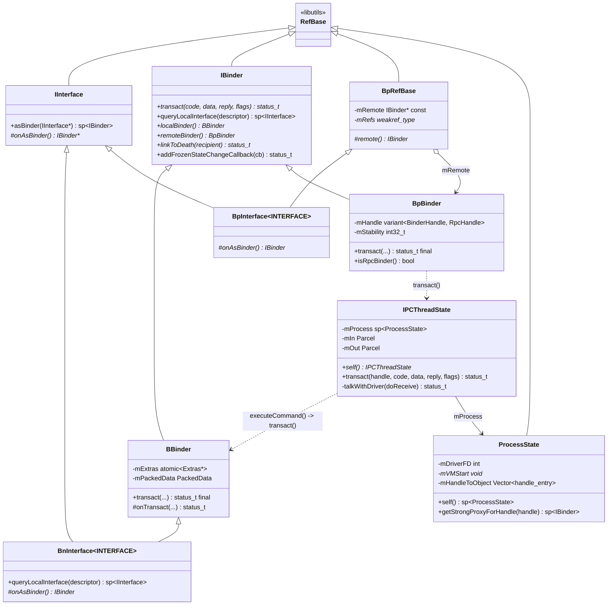
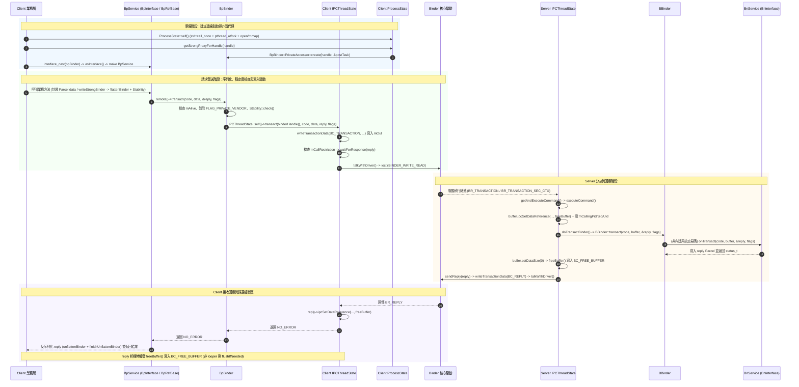

# 5.2 Binder 進程間通信庫（libbinder）

- **情景說明**：一個原生 C++ Client 行程與 Server 行程分別透過 `libbinder` 建立與 Binder 驅動的行程級連線（`ProcessState`）與執行緒級通訊通道（`IPCThreadState`），在業務層透過 `IInterface` / `BnInterface` / `BpInterface` 與底層 `BBinder` / `BpBinder` 完成介面抽象，並經由 `Parcel` 將參數與 Binder 物件扁平化，完整串起一次跨行程遠端呼叫與回覆。
- **對應原書**：第 5 章 5.2 節〈Binder 进程间通信库〉（p.191–196）
- **涉及專案與版本基準**：
  - `platform/frameworks/native` 〔`android-17.0.0_r1`，commit `ae266dc`〕

---

## 5.2.1 類別階層總覽與 `IBinder` / `IInterface` 抽象介面

> 對應原書 5.2（p.191–196，圖 5-15 與圖 5-16）。`libbinder` 將底層 `/dev/binder` 的 `ioctl` 讀寫與協定封裝成物件導向框架：Server 端以 **Binder 本地物件**（`BnInterface<I>` / `BBinder`）對應核心中的 `binder_node`；Client 端以 **Binder 代理物件**（`BpInterface<I>` / `BpRefBase` / `BpBinder`）對應核心中的 `binder_ref`。兩端皆透過每執行緒一份的 `IPCThreadState` 與每行程一份的 `ProcessState` 和核心驅動互動。



### Step 1：`IBinder` 抽象基底類別
**位置**：`platform/frameworks/native/libs/binder/include/binder/IBinder.h` 〔`android-17.0.0_r1`，lines 52–354〕

```cpp
class [[clang::lto_visibility_public]] LIBBINDER_EXPORTED IBinder : public virtual RefBase {
public:
    enum {
        FIRST_CALL_TRANSACTION = 0x00000001,
        LAST_CALL_TRANSACTION = 0x00ffffff,

        PING_TRANSACTION = B_PACK_CHARS('_', 'P', 'N', 'G'),
        START_RECORDING_TRANSACTION = B_PACK_CHARS('_', 'S', 'R', 'D'),
        STOP_RECORDING_TRANSACTION = B_PACK_CHARS('_', 'E', 'R', 'D'),
        DUMP_TRANSACTION = B_PACK_CHARS('_', 'D', 'M', 'P'),
        SHELL_COMMAND_TRANSACTION = B_PACK_CHARS('_', 'C', 'M', 'D'),
        INTERFACE_TRANSACTION = B_PACK_CHARS('_', 'N', 'T', 'F'),
        SYSPROPS_TRANSACTION = B_PACK_CHARS('_', 'S', 'P', 'R'),
        EXTENSION_TRANSACTION = B_PACK_CHARS('_', 'E', 'X', 'T'),
        DEBUG_PID_TRANSACTION = B_PACK_CHARS('_', 'P', 'I', 'D'),
        SET_RPC_CLIENT_TRANSACTION = B_PACK_CHARS('_', 'R', 'P', 'C'),
        ...
        FLAG_ONEWAY = 0x00000001,
        FLAG_CLEAR_BUF = 0x00000020,
        FLAG_PRIVATE_VENDOR = 0x10000000,
    };

    virtual sp<IInterface>  queryLocalInterface(const String16& descriptor);
    virtual const String16& getInterfaceDescriptor() const = 0;

    virtual bool            isBinderAlive() const = 0;
    virtual status_t        pingBinder() = 0;
    virtual status_t        dump(int fd, const Vector<String16>& args) = 0;
    static  status_t        shellCommand(const sp<IBinder>& target, int in, int out, int err,
                                         Vector<String16>& args, const sp<IShellCallback>& callback,
                                         const sp<IResultReceiver>& resultReceiver);
    status_t                getExtension(sp<IBinder>* out);
    status_t                getDebugPid(pid_t* outPid);

    virtual status_t        transact(   uint32_t code,
                                        const Parcel& data,
                                        Parcel* reply,
                                        uint32_t flags = 0) = 0;

    class DeathRecipient : public virtual RefBase
    {
    public:
        virtual void binderDied(const wp<IBinder>& who) = 0;
    };

    class FrozenStateChangeCallback : public virtual RefBase {
    public:
        enum class State {
            FROZEN,
            UNFROZEN,
        };
        virtual void onStateChanged(const wp<IBinder>& who, State state) = 0;
    };

    virtual status_t        linkToDeath(const sp<DeathRecipient>& recipient,
                                        void* cookie = nullptr,
                                        uint32_t flags = 0) = 0;
    virtual status_t        unlinkToDeath(  const wp<DeathRecipient>& recipient,
                                            void* cookie = nullptr,
                                            uint32_t flags = 0,
                                            wp<DeathRecipient>* outRecipient = nullptr) = 0;

    [[nodiscard]] status_t addFrozenStateChangeCallback(
            const wp<FrozenStateChangeCallback>& callback);
    [[nodiscard]] status_t removeFrozenStateChangeCallback(
            const wp<FrozenStateChangeCallback>& callback);

    [[nodiscard]] virtual void* attachObject(const void* objectID, void* object,
                                             void* cleanupCookie, object_cleanup_func func) = 0;
    [[nodiscard]] virtual void* findObject(const void* objectID) const = 0;
    [[nodiscard]] virtual void* detachObject(const void* objectID) = 0;
    void withLock(const std::function<void()>& doWithLock);

    virtual BBinder*        localBinder();
    virtual BpBinder*       remoteBinder();
    ...
};
```

`IBinder` 繼承自 `virtual RefBase`，同時是本地端 `BBinder` 與遠端代理 `BpBinder` 的共同抽象：
1. **區分本地與遠端**：`localBinder()` 僅在 `BBinder` 回傳 `this`，`remoteBinder()` 僅在 `BpBinder` 回傳 `this`；`Parcel::flattenBinder`、`IBinder::getExtension` 與 `Stability` 等核心路徑皆藉此在零 RTTI 開銷下分辨物件歸屬。
2. **保留交易碼空間**：使用者自訂方法使用 `[FIRST_CALL_TRANSACTION, LAST_CALL_TRANSACTION]`（`0x1`–`0xffffff`）；以 `B_PACK_CHARS('_', ...)` 編碼的內建系統交易碼則承載框架能力，包含 `PING`、`DUMP`、`INTERFACE`、`SYSPROPS`，以及新版新增的：
   - `SHELL_COMMAND_TRANSACTION`（`cmd` 工具透過 Binder 轉發標準 I/O）；
   - `EXTENSION_TRANSACTION`（`getExtension` / `setExtension`，讓下游廠商在不修改 AOSP 既有介面的前提下附加客製化擴充介面）；
   - `DEBUG_PID_TRANSACTION`（查詢遠端服務 PID 供除錯）；
   - `START_RECORDING_TRANSACTION` / `STOP_RECORDING_TRANSACTION`（錄製交易供 fuzzing / 重播）；
   - `SET_RPC_CLIENT_TRANSACTION`（除錯建置下動態掛載 RPC Server）。
3. **交易旗標**：除 `FLAG_ONEWAY` 外，新增對應驅動 `TF_CLEAR_BUF` 的 `FLAG_CLEAR_BUF`（交易結束後將核心緩衝區清零以保護敏感資料），以及僅在使用者空間生效、進入核心前會被剝除的 `FLAG_PRIVATE_VENDOR`。
4. **生命週期與附加物件**：除 `DeathRecipient` 死亡監聽外，17 新增 `FrozenStateChangeCallback` 監聽對端行程的凍結／解凍狀態（僅對遠端 `BpBinder` 有效，對本地 `BBinder` 呼叫會回傳 `INVALID_OPERATION`）；`attachObject` / `findObject` / `detachObject` 與 `withLock` 則讓 JNI（`JavaBBinder` / `BinderProxy`）與 `libbinder_ndk`（`ABpBinder`）能把語言綁定物件掛載在同一個 `IBinder` 生命週期上。

> 〔與 2.3 差異〕**搬家 + 擴充**：路徑由 `frameworks/base/include/binder/IBinder.h` 遷至 `frameworks/native/libs/binder/include/binder/IBinder.h`（原書 p.193）；新增 `FrozenStateChangeCallback`、`getExtension`、`shellCommand`、`getDebugPid`、`FLAG_CLEAR_BUF`、`FLAG_PRIVATE_VENDOR` 與交易錄製／RPC 除錯等內建交易碼；`attachObject` 改回傳既有關聯指標而非 `void`，並新增 `withLock` 與 `lookupOrCreateWeak`。

---

### Step 2：`IInterface`、`BnInterface<T>` 與 `BpInterface<T>`
**位置**：`platform/frameworks/native/libs/binder/include/binder/IInterface.h` 〔`android-17.0.0_r1`，lines 28–91、167–198〕與 `IInterface.cpp` 〔lines 31–44〕

```cpp
// include/binder/IInterface.h
class LIBBINDER_EXPORTED IInterface : public virtual RefBase {
public:
            IInterface();
            static sp<IBinder>  asBinder(const IInterface*);
            static sp<IBinder>  asBinder(const sp<IInterface>&);

protected:
    virtual                     ~IInterface();
    virtual IBinder*            onAsBinder() = 0;
};

template<typename INTERFACE>
inline sp<INTERFACE> interface_cast(const sp<IBinder>& obj)
{
    return INTERFACE::asInterface(obj);
}

template<typename INTERFACE>
inline sp<INTERFACE> checked_interface_cast(const sp<IBinder>& obj)
{
    if (obj->getInterfaceDescriptor() != INTERFACE::descriptor) {
        return nullptr;
    }

    return interface_cast<INTERFACE>(obj);
}

template <typename INTERFACE>
class LIBBINDER_EXPORTED BnInterface : public INTERFACE, public BBinder {
public:
    virtual sp<IInterface>      queryLocalInterface(const String16& _descriptor);
    virtual const String16&     getInterfaceDescriptor() const;
    typedef INTERFACE BaseInterface;

protected:
    virtual IBinder*            onAsBinder();
};

template <typename INTERFACE>
class LIBBINDER_EXPORTED BpInterface : public INTERFACE, public BpRefBase {
public:
    explicit                    BpInterface(const sp<IBinder>& remote);
    typedef INTERFACE BaseInterface;

protected:
    virtual IBinder*            onAsBinder();
};
```

雙向轉換的關鍵實作（`IInterface.h` lines 167–197 與 `IInterface.cpp` lines 32–43）：

```cpp
// IInterface.cpp
sp<IBinder> IInterface::asBinder(const sp<IInterface>& iface)
{
    if (iface == nullptr) return nullptr;
    return sp<IBinder>::fromExisting(iface->onAsBinder());
}

// IInterface.h
template<typename INTERFACE>
inline sp<IInterface> BnInterface<INTERFACE>::queryLocalInterface(
        const String16& _descriptor)
{
    if (_descriptor == INTERFACE::descriptor) return sp<IInterface>::fromExisting(this);
    return nullptr;
}

template<typename INTERFACE>
IBinder* BnInterface<INTERFACE>::onAsBinder()
{
    return this;
}

template<typename INTERFACE>
inline IBinder* BpInterface<INTERFACE>::onAsBinder()
{
    return remote();
}
```

- **多重繼承設計**：`BnInterface<INTERFACE>` 同時繼承業務介面 `INTERFACE` 與 `BBinder`，本身就是一個 `IBinder`，因此 `onAsBinder()` 直接回傳 `this`。`BpInterface<INTERFACE>` 同時繼承 `INTERFACE` 與 `BpRefBase`，本身**不是** `IBinder`，而是透過 `BpRefBase::mRemote` 組合一個 `BpBinder`，因此 `onAsBinder()` 回傳 `remote()`。
- **同行程本地捷徑**：當 Client 與 Server 恰好位於同一行程時，傳遞給 `interface_cast<IFoo>(obj)` 的 `obj` 本身就是 `BnFoo`（`BBinder` 子類）。`obj->queryLocalInterface(IFoo::descriptor)` 比對描述符相符後直接回傳 `this`，後續呼叫即為純 C++ 虛函式呼叫，完全不經 `Parcel` 序列化與核心驅動。
- **`interface_cast` vs `checked_interface_cast`**：前者對遠端 `BpBinder` 不會驗證描述符，直接建構 `Bp<INTERFACE>`（型別錯誤要到實際呼叫時由 Server 端回傳 `BAD_TYPE` 才發現）；後者先透過 `INTERFACE_TRANSACTION` 查詢遠端描述符比對，不符直接回 `nullptr`。

> 〔與 2.3 差異〕**搬家 + 擴充**：核心模板骨架 `IInterface` / `BnInterface` / `BpInterface` 與 `interface_cast` 跟原書（p.192）一致；檔案搬遷至 `frameworks/native/libs/binder/include/binder/IInterface.h`，並新增 `checked_interface_cast`、型別別名 `BaseInterface`，以及統一使用 `sp<T>::fromExisting(...)` 取代裸指標隱式轉 `sp<T>`（避免未經 `sp::make` 管理的堆疊物件誤建強指標）。

---

### Step 3：`DECLARE_META_INTERFACE` 與 `IMPLEMENT_META_INTERFACE` 白名單限制
**位置**：`platform/frameworks/native/libs/binder/include/binder/IInterface.h` 〔`android-17.0.0_r1`，lines 94–162、201–279〕

```cpp
#define DECLARE_META_INTERFACE(INTERFACE)                                                         \
public:                                                                                           \
    static const ::android::String16 descriptor;                                                  \
    static ::android::sp<I##INTERFACE> asInterface(const ::android::sp<::android::IBinder>& obj); \
    virtual const ::android::String16& getInterfaceDescriptor() const;                            \
    I##INTERFACE();                                                                               \
    virtual ~I##INTERFACE();

#ifndef DO_NOT_CHECK_MANUAL_BINDER_INTERFACES

#define IMPLEMENT_META_INTERFACE(INTERFACE, NAME)                       \
    static_assert(internal::allowedManualInterface(NAME),               \
                  "b/64223827: Manually written binder interfaces are " \
                  "considered error prone and frequently have bugs. "   \
                  "The preferred way to add interfaces is to define "   \
                  "an .aidl file to auto-generate the interface. If "   \
                  "an interface must be manually written, add its "     \
                  "name to the allowlist.");                            \
    DO_NOT_DIRECTLY_USE_ME_IMPLEMENT_META_INTERFACE(INTERFACE, NAME)
...
#endif

#define DO_NOT_DIRECTLY_USE_ME_IMPLEMENT_META_INTERFACE0(ITYPE, INAME, BPTYPE)              \
    const ::android::String16& ITYPE::getInterfaceDescriptor() const {                      \
        return ITYPE::descriptor;                                                           \
    }                                                                                       \
    ::android::sp<ITYPE> ITYPE::asInterface(const ::android::sp<::android::IBinder>& obj) { \
        ::android::sp<ITYPE> intr;                                                          \
        if (obj != nullptr) {                                                               \
            intr = ::android::sp<ITYPE>::cast(obj->queryLocalInterface(ITYPE::descriptor)); \
            if (intr == nullptr) {                                                          \
                intr = ::android::sp<BPTYPE>::make(obj);                                    \
            }                                                                               \
        }                                                                                   \
        return intr;                                                                        \
    }                                                                                       \
    ITYPE::INAME() {}                                                                       \
    ITYPE::~INAME() {}
```

`asInterface(obj)` 串起整個轉換機制：先呼叫 `obj->queryLocalInterface(descriptor)`，若為本地 `Bn` 物件則直接取得介面指標；若回傳 `nullptr`（遠端 `BpBinder`），則以 `sp<Bp##INTERFACE>::make(obj)` 包裝成代理物件。

Android 17 最顯著的工程約束在於 `IMPLEMENT_META_INTERFACE` 中的編譯期 `static_assert(internal::allowedManualInterface(NAME))`：`internal::kManualInterfaces` 僅保留少數尚未遷移完畢的歷史介面（如 `android.app.IActivityManager`、`android.graphicsenv.IGpuService`、`android.ui.ISurfaceComposer`、`android.media.IMediaPlayer` 等約 50 個）。任何**新介面**若嘗試照原書 5.3 的做法手寫 `IMPLEMENT_META_INTERFACE`，在編譯期就會直接失敗，必須改用 `.aidl` 檔案交由 `aidl` 編譯器自動生成（`aidl` 生成碼會直接展開實作，不依賴此巨集，詳見 5.3 節）。

> 〔與 2.3 差異〕**邏輯改變**：2.3 允許任意服務直接以 `IMPLEMENT_META_INTERFACE` 手寫 `Bn`/`Bp`（原書 p.197–198）；17 加入編譯期白名單 `kManualInterfaces` 封鎖新增手寫介面，並以 `[[clang::no_destroy]]` + `StaticString16` 避免行程結束時靜態 `descriptor` 析構順序問題。

---

## 5.2.2 本地端物件 `BBinder` 與遠端代理端 `BpRefBase` / `BpBinder`

### Step 4：`BBinder`（Binder 本地物件）
**位置**：`platform/frameworks/native/libs/binder/include/binder/Binder.h` 〔`android-17.0.0_r1`，lines 45–227〕與 `Binder.cpp` 〔lines 79–85、320–340、490–587、1102–1157〕

```cpp
// include/binder/Binder.h
class BBinder : public IBinder {
public:
    LIBBINDER_EXPORTED virtual status_t transact(uint32_t code, const Parcel& data, Parcel* reply,
                                                 uint32_t flags = 0) final;
    ...
    LIBBINDER_EXPORTED void setRequestingSid(bool requestSid);
    LIBBINDER_EXPORTED void setExtension(const sp<IBinder>& extension);
    LIBBINDER_EXPORTED void setMinSchedulerPolicy(int policy, int priority);
    LIBBINDER_EXPORTED void setInheritRt(bool inheritRt);
    LIBBINDER_EXPORTED void setTransactionCodeMap(const TransactionCodeData* data);
    ...
protected:
    LIBBINDER_EXPORTED virtual status_t onTransact(uint32_t code, const Parcel& data, Parcel* reply,
                                                   uint32_t flags = 0);
private:
    class PackedData {
        // 64-Bit Layout: [ Address (63:4) | R (3) | Stability (2:1) | Parceled (0) ]
        std::atomic<uintptr_t> mPackedData{0};
    };
    ...
    std::atomic<Extras*> mExtras;
    PackedData mPackedData;
};
```

`BBinder` 的請求分派核心實作（`Binder.cpp` lines 490–587）：

```cpp
status_t BBinder::transact(
    uint32_t code, const Parcel& data, Parcel* reply, uint32_t flags)
{
    bool tracingEnabled = get_trace_enabled_tags() & ATRACE_TAG_AIDL;
    if (tracingEnabled) {
        tracingEnabled = startTrace(code);
    }
    scope_guard guard = make_scope_guard([&]() {
        if (tracingEnabled) trace_end(ATRACE_TAG_AIDL);
    });

    const auto startTime = std::chrono::steady_clock::now();
    data.setDataPosition(0);

    if (reply != nullptr && (flags & FLAG_CLEAR_BUF)) {
        reply->markSensitive();
    }
    ...
    status_t err = NO_ERROR;
    switch (code) {
        case PING_TRANSACTION:
            err = pingBinder();
            break;
        case START_RECORDING_TRANSACTION:
            err = startRecordingTransactions(data);
            break;
        case STOP_RECORDING_TRANSACTION:
            err = stopRecordingTransactions();
            break;
        case EXTENSION_TRANSACTION:
            LOG_ALWAYS_FATAL_IF(reply == nullptr, "reply == nullptr");
            err = reply->writeStrongBinder(getExtension());
            break;
        case DEBUG_PID_TRANSACTION:
            LOG_ALWAYS_FATAL_IF(reply == nullptr, "reply == nullptr");
            err = reply->writeInt32(getDebugPid());
            break;
        case SET_RPC_CLIENT_TRANSACTION: {
            err = setRpcClientDebug(data);
            break;
        }
        default:
            err = onTransact(code, data, reply, flags);
            break;
    }

    // In case this is being transacted on in the same process.
    if (reply != nullptr) {
        reply->setDataPosition(0);
        ...
    }
    ...
    const uint64_t transactionMs = to_ms(std::chrono::steady_clock::now() - startTime);
    if (transactionMs > 1000lu) {
        ALOGW("Binder transaction to %s, function: %s, took %" PRIu64
              "ms. Data bytes: %zu Reply bytes: %zu Flags: %d",
              String8(getInterfaceDescriptor()).c_str(), getFunctionNameAndCode(code).c_str(),
              transactionMs, data.dataSize(), reply ? reply->dataSize() : 0u, flags);
    }
    return err;
}
```

重點解析：
1. **ABI 大小凍結與 `PackedData` 指標壓縮**：`Binder.cpp` 以 `static_assert(sizeof(IBinder) == 24)`、`static_assert(sizeof(BBinder) == 40)`（64-bit）嚴格鎖定物件佈局，以兼容預編譯二進位檔。因此 `BBinder` 不隨意新增成員變數，而是：
   - 將 16-byte 對齊的 `TransactionCodeData*`（AIDL 生成的方法名稱對照表，供 ATrace 與日誌反查函式名）、2-bit 穩定度編碼（`Stability`）與 1-bit `wasParceled` 旗標打包進單一 `std::atomic<uintptr_t> mPackedData`；
   - 其餘非熱路徑屬性（`mExtension`、排程策略 `mPolicy`/`mPriority`、`mRequestingSid`、`mInheritRt`、`mObjectMgr`、`mRecordingFd`）全數放進透過 CAS 延遲配置的 `BBinder::Extras` 物件中。
2. **「不可變於傳送後」的檢查**：`setRequestingSid`、`setMinSchedulerPolicy`、`setInheritRt`、`setExtension` 都要求在該 `BBinder` 首次經 `Parcel::flattenBinder` 送往其他行程（`setParceled()`）之前呼叫，否則觸發 `LOG_ALWAYS_FATAL_IF(wasParceled(), ...)`；因為這些旗標只會在核心初次建立 `binder_node` 時寫入核心節點。
3. **`transact` 標記為 `final`**：子類不可覆寫 `transact`，一律透過覆寫 `onTransact` 處理業務交易碼，而未處理的系統交易碼（`INTERFACE_TRANSACTION`、`DUMP_TRANSACTION`、`SHELL_COMMAND_TRANSACTION`、`SYSPROPS_TRANSACTION`）會落回基類 `BBinder::onTransact`。同時 `transact` 統一處理 `ATRACE_TAG_AIDL` 追蹤、超過 `kLogTransactionsOverBytes` 的大封包警告、超過 1000 ms 的慢交易警告，以及 `FLAG_CLEAR_BUF` 敏感回覆標記。

> 〔與 2.3 差異〕**邏輯改變 + 擴充**：2.3 的 `BBinder::transact` 僅做 `PING_TRANSACTION` 判斷後呼叫 `onTransact`（原書 p.192–193）；17 將 `transact` 鎖定為 `final`，整合了 `EXTENSION`/`DEBUG_PID`/`RECORDING`/`SET_RPC_CLIENT` 交易分派、ATrace、慢/大交易觀測、敏感緩衝區傳遞，並以 `PackedData` 與延遲 `Extras` 在不破壞物件大小 ABI 下承載排程、SELinux SID、穩定度與方法名稱表。

---

### Step 5：`BpRefBase` 與 `BpBinder`（Binder 代理物件）
**位置**：`platform/frameworks/native/libs/binder/include/binder/Binder.h` 〔lines 231–251〕、`Binder.cpp` 〔lines 1180–1223〕、`include/binder/BpBinder.h` 〔lines 43–252〕、`BpBinder.cpp` 〔lines 172–302、394–446〕

先看 `BpRefBase`（業務代理 `Bp<Service>` 的基類，位於 `Binder.h` / `Binder.cpp`）：

```cpp
// include/binder/Binder.h
class BpRefBase : public virtual RefBase {
protected:
    LIBBINDER_EXPORTED explicit BpRefBase(const sp<IBinder>& o);
    LIBBINDER_EXPORTED virtual ~BpRefBase();
    LIBBINDER_EXPORTED virtual void onFirstRef();
    LIBBINDER_EXPORTED virtual void onLastStrongRef(const void* id);
    LIBBINDER_EXPORTED virtual bool onIncStrongAttempted(uint32_t flags, const void* id);

    LIBBINDER_EXPORTED inline IBinder* remote() const { return mRemote; }
    LIBBINDER_EXPORTED inline sp<IBinder> remoteStrong() const {
        return sp<IBinder>::fromExisting(mRemote);
    }

private:
    IBinder* const          mRemote;
    RefBase::weakref_type*  mRefs;
    std::atomic<int32_t>    mState;
};

// Binder.cpp
BpRefBase::BpRefBase(const sp<IBinder>& o)
    : mRemote(o.get()), mRefs(nullptr), mState(0)
{
    extendObjectLifetime(OBJECT_LIFETIME_WEAK);

    if (mRemote) {
        mRemote->incStrong(this);           // Removed on first IncStrong().
        mRefs = mRemote->createWeak(this);  // Held for our entire lifetime.
    }
}
```

`BpRefBase` 持有底層 `BpBinder` 指標 `mRemote`，在建構時即對 `mRemote` 增加強弱引用，並在 `onFirstRef` / `onLastStrongRef` / `onIncStrongAttempted` 中把自身強弱引用變化同步轉發給 `mRemote`（詳細引用計數聯動將於 5.4 節展開）。

再看真正承載遠端通訊句柄的 `BpBinder`（`BpBinder.h` lines 43–252 與 `BpBinder.cpp` lines 172–301、394–446）：

```cpp
// include/binder/BpBinder.h
class BpBinder : public IBinder {
public:
    LIBBINDER_EXPORTED bool isRpcBinder() const;
    LIBBINDER_EXPORTED virtual status_t transact(uint32_t code, const Parcel& data, Parcel* reply,
                                                 uint32_t flags = 0) final;
    ...
    class PrivateAccessor {
    private:
        friend class ::android::Parcel;
        friend class ::android::ProcessState;
        friend class ::android::RpcSession;
        friend class ::android::RpcState;
        friend class ::android::IPCThreadState;
        ...
        static sp<BpBinder> create(int32_t handle, std::function<void()>* postTask);
        static sp<BpBinder> create(sp<RpcSession>&& session, uint64_t address);
        int32_t binderHandle() const { return mBinder->binderHandle(); }
        ...
    };

private:
    struct BinderHandle {
        int32_t handle;
    };
    struct RpcHandle {
        sp<RpcSession> session;
        uint64_t address;
    };
    using Handle = std::variant<BinderHandle, RpcHandle>;

    int32_t mStability;
    Handle mHandle;
    ...
    mutable RpcMutex mLock;
    volatile int32_t mAlive;
    volatile int32_t mObitsSent;
    Vector<Obituary>* mObituaries;
    std::unique_ptr<FrozenStateChange> mFrozen;
    ObjectManager mObjectMgr;
    mutable String16 mDescriptorCache;
    int32_t mTrackedUid;
};
```

```cpp
// BpBinder.cpp
sp<BpBinder> BpBinder::create(int32_t handle, std::function<void()>* postTask) {
    ...
    int32_t trackedUid = -1;
    if (sCountByUidEnabled) {
        trackedUid = IPCThreadState::self()->getCallingUid();
        RpcMutexUniqueLock _l(sTrackingLock);
        const uint32_t trackedValue = sTrackingMap[trackedUid];
        const uint32_t currentValue = trackedValue & COUNTING_VALUE_MASK;
        ... // 檢查 Warning(2250) / High(2500) 水位，必要時填入 *postTask 回呼或節流回傳 nullptr
        sTrackingMap[trackedUid]++;
    }
    uint32_t numProxies = sBinderProxyCount.fetch_add(1, std::memory_order_relaxed);
    ...
    return sp<BpBinder>::make(BinderHandle{handle}, trackedUid);
}

BpBinder::BpBinder(BinderHandle&& handle, int32_t trackedUid) : BpBinder(Handle(handle)) {
    ...
    mTrackedUid = trackedUid;
    IPCThreadState::self()->incWeakHandle(this->binderHandle(), this);
}

status_t BpBinder::transact(
    uint32_t code, const Parcel& data, Parcel* reply, uint32_t flags)
{
    // Once a binder has died, it will never come back to life.
    if (mAlive) {
        bool privateVendor = flags & FLAG_PRIVATE_VENDOR;
        // don't send userspace flags to the kernel
        flags = flags & ~static_cast<uint32_t>(FLAG_PRIVATE_VENDOR);

        // user transactions require a given stability level
        if (code >= FIRST_CALL_TRANSACTION && code <= LAST_CALL_TRANSACTION) {
            using android::internal::Stability;

            int16_t stability = Stability::getRepr(this);
            Stability::Level required = privateVendor ? Stability::VENDOR
                : Stability::getLocalLevel();

            if (!Stability::check(stability, required)) [[unlikely]] {
                ALOGE("Cannot do a user transaction on a %s binder (%s) in a %s context.",
                      Stability::levelString(stability).c_str(),
                      String8(getInterfaceDescriptor()).c_str(),
                      Stability::levelString(required).c_str());
                return BAD_TYPE;
            }
        }

        status_t status;
        if (isRpcBinder()) [[unlikely]] {
            status = rpcSession()->transact(sp<IBinder>::fromExisting(this), code, data, reply,
                                            flags);
        } else {
            ...
            status = IPCThreadState::self()->transact(binderHandle(), code, data, reply, flags);
        }
        ...
        if (status == DEAD_OBJECT) mAlive = 0;

        return status;
    }

    return DEAD_OBJECT;
}
```

Android 17 中 `BpBinder` 有四項關鍵演進：
1. **工廠方法與 `PrivateAccessor` 封裝**：建構子與 `handle()` 皆不再公開，外部無法隨意 `new BpBinder(handle)` 或直接讀取核心 handle；只有受信任的內部模組（`ProcessState`、`Parcel`、`IPCThreadState`、`RpcSession`）可透過 `BpBinder::PrivateAccessor` 建立或讀取 `binderHandle()`。
2. **雙傳輸抽象（`std::variant<BinderHandle, RpcHandle>`）**：`mHandle` 不再只是單純的 `int32_t`，而是同時支援傳統核心驅動（`BinderHandle{handle}`）與 Socket/vsock 上的 RPC Binder（`RpcHandle{session, address}`）。在 `BpBinder::transact` 中依 `isRpcBinder()` 分流，讓上層 `Bp<Interface>` 與 AIDL 生成碼無須感知底層傳輸方式。
3. **跨分區介面穩定度強制檢查（`Stability::check`）**：對所有使用者交易碼（`FIRST_CALL_TRANSACTION..LAST_CALL_TRANSACTION`），`BpBinder::transact` 會比對該 proxy 的 `mStability`（`VENDOR = 0b000011`、`SYSTEM = 0b001100`、`VINTF = 0b111111`）是否滿足呼叫端編譯單元所要求的 `required`（`Stability::check` 條件為 `(provided & required) == required`）。這在執行期防止 system 分區直接呼叫未宣告 VINTF 穩定度的 vendor 介面（反之亦然），違反時直接回傳 `BAD_TYPE`。
4. **Per-UID Proxy 數量水位防護**：`BpBinder::create` 可依發送端 UID 統計本行程持有的遠端 proxy 數量（預設 Warning 2250 / High 2500 / Low 2000，供 `system_server` 防範惡意 App 洩漏大量 Binder proxy 耗盡系統資源），觸發告警或節流時透過 `postTask` 延後至呼叫端釋放 `ProcessState::mLock` 後再回呼，避免死鎖。

> 〔與 2.3 差異〕**邏輯改變**：2.3 的 `BpBinder` 只有公開建構子 `BpBinder(int32_t handle)` 與 `const int32_t mHandle`，`transact` 檢查 `mAlive` 後直接轉給 `IPCThreadState::self()->transact`（原書 p.193–194）；17 改為私有工廠 + `PrivateAccessor`、`std::variant` 抽象核心與 RPC 傳輸、加入 `Stability::check` 穩定度門檻、per-UID proxy 水位控管、`mFrozen` 凍結通知管理與 `mDescriptorCache` 快取。

---

## 5.2.3 行程級單例 `ProcessState`：驅動連線、Fork 防護與 Handle 表

### Step 6：`ProcessState::self` / `initWithDriver` 與 `pthread_atfork` 防護
**位置**：`platform/frameworks/native/libs/binder/include/binder/ProcessState.h` 〔`android-17.0.0_r1`，lines 47–223〕與 `ProcessState.cpp` 〔lines 48–60、106–218、537–553、606–652〕

```cpp
// ProcessState.cpp
#define BINDER_VM_SIZE ((1 * 1024 * 1024) - sysconf(_SC_PAGE_SIZE) * 2)
#define DEFAULT_MAX_BINDER_THREADS 15
#define DEFAULT_ENABLE_ONEWAY_SPAM_DETECTION 1

#ifdef __ANDROID_VNDK__
const char* kDefaultDriver = "/dev/vndbinder";
#else
const char* kDefaultDriver = "/dev/binder";
#endif

[[clang::no_destroy]] static sp<ProcessState> gProcess;
[[clang::no_destroy]] static std::mutex gProcessMutex;

static void verifyNotForked(bool forked) {
    LOG_ALWAYS_FATAL_IF(forked, "libbinder ProcessState can not be used after fork");
}

sp<ProcessState> ProcessState::self()
{
    return init(kDefaultDriver, false /*requireDefault*/);
}

sp<ProcessState> ProcessState::initWithDriver(const char* driver)
{
    return init(driver, true /*requireDefault*/);
}

sp<ProcessState> ProcessState::init(const char* driver, bool requireDefault) {
    if (driver == nullptr) {
        std::lock_guard<std::mutex> l(gProcessMutex);
        if (gProcess) {
            verifyNotForked(gProcess->mForked);
        }
        return gProcess;
    }

    [[clang::no_destroy]] static std::once_flag gProcessOnce;
    std::call_once(gProcessOnce, [&](){
        if (access(driver, R_OK) == -1) {
            ALOGE("Binder driver %s is unavailable. Using /dev/binder instead.", driver);
            driver = "/dev/binder";
        }
        ...
        int ret = pthread_atfork(ProcessState::onFork, ProcessState::parentPostFork,
                                 ProcessState::childPostFork);
        LOG_ALWAYS_FATAL_IF(ret != 0, "pthread_atfork error %s", strerror(ret));

        std::lock_guard<std::mutex> l(gProcessMutex);
        gProcess = sp<ProcessState>::make(driver);
    });

    if (requireDefault) {
        LOG_ALWAYS_FATAL_IF(gProcess->getDriverName() != driver,
                            "ProcessState was already initialized with %s,"
                            " can't initialize with %s.",
                            gProcess->getDriverName().c_str(), driver);
    }

    verifyNotForked(gProcess->mForked);
    return gProcess;
}

void ProcessState::childPostFork() {
    if (gProcess) {
        gProcess->mForked = true;
        // "O_CLOFORK"
        close(gProcess->mDriverFD);
        gProcess->mDriverFD = -1;
    }
    gProcessMutex.unlock();
}
```

每個使用核心 Binder 的行程都維護唯一的 `ProcessState` 單例（`gProcess`），其職責包含：
1. **多 Domain 驅動選擇**：編譯給 vendor 分區（`__ANDROID_VNDK__`）時預設開啟 `/dev/vndbinder`，system 分區預設開啟 `/dev/binder`；亦可透過 `ProcessState::initWithDriver(driver)` 在首次初始化前顯式指定裝置節點（若之後有人試圖以不同驅動再次呼叫 `initWithDriver`，將直接 `LOG_ALWAYS_FATAL_IF` 終止）。
2. **`open` 與 `mmap` 初始化**：在 `ProcessState::ProcessState(const char* driver)` 內呼叫 `open_driver`（執行 `open`、`BINDER_VERSION`、`BINDER_SET_MAX_THREADS(15)`、`BINDER_ENABLE_ONEWAY_SPAM_DETECTION(1)`）與 `mmap(BINDER_VM_SIZE, PROT_READ, MAP_PRIVATE | MAP_NORESERVE)`（約 1 MB − 2 頁）。開啟與映射在核心內的完整流程已於 5.1.3 與 5.1.4 詳述，此處不贅述。
3. **`pthread_atfork` 跨 Fork 防護**：Binder 驅動的 `binder_proc` 綁定原始行程的 `mm_struct` 與 `pid`，且 VMA 設了 `VM_DONTCOPY`（見 5.1.4），因此**絕對不能**在 `ProcessState` 初始化後 `fork()` 並在子行程繼續使用 Binder。`ProcessState::init` 在建構 `gProcess` 之前即註冊 `pthread_atfork`：`onFork` 鎖住 `gProcessMutex`，`childPostFork` 在子行程將 `mForked = true` 並主動 `close(mDriverFD)`；若子行程後續誤呼叫 `ProcessState::self()`，`verifyNotForked` 會立刻 abort，避免靜默損毀父行程的 Binder 狀態。
4. **執行緒池、呼叫限制與驅動特性探測**：`ProcessState` 另管理執行緒池狀態（`mMaxThreads`、`mCurrentThreads`、`mKernelStartedThreads`、`mExecutingThreadsCount`、`mStarvationStartTime`）、同步呼叫限制（`CallRestriction`，如 `servicemanager` 設為 `FATAL_IF_NOT_ONEWAY` 防止自身被阻塞）、以及 `isDriverFeatureEnabled`（讀取 `/dev/binderfs/features/{oneway_spam_detection,extended_error,freeze_notification}` 探測核心是否支援對應特性）。

> 〔與 2.3 差異〕**搬家 + 邏輯改變**：2.3 的 `ProcessState::self()` 僅以 `gProcessMutex` 雙檢建立固定開啟 `/dev/binder` 的單例（原書 p.195）；17 改用 `std::call_once`、支援 `/dev/vndbinder` 與 `initWithDriver`、加入 `pthread_atfork` 防護、`CallRestriction`、`DriverFeature` 探測與執行緒池飢餓追蹤；且在 Android 環境中若開啟或 `mmap` 失敗會直接 `LOG_ALWAYS_FATAL_IF` 終止（`EXPECT_BINDER_OPEN_SUCCESS`）。

---

### Step 7：`ProcessState::getStrongProxyForHandle` 與 `mHandleToObject` Handle 對應表
**位置**：`platform/frameworks/native/libs/binder/ProcessState.cpp` 〔`android-17.0.0_r1`，lines 323–420〕

```cpp
ProcessState::handle_entry* ProcessState::lookupHandleLocked(int32_t handle)
{
    const size_t N=mHandleToObject.size();
    if (N <= (size_t)handle) {
        handle_entry e;
        e.binder = nullptr;
        e.refs = nullptr;
        status_t err = mHandleToObject.insertAt(e, N, handle+1-N);
        if (err < NO_ERROR) return nullptr;
    }
    return &mHandleToObject.editItemAt(handle);
}

extern sp<BBinder> the_context_object;

sp<IBinder> ProcessState::getStrongProxyForHandle(int32_t handle)
{
    sp<IBinder> result;
    std::function<void()> postTask;

    std::unique_lock<std::mutex> _l(mLock);

    if (handle == 0 && the_context_object != nullptr) return the_context_object;

    handle_entry* e = lookupHandleLocked(handle);

    if (e != nullptr) {
        IBinder* b = e->binder;
        if (b == nullptr || !e->refs->attemptIncWeak(this)) {
            if (handle == 0) {
                IPCThreadState* ipc = IPCThreadState::self();

                CallRestriction originalCallRestriction = ipc->getCallRestriction();
                ipc->setCallRestriction(CallRestriction::NONE);

                Parcel data;
                status_t status = ipc->transact(
                        0, IBinder::PING_TRANSACTION, data, nullptr, 0);

                ipc->setCallRestriction(originalCallRestriction);

                if (status == DEAD_OBJECT)
                   return nullptr;
            }

            sp<BpBinder> bp = BpBinder::PrivateAccessor::create(handle, &postTask);
            e->binder = bp.get();
            if (bp) e->refs = bp->getWeakRefs();
            result = bp;
        } else {
            result.force_set(b);
            e->refs->decWeak(this);
        }
    }

    _l.unlock();

    if (postTask) postTask();

    return result;
}
```

`ProcessState` 以線性陣列 `Vector<handle_entry> mHandleToObject` 維護**「核心 handle → 使用者空間 `BpBinder`」的一對一快取表**（因為核心驅動為每個行程從 1 開始以 `dbitmap` 分配緊湊的 `desc` 整數，handle 值通常很小，直接以 handle 作索引即可 $O(1)$ 存取）：
1. **Context Manager 本地捷徑**：若 `handle == 0` 且本行程本身就是註冊了 `the_context_object` 的 `servicemanager`，直接回傳本地 `BBinder`。
2. **弱引用複用與銷毀競態防護**：若 `e->binder` 非空，呼叫 `e->refs->attemptIncWeak(this)` 嘗試鎖住既有 `BpBinder` 的弱引用。這之所以安全，是因為 `BpBinder::~BpBinder()` 釋放記憶體前必先呼叫 `ProcessState::expungeHandle(handle, this)` 取得同一把 `mLock` 並清空 `e->binder`。成功則以 `result.force_set(b)` 直接複用同一個 `BpBinder` 實例，避免同一個遠端服務在同行程產生多個代理物件。
3. **`handle == 0` 的首次存活探測**：核心中 handle 0（Context Manager）是唯一不經交易轉譯、使用者空間主動憑空構造代理的對象；在建立 `BpBinder(0)` 之前會暫時解除 `CallRestriction` 並送出一次 `PING_TRANSACTION`，確認 `servicemanager` 已就緒才建立代理，否則直接回傳 `nullptr`（詳見 5.7 節）。
4. **鎖外執行 `postTask`**：若 `BpBinder::create` 觸發了 per-UID proxy 水位告警回呼，會把回呼放進 `postTask`，等 `_l.unlock()` 釋放 `ProcessState::mLock` 後才執行，防止回呼內再次存取 `ProcessState` 導致重入死鎖。

> 〔與 2.3 差異〕**邏輯改變**：2.3 直接 `b = new BpBinder(handle)` 且沒有 `the_context_object` 捷徑、`CallRestriction` 暫解與 `postTask` 鎖外回呼；17 透過 `BpBinder::PrivateAccessor::create` 整合 proxy 水位追蹤與安全回呼機制（2.3 對應邏輯見原書 5.4.4 / 5.7，p.215、248）。

---

## 5.2.4 執行緒級通道 `IPCThreadState`：TLS、指令緩衝與驅動對話

### Step 8：`IPCThreadState::self`（每執行緒 TLS）與建構／銷毀
**位置**：`platform/frameworks/native/libs/binder/include/binder/IPCThreadState.h` 〔`android-17.0.0_r1`，lines 40–276〕與 `IPCThreadState.cpp` 〔lines 370–410、1117–1141、1773–1785〕

```cpp
// IPCThreadState.cpp
static pthread_mutex_t gTLSMutex = PTHREAD_MUTEX_INITIALIZER;
static std::atomic<bool> gHaveTLS(false);
static pthread_key_t gTLS = 0;

IPCThreadState* IPCThreadState::self()
{
    if (gHaveTLS.load(std::memory_order_acquire)) {
restart:
        const pthread_key_t k = gTLS;
        IPCThreadState* st = (IPCThreadState*)pthread_getspecific(k);
        if (st) return st;
        return new IPCThreadState;
    }

    pthread_mutex_lock(&gTLSMutex);
    if (!gHaveTLS.load(std::memory_order_relaxed)) {
        int key_create_value = pthread_key_create(&gTLS, threadDestructor);
        if (key_create_value != 0) {
            pthread_mutex_unlock(&gTLSMutex);
            ...
            return nullptr;
        }
        gHaveTLS.store(true, std::memory_order_release);
    }
    pthread_mutex_unlock(&gTLSMutex);
    goto restart;
}

IPCThreadState::IPCThreadState()
      : mProcess(ProcessState::self()),
        mServingStackPointer(nullptr),
        mServingStackPointerGuard(nullptr),
        mWorkSource(kUnsetWorkSource),
        mPropagateWorkSource(false),
        mIsLooper(false),
        mIsFlushing(false),
        mIsProcessingPostWriteDerefs(false),
        mStrictModePolicy(0),
        mLastTransactionBinderFlags(0),
        mCallRestriction(mProcess->mCallRestriction) {
    pthread_setspecific(gTLS, this);
    clearCaller();
    mHasExplicitIdentity = false;
    mIn.setDataCapacity(256);
    mOut.setDataCapacity(256);
}

void IPCThreadState::threadDestructor(void *st)
{
    IPCThreadState* const self = static_cast<IPCThreadState*>(st);
    if (self) {
        self->flushCommands();
#if defined(BINDER_WITH_KERNEL_IPC)
        if (self->mProcess->mDriverFD >= 0) {
            ioctl(self->mProcess->mDriverFD, BINDER_THREAD_EXIT, 0);
        }
#endif
        delete self;
    }
}
```

每條參與 Binder IPC 的執行緒（包含主動發起呼叫的普通執行緒與 Binder 執行緒池中的工作執行緒）都透過 POSIX TLS（`gTLS`）持有專屬的 `IPCThreadState`：
- **私有指令緩衝區**：建構時為 `mIn`（從核心讀回 `BR_*` 指令）與 `mOut`（待送往核心的 `BC_*` 指令）各預配 256 bytes 容量，並持有 `mProcess` 強指標確保 `ProcessState` 活到所有通訊執行緒退出為止。
- **呼叫端身份上下文**：記錄當前正在服務的遠端請求之 `mCallingPid`、`mCallingSid`（SELinux context，需目標 `BBinder` 設過 `setRequestingSid(true)`）、`mCallingUid`、`mWorkSource`（跨行程計費／歸責 UID），以及 `mServingStackPointer` / `mServingStackPointerGuard`（防止在非 Binder 呼叫語境下誤用 `getCallingUid()`）。
- **延遲引用釋放佇列**：`mPendingStrongDerefs` / `mPendingWeakDerefs`（處理完當前批次 `mIn` 指令後再執行 `BR_RELEASE`/`BR_DECREFS`）與 `mPostWriteStrongDerefs` / `mPostWriteWeakDerefs`（待 `mOut` 中的 `BC_ACQUIRE`/`BC_INCREFS` 確實送進核心後再釋放暫時引用，避免在寫入驅動前物件就被銷毀）。
- **執行緒退出清理**：`pthread_key_create` 綁定的 `threadDestructor` 在執行緒結束時自動把殘留的 `mOut` 命令（如 `BC_FREE_BUFFER`、`BC_DECREFS`）刷進核心，再送出 `ioctl(BINDER_THREAD_EXIT)` 通知驅動回收核心中的 `struct binder_thread`。

> 〔與 2.3 差異〕**邏輯改變 + 擴充**：TLS 模式與 `mIn`/`mOut`（256 bytes）核心設計不變（原書 p.194），但 17 移除了易與行程析構競態的 `IPCThreadState::shutdown()`（程式碼註解標註 `b/77934844`），改用 `std::atomic<bool> gHaveTLS` acquire/release 同步，並新增 `mCallingSid`、`mWorkSource`、`SpGuard`、`mCallRestriction`、`mPostWrite*Derefs` 與 `BinderObserver` 統計掛鉤。

---

### Step 9：`IPCThreadState::transact` → `writeTransactionData` → `waitForResponse` → `talkWithDriver`
**位置**：`platform/frameworks/native/libs/binder/IPCThreadState.cpp` 〔`android-17.0.0_r1`，lines 921–996、1153–1399、1488–1629、1853–1867〕

當 Client 端呼叫 `BpBinder::transact` 並分派到核心 Binder 路徑時，會進入 `IPCThreadState::transact`：

```cpp
status_t IPCThreadState::transact(int32_t handle,
                                  uint32_t code, const Parcel& data,
                                  Parcel* reply, uint32_t flags)
{
    LOG_ALWAYS_FATAL_IF(data.isForRpc(), "Parcel constructed for RPC, but being used with binder.");

    status_t err;
    flags |= TF_ACCEPT_FDS;

    err = writeTransactionData(BC_TRANSACTION, flags, handle, code, data, nullptr);
    if (err != NO_ERROR) {
        if (reply) reply->setError(err);
        return (mLastError = err);
    }

    if ((flags & TF_ONE_WAY) == 0) {
        if (mCallRestriction != ProcessState::CallRestriction::NONE) [[unlikely]] {
            if (mCallRestriction == ProcessState::CallRestriction::ERROR_IF_NOT_ONEWAY) {
                ALOGE("Process making non-oneway call (code: %u) but is restricted.", code);
                ...
            } else /* FATAL_IF_NOT_ONEWAY */ {
                LOG_ALWAYS_FATAL("Process may not make non-oneway calls (code: %u).", code);
            }
        }
        if (reply) {
            err = waitForResponse(reply);
        } else {
            Parcel fakeReply;
            err = waitForResponse(&fakeReply);
        }
    } else {
        err = waitForResponse(nullptr, nullptr);
    }

    return err;
}
```

`writeTransactionData` 將目標 `handle`、交易碼 `code` 與 `data` Parcel 的底層資料指標與物件偏移表填進 `struct binder_transaction_data`，寫入 `mOut`：

```cpp
status_t IPCThreadState::writeTransactionData(int32_t cmd, uint32_t binderFlags,
    int32_t handle, uint32_t code, const Parcel& data, status_t* statusBuffer)
{
    binder_transaction_data tr;
    tr.target.ptr = 0;
    tr.target.handle = handle;
    tr.code = code;
    tr.flags = binderFlags;
    tr.cookie = 0;
    tr.sender_pid = 0;
    tr.sender_euid = 0;

    const status_t err = data.errorCheck();
    if (err == NO_ERROR) {
        tr.data_size = data.ipcDataSize();
        tr.data.ptr.buffer = data.ipcData();
        tr.offsets_size = data.ipcObjectsCount()*sizeof(binder_size_t);
        tr.data.ptr.offsets = data.ipcObjects();
    } else if (statusBuffer) {
        tr.flags |= TF_STATUS_CODE;
        *statusBuffer = err;
        tr.data_size = sizeof(status_t);
        tr.data.ptr.buffer = reinterpret_cast<uintptr_t>(statusBuffer);
        tr.offsets_size = 0;
        tr.data.ptr.offsets = 0;
    } else {
        return (mLastError = err);
    }

    mOut.writeInt32(cmd);
    mOut.write(&tr, sizeof(tr));
    return NO_ERROR;
}
```

接著 `waitForResponse` 反覆呼叫 `talkWithDriver()` 把 `mOut` 送入核心並讀取驅動回傳的 `BR_*` 指令（`IPCThreadState.cpp` lines 1153–1244、1246–1363）：

```cpp
status_t IPCThreadState::waitForResponse(Parcel *reply, status_t *acquireResult)
{
    uint32_t cmd;
    int32_t err;

    while (1) {
        if ((err=talkWithDriver()) < NO_ERROR) break;
        ...
        if (mIn.dataAvail() == 0) continue;
        cmd = (uint32_t)mIn.readInt32();

        switch (cmd) {
        case BR_ONEWAY_SPAM_SUSPECT:
            ALOGE("Process seems to be sending too many oneway calls.");
            ...
            [[fallthrough]];
        case BR_TRANSACTION_COMPLETE:
            if (!reply && !acquireResult) goto finish;
            break;

        case BR_TRANSACTION_PENDING_FROZEN:
            ALOGW("Sending oneway calls to frozen process.");
            goto finish;

        case BR_DEAD_REPLY:
            err = DEAD_OBJECT;
            goto finish;

        case BR_FAILED_REPLY:
            err = FAILED_TRANSACTION;
            goto finish;

        case BR_FROZEN_REPLY:
            err = enableFrozenObjectErrorCode() ? FROZEN_OBJECT : FAILED_TRANSACTION;
            goto finish;
        ...
        case BR_REPLY:
            ...
            binder_transaction_data tr;
            err = mIn.read(&tr, sizeof(tr));
            if (err != NO_ERROR) goto finish;
            if ((tr.flags & TF_STATUS_CODE) == 0) {
                reply->ipcSetDataReference(reinterpret_cast<const uint8_t*>(tr.data.ptr.buffer),
                                           tr.data_size,
                                           reinterpret_cast<const binder_size_t*>(
                                                   tr.data.ptr.offsets),
                                           tr.offsets_size / sizeof(binder_size_t), freeBuffer);
            } else {
                err = *reinterpret_cast<const status_t*>(tr.data.ptr.buffer);
                freeBuffer(reinterpret_cast<const uint8_t*>(tr.data.ptr.buffer), tr.data_size,
                           reinterpret_cast<const binder_size_t*>(tr.data.ptr.offsets),
                           tr.offsets_size / sizeof(binder_size_t));
            }
            goto finish;

        default:
            err = executeCommand(cmd);
            if (err != NO_ERROR) goto finish;
            break;
        }
    }
finish:
    if (err != NO_ERROR) {
        if (acquireResult) *acquireResult = err;
        if (reply) reply->setError(err);
        mLastError = err;
        logExtendedError();
    }
    return err;
}
```

```cpp
status_t IPCThreadState::talkWithDriver(bool doReceive)
{
    if (mProcess->mDriverFD < 0) {
        return -EBADF;
    }

    binder_write_read bwr;
    const bool needRead = mIn.dataPosition() >= mIn.dataSize();
    const size_t outAvail = (!doReceive || needRead) ? mOut.dataSize() : 0;

    bwr.write_size = outAvail;
    bwr.write_buffer = (uintptr_t)mOut.data();

    if (doReceive && needRead) {
        bwr.read_size = mIn.dataCapacity();
        bwr.read_buffer = (uintptr_t)mIn.data();
    } else {
        bwr.read_size = 0;
        bwr.read_buffer = 0;
    }

    if ((bwr.write_size == 0) && (bwr.read_size == 0)) return NO_ERROR;

    bwr.write_consumed = 0;
    bwr.read_consumed = 0;
    status_t err;
    do {
        if (ioctl(mProcess->mDriverFD, BINDER_WRITE_READ, &bwr) >= 0)
            err = NO_ERROR;
        else
            err = -errno;
        if (mProcess->mDriverFD < 0) {
            err = -EBADF;
        }
    } while (err == -EINTR);

    if (err >= NO_ERROR) {
        if (bwr.write_consumed > 0) {
            if (bwr.write_consumed < mOut.dataSize()) {
                ...
                LOG_ALWAYS_FATAL("Driver did not consume write buffer. "
                                 "err: %s consumed: %zu of %zu.\n"
                                 "Return command: %s",
                                 statusToString(err).c_str(), (size_t)bwr.write_consumed,
                                 mOut.dataSize(), logStream.str().c_str());
            } else {
                mOut.setDataSize(0);
                processPostWriteDerefs();
            }
        }
        if (bwr.read_consumed > 0) {
            mIn.setDataSize(bwr.read_consumed);
            mIn.setDataPosition(0);
        }
        return NO_ERROR;
    }
    return err;
}
```

而在 **Server 端**，進入執行緒池（`joinThreadPool`）或整合 `Looper` 輪詢（`setupPolling` + `handlePolledCommands`，供 `servicemanager` 使用）的工作執行緒透過 `getAndExecuteCommand()` → `executeCommand()` 消費 `BR_TRANSACTION` / `BR_TRANSACTION_SEC_CTX`（`IPCThreadState.cpp` lines 1488–1629）：

```cpp
    case BR_TRANSACTION_SEC_CTX:
    case BR_TRANSACTION:
        {
            binder_transaction_data_secctx tr_secctx;
            binder_transaction_data& tr = tr_secctx.transaction_data;
            if (cmd == (int) BR_TRANSACTION_SEC_CTX) {
                result = mIn.read(&tr_secctx, sizeof(tr_secctx));
            } else {
                result = mIn.read(&tr, sizeof(tr));
                tr_secctx.secctx = 0;
            }
            ...
            Parcel buffer;
            buffer.ipcSetDataReference(
                reinterpret_cast<const uint8_t*>(tr.data.ptr.buffer),
                tr.data_size,
                reinterpret_cast<const binder_size_t*>(tr.data.ptr.offsets),
                tr.offsets_size/sizeof(binder_size_t), freeBuffer);

            const void* origServingStackPointer = mServingStackPointer;
            mServingStackPointer = __builtin_frame_address(0);
            ... // 備份並更新 mCallingPid / mCallingSid / mCallingUid / mWorkSource

            Parcel reply;
            status_t error;
            if (tr.target.ptr) {
                if (reinterpret_cast<RefBase::weakref_type*>(tr.target.ptr)
                            ->attemptIncStrong(this)) {
                    BBinder* binder = reinterpret_cast<BBinder*>(tr.cookie);
                    error = doTransactBinder(binder, tr.code, buffer, &reply, tr.flags);
                    binder->decStrong(this);
                } else {
                    error = UNKNOWN_TRANSACTION;
                }
            } else {
                BBinder* binder = the_context_object.get();
                error = doTransactBinder(binder, tr.code, buffer, &reply, tr.flags);
            }

            if ((tr.flags & TF_ONE_WAY) == 0) {
                if (error < NO_ERROR) reply.setError(error);
                // b/238777741: 先釋放請求緩衝區（寫入 BC_FREE_BUFFER），再送出 BC_REPLY
                buffer.setDataSize(0);
                constexpr uint32_t kForwardReplyFlags = TF_CLEAR_BUF;
                status_t error2 = sendReply(reply, (tr.flags & kForwardReplyFlags));
                ...
            }
            ... // 還原呼叫者上下文
        }
        break;
```

這條互動鏈路展現了 `IPCThreadState` 的幾個核心設計巧思：
1. **同步 vs 非同步終止條件**：`oneway`（`TF_ONE_WAY`）呼叫傳給 `waitForResponse(nullptr, nullptr)`，只要收到驅動確認入隊的 `BR_TRANSACTION_COMPLETE`（或目標已凍結時的 `BR_TRANSACTION_PENDING_FROZEN`）即立刻返回；同步呼叫則持續迴圈直到收到 `BR_REPLY` 或錯誤回覆，若期間 Server 回呼本行程（巢狀同步交易），則在 `default:` 分支由 `executeCommand` 就地處理。
2. **零拷貝接收與自動 `BC_FREE_BUFFER`**：無論是 Client 端收到 `BR_REPLY` 或 Server 端收到 `BR_TRANSACTION`，都是呼叫 `Parcel::ipcSetDataReference` 直接指向核心 `mmap` 緩衝區中的 `tr.data.ptr.buffer`，並註冊 `IPCThreadState::freeBuffer` 作為釋放回呼。待 `Parcel` 析構或 `setDataSize(0)` 時，`freeBuffer` 自動把 `BC_FREE_BUFFER` 寫入 `mOut`（若非 looper 執行緒則經 `flushIfNeeded()` 立即刷出，避免非 looper 執行緒長期不再進驅動而佔住核心緩衝區）。
3. **防止緩衝區釋放競態（`b/238777741`）**：Server 端在 `sendReply` 之前先呼叫 `buffer.setDataSize(0)`，讓 `BC_FREE_BUFFER` 排在 `BC_REPLY` 前面一起送入驅動，確保 Client 收到回覆並立刻發起下一筆交易時，上一筆請求佔用的核心緩衝區已經釋放。
4. **細粒度觀測與錯誤回報**：`waitForResponse` 處理 17 新增的 `BR_ONEWAY_SPAM_SUSPECT`、`BR_TRANSACTION_PENDING_FROZEN`、`BR_FROZEN_REPLY`（依 flag `enable_frozen_object_error` 回傳 `FROZEN_OBJECT` 或 `FAILED_TRANSACTION`），失敗時呼叫 `logExtendedError()` 透過 `BINDER_GET_EXTENDED_ERROR` 向驅動查詢底層 `errno`（例如 `ENOSPC` 代表緩衝區已滿）；`getAndExecuteCommand` 則以 `mExecutingThreadsCount` 與 `mStarvationStartTime` 偵測執行緒池超過 100 ms 的飢餓。

> 〔與 2.3 差異〕**邏輯改變 + 擴充**：`transact` → `writeTransactionData` → `waitForResponse` → `talkWithDriver` → `executeCommand` 的骨架延續 2.3（原書 p.194、258–280）；17 新增了 `BR_TRANSACTION_SEC_CTX`（SELinux context）、`BR_FROZEN_REPLY` / `BR_TRANSACTION_PENDING_FROZEN` / `BR_ONEWAY_SPAM_SUSPECT`、`CallRestriction`、`setupPolling`/`handlePolledCommands`、`flushIfNeeded`、`b/238777741` 先清緩衝再回覆、`logExtendedError`、`doTransactBinder`（整合 `BinderObserver` 與 PCC audit logging），以及 `talkWithDriver` 對部分寫入直接 `LOG_ALWAYS_FATAL`（2.3 是用 `mOut.remove` 保留剩餘位元組）。

---

## 5.2.5 `Parcel` 物件扁平化與穩定度編碼概覽

### Step 10：`Parcel::flattenBinder` / `unflattenBinder` 與 `Stability` 傳遞
**位置**：`platform/frameworks/native/libs/binder/include/binder/Parcel.h` 〔`android-17.0.0_r1`，lines 1370–1467〕、`Parcel.cpp` 〔lines 224–349、398–483、1944–1979、3025–3081〕

`Parcel` 是 Binder 交易中資料與物件的序列化容器。為了同時支援核心 Binder 與 RPC Binder，`Parcel` 內部以 `std::variant<KernelFields, RpcFields> mVariantFields` 分離兩套元資料：核心路徑在 `KernelFields` 中維護 `mObjects`（記錄所有 `flat_binder_object` 在 `mData` 中的位元組偏移量，對應 `binder_transaction_data.data.ptr.offsets`）。

當發送端呼叫 `Parcel::writeStrongBinder(binder)` 時，會進入 `Parcel::flattenBinder`（`Parcel.cpp` lines 252–349）：

```cpp
status_t Parcel::flattenBinder(const sp<IBinder>& binder) {
    BBinder* local = nullptr;
    if (binder) local = binder->localBinder();
    if (local) local->setParceled();

    if (auto* rpcFields = maybeRpcFields()) {
        ... // RPC Binder 走 session address 編碼，詳見 5.2.6
        return finishFlattenBinder(binder);
    }

    flat_binder_object obj;
    int schedBits = 0;
    if (!IPCThreadState::self()->backgroundSchedulingDisabled()) {
        schedBits = schedPolicyMask(SCHED_NORMAL, 19);
    }

    if (binder != nullptr) {
        if (!local) {
            BpBinder *proxy = binder->remoteBinder();
            if (proxy == nullptr) {
                ALOGE("null proxy");
            } else {
                if (proxy->isRpcBinder()) {
                    ALOGE("Sending a socket binder over kernel binder is prohibited");
                    return INVALID_OPERATION;
                }
            }
            const int32_t handle = proxy ? proxy->getPrivateAccessor().binderHandle() : 0;
            obj.hdr.type = BINDER_TYPE_HANDLE;
            obj.binder = 0;
            obj.flags = 0;
            obj.handle = handle;
            obj.cookie = 0;
        } else {
            int policy = local->getMinSchedulerPolicy();
            int priority = local->getMinSchedulerPriority();
            if (policy != 0 || priority != 0) {
                schedBits = schedPolicyMask(policy, priority);
            }
            obj.flags = FLAT_BINDER_FLAG_ACCEPTS_FDS;
            if (local->isRequestingSid()) {
                obj.flags |= FLAT_BINDER_FLAG_TXN_SECURITY_CTX;
            }
            if (local->isInheritRt()) {
                obj.flags |= FLAT_BINDER_FLAG_INHERIT_RT;
            }
            obj.hdr.type = BINDER_TYPE_BINDER;
            obj.binder = reinterpret_cast<uintptr_t>(local->getWeakRefs());
            obj.cookie = reinterpret_cast<uintptr_t>(local);
        }
    } else {
        obj.hdr.type = BINDER_TYPE_BINDER;
        obj.flags = 0;
        obj.binder = 0;
        obj.cookie = 0;
    }

    obj.flags |= schedBits;

    status_t status = writeObject(obj, false);
    if (status != OK) return status;

    return finishFlattenBinder(binder);
}
```

而在接收端呼叫 `Parcel::readStrongBinder(&out)` 時，驅動已在核心中將 `BINDER_TYPE_BINDER` 轉譯為接收行程的 `BINDER_TYPE_HANDLE`（若是回到原始擁有行程，則由 `BINDER_TYPE_HANDLE` 還原為 `BINDER_TYPE_BINDER`），接著 `Parcel::unflattenBinder`（`Parcel.cpp` lines 461–478）與 `finishUnflattenBinder`（lines 231–244）完成還原：

```cpp
// Parcel.cpp
status_t Parcel::finishFlattenBinder(const sp<IBinder>& binder)
{
    internal::Stability::tryMarkCompilationUnit(binder.get());
    int16_t rep = internal::Stability::getRepr(binder.get());
    return writeInt32(rep);
}

status_t Parcel::finishUnflattenBinder(
    const sp<IBinder>& binder, sp<IBinder>* out) const
{
    int32_t stability;
    status_t status = readInt32(&stability);
    if (status != OK) return status;

    status = internal::Stability::setRepr(binder.get(), static_cast<int16_t>(stability),
                                          true /*log*/);
    if (status != OK) return status;

    *out = binder;
    return OK;
}

status_t Parcel::unflattenBinder(sp<IBinder>* out) const
{
    ...
    const flat_binder_object* flat = readObject(false);
    if (flat) {
        switch (flat->hdr.type) {
            case BINDER_TYPE_BINDER: {
                sp<IBinder> binder =
                        sp<IBinder>::fromExisting(reinterpret_cast<IBinder*>(flat->cookie));
                return finishUnflattenBinder(binder, out);
            }
            case BINDER_TYPE_HANDLE: {
                sp<IBinder> binder =
                    ProcessState::self()->getStrongProxyForHandle(flat->handle);
                return finishUnflattenBinder(binder, out);
            }
        }
    }
    return BAD_TYPE;
}
```

扁平化與還原過程包含四個重要細節：
1. **本地物件的旗標上報**：本地 `BBinder` 打包成 `BINDER_TYPE_BINDER` 時，把弱引用指標放進 `obj.binder`、物件本身指標放進 `obj.cookie`，並把排程策略／優先權、`FLAT_BINDER_FLAG_ACCEPTS_FDS`、`FLAT_BINDER_FLAG_TXN_SECURITY_CTX`（`isRequestingSid`）與 `FLAT_BINDER_FLAG_INHERIT_RT`（`isInheritRt`）一併寫入 `obj.flags`，供核心建立 `binder_node` 時記錄。同時呼叫 `local->setParceled()` 禁止之後再修改這些屬性。
2. **禁止跨傳輸混用**：如果嘗試把一個 RPC `BpBinder`（`isRpcBinder()`）寫進核心 Binder 的 `Parcel`，`flattenBinder` 會直接拒絕並回傳 `INVALID_OPERATION`。
3. **`writeObject` 記錄偏移並保護引用**：`Parcel::writeObject` 把 `flat_binder_object` 寫入 `mData`，若 `val.binder != 0` 則把該偏移量寫入 `KernelFields::mObjects` 並呼叫 `acquire_object` 暫持引用，直到 `Parcel` 銷毀才釋放。
4. **附加 4-byte `Stability` 線路編碼**：緊接在 `flat_binder_object` 之後，`finishFlattenBinder` 會自動把未標記穩定度的本地物件標記為所屬編譯單元（`SYSTEM` 或 `VENDOR`），並額外寫入一個 `int32_t` 穩定度代碼；接收端 `finishUnflattenBinder` 讀出該值並寫入新建 `BpBinder::mStability`，作為之後 `BpBinder::transact` 執行 `Stability::check` 的依據。

> 〔與 2.3 差異〕**邏輯改變**：2.3 的 `Parcel` 僅針對核心 Binder 實作 `flatten_binder` / `unflatten_binder`，沒有 `KernelFields`/`RpcFields` 雙模式、`Stability` 4-byte 附加欄位，也沒有 `TXN_SECURITY_CTX`、`INHERIT_RT` 與最小排程策略等 `flat_binder_object.flags` 擴充（2.3 對應邏輯見原書 5.8.1，p.262–264）。

---

## 5.2.6 Android 17 Binder 使用者空間生態定位（簡述）

在 Android 17 的 `platform/frameworks/native/libs/binder/` 目錄下，除本章主線聚焦的 C++ `libbinder` 外，還並存三套延伸綁定／傳輸層，與 `libbinder` 的關係如下：

| 層級 / 模組 | 原始碼位置（`frameworks/native/libs/binder/`） | 與 C++ `libbinder` 的關係與用途 |
|---|---|---|
| **`libbinder`（C++）** | `Binder.cpp`、`BpBinder.cpp`、`ProcessState.cpp`、`IPCThreadState.cpp`、`Parcel.cpp` | 系統分區與 vendor 分區內部的原生 C++ 核心實作（**ABI 不跨 APEX／SDK 保證穩定**，因此 `Stability.cpp` 甚至以 `#error` 禁止 APEX 直接使用 `libbinder`） |
| **`libbinder_ndk`（C / NDK）** | `ndk/`（`ibinder_internal.h`、`ibinder.cpp`、`parcel.cpp`、`process.cpp`） | 建構在 `libbinder` 之上，以穩定的 C ABI（`AIBinder`、`AParcel`）對外暴露：`ABBinder` 繼承 `AIBinder` 與 `android::BBinder`，`ABpBinder` 則透過 `mRemote` 包裝 `sp<android::IBinder>`。供 APEX 模組、Vendor HAL（Stable AIDL）與 NDK 應用程式使用 |
| **`libbinder_rs`（Rust）** | `rust/src/`（`lib.rs`、`binder.rs`、`proxy.rs`、`parcel.rs`） | 建構於 `libbinder_ndk` 之上的安全 Rust 綁定（見 `rust/src/lib.rs` 說明，為供 APEX 使用而僅暴露 NDK 介面），作為 Rust AIDL 編譯後端的執行期 |
| **RPC Binder** | `RpcSession.cpp`、`RpcServer.cpp`、`RpcState.cpp`、`RpcTransport*.cpp` | 以 Socket / vsock / Trusty TIPC 取代 `/dev/binder` 核心驅動，用於 VM（Microdroid）或 Trusty TEE 跨邊界通訊；在物件層直接複用 `BpBinder`（`RpcHandle`）與 `Parcel`（`RpcFields`） |

> 〔與 2.3 差異〕**新增**：2.3 使用者空間僅有 C++ `libbinder`（與 JNI 橋接給 Java）；17 因應 Project Treble（system/vendor 隔離）、Mainline APEX 模組化、Rust 系統開發與虛擬化需求，在 `libbinder` 之上衍生出 `libbinder_ndk`、`libbinder_rs` 並於內部整合了 RPC Binder。

---

## 整節呼叫鏈總結

以下時序圖以一次同步遠端呼叫為例，總結使用者空間 `libbinder` 各核心類別（Client 端代理鏈、驅動對話與 Server 端分派鏈）的協作關係：


