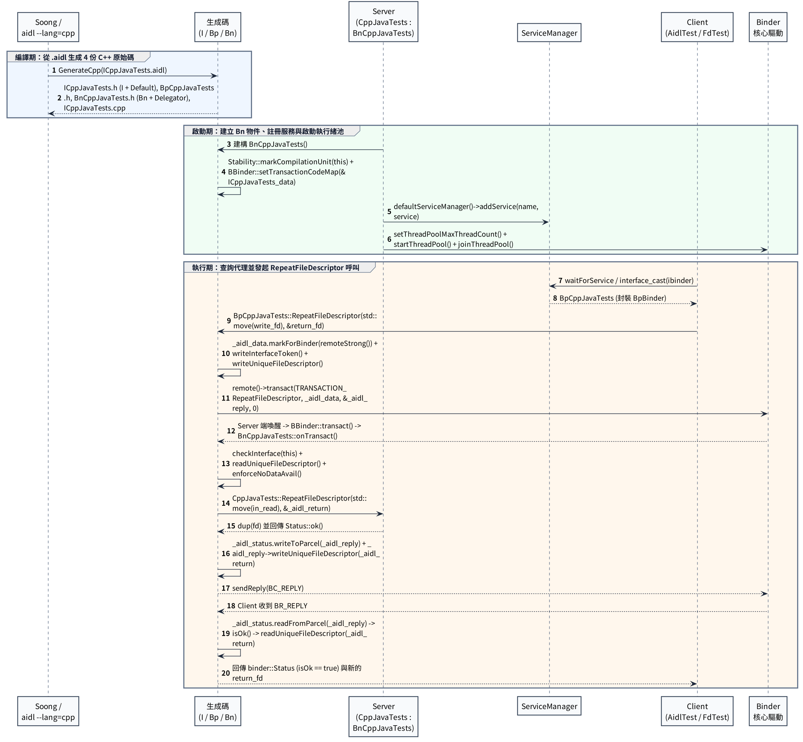

# 5.3 Binder 進程間通信應用實例（AIDL C++）

- **情景說明**：在 Android 17 中，手寫 `IMPLEMENT_META_INTERFACE` 已受限於編譯期白名單（見 5.2.1 Step 3），新增的原生 Binder 服務一律改由 AIDL 定義並交由編譯器自動產生介面、代理與存根碼。本節以 AOSP 官方測試介面 `ICppJavaTests.aidl`（搭配官方預先產生的 golden output 與真實服務／客戶端 `aidl_test_service.cpp`、`aidl_test_client`）為主線，從 `.aidl` 宣告與 Soong `aidl_interface` 規則出發，追蹤 `aidl --lang=cpp` 編譯器如何產出 `I<Name>` / `Bp<Name>` / `Bn<Name>` / `I<Name>Default` / `I<Name>Delegator`，再銜接原生系統服務的啟動骨架（`main_gpuservice.cpp`）與 C++ / NDK 客戶端的查詢呼叫流程（`codelab/client/testClient.cpp`）。
- **對應原書**：第 5 章 5.3 節〈Binder 进程间通信应用实例〉（p.196–204）
- **涉及專案與版本基準**：
  - `platform/system/tools/aidl` 〔`android-17.0.0_r1`，commit `9a94664`〕
  - `platform/frameworks/native` 〔`android-17.0.0_r1`，commit `ae266dc`〕

---

## 5.3.1 介面定義與建置規則（取代原書 `common/` 與 `Android.mk`）

> 對應原書 5.3（p.196–200）。原書為示範 Binder 應用，在 `common/` 手動撰寫 `IFregService.h` 與 `IFregService.cpp`（自行定義 `GET_VAL`/`SET_VAL` 交易碼、手寫 `BpFregService`、`IMPLEMENT_META_INTERFACE` 與 `BnFregService::onTransact`），並以 `Android.mk` 建置。在 Android 17 中，這些樣板碼全部改由 `.aidl` 描述檔與 `Android.bp` 的 `aidl_interface` 模組自動生成。

### Step 1：`.aidl` 介面定義與 `Android.bp`（`aidl_interface`）
**位置**：`platform/system/tools/aidl/tests/android/aidl/tests/ICppJavaTests.aidl` 〔`android-17.0.0_r1`，lines 17–44〕與 `platform/system/tools/aidl/Android.bp` 〔lines 469–495〕

```aidl
package android.aidl.tests;

import android.aidl.tests.BadParcelable;
import android.aidl.tests.GenericStructuredParcelable;
import android.aidl.tests.IntEnum;
import android.aidl.tests.StructuredParcelable;
import android.aidl.tests.Union;
import android.os.PersistableBundle;

// Tests that are only supported by the C++/Java backends, not NDK/Rust
interface ICppJavaTests {
    BadParcelable RepeatBadParcelable(in BadParcelable input);

    GenericStructuredParcelable<int, StructuredParcelable, IntEnum> RepeatGenericParcelable(
            in GenericStructuredParcelable<int, StructuredParcelable, IntEnum> input,
            out GenericStructuredParcelable<int, StructuredParcelable, IntEnum> repeat);
    PersistableBundle RepeatPersistableBundle(in PersistableBundle input);

    PersistableBundle[] ReversePersistableBundles(
            in PersistableBundle[] input, out PersistableBundle[] repeated);
    Union ReverseUnion(in Union input, out Union repeated);
    // Test that List<T> types work correctly.
    List<IBinder> ReverseNamedCallbackList(in List<IBinder> input, out List<IBinder> repeated);

    FileDescriptor RepeatFileDescriptor(in FileDescriptor read);
    FileDescriptor[] ReverseFileDescriptorArray(
            in FileDescriptor[] input, out FileDescriptor[] repeated);
}
```

對應的 Soong 建置規則位於 `platform/system/tools/aidl/Android.bp`：

```bp
aidl_interface {
    name: "aidl-cpp-java-test-interface",
    unstable: true,
    srcs: [
        "tests/android/aidl/tests/BadParcelable.aidl",
        "tests/android/aidl/tests/ICppJavaTests.aidl",
    ],
    local_include_dir: "tests",
    include_dirs: [
        "frameworks/native/aidl/binder",
    ],
    imports: ["aidl-test-interface"],
    backend: {
        cpp: {
            additional_shared_libraries: ["libsimpleparcelable"],
            enabled: true,
        },
        java: {
            additional_libs: [
                "libsimpleparcelable_java",
            ],
            platform_apis: true,
            enabled: true,
        },
        rust: {
            enabled: false,
        },
```

若只是建立一個全新的簡易服務介面（例如官方教學 `platform/system/tools/aidl/codelab/aidl/hello/world/IHello.aidl`），介面定義本身僅需數行：

```aidl
package hello.world;

interface IHello {
    // Have the service log a message for us
    void LogMessage(String message);
    // Get a "hello world" message from the service
    String getMessage();
}
```

重點解析：
1. **參數方向修飾符（`in` / `out` / `inout`）**：非基本型別參數（Parcelable、陣列、`List`、`FileDescriptor` 等）在 AIDL 中必須明確標註傳輸方向，編譯器據此決定只在請求 `_aidl_data` 寫入（`in`）、只在回覆 `_aidl_reply` 寫回（`out`），或雙向讀寫（`inout`）。
2. **`aidl_interface` 自動產生多語言目標**：Soong 會依 `backend` 設定，對同一個 `.aidl` 介面自動產出 `<name>-cpp`（C++ `libbinder`）、`<name>-ndk`（C/C++ `libbinder_ndk`）、`<name>-java`（Java）與 `<name>-rust`（Rust）四套函式庫目標；模組只需在 `shared_libs` / `static_libs` 中依賴對應後端名稱即可，無須手動維護交易碼或序列化順序。
3. **版本凍結（Stable AIDL vs `unstable: true`）**：用於同分區內部測試或非跨分區 API 時可設 `unstable: true`；跨分區（如 system ↔ vendor）則須移除 `unstable: true`、由 `m <name>-freeze-api` 凍結 API 快照並產生 `VERSION` 與 `HASH` 檢查（見 Step 3）。

> 〔與 2.3 差異〕**已移除並改寫**：2.3 針對原生 C++ 服務沒有 `aidl --lang=cpp` 編譯支援（當時 AIDL 僅支援 Java），因此原書必須手寫 `IFregService.h`/`IFregService.cpp` 並以 `Android.mk` 編譯（原書 p.196–200、202–203）；17 改由 Soong `Android.bp` 的 `aidl_interface` 驅動 `aidl` 編譯器同時產出 C++ / NDK / Java / Rust 綁定。

---

### Step 2：`aidl --lang=cpp` 編譯器管線（`GenerateCpp`）
**位置**：`platform/system/tools/aidl/generate_cpp.cpp` 〔`android-17.0.0_r1`，lines 1550–1622〕

```cpp
void GenerateSource(CodeWriter& out, const AidlDefinedType& defined_type,
                    const AidlTypenames& typenames, const Options& options) {
  struct Visitor : AidlVisitor {
    ...
    void Visit(const AidlInterface& interface) override {
      GenerateInterfaceSource(out, interface, typenames, options);
      GenerateClientSource(out, interface, typenames, options);
      GenerateServerSource(out, interface, typenames, options);
    }
    ...
  } v(out, typenames, options);
  VisitTopDown(v, defined_type);
}

bool GenerateCpp(const string& output_file, const Options& options, const AidlTypenames& typenames,
                 const AidlDefinedType& defined_type, const IoDelegate& io_delegate) {
  if (!ValidateOutputFilePath(output_file, options, defined_type)) {
    return false;
  }
  ...
  return gen(options.OutputHeaderDir() + HeaderFile(defined_type, ClassNames::RAW),
             &GenerateHeader) &&
         gen(options.OutputHeaderDir() + HeaderFile(defined_type, ClassNames::CLIENT),
             &GenerateClientHeader) &&
         gen(options.OutputHeaderDir() + HeaderFile(defined_type, ClassNames::SERVER),
             &GenerateServerHeader) &&
         gen(output_file, &GenerateSource);
}
```

Soong 呼叫 `aidl --lang=cpp` 後，編譯器會將單一 `.aidl` 介面展開為**四個檔案**（相較於原書把全部手寫進兩個檔案，介面、代理與存根的標頭已徹底解耦）：

| 輸出檔案（以 `ICppJavaTests.aidl` 為例） | 產生函式 | 內容與使用者 |
|---|---|---|
| `include/android/aidl/tests/ICppJavaTests.h` | `GenerateHeader` | 抽象介面 `ICppJavaTests` 與預設空實作 `ICppJavaTestsDefault`（Client 與 Server 共同 `#include`） |
| `include/android/aidl/tests/BpCppJavaTests.h` | `GenerateClientHeader` | 代理類別 `BpCppJavaTests : BpInterface<ICppJavaTests>`（通常僅由生成的 `.cpp` 與特定測試引入） |
| `include/android/aidl/tests/BnCppJavaTests.h` | `GenerateServerHeader` | 存根類別 `BnCppJavaTests : BnInterface<ICppJavaTests>`、交易碼常數 `TRANSACTION_*` 與委派包裝類 `ICppJavaTestsDelegator`（Server 實作 `#include`） |
| `android/aidl/tests/ICppJavaTests.cpp` | `GenerateSource` | 依序輸出三段實作：元介面巨集（`GenerateInterfaceSource`）、`Bp` 方法序列化（`GenerateClientSource`）、`TransactionCodeData` + `Bn` 建構子與 `onTransact`（`GenerateServerSource`） |

> 〔與 2.3 差異〕**新增**：2.3 沒有 C++ AIDL 程式碼產生器；17 的 `system/tools/aidl/generate_cpp.cpp` 自動維護上述四檔拆分與所有序列化、穩定度、錯誤處理與追蹤掛鉤。

---

## 5.3.2 解析 AIDL 產生的 C++ 骨架碼（官方 Golden Output）

> 以下三個 Step 直接讀自 `platform/system/tools/aidl/tests/golden_output/aidl-cpp-java-test-interface-cpp-source/gen/`——這是 AOSP 內建用來回歸驗證 `aidl --lang=cpp` 輸出的真實產出碼。

### Step 3：介面標頭 `ICppJavaTests.h`（`I<Name>`、`I<Name>Default` 與 `binder::Status`）
**位置**：`platform/system/tools/aidl/tests/golden_output/aidl-cpp-java-test-interface-cpp-source/gen/include/android/aidl/tests/ICppJavaTests.h` 〔`android-17.0.0_r1`，lines 31–82〕

```cpp
namespace android {
namespace aidl {
namespace tests {
class LIBBINDER_EXPORTED ICppJavaTestsDelegator;

class LIBBINDER_EXPORTED ICppJavaTests : public ::android::IInterface {
public:
  typedef ICppJavaTestsDelegator DefaultDelegator;
  DECLARE_META_INTERFACE(CppJavaTests)
  virtual ::android::binder::Status RepeatBadParcelable(const ::android::aidl::tests::BadParcelable& input, ::android::aidl::tests::BadParcelable* _aidl_return) = 0;
  ...
  virtual ::android::binder::Status ReversePersistableBundles(const ::std::vector<::android::os::PersistableBundle>& input, ::std::vector<::android::os::PersistableBundle>* repeated, ::std::vector<::android::os::PersistableBundle>* _aidl_return) = 0;
  ...
  virtual ::android::binder::Status RepeatFileDescriptor(::android::base::unique_fd read, ::android::base::unique_fd* _aidl_return) = 0;
  virtual ::android::binder::Status ReverseFileDescriptorArray(const ::std::vector<::android::base::unique_fd>& input, ::std::vector<::android::base::unique_fd>* repeated, ::std::vector<::android::base::unique_fd>* _aidl_return) = 0;
};  // class ICppJavaTests

class LIBBINDER_EXPORTED ICppJavaTestsDefault : public ICppJavaTests {
public:
  ::android::IBinder* onAsBinder() override {
    return nullptr;
  }
  ::android::binder::Status RepeatBadParcelable(const ::android::aidl::tests::BadParcelable& /*input*/, ::android::aidl::tests::BadParcelable* /*_aidl_return*/) override {
    return ::android::binder::Status::fromStatusT(::android::UNKNOWN_TRANSACTION);
  }
  ...
  ::android::binder::Status RepeatFileDescriptor(::android::base::unique_fd /*read*/, ::android::base::unique_fd* /*_aidl_return*/) override {
    return ::android::binder::Status::fromStatusT(::android::UNKNOWN_TRANSACTION);
  }
  ...
};  // class ICppJavaTestsDefault
}  // namespace tests
}  // namespace aidl
}  // namespace android
```

與原書手寫的 `IFregService`（`virtual int32_t getVal() = 0;`）相比，AIDL 產生的介面有以下關鍵設計：
1. **統一以 `::android::binder::Status` 作為 C++ 回傳值**：即便 `.aidl` 方法宣告為 `void` 或回傳物件，C++ 介面一律回傳 `binder::Status`，原本的回傳值則移至參數列表最末端的指標 `*_aidl_return`。
   - 依 `platform/frameworks/native/libs/binder/include/binder/Status.h`（lines 55–147），`Status` 同時承載兩類錯誤：**底層傳輸失敗**（`EX_TRANSACTION_FAILED`，如 `DEAD_OBJECT`、`FAILED_TRANSACTION`，透過 `transactionError()` 讀取）與**遠端業務異常**（寫在 `_aidl_reply` 開頭的異常標頭，包括 `EX_SECURITY`、`EX_ILLEGAL_ARGUMENT`、`EX_NULL_POINTER`、`EX_SERVICE_SPECIFIC` 等，能跨 C++ / Java / Rust 互通）。這解決了原書 `int32_t getVal()` 無法區分「暫存器真的回傳 -1」還是「Binder 交易失敗」的缺陷。
2. **參數傳遞慣例**（見 `generate_cpp.cpp::GenerateArgList`，lines 101–160）：
   - `in` 參數：基本型別與 enum 採按值傳遞；複雜物件與陣列採 `const T&`；不可複製的 `unique_fd`（對應 AIDL `FileDescriptor`）按值傳遞以轉移所有權（程式碼註解標註 `b/144943748`）。
   - `out` / `inout` 參數與 `_aidl_return`：統一轉為指標 `T*`。
3. **`ICppJavaTestsDefault` 預設實作**：提供所有純虛函式的預設實作（回傳 `Status::fromStatusT(UNKNOWN_TRANSACTION)`），供測試 mock 或僅實作部分方法的輔助類別繼承。
4. **版本化 Stable AIDL 介面擴充**：當介面啟用 `--structured --version N --hash ...` 時（可對照 `tests/golden_output/aidl-test-versioned-interface-V2-cpp-source/gen/include/android/aidl/versioned/tests/IFooInterface.h`），`I<Name>` 會額外產生 `static inline const int32_t VERSION`、`static inline const std::string HASH`，以及 `getInterfaceVersion()` 與 `getInterfaceHash()` 兩個內建元交易方法，讓 Client 在執行期探測對端服務的版本與雜湊值。

> 〔與 2.3 差異〕**邏輯改變**：保留 `IInterface` 繼承與 `DECLARE_META_INTERFACE` 展開骨架（原書 p.197），但新增強制性的 `binder::Status` 異常模型、`*_aidl_return` 尾端輸出參數、`I<Name>Default`、`DefaultDelegator` 型別別名，以及 Stable AIDL 的版本／雜湊查詢能力。

---

### Step 4：客戶端代理 `BpCppJavaTests.h` 與 `ICppJavaTests.cpp`（`Bp<Name>` 序列化路徑）
**位置**：
- `platform/system/tools/aidl/tests/golden_output/aidl-cpp-java-test-interface-cpp-source/gen/include/android/aidl/tests/BpCppJavaTests.h` 〔`android-17.0.0_r1`，lines 16–34〕
- `platform/system/tools/aidl/tests/golden_output/aidl-cpp-java-test-interface-cpp-source/gen/android/aidl/tests/ICppJavaTests.cpp` 〔`android-17.0.0_r1`，lines 9–30、136–176、254–286〕

代理標頭宣告（`BpCppJavaTests.h`）：

```cpp
namespace android {
namespace aidl {
namespace tests {
class LIBBINDER_EXPORTED BpCppJavaTests : public ::android::BpInterface<ICppJavaTests> {
public:
  explicit BpCppJavaTests(const ::android::sp<::android::IBinder>& _aidl_impl);
  virtual ~BpCppJavaTests() = default;
  ...
  ::android::binder::Status ReversePersistableBundles(const ::std::vector<::android::os::PersistableBundle>& input, ::std::vector<::android::os::PersistableBundle>* repeated, ::std::vector<::android::os::PersistableBundle>* _aidl_return) override;
  ...
  ::android::binder::Status RepeatFileDescriptor(::android::base::unique_fd read, ::android::base::unique_fd* _aidl_return) override;
  ...
};  // class BpCppJavaTests
}  // namespace tests
}  // namespace aidl
}  // namespace android
```

元介面巨集與兩個具代表性的 `Bp` 方法實作（`ICppJavaTests.cpp`）：

```cpp
#include <android/aidl/tests/ICppJavaTests.h>
#include <android/aidl/tests/BpCppJavaTests.h>
namespace android {
namespace aidl {
namespace tests {
DO_NOT_DIRECTLY_USE_ME_IMPLEMENT_META_INTERFACE(CppJavaTests, "android.aidl.tests.ICppJavaTests")
}  // namespace tests
}  // namespace aidl
}  // namespace android
#include <android/aidl/tests/BpCppJavaTests.h>
#include <android/aidl/tests/BnCppJavaTests.h>
#include <binder/Parcel.h>

namespace android {
namespace aidl {
namespace tests {

BpCppJavaTests::BpCppJavaTests(const ::android::sp<::android::IBinder>& _aidl_impl)
    : BpInterface<ICppJavaTests>(_aidl_impl){
}
```

```cpp
::android::binder::Status BpCppJavaTests::RepeatFileDescriptor(::android::base::unique_fd read, ::android::base::unique_fd* _aidl_return) {
  ::android::Parcel _aidl_data;
  _aidl_data.markForBinder(remoteStrong());
  ::android::Parcel _aidl_reply;
  ::android::status_t _aidl_ret_status = ::android::OK;
  ::android::binder::Status _aidl_status;
  _aidl_ret_status = _aidl_data.writeInterfaceToken(getInterfaceDescriptor());
  if (((_aidl_ret_status) != (::android::OK))) {
    goto _aidl_error;
  }
  _aidl_ret_status = _aidl_data.writeUniqueFileDescriptor(read);
  if (((_aidl_ret_status) != (::android::OK))) {
    goto _aidl_error;
  }
  _aidl_ret_status = remote()->transact(BnCppJavaTests::TRANSACTION_RepeatFileDescriptor, _aidl_data, &_aidl_reply, 0);
  if (((_aidl_ret_status) != (::android::OK))) {
    goto _aidl_error;
  }
  _aidl_ret_status = _aidl_status.readFromParcel(_aidl_reply);
  if (((_aidl_ret_status) != (::android::OK))) {
    goto _aidl_error;
  }
  if (!_aidl_status.isOk()) {
    return _aidl_status;
  }
  _aidl_ret_status = _aidl_reply.readUniqueFileDescriptor(_aidl_return);
  if (((_aidl_ret_status) != (::android::OK))) {
    goto _aidl_error;
  }
  _aidl_error:
  _aidl_status.setFromStatusT(_aidl_ret_status);
  return _aidl_status;
}
```

如果方法包含動態陣列 `out` 參數（如 `ReversePersistableBundles`），Client 端在送出前還會多寫一個陣列長度（`_aidl_data.writeVectorSize(*repeated)`），並在回覆讀取時遵循「先讀 `_aidl_return`，再依序讀各 `out` 參數」的約定：

```cpp
  _aidl_ret_status = _aidl_data.writeParcelableVector(input);
  if (((_aidl_ret_status) != (::android::OK))) {
    goto _aidl_error;
  }
  _aidl_ret_status = _aidl_data.writeVectorSize(*repeated);
  if (((_aidl_ret_status) != (::android::OK))) {
    goto _aidl_error;
  }
  _aidl_ret_status = remote()->transact(BnCppJavaTests::TRANSACTION_ReversePersistableBundles, _aidl_data, &_aidl_reply, 0);
  ...
  _aidl_ret_status = _aidl_reply.readParcelableVector(_aidl_return);
  ...
  _aidl_ret_status = _aidl_reply.readParcelableVector(repeated);
```

對照 `generate_cpp.cpp::GenerateInterfaceSource`（lines 735–755）與 `GenerateClientTransaction`（lines 173–309），可以看到 5 個在 2.3 手寫碼中不存在的關鍵細節：
1. **合法繞過手寫白名單**：`aidl` 編譯器在 `ICppJavaTests.cpp` 內輸出的是 `DO_NOT_DIRECTLY_USE_ME_IMPLEMENT_META_INTERFACE(...)`，直接展開 `descriptor` 與 `asInterface()`，不觸發 `IMPLEMENT_META_INTERFACE` 的 `static_assert(allowedManualInterface(NAME))`。
2. **`_aidl_data.markForBinder(remoteStrong())`**：若底層 `BpBinder` 是 RPC Binder（Socket 傳輸），此呼叫會把 `_aidl_data` 切換為 `RpcFields` 模式並綁定對應的 `RpcSession`（核心 Binder 路徑下則為 no-op）；使同一份生成碼透明相容核心 Binder 與 RPC Binder。
3. **逐行檢查 `status_t` 與異常標頭解碼**：每一次 `write*` / `transact` / `read*` 都檢查回傳是否為 `::android::OK`，失敗即 `goto _aidl_error` 經 `_aidl_status.setFromStatusT(_aidl_ret_status)` 包裝成 `EX_TRANSACTION_FAILED` 返回。若 `transact` 成功，必須先 `_aidl_status.readFromParcel(_aidl_reply)` 讀取遠端異常標頭；若 `!_aidl_status.isOk()` 則直接回傳該異常，**絕不**繼續讀取回傳值（避免對空 Parcel 誤讀）。
4. **`oneway` 與 `@SensitiveData` 的編譯期切換**（見 `generate_cpp.cpp` lines 186–193、244–270）：
   - `oneway` 方法不宣告 `_aidl_reply`，`remote()->transact(..., nullptr, ::android::IBinder::FLAG_ONEWAY)`，且不呼叫 `_aidl_status.readFromParcel`。
   - 標註 `@SensitiveData` 的介面會在寫入前呼叫 `_aidl_data.markSensitive()`，並在 `transact` flags 加上 `::android::IBinder::FLAG_CLEAR_BUF`，觸發核心在釋放緩衝區前清零實體頁（見 5.1.5 Step 7）。

> 〔與 2.3 差異〕**邏輯改變**：2.3 的 `BpFregService` 直接 `data.writeInterfaceToken` → `remote()->transact` → `reply.readInt32()`，既不檢查 `transact` 與讀寫錯誤，也沒有 `Status` 異常標頭與 `markForBinder`（原書 p.198–199）；17 的 AIDL 生成碼全面加上傳輸模式標記、完整錯誤檢查、異常標頭協定與 `oneway`/`FLAG_CLEAR_BUF` 支援。

---

### Step 5：服務端存根 `BnCppJavaTests.h`、`I<Name>Delegator` 與 `BnCppJavaTests::onTransact`
**位置**：
- `platform/system/tools/aidl/tests/golden_output/aidl-cpp-java-test-interface-cpp-source/gen/include/android/aidl/tests/BnCppJavaTests.h` 〔`android-17.0.0_r1`，lines 17–68〕
- `platform/system/tools/aidl/tests/golden_output/aidl-cpp-java-test-interface-cpp-source/gen/android/aidl/tests/ICppJavaTests.cpp` 〔`android-17.0.0_r1`，lines 333–367、463–501、572–601、641–655〕

先看 `BnCppJavaTests.h`：

```cpp
namespace android {
namespace aidl {
namespace tests {
class LIBBINDER_EXPORTED BnCppJavaTests : public ::android::BnInterface<ICppJavaTests> {
public:
  static constexpr uint32_t TRANSACTION_RepeatBadParcelable = ::android::IBinder::FIRST_CALL_TRANSACTION + 0;
  ...
  static constexpr uint32_t TRANSACTION_ReversePersistableBundles = ::android::IBinder::FIRST_CALL_TRANSACTION + 3;
  ...
  static constexpr uint32_t TRANSACTION_RepeatFileDescriptor = ::android::IBinder::FIRST_CALL_TRANSACTION + 6;
  static constexpr uint32_t TRANSACTION_ReverseFileDescriptorArray = ::android::IBinder::FIRST_CALL_TRANSACTION + 7;
  explicit BnCppJavaTests();
  ::android::status_t onTransact(uint32_t _aidl_code, const ::android::Parcel& _aidl_data, ::android::Parcel* _aidl_reply, uint32_t _aidl_flags) override;
};  // class BnCppJavaTests

class LIBBINDER_EXPORTED ICppJavaTestsDelegator : public BnCppJavaTests {
public:
  explicit ICppJavaTestsDelegator(const ::android::sp<ICppJavaTests> &impl) : _aidl_delegate(impl) {}

  ::android::sp<ICppJavaTests> getImpl() { return _aidl_delegate; }
  ...
  ::android::binder::Status RepeatFileDescriptor(::android::base::unique_fd read, ::android::base::unique_fd* _aidl_return) override {
    return _aidl_delegate->RepeatFileDescriptor(std::move(read), _aidl_return);
  }
  ...
private:
  ::android::sp<ICppJavaTests> _aidl_delegate;
};  // class ICppJavaTestsDelegator
}  // namespace tests
}  // namespace aidl
}  // namespace android
```

再看 `ICppJavaTests.cpp` 中的服務端初始化與 `onTransact` 分派實作：

```cpp
#include <android/aidl/tests/BnCppJavaTests.h>
#include <binder/Parcel.h>
#include <binder/Stability.h>

static const char* ICppJavaTests_names[] = {
  "RepeatBadParcelable",
  "RepeatGenericParcelable",
  "RepeatPersistableBundle",
  "ReversePersistableBundles",
  "ReverseUnion",
  "ReverseNamedCallbackList",
  "RepeatFileDescriptor",
  "ReverseFileDescriptorArray",
};

alignas(16) static const ::android::TransactionCodeData ICppJavaTests_data = {
  .totalSize = sizeof(::android::TransactionCodeData),
  .backendType = "cpp",
  .names = ICppJavaTests_names,
  .count = 8,
};

namespace android {
namespace aidl {
namespace tests {

BnCppJavaTests::BnCppJavaTests()
{
  ::android::internal::Stability::markCompilationUnit(this);
  ::android::BBinder::setTransactionCodeMap(&ICppJavaTests_data);
}

::android::status_t BnCppJavaTests::onTransact(uint32_t _aidl_code, const ::android::Parcel& _aidl_data, ::android::Parcel* _aidl_reply, uint32_t _aidl_flags) {
  ::android::status_t _aidl_ret_status = ::android::OK;
  switch (_aidl_code) {
  ...
  case BnCppJavaTests::TRANSACTION_ReversePersistableBundles:
  {
    ::std::vector<::android::os::PersistableBundle> in_input;
    ::std::vector<::android::os::PersistableBundle> out_repeated;
    ::std::vector<::android::os::PersistableBundle> _aidl_return;
    if (!(_aidl_data.checkInterface(this))) {
      _aidl_ret_status = ::android::BAD_TYPE;
      break;
    }
    _aidl_ret_status = _aidl_data.readParcelableVector(&in_input);
    if (((_aidl_ret_status) != (::android::OK))) {
      break;
    }
    _aidl_ret_status = _aidl_data.resizeOutVector(&out_repeated);
    if (((_aidl_ret_status) != (::android::OK))) {
      break;
    }
    if (auto st = _aidl_data.enforceNoDataAvail(); !st.isOk()) {
      _aidl_ret_status = st.writeToParcel(_aidl_reply);
      break;
    }
    ::android::binder::Status _aidl_status(ReversePersistableBundles(in_input, &out_repeated, &_aidl_return));
    _aidl_ret_status = _aidl_status.writeToParcel(_aidl_reply);
    if (((_aidl_ret_status) != (::android::OK))) {
      break;
    }
    if (!_aidl_status.isOk()) {
      break;
    }
    _aidl_ret_status = _aidl_reply->writeParcelableVector(_aidl_return);
    if (((_aidl_ret_status) != (::android::OK))) {
      break;
    }
    _aidl_ret_status = _aidl_reply->writeParcelableVector(out_repeated);
    if (((_aidl_ret_status) != (::android::OK))) {
      break;
    }
  }
  break;
  ...
  case BnCppJavaTests::TRANSACTION_RepeatFileDescriptor:
  {
    ::android::base::unique_fd in_read;
    ::android::base::unique_fd _aidl_return;
    if (!(_aidl_data.checkInterface(this))) {
      _aidl_ret_status = ::android::BAD_TYPE;
      break;
    }
    _aidl_ret_status = _aidl_data.readUniqueFileDescriptor(&in_read);
    if (((_aidl_ret_status) != (::android::OK))) {
      break;
    }
    if (auto st = _aidl_data.enforceNoDataAvail(); !st.isOk()) {
      _aidl_ret_status = st.writeToParcel(_aidl_reply);
      break;
    }
    ::android::binder::Status _aidl_status(RepeatFileDescriptor(std::move(in_read), &_aidl_return));
    _aidl_ret_status = _aidl_status.writeToParcel(_aidl_reply);
    if (((_aidl_ret_status) != (::android::OK))) {
      break;
    }
    if (!_aidl_status.isOk()) {
      break;
    }
    _aidl_ret_status = _aidl_reply->writeUniqueFileDescriptor(_aidl_return);
    if (((_aidl_ret_status) != (::android::OK))) {
      break;
    }
  }
  break;
  ...
  default:
  {
    _aidl_ret_status = ::android::BBinder::onTransact(_aidl_code, _aidl_data, _aidl_reply, _aidl_flags);
  }
  break;
  }
  if (_aidl_ret_status == ::android::UNEXPECTED_NULL) {
    _aidl_ret_status = ::android::binder::Status::fromExceptionCode(::android::binder::Status::EX_NULL_POINTER).writeOverParcel(_aidl_reply);
  }
  return _aidl_ret_status;
}
```

重點解析：
1. **建構子自動註冊 `Stability` 與 `TransactionCodeData`**：
   - `Stability::markCompilationUnit(this)` 將此 `BBinder` 標記為目前編譯單元的穩定度（`SYSTEM` 或 `VENDOR`）；若介面標註了 `@VintfStability`，`generate_cpp.cpp`（lines 701–705）會改輸出 `Stability::markVintf(this)`。
   - `alignas(16)` 的 `ICppJavaTests_data` 透過 `BBinder::setTransactionCodeMap` 寫入 5.2.2 Step 4 介紹的 `BBinder::mPackedData`（16-byte 對齊正是為了騰出最低 4 bit 給 `Stability` 與 `PARCELED_BIT`！）。如此 `BBinder::transact` 進行 ATrace、慢交易日誌或 `BinderObserver` 統計時，就能直接把數字交易碼反查成 `"RepeatFileDescriptor"` 方法名。
2. **介面檢驗與 `enforceNoDataAvail()` 安全防線**：
   - 介面描述符不符時回傳 `::android::BAD_TYPE`（不再是手寫巨集 `CHECK_INTERFACE` 的 `PERMISSION_DENIED`）。
   - 當方法有參數且 `min_sdk_version >= Tiramisu`（Android 13）時，讀完所有輸入參數後必呼叫 `_aidl_data.enforceNoDataAvail()`，若 Client 多塞了未消費的位元組，直接把錯誤 `Status` 寫入 `_aidl_reply` 並中止執行，防堵 Parcel 反序列化錯位漏洞。
3. **`UNEXPECTED_NULL` 轉譯為 `EX_NULL_POINTER`**：若任一步驟因非 `@nullable` 參數收到空物件而得到 `::android::UNEXPECTED_NULL`，`onTransact` 尾端會透過 `writeOverParcel(_aidl_reply)` 改寫回覆為標準 `EX_NULL_POINTER` 異常，使 Java Client 能收到對應的 `NullPointerException`。
4. **`I<Name>Delegator` 與 `binder/Delegate.h`**：AIDL 自動為每個介面生成繼承 `Bn<Name>` 的委派包裝類 `ICppJavaTestsDelegator`。配合 `frameworks/native/libs/binder/include/binder/Delegate.h` 的 `android::delegate<T>(binder)` 函式，行程可以把一個已持有的遠端 `Bp` 或本地 `Bn` 包成新的本地 `BBinder` 轉發出去（用於注入攔截器、代理隔離或跨權限轉交），且再次呼叫 `delegate()` 時能靠 `attachObject(isDelegatorId, ...)` 偵測並安全解包取回原實作。

> 〔與 2.3 差異〕**邏輯改變 + 擴充**：2.3 的 `BnFregService::onTransact` 僅做 `CHECK_INTERFACE`、讀寫基本型別與 `BBinder::onTransact` 回退（原書 p.198–200）；17 的 `Bn` 存根自動在建構子標記 `Stability` 與 16-byte 對齊的方法名稱表，在 `onTransact` 加入 `BAD_TYPE` 檢驗、`resizeOutVector`、`enforceNoDataAvail`、`Status` 異常寫回、`UNEXPECTED_NULL -> EX_NULL_POINTER` 轉換，並附帶 `I<Name>Delegator`。

---

## 5.3.3 Server 端服務實作與啟動骨架（取代原書 `server/FregServer.cpp`）

### Step 6：繼承 `Bn<Name>` 實作業務邏輯與向 ServiceManager 註冊啟動
**位置**：
- `platform/system/tools/aidl/tests/aidl_test_service.cpp` 〔`android-17.0.0_r1`，lines 196–272、1019–1041〕
- `platform/frameworks/native/services/gpuservice/main_gpuservice.cpp` 〔`android-17.0.0_r1`，lines 25–43〕

業務服務只需繼承 AIDL 產生的 `BnCppJavaTests` 並覆寫介面方法（無須再碰任何 `Parcel` 或 `onTransact` 程式碼），以下節錄自 `aidl_test_service.cpp`：

```cpp
class CppJavaTests : public BnCppJavaTests {
 public:
  CppJavaTests() = default;
  ~CppJavaTests() = default;

  Status RepeatBadParcelable(const BadParcelable& input, BadParcelable* _aidl_return) override {
    *_aidl_return = input;
    return Status::ok();
  }
  ...
  Status RepeatFileDescriptor(unique_fd read, unique_fd* _aidl_return) override {
    ALOGE("Repeating file descriptor");
    *_aidl_return = unique_fd(dup(read.get()));
    return Status::ok();
  }

  Status ReverseFileDescriptorArray(const vector<unique_fd>& input, vector<unique_fd>* repeated,
                                    vector<unique_fd>* _aidl_return) override {
    ALOGI("Reversing descriptor array of length %zu", input.size());
    repeated->clear();
    for (const auto& item : input) {
      repeated->push_back(unique_fd(dup(item.get())));
      _aidl_return->push_back(unique_fd(dup(item.get())));
    }
    std::reverse(_aidl_return->begin(), _aidl_return->end());
    return Status::ok();
  }
};
```

在該測試服務的 `main()` 中，建立服務實例、向 `defaultServiceManager()` 註冊並讓主執行緒加入 Binder 執行緒池：

```cpp
int main(int /* argc */, char* /* argv */[]) {
  IPCThreadState::self()->disableBackgroundScheduling(true);

  std::vector<sp<IBinder>> services = {
      sp<FixedSizeArrayService>::make(), sp<LoggableInterfaceService>::make(),
      sp<NativeService>::make(),         sp<NestedService>::make(),
      sp<TrunkStableService>::make(),    sp<VersionedService>::make(),
  };

  for (const auto& service : services) {
    status_t status =
        defaultServiceManager()->addService(service->getInterfaceDescriptor(), service);
    if (status != OK) {
      ALOGE("Failed to add service %s", String8(service->getInterfaceDescriptor()).c_str());
      return EXIT_FAILURE;
    }
  }

  IPCThreadState::self()->joinThreadPool();
  return EXIT_FAILURE;
}
```

而在實際的 AOSP 系統常駐服務中（例如 `platform/frameworks/native/services/gpuservice/main_gpuservice.cpp`，5.8 節將完整追蹤其啟動與註冊流程），標準的多執行緒服務啟動骨架長這樣：

```cpp
int main(int /* argc */, char** /* argv */) {
    signal(SIGPIPE, SIG_IGN);

    // publish GpuService
    sp<GpuService> gpuservice = new GpuService();
    sp<IServiceManager> sm(defaultServiceManager());
    sm->addService(String16(GpuService::SERVICE_NAME), gpuservice, false);

    // limit the number of binder threads to 4.
    ProcessState::self()->setThreadPoolMaxThreadCount(4);

    // start the thread pool
    sp<ProcessState> ps(ProcessState::self());
    ps->startThreadPool();
    ps->giveThreadPoolName();
    IPCThreadState::self()->joinThreadPool();

    return 0;
}
```

啟動骨架的工程要點：
1. **明確限制執行緒池上限**：`ProcessState` 預設會向驅動申請多達 `DEFAULT_MAX_BINDER_THREADS = 15` 條衍生執行緒；現代系統服務（如 `gpuservice`）會在 `startThreadPool()` 之前主動呼叫 `setThreadPoolMaxThreadCount(4)` 節省記憶體與執行緒開銷（若服務僅需單執行緒處理，則如 `aidl_test_service.cpp` 不呼叫 `startThreadPool()`，只由主執行緒呼叫 `joinThreadPool()`）。
2. **`giveThreadPoolName()` 與 `SIGPIPE`**：`giveThreadPoolName()` 將主執行緒重命名為 `binder:<pid>_<seq>` 方便除錯與 systrace 辨識；忽略 `SIGPIPE` 則防止透過 `dump(fd)` 或 `shellCommand` 寫入已關閉管道時誤殺整個服務行程。
3. **`BinderService<T>` 已棄用**：`platform/frameworks/native/libs/binder/include/binder/BinderService.h`（line 29）已明確標註 `WARNING: deprecated - DO NOT USE - prefer to setup service directly.`，理由是其會隱式啟動多達 16 條執行緒且增加模板膨脹，因此 17 的現代服務皆直接展開上述呼叫序列。

> 〔與 2.3 差異〕**邏輯改變**：服務實作改為直接繼承 AIDL 產生的 `Bn<Name>` 並回傳 `Status::ok()`；啟動流程仍維持 `defaultServiceManager()->addService(...)` → `startThreadPool()` → `joinThreadPool()` 骨架（原書 `FregServer.cpp`，p.201–202），但 17 強調以 `sp<T>::make()` 建立物件、顯式呼叫 `setThreadPoolMaxThreadCount()` 與 `giveThreadPoolName()`、放棄 `BinderService<T>` 封裝，並以 Soong `cc_binary` 搭配 `init_rc`（如 `gpuservice.rc`）由 `init` 託管啟動。

---

## 5.3.4 Client 端取得代理與呼叫（取代原書 `client/FregClient.cpp`）

### Step 7：C++ `libbinder` 客戶端（`waitForService<T>` 與 `interface_cast<T>`）
**位置**：
- `platform/frameworks/native/libs/binder/include/binder/IServiceManager.h` 〔`android-17.0.0_r1`，lines 198–230〕
- `platform/system/tools/aidl/tests/aidl_test_client.h` 〔`android-17.0.0_r1`，lines 31–59〕
- `platform/system/tools/aidl/tests/aidl_test_client_file_descriptors.cpp` 〔`android-17.0.0_r1`，lines 65–82〕

`IServiceManager.h` 提供了一組強型別範本輔助函式，取代原書手動分兩步呼叫 `getService` 再 `asInterface` 的寫法（原 `IServiceManager::getService` 在 17 已標記 deprecated）：

```cpp
template<typename INTERFACE>
sp<INTERFACE> waitForService(const String16& name) {
    const sp<IServiceManager> sm = defaultServiceManager();
    return interface_cast<INTERFACE>(sm->waitForService(name));
}
...
template<typename INTERFACE>
sp<INTERFACE> waitForVintfService(
        const String16& instance = String16("default")) {
    return waitForDeclaredService<INTERFACE>(
        INTERFACE::descriptor + String16("/") + instance);
}
```

在真實的 C++ 測試客戶端 `aidl_test_client.h` 中，透過 `waitForService<ITestService>` 取得服務代理，並透過 `interface_cast<ICppJavaTests>` 將回傳的 `IBinder` 轉型為 `BpCppJavaTests`：

```cpp
class AidlTest : public testing::Test {
 public:
  void SetUp() override {
    ...
    android::ProcessState::self()->setThreadPoolMaxThreadCount(1);
    android::ProcessState::self()->startThreadPool();
    service = waitForService<ITestService>(ITestService::descriptor);
    ASSERT_NE(nullptr, service);

    sp<android::IBinder> ibinder;
    auto status = service->GetCppJavaTests(&ibinder);
    ASSERT_TRUE(status.isOk());
    cpp_java_tests = android::interface_cast<ICppJavaTests>(ibinder);
    ...
  }

  BackendType backend;
  sp<ITestService> service;
  sp<ICppJavaTests> cpp_java_tests;
};
```

呼叫方法時（`aidl_test_client_file_descriptors.cpp`），直接呼叫代理物件的強型別成員函式並檢查 `binder::Status::isOk()`：

```cpp
TEST_F(FdTest, fileDescriptor) {
  if (!cpp_java_tests) GTEST_SKIP() << "Service does not support the CPP/Java-only tests.";

  unique_fd read_fd;
  unique_fd write_fd;
  DoPipe(&read_fd, &write_fd);

  unique_fd return_fd;
  auto status = cpp_java_tests->RepeatFileDescriptor(std::move(write_fd), &return_fd);
  ASSERT_TRUE(status.isOk());

  WriteStringToFd("ReturnString", return_fd);
  ReadFdToStringAndCompare(read_fd, "ReturnString");
}
```

注意 `AidlTest::SetUp()` 也在 Client 端呼叫了 `ProcessState::self()->startThreadPool()`：如果 Client 只需要發起單向呼叫且**不**註冊回呼介面或 `DeathRecipient`／凍結通知，不開執行緒池也能呼叫；但只要 Client 會把本地 `BBinder`（callback）送給 Server 或註冊死亡監聽，就必須啟動至少一條執行緒池執行緒來接收來自核心驅動的回呼事件。

> 〔與 2.3 差異〕**邏輯改變**：2.3 的 `FregClient.cpp` 呼叫 `defaultServiceManager()->getService(...)` 並手寫 `IFregService::asInterface(binder)`（原書 p.202–203）；17 改用 `waitForService<T>`（或針對 VINTF HAL 的 `waitForVintfService<T>`，搭配 `ServiceManager` 的事件通知等待機制而非客戶端輪詢 `sleep`），且每次遠端呼叫皆檢查回傳的 `binder::Status::isOk()`。

---

### Step 8：對照 NDK 後端（`libbinder_ndk`）客戶端寫法（`codelab/client/testClient.cpp`）
**位置**：
- `platform/system/tools/aidl/codelab/client/testClient.cpp` 〔`android-17.0.0_r1`，lines 16–41〕
- `platform/system/tools/aidl/codelab/client/Android.bp` 〔`android-17.0.0_r1`，lines 15–24〕

若開發者位於 APEX 模組、Vendor 分區或 NDK 環境（無法直接連結非穩定的 `libbinder`，見 5.2.6），則連結 `libbinder_ndk` 與 AIDL 產生的 `<name>-ndk` 函式庫：

```cpp
#include <gtest/gtest.h>

#include <android/binder_auto_utils.h>
#include <android/binder_manager.h>

#include <aidl/hello/world/IHello.h>

using aidl::hello::world::IHello;

TEST(HelloWorldTestClient, GetServiceSayHello) {
  std::string instance = std::string(IHello::descriptor) + "/default";
  ndk::SpAIBinder binder = ndk::SpAIBinder(AServiceManager_waitForService(instance.c_str()));
  ASSERT_NE(binder, nullptr);

  // If this is the wrong interface, this result will be null
  auto hello = IHello::fromBinder(binder);
  ASSERT_NE(hello, nullptr);

  auto res = hello->LogMessage("Hello service!");
  EXPECT_TRUE(res.isOk()) << res;
}
```

對應的 `Android.bp`：

```bp
cc_test {
    name: "hello-world-client-test",
    srcs: ["testClient.cpp"],
    shared_libs: [
        "libbinder_ndk",
    ],
    static_libs: [
        "hello.world-ndk",
    ],
}
```

C++ `libbinder` 與 NDK `libbinder_ndk` 後端在呼叫面上的對照非常工整：

| 概念 | C++ `libbinder` 後端（`-cpp`） | NDK `libbinder_ndk` 後端（`-ndk`） |
|---|---|---|
| 標頭路徑與命名空間 | `#include <pkg/IFoo.h>`（`pkg::IFoo`） | `#include <aidl/pkg/IFoo.h>`（`aidl::pkg::IFoo`） |
| 智慧指標 | `android::sp<IBinder>` / `sp<IFoo>` | `ndk::SpAIBinder` / `std::shared_ptr<IFoo>` |
| 查詢服務 | `android::waitForService<IFoo>(name)` | `AServiceManager_waitForService(name)` |
| 介面轉型 | `android::interface_cast<IFoo>(binder)` | `IFoo::fromBinder(binder)` |
| 交易狀態回傳型別 | `android::binder::Status` | `ndk::ScopedAStatus` |
| 適用邊界 | 僅限同分區內部平台元件 | 跨 APEX / Vendor / System（Stable AIDL 推薦） |

> 〔與 2.3 差異〕**新增**：2.3 不存在 `libbinder_ndk` 與 `aidl_interface` 多後端機制；17 的新服務（特別是 HAL 與 APEX 邊界）普遍改採 `libbinder_ndk` 或 Rust 後端，但底層依然委託給 5.2 節分析的 `libbinder` 與 Binder 驅動執行。

---

## 整節呼叫鏈總結

以下時序圖串連 Android 17 中一個 AIDL C++ 服務從**編譯期程式碼生成**到**執行期跨行程呼叫（以 `RepeatFileDescriptor` 為例）**的完整鏈路：


