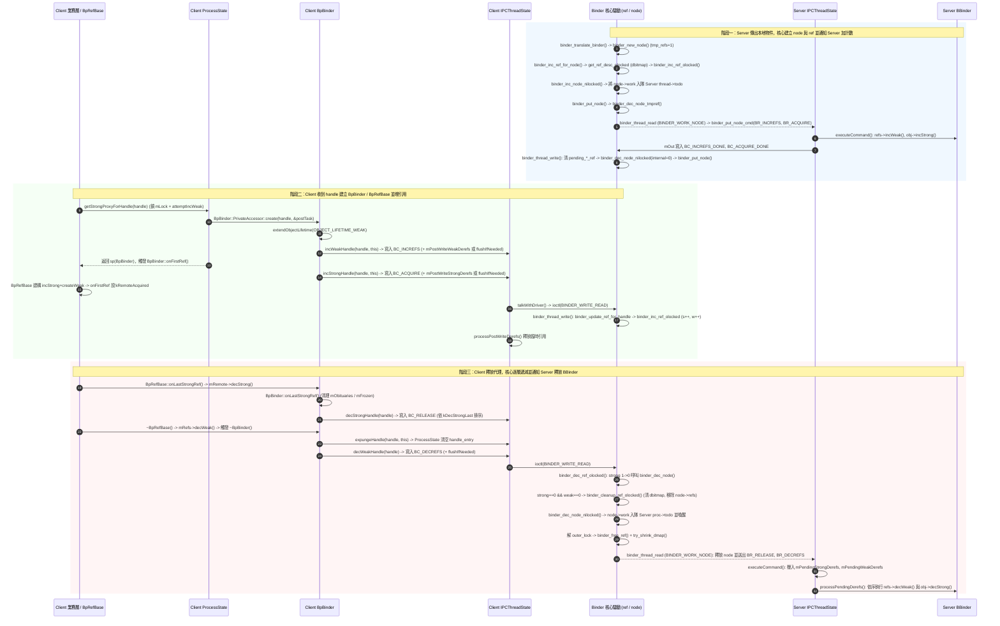

# 5.4 Binder 物件引用計數技術

- **情景說明**：Client 行程與 Server 行程跨行程共享同一個 Binder 服務物件時，完整通訊鏈路涉及四層物件——Client 端使用者空間的 **Binder 代理物件（`BpBinder` / `BpRefBase`）**、核心驅動中的 **Binder 引用物件（`binder_ref`）**、核心驅動中的 **Binder 實體物件（`binder_node`）**，以及 Server 端使用者空間的 **Binder 本地物件（`BBinder`）**。四者構成單向依賴鏈：`BpBinder` → `binder_ref` → `binder_node` → `BBinder`。本節逐層追蹤這四類物件如何透過 `RefBase` 智慧指標與 `BC_*`／`BR_*` 引用計數協定維持生命週期，避免任何仍被依賴的物件遭到提前銷毀，同時剖析 Android 17 在細粒度三級鎖（`outer_lock` → `node->lock` → `inner_lock`）、臨時引用 `tmp_refs`、`dbitmap` 句柄位圖、使用者空間延遲釋放佇列（`mPending*Derefs`／`mPostWrite*Derefs`）與停用 `BC_ATTEMPT_ACQUIRE` 等面向的實作演進。
- **對應原書**：第 5 章 5.4 節〈Binder 对象引用计数技术〉（p.204–220）
- **涉及專案與版本基準**：
  - `kernel/common` 〔`android17-6.18`，Linux 6.18，commit `1e0de07`〕
  - `platform/frameworks/native` 〔`android-17.0.0_r1`，commit `ae266dc`〕

---

## 總覽：四層物件依賴鏈與三道「多對一」壓縮

> 對應原書 5.4 引言（p.204–205，圖 5-17）以及各小節總結（圖 5-18、圖 5-19、圖 5-20）。

在一次跨行程 Binder 通訊中，請求沿著「Client 代理物件（`BpBinder`，持有 `handle`）→ 核心引用物件（`binder_ref`，依 `desc` 查找）→ 核心實體物件（`binder_node`，由 `ref->node` 指向）→ Server 本地物件（`BBinder`，由 `node->ptr`／`node->cookie` 定位）」傳遞。為了讓任意一端不會在對方仍使用期間過早釋放物件，同時避免每次指標拷貝都陷入核心 `ioctl`，Binder 在四層之間設計了**三道「多對一」的引用計數壓縮**：

1. **Client 使用者空間 → 核心 `binder_ref`（多對一）**：同一個 Client 行程內無論有多少 `sp<BpBinder>` 或 `BpInterface` 指向同一 `handle`，`BpBinder` 僅在**建構**時送一次 `BC_INCREFS`、在**首次被強指標引用（0→1）**時送一次 `BC_ACQUIRE`、在**最後強指標釋放（1→0）**時送一次 `BC_RELEASE`、在**析構**時送一次 `BC_DECREFS`。
2. **核心 `binder_ref` → 核心 `binder_node`（多對一）**：一個 `binder_ref` 本身即使強引用計數累增到 N，也只在 `ref->data.strong` 從 **0→1** 時遞增 `node->internal_strong_refs`，從 **1→0** 時遞減；其是否掛在 `node->refs` 串列上則隱含了對 `node` 的外部弱引用。
3. **核心 `binder_node` → Server 使用者空間 `BBinder`（多對一）**：即使有 M 個不同 Client 的 `binder_ref` 同時強引用同一個 `binder_node`（`node->internal_strong_refs == M`），核心也只在需要時透過 `BR_INCREFS`／`BR_ACQUIRE` 對 Server 的 `BBinder` 增加**最多 1 次**弱引用與 **1 次**強引用（由 `has_weak_ref`／`has_strong_ref` 旗標追蹤），直到所有內外部引用皆歸零才下發 `BR_RELEASE`／`BR_DECREFS`。

此外，Android 17 核心驅動以三級細粒度自旋鎖取代了 2.3 的全域 `binder_lock`（見 `binder.c` lines 9–41 註解）：

- **第 1 層 `proc->outer_lock`**（`binder_proc_lock`／`_olocked`）：保護 `binder_ref`、`refs_by_desc`、`refs_by_node` 與 `dmap`。
- **第 2 層 `node->lock`**（`binder_node_lock`／`_nlocked`）：保護 `binder_node` 本身欄位與 `node->refs` 串列。
- **第 3 層 `proc->inner_lock`**（`binder_inner_proc_lock`／`_ilocked`）：保護 `proc->nodes`、`proc->threads`、`proc->todo`、`thread->todo` 與 `node` 的 `has_*_ref`／`pending_*_ref` 位元欄位。同時持有第 2、3 層時稱為 `_nilocked`（`binder_node_inner_lock`）。

以下依原書順序，從最底層的被依賴者 `BBinder` 一路往外剖析至 `BpBinder`／`BpRefBase`。

---

## 5.4.1 Binder 本地物件（`BBinder`）的生命週期

> 對應原書 5.4.1（p.205–208）。`BBinder` 位於 Server 行程的使用者空間並繼承 `RefBase`。核心的 `binder_node` 無法直接操作使用者空間的智慧指標，因此必須透過 `BINDER_WORK_NODE` 工作項在 Server 呼叫 `binder_thread_read` 時寫出 `BR_INCREFS`、`BR_ACQUIRE`、`BR_RELEASE`、`BR_DECREFS` 四個協定命令，由 `IPCThreadState::executeCommand` 增減 `BBinder` 的強弱引用計數，並在增加完成後回傳 `BC_INCREFS_DONE`／`BC_ACQUIRE_DONE` 確認。

### Step 1：`binder.c::binder_thread_read` 與 `binder_put_node_cmd`（下發本地物件引用計數命令）
**位置**：`kernel/common/drivers/android/binder.c` 〔`android17-6.18`，lines 5055–5206、`binder_put_node_cmd` lines 4867–4896〕

```c
static int binder_put_node_cmd(struct binder_proc *proc,
			       struct binder_thread *thread,
			       void __user **ptrp,
			       binder_uintptr_t node_ptr,
			       binder_uintptr_t node_cookie,
			       int node_debug_id,
			       uint32_t cmd, const char *cmd_name)
{
	void __user *ptr = *ptrp;

	if (put_user(cmd, (uint32_t __user *)ptr))
		return -EFAULT;
	ptr += sizeof(uint32_t);

	if (put_user(node_ptr, (binder_uintptr_t __user *)ptr))
		return -EFAULT;
	ptr += sizeof(binder_uintptr_t);

	if (put_user(node_cookie, (binder_uintptr_t __user *)ptr))
		return -EFAULT;
	ptr += sizeof(binder_uintptr_t);

	binder_stat_br(proc, thread, cmd);
	binder_debug(BINDER_DEBUG_USER_REFS, "%d:%d %s %d u%016llx c%016llx\n",
		     proc->pid, thread->pid, cmd_name, node_debug_id,
		     (u64)node_ptr, (u64)node_cookie);

	*ptrp = ptr;
	return 0;
}
```

在 `binder_thread_read` 主迴圈中，執行緒持有 `proc->inner_lock` 從 `thread->todo` 或 `proc->todo` 取出工作項，遇 `BINDER_WORK_NODE` 時的處理如下：

```c
		if (!binder_worklist_empty_ilocked(&thread->todo))
			list = &thread->todo;
		else if (!binder_worklist_empty_ilocked(&proc->todo) &&
			   wait_for_proc_work)
			list = &proc->todo;
		else {
...
		}
skip:
		if (end - ptr < sizeof(tr) + 4) {
			binder_inner_proc_unlock(proc);
			break;
		}
		trace_android_vh_binder_thread_read(&list, proc, thread);
		w = binder_dequeue_work_head_ilocked(list);
		if (binder_worklist_empty_ilocked(&thread->todo))
			thread->process_todo = false;

		switch (w->type) {
...
		case BINDER_WORK_NODE: {
			struct binder_node *node = container_of(w, struct binder_node, work);
			int strong, weak;
			binder_uintptr_t node_ptr = node->ptr;
			binder_uintptr_t node_cookie = node->cookie;
			int node_debug_id = node->debug_id;
			int has_weak_ref;
			int has_strong_ref;
			void __user *orig_ptr = ptr;

			BUG_ON(proc != node->proc);
			strong = node->internal_strong_refs ||
					node->local_strong_refs;
			weak = !hlist_empty(&node->refs) ||
					node->local_weak_refs ||
					node->tmp_refs || strong;
			has_strong_ref = node->has_strong_ref;
			has_weak_ref = node->has_weak_ref;

			if (weak && !has_weak_ref) {
				node->has_weak_ref = 1;
				node->pending_weak_ref = 1;
				node->local_weak_refs++;
			}
			if (strong && !has_strong_ref) {
				node->has_strong_ref = 1;
				node->pending_strong_ref = 1;
				node->local_strong_refs++;
			}
			if (!strong && has_strong_ref)
				node->has_strong_ref = 0;
			if (!weak && has_weak_ref)
				node->has_weak_ref = 0;
			if (!weak && !strong) {
				binder_debug(BINDER_DEBUG_INTERNAL_REFS,
					     "%d:%d node %d u%016llx c%016llx deleted\n",
					     proc->pid, thread->pid,
					     node_debug_id,
					     (u64)node_ptr,
					     (u64)node_cookie);
				rb_erase(&node->rb_node, &proc->nodes);
				binder_inner_proc_unlock(proc);
				binder_node_lock(node);
				/*
				 * Acquire the node lock before freeing the
				 * node to serialize with other threads that
				 * may have been holding the node lock while
				 * decrementing this node (avoids race where
				 * this thread frees while the other thread
				 * is unlocking the node after the final
				 * decrement)
				 */
				binder_node_unlock(node);
				binder_free_node(node);
			} else
				binder_inner_proc_unlock(proc);

			if (weak && !has_weak_ref)
				ret = binder_put_node_cmd(
						proc, thread, &ptr, node_ptr,
						node_cookie, node_debug_id,
						BR_INCREFS, "BR_INCREFS");
			if (!ret && strong && !has_strong_ref)
				ret = binder_put_node_cmd(
						proc, thread, &ptr, node_ptr,
						node_cookie, node_debug_id,
						BR_ACQUIRE, "BR_ACQUIRE");
			if (!ret && !strong && has_strong_ref)
				ret = binder_put_node_cmd(
						proc, thread, &ptr, node_ptr,
						node_cookie, node_debug_id,
						BR_RELEASE, "BR_RELEASE");
			if (!ret && !weak && has_weak_ref)
				ret = binder_put_node_cmd(
						proc, thread, &ptr, node_ptr,
						node_cookie, node_debug_id,
						BR_DECREFS, "BR_DECREFS");
			if (orig_ptr == ptr)
				binder_debug(BINDER_DEBUG_INTERNAL_REFS,
					     "%d:%d node %d u%016llx c%016llx state unchanged\n",
					     proc->pid, thread->pid,
					     node_debug_id,
					     (u64)node_ptr,
					     (u64)node_cookie);
			if (ret)
				return ret;
		} break;
```

**解說**：
1. **狀態快照與四條獨立轉換規則**：在持有 `proc->inner_lock` 時，驅動先計算 `node` 此刻是否仍應維持強引用（`strong = internal_strong_refs || local_strong_refs`）與弱引用（`weak = !hlist_empty(&node->refs) || local_weak_refs || tmp_refs || strong`），並將 `has_strong_ref`／`has_weak_ref`、`node->ptr`（指向 `BBinder` 的 `weakref_type*`）、`node->cookie`（指向 `BBinder*` 本身）讀入區域變數。四組轉換條件分別對應：
   - `weak && !has_weak_ref` → 發送 `BR_INCREFS`：設 `has_weak_ref = 1`、`pending_weak_ref = 1` 並遞增 `local_weak_refs++`。
   - `strong && !has_strong_ref` → 發送 `BR_ACQUIRE`：設 `has_strong_ref = 1`、`pending_strong_ref = 1` 並遞增 `local_strong_refs++`。
   - `!strong && has_strong_ref` → 發送 `BR_RELEASE`：清 `has_strong_ref = 0`。
   - `!weak && has_weak_ref` → 發送 `BR_DECREFS`：清 `has_weak_ref = 0`。
2. **為何 `BR_INCREFS`／`BR_ACQUIRE` 要同時遞增 `local_*_refs` 並設 `pending_*_ref`**：在 `BR_ACQUIRE` 送往使用者空間、但 Server 尚未完成 `obj->incStrong` 並回覆 `BC_ACQUIRE_DONE` 的空窗期內，即使所有 Client 突然釋放了該服務，`local_strong_refs` 仍 ≥ 1，可防止驅動在 Server 處理 `BR_ACQUIRE` 之前就提早把 `node` 銷毀或發送錯序的 `BR_RELEASE`。待 Step 4 收到 `BC_ACQUIRE_DONE` 時再清零 `pending_strong_ref` 並遞減 `local_strong_refs`。
3. **先放自旋鎖再 `put_user`**：`binder_put_node_cmd` 內呼叫 `put_user` 寫入使用者空間緩衝區，可能觸發 page fault 睡眠，因此**絕不可**在持有自旋鎖 `proc->inner_lock` 時執行。驅動先在鎖內更新狀態並將 `node_ptr`／`node_cookie` 複製到區域變數，釋放 `inner_lock` 後再依序寫出最多兩個命令（例如同時寫出 `BR_INCREFS` 與 `BR_ACQUIRE`，或同時寫出 `BR_RELEASE` 與 `BR_DECREFS`）。
4. **最後歸零時的釋放序列化**：若 `!weak && !strong`（代表連 `tmp_refs` 都為 0，且不再有任何內外部引用），代表這次 `BINDER_WORK_NODE` 是為了送出最後的 `BR_RELEASE`／`BR_DECREFS`。驅動直接將 `node` 從 `proc->nodes` 紅黑樹移除並釋放 `inner_lock`，接著**刻意執行一對空的 `binder_node_lock(node)`／`binder_node_unlock(node)`** 才呼叫 `binder_free_node(node)`——這是為了與另一個可能剛在 `binder_dec_node_nilocked` 裡放完 `inner_lock`、正要呼叫 `spin_unlock(&node->lock)` 的執行緒序列化，避免發生 use-after-free。

> 〔與 2.3 差異〕**邏輯改變**：(1) 2.3 使用全域 mutex `binder_lock` 且未先將 `w` 出隊，並用 `if / else if / else if / else if` 每次迴圈只送出一個 `BR_*` 命令；17 改為先出隊並以四個獨立 `if` 一次送出成對命令，且所有 `put_user` 拆至 `binder_put_node_cmd` 並於釋放 `inner_lock` 後執行。(2) 17 的 `weak` 判斷納入了 `node->tmp_refs`，並在 `!weak && !strong` 時以空鎖 `node->lock` 序列化後直接回收 `node`。(3) `node_ptr`／`node_cookie` 型別由 `void *` 改為固定 64-bit 寬度的 `binder_uintptr_t`（原書 p.206–207）。

---

### Step 2：`IPCThreadState::executeCommand`（使用者空間處理四種 `BR_*` 命令）
**位置**：`platform/frameworks/native/libs/binder/IPCThreadState.cpp` 〔`android-17.0.0_r1`，lines 1408–1486〕

```cpp
status_t IPCThreadState::executeCommand(int32_t cmd)
{
    BBinder* obj;
    RefBase::weakref_type* refs;
    status_t result = NO_ERROR;

    switch ((uint32_t)cmd) {
...
    case BR_ACQUIRE:
        refs = (RefBase::weakref_type*)mIn.readPointer();
        obj = (BBinder*)mIn.readPointer();
        ALOG_ASSERT(refs->refBase() == obj,
                   "BR_ACQUIRE: object %p does not match cookie %p (expected %p)",
                   refs, obj, refs->refBase());
        obj->incStrong(mProcess.get());
        IF_LOG_REMOTEREFS() {
            LOG_REMOTEREFS("BR_ACQUIRE from driver on %p", obj);
            obj->printRefs();
        }
        mOut.writeInt32(BC_ACQUIRE_DONE);
        mOut.writePointer((uintptr_t)refs);
        mOut.writePointer((uintptr_t)obj);
        break;

    case BR_RELEASE:
        refs = (RefBase::weakref_type*)mIn.readPointer();
        obj = (BBinder*)mIn.readPointer();
        ALOG_ASSERT(refs->refBase() == obj,
                   "BR_RELEASE: object %p does not match cookie %p (expected %p)",
                   refs, obj, refs->refBase());
        IF_LOG_REMOTEREFS() {
            LOG_REMOTEREFS("BR_RELEASE from driver on %p", obj);
            obj->printRefs();
        }
        mPendingStrongDerefs.push(obj);
        break;

    case BR_INCREFS:
        refs = (RefBase::weakref_type*)mIn.readPointer();
        obj = (BBinder*)mIn.readPointer();
        refs->incWeak(mProcess.get());
        mOut.writeInt32(BC_INCREFS_DONE);
        mOut.writePointer((uintptr_t)refs);
        mOut.writePointer((uintptr_t)obj);
        break;

    case BR_DECREFS:
        refs = (RefBase::weakref_type*)mIn.readPointer();
        // NOLINTNEXTLINE(clang-analyzer-deadcode.DeadStores)
        obj = (BBinder*)mIn.readPointer(); // consume
        // NOTE: This assertion is not valid, because the object may no
        // longer exist (thus the (BBinder*)cast above resulting in a different
        // memory address).
        //ALOG_ASSERT(refs->refBase() == obj,
        //           "BR_DECREFS: object %p does not match cookie %p (expected %p)",
        //           refs, obj, refs->refBase());
        mPendingWeakDerefs.push(refs);
        break;

    case BR_ATTEMPT_ACQUIRE:
        refs = (RefBase::weakref_type*)mIn.readPointer();
        obj = (BBinder*)mIn.readPointer();

        {
            const bool success = refs->attemptIncStrong(mProcess.get());
            ALOG_ASSERT(success && refs->refBase() == obj,
                       "BR_ATTEMPT_ACQUIRE: object %p does not match cookie %p (expected %p)",
                       refs, obj, refs->refBase());

            mOut.writeInt32(BC_ACQUIRE_RESULT);
            mOut.writeInt32((int32_t)success);
        }
        break;
```

**解說**：
1. **立即增計數 + 寫回 `*_DONE`**：`BR_ACQUIRE` 與 `BR_INCREFS` 分別立即呼叫 `obj->incStrong(mProcess.get())` 與 `refs->incWeak(mProcess.get())`，確保 `BBinder` 不會在後續指令中被提前析構；並將 `BC_ACQUIRE_DONE`／`BC_INCREFS_DONE`（連同 `refs` 與 `obj` 指標）寫入 `mOut`，待下一次 `talkWithDriver` 送回核心。
2. **延遲減計數（`mPendingStrongDerefs`／`mPendingWeakDerefs`）**：`BR_RELEASE` 與 `BR_DECREFS` 不會當場呼叫 `decStrong`／`decWeak`，而是先推入 `IPCThreadState` 的待釋放向量。除了優先處理當前 `mIn` 中更緊急的交易之外，也能避免在解析同一批命令緩衝區途中，因物件析構函式發起巢狀 Binder 交易而破壞當前的執行狀態。
3. **`BR_DECREFS` 為何註解掉 `refs->refBase() == obj` 斷言**：`BBinder` 預設採強引用生命週期（`OBJECT_LIFETIME_STRONG`）。當強引用降為 0 時，`BBinder` 物件本體可能已被 `delete`，僅剩獨立配置的 `weakref_impl` 影子物件（`refs`）仍存活等待弱引用歸零；此時 `obj` 指標已成懸垂位址，因此 `BR_DECREFS` 只能讀取消費掉它，絕不能解引用，只能對 `refs` 執行 `decWeak`。
4. **`BR_ATTEMPT_ACQUIRE` 殘留相容分支**：雖然 `executeCommand` 仍保留了 `BR_ATTEMPT_ACQUIRE` 的處理碼，但如 Step 4 與 5.4.4 所示，Android 17 核心驅動與 Client 端 `attemptIncStrongHandle` 皆已停用該協定，執行期不會觸發此分支。

> 〔與 2.3 差異〕**邏輯改變（指標寬度與註解修正）**：2.3 以 `mIn.readInt32()`／`mOut.writeInt32()` 讀寫 32-bit 位址；17 全面改為 `readPointer()`／`writePointer()` 以支援 64-bit 核心 `binder_uintptr_t`；其餘「增引用立即處理、減引用緩存延遲」的核心策略維持不變（原書 p.207–208）。

---

### Step 3：`IPCThreadState::processPendingDerefs`（清空收件佇列後執行延遲釋放）
**位置**：`platform/frameworks/native/libs/binder/IPCThreadState.cpp` 〔`android-17.0.0_r1`，lines 786–818、850–855、898–909〕

```cpp
// When we've cleared the incoming command queue, process any pending derefs
void IPCThreadState::processPendingDerefs()
{
    if (mIn.dataPosition() >= mIn.dataSize()) {
        /*
         * The decWeak()/decStrong() calls may cause a destructor to run,
         * which in turn could have initiated an outgoing transaction,
         * which in turn could cause us to add to the pending refs
         * vectors; so instead of simply iterating, loop until they're empty.
         *
         * We do this in an outer loop, because calling decStrong()
         * may result in something being added to mPendingWeakDerefs,
         * which could be delayed until the next incoming command
         * from the driver if we don't process it now.
         */
        while (mPendingWeakDerefs.size() > 0 || mPendingStrongDerefs.size() > 0) {
            while (mPendingWeakDerefs.size() > 0) {
                RefBase::weakref_type* refs = mPendingWeakDerefs[0];
                mPendingWeakDerefs.removeAt(0);
                refs->decWeak(mProcess.get());
            }

            if (mPendingStrongDerefs.size() > 0) {
                // We don't use while() here because we don't want to re-order
                // strong and weak decs at all; if this decStrong() causes both a
                // decWeak() and a decStrong() to be queued, we want to process
                // the decWeak() first.
                BBinder* obj = mPendingStrongDerefs[0];
                mPendingStrongDerefs.removeAt(0);
                obj->decStrong(mProcess.get());
            }
        }
    }
}
```

它會在 `joinThreadPool` 每次迴圈開頭（進入下一次 `getAndExecuteCommand` 前）與 `handlePolledCommands` 讀完所有輪詢命令後被呼叫：

```cpp
    do {
        processPendingDerefs();
        // now get the next command to be processed, waiting if necessary
        result = getAndExecuteCommand();
...
status_t IPCThreadState::handlePolledCommands()
{
    status_t result;

    do {
        result = getAndExecuteCommand();
    } while (mIn.dataPosition() < mIn.dataSize());

    processPendingDerefs();
    flushCommands();
    return result;
}
```

**解說**：
1. **僅在 `mIn` 全數消化完畢時執行**：判斷 `mIn.dataPosition() >= mIn.dataSize()` 確保這批從驅動讀出的所有命令都已處理完畢，不會打斷同批次中緊隨其後的 `BR_INCREFS`／`BR_ACQUIRE`。
2. **雙層迴圈與「先弱後強、逐個強釋放」的順序保證**：呼叫 `decWeak` 或 `decStrong` 可能觸發使用者自訂析構函式，而析構函式內部又可能發起新的跨行程呼叫並從核心帶回新的 `BR_RELEASE`／`BR_DECREFS` 塞進這兩個向量。因此每次從索引 `0` 取出（FIFO）並立刻 `removeAt(0)`；且每做完**一個** `decStrong` 就回到外層 `while` 先清空所有新產生的 `mPendingWeakDerefs`，確保不會把強釋放連帶產生的弱釋放拖延到下一次 `ioctl` 才處理。

> 〔與 2.3 差異〕**邏輯改變**：原書 2.3 僅在文末簡述 `mPendingStrongDerefs`／`mPendingWeakDerefs` 會在下次進入驅動前處理；17 抽成獨立的 `processPendingDerefs()` 並以 FIFO 雙層迴圈防範析構函式巢狀重入，且同時服務 `joinThreadPool` 與 `servicemanager` 使用的 `handlePolledCommands` 路徑（原書 p.208）。

---

### Step 4：`binder.c::binder_thread_write`（處理 `BC_INCREFS_DONE` 與 `BC_ACQUIRE_DONE`）
**位置**：`kernel/common/drivers/android/binder.c` 〔`android17-6.18`，lines 4463–4536〕

```c
		case BC_INCREFS_DONE:
		case BC_ACQUIRE_DONE: {
			binder_uintptr_t node_ptr;
			binder_uintptr_t cookie;
			struct binder_node *node;
			bool free_node;

			if (get_user(node_ptr, (binder_uintptr_t __user *)ptr))
				return -EFAULT;
			ptr += sizeof(binder_uintptr_t);
			if (get_user(cookie, (binder_uintptr_t __user *)ptr))
				return -EFAULT;
			ptr += sizeof(binder_uintptr_t);
			node = binder_get_node(proc, node_ptr);
			if (node == NULL) {
				binder_user_error("%d:%d %s u%016llx no match\n",
					proc->pid, thread->pid,
					cmd == BC_INCREFS_DONE ?
					"BC_INCREFS_DONE" :
					"BC_ACQUIRE_DONE",
					(u64)node_ptr);
				break;
			}
			if (cookie != node->cookie) {
				binder_user_error("%d:%d %s u%016llx node %d cookie mismatch %016llx != %016llx\n",
					proc->pid, thread->pid,
					cmd == BC_INCREFS_DONE ?
					"BC_INCREFS_DONE" : "BC_ACQUIRE_DONE",
					(u64)node_ptr, node->debug_id,
					(u64)cookie, (u64)node->cookie);
				binder_put_node(node);
				break;
			}
			binder_node_inner_lock(node);
			if (cmd == BC_ACQUIRE_DONE) {
				if (node->pending_strong_ref == 0) {
					binder_user_error("%d:%d BC_ACQUIRE_DONE node %d has no pending acquire request\n",
						proc->pid, thread->pid,
						node->debug_id);
					binder_node_inner_unlock(node);
					binder_put_node(node);
					break;
				}
				node->pending_strong_ref = 0;
			} else {
				if (node->pending_weak_ref == 0) {
					binder_user_error("%d:%d BC_INCREFS_DONE node %d has no pending increfs request\n",
						proc->pid, thread->pid,
						node->debug_id);
					binder_node_inner_unlock(node);
					binder_put_node(node);
					break;
				}
				node->pending_weak_ref = 0;
			}
			free_node = binder_dec_node_nilocked(node,
					cmd == BC_ACQUIRE_DONE, 0);
			WARN_ON(free_node);
			binder_debug(BINDER_DEBUG_USER_REFS,
				     "%d:%d %s node %d ls %d lw %d tr %d\n",
				     proc->pid, thread->pid,
				     cmd == BC_INCREFS_DONE ? "BC_INCREFS_DONE" : "BC_ACQUIRE_DONE",
				     node->debug_id, node->local_strong_refs,
				     node->local_weak_refs, node->tmp_refs);
			binder_node_inner_unlock(node);
			binder_put_node(node);
			break;
		}
		case BC_ATTEMPT_ACQUIRE:
			pr_err("BC_ATTEMPT_ACQUIRE not supported\n");
			return -EINVAL;
		case BC_ACQUIRE_RESULT:
			pr_err("BC_ACQUIRE_RESULT not supported\n");
			return -EINVAL;
```

**解說**：
1. **配對消除 Step 1 預加的內部引用**：Server 回傳 `BC_ACQUIRE_DONE`／`BC_INCREFS_DONE` 後，驅動以 `binder_get_node(proc, node_ptr)` 查出 `node`（此函式在 `inner_lock` 內已自動替呼叫端加上一次 `node->tmp_refs++`）並比對 `cookie`。接著取得 `binder_node_inner_lock(node)`，檢查並清除 `pending_strong_ref`／`pending_weak_ref`，呼叫 `binder_dec_node_nilocked(node, cmd == BC_ACQUIRE_DONE, 0)`（`internal = 0`）把 Step 1 在送出 `BR_ACQUIRE`／`BR_INCREFS` 時預先增加的 `local_strong_refs`／`local_weak_refs` 減回 1。
2. **為何 `WARN_ON(free_node)` 成立**：因為此刻 `binder_get_node` 仍持有 1 個 `tmp_refs`，`binder_dec_node_nilocked` 絕不會回傳 `true` 要求立即釋放 `node`。真正檢查是否所有計數歸零的時機是在放完 `binder_node_inner_unlock(node)` 後呼叫 `binder_put_node(node)`（見 5.4.2 Step 4）。若在這段空窗期所有 Client 已釋放了該物件，此處 `binder_dec_node_nilocked` 會把 `node->work` 重新排入 `proc->todo` 以通知 Server 執行 `BR_RELEASE`／`BR_DECREFS`。
3. **`BC_ATTEMPT_ACQUIRE` 與 `BC_ACQUIRE_RESULT` 明確不支援**：緊接在後的兩個 `case` 直接印出錯誤並回傳 `-EINVAL`，確認 Linux 6.18 的 Binder 驅動已完全不支援從弱引用嘗試升級強引用的跨行程協定。

> 〔與 2.3 差異〕**邏輯改變**：2.3 在全域鎖保護下直接查找 `binder_get_node` 並呼叫 `binder_dec_node`；17 導入 `tmp_refs`（`binder_get_node` 取得、`binder_put_node` 歸還）與 `binder_node_inner_lock`／`binder_dec_node_nilocked` 兩階段釋放模式。原書 5.4.1 未展開 `BC_*_DONE` 程式碼，此處補齊完整閉環（原書 p.207–208）。

---

## 5.4.2 Binder 實體物件（`binder_node`）的生命週期

> 對應原書 5.4.2（p.209–212）。`binder_node` 是核心中代表一個 Server 端 `BBinder` 的實體物件，在 Server 首次透過交易（例如 `addService`）把本地物件傳給其他行程，或呼叫 `BINDER_SET_CONTEXT_MGR_EXT` 註冊 Context Manager 時建立。它的生命週期同時受外部引用（Client 的 `binder_ref`）、內部引用（驅動暫持給 Server 端的操作）與 Android 17 新增的臨時引用 `tmp_refs` 共同決定。

### Step 1：`binder_internal.h::struct binder_node` 與 `binder_node_inner_lock`（四維引用計數與鎖序）
**位置**：`kernel/common/drivers/android/binder_internal.h` 〔`android17-6.18`，lines 238–276〕與 `kernel/common/drivers/android/binder.c` 〔`android17-6.18`，lines 374–410〕

```c
struct binder_node {
	int debug_id;
	spinlock_t lock;
	struct binder_work work;
	union {
		struct rb_node rb_node;
		struct hlist_node dead_node;
	};
	struct binder_proc *proc;
	struct hlist_head refs;
	int internal_strong_refs;
	int local_weak_refs;
	int local_strong_refs;
	int tmp_refs;
	binder_uintptr_t ptr;
	binder_uintptr_t cookie;
	struct {
		/*
		 * bitfield elements protected by
		 * proc inner_lock
		 */
		u8 has_strong_ref:1;
		u8 pending_strong_ref:1;
		u8 has_weak_ref:1;
		u8 pending_weak_ref:1;
	};
	struct {
		/*
		 * invariant after initialization
		 */
		u8 sched_policy:2;
		u8 inherit_rt:1;
		u8 accept_fds:1;
		u8 txn_security_ctx:1;
		u8 min_priority;
	};
	bool has_async_transaction;
	struct list_head async_todo;
};
```

保護 `binder_node` 計數與 `proc` 工作佇列的複合鎖輔助函式定義於 `binder.c`：

```c
#define binder_node_inner_lock(node) _binder_node_inner_lock(node, __LINE__)
static void
_binder_node_inner_lock(struct binder_node *node, int line)
	__acquires(&node->lock) __acquires(&node->proc->inner_lock)
{
	binder_debug(BINDER_DEBUG_SPINLOCKS,
		     "%s: line=%d\n", __func__, line);
	spin_lock(&node->lock);
	if (node->proc)
		binder_inner_proc_lock(node->proc);
	else
		/* annotation for sparse */
		__acquire(&node->proc->inner_lock);
}

#define binder_node_inner_unlock(node) _binder_node_inner_unlock(node, __LINE__)
static void
_binder_node_inner_unlock(struct binder_node *node, int line)
	__releases(&node->lock) __releases(&node->proc->inner_lock)
{
	struct binder_proc *proc = node->proc;

	binder_debug(BINDER_DEBUG_SPINLOCKS,
		     "%s: line=%d\n", __func__, line);
	if (proc)
		binder_inner_proc_unlock(proc);
	else
		/* annotation for sparse */
		__release(&node->proc->inner_lock);
	spin_unlock(&node->lock);
}
```

**解說**：
1. **`binder_node` 的四類引用來源**：
   - **`internal_strong_refs`（外部強引用計數）**：記錄有多少個 Client 行程的 `binder_ref` 正在強引用此 `node`（原書註記其欄位名雖叫 `internal`，但語意上代表來自其他行程的外部強引用，相對 `local_*` 而言）。
   - **`refs`（雜湊串列，隱含外部弱引用計數）**：所有指向此 `node` 的 `binder_ref` 都會透過 `ref->node_entry` 掛在 `node->refs` 上，因此 `!hlist_empty(&node->refs)` 即代表存在至少一個外部弱引用，無需另設 `internal_weak_refs`。
   - **`local_strong_refs`／`local_weak_refs`（內部強／弱引用計數）**：驅動為宿主 Server 行程本身暫持的引用，例如向 Server 投遞交易、把 `BINDER_TYPE_HANDLE` 還原回原宿主行程的 `BINDER_TYPE_BINDER`（`binder_translate_handle`），或等待 Server 回覆 `BC_ACQUIRE_DONE`／`BC_INCREFS_DONE` 期間。
   - **`tmp_refs`（核心臨時引用計數，17 細粒度鎖關鍵欄位）**：核心函式將 `struct binder_node *` 存在區域變數中並釋放自旋鎖（例如執行 `kzalloc` 或跨行程取鎖）時，靠 `tmp_refs` 釘住 `node` 不被並發釋放；增減 `tmp_refs` **不需要**通知使用者空間 `BBinder`。
2. **`binder_node_inner_lock` 的鎖序與死亡節點處理**：嚴格遵循「先鎖 `node->lock`，再於 `node->proc != NULL` 時鎖 `node->proc->inner_lock`」的順序；若宿主行程已終止（`node->proc == NULL`，成為掛在 `binder_dead_nodes` 上的死亡節點），則無需鎖 `inner_lock`。

> 〔與 2.3 差異〕**邏輯改變**：2.3 的 `struct binder_node` 定義在 `binder.c` 中，沒有 `spinlock_t lock`、`tmp_refs`、排程／安全上下文位元欄位；17 搬至 `binder_internal.h`，新增 `lock` 與 `tmp_refs`，並將 `has_*_ref`／`pending_*_ref` 明確劃歸 `proc->inner_lock` 保護（原書 p.210，結構體見 5.1.1 p.156）。

---

### Step 2：`binder.c::binder_new_node` 與 `binder_init_node_ilocked`（建立實體物件與初始 `tmp_refs`）
**位置**：`kernel/common/drivers/android/binder.c` 〔`android17-6.18`，lines 918–998〕

```c
static struct binder_node *binder_init_node_ilocked(
						struct binder_proc *proc,
						struct binder_node *new_node,
						struct flat_binder_object *fp)
{
	struct rb_node **p = &proc->nodes.rb_node;
	struct rb_node *parent = NULL;
	struct binder_node *node;
	binder_uintptr_t ptr = fp ? fp->binder : 0;
	binder_uintptr_t cookie = fp ? fp->cookie : 0;
	__u32 flags = fp ? fp->flags : 0;
	s8 priority;

	assert_spin_locked(&proc->inner_lock);

	while (*p) {

		parent = *p;
		node = rb_entry(parent, struct binder_node, rb_node);

		if (ptr < node->ptr)
			p = &(*p)->rb_left;
		else if (ptr > node->ptr)
			p = &(*p)->rb_right;
		else {
			/*
			 * A matching node is already in
			 * the rb tree. Abandon the init
			 * and return it.
			 */
			binder_inc_node_tmpref_ilocked(node);
			return node;
		}
	}
	node = new_node;
	binder_stats_created(BINDER_STAT_NODE);
	node->tmp_refs++;
	rb_link_node(&node->rb_node, parent, p);
	rb_insert_color(&node->rb_node, &proc->nodes);
	node->debug_id = atomic_inc_return(&binder_last_id);
	node->proc = proc;
	node->ptr = ptr;
	node->cookie = cookie;
	node->work.type = BINDER_WORK_NODE;
	priority = flags & FLAT_BINDER_FLAG_PRIORITY_MASK;
	node->sched_policy = (flags & FLAT_BINDER_FLAG_SCHED_POLICY_MASK) >>
		FLAT_BINDER_FLAG_SCHED_POLICY_SHIFT;
	node->min_priority = to_kernel_prio(node->sched_policy, priority);
	node->accept_fds = !!(flags & FLAT_BINDER_FLAG_ACCEPTS_FDS);
	node->inherit_rt = !!(flags & FLAT_BINDER_FLAG_INHERIT_RT);
	node->txn_security_ctx = !!(flags & FLAT_BINDER_FLAG_TXN_SECURITY_CTX);
	spin_lock_init(&node->lock);
	INIT_LIST_HEAD(&node->work.entry);
	INIT_LIST_HEAD(&node->async_todo);
	binder_debug(BINDER_DEBUG_INTERNAL_REFS,
		     "%d:%d node %d u%016llx c%016llx created\n",
		     proc->pid, current->pid, node->debug_id,
		     (u64)node->ptr, (u64)node->cookie);

	return node;
}

static struct binder_node *binder_new_node(struct binder_proc *proc,
					   struct flat_binder_object *fp)
{
	struct binder_node *node;
	struct binder_node *new_node = kzalloc(sizeof(*node), GFP_KERNEL);

	if (!new_node)
		return NULL;
	binder_inner_proc_lock(proc);
	node = binder_init_node_ilocked(proc, new_node, fp);
	binder_inner_proc_unlock(proc);
	if (node != new_node)
		/*
		 * The node was already added by another thread
		 */
		kfree(new_node);

	return node;
}
```

**解說**：
1. **無鎖預配置 + 鎖內雙重檢查**：`kzalloc(..., GFP_KERNEL)` 可能睡眠，因此必須在取得自旋鎖 `proc->inner_lock` 之前先配置 `new_node`。加鎖後在 `proc->nodes` 紅黑樹中再次搜尋 `ptr`：若期間已有其他執行緒建立了相同 `ptr` 的 `binder_node`，則對既有節點呼叫 `binder_inc_node_tmpref_ilocked(node)` 後直接返回，並於解鎖後 `kfree(new_node)`。
2. **出生即帶 `tmp_refs == 1`**：全新初始化的 `node` 在 `binder_init_node_ilocked` 內立刻執行 `node->tmp_refs++` 並設定 `node->work.type = BINDER_WORK_NODE`。在典型呼叫端 `binder_translate_binder`（lines 2436–2476）中，無論 `node` 來自 `binder_get_node` 或 `binder_new_node`，都一定持有 1 個 `tmp_refs`，直到完成 `binder_inc_ref_for_node` 後才於 `done:` 呼叫 `binder_put_node(node)` 釋放。

> 〔與 2.3 差異〕**邏輯改變**：2.3 的 `binder_new_node(proc, ptr, cookie)` 在全域 mutex 內直接 `kzalloc` 並插入紅黑樹，且沒有 `tmp_refs` 或並發重複插入處理；17 改以 `flat_binder_object *fp` 傳入並抽出 `binder_init_node_ilocked`，同時初始化 `node->lock`、`sched_policy`、`inherit_rt`、`txn_security_ctx` 等欄位（原書 p.209，建立細節見 5.8.1 p.270）。

---

### Step 3：`binder.c::binder_inc_node` 與 `binder_inc_node_nilocked`（增加實體物件引用計數）
**位置**：`kernel/common/drivers/android/binder.c` 〔`android17-6.18`，lines 1006–1056〕

```c
static int binder_inc_node_nilocked(struct binder_node *node, int strong,
				    int internal,
				    struct list_head *target_list)
{
	struct binder_proc *proc = node->proc;

	assert_spin_locked(&node->lock);
	if (proc)
		assert_spin_locked(&proc->inner_lock);
	if (strong) {
		if (internal) {
			if (target_list == NULL &&
			    node->internal_strong_refs == 0 &&
			    !(node->proc &&
			      node == node->proc->context->binder_context_mgr_node &&
			      node->has_strong_ref)) {
				pr_err("invalid inc strong node for %d\n",
					node->debug_id);
				return -EINVAL;
			}
			node->internal_strong_refs++;
		} else
			node->local_strong_refs++;
		if (!node->has_strong_ref && target_list) {
			struct binder_thread *thread = container_of(target_list,
						    struct binder_thread, todo);
			binder_dequeue_work_ilocked(&node->work);
			BUG_ON(&thread->todo != target_list);
			binder_enqueue_deferred_thread_work_ilocked(thread,
								   &node->work);
		}
	} else {
		if (!internal)
			node->local_weak_refs++;
		if (!node->has_weak_ref && target_list && list_empty(&node->work.entry))
			binder_enqueue_work_ilocked(&node->work, target_list);
	}
	return 0;
}

static int binder_inc_node(struct binder_node *node, int strong, int internal,
			   struct list_head *target_list)
{
	int ret;

	binder_node_inner_lock(node);
	ret = binder_inc_node_nilocked(node, strong, internal, target_list);
	binder_node_inner_unlock(node);

	return ret;
}
```

**解說**：
四個參數中，`strong` 區分強／弱引用，`internal` 區分外部引用（`1`，來自 Client 的 `binder_ref`）與內部引用（`0`，驅動自身為宿主行程暫持），`target_list` 指向要排入 `BINDER_WORK_NODE` 的目標執行緒 `todo` 佇列（非 `NULL` 表示需要通知宿主行程增加 `BBinder` 的引用計數）：

| `(strong, internal)` | 遞增的計數欄位 | 檢查與投遞 `BINDER_WORK_NODE` 行為 |
|---|---|---|
| `(1, 1)` 外部強引用 | `node->internal_strong_refs++` | 若原為 0 且非該 `context` 的 Context Manager（且 `has_strong_ref` 為 1），則 `target_list` 不可為 `NULL`（否則回 `-EINVAL`）；若 `!has_strong_ref && target_list`，將 `node->work` 移至 `&thread->todo` |
| `(1, 0)` 內部強引用 | `node->local_strong_refs++` | 若 `!has_strong_ref && target_list`，將 `node->work` 移至 `&thread->todo` |
| `(0, 0)` 內部弱引用 | `node->local_weak_refs++` | 若 `!has_weak_ref && target_list && list_empty(&node->work.entry)`，將 `node->work` 加入 `target_list` |
| `(0, 1)` 外部弱引用 | 無額外計數器（呼叫前已將 `ref` 插入 `node->refs`） | 若 `!has_weak_ref && target_list && list_empty(&node->work.entry)`，將 `node->work` 加入 `target_list` |

兩個值得細看的 Android 17 細節：
1. **強引用排隊強制投遞至 `thread->todo`**：當 `!node->has_strong_ref && target_list` 時，驅動先 `binder_dequeue_work_ilocked(&node->work)`，以 `container_of` 取出對應的 `binder_thread`（並斷言 `&thread->todo == target_list`），呼叫 `binder_enqueue_deferred_thread_work_ilocked(thread, &node->work)`。這是因為 `target_list` 僅在 `binder_translate_binder`（Server 行程自己把本地 `BBinder` 打包傳出）時傳入 `&thread->todo`；如此能保證正在送出該物件的 Server 執行緒在交易完成返回前就能收到 `BR_INCREFS`／`BR_ACQUIRE`，而不必喚醒其他執行緒。
2. **多 Domain Context Manager 判斷**：特例改檢查 `node == node->proc->context->binder_context_mgr_node`，對應 `/dev/binder`、`/dev/hwbinder`、`/dev/vndbinder` 各有獨立 `binder_context`。

> 〔與 2.3 差異〕**改名 + 邏輯改變**：(1) 拆為 `binder_inc_node`（加鎖包裝）與 `binder_inc_node_nilocked`（須同時持有 `node->lock` 與 `proc->inner_lock`）。(2) 強引用改用 `binder_enqueue_deferred_thread_work_ilocked` 明確要求 `target_list == &thread->todo`；弱引用改為判斷 `if (!node->has_weak_ref && target_list && list_empty(&node->work.entry))`，當 `target_list == NULL` 時不再報錯返回 `-EINVAL`。(3) 全域 `binder_context_mgr_node` 改為 `node->proc->context->binder_context_mgr_node`（原書 p.209–210）。

---

### Step 4：`binder.c::binder_dec_node`、`binder_dec_node_nilocked` 與 `binder_put_node`（減少計數與銷毀實體物件）
**位置**：`kernel/common/drivers/android/binder.c` 〔`android17-6.18`，lines 1000–1004、1058–1203〕

```c
static void binder_free_node(struct binder_node *node)
{
	kfree(node);
	binder_stats_deleted(BINDER_STAT_NODE);
}
```

```c
static bool binder_dec_node_nilocked(struct binder_node *node,
				     int strong, int internal)
{
	struct binder_proc *proc = node->proc;

	assert_spin_locked(&node->lock);
	if (proc)
		assert_spin_locked(&proc->inner_lock);
	if (strong) {
		if (internal)
			node->internal_strong_refs--;
		else
			node->local_strong_refs--;
		if (node->local_strong_refs || node->internal_strong_refs)
			return false;
	} else {
		if (!internal)
			node->local_weak_refs--;
		if (node->local_weak_refs || node->tmp_refs ||
				!hlist_empty(&node->refs))
			return false;
	}

	if (proc && (node->has_strong_ref || node->has_weak_ref)) {
		if (list_empty(&node->work.entry)) {
			binder_enqueue_work_ilocked(&node->work, &proc->todo);
			binder_wakeup_proc_ilocked(proc);
		}
	} else {
		if (hlist_empty(&node->refs) && !node->local_strong_refs &&
		    !node->local_weak_refs && !node->tmp_refs) {
			if (proc) {
				binder_dequeue_work_ilocked(&node->work);
				rb_erase(&node->rb_node, &proc->nodes);
				binder_debug(BINDER_DEBUG_INTERNAL_REFS,
					     "refless node %d deleted\n",
					     node->debug_id);
			} else {
				BUG_ON(!list_empty(&node->work.entry));
				spin_lock(&binder_dead_nodes_lock);
				/*
				 * tmp_refs could have changed so
				 * check it again
				 */
				if (node->tmp_refs) {
					spin_unlock(&binder_dead_nodes_lock);
					return false;
				}
				hlist_del(&node->dead_node);
				spin_unlock(&binder_dead_nodes_lock);
				binder_debug(BINDER_DEBUG_INTERNAL_REFS,
					     "dead node %d deleted\n",
					     node->debug_id);
			}
			return true;
		}
	}
	return false;
}

static void binder_dec_node(struct binder_node *node, int strong, int internal)
{
	bool free_node;

	binder_node_inner_lock(node);
	free_node = binder_dec_node_nilocked(node, strong, internal);
	binder_node_inner_unlock(node);
	if (free_node)
		binder_free_node(node);
}

static void binder_inc_node_tmpref_ilocked(struct binder_node *node)
{
	/*
	 * No call to binder_inc_node() is needed since we
	 * don't need to inform userspace of any changes to
	 * tmp_refs
	 */
	node->tmp_refs++;
}

static void binder_inc_node_tmpref(struct binder_node *node)
{
	binder_node_lock(node);
	if (node->proc)
		binder_inner_proc_lock(node->proc);
	else
		spin_lock(&binder_dead_nodes_lock);
	binder_inc_node_tmpref_ilocked(node);
	if (node->proc)
		binder_inner_proc_unlock(node->proc);
	else
		spin_unlock(&binder_dead_nodes_lock);
	binder_node_unlock(node);
}

static void binder_dec_node_tmpref(struct binder_node *node)
{
	bool free_node;

	binder_node_inner_lock(node);
	if (!node->proc)
		spin_lock(&binder_dead_nodes_lock);
	else
		__acquire(&binder_dead_nodes_lock);
	node->tmp_refs--;
	BUG_ON(node->tmp_refs < 0);
	if (!node->proc)
		spin_unlock(&binder_dead_nodes_lock);
	else
		__release(&binder_dead_nodes_lock);
	/*
	 * Call binder_dec_node() to check if all refcounts are 0
	 * and cleanup is needed. Calling with strong=0 and internal=1
	 * causes no actual reference to be released in binder_dec_node().
	 * If that changes, a change is needed here too.
	 */
	free_node = binder_dec_node_nilocked(node, 0, 1);
	binder_node_inner_unlock(node);
	if (free_node)
		binder_free_node(node);
}

static void binder_put_node(struct binder_node *node)
{
	binder_dec_node_tmpref(node);
}
```

**解說**：
1. **歸零後的兩條分支**：
   - 若強引用全為 0（`!local_strong_refs && !internal_strong_refs`）或弱引用全為 0（`!local_weak_refs && !tmp_refs && hlist_empty(&node->refs)`），且宿主行程仍在（`proc != NULL`）並先前向使用者空間申請過強或弱引用（`has_strong_ref || has_weak_ref`），就把 `node->work` 排入 `proc->todo` 並呼叫 `binder_wakeup_proc_ilocked(proc)` 喚醒 Server 執行緒；後續在 5.4.1 Step 1 送出 `BR_RELEASE`／`BR_DECREFS`（若強弱皆已歸零，也會在那裡順便釋放 `node`）。
   - 反之，若宿主行程已死（`proc == NULL`），或從未向使用者空間發過引用請求（`!has_strong_ref && !has_weak_ref`），且所有計數（`refs`、`local_strong_refs`、`local_weak_refs`、`tmp_refs`）皆為 0，就將 `node` 從 `proc->nodes`（或持 `binder_dead_nodes_lock` 再次確認 `tmp_refs == 0` 後從 `binder_dead_nodes`）移除，並**回傳 `true`**。
2. **為何由呼叫端在鎖外 `binder_free_node(node)`**：`binder_dec_node_nilocked` 執行時仍持有 `node->lock`（就內嵌在 `node` 結構體中！），絕不能在解鎖前 `kfree(node)`。因此 `binder_dec_node` 先 `binder_node_inner_unlock(node)`，再依 `free_node` 呼叫 `binder_free_node(node)`。
3. **`binder_dec_node_tmpref` 的巧妙複用**：遞減 `node->tmp_refs--` 後，它呼叫 `binder_dec_node_nilocked(node, 0, 1)`——由於 `strong=0, internal=1` 不會扣減任何計數器，這行呼叫純粹用來重跑「是否已歸零、該入隊 `BINDER_WORK_NODE` 或銷毀節點」的收尾判斷。
4. **多對一壓縮（原書圖 5-18，p.212）**：假設 3 個 Client 的 `binder_ref` 同時強引用同一個 `binder_node`，則 `node->internal_strong_refs == 3`；但對 Server 端的 `BBinder` 而言，`node->has_strong_ref` 與 `node->has_weak_ref` 各自只有 1 位元，驅動只向 Server 發送過 1 次 `BR_INCREFS` 與 1 次 `BR_ACQUIRE`，有效降低核心與 Server 之間的協定往返次數。

> 〔與 2.3 差異〕**改名 + 邏輯改變**：(1) 2.3 的 `binder_dec_node` 直接在函式內 `kfree(node)` 並呼叫 `wake_up_interruptible(&node->proc->wait)`；17 拆為 `binder_dec_node`／`binder_dec_node_nilocked`，改由回傳 `bool free_node` 讓呼叫端在鎖外釋放，並以 `binder_wakeup_proc_ilocked(proc)` 喚醒等待中的閒置執行緒。(2) 新增 `binder_inc_node_tmpref`／`binder_dec_node_tmpref`／`binder_put_node` 與 `binder_dead_nodes_lock` 雙重檢查，確保細粒度鎖下不發生節點釋放競態（原書 p.211–212）。

---

## 5.4.3 Binder 引用物件（`binder_ref`）的生命週期

> 對應原書 5.4.3（p.212–217）。`binder_ref` 位於核心空間並歸屬於 Client 行程（`proc->refs_by_desc` 與 `proc->refs_by_node` 兩棵紅黑樹），每一個 `binder_ref` 透過唯一整數句柄 `desc` 與 Client 使用者空間的 `BpBinder` 對應。Client 行程透過 `BC_INCREFS`、`BC_ACQUIRE`、`BC_RELEASE`、`BC_DECREFS` 四個協定增減 `binder_ref` 的強弱引用計數。

### Step 1：`struct binder_ref` 與 `binder.c::binder_thread_write`（處理 `BC_INCREFS`／`BC_ACQUIRE`／`BC_RELEASE`／`BC_DECREFS`）
**位置**：`kernel/common/drivers/android/binder_internal.h` 〔`android17-6.18`，lines 308–347〕與 `kernel/common/drivers/android/binder.c` 〔`android17-6.18`，lines 4393–4462〕

```c
struct binder_ref_data {
	int debug_id;
	uint32_t desc;
	int strong;
	int weak;
};

struct binder_ref {
	/* Lookups needed: */
	/*   node + proc => ref (transaction) */
	/*   desc + proc => ref (transaction, inc/dec ref) */
	/*   node => refs + procs (proc exit) */
	struct binder_ref_data data;
	struct rb_node rb_node_desc;
	struct rb_node rb_node_node;
	struct hlist_node node_entry;
	struct binder_proc *proc;
	struct binder_node *node;
	struct binder_ref_death *death;
	struct binder_ref_freeze *freeze;
};
```

Client 透過 `ioctl(BINDER_WRITE_READ)` 送入四個引用計數命令時，由 `binder_thread_write` 分派處理：

```c
		case BC_INCREFS:
		case BC_ACQUIRE:
		case BC_RELEASE:
		case BC_DECREFS: {
			uint32_t target;
			const char *debug_string;
			bool strong = cmd == BC_ACQUIRE || cmd == BC_RELEASE;
			bool increment = cmd == BC_INCREFS || cmd == BC_ACQUIRE;
			struct binder_ref_data rdata;

			if (get_user(target, (uint32_t __user *)ptr))
				return -EFAULT;

			ptr += sizeof(uint32_t);
			ret = -1;
			if (increment && !target) {
				struct binder_node *ctx_mgr_node;

				mutex_lock(&context->context_mgr_node_lock);
				ctx_mgr_node = context->binder_context_mgr_node;
				if (ctx_mgr_node) {
					if (ctx_mgr_node->proc == proc) {
						binder_user_error("%d:%d context manager tried to acquire desc 0\n",
								  proc->pid, thread->pid);
						mutex_unlock(&context->context_mgr_node_lock);
						return -EINVAL;
					}
					ret = binder_inc_ref_for_node(
							proc, ctx_mgr_node,
							strong, NULL, &rdata);
				}
				mutex_unlock(&context->context_mgr_node_lock);
			}
			if (ret)
				ret = binder_update_ref_for_handle(
						proc, target, increment, strong,
						&rdata);
			if (!ret && rdata.desc != target) {
				binder_user_error("%d:%d tried to acquire reference to desc %d, got %d instead\n",
					proc->pid, thread->pid,
					target, rdata.desc);
			}
			switch (cmd) {
			case BC_INCREFS:
				debug_string = "IncRefs";
				break;
			case BC_ACQUIRE:
				debug_string = "Acquire";
				break;
			case BC_RELEASE:
				debug_string = "Release";
				break;
			case BC_DECREFS:
			default:
				debug_string = "DecRefs";
				break;
			}
			if (ret) {
				binder_user_error("%d:%d %s %d refcount change on invalid ref %d ret %d\n",
					proc->pid, thread->pid, debug_string,
					strong, target, ret);
				break;
			}
			binder_debug(BINDER_DEBUG_USER_REFS,
				     "%d:%d %s ref %d desc %d s %d w %d\n",
				     proc->pid, thread->pid, debug_string,
				     rdata.debug_id, rdata.desc, rdata.strong,
				     rdata.weak);
			break;
		}
```

**解說**：
1. **`struct binder_ref_data` 值快照**：因 `binder_ref` 必須在持有 `proc->outer_lock` 下存取，解鎖後隨時可能被別的執行緒釋放，故 17 將 `debug_id`、`desc`、`strong`、`weak` 抽出成 `struct binder_ref_data`，函式返回前在鎖內拷貝一份到呼叫端的堆疊變數 `rdata`，供後續除錯與驗證使用。
2. **句柄 `0`（Context Manager）的「先有句柄，後建引用」特例**：一般句柄必然是核心先建立 `binder_ref` 並透過 `binder_translate_binder`／`binder_translate_handle` 傳給 Client 才存在；唯獨句柄 `0` 代表所屬 `binder_context` 的 ServiceManager，Client 可直接對 `target == 0` 送出 `BC_INCREFS`／`BC_ACQUIRE`。此時驅動鎖定 `context->context_mgr_node_lock`，先防範 Context Manager 行程誤對自己取得 `desc 0`（`ctx_mgr_node->proc == proc` 直接回 `-EINVAL`），再呼叫 `binder_inc_ref_for_node` 按需建立或遞增指向 `ctx_mgr_node` 的 `binder_ref`。
3. **一般句柄或減少引用**：統一走 `binder_update_ref_for_handle(proc, target, increment, strong, &rdata)`，不會憑空建立新的 `binder_ref`。

> 〔與 2.3 差異〕**邏輯改變**：(1) `binder_ref` 抽出 `struct binder_ref_data` 並新增 `struct binder_ref_freeze *freeze`；(2) `binder_thread_write` 不再先查出 `struct binder_ref *ref` 再做 `switch`，而是以 `binder_inc_ref_for_node`（針對 `target == 0`）與 `binder_update_ref_for_handle` 封裝加鎖／解鎖，並透過 per-context 的 `context_mgr_node_lock` 取代全域 `binder_context_mgr_node`（原書 p.213–214）。

---

### Step 2：`binder.c::binder_inc_ref_for_node`、`binder_get_ref_for_node_olocked` 與 `dbitmap`（建立引用與分配句柄）
**位置**：`kernel/common/drivers/android/binder.c` 〔`android17-6.18`，lines 1251–1367、1646–1688〕與 `kernel/common/drivers/android/dbitmap.h` 〔`android17-6.18`，lines 26–34、135–155〕

先看 `dbitmap.h` 中動態位圖的核心結構與位元配置函式：

```c
struct dbitmap {
	unsigned int nbits;
	unsigned long *map;
};

static inline int dbitmap_enabled(struct dbitmap *dmap)
{
	return !!dmap->nbits;
}
...
static inline int
dbitmap_acquire_next_zero_bit(struct dbitmap *dmap, unsigned long offset,
			      unsigned long *bit)
{
	unsigned long n;

	n = find_next_zero_bit(dmap->map, dmap->nbits, offset);
	if (n == dmap->nbits)
		return -ENOSPC;

	*bit = n;
	set_bit(n, dmap->map);

	return 0;
}

static inline void
dbitmap_clear_bit(struct dbitmap *dmap, unsigned long bit)
{
	clear_bit(bit, dmap->map);
}
```

接著是 `binder.c` 中分配句柄、查找／插入 `binder_ref` 與遞增計數的完整呼叫鏈：

```c
static int get_ref_desc_olocked(struct binder_proc *proc,
				struct binder_node *node,
				u32 *desc)
{
	struct dbitmap *dmap = &proc->dmap;
	unsigned int nbits, offset;
	unsigned long *new, bit;

	/* 0 is reserved for the context manager */
	offset = (node == proc->context->binder_context_mgr_node) ? 0 : 1;

	if (!dbitmap_enabled(dmap)) {
		*desc = slow_desc_lookup_olocked(proc, offset);
		return 0;
	}

	if (dbitmap_acquire_next_zero_bit(dmap, offset, &bit) == 0) {
		*desc = bit;
		return 0;
	}

	/*
	 * The dbitmap is full and needs to grow. The proc->outer_lock
	 * is briefly released to allocate the new bitmap safely.
	 */
	nbits = dbitmap_grow_nbits(dmap);
	binder_proc_unlock(proc);
	new = bitmap_zalloc(nbits, GFP_KERNEL);
	binder_proc_lock(proc);
	dbitmap_grow(dmap, new, nbits);

	return -EAGAIN;
}

static struct binder_ref *binder_get_ref_for_node_olocked(
					struct binder_proc *proc,
					struct binder_node *node,
					struct binder_ref *new_ref)
{
	struct binder_ref *ref;
	struct rb_node *parent;
	struct rb_node **p;
	u32 desc;

retry:
	p = &proc->refs_by_node.rb_node;
	parent = NULL;
	while (*p) {
		parent = *p;
		ref = rb_entry(parent, struct binder_ref, rb_node_node);

		if (node < ref->node)
			p = &(*p)->rb_left;
		else if (node > ref->node)
			p = &(*p)->rb_right;
		else
			return ref;
	}
	if (!new_ref)
		return NULL;

	/* might release the proc->outer_lock */
	if (get_ref_desc_olocked(proc, node, &desc) == -EAGAIN)
		goto retry;

	binder_stats_created(BINDER_STAT_REF);
	new_ref->data.debug_id = atomic_inc_return(&binder_last_id);
	new_ref->proc = proc;
	new_ref->node = node;
	rb_link_node(&new_ref->rb_node_node, parent, p);
	rb_insert_color(&new_ref->rb_node_node, &proc->refs_by_node);

	new_ref->data.desc = desc;
	p = &proc->refs_by_desc.rb_node;
	while (*p) {
		parent = *p;
		ref = rb_entry(parent, struct binder_ref, rb_node_desc);

		if (new_ref->data.desc < ref->data.desc)
			p = &(*p)->rb_left;
		else if (new_ref->data.desc > ref->data.desc)
			p = &(*p)->rb_right;
		else
			BUG();
	}
	rb_link_node(&new_ref->rb_node_desc, parent, p);
	rb_insert_color(&new_ref->rb_node_desc, &proc->refs_by_desc);

	binder_node_lock(node);
	hlist_add_head(&new_ref->node_entry, &node->refs);

	binder_debug(BINDER_DEBUG_INTERNAL_REFS,
		     "%d new ref %d desc %d for node %d\n",
		      proc->pid, new_ref->data.debug_id, new_ref->data.desc,
		      node->debug_id);
	trace_android_vh_binder_new_ref(proc, new_ref->data.desc, new_ref->node->debug_id);
	binder_node_unlock(node);
	return new_ref;
}
```

外層 `binder_inc_ref_for_node` 則負責在無鎖狀態下預先配置 `new_ref`、調用上述函式並遞增計數：

```c
static int binder_inc_ref_for_node(struct binder_proc *proc,
			struct binder_node *node,
			bool strong,
			struct list_head *target_list,
			struct binder_ref_data *rdata)
{
	struct binder_ref *ref;
	struct binder_ref *new_ref = NULL;
	int ret = 0;

	binder_proc_lock(proc);
	ref = binder_get_ref_for_node_olocked(proc, node, NULL);
	if (!ref) {
		binder_proc_unlock(proc);
		new_ref = kzalloc(sizeof(*ref), GFP_KERNEL);
		if (!new_ref)
			return -ENOMEM;
		binder_proc_lock(proc);
		ref = binder_get_ref_for_node_olocked(proc, node, new_ref);
	}
	ret = binder_inc_ref_olocked(ref, strong, target_list);
	*rdata = ref->data;
	if (ret && ref == new_ref) {
		/*
		 * Cleanup the failed reference here as the target
		 * could now be dead and have already released its
		 * references by now. Calling on the new reference
		 * with strong=0 and a tmp_refs will not decrement
		 * the node. The new_ref gets kfree'd below.
		 */
		binder_cleanup_ref_olocked(new_ref);
		ref = NULL;
	}

	binder_proc_unlock(proc);
	if (new_ref && ref != new_ref)
		/*
		 * Another thread created the ref first so
		 * free the one we allocated
		 */
		kfree(new_ref);
	return ret;
}
```

**解說**：
1. **兩階段無鎖配置 `new_ref`**：與 `binder_new_node` 相同，因自旋鎖 `proc->outer_lock` 內不可睡眠，`binder_inc_ref_for_node` 先帶 `new_ref = NULL` 試查；查不到時釋放 `outer_lock` 執行 `kzalloc(..., GFP_KERNEL)`，再重新上鎖傳入 `new_ref`。若期間另一執行緒捷足先登（`ref != new_ref`），或 `binder_inc_ref_olocked` 失敗並清理掉 `new_ref`，都會在解鎖後統一 `kfree(new_ref)`。
2. **`dbitmap` 動態位圖取代線性掃描**：在 2.3 中，找最小可用句柄必須沿 `proc->refs_by_desc` 紅黑樹從頭 `rb_next` 線性掃描（$O(N)$），當 `system_server` 等行程持有數萬個句柄時開銷極大。Android 17（`dbitmap.h`）為每個 `binder_proc` 維護一個動態位圖 `proc->dmap`，以 `find_next_zero_bit` 在 $O(N/64)$ 內找到最小可用 `desc`（Context Manager 保留 `offset = 0`，其餘從 `1` 起算）。若位圖已滿，則暫放 `outer_lock` 呼叫 `bitmap_zalloc` 倍增容量、`dbitmap_grow` 替換（若記憶體不足則停用 `dmap` 優雅降級回 `slow_desc_lookup_olocked`），並回傳 `-EAGAIN` 讓 `binder_get_ref_for_node_olocked` 跳回 `retry:` 重新檢查 `refs_by_node`（避免放鎖期間其他執行緒已先插入該 `node` 的 `ref`）。
3. **跨層鎖序**：插入 `refs_by_node` 與 `refs_by_desc` 都在 `proc->outer_lock` 保護下完成；最後才取得 `binder_node_lock(node)`（嚴格遵守 `outer_lock` → `node->lock`）把 `new_ref->node_entry` 掛入 `node->refs`。

> 〔與 2.3 差異〕**改名 + 邏輯改變**：2.3 的 `binder_get_ref_for_node` 在全域鎖下直接 `kzalloc` 並線性遍歷 `refs_by_desc` 尋找最小 `desc`；17 拆為 `binder_inc_ref_for_node` + `binder_get_ref_for_node_olocked` + `get_ref_desc_olocked`，導入 `dbitmap` 動態位圖與放鎖重試（`-EAGAIN` / `goto retry`）機制（原書 p.214）。

---

### Step 3：`binder.c::binder_inc_ref_olocked`、`binder_update_ref_for_handle`、`binder_dec_ref_for_handle` 與 `binder_dec_ref_olocked`
**位置**：`kernel/common/drivers/android/binder.c` 〔`android17-6.18`，lines 1430–1490、1581–1630〕

```c
static int binder_inc_ref_olocked(struct binder_ref *ref, int strong,
				  struct list_head *target_list)
{
	int ret;

	if (strong) {
		if (ref->data.strong == 0) {
			ret = binder_inc_node(ref->node, 1, 1, target_list);
			if (ret)
				return ret;
		}
		ref->data.strong++;
	} else {
		if (ref->data.weak == 0) {
			ret = binder_inc_node(ref->node, 0, 1, target_list);
			if (ret)
				return ret;
		}
		ref->data.weak++;
	}
	return 0;
}

static bool binder_dec_ref_olocked(struct binder_ref *ref, int strong)
{
	if (strong) {
		if (ref->data.strong == 0) {
			binder_user_error("%d invalid dec strong, ref %d desc %d s %d w %d\n",
					  ref->proc->pid, ref->data.debug_id,
					  ref->data.desc, ref->data.strong,
					  ref->data.weak);
			return false;
		}
		ref->data.strong--;
		if (ref->data.strong == 0)
			binder_dec_node(ref->node, strong, 1);
	} else {
		if (ref->data.weak == 0) {
			binder_user_error("%d invalid dec weak, ref %d desc %d s %d w %d\n",
					  ref->proc->pid, ref->data.debug_id,
					  ref->data.desc, ref->data.strong,
					  ref->data.weak);
			return false;
		}
		ref->data.weak--;
	}
	if (ref->data.strong == 0 && ref->data.weak == 0) {
		binder_cleanup_ref_olocked(ref);
		return true;
	}
	return false;
}
```

依句柄增減計數的統一入口 `binder_update_ref_for_handle` 與其薄包裝 `binder_dec_ref_for_handle`：

```c
static int binder_update_ref_for_handle(struct binder_proc *proc,
		uint32_t desc, bool increment, bool strong,
		struct binder_ref_data *rdata)
{
	int ret = 0;
	struct binder_ref *ref;
	bool delete_ref = false;

	binder_proc_lock(proc);
	ref = binder_get_ref_olocked(proc, desc, strong);
	if (!ref) {
		ret = -EINVAL;
		goto err_no_ref;
	}
	if (increment)
		ret = binder_inc_ref_olocked(ref, strong, NULL);
	else
		delete_ref = binder_dec_ref_olocked(ref, strong);

	if (rdata)
		*rdata = ref->data;
	binder_proc_unlock(proc);

	if (delete_ref) {
		binder_free_ref(ref);
		try_shrink_dmap(proc);
	}
	return ret;

err_no_ref:
	binder_proc_unlock(proc);
	return ret;
}

static int binder_dec_ref_for_handle(struct binder_proc *proc,
		uint32_t desc, bool strong, struct binder_ref_data *rdata)
{
	return binder_update_ref_for_handle(proc, desc, false, strong, rdata);
}
```

**解說**：
1. **0↔1 邊緣觸發的多對一壓縮（原書圖 5-19，p.217）**：
   - `binder_inc_ref_olocked` 僅在 `ref->data.strong` 由 **0→1** 時呼叫 `binder_inc_node(ref->node, 1, 1, target_list)`，僅在 `ref->data.weak` 由 **0→1** 時呼叫 `binder_inc_node(ref->node, 0, 1, target_list)`。後續該 `ref` 的強引用再累增到 2、3… 時完全不必動到 `ref->node`。
   - 相對地，`binder_dec_ref_olocked` 僅在 `ref->data.strong` 由 **1→0** 時呼叫 `binder_dec_node(ref->node, strong, 1)` 遞減 `node->internal_strong_refs`。
2. **`binder_get_ref_olocked` 的強引用門檻**：注意 `binder_update_ref_for_handle` 呼叫 `binder_get_ref_olocked(proc, desc, strong)` 時傳入 `need_strong_ref = strong`——若某個句柄目前只有弱引用（`ref->data.strong == 0`），使用者空間不得直接用 `BC_ACQUIRE`（`increment=true, strong=true`）將它升級成強引用（這也正是 `BC_ATTEMPT_ACQUIRE` 原本存在的原因；如今兩者皆不可行，強引用只能透過交易傳遞 `BINDER_TYPE_HANDLE` 或 Context Manager `desc 0` 取得）。
3. **兩階段銷毀**：當 `ref->data.strong == 0 && ref->data.weak == 0` 時，`binder_dec_ref_olocked` 在 `outer_lock` 內執行 `binder_cleanup_ref_olocked(ref)` 解除所有資料結構關聯並回傳 `true`；外層 `binder_update_ref_for_handle` 在放開 `proc->outer_lock` 之後才呼叫 `binder_free_ref(ref)` 釋放記憶體，並呼叫 `try_shrink_dmap(proc)` 嘗試縮減位圖。

> 〔與 2.3 差異〕**改名 + 邏輯改變**：2.3 的 `binder_inc_ref`／`binder_dec_ref` 直接在函式內刪除 `ref`；17 改名為 `_olocked` 後綴並由 `binder_update_ref_for_handle`／`binder_dec_ref_for_handle` 包裝鎖管理，且在 `delete_ref` 後追加 `try_shrink_dmap(proc)`（原書 p.214–216）。

---

### Step 4：`binder.c::binder_cleanup_ref_olocked`、`binder_free_ref` 與 `try_shrink_dmap`（銷毀引用物件與回收 `dbitmap`）
**位置**：`kernel/common/drivers/android/binder.c` 〔`android17-6.18`，lines 1369–1418、1539–1566〕

```c
static void binder_cleanup_ref_olocked(struct binder_ref *ref)
{
	struct dbitmap *dmap = &ref->proc->dmap;
	bool delete_node = false;

	binder_debug(BINDER_DEBUG_INTERNAL_REFS,
		     "%d delete ref %d desc %d for node %d\n",
		      ref->proc->pid, ref->data.debug_id, ref->data.desc,
		      ref->node->debug_id);

	if (dbitmap_enabled(dmap))
		dbitmap_clear_bit(dmap, ref->data.desc);
	rb_erase(&ref->rb_node_desc, &ref->proc->refs_by_desc);
	rb_erase(&ref->rb_node_node, &ref->proc->refs_by_node);

	binder_node_inner_lock(ref->node);
	if (ref->data.strong)
		binder_dec_node_nilocked(ref->node, 1, 1);

	hlist_del(&ref->node_entry);
	delete_node = binder_dec_node_nilocked(ref->node, 0, 1);
	binder_node_inner_unlock(ref->node);
	/*
	 * Clear ref->node unless we want the caller to free the node
	 */
	if (!delete_node) {
		/*
		 * The caller uses ref->node to determine
		 * whether the node needs to be freed. Clear
		 * it since the node is still alive.
		 */
		ref->node = NULL;
	}

	if (ref->death) {
		binder_debug(BINDER_DEBUG_DEAD_BINDER,
			     "%d delete ref %d desc %d has death notification\n",
			      ref->proc->pid, ref->data.debug_id,
			      ref->data.desc);
		binder_dequeue_work(ref->proc, &ref->death->work);
		binder_stats_deleted(BINDER_STAT_DEATH);
	}

	if (ref->freeze) {
		binder_dequeue_work(ref->proc, &ref->freeze->work);
		binder_stats_deleted(BINDER_STAT_FREEZE);
	}

	binder_stats_deleted(BINDER_STAT_REF);
}
```

放鎖後的真正釋放與位圖縮容：

```c
static void binder_free_ref(struct binder_ref *ref)
{
	trace_android_vh_binder_del_ref(ref->proc, ref->data.desc);
	if (ref->node)
		binder_free_node(ref->node);
	kfree(ref->death);
	kfree(ref->freeze);
	kfree(ref);
}

/* shrink descriptor bitmap if needed */
static void try_shrink_dmap(struct binder_proc *proc)
{
	unsigned long *new;
	int nbits;

	binder_proc_lock(proc);
	nbits = dbitmap_shrink_nbits(&proc->dmap);
	binder_proc_unlock(proc);

	if (!nbits)
		return;

	new = bitmap_zalloc(nbits, GFP_KERNEL);
	binder_proc_lock(proc);
	dbitmap_shrink(&proc->dmap, new, nbits);
	binder_proc_unlock(proc);
}
```

**解說**：
1. **三級鎖全套嵌套示範**：進入 `binder_cleanup_ref_olocked` 時已持有 Client 的 `proc->outer_lock`；函式先清除 `dmap` 對應句柄位元並把 `ref` 從 `refs_by_desc` 與 `refs_by_node` 兩棵紅黑樹移除；隨後呼叫 `binder_node_inner_lock(ref->node)` 依序鎖住 `node->lock` 與 Server 的 `node->proc->inner_lock`（完整呈現 `outer` → `node` → `inner` 鎖序！）。
2. **強行銷毀保護與外部弱引用遞減**：若此函式是由行程退出（`binder_deferred_release`）強行呼叫，此時 `ref->data.strong` 可能仍 > 0，故須補呼叫 `binder_dec_node_nilocked(ref->node, 1, 1)` 扣減 `node->internal_strong_refs`。接著將 `ref->node_entry` 從 `node->refs` 移除，並呼叫 `binder_dec_node_nilocked(ref->node, 0, 1)` 檢查 `node` 是否因失去最後一個外部弱引用而需發送 `BR_DECREFS` 或直接銷毀。
3. **以 `ref->node` 指標傳遞「是否連帶釋放 `node`」的訊號**：若 `delete_node == false`，函式將 `ref->node = NULL`；若 `delete_node == true`，則刻意保留 `ref->node` 指標，交由稍後鎖外的 `binder_free_ref(ref)` 一併呼叫 `binder_free_node(ref->node)`，同時釋放 `ref->death`、`ref->freeze`（凍結通知，Android 17 新增）與 `ref` 本身。
4. **`try_shrink_dmap` 遲滯縮容**：在 `dbitmap.h` 中，當最後一個被設為 1 的位元位置落到總長度的 1/4 以下時，`dbitmap_shrink_nbits` 回傳減半的新大小（或全部為空時縮回 `NBITS_MIN`），於鎖外 `bitmap_zalloc` 後再回鎖內驗證並替換，避免高負載峰值過後位圖永久佔用記憶體，也避免在 1/2 邊界來回震盪。

> 〔與 2.3 差異〕**改名 + 邏輯改變**：2.3 的 `binder_delete_ref` 在單一函式內直接完成移除與 `kfree`；17 拆為鎖內的 `binder_cleanup_ref_olocked` 與鎖外的 `binder_free_ref`，新增 `dbitmap_clear_bit`／`try_shrink_dmap`、透過保留 `ref->node` 延遲釋放 `binder_node`，以及清理新增的 `ref->freeze` 凍結通知工作項（原書 p.216–217）。

---

## 5.4.4 Binder 代理物件（`BpBinder` / `BpRefBase`）的生命週期

> 對應原書 5.4.4（p.217–220）。`BpBinder` 運行於 Client 行程的使用者空間並繼承 `RefBase`，以整數句柄 `handle` 對應核心中的 `binder_ref`。為避免同一個行程對同一句柄重複建立多個 `BpBinder`（導致重複向核心送出 `BC_INCREFS`／`BC_ACQUIRE`），`ProcessState` 以 `mHandleToObject` 表集中管理並去重；業務層的 `BpInterface<I>` 則透過 `BpRefBase` 把強弱引用轉嫁給底層 `BpBinder`。

### Step 1：`ProcessState::getStrongProxyForHandle` 與 `expungeHandle`（句柄表去重與析構競態防護）
**位置**：`platform/frameworks/native/libs/binder/ProcessState.cpp` 〔`android-17.0.0_r1`，lines 323–420〕

```cpp
ProcessState::handle_entry* ProcessState::lookupHandleLocked(int32_t handle)
{
    const size_t N=mHandleToObject.size();
    if (N <= (size_t)handle) {
        handle_entry e;
        e.binder = nullptr;
        e.refs = nullptr;
        status_t err = mHandleToObject.insertAt(e, N, handle+1-N);
        if (err < NO_ERROR) return nullptr;
    }
    return &mHandleToObject.editItemAt(handle);
}

// see b/166779391: cannot change the VNDK interface, so access like this
extern sp<BBinder> the_context_object;

sp<IBinder> ProcessState::getStrongProxyForHandle(int32_t handle)
{
    sp<IBinder> result;
    std::function<void()> postTask;

    std::unique_lock<std::mutex> _l(mLock);

    if (handle == 0 && the_context_object != nullptr) return the_context_object;

    handle_entry* e = lookupHandleLocked(handle);

    if (e != nullptr) {
        // We need to create a new BpBinder if there isn't currently one, OR we
        // are unable to acquire a weak reference on this current one.  The
        // attemptIncWeak() is safe because we know the BpBinder destructor will always
        // call expungeHandle(), which acquires the same lock we are holding now.
        // We need to do this because there is a race condition between someone
        // releasing a reference on this BpBinder, and a new reference on its handle
        // arriving from the driver.
        IBinder* b = e->binder;
        if (b == nullptr || !e->refs->attemptIncWeak(this)) {
            if (handle == 0) {
                // Special case for context manager...
                // The context manager is the only object for which we create
                // a BpBinder proxy without already holding a reference.
                // Perform a dummy transaction to ensure the context manager
                // is registered before we create the first local reference
                // to it (which will occur when creating the BpBinder).
                // If a local reference is created for the BpBinder when the
                // context manager is not present, the driver will fail to
                // provide a reference to the context manager, but the
                // driver API does not return status.
                //
                // Note that this is not race-free if the context manager
                // dies while this code runs.

                IPCThreadState* ipc = IPCThreadState::self();

                CallRestriction originalCallRestriction = ipc->getCallRestriction();
                ipc->setCallRestriction(CallRestriction::NONE);

                Parcel data;
                status_t status = ipc->transact(
                        0, IBinder::PING_TRANSACTION, data, nullptr, 0);

                ipc->setCallRestriction(originalCallRestriction);

                if (status == DEAD_OBJECT)
                   return nullptr;
            }

            sp<BpBinder> bp = BpBinder::PrivateAccessor::create(handle, &postTask);
            e->binder = bp.get();
            if (bp) e->refs = bp->getWeakRefs();
            result = bp;
        } else {
            // This little bit of nastyness is to allow us to add a primary
            // reference to the remote proxy when this team doesn't have one
            // but another team is sending the handle to us.
            result.force_set(b);
            e->refs->decWeak(this);
        }
    }

    _l.unlock();

    if (postTask) postTask();

    return result;
}

void ProcessState::expungeHandle(int32_t handle, IBinder* binder)
{
    std::unique_lock<std::mutex> _l(mLock);

    handle_entry* e = lookupHandleLocked(handle);

    // This handle may have already been replaced with a new BpBinder
    // (if someone failed the AttemptIncWeak() above); we don't want
    // to overwrite it.
    if (e && e->binder == binder) e->binder = nullptr;
}
```

**解說**：
1. **為何以原始指標 + `attemptIncWeak` 解決析構競態**：`mHandleToObject[handle]` 不持有強指標（否則 `BpBinder` 永遠無法釋放），而是記錄 `{IBinder* binder, weakref_type* refs}`。當執行緒 A 剛好釋放最後一個弱引用進入 `~BpBinder()`，同一瞬間執行緒 B 剛從核心收到同一 `handle` 並呼叫 `getStrongProxyForHandle(handle)` 時：
   - 由於 `~BpBinder()` 必須呼叫 `expungeHandle()` 並爭搶同一把 `ProcessState::mLock`，只要執行緒 B 先拿到 `mLock`，`e->refs` 所指的 `weakref_impl` 保證尚未被釋放，可安全呼叫 `e->refs->attemptIncWeak(this)`。
   - 若 `attemptIncWeak` 成功（舊 `BpBinder` 尚未進入析構），執行緒 B 呼叫 `result.force_set(b)` 直接遞增強引用（若原本強引用為 0 則觸發 `onFirstRef`）並釋放剛剛暫取的弱引用，完成複用。
   - 若 `attemptIncWeak` 失敗（舊 `BpBinder` 的弱引用已歸 0、正卡在 `~BpBinder()` 等鎖），執行緒 B 便建立全新的 `BpBinder` 覆蓋 `e->binder` 與 `e->refs`；稍後執行緒 A 進入 `expungeHandle` 時會比對 `if (e && e->binder == binder)`，發現已被新物件取代就不會誤清。
2. **句柄 `0` 的兩道特例**：(1) 若本行程本身就是 `servicemanager`（已透過 `setTheContextObject` 設定 `the_context_object`），直接回傳本地 `BBinder`；(2) 若為其他行程首次取得 handle 0，先暫時解除 `CallRestriction` 並送出一次 `PING_TRANSACTION`，確認 Context Manager 已就緒才建立 `BpBinder(0)`（因為 `BC_INCREFS`／`BC_ACQUIRE` 寫入 `mOut` 沒有同步回傳錯誤碼）。
3. **鎖外執行 `postTask`**：當代理物件數量達到警戒水位時，`BpBinder::create` 會透過 `postTask` 帶回警示／超限回呼，刻意在 `_l.unlock()` 之後才呼叫，避免回呼內重入 `ProcessState::mLock` 造成死鎖。

> 〔與 2.3 差異〕**邏輯改變**：2.3 直接 `new BpBinder(handle)` 且無 `the_context_object` 捷徑、`CallRestriction` 暫存切換、`postTask` 鎖外回呼；17 改用 `std::mutex` 與私有工廠 `BpBinder::PrivateAccessor::create(handle, &postTask)`，並保留 `attemptIncWeak` + `force_set` + `expungeHandle` 的競態防護核心設計（原書 p.217–218）。

---

### Step 2：`BpBinder::create`、建構子與 `IPCThreadState::incWeakHandle`（`OBJECT_LIFETIME_WEAK`、`BC_INCREFS` 與 `mPostWriteWeakDerefs`）
**位置**：`platform/frameworks/native/libs/binder/BpBinder.cpp` 〔`android-17.0.0_r1`，lines 172–285〕與 `platform/frameworks/native/libs/binder/IPCThreadState.cpp` 〔`android-17.0.0_r1`，lines 1018–1028〕

```cpp
sp<BpBinder> BpBinder::create(int32_t handle, std::function<void()>* postTask) {
    if constexpr (!kEnableKernelIpc) {
        LOG_ALWAYS_FATAL("Binder kernel driver disabled at build time");
        return nullptr;
    }
    LOG_ALWAYS_FATAL_IF(postTask == nullptr, "BAD STATE");

    int32_t trackedUid = -1;
    if (sCountByUidEnabled) {
        trackedUid = IPCThreadState::self()->getCallingUid();
        RpcMutexUniqueLock _l(sTrackingLock);
        const uint32_t trackedValue = sTrackingMap[trackedUid];
        const uint32_t currentValue = trackedValue & COUNTING_VALUE_MASK;

        if (trackedValue & LIMIT_REACHED_MASK) [[unlikely]] {
            if (sBinderProxyThrottleCreate) {
                return nullptr;
            }
...
        } else {
            if (currentValue >= sBinderProxyCountWarningWatermark
                    && currentValue < sBinderProxyCountHighWatermark
                    && ((trackedValue & WARNING_REACHED_MASK) == 0)) [[unlikely]] {
                sTrackingMap[trackedUid] |= WARNING_REACHED_MASK;
                if (sWarningCallback) {
                    *postTask = [=]() { sWarningCallback(trackedUid); };
                }
            } else if (currentValue >= sBinderProxyCountHighWatermark) {
...
                sTrackingMap[trackedUid] |= LIMIT_REACHED_MASK;

                if (sLimitCallback) {
                    *postTask = [=]() { sLimitCallback(trackedUid); };
                }
...
                if (sBinderProxyThrottleCreate) {
...
                    return nullptr;
                }
            }
        }
        sTrackingMap[trackedUid]++;
    }
    uint32_t numProxies = sBinderProxyCount.fetch_add(1, std::memory_order_relaxed);
    binder::os::trace_int(ATRACE_TAG_AIDL, "binder_proxies", numProxies);
...
    return sp<BpBinder>::make(BinderHandle{handle}, trackedUid);
}
...
BpBinder::BpBinder(Handle&& handle)
      : mStability(0),
        mHandle(handle),
        mAlive(true),
        mObitsSent(false),
        mObituaries(nullptr),
        mDescriptorCache(kDescriptorUninit),
        mTrackedUid(-1) {
    extendObjectLifetime(OBJECT_LIFETIME_WEAK);
}

BpBinder::BpBinder(BinderHandle&& handle, int32_t trackedUid) : BpBinder(Handle(handle)) {
    if constexpr (!kEnableKernelIpc) {
        LOG_ALWAYS_FATAL("Binder kernel driver disabled at build time");
        return;
    }

    mTrackedUid = trackedUid;

    ALOGV("Creating BpBinder %p handle %d\n", this, this->binderHandle());

    IPCThreadState::self()->incWeakHandle(this->binderHandle(), this);
}
```

建構子呼叫的 `IPCThreadState::incWeakHandle` 實作如下：

```cpp
void IPCThreadState::incWeakHandle(int32_t handle, BpBinder *proxy)
{
    LOG_REMOTEREFS("IPCThreadState::incWeakHandle(%d)\n", handle);
    mOut.writeInt32(BC_INCREFS);
    mOut.writeInt32(handle);
    if (!flushIfNeeded()) {
        // Create a temp reference until the driver has handled this command.
        proxy->getWeakRefs()->incWeak(mProcess.get());
        mPostWriteWeakDerefs.push(proxy->getWeakRefs());
    }
}
```

**解說**：
1. **代理物件水位計數與限流**：Android 17 的 `BpBinder::create` 可按來源 UID（`sCountByUidEnabled`，例如 `system_server` 防範惡意 App 洩漏大量 Binder Proxy）統計活躍代理數；超過 `sBinderProxyCountWarningWatermark`／`HighWatermark` 時透過 `postTask` 觸發回呼，若啟用 `sBinderProxyThrottleCreate` 更直接回傳 `nullptr` 節流。
2. **`OBJECT_LIFETIME_WEAK` 與建構即送 `BC_INCREFS`**：基底建構子呼叫 `extendObjectLifetime(OBJECT_LIFETIME_WEAK)`，讓 `BpBinder` 的生命週期受**弱引用計數**支配——即使所有強指標都釋放了，只要還有 `wp<IBinder>` 存在，`BpBinder` 物件本身就不會被 `delete`，對應核心 `binder_ref` 仍保有的弱引用；而 `BinderHandle` 建構子立刻呼叫 `incWeakHandle(this->binderHandle(), this)` 把 `BC_INCREFS` 寫入 `mOut`。
3. **關鍵防競態設計：`flushIfNeeded()` 與 `mPostWriteWeakDerefs`**：在 2.3 中，`incWeakHandle` 僅把 `BC_INCREFS` 緩存在 `mOut`，沒有保護 `proxy`。試想一個經典競態：執行緒 A 建立 `BpBinder` 把 `BC_INCREFS` 寫入執行緒 A 自己的 `mOut`（尚未 `ioctl`），接著把 `BpBinder` 交給執行緒 B，執行緒 B 馬上釋放它並透過執行緒 B 自己的 `mOut` 先把 `BC_DECREFS` 送進核心——核心就會在收到 `BC_INCREFS` 之前先看到 `BC_DECREFS`！Android 17 徹底修復此問題：
   - 若當前執行緒不是 looper 且未在處理交易，`flushIfNeeded()` 會**立刻 `flushCommands()`** 把 `BC_INCREFS` 刷進核心。
   - 若當前執行緒是 looper（`flushIfNeeded()` 回傳 `false`，命令暫留 `mOut`），則對 `proxy` 額外增加一次臨時弱引用並壓入 `mPostWriteWeakDerefs`，釘住 `proxy` 絕不提前析構，直到本執行緒 `talkWithDriver()` 確實把 `mOut` 全數送交核心後才由 `processPostWriteDerefs()` 釋放（見 Step 3）。

> 〔與 2.3 差異〕**邏輯改變**：2.3 的 `BpBinder(int32_t handle)` 為公開建構子，`incWeakHandle(int32_t handle)` 僅寫入 `BC_INCREFS`；17 改為私有工廠 `BpBinder::create`（含 `std::variant` `BinderHandle`/`RpcHandle` 與每 UID 代理水位統計），並為 `incWeakHandle` 新增 `BpBinder *proxy` 參數、`flushIfNeeded()` 與 `mPostWriteWeakDerefs` 臨時引用保護（原書 p.218）。

---

### Step 3：`BpBinder` 強弱引用鉤子與 `IPCThreadState` 對應命令（含 `kDecStrongLast` 與停用 `attemptIncStrongHandle`）
**位置**：`platform/frameworks/native/libs/binder/BpBinder.cpp` 〔`android-17.0.0_r1`，lines 48–52、796–925〕與 `platform/frameworks/native/libs/binder/IPCThreadState.cpp` 〔`android-17.0.0_r1`，lines 697–715、820–839、998–1042、1331–1345〕

先看 `BpBinder.cpp` 中的四個生命週期回呼與析構函式：

```cpp
#if defined(LIBBINDER_BPBINDER_DECSTRONG_LAST)
    constexpr bool kDecStrongLast = true;
#else
    constexpr bool kDecStrongLast = false;
#endif
```

```cpp
BpBinder::~BpBinder() {
    if (isRpcBinder()) [[unlikely]] {
        return;
    }

    if constexpr (!kEnableKernelIpc) {
        LOG_ALWAYS_FATAL("Binder kernel driver disabled at build time");
        return;
    }

    ALOGV("Destroying BpBinder %p handle %d\n", this, binderHandle());

    IPCThreadState* ipc = IPCThreadState::self();

    if (mTrackedUid >= 0) {
        RpcMutexUniqueLock _l(sTrackingLock);
        uint32_t trackedValue = sTrackingMap[mTrackedUid];
        if ((trackedValue & COUNTING_VALUE_MASK) == 0) [[unlikely]] {
            ALOGE("Unexpected Binder Proxy tracking decrement in %p handle %d\n", this,
                  binderHandle());
        } else {
            auto countingValue = trackedValue & COUNTING_VALUE_MASK;
            if ((trackedValue & (LIMIT_REACHED_MASK | WARNING_REACHED_MASK)) &&
                (countingValue <= sBinderProxyCountLowWatermark)) [[unlikely]] {
                ALOGI("Limit reached bit reset for uid %d (fewer than %d proxies from uid %d held)",
                      getuid(), sBinderProxyCountLowWatermark, mTrackedUid);
                sTrackingMap[mTrackedUid] &= ~(LIMIT_REACHED_MASK | WARNING_REACHED_MASK);
                sLastLimitCallbackMap.erase(mTrackedUid);
            }
            if (--sTrackingMap[mTrackedUid] == 0) {
                sTrackingMap.erase(mTrackedUid);
            }
        }
    }
    uint32_t numProxies = --sBinderProxyCount;
    binder::os::trace_int(ATRACE_TAG_AIDL, "binder_proxies", numProxies);
    if (ipc) {
        ipc->expungeHandle(binderHandle(), this);
        ipc->decWeakHandle(binderHandle());
    }
}

void BpBinder::onFirstRef() {
    if (isRpcBinder()) [[unlikely]] {
        return;
    }

    if constexpr (!kEnableKernelIpc) {
        LOG_ALWAYS_FATAL("Binder kernel driver disabled at build time");
        return;
    }

    ALOGV("onFirstRef BpBinder %p handle %d\n", this, binderHandle());
    IPCThreadState* ipc = IPCThreadState::self();
    if (ipc) ipc->incStrongHandle(binderHandle(), this);
}

void BpBinder::onLastStrongRef(const void* /*id*/) {
    if (isRpcBinder()) [[unlikely]] {
        (void)rpcSession()->sendDecStrong(this);
        return;
    }

    if constexpr (!kEnableKernelIpc) {
        LOG_ALWAYS_FATAL("Binder kernel driver disabled at build time");
        return;
    }

    ALOGV("onLastStrongRef BpBinder %p handle %d\n", this, binderHandle());
    IF_ALOGV() {
        printRefs();
    }
    IPCThreadState* ipc = IPCThreadState::self();
    if (ipc && !kDecStrongLast) ipc->decStrongHandle(binderHandle());

    mLock.lock();
    Vector<Obituary>* obits = mObituaries;
    if(obits != nullptr) {
        if (!obits->isEmpty()) {
            ALOGI("onLastStrongRef automatically unlinking death recipients for binder (%p) with "
                  "descriptor: '%s'",
                  this, BPBINDER_BEST_DESCRIPTOR_LOCKED);
        }

        if (ipc) ipc->clearDeathNotification(binderHandle(), this);
        mObituaries = nullptr;
    }
    if (mFrozen != nullptr) {
        if (waitForFrozenListenerRemovalCompletion()) {
            if (!mFrozen->isPendingClear) {
                std::ignore =
                        IPCThreadState::self()->removeFrozenStateChangeCallback(binderHandle(),
                                                                                this);
            }
            *mFrozen = {};
            mFrozen->isPendingClear = true;
        } else {
            std::ignore =
                    IPCThreadState::self()->removeFrozenStateChangeCallback(binderHandle(), this);
            mFrozen.reset();
        }
    }
    mLock.unlock();

    if (obits != nullptr) {
        // XXX Should we tell any remaining DeathRecipient
        // objects that the last strong ref has gone away, so they
        // are no longer linked?
        delete obits;
    }

    if (ipc && kDecStrongLast) ipc->decStrongHandle(binderHandle());
}

bool BpBinder::onIncStrongAttempted(uint32_t /*flags*/, const void* /*id*/)
{
    // RPC binder doesn't currently support inc from weak binders
    if (isRpcBinder()) [[unlikely]] {
        return false;
    }

    if constexpr (!kEnableKernelIpc) {
        LOG_ALWAYS_FATAL("Binder kernel driver disabled at build time");
        return false;
    }

    ALOGV("onIncStrongAttempted BpBinder %p handle %d\n", this, binderHandle());
    IPCThreadState* ipc = IPCThreadState::self();
    return ipc ? ipc->attemptIncStrongHandle(binderHandle()) == NO_ERROR : false;
}
```

再看 `IPCThreadState.cpp` 中對應的句柄計數操作、`flushIfNeeded` 與 `processPostWriteDerefs`：

```cpp
bool IPCThreadState::flushIfNeeded(status_t* outRes) {
    if (mIsLooper || mServingStackPointer != nullptr || mIsFlushing) {
        if (outRes != nullptr) {
            *outRes = OK;
        }
        return false;
    }
    mIsFlushing = true;
    // In case this thread is not a looper and is not currently serving a binder transaction,
    // there's no guarantee that this thread will call back into the kernel driver any time
    // soon. Therefore, flush pending commands such as BC_FREE_BUFFER, to prevent them from getting
    // stuck in this thread's out buffer.
    status_t res = flushCommands();
    if (outRes != nullptr) {
        *outRes = res;
    }
    mIsFlushing = false;
    return true;
}
...
void IPCThreadState::processPostWriteDerefs()
{
    LOG_ALWAYS_FATAL_IF(mIsProcessingPostWriteDerefs,
                        "processPostWriteDerefs is called recursively.");
    mIsProcessingPostWriteDerefs = true;

    for (size_t i = 0; i < mPostWriteWeakDerefs.size(); i++) {
        RefBase::weakref_type* refs = mPostWriteWeakDerefs[i];
        refs->decWeak(mProcess.get());
    }
    mPostWriteWeakDerefs.clear();

    for (size_t i = 0; i < mPostWriteStrongDerefs.size(); i++) {
        RefBase* obj = mPostWriteStrongDerefs[i];
        obj->decStrong(mProcess.get());
    }
    mPostWriteStrongDerefs.clear();

    mIsProcessingPostWriteDerefs = false;
}
...
void IPCThreadState::incStrongHandle(int32_t handle, BpBinder *proxy)
{
    LOG_REMOTEREFS("IPCThreadState::incStrongHandle(%d)\n", handle);
    mOut.writeInt32(BC_ACQUIRE);
    mOut.writeInt32(handle);
    if (!flushIfNeeded()) {
        // Create a temp reference until the driver has handled this command.
        proxy->incStrong(mProcess.get());
        mPostWriteStrongDerefs.push(proxy);
    }
}

void IPCThreadState::decStrongHandle(int32_t handle)
{
    LOG_REMOTEREFS("IPCThreadState::decStrongHandle(%d)\n", handle);
    mOut.writeInt32(BC_RELEASE);
    mOut.writeInt32(handle);
    flushIfNeeded();
}
...
void IPCThreadState::decWeakHandle(int32_t handle)
{
    LOG_REMOTEREFS("IPCThreadState::decWeakHandle(%d)\n", handle);
    mOut.writeInt32(BC_DECREFS);
    mOut.writeInt32(handle);
    flushIfNeeded();
}

status_t IPCThreadState::attemptIncStrongHandle(int32_t handle) {
    (void)handle;
    ALOGE("%s(%d): Not supported\n", __func__, handle);
    return INVALID_OPERATION;
}
```

而在 `IPCThreadState::talkWithDriver` 完成 `ioctl(BINDER_WRITE_READ)` 且核心消費完全部 `mOut` 後，立刻釋放所有 `mPostWrite*Derefs` 臨時引用：

```cpp
    if (err >= NO_ERROR) {
        if (bwr.write_consumed > 0) {
            if (bwr.write_consumed < mOut.dataSize()) {
...
            } else {
                mOut.setDataSize(0);
                processPostWriteDerefs();
            }
        }
```

**解說**：
1. **`onFirstRef` → `BC_ACQUIRE` + `mPostWriteStrongDerefs`**：只有在 `BpBinder` **首次**被強指標引用（強引用 0→1）時才會呼叫 `onFirstRef()` → `incStrongHandle()` 寫入 `BC_ACQUIRE`。與 `incWeakHandle` 相同，若無法立刻 `flushIfNeeded()`，便先呼叫 `proxy->incStrong(mProcess.get())` 並將 `proxy` 推入 `mPostWriteStrongDerefs`，防止其他執行緒在 `BC_ACQUIRE` 送進核心之前就把 `BpBinder` 強引用歸零而搶先送出 `BC_RELEASE`。
2. **`onLastStrongRef` → 清理死亡／凍結監聽 + `BC_RELEASE`（與 `kDecStrongLast`）**：當最後一個 `sp<BpBinder>` 釋放（強引用 1→0）時，不僅呼叫 `decStrongHandle()` 寫入 `BC_RELEASE`，還會自動註銷尚未手動移除的 `mObituaries`（`clearDeathNotification`）與 `mFrozen`（`removeFrozenStateChangeCallback`）。編譯期開關 `kDecStrongLast`（受巨集 `LIBBINDER_BPBINDER_DECSTRONG_LAST` 控制）決定把 `decStrongHandle` 排在清理監聽**之前**還是**之後**——啟用時可確保註銷死亡／凍結通知的命令先於 `BC_RELEASE` 寫入 `mOut`，避免因 `BC_RELEASE` 先送出導致時序異常。若為 RPC Binder，則改呼叫 `rpcSession()->sendDecStrong(this)`。
3. **`onIncStrongAttempted` 與 `attemptIncStrongHandle` 已停用**：在原書時代（Android 2.3），設計上原本構想透過 `BC_ATTEMPT_ACQUIRE`／`BR_ATTEMPT_ACQUIRE`／`BC_ACQUIRE_RESULT` 讓僅持有 `wp<BpBinder>` 的 Client 嘗試跨行程把已失去強引用的遠端 `BBinder` 重新升級回強引用。但在 Android 17 中，不僅核心的 `BC_ATTEMPT_ACQUIRE` 直接回傳 `-EINVAL`，使用者空間的 `IPCThreadState::attemptIncStrongHandle` 也直接印出 `"Not supported"` 並回傳 `INVALID_OPERATION`。因此 `wp<BpBinder>::promote()` 僅在**本行程內仍有其他強指標持有該 `BpBinder`**（強引用計數 > 0，無需呼叫 `onIncStrongAttempted`）時才能成功；一旦本行程所有強引用歸零，即無法再從弱指標復活。
4. **`~BpBinder` → 更新水位 + `expungeHandle` + `BC_DECREFS`**：當所有弱指標皆釋放後進入析構函式，遞減每 UID 代理計數（降回 `sBinderProxyCountLowWatermark` 以下時重置限流旗標）與全域 `sBinderProxyCount`，再先呼叫 `ipc->expungeHandle(binderHandle(), this)` 把自己從 `ProcessState::mHandleToObject` 摘除，最後呼叫 `ipc->decWeakHandle(binderHandle())` 寫入 `BC_DECREFS`。
5. **非 looper 執行緒即時刷出 `flushIfNeeded()`**：若呼叫 `inc/dec*Handle` 的執行緒不是 Binder 執行緒池（`!mIsLooper`）且未在處理交易（`mServingStackPointer == nullptr`），該執行緒未來可能很久都不再進行 Binder 呼叫，若把 `BC_RELEASE`／`BC_DECREFS` 留在 `mOut` 會造成遠端物件長期洩漏；`flushIfNeeded()` 會立即執行 `flushCommands()` 透過 `ioctl` 送入核心。
6. **多對一壓縮（原書圖 5-20，p.220）**：假設 Client 行程內有 3 個 `BpInterface` 物件同時強引用同一個 `BpBinder`，則該 `BpBinder` 的強弱引用計數皆為 3，但核心 `binder_ref->data.strong` 與 `data.weak` 仍均為 1，大幅節省使用者空間與核心驅動間的 `BC_*` 協定開銷。

> 〔與 2.3 差異〕**邏輯改變**：(1) 2.3 沒有 `flushIfNeeded()` 與 `mPostWriteStrongDerefs`／`mPostWriteWeakDerefs` 機制（非 looper 執行緒與多執行緒競爭下曾有洩漏與亂序 bug）；17 補齊了臨時引用保護與非 looper 即時沖刷。(2) 17 新增 `kDecStrongLast`、`mFrozen` 凍結回呼自動清理、RPC Binder 分支與每 UID 代理計數統計。(3) `IPCThreadState::attemptIncStrongHandle` 明確回傳 `INVALID_OPERATION`（原書 5.4.4 僅介紹四個基本函式，未展開 `attemptIncStrongHandle`，見 p.218–220）。

---

### Step 4：`Binder.cpp::BpRefBase`（業務代理物件與 `BpBinder` 的引用轉嫁）
**位置**：`platform/frameworks/native/libs/binder/Binder.cpp` 〔`android-17.0.0_r1`，lines 1187–1223〕

```cpp
BpRefBase::BpRefBase(const sp<IBinder>& o)
    : mRemote(o.get()), mRefs(nullptr), mState(0)
{
    extendObjectLifetime(OBJECT_LIFETIME_WEAK);

    if (mRemote) {
        mRemote->incStrong(this);           // Removed on first IncStrong().
        mRefs = mRemote->createWeak(this);  // Held for our entire lifetime.
    }
}

BpRefBase::~BpRefBase()
{
    if (mRemote) {
        if (!(mState.load(std::memory_order_relaxed)&kRemoteAcquired)) {
            mRemote->decStrong(this);
        }
        mRefs->decWeak(this);
    }
}

void BpRefBase::onFirstRef()
{
    mState.fetch_or(kRemoteAcquired, std::memory_order_relaxed);
}

void BpRefBase::onLastStrongRef(const void* /*id*/)
{
    if (mRemote) {
        mRemote->decStrong(this);
    }
}

bool BpRefBase::onIncStrongAttempted(uint32_t /*flags*/, const void* /*id*/)
{
    return mRemote ? mRefs->attemptIncStrong(this) : false;
}
```

**解說**：
在 Client 業務層，所有 AIDL 產生的 `Bp<Interface>` 都繼承自 `BpInterface<I>` → `BpRefBase`（參見 [5.2-libbinder.md](file:///home/awe/disk/aosp-note/ch05-binder/5.2-libbinder.md)）。`BpRefBase` 的生命週期設計極具巧思：
1. **建構時先取強弱雙引用，交棒給 `onFirstRef`／`onLastStrongRef`**：`BpRefBase` 設定自身為 `OBJECT_LIFETIME_WEAK`，並在建構子中同時對 `mRemote`（底層 `BpBinder`）呼叫 `incStrong(this)` 與 `createWeak(this)`。
   - 一旦呼叫端把剛建好的 `Bp<Interface>` 交給 `sp<I>`，立刻觸發 `BpRefBase::onFirstRef()`，以原子操作設上 `kRemoteAcquired` 旗標，代表「建構子預取的那份強引用已正式移交給強引用生命週期管理」。
   - 當所有 `sp<I>` 都釋放時，觸發 `BpRefBase::onLastStrongRef()`，呼叫 `mRemote->decStrong(this)` 釋放該份強引用（可能進而觸發 `BpBinder::onLastStrongRef` 送出 `BC_RELEASE`）。
   - 若一個 `Bp<Interface>` 建構出來後從未被任何 `sp` 持有就遭銷毀（僅被 `wp` 持有後釋放），則 `kRemoteAcquired` 始終為 0，`~BpRefBase()` 會補呼叫 `mRemote->decStrong(this)` 歸還建構子預取的強引用；最後無論何種路徑，析構子都一定呼叫 `mRefs->decWeak(this)` 釋放全程持有的弱引用。
2. **弱升強轉嫁**：`onIncStrongAttempted` 轉交給 `mRefs->attemptIncStrong(this)`。如 Step 3 所分析，若同行程中仍有其他 `sp` 持有同一個 `BpBinder`，此處可成功升級；否則進到 `BpBinder::onIncStrongAttempted` 後會因 `attemptIncStrongHandle` 不支援而回傳 `false`。

> 〔與 2.3 差異〕**邏輯改變（微調）**：結構與生命週期語意與 2.3 一致，僅 `mState` 由舊式 `android_atomic_or` 改為 C++11 標準 `std::atomic`（`fetch_or`／`load` 搭配 `std::memory_order_relaxed`）（原書 5.2 p.194、5.4.4 p.220）。

---

## 整節呼叫鏈總結

### 四層物件與協定對照表

| 層級與物件 | 所在空間 | 追蹤的計數／旗標 | 向上／向下聯動機制 | Android 17 關鍵變化 |
|---|---|---|---|---|
| **業務代理 `BpRefBase`** | Client 使用者空間 | `RefBase` 強／弱計數、`mState`（`kRemoteAcquired`） | 建構 `incStrong`+`createWeak`；`onLastStrongRef` `decStrong`；析構 `decWeak` | `mState` 改用 `std::atomic` |
| **Binder 代理 `BpBinder`** | Client 使用者空間 | `RefBase`（`OBJECT_LIFETIME_WEAK`）、`ProcessState::mHandleToObject` | 建構 `BC_INCREFS`；`onFirstRef` `BC_ACQUIRE`；`onLastStrongRef` `BC_RELEASE`；析構 `expungeHandle`+`BC_DECREFS` | `BpBinder::create` 工廠 + UID 水位統計；`mPostWrite*Derefs` + `flushIfNeeded`；`kDecStrongLast`；`attemptIncStrongHandle` 回 `INVALID_OPERATION` |
| **Binder 引用 `binder_ref`** | 核心（歸屬 Client `proc`） | `data.strong`、`data.weak`、`data.desc`（受 `outer_lock` 保護） | `strong` 0↔1 觸發 `binder_inc/dec_node(..., 1, 1)`；`weak` 0→1 觸發 `binder_inc_node(..., 0, 1)`；雙歸零觸發 `binder_cleanup_ref_olocked` + `binder_free_ref` | 三級細粒度鎖；`dbitmap` 動態位圖分配／縮容 `desc`；`binder_ref_data` 快照；清理 `ref->freeze` |
| **Binder 實體 `binder_node`** | 核心（歸屬 Server `proc`） | `internal_strong_refs`、`refs`、`local_strong_refs`、`local_weak_refs`、`tmp_refs`、`has_*_ref`、`pending_*_ref` | 狀態變化時將 `node->work`（`BINDER_WORK_NODE`）入隊 `thread->todo` 或 `proc->todo`，由 `binder_thread_read` 下發 `BR_*` | 新增 `node->lock` 與 `tmp_refs`；四個獨立 `if` 一次送成對 `BR_*`；放鎖後 `binder_put_node_cmd`；`BC_ATTEMPT_ACQUIRE`/`BC_ACQUIRE_RESULT` 回 `-EINVAL` |
| **Binder 本地 `BBinder`** | Server 使用者空間 | `RefBase` 強／弱計數 | `BR_INCREFS`/`BR_ACQUIRE` 立即增計數並回 `BC_*_DONE`；`BR_RELEASE`/`BR_DECREFS` 緩存至 `mPending*Derefs` | 64-bit `readPointer`/`writePointer`；`processPendingDerefs` FIFO 雙層迴圈防重入 |

### 完整跨行程引用計數生命週期時序圖


