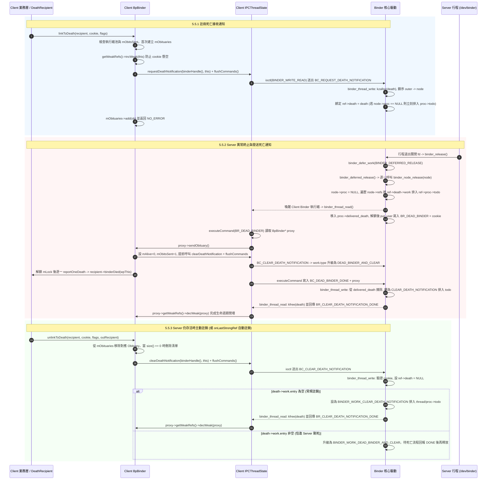

# 5.5 Binder 物件死亡通知機制

- **情景說明**：在跨行程通訊中，Client 行程持有指向 Server 行程本地物件（`BBinder`）的代理物件（`BpBinder`）。若 Server 行程因崩潰或被系統終止而異常退出，僅靠 5.4 節的引用計數協議無法主動通知 Client 端代理物件已經失效。本節追蹤三個完整情景：（1）Client 透過 `BpBinder::linkToDeath` 向 Binder 驅動註冊死亡接收通知；（2）Server 異常終止關閉 `/dev/binder`，驅動在 `binder_deferred_release` / `binder_node_release` 通知所有已註冊的 Client，並完成 `BR_DEAD_BINDER` → `sendObituary` → `BC_DEAD_BINDER_DONE` 交握；（3）Client 主動呼叫 `BpBinder::unlinkToDeath`（或釋放最後一個強引用觸發 `onLastStrongRef`）向驅動註銷通知，並於收到 `BR_CLEAR_DEATH_NOTIFICATION_DONE` 後安全歸還弱引用。最後簡述 Android 17 平行新增的行程凍結通知（`FREEZE_NOTIFICATION`）對照。
- **對應原書**：第 5 章 5.5 節〈Binder 对象死亡通知机制〉（p.220–232）
- **涉及專案與版本基準**：
  - `platform/frameworks/native` 〔`android-17.0.0_r1`，commit `ae266dc`〕
  - `kernel/common` 〔`android17-6.18`，commit `1e0de07`〕

---

## 5.5.1 註冊死亡接收通知（`linkToDeath` → `BC_REQUEST_DEATH_NOTIFICATION`）

> 對應原書 5.5.1（p.221–224）。死亡通知的核心是「使用者空間 `BpBinder` 聚合多個監聽者、核心層對單一 `binder_ref` 僅註冊一次」的兩層結構：Client 端以 `DeathRecipient` 定義回呼並掛入 `BpBinder::mObituaries`，僅在首個監聽者加入時發送 `BC_REQUEST_DEATH_NOTIFICATION`，將 `BpBinder` 位址作為 `cookie` 交給驅動保存。

### Step 1：`IBinder::DeathRecipient` 與死亡通知介面定義
**位置**：`platform/frameworks/native/libs/binder/include/binder/IBinder.h` 〔`android-17.0.0_r1`，lines 199–263〕

```cpp
    class DeathRecipient : public virtual RefBase
    {
    public:
        virtual void binderDied(const wp<IBinder>& who) = 0;
    };
...
    virtual status_t        linkToDeath(const sp<DeathRecipient>& recipient,
                                        void* cookie = nullptr,
                                        uint32_t flags = 0) = 0;
...
    virtual status_t        unlinkToDeath(  const wp<DeathRecipient>& recipient,
                                            void* cookie = nullptr,
                                            uint32_t flags = 0,
                                            wp<DeathRecipient>* outRecipient = nullptr) = 0;
```

Client 欲監控遠端服務存亡，必須繼承 `IBinder::DeathRecipient`（其繼承 `RefBase`，受智慧指標管理）並覆寫純虛擬函式 `binderDied(const wp<IBinder>& who)`。從介面註解與契約可歸納四個使用規則：
1. **僅支援遠端代理物件**：`BBinder::linkToDeath` 與 `BBinder::unlinkToDeath`（`platform/frameworks/native/libs/binder/Binder.cpp`，lines 590–606）直接回傳 `INVALID_OPERATION`，因為本地物件與當前行程同生共死，不可能在當前行程存活時單獨死亡。
2. **對監聽者持有弱引用**：`BpBinder` 內部僅以 `wp<DeathRecipient>` 保存監聽者，避免 `DeathRecipient` 與 `BpBinder` 形成循環強引用；呼叫端必須自行維持 `DeathRecipient` 存活。
3. **必須持有代理物件強引用**：當 `BpBinder` 的最後一個強引用消失時（`onLastStrongRef`），系統會自動註銷所有死亡通知。
4. **回呼參數僅為弱引用**：`binderDied` 接收 `const wp<IBinder>& who`，註解明確提示不要嘗試升級為強引用，因為遠端服務已死，強引用已無實質作用。

> 〔與 2.3 差異〕**不變**（僅搬家）：`libbinder` 標頭檔由 `frameworks/base/include/binder/IBinder.h` 搬遷至 `platform/frameworks/native/libs/binder/include/binder/IBinder.h`，預設參數由 `NULL` 改為 `nullptr`，`DeathRecipient` 與 `linkToDeath`/`unlinkToDeath` 介面簽章維持一致（原書 p.221）。

---

### Step 2：`BpBinder::linkToDeath` 與 `Obituary` 結構
**位置**：`platform/frameworks/native/libs/binder/include/binder/BpBinder.h` 〔`android-17.0.0_r1`，lines 210–234〕

```cpp
    struct Obituary {
        wp<DeathRecipient> recipient;
        void* cookie;
        uint32_t flags;
    };
...
    mutable RpcMutex mLock;
    volatile int32_t mAlive;
    volatile int32_t mObitsSent;
    Vector<Obituary>* mObituaries;
```

**位置**：`platform/frameworks/native/libs/binder/BpBinder.cpp` 〔`android-17.0.0_r1`，lines 449–505〕

```cpp
status_t BpBinder::linkToDeath(
    const sp<DeathRecipient>& recipient, void* cookie, uint32_t flags)
{
    if (isRpcBinder()) {
        if (rpcSession()->getMaxIncomingThreads() < 1) {
            ALOGE("Cannot register a DeathRecipient without any incoming threads. Need to set max "
                  "incoming threads to a value greater than 0 before calling linkToDeath.");
            return INVALID_OPERATION;
        }
    } else if constexpr (!kEnableKernelIpc) {
        LOG_ALWAYS_FATAL("Binder kernel driver disabled at build time");
        return INVALID_OPERATION;
    } else {
        if (ProcessState::self()->getThreadPoolMaxTotalThreadCount() == 0) {
            ALOGW("Linking to death on %s but there are no threads (yet?) listening to incoming "
                  "transactions. See ProcessState::startThreadPool and "
                  "ProcessState::setThreadPoolMaxThreadCount. Generally you should setup the "
                  "binder "
                  "threadpool before other initialization steps.",
                  String8(getInterfaceDescriptor()).c_str());
        }
    }

    Obituary ob;
    ob.recipient = recipient;
    ob.cookie = cookie;
    ob.flags = flags;

    LOG_ALWAYS_FATAL_IF(recipient == nullptr,
                        "linkToDeath(): recipient must be non-NULL");

    {
        RpcMutexUniqueLock _l(mLock);

        if (!mObitsSent) {
            if (!mObituaries) {
                mObituaries = new Vector<Obituary>;
                if (!mObituaries) {
                    return NO_MEMORY;
                }
                ALOGV("Requesting death notification: %p handle %d\n", this, binderHandle());
                if (!isRpcBinder()) {
                    if constexpr (kEnableKernelIpc) {
                        getWeakRefs()->incWeak(this);
                        IPCThreadState* self = IPCThreadState::self();
                        self->requestDeathNotification(binderHandle(), this);
                        self->flushCommands();
                    }
                }
            }
            ssize_t res = mObituaries->add(ob);
            return res >= (ssize_t)NO_ERROR ? (status_t)NO_ERROR : res;
        }
    }

    return DEAD_OBJECT;
}
```

逐段解析 `BpBinder::linkToDeath` 的執行邏輯：
1. **執行緒池與傳輸層前置檢查（lines 452–470）**：
   - 若為 RPC Binder（Socket 傳輸），要求 `rpcSession()->getMaxIncomingThreads() >= 1`，否則直接回傳 `INVALID_OPERATION`。
   - 若為一般核心 Binder（`kEnableKernelIpc`），檢查 `ProcessState::self()->getThreadPoolMaxTotalThreadCount() == 0`：因為核心下發 `BR_DEAD_BINDER` 時需要 Client 行程內有 Binder 執行緒在 `binder_thread_read` 中等待，若行程尚未配置執行緒池（如忘記呼叫 `startThreadPool` / `setThreadPoolMaxThreadCount`），會輸出警告日誌提醒開發者。
2. **封裝 `Obituary` 與非空斷言（lines 472–478）**：將 `recipient`（轉存為 `wp<DeathRecipient>`）、`cookie`、`flags` 封裝進 `Obituary`，並以 `LOG_ALWAYS_FATAL_IF` 強制禁止傳入空的 `recipient`。
3. **以 `mObitsSent` 攔截已死物件（line 483）**：在 `mLock` 保護下，若 `mObitsSent` 已為 `1`（表示之前已收過死亡通知），直接跳出並回傳 `DEAD_OBJECT`。
4. **首次註冊與核心互動（lines 484–498）**：
   - 一個 `BpBinder` 可被多個業務模組呼叫 `linkToDeath`，所有監聽者集中存於 `mObituaries` 向量。僅當 `mObituaries == nullptr`（首次註冊）時才需要向核心發起請求。
   - **關鍵生命週期保護（line 492）**：`getWeakRefs()->incWeak(this)` 先為當前 `BpBinder` 增加一次弱引用計數。這是因為接下來的 `requestDeathNotification(binderHandle(), this)` 會把原始指標 `this` 作為 `cookie` 交給核心驅動；在核心尚未回傳 `BR_CLEAR_DEATH_NOTIFICATION_DONE` 前，核心仍可能透過該 `cookie` 下發 `BR_DEAD_BINDER` 並轉型為 `BpBinder*`。這一次額外弱引用確保 `BpBinder` 物件本身（至少其記憶體與 `weakref_type`）在註銷徹底完成前絕不會被析構釋放，對應的 `decWeak` 會在 5.5.3 Step 3 的 `BR_CLEAR_DEATH_NOTIFICATION_DONE` 中歸還。
   - 接著透過 `IPCThreadState::self()` 寫入 `BC_REQUEST_DEATH_NOTIFICATION`，並立刻呼叫 `self->flushCommands()` 進入驅動完成註冊，避免命令停留在 `mOut` 緩衝區而錯過遠端服務死亡的瞬間。
5. **加入訃告清單（lines 499–500）**：將 `ob` 加入 `mObituaries` 並回傳 `NO_ERROR`。

> 〔與 2.3 差異〕**邏輯改變**：原書 2.3 路徑為 `frameworks/base/libs/binder/BpBinder.cpp`，直接以 `mHandle` 成員與 `AutoMutex` 實作（原書 p.221–222）。Android 17 改為 `RpcMutexUniqueLock` 與 `binderHandle()`（配合 `std::variant` 支援 RPC Binder），新增了 RPC incoming threads 檢查與核心執行緒池上限為 0 的警告，並明確展示在向核心註冊前先呼叫 `getWeakRefs()->incWeak(this)` 以防止 `cookie` 懸空指標（UAF）。

---

### Step 3：`IPCThreadState::requestDeathNotification` 與 `flushCommands`
**位置**：`platform/frameworks/native/libs/binder/IPCThreadState.cpp` 〔`android-17.0.0_r1`，lines 1052–1058, 664–691〕

```cpp
status_t IPCThreadState::requestDeathNotification(int32_t handle, BpBinder* proxy)
{
    mOut.writeInt32(BC_REQUEST_DEATH_NOTIFICATION);
    mOut.writeInt32((int32_t)handle);
    mOut.writePointer((uintptr_t)proxy);
    return NO_ERROR;
}
```

```cpp
status_t IPCThreadState::flushCommands() {
    if (mProcess->mDriverFD < 0)
        return -EBADF;

    if (status_t res = talkWithDriver(false); res != OK) {
        // TODO: we may want to abort for some of these cases
        ALOGW("1st call to talkWithDriver returned error in flushCommands: %s",
              statusToString(res).c_str());
        return res;
    }

    // The flush could have caused post-write refcount decrements to have
    // been executed, which in turn could result in BC_RELEASE/BC_DECREFS
    // being queued in mOut. So flush again, if we need to.
    if (mOut.dataSize() > 0) {
        if (status_t res = talkWithDriver(false); res != OK) {
            // TODO: we may want to abort for some of these cases
            ALOGW("2nd call to talkWithDriver returned error in flushCommands: %s",
                  statusToString(res).c_str());
            return res;
        }
    }
    if (mOut.dataSize() > 0) {
        ALOGW("mOut.dataSize() > 0 after flushCommands()");
    }

    return NO_ERROR;
}
```

`requestDeathNotification` 按照 UAPI 定義的 `BC_REQUEST_DEATH_NOTIFICATION` 格式（`include/uapi/linux/android/binder.h`，lines 595–600，載荷為 `struct binder_handle_cookie`），依序向 `mOut` 寫入命令碼、32 位元句柄 `handle` 以及指標寬度的 `cookie`（即 `BpBinder* proxy` 的位址）。

隨後的 `flushCommands()` 以 `talkWithDriver(false)`（`doReceive = false`，僅發送 `mOut` 命令、不阻塞讀取）執行 `ioctl(BINDER_WRITE_READ)` 把緩衝命令立即送入核心驅動。若第一次 `talkWithDriver` 觸發了 post-write 引用遞減而再向 `mOut` 排入新的 `BC_RELEASE`/`BC_DECREFS`，會補發第二次 `talkWithDriver(false)` 確保輸出緩衝區清空。

> 〔與 2.3 差異〕**邏輯改變**：原書 2.3 使用 `mOut.writeInt32((int32_t)proxy)` 寫入 32 位元指標，且 `flushCommands()` 僅單次呼叫 `talkWithDriver(false)`（原書 p.222）；Android 17 因應 64 位元 ABI 改用 `mOut.writePointer((uintptr_t)proxy)`（對應核心 `binder_uintptr_t`），且 `flushCommands()` 增加了錯誤回傳檢查與二次 flush 機制以清理延遲釋放產生的引用計數命令。

---

### Step 4：核心結構 `struct binder_ref_death` 與 `binder_thread_write` 處理 `BC_REQUEST_DEATH_NOTIFICATION`
**位置**：`kernel/common/drivers/android/binder_internal.h` 〔`android17-6.18`，lines 278–286, 334–347〕

```c
struct binder_ref_death {
	/**
	 * @work: worklist element for death notifications
	 *        (protected by inner_lock of the proc that
	 *        this ref belongs to)
	 */
	struct binder_work work;
	binder_uintptr_t cookie;
};
```

```c
struct binder_ref {
	/* Lookups needed: */
	/*   node + proc => ref (transaction) */
	/*   desc + proc => ref (transaction, inc/dec ref) */
	/*   node => refs + procs (proc exit) */
	struct binder_ref_data data;
	struct rb_node rb_node_desc;
	struct rb_node rb_node_node;
	struct hlist_node node_entry;
	struct binder_proc *proc;
	struct binder_node *node;
	struct binder_ref_death *death;
	struct binder_ref_freeze *freeze;
};
```

每個 `binder_ref` 最多對應一個 `struct binder_ref_death`（由 `ref->death` 指向，受目標 `node->lock` 保護），內含嵌入的工作項 `work`（受 Client 端 `proc->inner_lock` 保護）與使用者空間傳入的 `cookie`（`BpBinder` 位址）。當 `ioctl(BINDER_WRITE_READ)` 進入核心後，由 `binder_thread_write` 分派執行：

**位置**：`kernel/common/drivers/android/binder.c` 〔`android17-6.18`，lines 4369–4392, 4634–4714, 4755–4757〕

```c
static int binder_thread_write(struct binder_proc *proc,
			struct binder_thread *thread,
			binder_uintptr_t binder_buffer, size_t size,
			binder_size_t *consumed)
{
	uint32_t cmd;
	struct binder_context *context = proc->context;
	void __user *buffer = (void __user *)(uintptr_t)binder_buffer;
	void __user *ptr = buffer + *consumed;
	void __user *end = buffer + size;

	while (ptr < end && thread->return_error.cmd == BR_OK) {
		int ret;

		if (get_user(cmd, (uint32_t __user *)ptr))
			return -EFAULT;
		ptr += sizeof(uint32_t);
...
		switch (cmd) {
...
		case BC_REQUEST_DEATH_NOTIFICATION:
		case BC_CLEAR_DEATH_NOTIFICATION: {
			uint32_t target;
			binder_uintptr_t cookie;
			struct binder_ref *ref;
			struct binder_ref_death *death = NULL;

			if (get_user(target, (uint32_t __user *)ptr))
				return -EFAULT;
			ptr += sizeof(uint32_t);
			if (get_user(cookie, (binder_uintptr_t __user *)ptr))
				return -EFAULT;
			ptr += sizeof(binder_uintptr_t);
			if (cmd == BC_REQUEST_DEATH_NOTIFICATION) {
				/*
				 * Allocate memory for death notification
				 * before taking lock
				 */
				death = kzalloc(sizeof(*death), GFP_KERNEL);
				if (death == NULL) {
					WARN_ON(thread->return_error.cmd !=
						BR_OK);
					thread->return_error.cmd = BR_ERROR;
					binder_enqueue_thread_work(
						thread,
						&thread->return_error.work);
					binder_debug(
						BINDER_DEBUG_FAILED_TRANSACTION,
						"%d:%d BC_REQUEST_DEATH_NOTIFICATION failed\n",
						proc->pid, thread->pid);
					break;
				}
			}
			binder_proc_lock(proc);
			ref = binder_get_ref_olocked(proc, target, false);
			if (ref == NULL) {
				binder_user_error("%d:%d %s invalid ref %d\n",
					proc->pid, thread->pid,
					cmd == BC_REQUEST_DEATH_NOTIFICATION ?
					"BC_REQUEST_DEATH_NOTIFICATION" :
					"BC_CLEAR_DEATH_NOTIFICATION",
					target);
				binder_proc_unlock(proc);
				kfree(death);
				break;
			}
...
			binder_node_lock(ref->node);
			if (cmd == BC_REQUEST_DEATH_NOTIFICATION) {
				if (ref->death) {
					binder_user_error("%d:%d BC_REQUEST_DEATH_NOTIFICATION death notification already set\n",
						proc->pid, thread->pid);
					binder_node_unlock(ref->node);
					binder_proc_unlock(proc);
					kfree(death);
					break;
				}
				binder_stats_created(BINDER_STAT_DEATH);
				INIT_LIST_HEAD(&death->work.entry);
				death->cookie = cookie;
				ref->death = death;
				if (ref->node->proc == NULL) {
					ref->death->work.type = BINDER_WORK_DEAD_BINDER;

					binder_inner_proc_lock(proc);
					binder_enqueue_work_ilocked(
						&ref->death->work, &proc->todo);
					binder_wakeup_proc_ilocked(proc);
					binder_inner_proc_unlock(proc);
				}
			} else {
...
			}
			binder_node_unlock(ref->node);
			binder_proc_unlock(proc);
		} break;
```

這段核心處理展示了細粒度鎖模型下的四個關鍵設計：
1. **持鎖前預配記憶體（lines 4647–4666）**：因為 `binder_proc_lock`（`outer_lock`）與 `binder_node_lock`（`node->lock`）皆為自旋鎖（spinlock），不可在持鎖期間呼叫可能睡眠的 `kzalloc(..., GFP_KERNEL)`，因此先分配好 `death`；若後續發現 `ref == NULL` 或 `ref->death` 已存在，釋放自旋鎖後再 `kfree(death)`。
2. **嚴格遵循三級鎖序（lines 4667, 4691, 4708）**：依序獲取 `proc->outer_lock`（查詢 `refs_by_desc` 紅黑樹取得 `ref`）→ `ref->node->lock`（保護 `ref->death` 與 `ref->node->proc` 狀態同步，防止與 `binder_node_release` 競爭）→ `proc->inner_lock`（操作 `proc->todo` 與喚醒等待佇列）。
3. **禁止重複註冊（lines 4693–4700）**：同一個 `binder_ref` 若已有 `ref->death`，直接記錄 `binder_user_error` 並放棄此次註冊。
4. **處理「註冊時目標已死」的競態條件（lines 4705–4713）**：若在 `linkToDeath` 抵達核心之前，Server 行程就已經終止，`binder_node_release` 會將 `ref->node->proc` 清為 `NULL`。此時驅動立即將 `ref->death->work.type` 設為 `BINDER_WORK_DEAD_BINDER`，掛入 `&proc->todo` 並呼叫 `binder_wakeup_proc_ilocked(proc)` 喚醒 Client 的空閒 Binder 執行緒，確保不會漏掉死亡通知。

> 〔與 2.3 差異〕**邏輯改變**：原書 2.3 位於 `kernel/goldfish/drivers/staging/android/binder.c`，在全域互斥鎖 `binder_lock` 保護下直接呼叫 `binder_get_ref` 並於持鎖時 `kzalloc`；且當 `ref->node->proc == NULL` 時，2.3 會判斷當前執行緒是否為 looper（`BINDER_LOOPER_STATE_REGISTERED | BINDER_LOOPER_STATE_ENTERED`）決定排入 `thread->todo` 或 `proc->todo`（原書 p.223–224）。Android 17 改為三級細粒度自旋鎖、`kzalloc` 前置、`binder_uintptr_t` 讀取 64 位元 `cookie`，且目標已死時**一律排入 `proc->todo` 並透過 `binder_wakeup_proc_ilocked` 喚醒行程執行緒池**（因為 `flushCommands` 僅做寫入不讀回，即使當前執行緒剛好是 looper 也不應阻塞等待或僅限於該執行緒處理）。

---

## 5.5.2 發送死亡接收通知（Server 終止 → `BR_DEAD_BINDER` → `sendObituary` → `BC_DEAD_BINDER_DONE`）

> 對應原書 5.5.2（p.224–229）。無論 Server 行程是正常呼叫 `close()` 關閉 `/dev/binder`，還是因為 SIGSEGV / OOM Killer 異常終止而由 Linux 核心在 `do_exit()` → `exit_files()` 中自動關閉所有開啟的檔案描述符，最終都會觸發 Binder 驅動註冊的 `file_operations.release` 回呼——即 `binder_release`。

### Step 1：Server 退出關閉裝置檔：`binder_release` 與延遲工作排程
**位置**：`kernel/common/drivers/android/binder.c` 〔`android17-6.18`，lines 6462–6476, 6635–6674〕

```c
static int binder_release(struct inode *nodp, struct file *filp)
{
	struct binder_proc *proc = filp->private_data;

	debugfs_remove(proc->debugfs_entry);

	if (proc->binderfs_entry) {
		simple_recursive_removal(proc->binderfs_entry, NULL);
		proc->binderfs_entry = NULL;
	}

	binder_defer_work(proc, BINDER_DEFERRED_RELEASE);

	return 0;
}
```

```c
static void binder_deferred_func(struct work_struct *work)
{
	struct binder_proc *proc;

	int defer;

	do {
		mutex_lock(&binder_deferred_lock);
		if (!hlist_empty(&binder_deferred_list)) {
			proc = hlist_entry(binder_deferred_list.first,
					struct binder_proc, deferred_work_node);
			hlist_del_init(&proc->deferred_work_node);
			defer = proc->deferred_work;
			proc->deferred_work = 0;
		} else {
			proc = NULL;
			defer = 0;
		}
		mutex_unlock(&binder_deferred_lock);

		if (defer & BINDER_DEFERRED_FLUSH)
			binder_deferred_flush(proc);

		if (defer & BINDER_DEFERRED_RELEASE)
			binder_deferred_release(proc); /* frees proc */
	} while (proc);
}
static DECLARE_WORK(binder_deferred_work, binder_deferred_func);

static void
binder_defer_work(struct binder_proc *proc, enum binder_deferred_state defer)
{
	guard(mutex)(&binder_deferred_lock);
	proc->deferred_work |= defer;
	if (hlist_unhashed(&proc->deferred_work_node)) {
		hlist_add_head(&proc->deferred_work_node,
				&binder_deferred_list);
		schedule_work(&binder_deferred_work);
	}
}
```

`binder_release` 先移除該行程在 `debugfs` 與 `binderfs`（`/dev/binderfs/binder_logs/proc/<pid>`）下的監控檔案節點，接著將耗時的行程資源清理與死亡通知廣播工作透過 `binder_defer_work` 標記為 `BINDER_DEFERRED_RELEASE`，掛入全域 `binder_deferred_list` 並由核心工作佇列（`schedule_work(&binder_deferred_work)`）非同步執行 `binder_deferred_func` → `binder_deferred_release(proc)`。

> 〔與 2.3 差異〕**邏輯改變**：原書 2.3 在 `binder_release` 中移除 `/proc/binder/proc/<pid>`（`remove_proc_entry`，原書 p.225）；Android 17 早已淘汰 procfs 介面，改為清理 `debugfs_entry` 與 binderfs 的 `proc->binderfs_entry`（`simple_recursive_removal`），延遲工作佇列骨架則維持不變。

---

### Step 2：`binder_deferred_release` 與 `binder_node_release` 遍歷引用並投遞死亡工作項
**位置**：`kernel/common/drivers/android/binder.c` 〔`android17-6.18`，lines 6543–6604, 6478–6541〕

```c
static void binder_deferred_release(struct binder_proc *proc)
{
	struct binder_context *context = proc->context;
	struct rb_node *n;
	int threads, nodes, incoming_refs, outgoing_refs, active_transactions;
	struct list_head *special_list = NULL;

	mutex_lock(&binder_procs_lock);
	hlist_del(&proc->proc_node);
	mutex_unlock(&binder_procs_lock);

	mutex_lock(&context->context_mgr_node_lock);
	if (context->binder_context_mgr_node &&
	    context->binder_context_mgr_node->proc == proc) {
		binder_debug(BINDER_DEBUG_DEAD_BINDER,
			     "%s: %d context_mgr_node gone\n",
			     __func__, proc->pid);
		context->binder_context_mgr_node = NULL;
	}
	mutex_unlock(&context->context_mgr_node_lock);
	binder_inner_proc_lock(proc);
	/*
	 * Make sure proc stays alive after we
	 * remove all the threads
	 */
	proc->tmp_ref++;

	proc->is_dead = true;
	proc->is_frozen = false;
	proc->sync_recv = false;
	proc->async_recv = false;
	threads = 0;
	active_transactions = 0;
	while ((n = rb_first(&proc->threads))) {
		struct binder_thread *thread;

		thread = rb_entry(n, struct binder_thread, rb_node);
		binder_inner_proc_unlock(proc);
		threads++;
		active_transactions += binder_thread_release(proc, thread);
		binder_inner_proc_lock(proc);
	}

	nodes = 0;
	incoming_refs = 0;
	while ((n = rb_first(&proc->nodes))) {
		struct binder_node *node;

		node = rb_entry(n, struct binder_node, rb_node);
		nodes++;
		/*
		 * take a temporary ref on the node before
		 * calling binder_node_release() which will either
		 * kfree() the node or call binder_put_node()
		 */
		binder_inc_node_tmpref_ilocked(node);
		rb_erase(&node->rb_node, &proc->nodes);
		binder_inner_proc_unlock(proc);
		incoming_refs = binder_node_release(node, incoming_refs);
		binder_inner_proc_lock(proc);
	}
	binder_inner_proc_unlock(proc);
...
}
```

```c
static int binder_node_release(struct binder_node *node, int refs)
{
	struct binder_ref *ref;
	int death = 0;
	struct binder_proc *proc = node->proc;

	binder_release_work(proc, &node->async_todo);

	binder_node_lock(node);
	binder_inner_proc_lock(proc);
	binder_dequeue_work_ilocked(&node->work);
	/*
	 * The caller must have taken a temporary ref on the node,
	 */
	BUG_ON(!node->tmp_refs);
	if (hlist_empty(&node->refs) && node->tmp_refs == 1) {
		binder_inner_proc_unlock(proc);
		binder_node_unlock(node);
		binder_free_node(node);

		return refs;
	}

	node->proc = NULL;
	node->local_strong_refs = 0;
	node->local_weak_refs = 0;
	binder_inner_proc_unlock(proc);

	spin_lock(&binder_dead_nodes_lock);
	hlist_add_head(&node->dead_node, &binder_dead_nodes);
	spin_unlock(&binder_dead_nodes_lock);

	hlist_for_each_entry(ref, &node->refs, node_entry) {
		refs++;
		/*
		 * Need the node lock to synchronize
		 * with new notification requests and the
		 * inner lock to synchronize with queued
		 * death notifications.
		 */
		binder_inner_proc_lock(ref->proc);
		if (!ref->death) {
			binder_inner_proc_unlock(ref->proc);
			continue;
		}

		death++;

		BUG_ON(!list_empty(&ref->death->work.entry));
		ref->death->work.type = BINDER_WORK_DEAD_BINDER;
		binder_enqueue_work_ilocked(&ref->death->work,
					    &ref->proc->todo);
		binder_wakeup_proc_ilocked(ref->proc);
		binder_inner_proc_unlock(ref->proc);
	}

	binder_debug(BINDER_DEBUG_DEAD_BINDER,
		     "node %d now dead, refs %d, death %d\n",
		     node->debug_id, refs, death);
	binder_node_unlock(node);
	binder_put_node(node);

	return refs;
}
```

細粒度鎖架構下的節點死亡與通知投遞流程如下：
1. **標記行程死亡並安全取出每個 `binder_node`（`binder_deferred_release`，lines 6550–6604）**：
   - 將 `proc` 從全域 `binder_procs` 移除；若該行程正好是所屬 `context` 的 Context Manager（如 `servicemanager` 崩潰），清空 `context->binder_context_mgr_node`。
   - 設 `proc->is_dead = true` 與 `proc->is_frozen = false`，釋放所有 `proc->threads`（這會對進行中的同步交易回傳 `BR_DEAD_REPLY`）。
   - 逐一取出 `proc->nodes` 紅黑樹中的每個 `binder_node`：在釋放 `proc->inner_lock` 前先透過 `binder_inc_node_tmpref_ilocked(node)` 持有暫時引用，再從紅黑樹摘除並交由 `binder_node_release` 處理。之所以必須先放掉 `proc->inner_lock`，是因為 `binder_node_release` 需要以「先 `node->lock`、後 `inner_lock`」的合法鎖序加鎖。
2. **斷開宿主並搬移至死亡節點串列（`binder_node_release`，lines 6484–6508）**：
   - 先清理 `node->async_todo` 中尚未派送的非同步交易並摘除 `node->work`。
   - 若此時 `node->refs` 為空且沒有其他執行緒持有暫時引用（`node->tmp_refs == 1`），直接 `binder_free_node(node)` 釋放返回。
   - 否則代表仍有 Client 的 `binder_ref` 指向它：將 `node->proc = NULL`、本地引用計數清零，並掛入全域 `binder_dead_nodes` 串列（等未來所有 `binder_ref` 釋放後才真正銷毀）。
3. **廣播死亡通知給所有已註冊 Client（`binder_node_release`，lines 6510–6538）**：
   - 持有 `node->lock` 遍歷 `node->refs`（確保與 5.5.1 Step 4 的 `BC_REQUEST_DEATH_NOTIFICATION` 互斥，不會漏掉同時正在註冊的 Client）。
   - 對每個 `ref`，獲取該 Client 行程的 `ref->proc->inner_lock`；若 `ref->death != NULL`，將 `ref->death->work.type` 設為 `BINDER_WORK_DEAD_BINDER`，排入 `&ref->proc->todo`，並呼叫 `binder_wakeup_proc_ilocked(ref->proc)` 喚醒 Client 行程中正在 `binder_thread_read` 睡眠的 Binder 執行緒。
   - 最後解鎖 `node->lock` 並呼叫 `binder_put_node(node)` 歸還暫時引用。

> 〔與 2.3 差異〕**邏輯改變**：原書 2.3 將節點清理直接寫在 `binder_deferred_release` 的 `while` 迴圈內，在單一全域 `binder_lock` 下執行，直接 `list_add_tail` 與 `wake_up_interruptible(&ref->proc->wait)`（原書 p.225–226）。Android 17 拆出獨立函式 `binder_node_release`，引入 `tmp_refs` 暫時引用與 `node->lock` → `ref->proc->inner_lock` 細粒度鎖序，並將 `binder_context_mgr_node` 改為每個 `binder_context` 獨立管理。

---

### Step 3：Client 端核心讀取：`binder_thread_read` 寫回 `BR_DEAD_BINDER`
**位置**：`kernel/common/drivers/android/binder.c` 〔`android17-6.18`，lines 4983–4991, 5055–5080, 5207–5247, 5416–5440〕

```c
static int binder_thread_read(struct binder_proc *proc,
			      struct binder_thread *thread,
			      binder_uintptr_t binder_buffer, size_t size,
			      binder_size_t *consumed, int non_block)
{
	void __user *buffer = (void __user *)(uintptr_t)binder_buffer;
	void __user *ptr = buffer + *consumed;
	void __user *end = buffer + size;
...
		if (!binder_worklist_empty_ilocked(&thread->todo))
			list = &thread->todo;
		else if (!binder_worklist_empty_ilocked(&proc->todo) &&
			   wait_for_proc_work)
			list = &proc->todo;
		else {
...
		}
skip:
		if (end - ptr < sizeof(tr) + 4) {
			binder_inner_proc_unlock(proc);
			break;
		}
		trace_android_vh_binder_thread_read(&list, proc, thread);
		w = binder_dequeue_work_head_ilocked(list);
		if (binder_worklist_empty_ilocked(&thread->todo))
			thread->process_todo = false;

		switch (w->type) {
...
		case BINDER_WORK_DEAD_BINDER:
		case BINDER_WORK_DEAD_BINDER_AND_CLEAR:
		case BINDER_WORK_CLEAR_DEATH_NOTIFICATION: {
			struct binder_ref_death *death;
			uint32_t cmd;
			binder_uintptr_t cookie;

			death = container_of(w, struct binder_ref_death, work);
			if (w->type == BINDER_WORK_CLEAR_DEATH_NOTIFICATION)
				cmd = BR_CLEAR_DEATH_NOTIFICATION_DONE;
			else
				cmd = BR_DEAD_BINDER;
			cookie = death->cookie;

			binder_debug(BINDER_DEBUG_DEATH_NOTIFICATION,
				     "%d:%d %s %016llx\n",
				      proc->pid, thread->pid,
				      cmd == BR_DEAD_BINDER ?
				      "BR_DEAD_BINDER" :
				      "BR_CLEAR_DEATH_NOTIFICATION_DONE",
				      (u64)cookie);
			if (w->type == BINDER_WORK_CLEAR_DEATH_NOTIFICATION) {
				binder_inner_proc_unlock(proc);
				kfree(death);
				binder_stats_deleted(BINDER_STAT_DEATH);
			} else {
				binder_enqueue_work_ilocked(
						w, &proc->delivered_death);
				binder_inner_proc_unlock(proc);
			}
			if (put_user(cmd, (uint32_t __user *)ptr))
				return -EFAULT;
			ptr += sizeof(uint32_t);
			if (put_user(cookie,
				     (binder_uintptr_t __user *)ptr))
				return -EFAULT;
			ptr += sizeof(binder_uintptr_t);
			binder_stat_br(proc, thread, cmd);
			if (cmd == BR_DEAD_BINDER)
				goto done; /* DEAD_BINDER notifications can cause transactions */
		} break;
...
done:

	*consumed = ptr - buffer;
	binder_inner_proc_lock(proc);
	trace_android_vh_binder_spawn_new_thread(thread, proc, &force_spawn);

	if (force_spawn || (proc->requested_threads == 0 &&
	    list_empty(&thread->proc->waiting_threads) &&
	    proc->requested_threads_started < proc->max_threads &&
	    (thread->looper & (BINDER_LOOPER_STATE_REGISTERED |
	     BINDER_LOOPER_STATE_ENTERED)))/* the user-space code fails to */
	     /*spawn a new thread if we leave this out */) {
		proc->requested_threads++;
		binder_inner_proc_unlock(proc);
		binder_debug(BINDER_DEBUG_THREADS,
			     "%d:%d BR_SPAWN_LOOPER\n",
			     proc->pid, thread->pid);
		if (put_user(BR_SPAWN_LOOPER, (uint32_t __user *)buffer))
			return -EFAULT;
		binder_stat_br(proc, thread, BR_SPAWN_LOOPER);
	} else
		binder_inner_proc_unlock(proc);
	return 0;
}
```

Client 的空閒 Binder 執行緒被喚醒後，從 `proc->todo` 取出 `w`（透過 `binder_dequeue_work_head_ilocked` 已先移出原佇列），並統一處理三種死亡工作項：
1. **區分回覆命令（lines 5214–5219）**：透過 `container_of` 還原 `death`，並預先將 `death->cookie` 讀入區域變數 `cookie`：
   - `BINDER_WORK_CLEAR_DEATH_NOTIFICATION` → `BR_CLEAR_DEATH_NOTIFICATION_DONE`（註銷完成回執）。
   - `BINDER_WORK_DEAD_BINDER` 與 `BINDER_WORK_DEAD_BINDER_AND_CLEAR` → `BR_DEAD_BINDER`（真正通知遠端死亡）。
2. **鎖內狀態轉換與記憶體釋放（lines 5228–5236）**：
   - 若為 `BINDER_WORK_CLEAR_DEATH_NOTIFICATION`，表示該 `binder_ref_death` 已走完生命週期，解開 `proc->inner_lock` 後立刻 `kfree(death)` 釋放核心物件。
   - 若為 `BR_DEAD_BINDER` 兩類工作項，則在鎖內將 `w` 掛入 `proc->delivered_death` 佇列再解鎖。`delivered_death` 用來追蹤「已派送給使用者空間、尚未收到 `BC_DEAD_BINDER_DONE` 確認」的死亡通知。
3. **解鎖後寫入使用者緩衝區並提前返回（lines 5237–5246）**：將 `cmd` 與 `cookie`（`BpBinder*` 位址）以 `put_user` 寫回使用者空間 `mIn` 緩衝區（必須在釋放自旋鎖之後進行，因 `put_user` 可能觸發缺頁睡眠）。對於 `BR_DEAD_BINDER`，隨即執行 `goto done` 立刻結束本次 `binder_thread_read` 返回使用者空間——如同註解所述，業務層的 `binderDied()` 往往會發起新的 Binder 交易（例如重連服務），若繼續在核心迴圈裡堆積更多工作項，將延遲死亡處理且可能導致 `delivered_death` 狀態交錯。

> 〔與 2.3 差異〕**邏輯改變**：原書 2.3 先 `put_user` 再 `list_move(&w->entry, &proc->delivered_death)`（或 `kfree`），且 `cookie` 以 `void *` 寫出（原書 p.226–227）。Android 17 因改用自旋鎖 `proc->inner_lock`，必須先讀取區域變數 `cookie`、完成入列 `delivered_death`（或 `kfree`）並解鎖後再執行 `put_user`（`binder_uintptr_t`），避免在原子上下文觸發缺頁睡眠。

---

### Step 4：Client 使用者空間分派：`IPCThreadState::executeCommand`、`BpBinder::sendObituary` 與 `reportOneDeath`
**位置**：`platform/frameworks/native/libs/binder/IPCThreadState.cpp` 〔`android-17.0.0_r1`，lines 1408–1414, 1631–1638〕

```cpp
status_t IPCThreadState::executeCommand(int32_t cmd)
{
    BBinder* obj;
    RefBase::weakref_type* refs;
    status_t result = NO_ERROR;

    switch ((uint32_t)cmd) {
...
    case BR_DEAD_BINDER:
        {
            BpBinder *proxy = (BpBinder*)mIn.readPointer();
            proxy->sendObituary();
            mOut.writeInt32(BC_DEAD_BINDER_DONE);
            mOut.writePointer((uintptr_t)proxy);
        }
        break;
```

**位置**：`platform/frameworks/native/libs/binder/BpBinder.cpp` 〔`android-17.0.0_r1`，lines 552–592, 753–760〕

```cpp
void BpBinder::sendObituary()
{
    if (!kEnableKernelIpc && !isRpcBinder()) {
        LOG_ALWAYS_FATAL("Binder kernel driver disabled at build time");
        return;
    }

    ALOGV("Sending obituary for proxy %p handle %d, mObitsSent=%s\n", this, binderHandle(),
          mObitsSent ? "true" : "false");

    mAlive = 0;
    if (mObitsSent) return;

    mLock.lock();
    Vector<Obituary>* obits = mObituaries;
    if(obits != nullptr) {
        ALOGV("Clearing sent death notification: %p handle %d\n", this, binderHandle());
        if (!isRpcBinder()) {
            if constexpr (kEnableKernelIpc) {
                IPCThreadState* self = IPCThreadState::self();
                self->clearDeathNotification(binderHandle(), this);
                self->flushCommands();
            }
        }
        mObituaries = nullptr;
    }
    mObitsSent = 1;
    mLock.unlock();

    ALOGV("Reporting death of proxy %p for %zu recipients\n",
        this, obits ? obits->size() : 0U);

    if (obits != nullptr) {
        const size_t N = obits->size();
        for (size_t i=0; i<N; i++) {
            reportOneDeath(obits->itemAt(i));
        }

        delete obits;
    }
}
```

```cpp
void BpBinder::reportOneDeath(const Obituary& obit)
{
    sp<DeathRecipient> recipient = obit.recipient.promote();
    ALOGV("Reporting death to recipient: %p\n", recipient.get());
    if (recipient == nullptr) return;

    recipient->binderDied(wp<BpBinder>::fromExisting(this));
}
```

從 `BR_DEAD_BINDER` 到業務層回呼的執行細節非常巧妙，特別留意兩個時序關鍵點：
1. **在 `sendObituary` 內就提前發送 `BC_CLEAR_DEATH_NOTIFICATION`（lines 567–576）**：
   - `sendObituary()` 先將 `mAlive = 0`（後續 `isBinderAlive()` 與 `transact()` 皆可立即感知已死），接著在 `mLock` 內接管 `obits = mObituaries`，隨即呼叫 `clearDeathNotification` + `flushCommands()` 立刻向核心發送 `BC_CLEAR_DEATH_NOTIFICATION`！
   - 注意此時 `executeCommand` 尚未發送 `BC_DEAD_BINDER_DONE`（它要等 `sendObituary()` 返回後才寫入 `mOut`），因此核心中該 `death` 正位於 `proc->delivered_death` 佇列中！這個設計刻意讓核心將 `death->work.type` 標記為 `BINDER_WORK_DEAD_BINDER_AND_CLEAR`，等待真正收到 `BC_DEAD_BINDER_DONE` 後才轉成 `BINDER_WORK_CLEAR_DEATH_NOTIFICATION` 釋放核心結構並歸還使用者空間弱引用。
2. **先解鎖 `mLock`，再逐一回呼 `reportOneDeath`（lines 579–591）**：
   - 解開 `mLock` 才遍歷區域指標 `obits` 並呼叫 `reportOneDeath`，避免業務層在 `binderDied()` 內反向呼叫同一個 `BpBinder` 的方法（例如 `unlinkToDeath` 或 `detachObject`）造成自我死鎖。
   - `reportOneDeath` 將 `obit.recipient` 從 `wp<DeathRecipient>` 升級為強指標 `sp<DeathRecipient>`；若監聽者尚未銷毀，呼叫 `recipient->binderDied(wp<BpBinder>::fromExisting(this))`。
3. **寫入 `BC_DEAD_BINDER_DONE`（`IPCThreadState.cpp`，lines 1635–1636）**：所有監聽者執行完畢且 `delete obits` 後，`executeCommand` 將 `BC_DEAD_BINDER_DONE` 與 `proxy` 寫入 `mOut`，待下一次 `talkWithDriver`（例如 looper 下一輪迴圈）送回核心。

> 〔與 2.3 差異〕**邏輯改變**：原書 2.3 在 `IPCThreadState::executeCommand` 中以 `mIn.readInt32()` / `mOut.writeInt32((int32_t)proxy)` 讀寫指標，且 `sendObituary` 沒有前置的 `mAlive = 0; if (mObitsSent) return;` 檢查，`reportOneDeath` 直接傳入裸指標 `this`（原書 p.228–229）。Android 17 全面改用 64 位元 `readPointer()` / `writePointer()`，增設 `mAlive = 0` 與 `mObitsSent` 快速短路，並使用 `wp<BpBinder>::fromExisting(this)` 取代裸指標隱式轉型。

---

### Step 5：核心確認送達：`binder_thread_write` 處理 `BC_DEAD_BINDER_DONE`
**位置**：`kernel/common/drivers/android/binder.c` 〔`android17-6.18`，lines 4758–4806〕

```c
		case BC_DEAD_BINDER_DONE: {
			struct binder_work *w;
			binder_uintptr_t cookie;
			struct binder_ref_death *death = NULL;

			if (get_user(cookie, (binder_uintptr_t __user *)ptr))
				return -EFAULT;

			ptr += sizeof(cookie);
			binder_inner_proc_lock(proc);
			list_for_each_entry(w, &proc->delivered_death,
					    entry) {
				struct binder_ref_death *tmp_death =
					container_of(w,
						     struct binder_ref_death,
						     work);

				if (tmp_death->cookie == cookie) {
					death = tmp_death;
					break;
				}
			}
			binder_debug(BINDER_DEBUG_DEAD_BINDER,
				     "%d:%d BC_DEAD_BINDER_DONE %016llx found %p\n",
				     proc->pid, thread->pid, (u64)cookie,
				     death);
			if (death == NULL) {
				binder_user_error("%d:%d BC_DEAD_BINDER_DONE %016llx not found\n",
					proc->pid, thread->pid, (u64)cookie);
				binder_inner_proc_unlock(proc);
				break;
			}
			binder_dequeue_work_ilocked(&death->work);
			if (death->work.type == BINDER_WORK_DEAD_BINDER_AND_CLEAR) {
				death->work.type = BINDER_WORK_CLEAR_DEATH_NOTIFICATION;
				if (thread->looper &
					(BINDER_LOOPER_STATE_REGISTERED |
					 BINDER_LOOPER_STATE_ENTERED))
					binder_enqueue_thread_work_ilocked(
						thread, &death->work);
				else {
					binder_enqueue_work_ilocked(
							&death->work,
							&proc->todo);
					binder_wakeup_proc_ilocked(proc);
				}
			}
			binder_inner_proc_unlock(proc);
		} break;
```

當 Client 將 `BC_DEAD_BINDER_DONE` 送進核心後：
1. 在 `proc->inner_lock` 保護下，遍歷 `proc->delivered_death` 找到 `tmp_death->cookie == cookie` 的 `death`，以 `binder_dequeue_work_ilocked(&death->work)` 將其移出已送達佇列。
2. **完成「死亡通知 + 自動註銷」的後半段收尾（lines 4791–4804）**：由於 Step 4 的 `sendObituary()` 已經在 `BC_DEAD_BINDER_DONE` 之前就先送出了 `BC_CLEAR_DEATH_NOTIFICATION`，此時 `death->work.type` 正是 `BINDER_WORK_DEAD_BINDER_AND_CLEAR`！於是驅動將其降回 `BINDER_WORK_CLEAR_DEATH_NOTIFICATION` 並重新掛入 `thread->todo`（或 `proc->todo`）。緊接著 `binder_thread_read` 就會讀取到這筆工作項、`kfree(death)` 並發送 `BR_CLEAR_DEATH_NOTIFICATION_DONE` 給 Client，觸發 `decWeak(proxy)`，徹底閉環！

> 〔與 2.3 差異〕**邏輯改變**：原書 2.3 在 5.5.2 僅於文字中提及 `BC_DEAD_BINDER_DONE` 會將工作項移出 `delivered_death` 而未貼出核心實作（原書 p.227）。Android 17 以 `binder_inner_proc_lock(proc)` 取代全域鎖、使用 `binder_uintptr_t` 讀取 `cookie`，並透過 `binder_dequeue_work_ilocked` / `binder_enqueue_thread_work_ilocked` 完成 `BINDER_WORK_DEAD_BINDER_AND_CLEAR` → `BINDER_WORK_CLEAR_DEATH_NOTIFICATION` 的狀態收尾。

---

## 5.5.3 註銷死亡接收通知（`unlinkToDeath` → `BC_CLEAR_DEATH_NOTIFICATION` → `BR_CLEAR_DEATH_NOTIFICATION_DONE`）

> 對應原書 5.5.3（p.229–232）。當 Client 不再關心某個遠端服務的死亡事件時，可主動呼叫 `unlinkToDeath`；即使 Client 忘記主動呼叫，只要釋放最後一個 `sp<IBinder>`，`BpBinder::onLastStrongRef` 也會自動向驅動註銷。

### Step 1：主動註銷 `BpBinder::unlinkToDeath` 與自動註銷 `BpBinder::onLastStrongRef`
**位置**：`platform/frameworks/native/libs/binder/BpBinder.cpp` 〔`android-17.0.0_r1`，lines 508–550, 853–908〕

```cpp
status_t BpBinder::unlinkToDeath(
    const wp<DeathRecipient>& recipient, void* cookie, uint32_t flags,
    wp<DeathRecipient>* outRecipient)
{
    if (!kEnableKernelIpc && !isRpcBinder()) {
        LOG_ALWAYS_FATAL("Binder kernel driver disabled at build time");
        return INVALID_OPERATION;
    }

    RpcMutexUniqueLock _l(mLock);

    if (mObitsSent) {
        return DEAD_OBJECT;
    }

    const size_t N = mObituaries ? mObituaries->size() : 0;
    for (size_t i=0; i<N; i++) {
        const Obituary& obit = mObituaries->itemAt(i);
        if ((obit.recipient == recipient
                    || (recipient == nullptr && obit.cookie == cookie))
                && obit.flags == flags) {
            if (outRecipient != nullptr) {
                *outRecipient = mObituaries->itemAt(i).recipient;
            }
            mObituaries->removeAt(i);
            if (mObituaries->size() == 0) {
                ALOGV("Clearing death notification: %p handle %d\n", this, binderHandle());
                if (!isRpcBinder()) {
                    if constexpr (kEnableKernelIpc) {
                        IPCThreadState* self = IPCThreadState::self();
                        self->clearDeathNotification(binderHandle(), this);
                        self->flushCommands();
                    }
                }
                delete mObituaries;
                mObituaries = nullptr;
            }
            return NO_ERROR;
        }
    }

    return NAME_NOT_FOUND;
}
```

```cpp
void BpBinder::onLastStrongRef(const void* /*id*/) {
    if (isRpcBinder()) [[unlikely]] {
        (void)rpcSession()->sendDecStrong(this);
        return;
    }

    if constexpr (!kEnableKernelIpc) {
        LOG_ALWAYS_FATAL("Binder kernel driver disabled at build time");
        return;
    }

    ALOGV("onLastStrongRef BpBinder %p handle %d\n", this, binderHandle());
    IF_ALOGV() {
        printRefs();
    }
    IPCThreadState* ipc = IPCThreadState::self();
    if (ipc && !kDecStrongLast) ipc->decStrongHandle(binderHandle());

    mLock.lock();
    Vector<Obituary>* obits = mObituaries;
    if(obits != nullptr) {
        if (!obits->isEmpty()) {
            ALOGI("onLastStrongRef automatically unlinking death recipients for binder (%p) with "
                  "descriptor: '%s'",
                  this, BPBINDER_BEST_DESCRIPTOR_LOCKED);
        }

        if (ipc) ipc->clearDeathNotification(binderHandle(), this);
        mObituaries = nullptr;
    }
...
    mLock.unlock();

    if (obits != nullptr) {
        // XXX Should we tell any remaining DeathRecipient
        // objects that the last strong ref has gone away, so they
        // are no longer linked?
        delete obits;
    }

    if (ipc && kDecStrongLast) ipc->decStrongHandle(binderHandle());
}
```

兩條註銷入口的重點如下：
1. **主動註銷（`unlinkToDeath`）**：
   - 若 `mObitsSent` 已為 `1`，代表遠端已死且 `sendObituary` 早已清空清單並註銷，直接回傳 `DEAD_OBJECT`。
   - 比對條件支援兩種模式：直接比對 `obit.recipient == recipient`，或當 `recipient == nullptr` 時改用 `obit.cookie == cookie` 匹配（此時可透過輸出參數 `*outRecipient` 取回原先註冊的監聽者），且皆須滿足 `obit.flags == flags`。
   - 僅當移除後 `mObituaries->size() == 0`（最後一個監聽者已移除）時，才向核心發送 `clearDeathNotification` 並立刻 `flushCommands()`，隨後刪除 `mObituaries`。
2. **強引用歸零自動註銷（`onLastStrongRef`）**：
   - 當 Client 丟棄所有 `sp<IBinder>` 強引用時，`onLastStrongRef` 會檢查 `mObituaries != nullptr`，主動補發 `ipc->clearDeathNotification(binderHandle(), this)` 並釋放 `obits`。
   - 由於 5.5.1 Step 2 曾呼叫 `getWeakRefs()->incWeak(this)`，此時 `BpBinder` 的弱引用計數仍不為 0，不會立即進入 `~BpBinder()` 釋放記憶體，直到核心完成註銷並回傳 `BR_CLEAR_DEATH_NOTIFICATION_DONE` 執行 `decWeak(proxy)` 後，該 `BpBinder` 才會真正析構。
   - 另外，Android 17 透過編譯期旗標 `kDecStrongLast`（`LIBBINDER_BPBINDER_DECSTRONG_LAST`）控制 `decStrongHandle` 應置於 `clearDeathNotification` 之前或之後，避免在核心尚未清除死亡通知前就因引用歸零而出現時序競爭。

> 〔與 2.3 差異〕**邏輯改變**：原書 2.3 的 `unlinkToDeath` 邏輯骨架相同（另有一行未使用的區域變數 `allFlags`，在 17 已移除；原書 p.229–230）。Android 17 加上 RPC Binder / `kEnableKernelIpc` 分支，並在 `onLastStrongRef` 中以 `BPBINDER_BEST_DESCRIPTOR_LOCKED` 印出自動註銷診斷日誌，且增加了 `kDecStrongLast` 調整 `BC_RELEASE` 與 `BC_CLEAR_DEATH_NOTIFICATION` 的送出順序，同時在 `onLastStrongRef` 內一併處理 `mFrozen` 凍結回呼的自動清理。

---

### Step 2：`IPCThreadState::clearDeathNotification` 與核心 `binder_thread_write` 處理 `BC_CLEAR_DEATH_NOTIFICATION`
**位置**：`platform/frameworks/native/libs/binder/IPCThreadState.cpp` 〔`android-17.0.0_r1`，lines 1060–1066〕

```cpp
status_t IPCThreadState::clearDeathNotification(int32_t handle, BpBinder* proxy)
{
    mOut.writeInt32(BC_CLEAR_DEATH_NOTIFICATION);
    mOut.writeInt32((int32_t)handle);
    mOut.writePointer((uintptr_t)proxy);
    return NO_ERROR;
}
```

**位置**：`kernel/common/drivers/android/binder.c` 〔`android17-6.18`，lines 4714–4757〕

```c
			} else {
				if (ref->death == NULL) {
					binder_user_error("%d:%d BC_CLEAR_DEATH_NOTIFICATION death notification not active\n",
						proc->pid, thread->pid);
					binder_node_unlock(ref->node);
					binder_proc_unlock(proc);
					break;
				}
				death = ref->death;
				if (death->cookie != cookie) {
					binder_user_error("%d:%d BC_CLEAR_DEATH_NOTIFICATION death notification cookie mismatch %016llx != %016llx\n",
						proc->pid, thread->pid,
						(u64)death->cookie,
						(u64)cookie);
					binder_node_unlock(ref->node);
					binder_proc_unlock(proc);
					break;
				}
				ref->death = NULL;
				binder_inner_proc_lock(proc);
				if (list_empty(&death->work.entry)) {
					death->work.type = BINDER_WORK_CLEAR_DEATH_NOTIFICATION;
					if (thread->looper &
					    (BINDER_LOOPER_STATE_REGISTERED |
					     BINDER_LOOPER_STATE_ENTERED))
						binder_enqueue_thread_work_ilocked(
								thread,
								&death->work);
					else {
						binder_enqueue_work_ilocked(
								&death->work,
								&proc->todo);
						binder_wakeup_proc_ilocked(
								proc);
					}
				} else {
					BUG_ON(death->work.type != BINDER_WORK_DEAD_BINDER);
					death->work.type = BINDER_WORK_DEAD_BINDER_AND_CLEAR;
				}
				binder_inner_proc_unlock(proc);
			}
			binder_node_unlock(ref->node);
			binder_proc_unlock(proc);
		} break;
```

核心在持有 `proc->outer_lock` 與 `ref->node->lock` 的情況下確認 `ref->death != NULL` 且 `death->cookie == cookie`，先將 `ref->death = NULL` 與引用解除綁定，隨後取得 `proc->inner_lock` 並依 `list_empty(&death->work.entry)` 分成兩條路徑：
1. **常規註銷路徑（`list_empty(&death->work.entry)` 為真，lines 4734–4748）**：
   - 代表目標服務尚未死亡（或極端情況下該通知未在任何佇列中）。驅動直接把 `death->work.type` 設為 `BINDER_WORK_CLEAR_DEATH_NOTIFICATION`。
   - 若當前執行緒已是 Binder 執行緒（`BINDER_LOOPER_STATE_REGISTERED | BINDER_LOOPER_STATE_ENTERED`），就近排入 `thread->todo`；否則排入 `proc->todo` 並呼叫 `binder_wakeup_proc_ilocked(proc)` 喚醒執行緒池處理。
2. **競態合併路徑（`list_empty(&death->work.entry)` 為假，lines 4749–4752）**：
   - 發生在兩種情況：
     - **情況一（主動註銷撞上 Server 剛死）**：`binder_node_release` 剛把 `death->work` 掛入 `proc->todo`，Client 執行緒還沒來得及讀走 `BR_DEAD_BINDER`，另一執行緒就呼叫了 `unlinkToDeath`。
     - **情況二（`sendObituary` 內的自動註銷）**：5.5.2 Step 4 執行 `sendObituary()` 時，`death->work` 正掛在 `proc->delivered_death` 等待 `BC_DEAD_BINDER_DONE`，`sendObituary` 先行送出了 `BC_CLEAR_DEATH_NOTIFICATION`。
   - 這兩種情況下，`death->work.entry` 都非空且類型必為 `BINDER_WORK_DEAD_BINDER`（以 `BUG_ON` 斷言）。驅動**不能在此直接釋放 `death` 或從佇列摘除**，而是將類型升級為 `BINDER_WORK_DEAD_BINDER_AND_CLEAR`，讓原本的死亡通知流程繼續走完，等最終收到 `BC_DEAD_BINDER_DONE` 時（5.5.2 Step 5）再轉為 `BINDER_WORK_CLEAR_DEATH_NOTIFICATION` 完成釋放。
3. **補充：Client 行程自身異常退出時的兜底清理**：
   - 若 Client 自己也未註銷就崩潰，核心在執行該 Client 的 `binder_deferred_release` 時，會依序呼叫 `binder_cleanup_ref_olocked(ref)`（摘除 `ref->death->work`）→ `binder_free_ref(ref)`（`kfree(ref->death)`），以及對 `proc->todo` 與 `proc->delivered_death` 呼叫 `binder_release_work`（釋放所有殘留的 `BINDER_WORK_DEAD_BINDER_AND_CLEAR` 與 `BINDER_WORK_CLEAR_DEATH_NOTIFICATION`），確保核心記憶體零洩漏（`binder.c`，lines 1403–1410, 1544, 5480–5490, 6613–6624）。

> 〔與 2.3 差異〕**邏輯改變**：原書 2.3 的狀態分支邏輯完全一致（原書 p.230–232）；Android 17 的改動在於三級細粒度鎖（`binder_proc_lock` → `binder_node_lock` → `binder_inner_proc_lock`）、64 位元 `binder_uintptr_t` 的 `cookie` 檢查，以及改以 `binder_enqueue_thread_work_ilocked` / `binder_enqueue_work_ilocked` / `binder_wakeup_proc_ilocked` 輔助函式操作佇列。

---

### Step 3：完成註銷與弱引用歸還：`BR_CLEAR_DEATH_NOTIFICATION_DONE`
當 `binder_thread_read` 讀到 `BINDER_WORK_CLEAR_DEATH_NOTIFICATION`（見 5.5.2 Step 3，lines 5215–5244）時，核心會先 `kfree(death)` 釋放核心的 `binder_ref_death` 結構，再將 `BR_CLEAR_DEATH_NOTIFICATION_DONE` 與 `cookie` 寫回使用者空間，交由 `IPCThreadState::executeCommand` 執行最後一步：

**位置**：`platform/frameworks/native/libs/binder/IPCThreadState.cpp` 〔`android-17.0.0_r1`，lines 1640–1645〕

```cpp
    case BR_CLEAR_DEATH_NOTIFICATION_DONE:
        {
            BpBinder *proxy = (BpBinder*)mIn.readPointer();
            proxy->getWeakRefs()->decWeak(proxy);
        }
        break;
```

這一行 `proxy->getWeakRefs()->decWeak(proxy)` 與 5.5.1 Step 2 在 `BpBinder::linkToDeath` 中執行的 `getWeakRefs()->incWeak(this)` 嚴格成對：
- 在 `BR_CLEAR_DEATH_NOTIFICATION_DONE` 抵達前，即使 `BpBinder` 的所有強引用都已釋放，物件記憶體仍受到這筆弱引用保護，確保核心若途中送來 `BR_DEAD_BINDER` 絕不會發生 Use-After-Free。
- 一旦核心已釋放 `binder_ref_death` 並確認未來不再透過該 `cookie` 回調，`decWeak(proxy)` 便安全釋放弱引用（若無其他弱引用則正式呼叫 `~BpBinder()` 銷毀物件）。

下表總結 `struct binder_ref_death` 在整個狀態機中的完整流轉：

| `death->work.type` | 所在佇列 | 觸發事件 | 下一步動作與釋放時機 |
|---|---|---|---|
| （尚未排入） | 無（僅 `ref->death` 指向） | `BC_REQUEST_DEATH_NOTIFICATION`（目標存活） | 等待 Server 死亡或 Client 註銷 |
| `BINDER_WORK_DEAD_BINDER` | `proc->todo` | `binder_node_release` 或註冊時 `node->proc == NULL` | `binder_thread_read` 移入 `delivered_death` 並送出 `BR_DEAD_BINDER` |
| `BINDER_WORK_DEAD_BINDER` | `proc->delivered_death` | 已送出 `BR_DEAD_BINDER`，待 Client 回覆 | 若 Client 先送 `BC_CLEAR_DEATH_NOTIFICATION`（如 `sendObituary` 內），原位升級為 `DEAD_BINDER_AND_CLEAR` |
| `BINDER_WORK_DEAD_BINDER_AND_CLEAR` | `proc->todo` 或 `proc->delivered_death` | `BC_CLEAR_DEATH_NOTIFICATION` 撞上進行中的死亡通知 | 維持至 `BC_DEAD_BINDER_DONE` 抵達後，移出佇列並轉為 `CLEAR_DEATH_NOTIFICATION` 重新排入 `todo` |
| `BINDER_WORK_CLEAR_DEATH_NOTIFICATION` | `thread->todo` 或 `proc->todo` | 常規註銷，或 `DEAD_BINDER_AND_CLEAR` 收到 `BC_DEAD_BINDER_DONE` | `binder_thread_read` 執行 **`kfree(death)`** 並送出 `BR_CLEAR_DEATH_NOTIFICATION_DONE` → Client 呼叫 **`decWeak(proxy)`** |

> 〔與 2.3 差異〕**補充說明**：原書 2.3 在 5.5.3 結束於 `binder_thread_write` 將 `BINDER_WORK_CLEAR_DEATH_NOTIFICATION` 排入佇列（原書 p.232），未進一步追蹤使用者空間收到 `BR_CLEAR_DEATH_NOTIFICATION_DONE` 後的處理；Android 17 中以 `readPointer()` 取出 `proxy` 並執行 `decWeak(proxy)`，與 `linkToDeath` 的 `incWeak(this)` 共同構成防 UAF 的完整閉環。

---

## 5.5.4 延伸補充：Android 17 的凍結狀態通知（`FREEZE_NOTIFICATION`）對照（簡述）

Android 17 的核心與 `libbinder` 在死亡通知機制之外，平行實作了一套**行程凍結狀態通知（Freeze Notification）**機制，供系統服務（如監控快取 App 狀態）在目標進程被 cgroup freezer 凍結或解凍（透過 `BINDER_FREEZE` ioctl）時收到即時回呼。其架構幾乎完全仿照死亡通知的三段式交握，但針對「狀態可反覆切換」做出差異化設計：

**位置**：`platform/frameworks/native/libs/binder/include/binder/IBinder.h` 〔`android-17.0.0_r1`，lines 205–212〕

```cpp
    class FrozenStateChangeCallback : public virtual RefBase {
    public:
        enum class State {
            FROZEN,
            UNFROZEN,
        };
        virtual void onStateChanged(const wp<IBinder>& who, State state) = 0;
    };
```

**位置**：`kernel/common/drivers/android/binder_internal.h` 〔`android17-6.18`，lines 288–294〕

```c
struct binder_ref_freeze {
	struct binder_work work;
	binder_uintptr_t cookie;
	bool is_frozen:1;
	bool sent:1;
	bool resend:1;
};
```

下表對照兩套機制的關鍵元件與行為差異：

| 比較維度 | 死亡通知（Death Notification） | 凍結通知（Freeze Notification，Android 17） |
|---|---|---|
| **使用者空間介面** | `IBinder::DeathRecipient::binderDied`、`linkToDeath` / `unlinkToDeath` | `IBinder::FrozenStateChangeCallback::onStateChanged`、`addFrozenStateChangeCallback` / `removeFrozenStateChangeCallback`（不支援 RPC Binder） |
| **驅動命令（`BC_*`）** | `BC_REQUEST_DEATH_NOTIFICATION`、`BC_CLEAR_DEATH_NOTIFICATION`、`BC_DEAD_BINDER_DONE` | `BC_REQUEST_FREEZE_NOTIFICATION`、`BC_CLEAR_FREEZE_NOTIFICATION`、`BC_FREEZE_NOTIFICATION_DONE`（先檢查 `DriverFeature::FREEZE_NOTIFICATION`） |
| **驅動回覆（`BR_*`）** | `BR_DEAD_BINDER`（`cookie`）、`BR_CLEAR_DEATH_NOTIFICATION_DONE`（`cookie`） | `BR_FROZEN_BINDER`（`struct binder_frozen_state_info`，含 `cookie` 與 `is_frozen`）、`BR_CLEAR_FREEZE_NOTIFICATION_DONE`（`cookie`） |
| **核心結構與佇列** | `ref->death`（`struct binder_ref_death`）、`proc->delivered_death` | `ref->freeze`（`struct binder_ref_freeze`）、`proc->delivered_freeze` |
| **事件觸發與合併** | 一次性事件：Server 退出時於 `binder_node_release` 觸發；註冊時若 `node->proc == NULL` 才立刻投遞 | **可重複狀態事件**：註冊時若目標存活（`node->proc != NULL`）即立刻回報當前初始狀態；之後每次 `binder_ioctl_freeze` 呼叫 `binder_add_freeze_work` 推播。若前一次事件仍在等待 ack（`sent == true`）而狀態又改變，會標記 `resend = true` 合併事件，待 `BC_FREEZE_NOTIFICATION_DONE` 抵達後僅重送最新狀態 |
| **弱引用保護** | `linkToDeath` 中 `incWeak` → `BR_CLEAR_DEATH_NOTIFICATION_DONE` 中 `decWeak` | `IPCThreadState::addFrozenStateChangeCallback` 中 `incWeak` → `BR_CLEAR_FREEZE_NOTIFICATION_DONE` 中 `decWeak`；`BpBinder::onLastStrongRef` 同樣會自動清理 `mFrozen` |

> 〔與 2.3 差異〕**新增**：原書 2.3 完全沒有 Binder 凍結與凍結通知機制；Android 17 在核心 `binder.c`（`binder_request_freeze_notification` / `binder_clear_freeze_notification` / `binder_freeze_notification_done` / `binder_add_freeze_work`，lines 4167–4312, 5898–5962）與 `libbinder` 中完整建立此平行機制。

---

## 整節呼叫鏈總結

以下時序圖完整呈現「註冊死亡通知 → Server 異常退出與通知送達 → 主動／自動註銷並歸還弱引用」三大階段的跨層協作：


