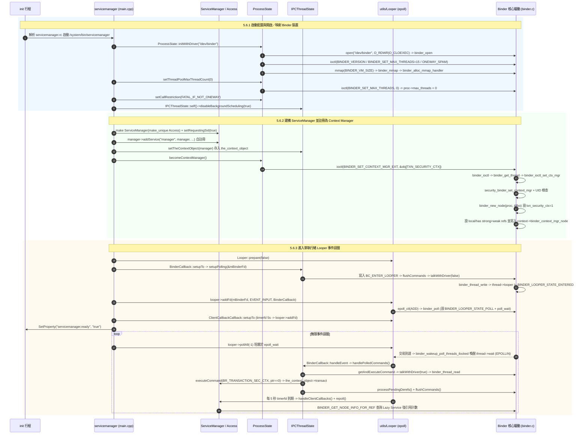

# 5.6 ServiceManager 的啟動過程

- **情景說明**：系統開機階段，`init` 行程解析 `servicemanager.rc` 並啟動 `/system/bin/servicemanager`（Vendor 分區則另依 `vndservicemanager.rc` 以同一份程式碼、傳入 `/dev/vndbinder` 啟動 `vndservicemanager`）。`servicemanager` 主執行緒透過 `libbinder` 開啟並映射 `/dev/binder`、將執行緒池上限鎖定為 `0` 且禁止發起同步遠端呼叫；隨後建立繼承自 AIDL `os::BnServiceManager` 的 `ServiceManager` 物件、開啟 SELinux SID 請求、完成 `"manager"` 自註冊並將其登錄為 `the_context_object`，呼叫 `ProcessState::becomeContextManager()` 經由 `BINDER_SET_CONTEXT_MGR_EXT` 在核心 `binder_context` 中建立 Context Manager 實體節點；最後透過 `utils/Looper` 搭配 `epoll`（監聽 `/dev/binder` 與 5 秒週期 `timerfd`）進入單執行緒事件迴圈並設定 `servicemanager.ready=true`，正式開始受理全系統的服務註冊與查詢請求。
- **對應原書**：第 5 章 5.6 節〈Service Manager 的启动过程〉（p.232–245）
- **涉及專案與版本基準**：
  - `platform/frameworks/native` 〔`android-17.0.0_r1`，commit `ae266dc`〕
  - `kernel/common` 〔`android17-6.18`，Linux 6.18，commit `1e0de07`〕

---

## 5.6.1 啟動配置與開啟／映射 Binder 裝置

> 對應原書 5.6 引言與 5.6.1〈打开和映射Binder设备文件〉（p.232–235）。原書的 Service Manager 是獨立的 C 程式（`frameworks/base/cmds/servicemanager/{service_manager.c,binder.c,binder.h}`），直接以 `open` / `mmap(128*1024)` / `ioctl` 操作 `/dev/binder`；Android 17 已將其完整重寫為 C++ 並直接建構在 `libbinder` 之上，與 `vndservicemanager` 共用同一份 `main.cpp` 與 `ServiceManager` 實作，僅透過啟動參數與編譯宏切換 Binder 裝置節點與 VINTF/Perfetto 能力。

### Step 1：`servicemanager.rc`、`vndservicemanager.rc` 與建置目標配置

**位置**：`platform/frameworks/native/cmds/servicemanager/servicemanager.rc` 〔`android-17.0.0_r1`，lines 1–15〕

```ini
service servicemanager /system/bin/servicemanager
    class core animation
    user system
    group system readproc
    critical
    file /dev/kmsg w
    onrestart setprop servicemanager.ready false
    onrestart restart --only-if-running apexd
    onrestart restart audioserver
    onrestart restart gatekeeperd
    onrestart class_restart --only-enabled main
    onrestart class_restart --only-enabled hal
    onrestart class_restart --only-enabled early_hal
    task_profiles ProcessCapacityHigh
    shutdown critical
```

**位置**：`platform/frameworks/native/cmds/servicemanager/vndservicemanager.rc` 〔`android-17.0.0_r1`，lines 1–10〕

```ini
service vndservicemanager /vendor/bin/vndservicemanager /dev/vndbinder
    class core
    user system
    group system readproc
    file /dev/kmsg w
    task_profiles ServiceCapacityLow
    onrestart class_restart main
    onrestart class_restart hal
    onrestart class_restart early_hal
    shutdown critical
```

**位置**：`platform/frameworks/native/cmds/servicemanager/Android.bp` 〔`android-17.0.0_r1`，lines 63–92〕

```bp
cc_binary {
    name: "servicemanager",
    defaults: ["servicemanager_defaults"],
    init_rc: ["servicemanager.rc"],
    srcs: ["main.cpp"],
    bootstrap: true,
}

cc_binary {
    name: "servicemanager.recovery",
    stem: "servicemanager",
    recovery: true,
    defaults: ["servicemanager_defaults"],
    init_rc: ["servicemanager.recovery.rc"],
    srcs: ["main.cpp"],
}

cc_binary {
    name: "vndservicemanager",
    defaults: ["servicemanager_defaults"],
    init_rc: ["vndservicemanager.rc"],
    vendor: true,
    cflags: [
        "-DVENDORSERVICEMANAGER=1",
    ],
    required: [
        "vndservice",
    ],
    srcs: ["main.cpp"],
}
```

**解說**：
1. **獨立 `.rc` 與 `bootstrap: true`**：`servicemanager` 的 `init` 服務定義不再集中寫在 `system/core/rootdir/init.rc`，而是隨二進位模組以 `init_rc: ["servicemanager.rc"]` 安裝至 `/system/etc/init/servicemanager.rc`；`bootstrap: true` 標記使其位於早期啟動階段即可載入（不依賴 APEX 更新版本）。
2. **關鍵服務屬性與重啟連鎖反應**：
   - `class core animation`：同時歸屬 `core` 與 `animation` 類別，在開機早期隨 `core` 啟動；
   - `user system`、`group system readproc`：以 `system` 身分執行，`readproc` 群組權限用於必要時讀取 `/proc/<pid>`；
   - `critical` 與 `shutdown critical`：若在短時間內反覆崩潰將觸發重開機進入 recovery，且關機階段最後才終止；
   - `file /dev/kmsg w`：由 `init` 預先以唯寫模式開啟 `/dev/kmsg` 並繼承 fd，使 `servicemanager` 在 `logd` 尚未就緒前就能將日誌寫入核心 ring buffer；
   - `onrestart`：一旦重啟，先將系統屬性 `servicemanager.ready` 重置為 `false`，再依序重啟 `apexd`、`audioserver`、`gatekeeperd` 以及所有 `main`、`hal`、`early_hal` 類別服務（所有舊 Binder handle 在原 `servicemanager` 結束後皆已失效）；
   - `task_profiles ProcessCapacityHigh`：給予較高的排程／cgroup 容量配置，避免系統高負載時服務註冊與查詢延遲。
3. **多域共源設計**：`vndservicemanager` 與 `servicemanager` 使用完全相同的 `main.cpp` 與 `ServiceManager.cpp`，差別僅在編譯期加入 `-DVENDORSERVICEMANAGER=1`（停用 VINTF、Perfetto 與 `servicemanager.ready` 屬性設定）並在 `.rc` 傳入命令列參數 `/dev/vndbinder`。

> 〔與 2.3 差異〕**改名搬家 + 邏輯改變**：2.3 將 `servicemanager` 服務定義寫死在 `system/core/rootdir/init.rc` 且 `onrestart` 僅重啟 `zygote` 與 `media`（原書 p.232–233）；17 拆出獨立的 `servicemanager.rc` 與 `vndservicemanager.rc`，新增 `servicemanager.ready` 屬性同步、`file /dev/kmsg w`、`task_profiles`、`shutdown critical` 與按服務類別重啟（`main`/`hal`/`early_hal`）。

---

### Step 2：`main()` 入口初始化日誌、解析驅動路徑並配置 `ProcessState` 策略

**位置**：`platform/frameworks/native/cmds/servicemanager/main.cpp` 〔`android-17.0.0_r1`，lines 146–166〕

```cpp
int main(int argc, char** argv) {
    android::base::InitLogging(argv, android::base::KernelLogger);

    if (argc > 2) {
        LOG(FATAL) << "usage: " << argv[0] << " [binder driver]";
    }

    const char* driver = argc == 2 ? argv[1] : "/dev/binder";

#if !defined(VENDORSERVICEMANAGER) && !defined(__ANDROID_RECOVERY__)
    android::register_perfetto_te_categories();
#endif // !defined(VENDORSERVICEMANAGER) && !defined(__ANDROID_RECOVERY__)

    LOG(INFO) << "Starting sm instance on " << driver;

    sp<ProcessState> ps = ProcessState::initWithDriver(driver);
    ps->setThreadPoolMaxThreadCount(0);
    ps->setCallRestriction(ProcessState::CallRestriction::FATAL_IF_NOT_ONEWAY);

    IPCThreadState::self()->disableBackgroundScheduling(true);
```

**解說**：
1. **早期日誌與 Perfetto**：`InitLogging(argv, android::base::KernelLogger)` 搭配 `.rc` 的 `file /dev/kmsg w` 讓開機初期訊息直接進入 `dmesg`；在正常系統環境（非 vendor、非 recovery）中呼叫 `register_perfetto_te_categories()` 註冊 `servicemanager` 的 Perfetto Track Event 分類，供後續 `addService`/`getService2` 等熱點方法輸出效能追蹤切片。
2. **驅動路徑選擇**：未指定參數時預設操作 `/dev/binder`；由 `vndservicemanager.rc` 啟動時 `argc == 2`，`driver` 為 `"/dev/vndbinder"`。
3. **四項行程級 Binder 初始設定（順序嚴格不可對調）**：
   - `ProcessState::initWithDriver(driver)`：開啟並 `mmap` 指定驅動節點，建立行程單例 `gProcess`；
   - `ps->setThreadPoolMaxThreadCount(0)`：覆寫核心最大衍生執行緒數為 `0`，鎖死為單執行緒模型；
   - `ps->setCallRestriction(ProcessState::CallRestriction::FATAL_IF_NOT_ONEWAY)`：禁止本行程發出任何同步（阻塞等待回覆）的 Binder 呼叫——**必須在首次呼叫 `IPCThreadState::self()` 之前完成**，因為內部會斷言 `IPCThreadState::selfOrNull() == nullptr`；
   - `IPCThreadState::self()->disableBackgroundScheduling(true)`：建立主執行緒的 `IPCThreadState`（此時會複製剛設定好的 `mCallRestriction`），同時停用背景排程降級，防止高優先權的 `servicemanager` 因服務背景行程而被放進低權重背景排程群組。

> 〔與 2.3 差異〕**已移除並重寫**：2.3 的 `service_manager.c::main` 直接呼叫自製的 `binder_open(128*1024)`、`binder_become_context_manager(bs)`、`binder_loop(bs, svcmgr_handler)`，完全不連結 `libbinder`（原書 p.233–234）；17 改由 `cmds/servicemanager/main.cpp` 統一透過 `libbinder` 的 `ProcessState` 與 `IPCThreadState` 運作，並明確以 API 強制單執行緒與禁止同步外呼。

---

### Step 3：`ProcessState::initWithDriver` 與 `ProcessState` 建構子開啟並映射 Binder 裝置

**位置**：`platform/frameworks/native/libs/binder/ProcessState.cpp` 〔`android-17.0.0_r1`，lines 48–50, 111–114, 137–181, 572–652〕

```cpp
#define BINDER_VM_SIZE ((1 * 1024 * 1024) - sysconf(_SC_PAGE_SIZE) * 2)
#define DEFAULT_MAX_BINDER_THREADS 15
#define DEFAULT_ENABLE_ONEWAY_SPAM_DETECTION 1
...
sp<ProcessState> ProcessState::initWithDriver(const char* driver)
{
    return init(driver, true /*requireDefault*/);
}
...
sp<ProcessState> ProcessState::init(const char* driver, bool requireDefault) {
    if (driver == nullptr) {
        std::lock_guard<std::mutex> l(gProcessMutex);
        if (gProcess) {
            verifyNotForked(gProcess->mForked);
        }
        return gProcess;
    }

    [[clang::no_destroy]] static std::once_flag gProcessOnce;
    std::call_once(gProcessOnce, [&](){
        if (access(driver, R_OK) == -1) {
            ALOGE("Binder driver %s is unavailable. Using /dev/binder instead.", driver);
            driver = "/dev/binder";
        }
...
        int ret = pthread_atfork(ProcessState::onFork, ProcessState::parentPostFork,
                                 ProcessState::childPostFork);
        LOG_ALWAYS_FATAL_IF(ret != 0, "pthread_atfork error %s", strerror(ret));

        std::lock_guard<std::mutex> l(gProcessMutex);
        gProcess = sp<ProcessState>::make(driver);
    });

    if (requireDefault) {
        // Detect if we are trying to initialize with a different driver, and
        // consider that an error. ProcessState will only be initialized once above.
        LOG_ALWAYS_FATAL_IF(gProcess->getDriverName() != driver,
                            "ProcessState was already initialized with %s,"
                            " can't initialize with %s.",
                            gProcess->getDriverName().c_str(), driver);
    }

    verifyNotForked(gProcess->mForked);
    return gProcess;
}
...
static unique_fd open_driver(const char* driver, String8* error) {
    auto fd = unique_fd(open(driver, O_RDWR | O_CLOEXEC));
    if (!fd.ok()) {
        error->appendFormat("%d (%s) Opening '%s' failed", errno, strerror(errno), driver);
        return {};
    }
    int vers = 0;
    int result = ioctl(fd.get(), BINDER_VERSION, &vers);
    if (result == -1) {
        error->appendFormat("%d (%s) Binder ioctl to obtain version failed", errno,
                            strerror(errno));
        return {};
    }
    if (result != 0 || vers != BINDER_CURRENT_PROTOCOL_VERSION) {
        error->appendFormat("Binder driver protocol(%d) does not match user space protocol(%d)! "
                            "ioctl() return value: %d",
                            vers, BINDER_CURRENT_PROTOCOL_VERSION, result);
        return {};
    }
    size_t maxThreads = DEFAULT_MAX_BINDER_THREADS;
    result = ioctl(fd.get(), BINDER_SET_MAX_THREADS, &maxThreads);
    if (result == -1) {
        ALOGE("Binder ioctl to set max threads failed: %s", strerror(errno));
    }
    uint32_t enable = DEFAULT_ENABLE_ONEWAY_SPAM_DETECTION;
    result = ioctl(fd.get(), BINDER_ENABLE_ONEWAY_SPAM_DETECTION, &enable);
    if (result == -1) {
        ALOGE_IF(ProcessState::isDriverFeatureEnabled(
                     ProcessState::DriverFeature::ONEWAY_SPAM_DETECTION),
                 "Binder ioctl to enable oneway spam detection failed: %s", strerror(errno));
    }
    return fd;
}

ProcessState::ProcessState(const char* driver)
      : mDriverName(String8(driver)),
        mDriverFD(-1),
        mVMStart(MAP_FAILED),
...
        mCallRestriction(CallRestriction::NONE) {
    String8 error;
    unique_fd opened = open_driver(driver, &error);

    if (opened.ok()) {
        // mmap the binder, providing a chunk of virtual address space to receive transactions.
        mVMStart = mmap(nullptr, BINDER_VM_SIZE, PROT_READ, MAP_PRIVATE | MAP_NORESERVE,
                        opened.get(), 0);
        if (mVMStart == MAP_FAILED) {
            // *sigh*
            ALOGE("Using %s failed: unable to mmap transaction memory.", driver);
            opened.reset();
            mDriverName.clear();
        }
    }

#if defined(EXPECT_BINDER_OPEN_SUCCESS)
    LOG_ALWAYS_FATAL_IF(!opened.ok(),
                        "Binder driver '%s' could not be opened. Error: %s. Terminating.",
                        driver, error.c_str());
#else
...
#endif

    if (opened.ok()) {
        mDriverFD = opened.release();
    }
#ifdef BINDER_WITH_OBSERVERS
    mBinderObserver = std::make_unique<BinderObserver>();
#endif
}
```

**解說**：
1. **`initWithDriver` 的嚴格性**：`initWithDriver(driver)` 以 `requireDefault = true` 呼叫 `ProcessState::init`，確保行程內此前無人搶先用其他驅動（例如預設的 `/dev/binder`）初始化過 `gProcess`；若已初始化且驅動名稱不符，將立刻觸發 `LOG_ALWAYS_FATAL_IF`。
2. **開啟與協定協商**：`open_driver` 以 `O_RDWR | O_CLOEXEC` 開啟 `/dev/binder`（核心執行 5.1.3 的 `binder_open`，建立 `binder_proc` 並綁定至對應的 `binder_context`），接著依序執行：
   - `BINDER_VERSION`：驗證使用者空間與核心協定版本一致（`BINDER_CURRENT_PROTOCOL_VERSION`），同時核心端在此次 `ioctl` 就會透過 `binder_get_thread` 為 `servicemanager` 主執行緒建立 `binder_thread`；
   - `BINDER_SET_MAX_THREADS`：先設為預設值 `15`（緊接著會在 Step 4 被 `servicemanager` 改寫為 `0`）；
   - `BINDER_ENABLE_ONEWAY_SPAM_DETECTION`：啟用單向呼叫洪水偵測。
3. **記憶體映射大小**：`ProcessState` 建構子以 `mmap(nullptr, BINDER_VM_SIZE, PROT_READ, MAP_PRIVATE | MAP_NORESERVE, opened.get(), 0)` 映射 `1MB - 2 * PAGE_SIZE`（4KB 頁為 1016 KB）的唯讀虛擬位址空間（核心 `binder_mmap` → `binder_alloc_mmap_handler`，見 5.1.4，不預配實體頁、按需裝頁）。與 2.3 `servicemanager` 獨立映射 `128 KB` 不同，Android 17 直接與所有 `libbinder` 行程共用 ~1MB 緩衝區，容納更高的併發服務查詢／大型服務列表回傳。

> 〔與 2.3 差異〕**已移除並重寫**：2.3 的 `cmds/servicemanager/binder.c::binder_open` 自行 `malloc(sizeof(struct binder_state))`、`open("/dev/binder", O_RDWR)`、略過版本檢查（原始碼裡還留著 `/* TODO: check version */`），且僅映射 `128*1024` 位元組（原書 p.234–235）；17 直接複用 `libbinder` 的 `ProcessState::initWithDriver`，具備 `O_CLOEXEC`、協定版本檢查、`pthread_atfork` 防護與 `BINDER_VM_SIZE` 映射。

---

### Step 4：鎖定執行緒池上限為 `0`、禁止同步外呼與停用背景降權

**位置**：`platform/frameworks/native/libs/binder/ProcessState.cpp` 〔`android-17.0.0_r1`，lines 316–321, 451–462〕

```cpp
void ProcessState::setCallRestriction(CallRestriction restriction) {
    LOG_ALWAYS_FATAL_IF(IPCThreadState::selfOrNull() != nullptr,
        "Call restrictions must be set before the threadpool is started.");

    mCallRestriction = restriction;
}
...
status_t ProcessState::setThreadPoolMaxThreadCount(size_t maxThreads) {
    LOG_ALWAYS_FATAL_IF(mThreadPoolStarted && maxThreads < mMaxThreads,
           "Binder threadpool cannot be shrunk after starting");
    status_t result = NO_ERROR;
    if (ioctl(mDriverFD, BINDER_SET_MAX_THREADS, &maxThreads) != -1) {
        mMaxThreads = maxThreads;
    } else {
        result = -errno;
        ALOGE("Binder ioctl to set max threads failed: %s", strerror(-result));
    }
    return result;
}
```

**位置**：`platform/frameworks/native/libs/binder/IPCThreadState.cpp` 〔`android-17.0.0_r1`，lines 431–434, 948–957, 1117–1134〕

```cpp
void IPCThreadState::disableBackgroundScheduling(bool disable)
{
    gDisableBackgroundScheduling.store(disable, std::memory_order_relaxed);
}
...
    if ((flags & TF_ONE_WAY) == 0) {
        if (mCallRestriction != ProcessState::CallRestriction::NONE) [[unlikely]] {
            if (mCallRestriction == ProcessState::CallRestriction::ERROR_IF_NOT_ONEWAY) {
                ALOGE("Process making non-oneway call (code: %u) but is restricted.", code);
                CallStack::logStack("non-oneway call", CallStack::getCurrent(10).get(),
                    ANDROID_LOG_ERROR);
            } else /* FATAL_IF_NOT_ONEWAY */ {
                LOG_ALWAYS_FATAL("Process may not make non-oneway calls (code: %u).", code);
            }
        }
...
IPCThreadState::IPCThreadState()
      : mProcess(ProcessState::self()),
        mServingStackPointer(nullptr),
        mServingStackPointerGuard(nullptr),
        mWorkSource(kUnsetWorkSource),
        mPropagateWorkSource(false),
        mIsLooper(false),
        mIsFlushing(false),
        mIsProcessingPostWriteDerefs(false),
        mStrictModePolicy(0),
        mLastTransactionBinderFlags(0),
        mCallRestriction(mProcess->mCallRestriction) {
    pthread_setspecific(gTLS, this);
    clearCaller();
    mHasExplicitIdentity = false;
    mIn.setDataCapacity(256);
    mOut.setDataCapacity(256);
}
```

**解說**：
1. **為何 `maxThreads = 0`**：`setThreadPoolMaxThreadCount(0)` 透過 `ioctl(mDriverFD, BINDER_SET_MAX_THREADS, &maxThreads)` 將核心 `proc->max_threads` 設為 `0`（對應 `binder.c` lines 6071–6083）。如此驅動端在 `binder_thread_read` 永遠不會下發 `BR_SPAWN_LOOPER`；整個 `servicemanager` 行程僅靠主執行緒串行處理所有服務註冊／查詢／死亡通知，內部 `mNameToService`、`mNameToRegistrationCallback`、`mNameToClientCallback` 等容器完全無需加鎖，既避免鎖爭用又確保狀態轉移的原子性。
2. **為何 `FATAL_IF_NOT_ONEWAY`**：單執行緒伺服器的致命風險在於**回呼死鎖**——如果 `servicemanager` 同步呼叫某個外部行程（例如通知 `IServiceCallback` 或 `IClientCallback`），而該行程正卡在等 `servicemanager` 或已經凍結／異常，全系統所有服務查詢就會瞬間停擺。將 `mCallRestriction` 設為 `FATAL_IF_NOT_ONEWAY` 後，首次建立 `IPCThreadState` 時會從 `mProcess->mCallRestriction` 複製此策略，任何同步呼叫（`(flags & TF_ONE_WAY) == 0`）都會立刻在 `IPCThreadState::transact` 中止行程以杜絕隱性死鎖。因此 `IServiceCallback.onRegistration` 與 `IClientCallback.onClients` 在 AIDL 中皆定義為 `oneway`。
3. **為何 `disableBackgroundScheduling(true)`**：設定 `gDisableBackgroundScheduling = true`，防止 `servicemanager` 在處理背景優先權 Client 交易或系統排程調整時被降級至背景 cgroup。

> 〔與 2.3 差異〕**新增**：2.3 的 `servicemanager` 因未使用 `libbinder` 且不會對外發起任何 Binder 呼叫（無註冊回呼、無 Lazy Service 客戶端回呼），故無執行緒池上限重設、`CallRestriction` 強制單向檢查與背景排程保護（原書 p.234–235）。

---

## 5.6.2 註冊為 Context Manager

> 對應原書 5.6.2〈注册为Binder上下文管理者〉（p.235–239）。原書在 `main()` 中僅將 `svcmgr_handle` 設為魔術值 `((void*) 0)`，再呼叫 `ioctl(bs->fd, BINDER_SET_CONTEXT_MGR, 0)`；Android 17 則建立真正的 AIDL `BBinder` 物件 `ServiceManager`，設定 `setRequestingSid(true)`、完成 `"manager"` 自註冊與 `setTheContextObject(manager)`，並透過新介面 `BINDER_SET_CONTEXT_MGR_EXT` 將 `FLAT_BINDER_FLAG_TXN_SECURITY_CTX` 旗標交給核心，在對應 `binder_context` 下建立可攜帶呼叫端 SELinux SID 的 Context Manager 實體節點。

### Step 5：建構 `ServiceManager` 與 `Access`、開啟 SID 請求並自註冊 `"manager"`

**位置**：`platform/frameworks/native/cmds/servicemanager/main.cpp` 〔`android-17.0.0_r1`，lines 167–176〕

```cpp
    sp<ServiceManager> manager = sp<ServiceManager>::make(std::make_unique<Access>());
    manager->setRequestingSid(true);
    if (!manager->addService("manager", manager, false /*allowIsolated*/, IServiceManager::DUMP_FLAG_PRIORITY_DEFAULT).isOk()) {
        LOG(ERROR) << "Could not self register servicemanager";
    }

    IPCThreadState::self()->setTheContextObject(manager);
    if (!ps->becomeContextManager()) {
        LOG(FATAL) << "Could not become context manager";
    }
```

**位置**：`platform/frameworks/native/cmds/servicemanager/ServiceManager.h` 〔`android-17.0.0_r1`，lines 41–45, 86–108, 137–142〕

```cpp
class ServiceManager : public os::BnServiceManager, public IBinder::DeathRecipient {
public:
    ServiceManager(std::unique_ptr<Access>&& access);
    ~ServiceManager();
...
private:
    struct Service {
        sp<IBinder> binder; // not null
        bool allowIsolated;
        int32_t dumpPriority;
        bool hasClients = false; // notifications sent on true -> false.
        bool guaranteeClient = false; // forces the client check to true
        Access::CallingContext ctx;   // process that originally registers this

        // the number of clients of the service, including servicemanager itself
        ssize_t getNodeStrongRefCount();

        ~Service();
    };

    struct RegistrationCallback {
        sp<IServiceCallback> callback;
        Access::CallingContext ctx;
    };
    using ServiceCallbackMap = std::map<std::string, std::vector<RegistrationCallback>>;
    using ClientCallbackMap = std::map<std::string, std::vector<sp<IClientCallback>>>;
    using ServiceMap = std::map<std::string, Service>;
...
    ServiceMap mNameToService;
    ServiceCallbackMap mNameToRegistrationCallback;
    ClientCallbackMap mNameToClientCallback;

    std::unique_ptr<Access> mAccess;
};
```

**位置**：`platform/frameworks/native/cmds/servicemanager/Access.cpp` 〔`android-17.0.0_r1`，lines 93–107, 113–128〕

```cpp
Access::Access() {
#ifdef __ANDROID__
    union selinux_callback cb;

    cb.func_audit = auditCallback;
    selinux_set_callback(SELINUX_CB_AUDIT, cb);

    cb.func_log = kIsVendor ? selinux_vendor_log_callback : selinux_log_callback;
    selinux_set_callback(SELINUX_CB_LOG, cb);

    CHECK(selinux_status_open(true /*fallback*/) >= 0);

    CHECK(getcon(&mThisProcessContext) == 0);
#endif
}
...
Access::CallingContext Access::getCallingContext() {
#ifdef __ANDROID__
    IPCThreadState* ipc = IPCThreadState::self();

    const char* callingSid = ipc->getCallingSid();
    pid_t callingPid = ipc->getCallingPid();

    return CallingContext {
        .debugPid = callingPid,
        .uid = ipc->getCallingUid(),
        .sid = callingSid ? std::string(callingSid) : getPidcon(callingPid),
    };
#else
    return CallingContext();
#endif
}
```

**位置**：`platform/frameworks/native/libs/binder/Binder.cpp` 〔`android-17.0.0_r1`，lines 667–686〕

```cpp
void BBinder::setRequestingSid(bool requestingSid)
{
    LOG_ALWAYS_FATAL_IF(wasParceled(),
                        "setRequestingSid() should not be called after a binder object "
                        "is parceled/sent to another process");

    Extras* e = mExtras.load(std::memory_order_acquire);

    if (!e) {
        // default is false. Most things don't need sids, so avoiding allocations when possible.
        if (!requestingSid) {
            return;
        }

        e = getOrCreateExtras();
        if (!e) return; // out of memory
    }

    e->mRequestingSid = requestingSid;
}
```

**解說**：
1. **`ServiceManager` 的多重繼承角色**：繼承自 AIDL 編譯 `libs/binder/aidl/android/os/IServiceManager.aidl` 生成的 `os::BnServiceManager`（本身繼承 `BBinder`，覆寫 `onTransact` 分派 `getService2`/`addService`/`listServices`/`registerForNotifications`/`registerClientCallback`/`checkServiceAccess` 等 17 個方法），同時實作 `IBinder::DeathRecipient`，以便在任何已註冊服務或回呼行程死亡時收到 `binderDied()` 並自動清理 `mNameToService`、`mNameToRegistrationCallback` 與 `mNameToClientCallback`。
2. **`Access` 初始化 SELinux 檢查環境**：建構 `Access` 時註冊 `SELINUX_CB_AUDIT` 與 `SELINUX_CB_LOG` 回呼、呼叫 `selinux_status_open(true)` 映射核心 SELinux 狀態頁（讓 `getSehandle()` 能在 policy 重載時即時重開 `service_contexts`），並以 `getcon(&mThisProcessContext)` 快取自身 SELinux context 供 `list` 權限檢查使用。
3. **`manager->setRequestingSid(true)` 與自註冊 `"manager"`**：
   - `setRequestingSid(true)` 在 `BBinder::Extras` 標記 `mRequestingSid = true`。當此本地物件日後透過 `Parcel::writeStrongBinder` 序列化送出給其他行程（例如有行程查詢 `"manager"` 服務取得此 binder）時，封裝出的 `flat_binder_object` 會帶上 `FLAT_BINDER_FLAG_TXN_SECURITY_CTX`，確保經由該節點進入的所有交易都附帶呼叫端 SELinux SID。
   - 隨即在行程內直接呼叫 `manager->addService("manager", manager, ...)`：此時並未處於遠端交易中（`mServingStackPointer == nullptr`、`callingSid == nullptr`），故 `Access::getCallingContext()` 會透過 `getPidcon(getpid())` 取得自身 SELinux SID 並通過 `Access::canAdd` 檢查；又因傳入的 `manager` 為本地 `BBinder`（`binder->remoteBinder() == nullptr`），`ServiceManager::addService` 第 549 行會跳過 `linkToDeath`，直接將自己登記在 `mNameToService["manager"]`，使 `service list`、`dumpsys manager` 等工具能以一致方式查詢或診斷 `servicemanager`。

> 〔與 2.3 差異〕**已移除並重寫**：2.3 僅以單向鏈表 `svclist` 儲存服務（無 SELinux 權限模組、無 AIDL `BBinder` 物件、也不自註冊 `"manager"`），僅定義全域指標 `svcmgr_handle = ((void*) 0)`（原書 p.233–235）；17 建構完整的 AIDL `BnServiceManager` 實作並整合 SELinux `Access` 與 `mRequestingSid`。

---

### Step 6：`IPCThreadState::setTheContextObject` 與 `ProcessState::becomeContextManager`

**位置**：`platform/frameworks/native/libs/binder/IPCThreadState.cpp` 〔`android-17.0.0_r1`，lines 1401–1406, 1551–1565〕

```cpp
[[clang::no_destroy]] sp<BBinder> the_context_object;

void IPCThreadState::setTheContextObject(const sp<BBinder>& obj)
{
    the_context_object = obj;
}
...
            if (tr.target.ptr) {
                // We only have a weak reference on the target object, so we must first try to
                // safely acquire a strong reference before doing anything else with it.
                if (reinterpret_cast<RefBase::weakref_type*>(tr.target.ptr)
                            ->attemptIncStrong(this)) {
                    BBinder* binder = reinterpret_cast<BBinder*>(tr.cookie);
                    error = doTransactBinder(binder, tr.code, buffer, &reply, tr.flags);
                    binder->decStrong(this);
                } else {
                    error = UNKNOWN_TRANSACTION;
                }
            } else {
                BBinder* binder = the_context_object.get();
                error = doTransactBinder(binder, tr.code, buffer, &reply, tr.flags);
            }
```

**位置**：`platform/frameworks/native/libs/binder/ProcessState.cpp` 〔`android-17.0.0_r1`，lines 234–257〕

```cpp
bool ProcessState::becomeContextManager()
{
    std::unique_lock<std::mutex> _l(mLock);

    flat_binder_object obj {
        .flags = FLAT_BINDER_FLAG_TXN_SECURITY_CTX,
    };

    int result = ioctl(mDriverFD, BINDER_SET_CONTEXT_MGR_EXT, &obj);

    // fallback to original method
    if (result != 0) {
        android_errorWriteLog(0x534e4554, "121035042");

        int unused = 0;
        result = ioctl(mDriverFD, BINDER_SET_CONTEXT_MGR, &unused);
    }

    if (result == -1) {
        ALOGE("Binder ioctl to become context manager failed: %s\n", strerror(errno));
    }

    return result == 0;
}
```

**位置**：`kernel/common/include/uapi/linux/android/binder.h` 〔`android17-6.18`，lines 93–100, 125–137, 308–323〕

```c
	/**
	 * @FLAT_BINDER_FLAG_TXN_SECURITY_CTX: request security contexts
	 *
	 * Only when set, causes senders to include their security
	 * context
	 */
	FLAT_BINDER_FLAG_TXN_SECURITY_CTX = 0x1000,
};
...
struct flat_binder_object {
	struct binder_object_header	hdr;
	__u32				flags;

	/* 8 bytes of data. */
	union {
		binder_uintptr_t	binder;	/* local object */
		__u32			handle;	/* remote object */
	};

	/* extra data associated with local object */
	binder_uintptr_t	cookie;
};
...
enum {
	BINDER_WRITE_READ		= _IOWR('b', 1, struct binder_write_read),
	BINDER_SET_IDLE_TIMEOUT		= _IOW('b', 3, __s64),
	BINDER_SET_MAX_THREADS		= _IOW('b', 5, __u32),
	BINDER_SET_IDLE_PRIORITY	= _IOW('b', 6, __s32),
	BINDER_SET_CONTEXT_MGR		= _IOW('b', 7, __s32),
	BINDER_THREAD_EXIT		= _IOW('b', 8, __s32),
	BINDER_VERSION			= _IOWR('b', 9, struct binder_version),
	BINDER_GET_NODE_DEBUG_INFO	= _IOWR('b', 11, struct binder_node_debug_info),
	BINDER_GET_NODE_INFO_FOR_REF	= _IOWR('b', 12, struct binder_node_info_for_ref),
	BINDER_SET_CONTEXT_MGR_EXT	= _IOW('b', 13, struct flat_binder_object),
	BINDER_FREEZE			= _IOW('b', 14, struct binder_freeze_info),
	BINDER_GET_FROZEN_INFO		= _IOWR('b', 15, struct binder_frozen_status_info),
	BINDER_ENABLE_ONEWAY_SPAM_DETECTION	= _IOW('b', 16, __u32),
	BINDER_GET_EXTENDED_ERROR	= _IOWR('b', 17, struct binder_extended_error),
};
```

**解說**：
1. **`the_context_object` 的橋接作用**：注意 `becomeContextManager()` 所建構的 `flat_binder_object obj` 僅初始化 `.flags = FLAT_BINDER_FLAG_TXN_SECURITY_CTX`，其餘欄位皆零初始化（`obj.binder == 0`、`obj.cookie == 0`）。這意味著核心為 Context Manager 建立的 `binder_node` 的 `ptr` 與 `cookie` 依然是 `0`。當外部 Client 透過 handle `0` 發起交易時，核心傳給 `servicemanager` 的 `tr.target.ptr` 為 `0`；`IPCThreadState::executeCommand` 走進 `else` 分支，直接取出 `the_context_object.get()`（也就是剛才以 `setTheContextObject(manager)` 登錄的 `ServiceManager` 實例）交給 `doTransactBinder()` 分派！此外，若 `servicemanager` 自身呼叫 `ProcessState::getStrongProxyForHandle(0)`，`ProcessState.cpp` 第 346 行亦會直接回傳 `the_context_object`（避免對自己發出跨行程交易）。
2. **`BINDER_SET_CONTEXT_MGR_EXT` 優先與相容回退**：
   - 舊指令 `BINDER_SET_CONTEXT_MGR` 僅接受一個未使用的 `__s32` 參數，無法傳遞節點旗標；
   - 新指令 `BINDER_SET_CONTEXT_MGR_EXT` 接受完整的 `struct flat_binder_object`，讓 `servicemanager` 能以 `FLAT_BINDER_FLAG_TXN_SECURITY_CTX`（`0x1000`）要求核心在每次投遞給 Context Manager 的交易中附帶發送端 SELinux 安全上下文（改發 `BR_TRANSACTION_SEC_CTX` 而非 `BR_TRANSACTION`），徹底消除舊版依 `getpidcon(sender_pid)` 查詢 `/proc` 時的 PID 重用競爭漏洞（TOCTOU）。
   - 僅在極舊核心不支援 `_EXT` 時才寫入安全日誌（`121035042`）並回退至 `BINDER_SET_CONTEXT_MGR`。

> 〔與 2.3 差異〕**邏輯改變 + 擴充**：2.3 僅呼叫 `ioctl(bs->fd, BINDER_SET_CONTEXT_MGR, 0)`，使用者空間也無 `the_context_object`（由 `binder_loop` 直接把 `tr.target.ptr == 0` 交給 `svcmgr_handler`）（原書 p.235）；17 改為 `setTheContextObject(manager)` 搭配 `BINDER_SET_CONTEXT_MGR_EXT` + `FLAT_BINDER_FLAG_TXN_SECURITY_CTX`。

---

### Step 7：核心 `binder_ioctl` 分派與 `binder_get_thread` 取得／建立執行緒結構

**位置**：`kernel/common/drivers/android/binder.c` 〔`android17-6.18`，lines 6046–6100, 6253–6264〕

```c
static long binder_ioctl(struct file *filp, unsigned int cmd, unsigned long arg)
{
	int ret;
	struct binder_proc *proc = filp->private_data;
	struct binder_thread *thread;
	void __user *ubuf = (void __user *)arg;

	trace_binder_ioctl(cmd, arg);

	ret = wait_event_interruptible(binder_user_error_wait, binder_stop_on_user_error < 2);
	if (ret)
		goto err_unlocked;

	thread = binder_get_thread(proc);
	if (thread == NULL) {
		ret = -ENOMEM;
		goto err;
	}

	switch (cmd) {
	case BINDER_WRITE_READ:
		ret = binder_ioctl_write_read(filp, arg, thread);
		if (ret)
			goto err;
		break;
	case BINDER_SET_MAX_THREADS: {
		u32 max_threads;

		if (copy_from_user(&max_threads, ubuf,
				   sizeof(max_threads))) {
			ret = -EINVAL;
			goto err;
		}
		binder_inner_proc_lock(proc);
		proc->max_threads = max_threads;
		binder_inner_proc_unlock(proc);
		break;
	}
	case BINDER_SET_CONTEXT_MGR_EXT: {
		struct flat_binder_object fbo;

		if (copy_from_user(&fbo, ubuf, sizeof(fbo))) {
			ret = -EINVAL;
			goto err;
		}
		ret = binder_ioctl_set_ctx_mgr(filp, &fbo);
		if (ret)
			goto err;
		break;
	}
	case BINDER_SET_CONTEXT_MGR:
		ret = binder_ioctl_set_ctx_mgr(filp, NULL);
		if (ret)
			goto err;
		break;
...
	ret = 0;
	trace_android_vh_binder_ioctl_end(current, cmd, arg, thread, proc, &ret);
err:
	if (thread)
		thread->looper_need_return = false;
	wait_event_interruptible(binder_user_error_wait, binder_stop_on_user_error < 2);
	if (ret && ret != -EINTR)
		pr_info("%d:%d ioctl %x %lx returned %d\n", proc->pid, current->pid, cmd, arg, ret);
err_unlocked:
	trace_binder_ioctl_done(ret);
	return ret;
}
```

**位置**：`kernel/common/drivers/android/binder.c` 〔`android17-6.18`，lines 5512–5574〕

```c
static struct binder_thread *binder_get_thread_ilocked(
		struct binder_proc *proc, struct binder_thread *new_thread)
{
	struct binder_thread *thread = NULL;
	struct rb_node *parent = NULL;
	struct rb_node **p = &proc->threads.rb_node;

	while (*p) {
		parent = *p;
		thread = rb_entry(parent, struct binder_thread, rb_node);

		if (current->pid < thread->pid)
			p = &(*p)->rb_left;
		else if (current->pid > thread->pid)
			p = &(*p)->rb_right;
		else
			return thread;
	}
	if (!new_thread)
		return NULL;
	thread = new_thread;
	binder_stats_created(BINDER_STAT_THREAD);
	thread->proc = proc;
	thread->pid = current->pid;
	get_task_struct(current);
	thread->task = current;
	atomic_set(&thread->tmp_ref, 0);
	init_waitqueue_head(&thread->wait);
	INIT_LIST_HEAD(&thread->todo);
	rb_link_node(&thread->rb_node, parent, p);
	rb_insert_color(&thread->rb_node, &proc->threads);
	thread->looper_need_return = true;
	thread->return_error.work.type = BINDER_WORK_RETURN_ERROR;
	thread->return_error.cmd = BR_OK;
	thread->reply_error.work.type = BINDER_WORK_RETURN_ERROR;
	thread->reply_error.cmd = BR_OK;
	spin_lock_init(&thread->prio_lock);
	thread->prio_state = BINDER_PRIO_SET;
	thread->ee.command = BR_OK;
	INIT_LIST_HEAD(&new_thread->waiting_thread_node);
	return thread;
}

static struct binder_thread *binder_get_thread(struct binder_proc *proc)
{
	struct binder_thread *thread;
	struct binder_thread *new_thread;

	binder_inner_proc_lock(proc);
	thread = binder_get_thread_ilocked(proc, NULL);
	binder_inner_proc_unlock(proc);
	if (!thread) {
		new_thread = kzalloc(sizeof(*thread), GFP_KERNEL);
		if (new_thread == NULL)
			return NULL;
		binder_inner_proc_lock(proc);
		thread = binder_get_thread_ilocked(proc, new_thread);
		binder_inner_proc_unlock(proc);
		if (thread != new_thread)
			kfree(new_thread);
	}
	return thread;
}
```

**解說**：
1. **無全域鎖的兩階段查找與分配**：`binder_ioctl` 不再於入口處取得單一全域 `binder_lock` mutex。`binder_get_thread(proc)` 先在 `proc->inner_lock` 下查詢 `proc->threads` 紅黑樹；若尚未建立，則先解鎖以 `kzalloc(..., GFP_KERNEL)`（可睡眠分配）建立 `new_thread`，再重新加鎖插入，避免在自旋鎖內做可能睡眠的記憶體分配。
2. **首次建立時機的細微變化**：在原書 2.3 中，因 `binder_open` 未發任何 `ioctl`，主執行緒的 `binder_thread` 是在 `BINDER_SET_CONTEXT_MGR` 才首次建立；而在 Android 17 中，Step 3 的 `open_driver` 執行 `BINDER_VERSION` 時就已為 `servicemanager` 主執行緒建立並插入 `binder_thread`，因此走到 `BINDER_SET_CONTEXT_MGR_EXT` 時 `binder_get_thread` 會直接命中紅黑樹返回。
3. **`looper_need_return` 取代旗標位元**：新建 `binder_thread` 時設定獨立布林欄位 `thread->looper_need_return = true`（原書為 `thread->looper |= BINDER_LOOPER_STATE_NEED_RETURN`），並在 `binder_ioctl` 返回前的 `err:` 標籤統一清為 `false`，確保首次進入的執行緒在完成此次 `ioctl` 後立即返回使用者空間。
4. **`BINDER_SET_CONTEXT_MGR_EXT` 分派**：將使用者空間傳入的 `struct flat_binder_object` 拷貝至核心堆疊變數 `fbo` 後呼叫 `binder_ioctl_set_ctx_mgr(filp, &fbo)`；舊指令 `BINDER_SET_CONTEXT_MGR` 則將第二參數傳為 `NULL`。

> 〔與 2.3 差異〕**邏輯改變**：2.3 的 `binder_ioctl` 全程持有全域 `mutex_lock(&binder_lock)` 並直接在 `switch` 內 inline 處理 `BINDER_SET_CONTEXT_MGR`，`binder_get_thread` 直接在鎖內 `kzalloc`（原書 p.235–237）；17 移除全域 mutex，將 `binder_get_thread` 改為自旋鎖保護的先查後配兩階段模式，並新增 `BINDER_SET_CONTEXT_MGR_EXT` 分支交給獨立函式 `binder_ioctl_set_ctx_mgr`。

---

### Step 8：核心 `binder_ioctl_set_ctx_mgr` 與 `binder_new_node` 建立 Context Manager 實體節點

**位置**：`kernel/common/drivers/android/binder.c` 〔`android17-6.18`，lines 5779–5819〕

```c
static int binder_ioctl_set_ctx_mgr(struct file *filp,
				    struct flat_binder_object *fbo)
{
	int ret = 0;
	struct binder_proc *proc = filp->private_data;
	struct binder_context *context = proc->context;
	struct binder_node *new_node;
	kuid_t curr_euid = current_euid();

	guard(mutex)(&context->context_mgr_node_lock);
	if (context->binder_context_mgr_node) {
		pr_err("BINDER_SET_CONTEXT_MGR already set\n");
		return -EBUSY;
	}
	ret = security_binder_set_context_mgr(proc->cred);
	if (ret < 0)
		return ret;
	if (uid_valid(context->binder_context_mgr_uid)) {
		if (!uid_eq(context->binder_context_mgr_uid, curr_euid)) {
			pr_err("BINDER_SET_CONTEXT_MGR bad uid %d != %d\n",
			       from_kuid(&init_user_ns, curr_euid),
			       from_kuid(&init_user_ns,
					 context->binder_context_mgr_uid));
			return -EPERM;
		}
	} else {
		context->binder_context_mgr_uid = curr_euid;
	}
	new_node = binder_new_node(proc, fbo);
	if (!new_node)
		return -ENOMEM;
	binder_node_lock(new_node);
	new_node->local_weak_refs++;
	new_node->local_strong_refs++;
	new_node->has_strong_ref = 1;
	new_node->has_weak_ref = 1;
	context->binder_context_mgr_node = new_node;
	binder_node_unlock(new_node);
	binder_put_node(new_node);
	return ret;
}
```

**位置**：`kernel/common/drivers/android/binder.c` 〔`android17-6.18`，lines 918–998〕

```c
static struct binder_node *binder_init_node_ilocked(
						struct binder_proc *proc,
						struct binder_node *new_node,
						struct flat_binder_object *fp)
{
	struct rb_node **p = &proc->nodes.rb_node;
	struct rb_node *parent = NULL;
	struct binder_node *node;
	binder_uintptr_t ptr = fp ? fp->binder : 0;
	binder_uintptr_t cookie = fp ? fp->cookie : 0;
	__u32 flags = fp ? fp->flags : 0;
	s8 priority;

	assert_spin_locked(&proc->inner_lock);

	while (*p) {

		parent = *p;
		node = rb_entry(parent, struct binder_node, rb_node);

		if (ptr < node->ptr)
			p = &(*p)->rb_left;
		else if (ptr > node->ptr)
			p = &(*p)->rb_right;
		else {
			/*
			 * A matching node is already in
			 * the rb tree. Abandon the init
			 * and return it.
			 */
			binder_inc_node_tmpref_ilocked(node);
			return node;
		}
	}
	node = new_node;
	binder_stats_created(BINDER_STAT_NODE);
	node->tmp_refs++;
	rb_link_node(&node->rb_node, parent, p);
	rb_insert_color(&node->rb_node, &proc->nodes);
	node->debug_id = atomic_inc_return(&binder_last_id);
	node->proc = proc;
	node->ptr = ptr;
	node->cookie = cookie;
	node->work.type = BINDER_WORK_NODE;
	priority = flags & FLAT_BINDER_FLAG_PRIORITY_MASK;
	node->sched_policy = (flags & FLAT_BINDER_FLAG_SCHED_POLICY_MASK) >>
		FLAT_BINDER_FLAG_SCHED_POLICY_SHIFT;
	node->min_priority = to_kernel_prio(node->sched_policy, priority);
	node->accept_fds = !!(flags & FLAT_BINDER_FLAG_ACCEPTS_FDS);
	node->inherit_rt = !!(flags & FLAT_BINDER_FLAG_INHERIT_RT);
	node->txn_security_ctx = !!(flags & FLAT_BINDER_FLAG_TXN_SECURITY_CTX);
	spin_lock_init(&node->lock);
	INIT_LIST_HEAD(&node->work.entry);
	INIT_LIST_HEAD(&node->async_todo);
	binder_debug(BINDER_DEBUG_INTERNAL_REFS,
		     "%d:%d node %d u%016llx c%016llx created\n",
		     proc->pid, current->pid, node->debug_id,
		     (u64)node->ptr, (u64)node->cookie);

	return node;
}

static struct binder_node *binder_new_node(struct binder_proc *proc,
					   struct flat_binder_object *fp)
{
	struct binder_node *node;
	struct binder_node *new_node = kzalloc(sizeof(*node), GFP_KERNEL);

	if (!new_node)
		return NULL;
	binder_inner_proc_lock(proc);
	node = binder_init_node_ilocked(proc, new_node, fp);
	binder_inner_proc_unlock(proc);
	if (node != new_node)
		/*
		 * The node was already added by another thread
		 */
		kfree(new_node);

	return node;
}
```

**解說**：
1. **Per-Context 隔離與自動互斥鎖**：核心不再使用驅動全域的 `binder_context_mgr_node` / `binder_context_mgr_uid`，而是將其掛載於每個 Binder 裝置節點專屬的 `struct binder_context`（`proc->context`）下，並以 Linux 6.x 的 `guard(mutex)(&context->context_mgr_node_lock)` 進行 RAII 式加鎖／解鎖。這讓 `/dev/binder` 的 `servicemanager` 與 `/dev/vndbinder` 的 `vndservicemanager` 彼此完全獨立。
2. **三道安全與唯一性門檻**：
   - **唯一性檢查**：若 `context->binder_context_mgr_node` 已存在，直接返回 `-EBUSY`；
   - **SELinux LSM 權限檢查**：`security_binder_set_context_mgr(proc->cred)` 檢查當前行程是否有 `binder { set_context_mgr }` 權限，杜絕非授權行程搶註 Context Manager；
   - **UID 一致性檢查**：首次成功前將 `context->binder_context_mgr_uid` 設為 `current_euid()`（`system` UID 1000）；若日後 `servicemanager` 崩潰被 `init` 重啟，僅允許相同有效 UID 再次接管。
3. **`binder_new_node` 建立實體節點與 `txn_security_ctx`**：
   - 依循相同的「鎖外 `kzalloc`、鎖內插入紅黑樹」模式呼叫 `binder_init_node_ilocked`；
   - 由於使用者空間傳入的 `fbo` 中 `fbo->binder = 0`、`fbo->cookie = 0`、`fbo->flags = FLAT_BINDER_FLAG_TXN_SECURITY_CTX`，因此新建節點滿足 `node->ptr = 0`、`node->cookie = 0`，且最關鍵的是 **`node->txn_security_ctx = 1`**（line 968）！日後所有送往 handle `0` 的跨行程交易在 `binder_transaction` 中都會看到 `target_node->txn_security_ctx == 1`，進而將發送端 SELinux context 字串寫入交易緩衝區並以 `BR_TRANSACTION_SEC_CTX` 送達 `servicemanager`。
   - `binder_init_node_ilocked` 亦將 `node->tmp_refs++` 保護節點不被併發釋放；在 `binder_ioctl_set_ctx_mgr` 完成 `local_weak_refs++`、`local_strong_refs++`、`has_strong_ref = 1`、`has_weak_ref = 1` 並寫入 `context->binder_context_mgr_node = new_node` 後，呼叫 `binder_put_node(new_node)` 歸還該臨時引用 `tmp_refs`。

> 〔與 2.3 差異〕**邏輯改變 + 擴充**：2.3 將 `binder_context_mgr_node` 與 `binder_context_mgr_uid` 存為驅動全域靜態變數，未經 LSM 檢查，且呼叫 `binder_new_node(proc, NULL, NULL)` 無法傳遞任何節點旗標（原書 p.236–239）；17 改為 per-`binder_context` 管理以支援多域（`/dev/binder`、`/dev/vndbinder` 等），加入 `security_binder_set_context_mgr`、`binder_node_lock`、`tmp_refs` 生命週期保護，並透過 `struct flat_binder_object` 開啟 `node->txn_security_ctx`。

---

## 5.6.3 進入單執行緒 `Looper` 事件迴圈

> 對應原書 5.6.3〈循环等待Client进程请求〉（p.239–245）。原書的 `binder_loop` 直接以 `BC_ENTER_LOOPER` 註冊主執行緒後，便在 `for (;;)` 中不斷以阻塞式 `ioctl(BINDER_WRITE_READ)` 睡眠於核心 `binder_thread_read`。Android 17 的 `servicemanager` 除了受理 Binder IPC 之外，還必須以每 5 秒一次的週期定時檢查 Lazy Service 的客戶端引用計數；為了在**單執行緒**下同時多工監聽 `/dev/binder` 與 `timerfd`，它改以 `libutils` 的 `Looper`（底層 `epoll`）作為事件主迴圈，並透過核心的 `binder_poll` 與 `IPCThreadState::setupPolling` / `handlePolledCommands` 整合驅動事件。

### Step 9：`main()` 建立 `Looper`、註冊 `BinderCallback` 與 5 秒 `ClientCallbackCallback`、發佈就緒屬性並進入 `pollAll(-1)`

**位置**：`platform/frameworks/native/cmds/servicemanager/main.cpp` 〔`android-17.0.0_r1`，lines 59–144, 178–195〕

```cpp
class BinderCallback : public LooperCallback {
public:
    static sp<BinderCallback> setupTo(const sp<Looper>& looper) {
        sp<BinderCallback> cb = sp<BinderCallback>::make();
        cb->mLooper = looper;

        IPCThreadState::self()->setupPolling(&cb->mBinderFd);
        LOG_ALWAYS_FATAL_IF(cb->mBinderFd < 0, "Failed to setupPolling: %d", cb->mBinderFd);

        int ret = looper->addFd(cb->mBinderFd, Looper::POLL_CALLBACK, Looper::EVENT_INPUT, cb,
                                nullptr /*data*/);
        LOG_ALWAYS_FATAL_IF(ret != 1, "Failed to add binder FD to Looper");

        return cb;
    }

    int handleEvent(int /* fd */, int /* events */, void* /* data */) override {
        IPCThreadState::self()->handlePolledCommands();
        return 1;  // Continue receiving callbacks.
    }

    void repoll() {
        if (!mLooper->repoll(mBinderFd)) {
            ALOGE("Failed to repoll binder FD.");
        }
    }

private:
    sp<Looper> mLooper;
    int mBinderFd = -1;
};

// LooperCallback for IClientCallback
class ClientCallbackCallback : public LooperCallback {
public:
    static sp<ClientCallbackCallback> setupTo(const sp<Looper>& looper,
                                              const sp<ServiceManager>& manager,
                                              sp<BinderCallback> binderCallback) {
        sp<ClientCallbackCallback> cb = sp<ClientCallbackCallback>::make(manager);
        cb->mBinderCallback = binderCallback;

        int fdTimer = timerfd_create(CLOCK_MONOTONIC, 0 /*flags*/);
        LOG_ALWAYS_FATAL_IF(fdTimer < 0, "Failed to timerfd_create: fd: %d err: %d", fdTimer, errno);

        itimerspec timespec {
            .it_interval = {
                .tv_sec = 5,
                .tv_nsec = 0,
            },
            .it_value = {
                .tv_sec = 5,
                .tv_nsec = 0,
            },
        };

        int timeRes = timerfd_settime(fdTimer, 0 /*flags*/, &timespec, nullptr);
        LOG_ALWAYS_FATAL_IF(timeRes < 0, "Failed to timerfd_settime: res: %d err: %d", timeRes, errno);

        int addRes = looper->addFd(fdTimer,
                                   Looper::POLL_CALLBACK,
                                   Looper::EVENT_INPUT,
                                   cb,
                                   nullptr);
        LOG_ALWAYS_FATAL_IF(addRes != 1, "Failed to add client callback FD to Looper");

        return cb;
    }

    int handleEvent(int fd, int /*events*/, void* /*data*/) override {
        uint64_t expirations;
        int ret = read(fd, &expirations, sizeof(expirations));
        if (ret != sizeof(expirations)) {
            ALOGE("Read failed to callback FD: ret: %d err: %d", ret, errno);
        }

        mManager->handleClientCallbacks();
        mBinderCallback->repoll(); // b/316829336

        return 1;  // Continue receiving callbacks.
    }
private:
    friend sp<ClientCallbackCallback>;
    ClientCallbackCallback(const sp<ServiceManager>& manager) : mManager(manager) {}
    sp<ServiceManager> mManager;
    sp<BinderCallback> mBinderCallback;
};
...
    sp<Looper> looper = Looper::prepare(false /*allowNonCallbacks*/);

    sp<BinderCallback> binderCallback = BinderCallback::setupTo(looper);
    ClientCallbackCallback::setupTo(looper, manager, binderCallback);

#ifndef VENDORSERVICEMANAGER
    if (!SetProperty("servicemanager.ready", "true")) {
        LOG(ERROR) << "Failed to set servicemanager ready property";
    }
#endif

    while(true) {
        looper->pollAll(-1);
    }

    // should not be reached
    return EXIT_FAILURE;
}
```

**解說**：
1. **`Looper::prepare(false)`**：為主執行緒配置 `utils/Looper` 單例（底層以 `epoll_create1` 建立 epoll 實例，`allowNonCallbacks = false` 表示所有事件皆由 `LooperCallback::handleEvent` 處理）。
2. **`BinderCallback::setupTo(looper)`**：
   - 呼叫 `IPCThreadState::self()->setupPolling(&cb->mBinderFd)` 將 `BC_ENTER_LOOPER` 送入核心並取得 `/dev/binder` 的 fd；
   - 呼叫 `looper->addFd(cb->mBinderFd, Looper::POLL_CALLBACK, Looper::EVENT_INPUT, cb, nullptr)`，透過 `epoll_ctl(EPOLL_CTL_ADD)` 監聽 `EPOLLIN` 事件。每當 `/dev/binder` 可讀，`Looper` 便分派至 `BinderCallback::handleEvent`，呼叫 `IPCThreadState::self()->handlePolledCommands()`。
3. **`ClientCallbackCallback::setupTo(...)`**：
   - 以 `timerfd_create(CLOCK_MONOTONIC, 0)` 與 `timerfd_settime` 建立週期 5 秒（`it_interval.tv_sec = 5`、`it_value.tv_sec = 5`）的定時器並掛入同一個 `Looper`；
   - 定時器到期時讀出 `expirations` 清除可讀狀態，呼叫 `mManager->handleClientCallbacks()` 檢查 Lazy Service 引用數（詳見 Step 13），最後呼叫 `mBinderCallback->repoll()`（針對 `b/316829336` 重新向 epoll 刷新 binder fd 監聽，避免極端時序下遺漏待處理事件）。
4. **`SetProperty("servicemanager.ready", "true")`**：在非 vendor 版本中，**必須在 `becomeContextManager()` 與 `BinderCallback::setupTo()` 均完成之後**才設定此系統屬性，向 `init` 與後續系統服務宣告 `servicemanager` 已正式就緒（對應 `servicemanager.rc` 重啟時將其重置為 `false`）。
5. **進入無限事件迴圈**：`while(true) { looper->pollAll(-1); }` 以無窮逾時（`-1`）阻塞於 `epoll_wait`，直到 `/dev/binder` 有待處理工作或 5 秒 `timerfd` 到期。

> 〔與 2.3 差異〕**已移除並重寫**：2.3 的 `binder_loop` 直接以 `for (;;)` 阻塞在 `ioctl(bs->fd, BINDER_WRITE_READ, &bwr)` 並以 `binder_parse` 手動拆包（原書 p.239–240）；17 改由 `utils/Looper` + `epoll` 統一驅動 `/dev/binder` 與 5 秒 `timerfd`，並新增 `servicemanager.ready` 屬性通知開機同步點。

---

### Step 10：`IPCThreadState::setupPolling` 與核心處理 `BC_ENTER_LOOPER`

**位置**：`platform/frameworks/native/libs/binder/IPCThreadState.cpp` 〔`android-17.0.0_r1`，lines 664–691, 885–896〕

```cpp
status_t IPCThreadState::flushCommands() {
    if (mProcess->mDriverFD < 0)
        return -EBADF;

    if (status_t res = talkWithDriver(false); res != OK) {
        // TODO: we may want to abort for some of these cases
        ALOGW("1st call to talkWithDriver returned error in flushCommands: %s",
              statusToString(res).c_str());
        return res;
    }

    // The flush could have caused post-write refcount decrements to have
    // been executed, which in turn could result in BC_RELEASE/BC_DECREFS
    // being queued in mOut. So flush again, if we need to.
    if (mOut.dataSize() > 0) {
        if (status_t res = talkWithDriver(false); res != OK) {
            // TODO: we may want to abort for some of these cases
            ALOGW("2nd call to talkWithDriver returned error in flushCommands: %s",
                  statusToString(res).c_str());
            return res;
        }
    }
    if (mOut.dataSize() > 0) {
        ALOGW("mOut.dataSize() > 0 after flushCommands()");
    }

    return NO_ERROR;
}
...
status_t IPCThreadState::setupPolling(int* fd)
{
    if (mProcess->mDriverFD < 0) {
        return -EBADF;
    }

    mOut.writeInt32(BC_ENTER_LOOPER);
    flushCommands();
    *fd = mProcess->mDriverFD;
    mProcess->mCurrentThreads++;
    return 0;
}
```

**位置**：`kernel/common/drivers/android/binder.c` 〔`android17-6.18`，lines 4615–4625, 5724–5777〕

```c
		case BC_ENTER_LOOPER:
			binder_debug(BINDER_DEBUG_THREADS,
				     "%d:%d BC_ENTER_LOOPER\n",
				     proc->pid, thread->pid);
			if (thread->looper & BINDER_LOOPER_STATE_REGISTERED) {
				thread->looper |= BINDER_LOOPER_STATE_INVALID;
				binder_user_error("%d:%d ERROR: BC_ENTER_LOOPER called after BC_REGISTER_LOOPER\n",
					proc->pid, thread->pid);
			}
			thread->looper |= BINDER_LOOPER_STATE_ENTERED;
			break;
...
static int binder_ioctl_write_read(struct file *filp, unsigned long arg,
				struct binder_thread *thread)
{
	int ret = 0;
	struct binder_proc *proc = filp->private_data;
	void __user *ubuf = (void __user *)arg;
	struct binder_write_read bwr;
	bool has_special_work = false;

	if (copy_from_user(&bwr, ubuf, sizeof(bwr)))
		return -EFAULT;

	binder_debug(BINDER_DEBUG_READ_WRITE,
		     "%d:%d write %lld at %016llx, read %lld at %016llx\n",
		     proc->pid, thread->pid,
		     (u64)bwr.write_size, (u64)bwr.write_buffer,
		     (u64)bwr.read_size, (u64)bwr.read_buffer);

	if (bwr.write_size > 0) {
		ret = binder_thread_write(proc, thread,
					  bwr.write_buffer,
					  bwr.write_size,
					  &bwr.write_consumed);
		trace_binder_write_done(ret);
		if (ret < 0) {
			bwr.read_consumed = 0;
			goto out;
		}
	}
	if (bwr.read_size > 0) {
		ret = binder_thread_read(proc, thread, bwr.read_buffer,
					 bwr.read_size,
					 &bwr.read_consumed,
					 filp->f_flags & O_NONBLOCK);
		trace_binder_read_done(ret);
		binder_inner_proc_lock(proc);
		trace_android_vh_binder_has_proc_work_ilocked(
			thread, true, &has_special_work);
		if (!binder_worklist_empty_ilocked(&proc->todo) || has_special_work)
			binder_wakeup_proc_ilocked(proc);
		binder_inner_proc_unlock(proc);
		if (ret < 0)
			goto out;
	}
	binder_debug(BINDER_DEBUG_READ_WRITE,
		     "%d:%d wrote %lld of %lld, read return %lld of %lld\n",
		     proc->pid, thread->pid,
		     (u64)bwr.write_consumed, (u64)bwr.write_size,
		     (u64)bwr.read_consumed, (u64)bwr.read_size);
out:
	if (copy_to_user(ubuf, &bwr, sizeof(bwr)))
		ret = -EFAULT;
	return ret;
}
```

**解說**：
1. **寫入 `BC_ENTER_LOOPER` 並立即沖刷**：`setupPolling` 將 `BC_ENTER_LOOPER` 寫入執行緒的輸出緩衝區 `mOut`，隨即呼叫 `flushCommands()` → `talkWithDriver(false)`。因 `doReceive = false`，組裝出的 `binder_write_read` 滿足 `bwr.write_size == 4`、`bwr.read_size == 0`。
2. **核心標記 `BINDER_LOOPER_STATE_ENTERED`**：`binder_ioctl_write_read` 只執行 `binder_thread_write`，在 `case BC_ENTER_LOOPER:` 確認未與 `BINDER_LOOPER_STATE_REGISTERED` 衝突後，將 `thread->looper |= BINDER_LOOPER_STATE_ENTERED`（宣告主執行緒為主動加入的 Binder 執行緒）。因 `bwr.read_size == 0`，跳過 `binder_thread_read` 立刻返回使用者空間。
3. **`flushCommands()` 的二次沖刷設計**：在一般交易處理完成後呼叫 `flushCommands()` 時，第一次 `talkWithDriver(false)` 寫完後會執行 `processPostWriteDerefs()`，可能觸發 `BpBinder` 解構而往 `mOut` 補寫新的 `BC_RELEASE` / `BC_DECREFS`，故 `flushCommands()` 會再次檢查 `mOut.dataSize() > 0` 並執行第二次 `talkWithDriver(false)`，確保緩衝區徹底清空。
4. **回傳 fd 與執行緒計數**：最後將 `mProcess->mDriverFD` 寫回 `*fd` 交給 `Looper` 註冊，並將 `mProcess->mCurrentThreads++`。

> 〔與 2.3 差異〕**邏輯改變**：發送 `BC_ENTER_LOOPER` 與核心設定 `BINDER_LOOPER_STATE_ENTERED` 的協定語意不變（原書 p.240–242），但使用者空間改由 `IPCThreadState::setupPolling` + `flushCommands` 取代自寫的 `binder_write`，且核心將 `BINDER_WRITE_READ` 拆為獨立函式 `binder_ioctl_write_read` 並以細粒度 `inner_lock` 取代全域 mutex。

---

### Step 11：核心 `binder_poll` 與 `epoll` 喚醒路徑

**位置**：`kernel/common/drivers/android/binder.c` 〔`android17-6.18`，lines 559–603, 649–684, 5699–5722〕

```c
static bool binder_has_work_ilocked(struct binder_thread *thread,
				    bool do_proc_work)
{
	bool has_work = thread->process_todo ||
		thread->looper_need_return ||
		(do_proc_work &&
		!binder_worklist_empty_ilocked(&thread->proc->todo));
	trace_android_vh_binder_has_special_work_ilocked(thread, do_proc_work, &has_work);
	return has_work;
}

static bool binder_has_work(struct binder_thread *thread, bool do_proc_work)
{
	bool has_work;

	binder_inner_proc_lock(thread->proc);
	has_work = binder_has_work_ilocked(thread, do_proc_work);
	binder_inner_proc_unlock(thread->proc);

	return has_work;
}

static bool binder_available_for_proc_work_ilocked(struct binder_thread *thread)
{
	return !thread->transaction_stack &&
		binder_worklist_empty_ilocked(&thread->todo);
}

static void binder_wakeup_poll_threads_ilocked(struct binder_proc *proc,
					       bool sync)
{
	struct rb_node *n;
	struct binder_thread *thread;

	for (n = rb_first(&proc->threads); n != NULL; n = rb_next(n)) {
		thread = rb_entry(n, struct binder_thread, rb_node);
		if (thread->looper & BINDER_LOOPER_STATE_POLL &&
		    binder_available_for_proc_work_ilocked(thread)) {
			if (sync)
				wake_up_interruptible_sync(&thread->wait);
			else
				wake_up_interruptible(&thread->wait);
		}
	}
}
...
static void binder_wakeup_thread_ilocked(struct binder_proc *proc,
					 struct binder_thread *thread,
					 bool sync)
{
	assert_spin_locked(&proc->inner_lock);

	if (thread) {
		if (sync)
			wake_up_interruptible_sync(&thread->wait);
		else
			wake_up_interruptible(&thread->wait);
		return;
	}

	/* Didn't find a thread waiting for proc work; this can happen
	 * in two scenarios:
	 * 1. All threads are busy handling transactions
	 *    In that case, one of those threads should call back into
	 *    the kernel driver soon and pick up this work.
	 * 2. Threads are using the (e)poll interface, in which case
	 *    they may be blocked on the waitqueue without having been
	 *    added to waiting_threads. For this case, we just iterate
	 *    over all threads not handling transaction work, and
	 *    wake them all up. We wake all because we don't know whether
	 *    a thread that called into (e)poll is handling non-binder
	 *    work currently.
	 */
	binder_wakeup_poll_threads_ilocked(proc, sync);
}

static void binder_wakeup_proc_ilocked(struct binder_proc *proc)
{
	struct binder_thread *thread = binder_select_thread_ilocked(proc);

	binder_wakeup_thread_ilocked(proc, thread, /* sync = */false);
}
...
static __poll_t binder_poll(struct file *filp,
				struct poll_table_struct *wait)
{
	struct binder_proc *proc = filp->private_data;
	struct binder_thread *thread = NULL;
	bool wait_for_proc_work;

	thread = binder_get_thread(proc);
	if (!thread)
		return EPOLLERR;

	binder_inner_proc_lock(thread->proc);
	thread->looper |= BINDER_LOOPER_STATE_POLL;
	wait_for_proc_work = binder_available_for_proc_work_ilocked(thread);

	binder_inner_proc_unlock(thread->proc);

	poll_wait(filp, &thread->wait, wait);

	if (binder_has_work(thread, wait_for_proc_work))
		return EPOLLIN;

	return 0;
}
```

**解說**：
1. **`epoll` 掛入 `thread->wait`**：當 `looper->addFd` 呼叫 `epoll_ctl(EPOLL_CTL_ADD)` 註冊 `mBinderFd` 時，核心 VFS 呼叫 `binder_poll`：
   - 取得主執行緒的 `binder_thread`，在 `proc->inner_lock` 保護下打上 **`BINDER_LOOPER_STATE_POLL`** 標記，並計算 `wait_for_proc_work`（主執行緒此時 `transaction_stack == NULL` 且 `thread->todo` 為空，故為 `true`）；
   - 呼叫 `poll_wait(filp, &thread->wait, wait)` 將 epoll 的等待佇列回呼（`ep_poll_callback`）註冊至 `thread->wait`；
   - 立即呼叫 `binder_has_work(thread, wait_for_proc_work)` 檢查 `thread->process_todo`、`thread->looper_need_return` 或 `proc->todo` 非空：有待辦工作則立刻回傳 `EPOLLIN`，否則回傳 `0` 讓後續 `looper->pollAll(-1)` 進入 `epoll_wait` 睡眠。
2. **交易到來時如何喚醒 `epoll_wait`**：
   - 一般的 Binder 執行緒池是阻塞在 `binder_thread_read` → `binder_wait_for_work`，執行緒會先把自身掛進 `proc->waiting_threads` 鏈表；
   - 但 `servicemanager` 是透過 `epoll_wait` 睡眠，**並未掛進 `proc->waiting_threads`**。因此當外部行程對 handle `0` 發起 `BC_TRANSACTION` 並將工作項排入 `proc->todo` 後，核心呼叫 `binder_wakeup_proc_ilocked(proc)` → `binder_select_thread_ilocked(proc)` 會取回 `NULL`；
   - 此時 `binder_wakeup_thread_ilocked` 走入下方註解說明的「情境 2」：呼叫 `binder_wakeup_poll_threads_ilocked(proc, sync)`，遍歷 `proc->threads` 找出帶有 `BINDER_LOOPER_STATE_POLL` 且可處理行程工作項的執行緒，喚醒其 `thread->wait`！`ep_poll_callback` 隨即被觸發，令 `servicemanager` 主執行緒從 `epoll_wait` 醒來並收到 `EPOLLIN`。

> 〔與 2.3 差異〕**新增 / 邏輯改變**：2.3 的 `servicemanager` 直接阻塞於 `binder_thread_read` 的 `wait_event_interruptible_exclusive(proc->wait, ...)`，完全不走 `binder_poll`（原書 p.242–245）；17 的核心已移除行程級 `proc->wait` 改用 `proc->waiting_threads` 搭配各執行緒私有的 `thread->wait`，並由 `binder_poll`（設置 `BINDER_LOOPER_STATE_POLL`）與 `binder_wakeup_poll_threads_ilocked` 完整支撐 `epoll` 事件迴圈。

---

### Step 12：`BinderCallback::handleEvent` → `IPCThreadState::handlePolledCommands` 與 `binder_thread_read`

**位置**：`platform/frameworks/native/libs/binder/IPCThreadState.cpp` 〔`android-17.0.0_r1`，lines 734–783, 898–909, 1246–1363〕

```cpp
status_t IPCThreadState::getAndExecuteCommand()
{
    status_t result;
    int32_t cmd;

    result = talkWithDriver();
    if (result >= NO_ERROR) {
        size_t IN = mIn.dataAvail();
        if (IN < sizeof(int32_t)) return result;
        cmd = mIn.readInt32();
...
        result = executeCommand(cmd);
...
    }

    return result;
}
...
status_t IPCThreadState::handlePolledCommands()
{
    status_t result;

    do {
        result = getAndExecuteCommand();
    } while (mIn.dataPosition() < mIn.dataSize());

    processPendingDerefs();
    flushCommands();
    return result;
}
...
status_t IPCThreadState::talkWithDriver(bool doReceive)
{
    if (mProcess->mDriverFD < 0) {
        return -EBADF;
    }

    binder_write_read bwr;

    // Is the read buffer empty?
    const bool needRead = mIn.dataPosition() >= mIn.dataSize();

    // We don't want to write anything if we are still reading
    // from data left in the input buffer and the caller
    // has requested to read the next data.
    const size_t outAvail = (!doReceive || needRead) ? mOut.dataSize() : 0;

    bwr.write_size = outAvail;
    bwr.write_buffer = (uintptr_t)mOut.data();

    // This is what we'll read.
    if (doReceive && needRead) {
        bwr.read_size = mIn.dataCapacity();
        bwr.read_buffer = (uintptr_t)mIn.data();
    } else {
        bwr.read_size = 0;
        bwr.read_buffer = 0;
    }
...
    // Return immediately if there is nothing to do.
    if ((bwr.write_size == 0) && (bwr.read_size == 0)) return NO_ERROR;

    bwr.write_consumed = 0;
    bwr.read_consumed = 0;
    status_t err;
    do {
...
#if defined(BINDER_WITH_KERNEL_IPC)
        if (ioctl(mProcess->mDriverFD, BINDER_WRITE_READ, &bwr) >= 0)
            err = NO_ERROR;
        else
            err = -errno;
#else
        err = INVALID_OPERATION;
#endif
        if (mProcess->mDriverFD < 0) {
            err = -EBADF;
        }
...
    } while (err == -EINTR);
...
    if (err >= NO_ERROR) {
        if (bwr.write_consumed > 0) {
            if (bwr.write_consumed < mOut.dataSize()) {
...
            } else {
                mOut.setDataSize(0);
                processPostWriteDerefs();
            }
        }
        if (bwr.read_consumed > 0) {
            mIn.setDataSize(bwr.read_consumed);
            mIn.setDataPosition(0);
        }
...
        return NO_ERROR;
    }
...
    return err;
}
```

**位置**：`kernel/common/drivers/android/binder.c` 〔`android17-6.18`，lines 4983–5068, 5416–5439〕

```c
static int binder_thread_read(struct binder_proc *proc,
			      struct binder_thread *thread,
			      binder_uintptr_t binder_buffer, size_t size,
			      binder_size_t *consumed, int non_block)
{
	void __user *buffer = (void __user *)(uintptr_t)binder_buffer;
	void __user *ptr = buffer + *consumed;
	void __user *end = buffer + size;

	int ret = 0;
	bool nothing_to_do = false;
	bool force_spawn = false;
	int wait_for_proc_work;

	if (*consumed == 0) {
		if (put_user(BR_NOOP, (uint32_t __user *)ptr))
			return -EFAULT;
		ptr += sizeof(uint32_t);
	}

retry:
	binder_inner_proc_lock(proc);
	wait_for_proc_work = binder_available_for_proc_work_ilocked(thread);
	binder_inner_proc_unlock(proc);

	thread->looper |= BINDER_LOOPER_STATE_WAITING;

	trace_binder_wait_for_work(wait_for_proc_work,
				   !!thread->transaction_stack,
				   !binder_worklist_empty(proc, &thread->todo));
	if (wait_for_proc_work) {
		if (!(thread->looper & (BINDER_LOOPER_STATE_REGISTERED |
					BINDER_LOOPER_STATE_ENTERED))) {
			binder_user_error("%d:%d ERROR: Thread waiting for process work before calling BC_REGISTER_LOOPER or BC_ENTER_LOOPER (state %x)\n",
				proc->pid, thread->pid, thread->looper);
			wait_event_interruptible(binder_user_error_wait,
						 binder_stop_on_user_error < 2);
		}
		trace_android_vh_binder_before_restore_priority(NULL);
		binder_restore_priority(thread, &proc->default_priority);
	}

	if (non_block) {
		if (!binder_has_work(thread, wait_for_proc_work))
			ret = -EAGAIN;
	} else {
		ret = binder_wait_for_work(thread, wait_for_proc_work);
	}

	thread->looper &= ~BINDER_LOOPER_STATE_WAITING;

	if (ret)
		return ret;

	while (1) {
...
		if (!binder_worklist_empty_ilocked(&thread->todo))
			list = &thread->todo;
		else if (!binder_worklist_empty_ilocked(&proc->todo) &&
			   wait_for_proc_work)
			list = &proc->todo;
		else {
no_work:
			binder_inner_proc_unlock(proc);

			/* no data added */
			if (ptr - buffer == 4 && !thread->looper_need_return)
				goto retry;
			break;
		}
...
done:

	*consumed = ptr - buffer;
	binder_inner_proc_lock(proc);
	trace_android_vh_binder_spawn_new_thread(thread, proc, &force_spawn);

	if (force_spawn || (proc->requested_threads == 0 &&
	    list_empty(&thread->proc->waiting_threads) &&
	    proc->requested_threads_started < proc->max_threads &&
	    (thread->looper & (BINDER_LOOPER_STATE_REGISTERED |
	     BINDER_LOOPER_STATE_ENTERED)))/* the user-space code fails to */
	     /*spawn a new thread if we leave this out */) {
		proc->requested_threads++;
		binder_inner_proc_unlock(proc);
		binder_debug(BINDER_DEBUG_THREADS,
			     "%d:%d BR_SPAWN_LOOPER\n",
			     proc->pid, thread->pid);
		if (put_user(BR_SPAWN_LOOPER, (uint32_t __user *)buffer))
			return -EFAULT;
		binder_stat_br(proc, thread, BR_SPAWN_LOOPER);
	} else
		binder_inner_proc_unlock(proc);
	return 0;
}
```

**解說**：
1. **事件分派與批次排空**：`epoll_wait` 收到 `EPOLLIN` 後觸發 `BinderCallback::handleEvent`，呼叫 `IPCThreadState::handlePolledCommands()`：
   - 首輪 `getAndExecuteCommand()` 中，`mIn` 為空（`needRead == true`），`talkWithDriver()`（預設 `doReceive = true`）向核心發送 `ioctl(BINDER_WRITE_READ)`，帶入 256 位元組的接收緩衝區 `mIn`；
   - 核心 `binder_thread_read` 先寫入 `BR_NOOP`，接著從 `thread->todo` 或 `proc->todo` 取出已就緒的工作項（如 `BR_TRANSACTION_SEC_CTX`、`BR_DEAD_BINDER` 等）寫入 `mIn` 後返回；
   - `do { ... } while (mIn.dataPosition() < mIn.dataSize());` 迴圈持續把 `mIn` 中讀回的所有回傳指令逐條交給 `executeCommand(cmd)` 處理（在後續迭代中 `needRead == false` 且 `outAvail == 0`，故 `talkWithDriver()` 直接 `return NO_ERROR` 不會再陷進核心！）；
   - 當收到 `BR_TRANSACTION_SEC_CTX` 且 `tr.target.ptr == 0` 時，`executeCommand` 將 `mCallingSid` 指向核心提供的 SELinux context，並透過 `the_context_object` 呼叫 `ServiceManager::transact` → `os::BnServiceManager::onTransact` 完成業務處理並送回 `BC_REPLY`。
2. **回到 `epoll_wait` 前的善後**：`mIn` 全部消化後，`handlePolledCommands()` 依序執行 `processPendingDerefs()`（處理延遲的 `BR_RELEASE` / `BR_DECREFS`）與 `flushCommands()`（將處理交易過程中產生的 `BC_FREE_BUFFER`、`BC_DEAD_BINDER_DONE` 等指令立即寫入核心），隨後返回 `1`（告知 `Looper` 繼續監聽此 fd），主執行緒重新進入 `looper->pollAll(-1)` 睡眠。
3. **為何絕不觸發 `BR_SPAWN_LOOPER`**：對照 `binder_thread_read` 結尾（lines 5422–5427），核心僅在 `proc->requested_threads == 0`、`list_empty(&thread->proc->waiting_threads)`、`proc->requested_threads_started < proc->max_threads` 且執行緒具 `REGISTERED | ENTERED` 狀態時，才會寫出 `BR_SPAWN_LOOPER`。由於 Step 4 已將 `proc->max_threads` 設為 `0`，`proc->requested_threads_started < 0` 恆為假，確保 `servicemanager` 永遠維持單執行緒。

> 〔與 2.3 差異〕**邏輯改變**：原書在 5.6.3 僅分析主執行緒阻塞於 `binder_thread_read` 與 `BR_SPAWN_LOOPER` 條件（原書 p.242–245）；17 由 `Looper` 觸發 `handlePolledCommands` 在確定有事件時才進入 `binder_thread_read` 取出指令，並於結束前補做 `processPendingDerefs` 與 `flushCommands`；核心端則改以 `list_empty(&thread->proc->waiting_threads)` 取代舊版的 `proc->ready_threads == 0`。

---

### Step 13（補充）：5 秒定時器 `handleClientCallbacks` 與 Context Manager 專屬核心查詢

**位置**：`platform/frameworks/native/cmds/servicemanager/ServiceManager.cpp` 〔`android-17.0.0_r1`，lines 968–1024〕

```cpp
ssize_t ServiceManager::Service::getNodeStrongRefCount() {
    sp<BpBinder> bpBinder = sp<BpBinder>::fromExisting(binder->remoteBinder());
    if (bpBinder == nullptr) return -1;

    return ProcessState::self()->getStrongRefCountForNode(bpBinder);
}

void ServiceManager::handleClientCallbacks() {
    for (const auto& [name, service] : mNameToService) {
        handleServiceClientCallback(1 /* sm has one refcount */, name, true);
    }
}

bool ServiceManager::handleServiceClientCallback(size_t knownClients,
                                                 const std::string& serviceName,
                                                 bool isCalledOnInterval) {
    auto serviceIt = mNameToService.find(serviceName);
    if (serviceIt == mNameToService.end() || mNameToClientCallback.count(serviceName) < 1) {
        return true; // return we do have clients a.k.a. DON'T DO ANYTHING
    }

    Service& service = serviceIt->second;
    ssize_t count = service.getNodeStrongRefCount();

    // binder driver doesn't support this feature, consider we have clients
    if (count == -1) return true;

    bool hasKernelReportedClients = static_cast<size_t>(count) > knownClients;
...
    // Regardless of this situation, we want to give this notification as soon as possible.
    // This way, we have a chance of preventing further thrashing.
    if (hasKernelReportedClients && !service.hasClients) {
        sendClientCallbackNotifications(serviceName, true, "we now have a record of a client");
    }

    // But limit rate of shutting down service.
    if (isCalledOnInterval) {
        if (!hasKernelReportedClients && service.hasClients) {
            sendClientCallbackNotifications(serviceName, false,
                                            "we now have no record of a client");
        }
    }

    // May be different than 'hasKernelReportedClients'. We intentionally delay
    // information about clients going away to reduce thrashing.
    return service.hasClients;
}
```

**位置**：`platform/frameworks/native/libs/binder/ProcessState.cpp` 〔`android-17.0.0_r1`，lines 294–314〕

```cpp
ssize_t ProcessState::getStrongRefCountForNode(const sp<BpBinder>& binder) {
    if (binder->isRpcBinder()) return -1;

    binder_node_info_for_ref info;
    memset(&info, 0, sizeof(binder_node_info_for_ref));

    info.handle = binder->getPrivateAccessor().binderHandle();

    status_t result = ioctl(mDriverFD, BINDER_GET_NODE_INFO_FOR_REF, &info);

    if (result != OK) {
        static bool logged = false;
        if (!logged) {
          ALOGW("Kernel does not support BINDER_GET_NODE_INFO_FOR_REF.");
          logged = true;
        }
        return -1;
    }

    return info.strong_count;
}
```

**位置**：`kernel/common/drivers/android/binder.c` 〔`android17-6.18`，lines 5821–5855〕

```c
static int binder_ioctl_get_node_info_for_ref(struct binder_proc *proc,
		struct binder_node_info_for_ref *info)
{
	struct binder_node *node;
	struct binder_context *context = proc->context;
	__u32 handle = info->handle;

	if (info->strong_count || info->weak_count || info->reserved1 ||
	    info->reserved2 || info->reserved3) {
		binder_user_error("%d BINDER_GET_NODE_INFO_FOR_REF: only handle may be non-zero.",
				  proc->pid);
		return -EINVAL;
	}

	/* This ioctl may only be used by the context manager */
	mutex_lock(&context->context_mgr_node_lock);
	if (!context->binder_context_mgr_node ||
		context->binder_context_mgr_node->proc != proc) {
		mutex_unlock(&context->context_mgr_node_lock);
		return -EPERM;
	}
	mutex_unlock(&context->context_mgr_node_lock);

	node = binder_get_node_from_ref(proc, handle, true, NULL);
	if (!node)
		return -EINVAL;

	info->strong_count = node->local_strong_refs +
		node->internal_strong_refs;
	info->weak_count = node->local_weak_refs;

	binder_put_node(node);

	return 0;
}
```

**解說**：
1. 這正是 Android 17 的 `servicemanager` 必須引入 `utils/Looper` + `timerfd` 的核心原因：為了支援 **Lazy Service**（按需啟動、閒置自動退出以節省記憶體的 AIDL 服務），`ClientCallbackCallback` 每 5 秒醒來呼叫 `handleClientCallbacks()`。
2. 對於每個註冊了 `IClientCallback` 的服務，`servicemanager` 透過 `ProcessState::getStrongRefCountForNode` 呼叫核心專屬 ioctl **`BINDER_GET_NODE_INFO_FOR_REF`**。核心會嚴格驗證 `context->binder_context_mgr_node->proc == proc`（只有該域的 Context Manager 才能呼叫），並回傳目標 `binder_node` 的 `local_strong_refs + internal_strong_refs`。
3. 因為 `servicemanager` 本身就持有該服務 1 個強引用（`knownClients = 1`），一旦查詢結果 `count <= 1` 且先前狀態為 `hasClients == true`，`servicemanager` 便透過 `oneway` 方法 `callback->onClients(service.binder, false)` 通知服務端（如 `LazyServiceRegistrar`）已無任何外部 Client，可透過 `tryUnregisterService` 安全退出。

> 〔與 2.3 差異〕**新增**：原書 2.3 無 Lazy Service、`IClientCallback`、`timerfd` 輪詢與 `BINDER_GET_NODE_INFO_FOR_REF` ioctl（原書 p.239–245）。

---

## 整節呼叫鏈總結


