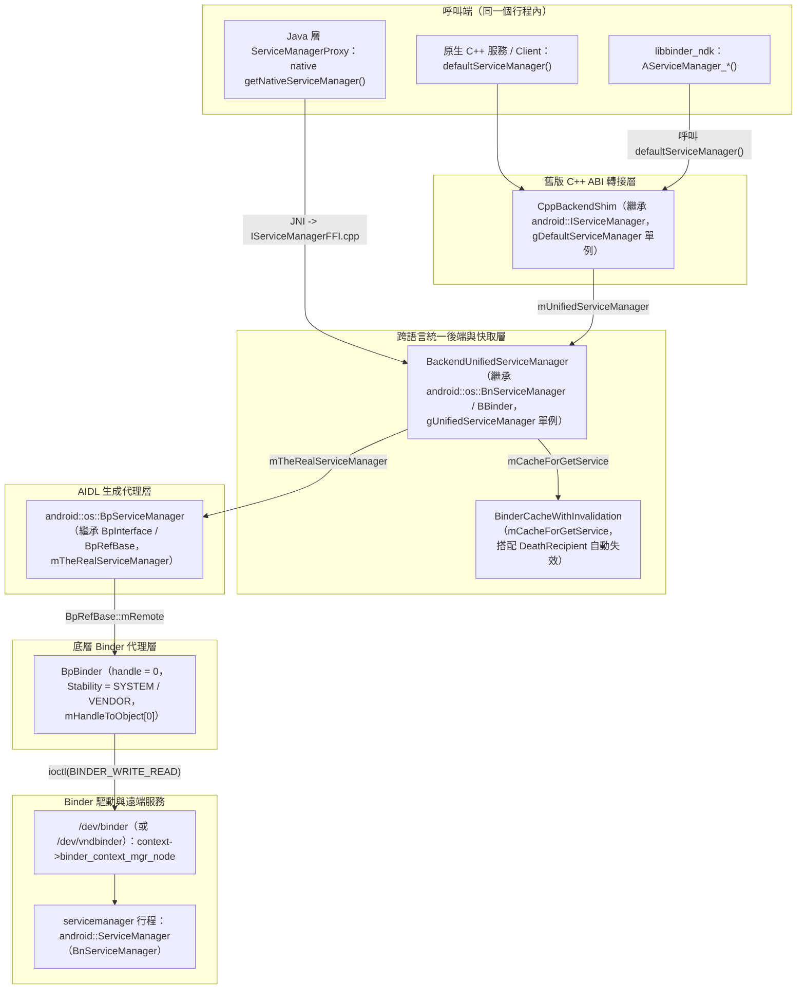
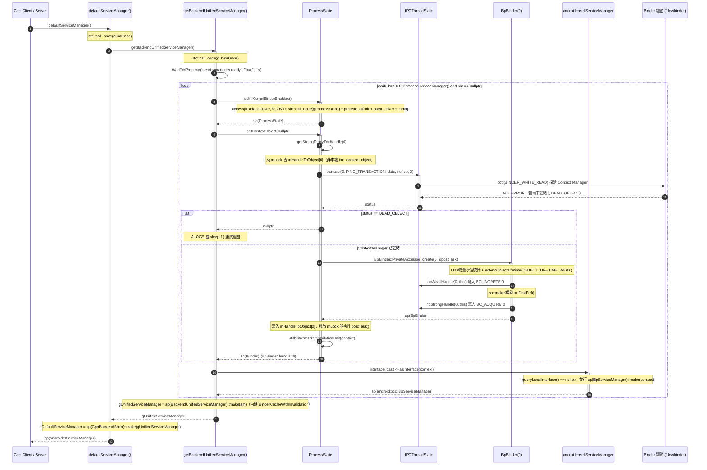

# 5.7 ServiceManager 代理物件的取得過程

- **情景說明**：一個原生 C++ 行程（例如 5.8 節的 `gpuservice` 在啟動時呼叫 `defaultServiceManager()->addService(...)`，或 Client 呼叫 `defaultServiceManager()->getService(...)`）首次呼叫 `android::defaultServiceManager()`，從零開始建立指向遠端 `servicemanager` 行程（handle `0`）的代理物件鏈。本節完整追蹤從 `defaultServiceManager()` 到 `CppBackendShim`、`BackendUnifiedServiceManager`（含 `BinderCacheWithInvalidation` 客戶端快取）、`ProcessState::getContextObject()`、`ProcessState::getStrongProxyForHandle(0)`（含 `PING_TRANSACTION` 探活）、`BpBinder::create(0)`，最終透過 `interface_cast<android::os::IServiceManager>` 封裝出 AIDL 生成的 `android::os::BpServiceManager` 之完整呼叫鏈。
- **對應原書**：第 5 章 5.7 節〈Service Manager 代理对象的获取过程〉（p.246–252）
- **涉及專案與版本基準**：
  - `platform/frameworks/native` 〔`android-17.0.0_r1`，commit `ae266dc`〕
  - `platform/system/tools/aidl` 〔`android-17.0.0_r1`，commit `9a94664`〕（對照 AIDL 產生 `android::os::BpServiceManager` 與 `asInterface`）
  - `platform/frameworks/base` 〔`android-17.0.0_r1`，commit `94b4c16`〕（對照 Java 層透過 JNI 共用同一份 `BackendUnifiedServiceManager`）

---

## 5.7.1 物件分層架構與 `IServiceManager` 介面演進

> 對應原書 5.7（p.246–247，圖 5-21）。原書 Android 2.3 的 ServiceManager 代理只有薄薄一層：`defaultServiceManager()` 直接把 handle `0` 的 `BpBinder` 包裝成手寫的 `BpServiceManager` 並回傳。Android 17 則因「協定全面改用 AIDL」「導入客戶端服務快取（`BinderCacheWithInvalidation`）」「C++ / NDK / Java 三端共用同一套後端」以及「支援 RPC / UDS ServiceManager」等需求，演化為清晰的**三層封裝架構**。



這張分層圖揭示了 Android 17 的三個設計核心：
1. **向後相容與現代協定的解耦**：公開標頭 `include/binder/IServiceManager.h` 中的 `android::IServiceManager` 維持原有 C++ 介面（`String16`、`Vector<String16>`、`status_t`），避免破壞龐大的既有 C++ 呼叫端；真正的跨行程協定則由 `aidl/android/os/IServiceManager.aidl` 定義，由 `CppBackendShim` 負責在兩者間轉換型別。
2. **行程內統一快取與跨語言複用**：`BackendUnifiedServiceManager` 繼承自 `android::os::BnServiceManager`（因此本身同時是 `android::os::IServiceManager` 與本機 `BBinder`），在行程內以單例持有 `BinderCacheWithInvalidation`。無論是 C++、NDK 還是 Java 透過 JNI 查詢服務，全都會經過同一個快取與遠端通道。
3. **不再「零驅動互動」**：原書 p.246 指出「由於 Service Manager 的句柄值恆為 0，取得代理的過程省去了與 Binder 驅動程式互動的過程」。在 Android 17 中，為了防止 `servicemanager` 尚未完成 `BINDER_SET_CONTEXT_MGR_EXT` 時就建立出無效的 handle `0` 代理，除了等待 `servicemanager.ready` 系統屬性，還在 `getStrongProxyForHandle(0)` 內主動向驅動發送一次 `IBinder::PING_TRANSACTION` 探活。

### Step 1：舊版 C++ 介面 `android::IServiceManager` 與 AIDL 介面 `android::os::IServiceManager`
**位置**：
- `platform/frameworks/native/libs/binder/include/binder/IServiceManager.h` 〔`android-17.0.0_r1`，lines 36–196〕
- `platform/frameworks/native/libs/binder/aidl/android/os/IServiceManager.aidl` 〔`android-17.0.0_r1`，lines 33–192〕

先看給原生 C++ 使用者呼叫的 `android::IServiceManager`（節錄關鍵介面）：

```cpp
class LIBBINDER_EXPORTED IServiceManager : public IInterface {
public:
    // for ABI compatibility
    virtual const String16& getInterfaceDescriptor() const;

    IServiceManager();
    virtual ~IServiceManager();
...
    [[deprecated("this polls for 5s, prefer waitForService or checkService")]]
    virtual sp<IBinder> getService(const String16& name) const = 0;

    /**
     * Retrieve an existing service, non-blocking.
     */
    virtual sp<IBinder>         checkService( const String16& name) const = 0;
...
    // NOLINTNEXTLINE(google-default-arguments)
    virtual status_t addService(const String16& name, const sp<IBinder>& service,
                                bool allowIsolated = false,
                                int dumpsysFlags = DUMP_FLAG_PRIORITY_DEFAULT) = 0;

    /**
     * Return list of all existing services.
     */
    // NOLINTNEXTLINE(google-default-arguments)
    virtual Vector<String16> listServices(int dumpsysFlags = DUMP_FLAG_PRIORITY_ALL) = 0;

    /**
     * Efficiently wait for a service.
     *
     * Returns nullptr only for permission problem or fatal error.
     */
    virtual sp<IBinder> waitForService(const String16& name) = 0;
...
    virtual bool isDeclared(const String16& name) = 0;
...
    virtual status_t registerForNotifications(const String16& name,
                                              const sp<LocalRegistrationCallback>& callback) = 0;
...
    virtual void enableAddServiceCache(bool value) = 0;
...
    virtual bool checkServiceAccess(const String16& callererSid, pid_t callererDebugPid,
                                    uid_t callererUid, const String16& name,
                                    const String16& permission) = 0;
};

LIBBINDER_EXPORTED sp<IServiceManager> defaultServiceManager();
...
LIBBINDER_EXPORTED void setDefaultServiceManager(const sp<IServiceManager>& sm);
```

注意類別註解 `IInterface is only for legacy ABI compatibility`：`android::IServiceManager` 已經**沒有** `DECLARE_META_INTERFACE(ServiceManager)`，也沒有手寫的 `BpServiceManager`。真正定義跨行程 Binder 交易碼與序列化格式的是 `IServiceManager.aidl`：

```aidl
interface IServiceManager {
...
    const int FLAG_IS_LAZY_SERVICE = 1 << 30;
...
    @UnsupportedAppUsage
    @nullable IBinder getService(@utf8InCpp String name);
...
    Service getService2(@utf8InCpp String name);
...
    @UnsupportedAppUsage
    @nullable IBinder checkService(@utf8InCpp String name);
...
    Service checkService2(@utf8InCpp String name);

    /**
     * Place a new @a service called @a name into the service
     * manager.
     */
    void addService(@utf8InCpp String name, IBinder service,
        boolean allowIsolated, int dumpPriority);

    /**
     * Return a list of all currently running services.
     */
    @utf8InCpp String[] listServices(int dumpPriority);

    /**
     * Request a callback when a service is registered.
     */
    void registerForNotifications(@utf8InCpp String name, IServiceCallback callback);

    /**
     * Unregisters all requests for notifications for a specific callback.
     */
    void unregisterForNotifications(@utf8InCpp String name, IServiceCallback callback);
...
    boolean isDeclared(@utf8InCpp String name);
...
    void registerClientCallback(@utf8InCpp String name, IBinder service, IClientCallback callback);

    /**
     * Attempt to unregister and remove a service. Will fail if the service is still in use.
     */
    void tryUnregisterService(@utf8InCpp String name, IBinder service);
...
    boolean checkServiceAccess(in CallerContext callerCtx, @utf8InCpp String name, @utf8InCpp String permission);
}
```

重點解析：
1. **兩個同名的 `IServiceManager` 位於不同命名空間**：
   - `android::IServiceManager`（手寫 C++ 抽象類別，位於 `include/binder/IServiceManager.h`）是給 `defaultServiceManager()` 回傳的介面；
   - `android::os::IServiceManager`（AIDL 編譯器從 `IServiceManager.aidl` 產生，在 `IServiceManager.cpp` 中以別名 `AidlServiceManager` 稱呼）才是真正決定線上（wire）協定的介面。
2. **`getService` 已標註 `[[deprecated]]`**：舊版 `getService()` 會每 100ms／1s 輪詢最多 5 秒，現代程式改用事件驅動的 `waitForService()`（向 `servicemanager` 註冊 `IServiceCallback`），而底層查詢則改走 `getService2()` / `checkService2()`，回傳 `union Service`（包含 `ServiceWithMetadata`：`service` + `isLazyService`，或用於跨 VM / Socket RPC 服務的 `accessor`）。

> 〔與 2.3 差異〕**邏輯改變 + 搬家**：原書 `frameworks/base/include/binder/IServiceManager.h` 僅定義 `getService`/`checkService`/`addService`/`listServices` 四個方法，並以 `DECLARE_META_INTERFACE` / 手寫 `BpServiceManager` 打包 `Parcel`（原書 p.246、p.251）。Android 17 遷入 `frameworks/native/libs/binder/`，將真實 IPC 介面抽至 `aidl/android/os/IServiceManager.aidl`，大幅擴充至 17 個方法（涵蓋 VINTF 宣告查詢、Lazy Service、非同步註冊通知、`ServiceWithMetadata` 與委派權限檢查），原 C++ `android::IServiceManager` 退居為 ABI 相容門面。

---

## 5.7.2 從 `defaultServiceManager()` 到 `BackendUnifiedServiceManager`

### Step 2：呼叫入口 `defaultServiceManager()` 與 `CppBackendShim` 轉接層
**位置**：`platform/frameworks/native/libs/binder/IServiceManager.cpp` 〔`android-17.0.0_r1`，lines 70–166、198–199、333–352、580–581〕

以 5.8 節 `gpuservice` 啟動為例（`platform/frameworks/native/services/gpuservice/main_gpuservice.cpp`，line 30）：

```cpp
    sp<IServiceManager> sm(defaultServiceManager());
```

呼叫進入 `IServiceManager.cpp` 的 `defaultServiceManager()`：

```cpp
using AidlServiceManager = android::os::IServiceManager;
...
// From the old libbinder IServiceManager interface to IServiceManager.
class CppBackendShim : public IServiceManager {
public:
    explicit CppBackendShim(const sp<BackendUnifiedServiceManager>& impl);

    sp<IBinder> getService(const String16& name) const override;
    sp<IBinder> checkService(const String16& name) const override;
    status_t addService(const String16& name, const sp<IBinder>& service,
                        bool allowIsolated, int dumpsysPriority) override;
...
    // for legacy ABI
    const String16& getInterfaceDescriptor() const override {
        return mUnifiedServiceManager->getInterfaceDescriptor();
    }
    IBinder* onAsBinder() override { return IInterface::asBinder(mUnifiedServiceManager).get(); }
...
protected:
    sp<BackendUnifiedServiceManager> mUnifiedServiceManager;
...
};
...
[[clang::no_destroy]] static std::once_flag gSmOnce;
[[clang::no_destroy]] static sp<IServiceManager> gDefaultServiceManager;
...
sp<IServiceManager> defaultServiceManager()
{
    std::call_once(gSmOnce, []() {
        gDefaultServiceManager = sp<CppBackendShim>::make(getBackendUnifiedServiceManager());
    });

    return gDefaultServiceManager;
}

void setDefaultServiceManager(const sp<IServiceManager>& sm) {
    bool called = false;
    std::call_once(gSmOnce, [&]() {
        gDefaultServiceManager = sm;
        called = true;
    });

    if (!called) {
        LOG_ALWAYS_FATAL("setDefaultServiceManager() called after defaultServiceManager().");
    }
}
...
CppBackendShim::CppBackendShim(const sp<BackendUnifiedServiceManager>& impl)
      : mUnifiedServiceManager(impl) {}
```

解說：
1. **`std::call_once` + `[[clang::no_destroy]]` 取代原書手寫雙重檢查鎖**：
   - 原書（p.247）把 `gDefaultServiceManager` 與 `gDefaultServiceManagerLock` 放在 `Static.cpp`，並在 `defaultServiceManager()` 中做不帶原子記憶體序的 `if (gDefaultServiceManager != NULL)` 雙重檢查；在弱記憶體序架構（如 ARM64）上這屬於未定義行為（data race）。
   - Android 17 將全域狀態收回 `IServiceManager.cpp` 作為檔案內部靜態變數（現今 `Static.cpp` 僅保留 `aout`/`aerr` 文字輸出流），改用 C++11 標準的 `std::call_once(gSmOnce, ...)` 保證行程內僅初始化一次且對所有執行緒具備 acquire-release 同步語意；加上 `[[clang::no_destroy]]` 避免行程退出時因靜態物件解構順序不確定而引發 use-after-free。
2. **`setDefaultServiceManager()` 注入點**：共用同一個 `gSmOnce`，允許單元測試或 host 端（透過 `createRpcDelegateServiceManager` 經 adb 代理裝置端 ServiceManager）在首次呼叫 `defaultServiceManager()` 之前替換預設實作；若順序顛倒則立刻 `LOG_ALWAYS_FATAL` 中止。
3. **`CppBackendShim` 的職責**：
   - 僅儲存一個 `sp<BackendUnifiedServiceManager> mUnifiedServiceManager`（以及 `registerForNotifications` 用的本地回呼表）。
   - 覆寫 `onAsBinder()` 轉回 `mUnifiedServiceManager` 的底層 `IBinder*`，因此即便舊程式對 `defaultServiceManager()` 呼叫 `IInterface::asBinder()`（例如 `LazyServiceRegistrar.cpp` 會做 `interface_cast<AidlServiceManager>(asBinder(defaultServiceManager()))`），也能直接拿到 `BackendUnifiedServiceManager`！
   - 執行 `CppBackendShim::addService` / `checkService` / `getService` 時，負責將 `String16` 轉為 UTF-8 `std::string`、解包 `ServiceWithMetadata` 或抽取 `Status::exceptionCode()`。

> 〔與 2.3 差異〕**邏輯改變**：原書 `defaultServiceManager()` 直接執行 `interface_cast<IServiceManager>(ProcessState::self()->getContextObject(NULL))` 並將單例放在 `Static.cpp` 以 `Mutex` 雙重檢查保護（原書 p.247）。Android 17 改以 `std::call_once` 與 `[[clang::no_destroy]]` 實作執行緒安全單例，並插入 `CppBackendShim` 轉接層委託給 `getBackendUnifiedServiceManager()`。

---

### Step 3：跨語言統一後端 `getBackendUnifiedServiceManager()` 與啟動等待重試迴圈
**位置**：
- `platform/frameworks/native/libs/binder/BackendUnifiedServiceManager.cpp` 〔`android-17.0.0_r1`，lines 481–549〕
- `platform/frameworks/native/libs/binder/IServiceManagerFFI.cpp` 〔`android-17.0.0_r1`，lines 23–29〕
- `platform/frameworks/native/libs/binder/ndk/service_manager.cpp` 〔`android-17.0.0_r1`，lines 34–42〕
- `platform/frameworks/base/core/jni/android_os_ServiceManagerNative.cpp` 〔`android-17.0.0_r1`，lines 23–28〕

`defaultServiceManager()` 的 lambda 內部呼叫 `getBackendUnifiedServiceManager()`：

```cpp
[[clang::no_destroy]] static std::once_flag gUSmOnce;
[[clang::no_destroy]] static sp<BackendUnifiedServiceManager> gUnifiedServiceManager;

static bool hasOutOfProcessServiceManager() {
// We don't currently support kernel binder service management or UDS
// service management on host or when libbinder is compiled without any
// kernel binder suport. Please use setDefaultServiceManager for host
// processes that want to use service manager APIs.
#if !defined(BINDER_WITH_KERNEL_IPC) || !defined(__BIONIC__)
    return false;
#else
#ifdef __ANDROID_VNDK__
    return true;
#else
    return android::base::GetBoolProperty("servicemanager.installed", true);
#endif
#endif
}

static sp<AidlServiceManager> getUdsServiceManager() {
    auto session = RpcSession::make();
    session->setFileDescriptorTransportMode(RpcSession::FileDescriptorTransportMode::UNIX);
    auto status = session->setupUnixDomainClient(kUdsServiceManagerName);
    if (status == OK) {
        return interface_cast<AidlServiceManager>(session->getRootObject());
    }
    return nullptr;
}

sp<BackendUnifiedServiceManager> getBackendUnifiedServiceManager() {
    std::call_once(gUSmOnce, []() {
#if defined(__BIONIC__) && !defined(__ANDROID_VNDK__)
        /* wait for service manager */
        if (hasOutOfProcessServiceManager()) {
            using std::literals::chrono_literals::operator""s;
            using android::base::WaitForProperty;
            while (!WaitForProperty("servicemanager.ready", "true", 1s)) {
                ALOGE("Waited for servicemanager.ready for a second, waiting another...");
            }
        }
#endif

        sp<AidlServiceManager> sm = nullptr;
        while (hasOutOfProcessServiceManager() && sm == nullptr) {
            // There is either a kernel binder service manager, or an RPC binder
            // service manager
            sp<ProcessState> ps = ProcessState::selfIfKernelBinderEnabled();
            if (ps) {
                // Service management over kernel binder
                sm = interface_cast<AidlServiceManager>(ps->getContextObject(nullptr));
            } else {
                // Check for service management over Unix Domain Sockets
                sm = getUdsServiceManager();
            }

            if (sm == nullptr) {
                std::string contextObjectName = ps
                        ? ps->getDriverName() + ", " + kUdsServiceManagerName
                        : kUdsServiceManagerName;
                ALOGE("Waiting 1s on context object(s) on %s.", contextObjectName.c_str());
                sleep(1);
            }
        }

        gUnifiedServiceManager = sp<BackendUnifiedServiceManager>::make(sm);
    });

    return gUnifiedServiceManager;
}
```

這段程式碼是 Android 17 ServiceManager 代理建立過程的心臟，細節如下：
1. **確認是否存在外部 ServiceManager 行程（`hasOutOfProcessServiceManager()`）**：
   - 在 host 端或無核心 Binder 支援的編譯組態下回傳 `false`，此時 `gUnifiedServiceManager` 仍會被建立，只是內部的 `mTheRealServiceManager` 為 `nullptr`（可純粹搭配本地注入的 RPC `AccessorProvider` 使用，但呼叫 `addService` 等需要真 `servicemanager` 的方法會回傳 `EX_UNSUPPORTED_OPERATION`）。
   - 在一般 Android 系統行程中檢查系統屬性 `servicemanager.installed`（預設 `true`）；在 VNDK（vendor）行程中因受限無法讀寫 system 屬性，直接回傳 `true`。
2. **第一道啟動同步：`WaitForProperty("servicemanager.ready", "true", 1s)`**：
   - 呼應 5.6 節 `cmds/servicemanager/main.cpp` 在完成 `becomeContextManager()` 與 `BinderCallback::setupTo()` 後設定的 `servicemanager.ready=true`。開機早期若其他系統服務搶先呼叫 `defaultServiceManager()`，會先在這裡以 1 秒為單位等待，避免無謂地反覆發送失敗的 Binder 交易。
3. **第二道重試迴圈：`while (hasOutOfProcessServiceManager() && sm == nullptr)`**：
   - 呼叫 `ProcessState::selfIfKernelBinderEnabled()`：若核心 Binder 裝置（`/dev/binder` 或 `/dev/vndbinder`）可存取，就走標準路徑 `interface_cast<AidlServiceManager>(ps->getContextObject(nullptr))`。
   - 若環境沒有核心 Binder 裝置節點（例如僅啟用 Socket RPC Binder 的微型環境或特定 VM），則走 `getUdsServiceManager()`，連線至 `/dev/socket/rpc_servicemanager` 取得 RPC session 的根物件。
   - **為何在 `servicemanager.ready` 已經為 `true` 後仍需要 `sleep(1)` 重試迴圈？** 一是 VNDK 行程沒有走 `WaitForProperty` 分支（且對應的是 `vndservicemanager`）；二是若 `servicemanager` 行程剛崩潰並由 `init` 重啟，在重新呼叫 `BINDER_SET_CONTEXT_MGR_EXT` 之前的短暫空窗期內，`ps->getContextObject(nullptr)` 內部的 `PING_TRANSACTION` 會收到 `DEAD_OBJECT` 而回傳 `nullptr`，於是本迴圈就會印出錯誤日誌並 `sleep(1)` 持續重試，直到取得有效的 `sm` 為止。
4. **C++ / NDK / Java 三端共用同一個單例**：
   - **NDK 層**（`libs/binder/ndk/service_manager.cpp`）：所有 `AServiceManager_*` API 皆直接呼叫 `defaultServiceManager()`，經由 `CppBackendShim` 進入同一個 `gUnifiedServiceManager`：

```cpp
binder_exception_t AServiceManager_addService(AIBinder* binder, const char* instance) {
    if (binder == nullptr || instance == nullptr) {
        return EX_ILLEGAL_ARGUMENT;
    }

    sp<IServiceManager> sm = defaultServiceManager();
    status_t exception = sm->addService(String16(instance), binder->getBinder());
    return PruneException(exception);
}
```

   - **Java 層**（`frameworks/base/core/jni/android_os_ServiceManagerNative.cpp` → `libs/binder/IServiceManagerFFI.cpp`）：Java 端 `ServiceManagerProxy` 在建構時呼叫 JNI 方法 `getNativeServiceManager()`，透過 FFI 函式直接取得同一個 `gUnifiedServiceManager` 並轉為 Java `IBinder`（5.10.1 節將完整追蹤 Java 端細節）：

```cpp
// platform/frameworks/native/libs/binder/IServiceManagerFFI.cpp
namespace android::impl {
sp<android::os::IServiceManager>
getJavaServicemanagerImplPrivateDoNotUseExceptInTheOnePlaceItIsUsed() {
    return getBackendUnifiedServiceManager();
}

} // namespace android::impl
```

```cpp
// platform/frameworks/base/core/jni/android_os_ServiceManagerNative.cpp
jobject JNICALL Java_android_os_ServiceManagerProxy_getNativeServiceManager(JNIEnv *env,
                                                                            jobject obj) {
    sp<IBinder> service = IInterface::asBinder(
            impl::getJavaServicemanagerImplPrivateDoNotUseExceptInTheOnePlaceItIsUsed());
    return javaObjectForIBinder(env, service);
}
```

> 〔與 2.3 差異〕**新增**：原書 2.3 沒有統一後端層，C++ 的 `IServiceManager.cpp` 與 Java 的 `ServiceManagerNative.java` 各自獨立實作 proxy 與 `Parcel` 打包，且完全沒有 `servicemanager.ready` 等待或 `getContextObject()` 回傳 `NULL` 時的 `sleep(1)` 重試機制（原書 p.247–249）。Android 17 新增 `getBackendUnifiedServiceManager()` 整合啟動同步、重試、UDS 回退與 C++/NDK/Java 跨語言共用。

---

### Step 4：`BackendUnifiedServiceManager` 建構與 `BinderCacheWithInvalidation` 客戶端快取
**位置**：
- `platform/frameworks/native/libs/binder/BackendUnifiedServiceManager.h` 〔`android-17.0.0_r1`，lines 27–176〕
- `platform/frameworks/native/libs/binder/BackendUnifiedServiceManager.cpp` 〔`android-17.0.0_r1`，lines 123–197〕

在 `getBackendUnifiedServiceManager()` 的最後一行（line 545），拿到遠端 `sm`（`android::os::BpServiceManager`）後，建立 `BackendUnifiedServiceManager` 實例：

```cpp
// BackendUnifiedServiceManager.h
class BinderCacheWithInvalidation
      : public std::enable_shared_from_this<BinderCacheWithInvalidation> {
    class BinderInvalidation : public IBinder::DeathRecipient {
    public:
        BinderInvalidation(std::weak_ptr<BinderCacheWithInvalidation> cache, const std::string& key)
              : mCache(std::move(cache)), mKey(key) {}

        void binderDied(const wp<IBinder>& who) override {
            sp<IBinder> binder = who.promote();
            if (std::shared_ptr<BinderCacheWithInvalidation> cache = mCache.lock()) {
                cache->removeItem(mKey, binder);
            } else {
                ALOGI("Binder Cache pointer expired: %s", mKey.c_str());
            }
        }

    private:
        std::weak_ptr<BinderCacheWithInvalidation> mCache;
        std::string mKey;
    };
    struct Entry {
        sp<IBinder> service;
        sp<BinderInvalidation> deathRecipient;
    };

public:
    sp<IBinder> getItem(const std::string& key) const {
        std::lock_guard<std::mutex> lock(mCacheMutex);

        if (auto it = mCache.find(key); it != mCache.end()) {
            return it->second.service;
        }
        return nullptr;
    }
...
    binder::Status setItem(const std::string& key, const sp<IBinder>& item) {
        sp<BinderInvalidation> deathRecipient =
                sp<BinderInvalidation>::make(shared_from_this(), key);

        // linkToDeath if binder is a remote binder.
        if (item->localBinder() == nullptr) {
            status_t status = item->linkToDeath(deathRecipient);
            if (status != android::OK) {
...
                ALOGE("Failed to linkToDeath binder for service %s. Error: %d", key.c_str(),
                      status);
                return binder::Status::fromStatusT(status);
            }
        }
        binder::ScopedTrace aidlTrace(ATRACE_TAG_AIDL,
                                      "BinderCacheWithInvalidation::setItem Successfully Cached");
        std::lock_guard<std::mutex> lock(mCacheMutex);
        mCache[key] = {.service = item, .deathRecipient = std::move(deathRecipient)};
        return binder::Status::ok();
    }

    bool isClientSideCachingEnabled(const std::string& serviceName) const;

private:
    std::map<std::string, Entry, std::less<>> mCache;
    mutable std::mutex mCacheMutex;
};

class BackendUnifiedServiceManager : public android::os::BnServiceManager {
public:
    explicit BackendUnifiedServiceManager(const sp<os::IServiceManager>& impl);
...
private:
    const String16 mNullInterfaceDescriptor;
    bool mEnableAddServiceCache = true;
    std::shared_ptr<BinderCacheWithInvalidation> mCacheForGetService;
    sp<os::IServiceManager> mTheRealServiceManager;
...
};
```

對應的建構子與快取判斷實作位於 `BackendUnifiedServiceManager.cpp`：

```cpp
bool BinderCacheWithInvalidation::isClientSideCachingEnabled(const std::string& serviceName) const {
    sp<ProcessState> self = ProcessState::selfOrNull();
    // Should not cache if process state could not be found, or if thread pool
    // max could is not greater than zero.
    if (!self) {
        ALOGW("Service retrieved before binder threads started. If they are to be started, "
              "consider starting binder threads earlier.");
        return false;
    } else if (self->getThreadPoolMaxTotalThreadCount() <= 0) {
        ALOGW("Thread Pool max thread count is 0. Cannot cache binder as linkToDeath cannot be "
              "implemented. serviceName: %s",
              serviceName.c_str());
        return false;
    }
    return true;
}
...
bool BackendUnifiedServiceManager::returnIfCached(const std::string& serviceName,
                                                  os::Service* _out) {
    sp<IBinder> item = mCacheForGetService->getItem(serviceName);
    // TODO(b/363177618): Enable caching for binders which are always null.
    if (item != nullptr && item->isBinderAlive()) {
        *_out = createServiceWithMetadata(item, false);
        return true;
    }
    return false;
}

BackendUnifiedServiceManager::BackendUnifiedServiceManager(const sp<AidlServiceManager>& impl)
      : mTheRealServiceManager(impl) {
    mCacheForGetService = std::make_shared<BinderCacheWithInvalidation>();
}
```

這裡有兩個非常值得細品的工程設計：
1. **為何一個「Client 端代理包裝器」會繼承 `android::os::BnServiceManager`？**
   - `BnServiceManager` 是 `BnInterface<android::os::IServiceManager>`（同時繼承 `android::os::IServiceManager` 與 `BBinder`）。讓 `BackendUnifiedServiceManager` 繼承它，有兩大好處：第一，C++ 的 `CppBackendShim` 可以零成本直接透過 C++ 虛函式呼叫它；第二，Java 層透過 `IServiceManagerFFI.cpp` 拿到它的 `sp<IBinder>` 時，它本身就是合法的本機 `BBinder`，Java 端 `IServiceManager.Stub.asInterface()` 透過 `BinderProxy`（實際上是包裝本機 C++ `BBinder` 的 `BinderProxy`）呼叫 `transact()` 時，無須經過核心驅動，直接在同一個行程內進入 `BnServiceManager::onTransact()`，由 `BackendUnifiedServiceManager` 攔截處理快取，未命中時再透過 `mTheRealServiceManager` 發起真正的跨行程 IPC！
2. **`BinderCacheWithInvalidation` 的防呆條件**：
   - **自動失效**：寫入快取（`setItem`）時，只要目標是遠端代理（`item->localBinder() == nullptr`），就會對其呼叫 `linkToDeath(deathRecipient)`（5.5 節機制）。一旦遠端服務崩潰，核心投遞 `BR_DEAD_BINDER` 觸發 `BinderInvalidation::binderDied()`，立刻將失效條目從 `mCache` 移除。
   - **執行緒池前提檢查**：死亡通知回呼需要至少一條 Binder 執行緒讀取驅動才能收到；因此 `isClientSideCachingEnabled()` 檢查 `ProcessState::getThreadPoolMaxTotalThreadCount() > 0`，若行程未啟動 Binder 執行緒池（例如簡易 CLI 工具或單純的 client），就會自動停用快取，避免永久回傳已死亡服務的過期 handle。
   - **Lazy Service 豁免**：`updateCache()` 明確跳過 `isServiceLazy == true` 的服務（因為快取會持續持有對該服務的強引用，導致 Lazy Service 永遠無法在無客戶端時自動卸載；完整快取查詢與回填路徑將於 5.9 節追蹤）。

> 〔與 2.3 差異〕**新增**：原書 2.3 的 C++ 端完全沒有 ServiceManager 客戶端快取，每次 `getService()` / `checkService()` 皆必須跨行程存取 `servicemanager`。Android 17 新增 `BackendUnifiedServiceManager` + `BinderCacheWithInvalidation`，結合 `DeathRecipient` 與執行緒池狀態檢查，在 C++、NDK、Java 三層統一降低對 `servicemanager` 的 IPC 負擔。

---

## 5.7.3 取得 handle `0` 的底層 `BpBinder` 與 `ProcessState` 初始化

現在我們回到 Step 3（`BackendUnifiedServiceManager.cpp` lines 527–530）的核心 Binder 路徑，逐層往下追蹤這兩行是如何建立出 handle `0` 的 `BpBinder` 並轉型成 `android::os::BpServiceManager` 的：

```cpp
            sp<ProcessState> ps = ProcessState::selfIfKernelBinderEnabled();
            if (ps) {
                // Service management over kernel binder
                sm = interface_cast<AidlServiceManager>(ps->getContextObject(nullptr));
```

### Step 5：`ProcessState::selfIfKernelBinderEnabled()` 與 `ProcessState::init()`
**位置**：`platform/frameworks/native/libs/binder/ProcessState.cpp` 〔`android-17.0.0_r1`，lines 48–60、106–181、572–652〕

```cpp
#define BINDER_VM_SIZE ((1 * 1024 * 1024) - sysconf(_SC_PAGE_SIZE) * 2)
#define DEFAULT_MAX_BINDER_THREADS 15
#define DEFAULT_ENABLE_ONEWAY_SPAM_DETECTION 1

#if defined(__ANDROID__) || defined(__Fuchsia__)
#define EXPECT_BINDER_OPEN_SUCCESS
#endif

#ifdef __ANDROID_VNDK__
const char* kDefaultDriver = "/dev/vndbinder";
#else
const char* kDefaultDriver = "/dev/binder";
#endif
...
sp<ProcessState> ProcessState::self()
{
    return init(kDefaultDriver, false /*requireDefault*/);
}

sp<ProcessState> ProcessState::initWithDriver(const char* driver)
{
    return init(driver, true /*requireDefault*/);
}

sp<ProcessState> ProcessState::selfOrNull()
{
    return init(nullptr, false /*requireDefault*/);
}

sp<ProcessState> ProcessState::selfIfKernelBinderEnabled() {
    if (access(kDefaultDriver, R_OK) == -1) return nullptr;
    return init(kDefaultDriver, false /*requireDefault*/);
}

[[clang::no_destroy]] static sp<ProcessState> gProcess;
[[clang::no_destroy]] static std::mutex gProcessMutex;
...
sp<ProcessState> ProcessState::init(const char* driver, bool requireDefault) {
    if (driver == nullptr) {
        std::lock_guard<std::mutex> l(gProcessMutex);
        if (gProcess) {
            verifyNotForked(gProcess->mForked);
        }
        return gProcess;
    }

    [[clang::no_destroy]] static std::once_flag gProcessOnce;
    std::call_once(gProcessOnce, [&](){
        if (access(driver, R_OK) == -1) {
            ALOGE("Binder driver %s is unavailable. Using /dev/binder instead.", driver);
            driver = "/dev/binder";
        }

        if (0 == strcmp(driver, "/dev/vndbinder") && !isVndservicemanagerEnabled()) {
            ALOGE("vndservicemanager is not started on this device, you can save resources/threads "
                  "by not initializing ProcessState with /dev/vndbinder.");
        }

        // we must install these before instantiating the gProcess object,
        // otherwise this would race with creating it, and there could be the
        // possibility of an invalid gProcess object forked by another thread
        // before these are installed
        int ret = pthread_atfork(ProcessState::onFork, ProcessState::parentPostFork,
                                 ProcessState::childPostFork);
        LOG_ALWAYS_FATAL_IF(ret != 0, "pthread_atfork error %s", strerror(ret));

        std::lock_guard<std::mutex> l(gProcessMutex);
        gProcess = sp<ProcessState>::make(driver);
    });

    if (requireDefault) {
        // Detect if we are trying to initialize with a different driver, and
        // consider that an error. ProcessState will only be initialized once above.
        LOG_ALWAYS_FATAL_IF(gProcess->getDriverName() != driver,
                            "ProcessState was already initialized with %s,"
                            " can't initialize with %s.",
                            gProcess->getDriverName().c_str(), driver);
    }

    verifyNotForked(gProcess->mForked);
    return gProcess;
}
```

首次執行 `sp<ProcessState>::make(driver)` 時，建構子呼叫 `open_driver()` 開啟驅動並進行 `mmap`（驅動端對應的 `binder_open` 與 `binder_mmap` / `binder_alloc_mmap_handler` 已於 5.1.3、5.1.4 節詳述）：

```cpp
static unique_fd open_driver(const char* driver, String8* error) {
    auto fd = unique_fd(open(driver, O_RDWR | O_CLOEXEC));
    if (!fd.ok()) {
        error->appendFormat("%d (%s) Opening '%s' failed", errno, strerror(errno), driver);
        return {};
    }
    int vers = 0;
    int result = ioctl(fd.get(), BINDER_VERSION, &vers);
...
    if (result != 0 || vers != BINDER_CURRENT_PROTOCOL_VERSION) {
        error->appendFormat("Binder driver protocol(%d) does not match user space protocol(%d)! "
                            "ioctl() return value: %d",
                            vers, BINDER_CURRENT_PROTOCOL_VERSION, result);
        return {};
    }
    size_t maxThreads = DEFAULT_MAX_BINDER_THREADS;
    result = ioctl(fd.get(), BINDER_SET_MAX_THREADS, &maxThreads);
    if (result == -1) {
        ALOGE("Binder ioctl to set max threads failed: %s", strerror(errno));
    }
    uint32_t enable = DEFAULT_ENABLE_ONEWAY_SPAM_DETECTION;
    result = ioctl(fd.get(), BINDER_ENABLE_ONEWAY_SPAM_DETECTION, &enable);
...
    return fd;
}

ProcessState::ProcessState(const char* driver)
      : mDriverName(String8(driver)),
        mDriverFD(-1),
        mVMStart(MAP_FAILED),
...
        mCallRestriction(CallRestriction::NONE) {
    String8 error;
    unique_fd opened = open_driver(driver, &error);

    if (opened.ok()) {
        // mmap the binder, providing a chunk of virtual address space to receive transactions.
        mVMStart = mmap(nullptr, BINDER_VM_SIZE, PROT_READ, MAP_PRIVATE | MAP_NORESERVE,
                        opened.get(), 0);
        if (mVMStart == MAP_FAILED) {
            // *sigh*
            ALOGE("Using %s failed: unable to mmap transaction memory.", driver);
            opened.reset();
            mDriverName.clear();
        }
    }

#if defined(EXPECT_BINDER_OPEN_SUCCESS)
    LOG_ALWAYS_FATAL_IF(!opened.ok(),
                        "Binder driver '%s' could not be opened. Error: %s. Terminating.",
                        driver, error.c_str());
#else
...
#endif

    if (opened.ok()) {
        mDriverFD = opened.release();
    }
...
}
```

重點解析：
1. **多 Binder Domain 隔離**：`kDefaultDriver` 依編譯目標決定開啟 `/dev/binder`（system/framework 行程）或 `/dev/vndbinder`（vendor/VNDK 行程），各自對應核心 `binderfs` 中不同的 `binder_context`（5.1.2 節）與不同的 ServiceManager 行程（`servicemanager` vs `vndservicemanager`）。若呼叫端曾先以 `ProcessState::initWithDriver(driver)` 初始化過其他節點，後續再呼叫 `selfIfKernelBinderEnabled()` 傳入 `requireDefault = false`，則直接沿用已建立的 `gProcess`。
2. **`pthread_atfork` 防護**：在建立 `gProcess` 之前就先註冊 `onFork`/`parentPostFork`/`childPostFork`。一旦行程呼叫 `fork()`，子行程會在 `childPostFork()` 中立刻關閉繼承來的 `mDriverFD` 並標記 `mForked = true`；子行程若再試圖存取 `ProcessState`，`verifyNotForked()` 會立刻中止程式，防止父子行程共用同一個 `binder_proc` 造成核心狀態錯亂。
3. **`BINDER_VM_SIZE` 動態頁大小**：為了支援 16KB page size 裝置，原書硬編碼的 `4096 * 2` 已改為 `sysconf(_SC_PAGE_SIZE) * 2`（在 4KB 系統上為 `1016 KB`，在 16KB 系統上為 `992 KB`）。
4. **`open_driver()` 的現代強化**：加上 `O_CLOEXEC` 防止 `exec()` 洩漏 fd、新增 `BINDER_ENABLE_ONEWAY_SPAM_DETECTION` 偵測單向交易濫用；在 Android 裝置上（`EXPECT_BINDER_OPEN_SUCCESS`）若開啟或 `mmap` 失敗會直接 `LOG_ALWAYS_FATAL_IF` 終止行程，不再靜默留下無效的 `ProcessState`。

> 〔與 2.3 差異〕**邏輯改變**：原書 `ProcessState::self()` 無參數固定開啟 `/dev/binder`、全域變數放在 `Static.cpp`、`BINDER_VM_SIZE` 硬編碼 `4096 * 2`、且無 `fork()` 防護（原書 p.247–249）。Android 17 抽為統一的 `ProcessState::init(driver, requireDefault)` 並新增 `selfIfKernelBinderEnabled()` / `initWithDriver()`，加入 `std::call_once`、`pthread_atfork`、`O_CLOEXEC`、`sysconf(_SC_PAGE_SIZE)` 與 `BINDER_ENABLE_ONEWAY_SPAM_DETECTION`。

---

### Step 6：`ProcessState::getContextObject()` 與穩定度標記 `Stability::markCompilationUnit()`
**位置**：
- `platform/frameworks/native/libs/binder/ProcessState.cpp` 〔`android-17.0.0_r1`，lines 183–196〕
- `platform/frameworks/native/libs/binder/Stability.cpp` 〔`android-17.0.0_r1`，lines 49–52、92–103、148–156〕

取得 `ProcessState` 單例後，Step 3 呼叫 `ps->getContextObject(nullptr)`：

```cpp
// ProcessState.cpp
sp<IBinder> ProcessState::getContextObject(const sp<IBinder>& /*caller*/)
{
    sp<IBinder> context = getStrongProxyForHandle(0);

    if (context) {
        // The root object is special since we get it directly from the driver, it is never
        // written by Parcell::writeStrongBinder.
        internal::Stability::markCompilationUnit(context.get());
    } else {
        ALOGW("Not able to get context object on %s.", mDriverName.c_str());
    }

    return context;
}
```

成功拿到 `context`（handle `0` 的 `BpBinder`，或在 `servicemanager` 行程本身為 `the_context_object`）後，會立即呼叫 `internal::Stability::markCompilationUnit(context.get())`：

```cpp
// Stability.cpp
void Stability::markCompilationUnit(IBinder* binder) {
    status_t result = setRepr(binder, getLocalLevel(), REPR_LOG);
    LOG_ALWAYS_FATAL_IF(result != OK, "Should only mark known object.");
}
...
Stability::Level Stability::getLocalLevel() {
#ifdef __ANDROID_APEX__
#error "APEX can't use libbinder (must use libbinder_ndk)"
#endif

#ifdef __ANDROID_VNDK__
    return Level::VENDOR;
#else
    // TODO(b/139325195): split up stability levels for system/APEX.
    return Level::SYSTEM;
#endif
}
...
    BBinder* local = binder->localBinder();
    if (local != nullptr) {
        local->setStability(setting);
    } else {
        binder->remoteBinder()->mStability = setting;
    }

    return OK;
```

為何多出這一步 `markCompilationUnit`？
- Project Treble 引入 Binder Stability 機制（`Level::SYSTEM`、`Level::VENDOR`、`Level::VINTF`），防止未宣告 VINTF 穩定度的介面跨越 system 與 vendor 分區邊界（在 `Parcel::writeStrongBinder` / `Parcel::readStrongBinder` 時會附帶與驗證 stability）。
- 然而 Context Manager（handle `0`）是整個 Binder 世界中唯一的「根物件（root object）」：它並非由任何其他行程透過 `Parcel::writeStrongBinder` 傳過來，而是直接憑約定句柄 `0` 從驅動取得。因此 `BpBinder` 建立時其 `mStability` 初始值為 `0`（`Level::UNDECLARED`）。
- `getContextObject()` 在此手動補上本編譯單元的穩定度標記：系統行程開啟 `/dev/binder` 連向 `servicemanager` 標記為 `Level::SYSTEM`；vendor 行程開啟 `/dev/vndbinder` 連向 `vndservicemanager` 標記為 `Level::VENDOR`。若 `getStrongProxyForHandle(0)` 回傳 `nullptr`（驅動端尚無 Context Manager），則印出警告並回傳 `nullptr`，讓上層 Step 3 進入 `sleep(1)` 重試。

> 〔與 2.3 差異〕**邏輯改變**：原書 `getContextObject()` 先檢查 `supportsProcesses()`（`mDriverFD >= 0`），成立則直接回傳 `getStrongProxyForHandle(0)`，不成立則回退單行程模擬分支（原書 p.249）。Android 17 已移除 `supportsProcesses()` 與單行程模擬分支（`ProcessState` 建構失敗在 Android 上直接 fatal），並新增 `internal::Stability::markCompilationUnit()` 為根物件補齊穩定度等級。

---

### Step 7：`ProcessState::getStrongProxyForHandle(0)` — 本地捷徑、`PING_TRANSACTION` 探活與 handle 表查詢
**位置**：
- `platform/frameworks/native/libs/binder/include/binder/ProcessState.h` 〔`android-17.0.0_r1`，lines 181–212〕
- `platform/frameworks/native/libs/binder/ProcessState.cpp` 〔`android-17.0.0_r1`，lines 323–408〕

`ProcessState` 內部維持一張以 handle 為索引的陣列 `mHandleToObject`，將每個核心 handle 對應到行程內唯一的 `BpBinder`：

```cpp
// include/binder/ProcessState.h
    struct handle_entry {
        IBinder* binder;
        RefBase::weakref_type* refs;
    };

    handle_entry* lookupHandleLocked(int32_t handle);
...
    mutable std::mutex mLock; // protects everything below.

    Vector<handle_entry> mHandleToObject;
```

進入 `lookupHandleLocked()` 與 `getStrongProxyForHandle(0)`：

```cpp
// ProcessState.cpp
ProcessState::handle_entry* ProcessState::lookupHandleLocked(int32_t handle)
{
    const size_t N=mHandleToObject.size();
    if (N <= (size_t)handle) {
        handle_entry e;
        e.binder = nullptr;
        e.refs = nullptr;
        status_t err = mHandleToObject.insertAt(e, N, handle+1-N);
        if (err < NO_ERROR) return nullptr;
    }
    return &mHandleToObject.editItemAt(handle);
}

// see b/166779391: cannot change the VNDK interface, so access like this
extern sp<BBinder> the_context_object;

sp<IBinder> ProcessState::getStrongProxyForHandle(int32_t handle)
{
    sp<IBinder> result;
    std::function<void()> postTask;

    std::unique_lock<std::mutex> _l(mLock);

    if (handle == 0 && the_context_object != nullptr) return the_context_object;

    handle_entry* e = lookupHandleLocked(handle);

    if (e != nullptr) {
        // We need to create a new BpBinder if there isn't currently one, OR we
        // are unable to acquire a weak reference on this current one.  The
        // attemptIncWeak() is safe because we know the BpBinder destructor will always
        // call expungeHandle(), which acquires the same lock we are holding now.
        // We need to do this because there is a race condition between someone
        // releasing a reference on this BpBinder, and a new reference on its handle
        // arriving from the driver.
        IBinder* b = e->binder;
        if (b == nullptr || !e->refs->attemptIncWeak(this)) {
            if (handle == 0) {
                // Special case for context manager...
                // The context manager is the only object for which we create
                // a BpBinder proxy without already holding a reference.
                // Perform a dummy transaction to ensure the context manager
                // is registered before we create the first local reference
                // to it (which will occur when creating the BpBinder).
                // If a local reference is created for the BpBinder when the
                // context manager is not present, the driver will fail to
                // provide a reference to the context manager, but the
                // driver API does not return status.
                //
                // Note that this is not race-free if the context manager
                // dies while this code runs.

                IPCThreadState* ipc = IPCThreadState::self();

                CallRestriction originalCallRestriction = ipc->getCallRestriction();
                ipc->setCallRestriction(CallRestriction::NONE);

                Parcel data;
                status_t status = ipc->transact(
                        0, IBinder::PING_TRANSACTION, data, nullptr, 0);

                ipc->setCallRestriction(originalCallRestriction);

                if (status == DEAD_OBJECT)
                   return nullptr;
            }

            sp<BpBinder> bp = BpBinder::PrivateAccessor::create(handle, &postTask);
            e->binder = bp.get();
            if (bp) e->refs = bp->getWeakRefs();
            result = bp;
        } else {
            // This little bit of nastyness is to allow us to add a primary
            // reference to the remote proxy when this team doesn't have one
            // but another team is sending the handle to us.
            result.force_set(b);
            e->refs->decWeak(this);
        }
    }

    _l.unlock();

    if (postTask) postTask();

    return result;
}
```

這段函式有四個關鍵邏輯需要徹底看懂：
1. **同行程本地捷徑（line 346）**：
   - 在 5.6 節中，`servicemanager` 啟動時呼叫過 `IPCThreadState::self()->setTheContextObject(manager)`，把自己的 `ServiceManager` 實例存進全域 `the_context_object`。如果 `servicemanager` 行程內有程式（例如 `libbinder` 內部工具）呼叫 `getContextObject()`，在此直接回傳本地 `BBinder`，不走驅動也不建 `BpBinder`。
2. **`mHandleToObject[0]` 查詢與弱引用復活判斷（lines 348–359）**：
   - 第一次查詢時 `mHandleToObject` 為空，`lookupHandleLocked(0)` 會擴充並插入 `{nullptr, nullptr}`，回傳 `&mHandleToObject[0]`。
   - 若先前已建立過 `BpBinder(0)`（`b != nullptr`），會呼叫 `e->refs->attemptIncWeak(this)` 驗證它是否尚未進入解構流程（詳見 5.4.4 節）：因為 `~BpBinder()` 必須先取得同一把 `ProcessState::mLock` 才能呼叫 `expungeHandle()`，所以持鎖期間呼叫 `attemptIncWeak()` 是完全安全的。若成功則直接以 `result.force_set(b)` 轉移所有權並扣回暫時弱引用；若 `b == nullptr` 或物件正在銷毀，就進入新建分支。
3. **`handle == 0` 專屬的 `PING_TRANSACTION` 探活（lines 360–388）**：
   - 這是 Android 17 相對於原書 2.3 最重要的修正之一。一般服務的 handle 是核心透過 `binder_translate_handle` 在行程中先建立好 `binder_ref` 並遞增引用後，才把 handle 數字交給使用者空間去建立 `BpBinder`。唯獨 Context Manager（handle `0`）是使用者空間「未先取得核心引用」就直接要求建立 `BpBinder(0)`。
   - 接下來 `BpBinder` 建構子與 `onFirstRef()` 會發送 `BC_INCREFS 0` / `BC_ACQUIRE 0`，但這兩個命令協議屬於非同步寫入緩衝區，驅動在找不到 `context->binder_context_mgr_node` 時並不會把失敗狀態同步回傳給 `BpBinder` 建構子。如果此時 `servicemanager` 還沒啟動完畢，行程就會拿到一個內部引用早已失敗的「殭屍 `BpBinder(0)`」！
   - 因此在真正建立 `BpBinder(0)` 之前，先透過 `IPCThreadState::self()->transact(0, IBinder::PING_TRANSACTION, data, nullptr, 0)` 發送一次同步 ping 交易（期間暫時將 `CallRestriction` 降為 `NONE`，避免如設定了 `FATAL_IF_NOT_ONEWAY` 的行程在探活時觸發 abort）。若驅動回傳 `DEAD_OBJECT`（表示目前沒有存活的 Context Manager），就立刻回傳 `nullptr`，交由 Step 3 的重試迴圈 `sleep(1)` 後重來。
4. **鎖外執行 `postTask()`（lines 403–405）**：
   - 呼叫 `BpBinder::PrivateAccessor::create(handle, &postTask)` 時如果觸發了 proxy 數量上限警告/限流回呼，回呼函式會被裝進 `postTask`，等 `_l.unlock()` 釋放 `ProcessState::mLock` 後才呼叫，防止回呼中再次存取 `ProcessState` 造成死鎖。

> 〔與 2.3 差異〕**邏輯改變**：原書 `getStrongProxyForHandle()` 沒有 `the_context_object` 本地捷徑、沒有 `handle == 0` 的 `PING_TRANSACTION` 探活，且直接呼叫 `new BpBinder(handle)`（原書 p.249–251）。Android 17 補上本地捷徑、先 `PING_TRANSACTION` 確認 Context Manager 存活、改由 `BpBinder::PrivateAccessor::create(handle, &postTask)` 工廠建立，並將統計回呼延後至解鎖後執行。

---

### Step 8：`BpBinder::PrivateAccessor::create(0)`、`BpBinder` 建構子與強弱引用計數初始化
**位置**：
- `platform/frameworks/native/libs/binder/include/binder/BpBinder.h` 〔`android-17.0.0_r1`，lines 148–150、183–190〕
- `platform/frameworks/native/libs/binder/BpBinder.cpp` 〔`android-17.0.0_r1`，lines 172–246、259–281、838–851〕
- `platform/frameworks/native/libs/binder/IPCThreadState.cpp` 〔`android-17.0.0_r1`，lines 998–1028〕

`ProcessState` 是 `BpBinder::PrivateAccessor` 的 friend，透過 `BpBinder::PrivateAccessor::create(0, &postTask)` 轉呼私有的 `BpBinder::create()`：

```cpp
// BpBinder.cpp
sp<BpBinder> BpBinder::create(int32_t handle, std::function<void()>* postTask) {
    if constexpr (!kEnableKernelIpc) {
        LOG_ALWAYS_FATAL("Binder kernel driver disabled at build time");
        return nullptr;
    }
    LOG_ALWAYS_FATAL_IF(postTask == nullptr, "BAD STATE");

    int32_t trackedUid = -1;
    if (sCountByUidEnabled) {
        trackedUid = IPCThreadState::self()->getCallingUid();
...
        sTrackingMap[trackedUid]++;
    }
    uint32_t numProxies = sBinderProxyCount.fetch_add(1, std::memory_order_relaxed);
    binder::os::trace_int(ATRACE_TAG_AIDL, "binder_proxies", numProxies);
    uint32_t numLastWarned = sBinderProxyCountWarned.load(std::memory_order_relaxed);
    uint32_t numNextWarn = numLastWarned + kBinderProxyCountWarnInterval;
    if (numProxies >= numNextWarn) {
        // Multiple threads can get here, make sure only one of them gets to
        // update the warn counter.
        if (sBinderProxyCountWarned.compare_exchange_strong(numLastWarned,
                                                            numNextWarn,
                                                            std::memory_order_relaxed)) {
            ALOGW("Unexpectedly many live BinderProxies: %d\n", numProxies);
        }
    }
    return sp<BpBinder>::make(BinderHandle{handle}, trackedUid);
}
```

接著 `sp<BpBinder>::make(BinderHandle{0}, trackedUid)` 執行兩段建構子，並在構造完畢、強指標 `sp<BpBinder>` 首次遞增強引用時觸發 `onFirstRef()`：

```cpp
// BpBinder.cpp
BpBinder::BpBinder(Handle&& handle)
      : mStability(0),
        mHandle(handle),
        mAlive(true),
        mObitsSent(false),
        mObituaries(nullptr),
        mDescriptorCache(kDescriptorUninit),
        mTrackedUid(-1) {
    extendObjectLifetime(OBJECT_LIFETIME_WEAK);
}

BpBinder::BpBinder(BinderHandle&& handle, int32_t trackedUid) : BpBinder(Handle(handle)) {
    if constexpr (!kEnableKernelIpc) {
        LOG_ALWAYS_FATAL("Binder kernel driver disabled at build time");
        return;
    }

    mTrackedUid = trackedUid;

    ALOGV("Creating BpBinder %p handle %d\n", this, this->binderHandle());

    IPCThreadState::self()->incWeakHandle(this->binderHandle(), this);
}
...
void BpBinder::onFirstRef() {
    if (isRpcBinder()) [[unlikely]] {
        return;
    }

    if constexpr (!kEnableKernelIpc) {
        LOG_ALWAYS_FATAL("Binder kernel driver disabled at build time");
        return;
    }

    ALOGV("onFirstRef BpBinder %p handle %d\n", this, binderHandle());
    IPCThreadState* ipc = IPCThreadState::self();
    if (ipc) ipc->incStrongHandle(binderHandle(), this);
}
```

而 `incWeakHandle(0, this)` 與 `incStrongHandle(0, this)` 在 `IPCThreadState.cpp` 中的行為如下：

```cpp
// IPCThreadState.cpp
void IPCThreadState::incStrongHandle(int32_t handle, BpBinder *proxy)
{
    LOG_REMOTEREFS("IPCThreadState::incStrongHandle(%d)\n", handle);
    mOut.writeInt32(BC_ACQUIRE);
    mOut.writeInt32(handle);
    if (!flushIfNeeded()) {
        // Create a temp reference until the driver has handled this command.
        proxy->incStrong(mProcess.get());
        mPostWriteStrongDerefs.push(proxy);
    }
}
...
void IPCThreadState::incWeakHandle(int32_t handle, BpBinder *proxy)
{
    LOG_REMOTEREFS("IPCThreadState::incWeakHandle(%d)\n", handle);
    mOut.writeInt32(BC_INCREFS);
    mOut.writeInt32(handle);
    if (!flushIfNeeded()) {
        // Create a temp reference until the driver has handled this command.
        proxy->getWeakRefs()->incWeak(mProcess.get());
        mPostWriteWeakDerefs.push(proxy->getWeakRefs());
    }
}
```

核心細節（呼應 5.4.4 節）：
1. **工廠方法與 Proxy 水位監控**：`BpBinder` 建構子已改為 `private`，強制經由 `BpBinder::create()` 建立，藉此在 `system_server` 等關鍵行程啟用 `sCountByUidEnabled` 時，能追蹤單一遠端 UID 塞過來的 proxy 數量並在達到高水位（預設 2500）時透過 `postTask` 觸發限流或告警，防止惡意 App 耗盡記憶體。
2. **雙傳輸句柄封裝**：`mHandle` 為 `std::variant<BinderHandle, RpcHandle>`，其中 `BinderHandle{0}` 代表核心 Binder 驅動的 handle `0`（而走 Step 3 `getUdsServiceManager()` 時則會建立持有 `RpcHandle{session, address}` 的 `BpBinder`）。
3. **生命週期與延遲下發引用命令**：
   - 基底建構子呼叫 `extendObjectLifetime(OBJECT_LIFETIME_WEAK)`，使 `BpBinder` 的生命週期受弱引用計數控制。
   - `BpBinder(BinderHandle&&, int32_t)` 立刻呼叫 `incWeakHandle(0, this)` 將 `(BC_INCREFS, 0)` 寫入當前執行緒的 `IPCThreadState::mOut` 緩衝區；緊接著 `sp<BpBinder>::make(...)` 把裸指標裝入 `sp<BpBinder>`，強引用由 0 變 1 觸發 `onFirstRef()`，再將 `(BC_ACQUIRE, 0)` 寫入 `mOut`。
   - 若目前不是在執行緒池內（無須立刻 flush），這兩條命令會暫存在 `mOut` 裡（並把暫時引用放進 `mPostWriteWeakDerefs` / `mPostWriteStrongDerefs` 避免物件提早釋放），等到下次呼叫 `addService()` / `getService2()` 進入 `talkWithDriver()` 時一併送進核心 `binder_thread_write`，由驅動為本行程建立 handle `0` 的 `binder_ref` 並遞增弱/強引用計數。

> 〔與 2.3 差異〕**邏輯改變**：原書直接在 `getStrongProxyForHandle()` 中 `new BpBinder(0)`，類別內僅保存一個 `const int32_t mHandle`（原書 p.249；`BpBinder` 生命週期於原書 5.4.4 p.214–219 詳述）。Android 17 改為私有建構子 + `BpBinder::create()` 工廠方法，加入每 UID Proxy 數量監控與總量 watermark 追蹤、`std::variant<BinderHandle, RpcHandle>` 統一核心與 RPC Binder，以及 `incWeakHandle`/`incStrongHandle` 搭配 `mPostWrite*Derefs` 保護尚未 flush 的代理物件。

---

## 5.7.4 `interface_cast<AidlServiceManager>` 封裝 AIDL `BpServiceManager`

### Step 9：`interface_cast<android::os::IServiceManager>` 與 AIDL 生成的 `asInterface` / `BpServiceManager`
**位置**：
- `platform/frameworks/native/libs/binder/include/binder/IInterface.h` 〔`android-17.0.0_r1`，lines 47–51、124–147〕
- `platform/system/tools/aidl/generate_cpp.cpp` 〔`android-17.0.0_r1`，lines 735–770〕

回到 Step 3 的 `BackendUnifiedServiceManager.cpp` line 530：

```cpp
sm = interface_cast<AidlServiceManager>(ps->getContextObject(nullptr));
```

`interface_cast` 定義在 `include/binder/IInterface.h`：

```cpp
template<typename INTERFACE>
inline sp<INTERFACE> interface_cast(const sp<IBinder>& obj)
{
    return INTERFACE::asInterface(obj);
}
```

此處模板參數 `INTERFACE` 是 `AidlServiceManager`（即 `android::os::IServiceManager`），因此會呼叫 `android::os::IServiceManager::asInterface(obj)`。

這個 `asInterface()` 與 `BpServiceManager` 類別都**不再手寫於 `IServiceManager.cpp`**，而是由 `aidl` 編譯器（`system/tools/aidl/generate_cpp.cpp`）根據 `IServiceManager.aidl` 在編譯期自動產生：

```cpp
// platform/system/tools/aidl/generate_cpp.cpp
void GenerateInterfaceSource(CodeWriter& out, const AidlInterface& interface,
                             const AidlTypenames& typenames, const Options&) {
  out << "#include <" << HeaderFile(interface, ClassNames::RAW, false) << ">\n";
  out << "#include <" << HeaderFile(interface, ClassNames::CLIENT, false) << ">\n";

  EnterNamespace(out, interface);

  if (auto parent = interface.GetParentType(); parent) {
    out << std::format("DO_NOT_DIRECTLY_USE_ME_IMPLEMENT_META_NESTED_INTERFACE({}, {}, \"{}\")\n",
                       GetQualifiedName(*parent, ClassNames::MAYBE_INTERFACE),
                       ClassName(interface, ClassNames::BASE), interface.GetDescriptor());
  } else {
    out << std::format("DO_NOT_DIRECTLY_USE_ME_IMPLEMENT_META_INTERFACE({}, \"{}\")\n",
                       ClassName(interface, ClassNames::BASE), interface.GetDescriptor());
  }

  GenerateConstantDefinitions(out, interface, typenames, /*template_decl=*/"",
                              ClassName(interface, ClassNames::INTERFACE));

  LeaveNamespace(out, interface);
}

void GenerateClientClassDecl(CodeWriter& out, const AidlInterface& interface,
                             const AidlTypenames& typenames, const Options& options) {
  const string bp_name = ClassName(interface, ClassNames::CLIENT);
  const string iface = ClassName(interface, ClassNames::INTERFACE);

  out << "class LIBBINDER_EXPORTED";
  GenerateDeprecated(out, interface);
  out << " " << bp_name << " : public ::android::BpInterface<" << iface << "> {\n";
  out << "public:\n";
  out.Indent();
  out << "explicit " << bp_name << "(const ::android::sp<::android::IBinder>& " << kImplVarName
      << ");\n";
  out << "virtual ~" << bp_name << "() = default;\n";
```

對 `android.os.IServiceManager` 而言，`GenerateInterfaceSource` 會在 `namespace android::os` 裡輸出 `DO_NOT_DIRECTLY_USE_ME_IMPLEMENT_META_INTERFACE(ServiceManager, "android.os.IServiceManager")`（之所以使用 `DO_NOT_DIRECTLY_USE_ME_*` 巨集，是因為 5.2 節提過的 `IMPLEMENT_META_INTERFACE` 加上了手寫白名單 `static_assert`，AIDL 產碼則直接展開內部巨集）。該巨集在 `include/binder/IInterface.h` 的定義如下：

```cpp
// Macro to be used by both IMPLEMENT_META_INTERFACE and IMPLEMENT_META_NESTED_INTERFACE
#define DO_NOT_DIRECTLY_USE_ME_IMPLEMENT_META_INTERFACE0(ITYPE, INAME, BPTYPE)              \
    const ::android::String16& ITYPE::getInterfaceDescriptor() const {                      \
        return ITYPE::descriptor;                                                           \
    }                                                                                       \
    ::android::sp<ITYPE> ITYPE::asInterface(const ::android::sp<::android::IBinder>& obj) { \
        ::android::sp<ITYPE> intr;                                                          \
        if (obj != nullptr) {                                                               \
            intr = ::android::sp<ITYPE>::cast(obj->queryLocalInterface(ITYPE::descriptor)); \
            if (intr == nullptr) {                                                          \
                intr = ::android::sp<BPTYPE>::make(obj);                                    \
            }                                                                               \
        }                                                                                   \
        return intr;                                                                        \
    }                                                                                       \
    ITYPE::INAME() {}                                                                       \
    ITYPE::~INAME() {}

// Macro for an interface type.
#define DO_NOT_DIRECTLY_USE_ME_IMPLEMENT_META_INTERFACE(INTERFACE, NAME)                          \
    [[clang::no_destroy]] const ::android::StaticString16 I##INTERFACE##_descriptor_static_str16( \
            __IINTF_CONCAT(u, NAME));                                                             \
    [[clang::no_destroy]] const ::android::String16 I##INTERFACE::descriptor(                     \
            I##INTERFACE##_descriptor_static_str16);                                              \
    DO_NOT_DIRECTLY_USE_ME_IMPLEMENT_META_INTERFACE0(I##INTERFACE, I##INTERFACE, Bp##INTERFACE)
```

執行流程一目了然：
1. 若 `obj` 是來自其他行程的遠端代理 `BpBinder(0)`：
   - `obj->queryLocalInterface(IServiceManager::descriptor)` 呼叫基底 `IBinder::queryLocalInterface()`，固定回傳 `nullptr`。
   - 接著執行 `sp<android::os::BpServiceManager>::make(obj)`：透過 `BpInterface<android::os::IServiceManager>` → `BpRefBase(obj)` 將 `BpBinder(0)` 存入 `mRemote`（同時增加該 `BpBinder` 的強/弱引用計數）。
   - 回傳 `sp<android::os::IServiceManager>` 給 `getBackendUnifiedServiceManager()` 中的 `sm`。
2. （補充情境）若是在 `servicemanager` 自己行程內部呼叫：
   - Step 7 已經直接回傳本地 `BBinder`（`the_context_object`，其實際型別是繼承 `android::os::BnServiceManager` 的 `ServiceManager`）。
   - `obj->queryLocalInterface(IServiceManager::descriptor)` 命中 `BnInterface::queryLocalInterface()`，直接回傳本地 `ServiceManager` 物件本身，完全不會包成 `BpServiceManager`！
3. **最終組裝完成**：
   - `getBackendUnifiedServiceManager()` 建立 `gUnifiedServiceManager = sp<BackendUnifiedServiceManager>::make(sm)`（把 `BpServiceManager` 存進 `mTheRealServiceManager`，並初始化 `BinderCacheWithInvalidation`）。
   - `defaultServiceManager()` 建立 `gDefaultServiceManager = sp<CppBackendShim>::make(gUnifiedServiceManager)` 並回傳給呼叫端。

至此，呼叫端手上的 `sp<android::IServiceManager>` 已經完整串接起：
`CppBackendShim` → `BackendUnifiedServiceManager`（+ `BinderCacheWithInvalidation`）→ `android::os::BpServiceManager` → `BpBinder(handle=0)`。下一節（5.8 節）將沿著這組代理物件，追蹤原生服務 `GpuService` 呼叫 `sm->addService(...)` 的完整跨行程註冊過程。

> 〔與 2.3 差異〕**邏輯改變**：`interface_cast<T>` 的模板外殼與 `asInterface()` 先查 `queryLocalInterface()` 再建立 `Bp*` 的核心模式與原書一致（原書 p.251–252），但目標型別由手寫的 `android::BpServiceManager`（以 `IMPLEMENT_META_INTERFACE` 展開並使用 `new BpServiceManager(obj)`）改為 AIDL 編譯器產生的 `android::os::BpServiceManager`（展開 `DO_NOT_DIRECTLY_USE_ME_IMPLEMENT_META_INTERFACE`，使用 `sp<BPTYPE>::make(obj)` 與 `[[clang::no_destroy]]` 靜態描述符），且外層多出 `BackendUnifiedServiceManager` 與 `CppBackendShim` 兩層封裝。

---

## 整節呼叫鏈總結



### 原書（Android 2.3）與 Android 17 核心差異對照

| 面向 | 原書 Android 2.3（p.246–252） | Android 17（`android-17.0.0_r1`） |
|---|---|---|
| 代理物件層級 | 單層：`BpServiceManager` → `BpBinder(0)` | 三層：`CppBackendShim` → `BackendUnifiedServiceManager`（含快取）→ AIDL `android::os::BpServiceManager` → `BpBinder(0)` |
| 介面定義方式 | 手寫 `android::IServiceManager` + `BpServiceManager`（4 個方法） | `aidl/android/os/IServiceManager.aidl` 自動產生 `android::os::BpServiceManager`（17 個方法）；舊 C++ `android::IServiceManager` 僅保留 ABI 相容 |
| 單例執行緒安全 | `Static.cpp` 全域 `Mutex` + 不安全雙重檢查鎖 | 檔案內部 `[[clang::no_destroy]]` + `std::call_once`（`gSmOnce`、`gUSmOnce`、`gProcessOnce`） |
| 啟動同步與容錯 | 無等待、無重試，假設 `BpBinder(0)` 建立不需與驅動互動 | 先等 `servicemanager.ready=true`；`getStrongProxyForHandle(0)` 以 `PING_TRANSACTION` 探活；失敗回傳 `nullptr` 並 `sleep(1)` 重試 |
| 客戶端快取與跨語言共用 | C++ 無快取；Java `ServiceManagerProxy` 另行手寫打包 | C++、NDK、Java 共用同一個 `BackendUnifiedServiceManager` 與 `BinderCacheWithInvalidation`（搭配 `DeathRecipient` 自動失效） |
| `ProcessState` 初始化 | 固定 `/dev/binder`、`4096 * 2`、無 `fork()` 防護 | 支援 `/dev/binder` 與 `/dev/vndbinder`、`sysconf(_SC_PAGE_SIZE) * 2`、`O_CLOEXEC`、`pthread_atfork` 防護、UDS RPC 回退 |
| 根物件穩定度與代理工廠 | 無 Stability 概念；直接 `new BpBinder(0)` | `getContextObject()` 補標 `Stability::markCompilationUnit()`；私有建構子改由 `BpBinder::PrivateAccessor::create()` 納入水位追蹤 |
