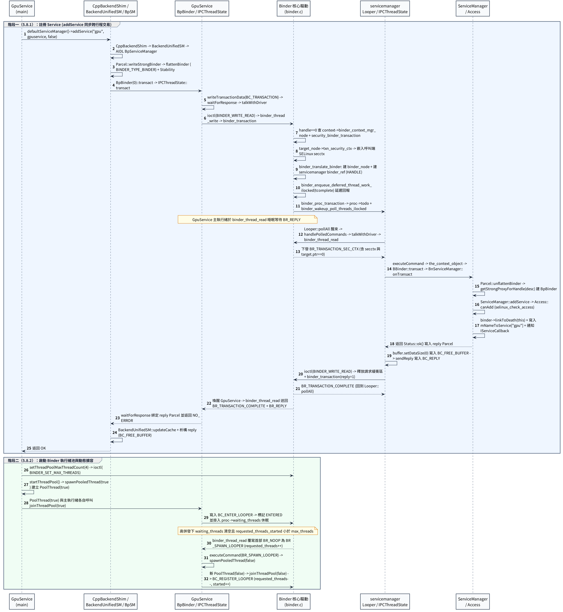

# 5.8 Service 組件的啟動過程

- **情景說明**：以 Android 17 真實系統原生服務 `GpuService`（`main_gpuservice.cpp`）的啟動為情景，追蹤一個原生 Service 行程啟動時的兩個核心階段：
  1. **註冊 Service**（5.8.1）：呼叫 `defaultServiceManager()->addService()`，貫通 Client 端 `CppBackendShim` → `BackendUnifiedServiceManager` → AIDL `BpServiceManager` → `Parcel::writeStrongBinder` / `BpBinder::transact` / `IPCThreadState::transact`，進入核心驅動 `binder_transaction`（查找 `context->binder_context_mgr_node`、呼叫 `binder_translate_binder` 建立 `binder_node` 與 `binder_ref`、附加 SELinux `security_ctx`、喚醒以 `epoll` 休眠的 `servicemanager`），再由 `servicemanager` 的 `Looper` → `handlePolledCommands` → `executeCommand(BR_TRANSACTION_SEC_CTX)` → `ServiceManager::addService`（含 `Access::canAdd` SELinux 權限檢查、`mNameToService` 登記、`linkToDeath` 與 `IServiceCallback` 通知）處理後，經 `BC_REPLY` → 核心送回 → Client `BR_REPLY` 完成整個跨行程同步交易；
  2. **啟動 Binder 執行緒池**（5.8.2）：追蹤 `setThreadPoolMaxThreadCount(4)` → `startThreadPool()` → `spawnPooledThread(true)` → `PoolThread::threadLoop()` → `joinThreadPool(true)`（`BC_ENTER_LOOPER`）與主執行緒 `giveThreadPoolName()` / `joinThreadPool()`，並深入核心 `binder_thread_read` 在空閒執行緒耗盡時動態下發 `BR_SPAWN_LOOPER` → `spawnPooledThread(false)` → `BC_REGISTER_LOOPER` 的執行緒池自動擴容閉環。
- **對應原書**：第 5 章 5.8 節〈Service 组件的启动过程〉（p.252–299）
- **涉及專案與版本基準**：
  - `platform/frameworks/native` 〔`android-17.0.0_r1`，commit `ae266dc`〕
  - `kernel/common` 〔`android17-6.18`，commit `1e0de07`〕

---

## 5.8.1 註冊 Service

> 對應原書 5.8.1（p.253–296）。原書將 `addService` 拆解為「封裝通訊資料 → 發送與處理 `BC_TRANSACTION` → 發送與處理 `BR_TRANSACTION` → 發送與處理 `BC_REPLY` → 發送與處理 `BR_REPLY`」五個階段，作為全章第一次完整貫通一次同步 Binder IPC 來回的示範。Android 17 仍維持這套五段式通訊骨架，但 Client 端多了 `CppBackendShim` 與 `BackendUnifiedServiceManager` 轉接層並改用 AIDL 生成的 `android::os::BpServiceManager`；核心驅動移除全域 `binder_lock`、改由 `binder_context` 與三級細粒度自旋鎖管理並支援透過 `BR_TRANSACTION_SEC_CTX` 傳遞 SELinux 上下文；Server 端 `servicemanager` 則已全面改寫為 C++ + `libbinder` + `Looper` + `BnServiceManager` + SELinux `Access`。

### Step 1：Service 行程入口——建立 `GpuService` 並呼叫 `addService`
**位置**：`platform/frameworks/native/services/gpuservice/main_gpuservice.cpp` 〔`android-17.0.0_r1`，lines 25–43〕

```cpp
int main(int /* argc */, char** /* argv */) {
    signal(SIGPIPE, SIG_IGN);

    // publish GpuService
    sp<GpuService> gpuservice = new GpuService();
    sp<IServiceManager> sm(defaultServiceManager());
    sm->addService(String16(GpuService::SERVICE_NAME), gpuservice, false);

    // limit the number of binder threads to 4.
    ProcessState::self()->setThreadPoolMaxThreadCount(4);

    // start the thread pool
    sp<ProcessState> ps(ProcessState::self());
    ps->startThreadPool();
    ps->giveThreadPoolName();
    IPCThreadState::self()->joinThreadPool();

    return 0;
}
```

`GpuService` 繼承自 `BnGpuService`（最終繼承 `BBinder`），服務名稱 `GpuService::SERVICE_NAME` 定義為 `"gpu"`（見 `GpuService.cpp` line 58）。在 `main()` 中：
1. `defaultServiceManager()` 回傳包裝著 `BackendUnifiedServiceManager` 與 `BpBinder(0)` 的 `CppBackendShim` 單例（見 5.7 節）；
2. `sm->addService(String16(GpuService::SERVICE_NAME), gpuservice, false)` 呼叫 `IServiceManager::addService`，其第四個預設參數 `dumpsysFlags` 在 `IServiceManager.h`（lines 93–95）定義為 `DUMP_FLAG_PRIORITY_DEFAULT`（`1 << 3`）；
3. 註冊成功後，接著在第 34–40 行配置並啟動 Binder 執行緒池（將於 5.8.2 追蹤）。

> 〔與 2.3 差異〕**邏輯改變**：原書以手寫教學範例 `FregServer.cpp` 的 `FregService::instantiate()` 作為起點（原書 p.252–254），且 `addService` 當時僅接受 `(name, service)` 兩個參數；Android 17 的真實原生服務（此處以 `GpuService` 為代表）已改用四參數介面（含 `allowIsolated` 與 `dumpsysFlags`），並在啟動執行緒池前顯式呼叫 `setThreadPoolMaxThreadCount` 與 `giveThreadPoolName`。

---

### Step 2：客戶端代理轉接層——`CppBackendShim::addService` → `BackendUnifiedServiceManager::addService` → AIDL `IServiceManager`
**位置**：
- `platform/frameworks/native/libs/binder/IServiceManager.cpp` 〔`android-17.0.0_r1`，lines 639–644〕
- `platform/frameworks/native/libs/binder/BackendUnifiedServiceManager.cpp` 〔`android-17.0.0_r1`，lines 337–352〕
- `platform/frameworks/native/libs/binder/aidl/android/os/IServiceManager.aidl` 〔`android-17.0.0_r1`，lines 105–106〕

```cpp
status_t CppBackendShim::addService(const String16& name, const sp<IBinder>& service,
                                    bool allowIsolated, int dumpsysPriority) {
    Status status = mUnifiedServiceManager->addService(String8(name).c_str(), service,
                                                       allowIsolated, dumpsysPriority);
    return status.exceptionCode();
}
```

`CppBackendShim` 將舊版 `libbinder` 的 `String16` 服務名稱轉為 UTF-8 `std::string`，轉交給內部的 `BackendUnifiedServiceManager::addService`：

```cpp
Status BackendUnifiedServiceManager::addService(const ::std::string& name,
                                                const sp<IBinder>& service, bool allowIsolated,
                                                int32_t dumpPriority) {
    if (mTheRealServiceManager) {
        Status status =
                mTheRealServiceManager->addService(name, service, allowIsolated, dumpPriority);
        // mEnableAddServiceCache is true by default.
        if (mEnableAddServiceCache && status.isOk()) {
            return updateCache(name, service,
                               dumpPriority & android::os::IServiceManager::FLAG_IS_LAZY_SERVICE);
        }
        return status;
    }
    return Status::fromExceptionCode(Status::EX_UNSUPPORTED_OPERATION,
                                     kUnsupportedOpNoServiceManager);
}
```

`mTheRealServiceManager` 的型別是 AIDL 介面 `android::os::IServiceManager`（實際物件為編譯期由 `aidl` 產生的 `android::os::BpServiceManager`，其底層 `remote()` 為 handle `0` 的 `BpBinder`）。對應的 AIDL 宣告如下：

```aidl
    void addService(@utf8InCpp String name, IBinder service,
        boolean allowIsolated, int dumpPriority);
```

AIDL 編譯器為 `android::os::BpServiceManager::addService` 生成的代理程式碼（生成規則見 5.3 節）會依序執行：
1. 宣告 `Parcel _aidl_data` 與 `Parcel _aidl_reply`；
2. 呼叫 `_aidl_data.writeInterfaceToken(getInterfaceDescriptor())` 寫入介面描述符 `"android.os.IServiceManager"`（以及 StrictMode 策略與 work source 標頭）；
3. 依序呼叫 `_aidl_data.writeUtf8AsUtf16(name)`、`_aidl_data.writeStrongBinder(service)`、`_aidl_data.writeBool(allowIsolated)`、`_aidl_data.writeInt32(dumpPriority)`；
4. 呼叫 `remote()->transact(BnServiceManager::TRANSACTION_addService, _aidl_data, &_aidl_reply, 0)` 發起同步交易；
5. 交易返回後從 `_aidl_reply` 讀出 `binder::Status`（內含異常碼與錯誤訊息）。

此外，若 `mTheRealServiceManager->addService(...)` 回傳 `Status::ok()` 且 `mEnableAddServiceCache` 為 `true`（預設值），`BackendUnifiedServiceManager` 會順帶呼叫 `updateCache()`（若服務未帶 `FLAG_IS_LAZY_SERVICE` 且行程執行緒池上限大於 0），把剛註冊的本地 `service` 記入 Client 端快取 `mCacheForGetService`，避免同行程稍後查詢自己時再走一次 IPC。

> 〔與 2.3 差異〕**邏輯改變**：2.3 直接在 `IServiceManager.cpp` 手寫 `BpServiceManager::addService`，使用 `ADD_SERVICE_TRANSACTION` 交易碼且僅寫入 `String16 name` 與 `service`（原書 p.253–254）；17 改由 `CppBackendShim` 銜接 `BackendUnifiedServiceManager`（新增 `addService` 後本地快取回填）與 AIDL 自動生成的 `android::os::BpServiceManager`。

---

### Step 3：封裝 Service 本地物件——`Parcel::writeStrongBinder` 與 `Parcel::flattenBinder`
**位置**：`platform/frameworks/native/libs/binder/Parcel.cpp` 〔`android-17.0.0_r1`，lines 1688–1691, 252–345, 224–229〕

```cpp
status_t Parcel::writeStrongBinder(const sp<IBinder>& val)
{
    return flattenBinder(val);
}
```

```cpp
status_t Parcel::flattenBinder(const sp<IBinder>& binder) {
    BBinder* local = nullptr;
    if (binder) local = binder->localBinder();
    if (local) local->setParceled();
...
#ifdef BINDER_WITH_KERNEL_IPC
    flat_binder_object obj;

    int schedBits = 0;
    if (!IPCThreadState::self()->backgroundSchedulingDisabled()) {
        schedBits = schedPolicyMask(SCHED_NORMAL, 19);
    }

    if (binder != nullptr) {
        if (!local) {
...
        } else {
#if __linux__
            int policy = local->getMinSchedulerPolicy();
            int priority = local->getMinSchedulerPriority();
#else
            int policy = 0;
            int priority = 0;
#endif

            if (policy != 0 || priority != 0) {
                // override value, since it is set explicitly
                schedBits = schedPolicyMask(policy, priority);
            }
            obj.flags = FLAT_BINDER_FLAG_ACCEPTS_FDS;
            if (local->isRequestingSid()) {
                obj.flags |= FLAT_BINDER_FLAG_TXN_SECURITY_CTX;
            }
            if (local->isInheritRt()) {
                obj.flags |= FLAT_BINDER_FLAG_INHERIT_RT;
            }
            obj.hdr.type = BINDER_TYPE_BINDER;
            obj.binder = reinterpret_cast<uintptr_t>(local->getWeakRefs());
            obj.cookie = reinterpret_cast<uintptr_t>(local);
        }
    } else {
...
    }

    obj.flags |= schedBits;

    status_t status = writeObject(obj, false);
    if (status != OK) return status;

    return finishFlattenBinder(binder);
```

```cpp
status_t Parcel::finishFlattenBinder(const sp<IBinder>& binder)
{
    internal::Stability::tryMarkCompilationUnit(binder.get());
    int16_t rep = internal::Stability::getRepr(binder.get());
    return writeInt32(rep);
}
```

此處傳入的 `binder` 是 `GpuService` 實例（本地 `BBinder`），因此 `local = binder->localBinder()` 不為空，進入本地物件打包路徑：
1. `local->setParceled()` 標記該物件已被序列化過，之後不允許再更動排程策略或 SID 旗標；
2. 建構 `struct flat_binder_object obj`：
   - `obj.hdr.type = BINDER_TYPE_BINDER`：告知核心驅動這是一個由發送行程擁有的本地 Binder 實體；
   - `obj.binder = local->getWeakRefs()`：以 `RefBase::weakref_type*` 作為核心 `binder_node->ptr` 的唯一識別鍵；
   - `obj.cookie = local`：保存 `BBinder*` 指標，日後收到交易時供 `IPCThreadState` 還原目標服務物件；
   - `obj.flags`：設定 `FLAT_BINDER_FLAG_ACCEPTS_FDS`，並視需要合併 `FLAT_BINDER_FLAG_TXN_SECURITY_CTX`、`FLAT_BINDER_FLAG_INHERIT_RT` 與最低排程優先權位元 `schedBits`（預設為 `SCHED_NORMAL` + nice `19`，即背景排程下限）；
3. `writeObject(obj, false)` 將 `obj` 寫入 `Parcel` 資料緩衝區 `mData`，同時將該 `flat_binder_object` 在 `mData` 中的位元組偏移量記入 `KernelFields::mObjects` 陣列，並呼叫 `acquire_object()` 暫持強引用直到 `Parcel` 析構；
4. `finishFlattenBinder(binder)` 緊接在 `flat_binder_object` 之後額外寫入 4 bytes 的介面穩定度（`Stability`）編碼（對 `GpuService` 為系統編譯單元穩定度），供接收端 `unflattenBinder` 還原。

> 〔與 2.3 差異〕**邏輯改變**：2.3 的 `writeStrongBinder` 呼叫檔內全域函式 `flatten_binder` 與 `finish_flatten_binder`，`obj.flags` 僅設 `0x7f | FLAT_BINDER_FLAG_ACCEPTS_FDS`（原書 p.255–256）；17 改為 `Parcel` 成員函式，新增 RPC Binder 分支、排程策略／RT 繼承／SELinux SID 旗標、`setParceled()` 鎖定，以及緊隨 `flat_binder_object` 之後的 4-byte `Stability` 欄位。

---

### Step 4：經由 `BpBinder` 轉入 `IPCThreadState`——`BpBinder::transact` 與 `IPCThreadState::transact`
**位置**：
- `platform/frameworks/native/libs/binder/BpBinder.cpp` 〔`android-17.0.0_r1`，lines 394–446〕
- `platform/frameworks/native/libs/binder/IPCThreadState.cpp` 〔`android-17.0.0_r1`，lines 921–996〕

```cpp
status_t BpBinder::transact(
    uint32_t code, const Parcel& data, Parcel* reply, uint32_t flags)
{
    // Once a binder has died, it will never come back to life.
    if (mAlive) {
        bool privateVendor = flags & FLAG_PRIVATE_VENDOR;
        // don't send userspace flags to the kernel
        flags = flags & ~static_cast<uint32_t>(FLAG_PRIVATE_VENDOR);

        // user transactions require a given stability level
        if (code >= FIRST_CALL_TRANSACTION && code <= LAST_CALL_TRANSACTION) {
            using android::internal::Stability;

            int16_t stability = Stability::getRepr(this);
            Stability::Level required = privateVendor ? Stability::VENDOR
                : Stability::getLocalLevel();

            if (!Stability::check(stability, required)) [[unlikely]] {
                ALOGE("Cannot do a user transaction on a %s binder (%s) in a %s context.",
                      Stability::levelString(stability).c_str(),
                      String8(getInterfaceDescriptor()).c_str(),
                      Stability::levelString(required).c_str());
                return BAD_TYPE;
            }
        }

        status_t status;
        if (isRpcBinder()) [[unlikely]] {
            status = rpcSession()->transact(sp<IBinder>::fromExisting(this), code, data, reply,
                                            flags);
        } else {
            if constexpr (!kEnableKernelIpc) {
                LOG_ALWAYS_FATAL("Binder kernel driver disabled at build time");
                return INVALID_OPERATION;
            }

            status = IPCThreadState::self()->transact(binderHandle(), code, data, reply, flags);
        }
...
        if (status == DEAD_OBJECT) mAlive = 0;

        return status;
    }

    return DEAD_OBJECT;
}
```

`BpBinder(0)` 確認存活、剝除使用者空間私有旗標 `FLAG_PRIVATE_VENDOR`、通過 `Stability::check` 檢查（handle 0 在 `ProcessState::getContextObject` 時已標記為本編譯單元穩定度），且非 RPC Binder 後，呼叫 `IPCThreadState::self()->transact(0, code, data, reply, 0)`：

```cpp
status_t IPCThreadState::transact(int32_t handle,
                                  uint32_t code, const Parcel& data,
                                  Parcel* reply, uint32_t flags)
{
    LOG_ALWAYS_FATAL_IF(data.isForRpc(), "Parcel constructed for RPC, but being used with binder.");

    status_t err;

    flags |= TF_ACCEPT_FDS;
...
    err = writeTransactionData(BC_TRANSACTION, flags, handle, code, data, nullptr);

    if (err != NO_ERROR) {
        if (reply) reply->setError(err);
        return (mLastError = err);
    }

    if ((flags & TF_ONE_WAY) == 0) {
        if (mCallRestriction != ProcessState::CallRestriction::NONE) [[unlikely]] {
            if (mCallRestriction == ProcessState::CallRestriction::ERROR_IF_NOT_ONEWAY) {
                ALOGE("Process making non-oneway call (code: %u) but is restricted.", code);
                CallStack::logStack("non-oneway call", CallStack::getCurrent(10).get(),
                    ANDROID_LOG_ERROR);
            } else /* FATAL_IF_NOT_ONEWAY */ {
                LOG_ALWAYS_FATAL("Process may not make non-oneway calls (code: %u).", code);
            }
        }
...
        if (reply) {
            err = waitForResponse(reply);
        } else {
            Parcel fakeReply;
            err = waitForResponse(&fakeReply);
        }
...
    } else {
        err = waitForResponse(nullptr, nullptr);
    }

    return err;
}
```

`addService` 是同步呼叫（`flags` 未設 `TF_ONE_WAY`），因此 `IPCThreadState::transact` 先透過 `writeTransactionData` 將 `BC_TRANSACTION` 寫入 `mOut`，檢查 `mCallRestriction`（`GpuService` 為 `NONE`，而 `servicemanager` 會設為 `FATAL_IF_NOT_ONEWAY` 以防死鎖），接著呼叫 `waitForResponse(reply)` 進入驅動並等待回覆。

> 〔與 2.3 差異〕**邏輯改變**：整體轉交路徑與 2.3 一致（原書 p.258–259），但 17 在 `BpBinder::transact` 新增 `Stability::check` 跨分區穩定度驗證與 RPC Binder 分派，在 `IPCThreadState::transact` 新增 `mCallRestriction` 同步呼叫限制與大封包告警。

---

### Step 5：組裝 `binder_transaction_data` 並進入 `ioctl`——`writeTransactionData`、`waitForResponse` 與 `talkWithDriver`
**位置**：`platform/frameworks/native/libs/binder/IPCThreadState.cpp` 〔`android-17.0.0_r1`，lines 1365–1399, 1153–1233, 1246–1356〕

```cpp
status_t IPCThreadState::writeTransactionData(int32_t cmd, uint32_t binderFlags,
    int32_t handle, uint32_t code, const Parcel& data, status_t* statusBuffer)
{
    binder_transaction_data tr;

    tr.target.ptr = 0; /* Don't pass uninitialized stack data to a remote process */
    tr.target.handle = handle;
    tr.code = code;
    tr.flags = binderFlags;
    tr.cookie = 0;
    tr.sender_pid = 0;
    tr.sender_euid = 0;

    const status_t err = data.errorCheck();
    if (err == NO_ERROR) {
        tr.data_size = data.ipcDataSize();
        tr.data.ptr.buffer = data.ipcData();
        tr.offsets_size = data.ipcObjectsCount()*sizeof(binder_size_t);
        tr.data.ptr.offsets = data.ipcObjects();
    } else if (statusBuffer) {
        tr.flags |= TF_STATUS_CODE;
        *statusBuffer = err;
        tr.data_size = sizeof(status_t);
        tr.data.ptr.buffer = reinterpret_cast<uintptr_t>(statusBuffer);
        tr.offsets_size = 0;
        tr.data.ptr.offsets = 0;
    } else {
        return (mLastError = err);
    }

    mOut.writeInt32(cmd);
    mOut.write(&tr, sizeof(tr));

    return NO_ERROR;
}
```

此時 `mOut` 內已寫入 `BC_TRANSACTION`（4 bytes）與完整的 `binder_transaction_data`（其中 `tr.target.handle = 0`，`tr.data.ptr.buffer` 指向 `Parcel` 緩衝區，`tr.data.ptr.offsets` 指向僅含一個元素、記錄 `GpuService` 的 `flat_binder_object` 位置的偏移陣列）。接著進入 `waitForResponse` 與 `talkWithDriver`：

```cpp
status_t IPCThreadState::waitForResponse(Parcel *reply, status_t *acquireResult)
{
    uint32_t cmd;
    int32_t err;

    while (1) {
        if ((err=talkWithDriver()) < NO_ERROR) break;
        err = mIn.errorCheck();
        if (err < NO_ERROR) break;
        if (mIn.dataAvail() == 0) continue;

        cmd = (uint32_t)mIn.readInt32();
...
        switch (cmd) {
        case BR_ONEWAY_SPAM_SUSPECT:
...
            [[fallthrough]];
        case BR_TRANSACTION_COMPLETE:
            if (!reply && !acquireResult) goto finish;
            break;

        case BR_TRANSACTION_PENDING_FROZEN:
            ALOGW("Sending oneway calls to frozen process.");
            goto finish;

        case BR_DEAD_REPLY:
            err = DEAD_OBJECT;
            goto finish;

        case BR_FAILED_REPLY:
            err = FAILED_TRANSACTION;
            goto finish;

        case BR_FROZEN_REPLY:
            err = enableFrozenObjectErrorCode() ? FROZEN_OBJECT : FAILED_TRANSACTION;
            goto finish;
...
        case BR_REPLY:
...
        default:
            err = executeCommand(cmd);
            if (err != NO_ERROR) goto finish;
            break;
        }
    }
```

```cpp
status_t IPCThreadState::talkWithDriver(bool doReceive)
{
    if (mProcess->mDriverFD < 0) {
        return -EBADF;
    }

    binder_write_read bwr;

    // Is the read buffer empty?
    const bool needRead = mIn.dataPosition() >= mIn.dataSize();

    // We don't want to write anything if we are still reading
    // from data left in the input buffer and the caller
    // has requested to read the next data.
    const size_t outAvail = (!doReceive || needRead) ? mOut.dataSize() : 0;

    bwr.write_size = outAvail;
    bwr.write_buffer = (uintptr_t)mOut.data();

    // This is what we'll read.
    if (doReceive && needRead) {
        bwr.read_size = mIn.dataCapacity();
        bwr.read_buffer = (uintptr_t)mIn.data();
    } else {
        bwr.read_size = 0;
        bwr.read_buffer = 0;
    }
...
    // Return immediately if there is nothing to do.
    if ((bwr.write_size == 0) && (bwr.read_size == 0)) return NO_ERROR;

    bwr.write_consumed = 0;
    bwr.read_consumed = 0;
    status_t err;
    do {
...
#if defined(BINDER_WITH_KERNEL_IPC)
        if (ioctl(mProcess->mDriverFD, BINDER_WRITE_READ, &bwr) >= 0)
            err = NO_ERROR;
        else
            err = -errno;
#else
        err = INVALID_OPERATION;
#endif
        if (mProcess->mDriverFD < 0) {
            err = -EBADF;
        }
...
    } while (err == -EINTR);
...
    if (err >= NO_ERROR) {
        if (bwr.write_consumed > 0) {
            if (bwr.write_consumed < mOut.dataSize()) {
                std::ostringstream logStream;
                printReturnCommandParcel(logStream, mIn);
                LOG_ALWAYS_FATAL("Driver did not consume write buffer. "
                                 "err: %s consumed: %zu of %zu.\n"
                                 "Return command: %s",
                                 statusToString(err).c_str(), (size_t)bwr.write_consumed,
                                 mOut.dataSize(), logStream.str().c_str());
            } else {
                mOut.setDataSize(0);
                processPostWriteDerefs();
            }
        }
        if (bwr.read_consumed > 0) {
            mIn.setDataSize(bwr.read_consumed);
            mIn.setDataPosition(0);
        }
...
        return NO_ERROR;
    }
```

第一次進入 `talkWithDriver(true)` 時，`mIn` 為空（`needRead == true`），`mOut` 存有 `BC_TRANSACTION`（`outAvail > 0`），於是 `bwr.write_size > 0` 且 `bwr.read_size == 256`（`mIn` 預設容量），透過單次 `ioctl(mDriverFD, BINDER_WRITE_READ, &bwr)` 同時將命令送入核心並準備接收回傳協定。另外注意若核心未能消耗全部 `mOut`，17 直接以 `LOG_ALWAYS_FATAL` 終止（2.3 僅呼叫 `mOut.remove(0, bwr.write_consumed)`），而正常完全消耗後則立即執行 `processPostWriteDerefs()` 釋放延遲遞減的暫存引用。

> 〔與 2.3 差異〕**邏輯改變**：三個函式的核心結構與 2.3 相同（原書 p.259–262）；17 在 `waitForResponse` 新增凍結／oneway 濫用相關回傳碼（`BR_FROZEN_REPLY`、`BR_TRANSACTION_PENDING_FROZEN`、`BR_ONEWAY_SPAM_SUSPECT`）與 `logExtendedError()`，在 `talkWithDriver` 加入 `processPostWriteDerefs()` 並改為嚴格檢查 `write_consumed`。

---

### Step 6：進入核心驅動——`binder_ioctl`、`binder_ioctl_write_read` 與 `binder_thread_write`
**位置**：`kernel/common/drivers/android/binder.c` 〔`android17-6.18`，lines 6046–6070, 5724–5777, 4369–4392, 4583–4593〕

```c
static long binder_ioctl(struct file *filp, unsigned int cmd, unsigned long arg)
{
	int ret;
	struct binder_proc *proc = filp->private_data;
	struct binder_thread *thread;
	void __user *ubuf = (void __user *)arg;

	trace_binder_ioctl(cmd, arg);

	ret = wait_event_interruptible(binder_user_error_wait, binder_stop_on_user_error < 2);
	if (ret)
		goto err_unlocked;

	thread = binder_get_thread(proc);
	if (thread == NULL) {
		ret = -ENOMEM;
		goto err;
	}

	switch (cmd) {
	case BINDER_WRITE_READ:
		ret = binder_ioctl_write_read(filp, arg, thread);
		if (ret)
			goto err;
		break;
```

`binder_ioctl` 透過 `binder_get_thread(proc)` 取得（或為 `gpuservice` 主執行緒新建）對應的 `struct binder_thread`，隨後進入 `binder_ioctl_write_read`：

```c
static int binder_ioctl_write_read(struct file *filp, unsigned long arg,
				struct binder_thread *thread)
{
	int ret = 0;
	struct binder_proc *proc = filp->private_data;
	void __user *ubuf = (void __user *)arg;
	struct binder_write_read bwr;
	bool has_special_work = false;

	if (copy_from_user(&bwr, ubuf, sizeof(bwr)))
		return -EFAULT;
...
	if (bwr.write_size > 0) {
		ret = binder_thread_write(proc, thread,
					  bwr.write_buffer,
					  bwr.write_size,
					  &bwr.write_consumed);
		trace_binder_write_done(ret);
		if (ret < 0) {
			bwr.read_consumed = 0;
			goto out;
		}
	}
	if (bwr.read_size > 0) {
		ret = binder_thread_read(proc, thread, bwr.read_buffer,
					 bwr.read_size,
					 &bwr.read_consumed,
					 filp->f_flags & O_NONBLOCK);
		trace_binder_read_done(ret);
		binder_inner_proc_lock(proc);
		trace_android_vh_binder_has_proc_work_ilocked(
			thread, true, &has_special_work);
		if (!binder_worklist_empty_ilocked(&proc->todo) || has_special_work)
			binder_wakeup_proc_ilocked(proc);
		binder_inner_proc_unlock(proc);
		if (ret < 0)
			goto out;
	}
...
out:
	if (copy_to_user(ubuf, &bwr, sizeof(bwr)))
		ret = -EFAULT;
	return ret;
}
```

由於 `bwr.write_size > 0`，先進入 `binder_thread_write` 解析命令流，讀出 `BC_TRANSACTION` 後將 `binder_transaction_data` 拷貝至核心堆疊變數 `tr`，再呼叫 `binder_transaction`（第四參數 `reply` 為 `0`）：

```c
static int binder_thread_write(struct binder_proc *proc,
			struct binder_thread *thread,
			binder_uintptr_t binder_buffer, size_t size,
			binder_size_t *consumed)
{
	uint32_t cmd;
	struct binder_context *context = proc->context;
	void __user *buffer = (void __user *)(uintptr_t)binder_buffer;
	void __user *ptr = buffer + *consumed;
	void __user *end = buffer + size;

	while (ptr < end && thread->return_error.cmd == BR_OK) {
		int ret;

		if (get_user(cmd, (uint32_t __user *)ptr))
			return -EFAULT;
		ptr += sizeof(uint32_t);
...
		switch (cmd) {
...
		case BC_TRANSACTION:
		case BC_REPLY: {
			struct binder_transaction_data tr;

			if (copy_from_user(&tr, ptr, sizeof(tr)))
				return -EFAULT;
			ptr += sizeof(tr);
			binder_transaction(proc, thread, &tr,
					   cmd == BC_REPLY, 0);
			break;
		}
```

> 〔與 2.3 差異〕**邏輯改變**：2.3 在 `binder_ioctl` 入口即取得全域互斥鎖 `binder_lock()` 並將 `BINDER_WRITE_READ` 邏輯直接內嵌於 `switch` 中（原書 p.262–264）；17 徹底移除全域 `binder_lock()`，將讀寫分派抽離為 `binder_ioctl_write_read()`，並新增支援 scatter-gather 的 `BC_TRANSACTION_SG` / `BC_REPLY_SG`。

---

### Step 7：核心查找 Context Manager、安全檢查與附加 SELinux 上下文——`binder_transaction`（前半）
**位置**：`kernel/common/drivers/android/binder.c` 〔`android17-6.18`，lines 3276–3351, 3434–3480, 3584–3655〕

```c
static void binder_transaction(struct binder_proc *proc,
			       struct binder_thread *thread,
			       struct binder_transaction_data *tr, int reply,
			       binder_size_t extra_buffers_size)
{
...
	struct binder_context *context = proc->context;
...
	t = kzalloc(sizeof(*t), GFP_KERNEL);
...
	t->debug_id = t_debug_id;
	t->start_time = t_start_time;
	t->from_pid = proc->pid;
	t->from_tid = thread->pid;
	t->sender_euid = current_euid();
	t->code = tr->code;
	t->flags = tr->flags;
	t->work.type = BINDER_WORK_TRANSACTION;
	t->is_async = !reply && (tr->flags & TF_ONE_WAY);
	t->is_reply = reply;
	if (!reply && !(tr->flags & TF_ONE_WAY))
		t->from = thread;

	if (reply) {
...
	} else {
		if (tr->target.handle) {
...
		} else {
			mutex_lock(&context->context_mgr_node_lock);
			target_node = context->binder_context_mgr_node;
			if (target_node)
				target_node = binder_get_node_refs_for_txn(
						target_node, &target_proc,
						&return_error);
			else
				return_error = BR_DEAD_REPLY;
			mutex_unlock(&context->context_mgr_node_lock);
			if (target_node && target_proc->pid == proc->pid) {
				binder_user_error("%d:%d got transaction to context manager from process owning it\n",
						  proc->pid, thread->pid);
				return_error = BR_FAILED_REPLY;
				return_error_param = -EINVAL;
				return_error_line = __LINE__;
				goto err_invalid_target_handle;
			}
		}
		if (!target_node) {
...
			goto err_dead_binder;
		}
		e->to_node = target_node->debug_id;
		if (WARN_ON(proc == target_proc)) {
...
			goto err_invalid_target_handle;
		}
		trace_android_vh_binder_trans(target_proc, proc, thread, tr);
		if (security_binder_transaction(proc->cred,
						target_proc->cred) < 0) {
			binder_txn_error("%d:%d transaction credentials failed\n",
				thread->pid, proc->pid);
			return_error = BR_FAILED_REPLY;
			return_error_param = -EPERM;
			return_error_line = __LINE__;
			goto err_invalid_target_handle;
		}
```

定位目標後，驅動檢查 `target_node->txn_security_ctx` 並為目標行程配置交易緩衝區：

```c
	if (target_node && target_node->txn_security_ctx) {
		u32 secid;
		size_t added_size;

		security_cred_getsecid(proc->cred, &secid);
		ret = security_secid_to_secctx(secid, &lsmctx);
		if (ret < 0) {
			binder_txn_error("%d:%d failed to get security context\n",
				thread->pid, proc->pid);
			return_error = BR_FAILED_REPLY;
			return_error_param = ret;
			return_error_line = __LINE__;
			goto err_get_secctx_failed;
		}
		added_size = ALIGN(lsmctx.len, sizeof(u64));
		extra_buffers_size += added_size;
		if (extra_buffers_size < added_size) {
			binder_txn_error("%d:%d integer overflow of extra_buffers_size\n",
				thread->pid, proc->pid);
			return_error = BR_FAILED_REPLY;
			return_error_param = -EINVAL;
			return_error_line = __LINE__;
			goto err_bad_extra_size;
		}
	}

	trace_binder_transaction(reply, t, target_node);

	t->buffer = binder_alloc_new_buf(&target_proc->alloc, tr->data_size,
		tr->offsets_size, extra_buffers_size,
		!reply && (t->flags & TF_ONE_WAY));
	if (IS_ERR(t->buffer)) {
...
		goto err_binder_alloc_buf_failed;
	}
	if (lsmctx.context) {
		int err;
		size_t buf_offset = ALIGN(tr->data_size, sizeof(void *)) +
				    ALIGN(tr->offsets_size, sizeof(void *)) +
				    ALIGN(extra_buffers_size, sizeof(void *)) -
				    ALIGN(lsmctx.len, sizeof(u64));

		t->security_ctx = t->buffer->user_data + buf_offset;
		err = binder_alloc_copy_to_buffer(&target_proc->alloc,
						  t->buffer, buf_offset,
						  lsmctx.context, lsmctx.len);
		if (err) {
			t->security_ctx = 0;
			WARN_ON(1);
		}
		security_release_secctx(&lsmctx);
		lsmctx.context = NULL;
	}
	t->buffer->debug_id = t->debug_id;
	t->buffer->transaction = t;
	t->buffer->target_node = target_node;
	t->buffer->clear_on_free = !!(t->flags & TF_CLEAR_BUF);
```

這段程式碼包含 Android 17 Binder 驅動最關鍵的四項安全與架構改動：
1. **Per-context Context Manager 查找**：`tr->target.handle == 0` 時，從當前裝置所屬 `proc->context->binder_context_mgr_node`（受 `context_mgr_node_lock` 保護）取得 `servicemanager` 的 `binder_node`（`/dev/binder` 與 `/dev/vndbinder` 各有獨立 context）；
2. **原子引用保護**：`binder_get_node_refs_for_txn`（`binder.c` lines 3170–3189）在鎖保護下同時對 `target_node` 遞增強引用與 `tmp_refs`，並遞增 `target_proc->tmp_ref`，確保在釋放鎖進行後續記憶體配置與拷貝時，`servicemanager` 行程與實體物件不會被釋放；
3. **LSM 交易權限與 SELinux Context 嵌入**：先執行 `security_binder_transaction(proc->cred, target_proc->cred)`（SELinux `binder { call }` 檢查）。接著因 `servicemanager` 在 5.6.2 註冊 Context Manager 時傳入 `FLAT_BINDER_FLAG_TXN_SECURITY_CTX`，`target_node->txn_security_ctx` 為 `1`，核心便取得發起端 `gpuservice` 的 SELinux 安全上下文（例如 `u:r:gpuservice:s0`），把對齊後的長度加進 `extra_buffers_size`，向 `binder_alloc_new_buf` 申請目標行程的接收緩衝區後，將該字串拷貝到 `t->buffer` 尾端並把使用者空間位址記錄在 `t->security_ctx`；
4. **無核心 VA 單次拷貝**：與 2.3 直接用 `copy_from_user(t->buffer->data, ...)` 寫入核心映射區不同，17 的 `binder_alloc` 不再將緩衝區映射到核心虛擬位址空間，所有寫入都必須透過 `binder_alloc_copy_to_buffer` / `binder_alloc_copy_user_to_buffer` 以 `kmap_local_page` 逐頁寫入目標 `struct page`（見 5.1.5 節）。

> 〔與 2.3 差異〕**邏輯改變**：2.3 使用全域變數 `binder_context_mgr_node`、無 LSM 安全鉤子與 `txn_security_ctx`，且以 `binder_alloc_buf` 搭配核心虛擬位址直接操作緩衝區（原書 p.264–267）；17 全面改為每 `binder_context` 隔離、細粒度鎖與 `tmp_ref`、SELinux 權限檢查與安全上下文嵌入，以及無核心 VA 的 `binder_alloc` 拷貝介面。

---

### Step 8：核心翻譯本地 Binder 物件——物件遍歷與 `binder_translate_binder`
**位置**：`kernel/common/drivers/android/binder.c` 〔`android17-6.18`，lines 3657–3776, 2426–2477〕

```c
	if (binder_alloc_copy_user_to_buffer(
				&target_proc->alloc,
				t->buffer,
				ALIGN(tr->data_size, sizeof(void *)),
				(const void __user *)
					(uintptr_t)tr->data.ptr.offsets,
				tr->offsets_size)) {
...
		goto err_copy_data_failed;
	}
...
	off_start_offset = ALIGN(tr->data_size, sizeof(void *));
	buffer_offset = off_start_offset;
	off_end_offset = off_start_offset + tr->offsets_size;
	sg_buf_offset = ALIGN(off_end_offset, sizeof(void *));
	sg_buf_end_offset = sg_buf_offset + extra_buffers_size -
		ALIGN(lsmctx.len, sizeof(u64));
	off_min = 0;
	for (buffer_offset = off_start_offset; buffer_offset < off_end_offset;
	     buffer_offset += sizeof(binder_size_t)) {
		struct binder_object_header *hdr;
		size_t object_size;
		struct binder_object object;
		binder_size_t object_offset;
		binder_size_t copy_size;

		if (binder_alloc_copy_from_buffer(&target_proc->alloc,
						  &object_offset,
						  t->buffer,
						  buffer_offset,
						  sizeof(object_offset))) {
...
			goto err_bad_offset;
		}

		/*
		 * Copy the source user buffer up to the next object
		 * that will be processed.
		 */
		copy_size = object_offset - user_offset;
		if (copy_size && (user_offset > object_offset ||
				object_offset > tr->data_size ||
				binder_alloc_copy_user_to_buffer(
					&target_proc->alloc,
					t->buffer, user_offset,
					user_buffer + user_offset,
					copy_size))) {
...
			goto err_copy_data_failed;
		}
		object_size = binder_get_object(target_proc, user_buffer,
				t->buffer, object_offset, &object);
...
		user_offset = object_offset + object_size;

		hdr = &object.hdr;
		off_min = object_offset + object_size;
		switch (hdr->type) {
		case BINDER_TYPE_BINDER:
		case BINDER_TYPE_WEAK_BINDER: {
			struct flat_binder_object *fp;

			fp = to_flat_binder_object(hdr);
			ret = binder_translate_binder(fp, t, thread);

			if (ret < 0 ||
			    binder_alloc_copy_to_buffer(&target_proc->alloc,
							t->buffer,
							object_offset,
							fp, sizeof(*fp))) {
...
				goto err_translate_failed;
			}
		} break;
```

驅動先將偏移陣列拷貝進 `t->buffer`，再逐一讀取每個 `object_offset`：先把前一段普通資料拷貝進 `t->buffer`，再讀出該偏移處的 `flat_binder_object`。由於 Step 3 打包的 `GpuService` 類型為 `BINDER_TYPE_BINDER`，於是呼叫 `binder_translate_binder`：

```c
static int binder_translate_binder(struct flat_binder_object *fp,
				   struct binder_transaction *t,
				   struct binder_thread *thread)
{
	struct binder_node *node;
	struct binder_proc *proc = thread->proc;
	struct binder_proc *target_proc = t->to_proc;
	struct binder_ref_data rdata;
	int ret = 0;

	node = binder_get_node(proc, fp->binder);
	if (!node) {
		node = binder_new_node(proc, fp);
		if (!node)
			return -ENOMEM;
	}
	if (fp->cookie != node->cookie) {
		binder_user_error("%d:%d sending u%016llx node %d, cookie mismatch %016llx != %016llx\n",
				  proc->pid, thread->pid, (u64)fp->binder,
				  node->debug_id, (u64)fp->cookie,
				  (u64)node->cookie);
		ret = -EINVAL;
		goto done;
	}
	if (security_binder_transfer_binder(proc->cred, target_proc->cred)) {
		ret = -EPERM;
		goto done;
	}

	ret = binder_inc_ref_for_node(target_proc, node,
			fp->hdr.type == BINDER_TYPE_BINDER,
			&thread->todo, &rdata);
	if (ret)
		goto done;

	if (fp->hdr.type == BINDER_TYPE_BINDER)
		fp->hdr.type = BINDER_TYPE_HANDLE;
	else
		fp->hdr.type = BINDER_TYPE_WEAK_HANDLE;
	fp->binder = 0;
	fp->handle = rdata.desc;
	fp->cookie = 0;
...
done:
	binder_put_node(node);
	return ret;
}
```

`binder_translate_binder` 完成跨行程物件身分轉換的四個關鍵動作：
1. **為 `GpuService` 建立核心實體物件 `binder_node`**：`GpuService` 首次被跨行程傳遞，`binder_get_node(proc, fp->binder)` 查無紀錄，因此 `binder_new_node(proc, fp)` 在 `gpuservice` 行程的 `proc->nodes` 紅黑樹中建立對應的 `binder_node`（記錄 `ptr = fp->binder`、`cookie = fp->cookie` 以及 `fp->flags` 中的排程與 SID 旗標）；
2. **SELinux 移轉檢查**：呼叫 `security_binder_transfer_binder(proc->cred, target_proc->cred)`（SELinux `binder { transfer }` 檢查）；
3. **為 `servicemanager` 建立核心引用物件 `binder_ref`**：`binder_inc_ref_for_node(target_proc, node, true, &thread->todo, &rdata)` 在 `servicemanager` 行程（`target_proc`）內為該 `binder_node` 建立新的 `binder_ref`，透過 `dbitmap` 分配一個唯一的非零句柄 `rdata.desc`，同時遞增 `node->internal_strong_refs`（並將 `BINDER_WORK_NODE` 掛入 `gpuservice` 執行緒的 `todo`，之後驅動會發送 `BR_INCREFS` / `BR_ACQUIRE` 通知 `gpuservice` 保護該本地 `BBinder` 不被提前銷毀，見 5.4 節）；
4. **原地改寫 `flat_binder_object` 並寫入目標緩衝區**：將 `fp->hdr.type` 由 `BINDER_TYPE_BINDER` 改為 `BINDER_TYPE_HANDLE`、`fp->handle = rdata.desc`，並將 `fp->binder` 與 `fp->cookie` 清零避免洩漏 `gpuservice` 的位址空間指標，最後呼叫 `binder_alloc_copy_to_buffer` 寫入 `servicemanager` 的 `t->buffer`。迴圈結束後，第 3954 行再將最後一個物件之後的剩餘資料（包括 4-byte `Stability`、`allowIsolated` 與 `dumpPriority`）拷貝完畢。

> 〔與 2.3 差異〕**邏輯改變**：2.3 將整個資料緩衝區一次拷貝完再就地修改 `flat_binder_object`，且 `binder_get_ref_for_node` 採線性掃描紅黑樹分配 `desc`（原書 p.267–270）；17 改採「物件間分段拷貝 + `binder_translate_binder` 單獨拷入轉換後的物件」，加入 `security_binder_transfer_binder` 權限檢查，並以 `dbitmap` $O(1)$ 分配 handle `desc`。

---

### Step 9：投遞交易工作項並喚醒 `servicemanager`——`binder_transaction`（後半）與 `binder_proc_transaction`
**位置**：`kernel/common/drivers/android/binder.c` 〔`android17-6.18`，lines 3982–4030, 3049–3125, 649–677〕

```c
	} else {
		tcomplete->type = BINDER_WORK_TRANSACTION_COMPLETE;
	}

	if (reply) {
...
	} else if (!(t->flags & TF_ONE_WAY)) {
		BUG_ON(t->buffer->async_transaction != 0);
		binder_inner_proc_lock(proc);
		/*
		 * Defer the TRANSACTION_COMPLETE, so we don't return to
		 * userspace immediately; this allows the target process to
		 * immediately start processing this transaction, reducing
		 * latency. We will then return the TRANSACTION_COMPLETE when
		 * the target replies (or there is an error).
		 */
		binder_enqueue_deferred_thread_work_ilocked(thread, tcomplete);
		t->from_parent = thread->transaction_stack;
		thread->transaction_stack = t;
		binder_inner_proc_unlock(proc);
		return_error = binder_proc_transaction(t,
				target_proc, target_thread);
		if (return_error) {
			binder_inner_proc_lock(proc);
			binder_pop_transaction_ilocked(thread, t);
			binder_inner_proc_unlock(proc);
			goto err_dead_proc_or_thread;
		}
	}
```

此處有兩個極其重要的現代核心最佳化與機制差異：

第一，**延遲投遞 `BR_TRANSACTION_COMPLETE`（Deferred Thread Work）**：注意第 4018 行呼叫的是 `binder_enqueue_deferred_thread_work_ilocked(thread, tcomplete)`，而非一般的 `binder_enqueue_thread_work_ilocked`。它會把 `tcomplete` 掛入 `gpuservice` 主執行緒的 `thread->todo`，但**刻意不將 `thread->process_todo` 設為 `true`**！因此當 `binder_thread_write` 返回 `binder_ioctl_write_read`、緊接著執行 `binder_thread_read` 時，`binder_has_work_ilocked` 會判定 `thread` 目前「尚無需立即處理的工作」，使 `gpuservice` 主執行緒**直接進入 `binder_wait_for_work` 睡眠等待回覆**，而不會像 2.3 那樣先回使用者空間吃掉 `BR_TRANSACTION_COMPLETE` 再做第二次 `ioctl` 系統呼叫，省去一次完整的 user/kernel 往返延遲。

第二，**將交易排入 `servicemanager` 並喚醒 `epoll` 等待者**：接著看 `binder_proc_transaction` 與 `binder_wakeup_thread_ilocked`：

```c
static int binder_proc_transaction(struct binder_transaction *t,
				    struct binder_proc *proc,
				    struct binder_thread *thread)
{
	struct binder_node *node = t->buffer->target_node;
	bool oneway = !!(t->flags & TF_ONE_WAY);
	bool pending_async = false;
	struct binder_transaction *t_outdated = NULL;
	bool frozen = false;
	bool enqueue_task = true;

	BUG_ON(!node);
	binder_node_lock(node);
...
	binder_inner_proc_lock(proc);
	if (proc->is_frozen) {
		frozen = true;
		proc->sync_recv |= !oneway;
		proc->async_recv |= oneway;
	}

	if ((frozen && !oneway) || proc->is_dead ||
			(thread && thread->is_dead)) {
		binder_inner_proc_unlock(proc);
		binder_node_unlock(node);
		return frozen ? BR_FROZEN_REPLY : BR_DEAD_REPLY;
	}

	if (!thread && !pending_async)
		thread = binder_select_thread_ilocked(proc);
...
	if (thread) {
		binder_transaction_priority(thread, t, node);
		binder_enqueue_thread_work_ilocked(thread, &t->work);
	} else if (!pending_async) {
		trace_android_vh_binder_special_task(t, proc, thread,
			&t->work, &proc->todo, !oneway, &enqueue_task);
		if (enqueue_task)
			binder_enqueue_work_ilocked(&t->work, &proc->todo);
	} else {
...
	}
...
	if (!pending_async)
		binder_wakeup_thread_ilocked(proc, thread, !oneway /* sync */);

	proc->outstanding_txns++;
	binder_inner_proc_unlock(proc);
	binder_node_unlock(node);
```

```c
static void binder_wakeup_thread_ilocked(struct binder_proc *proc,
					 struct binder_thread *thread,
					 bool sync)
{
	assert_spin_locked(&proc->inner_lock);

	if (thread) {
		if (sync)
			wake_up_interruptible_sync(&thread->wait);
		else
			wake_up_interruptible(&thread->wait);
		return;
	}
...
	binder_wakeup_poll_threads_ilocked(proc, sync);
}
```

因為 `servicemanager` 是透過 `Looper` 的 `epoll_wait`（對應核心 `binder_poll`，見 `binder.c` lines 5699–5722）休眠，而非阻塞在 `binder_thread_read` 的 `proc->waiting_threads` 佇列中，所以：
1. `binder_select_thread_ilocked(proc)` 回傳 `NULL`；
2. `&t->work` 被掛入 `servicemanager` 的行程級佇列 `proc->todo`；
3. `binder_wakeup_thread_ilocked(proc, NULL, true)` 轉呼 `binder_wakeup_poll_threads_ilocked(proc, true)`（`binder.c` lines 587–603），掃描帶有 `BINDER_LOOPER_STATE_POLL` 旗標且空閒的 `servicemanager` 執行緒並執行 `wake_up_interruptible_sync(&thread->wait)`，立即觸發 `epoll_wait` 回報 `EPOLLIN` 事件。

> 〔與 2.3 差異〕**邏輯改變**：2.3 將 `tcomplete` 直接加入 `thread->todo` 導致發起端多走一次 `ioctl`（原書 p.270–273），且 `servicemanager` 直接休眠於 `proc->wait`；17 透過 `binder_enqueue_deferred_thread_work_ilocked` 消除額外往返，加入凍結行程（`is_frozen`）拒絕同步交易檢查，並透過 `binder_wakeup_poll_threads_ilocked` 喚醒採 `epoll` 模式的 `servicemanager`。

---

### Step 10：`servicemanager` 從 `Looper` 醒來並讀取 `BR_TRANSACTION_SEC_CTX`
**位置**：
- `platform/frameworks/native/cmds/servicemanager/main.cpp` 〔`android-17.0.0_r1`，lines 75–78, 189–191〕
- `platform/frameworks/native/libs/binder/IPCThreadState.cpp` 〔`android-17.0.0_r1`，lines 898–909, 734–759〕
- `kernel/common/drivers/android/binder.c` 〔`android17-6.18`，lines 5055–5083, 5298–5414〕

`servicemanager` 主迴圈原本阻塞在 `looper->pollAll(-1)`，被核心喚醒後觸發 `BinderCallback::handleEvent`：

```cpp
    int handleEvent(int /* fd */, int /* events */, void* /* data */) override {
        IPCThreadState::self()->handlePolledCommands();
        return 1;  // Continue receiving callbacks.
    }
```

```cpp
status_t IPCThreadState::handlePolledCommands()
{
    status_t result;

    do {
        result = getAndExecuteCommand();
    } while (mIn.dataPosition() < mIn.dataSize());

    processPendingDerefs();
    flushCommands();
    return result;
}
```

`getAndExecuteCommand()` 呼叫 `talkWithDriver()`（此時 `mOut` 為空、`mIn` 為空），透過 `ioctl(BINDER_WRITE_READ)` 進入核心 `binder_thread_read`：

```c
		if (!binder_worklist_empty_ilocked(&thread->todo))
			list = &thread->todo;
		else if (!binder_worklist_empty_ilocked(&proc->todo) &&
			   wait_for_proc_work)
			list = &proc->todo;
		else {
no_work:
			binder_inner_proc_unlock(proc);

			/* no data added */
			if (ptr - buffer == 4 && !thread->looper_need_return)
				goto retry;
			break;
		}
skip:
		if (end - ptr < sizeof(tr) + 4) {
			binder_inner_proc_unlock(proc);
			break;
		}
		trace_android_vh_binder_thread_read(&list, proc, thread);
		w = binder_dequeue_work_head_ilocked(list);
		if (binder_worklist_empty_ilocked(&thread->todo))
			thread->process_todo = false;

		switch (w->type) {
		case BINDER_WORK_TRANSACTION: {
			binder_inner_proc_unlock(proc);
			t = container_of(w, struct binder_transaction, work);
		} break;
```

取出交易 `t` 後，`binder_thread_read` 填寫 `binder_transaction_data_secctx` 並寫回 `servicemanager` 使用者空間緩衝區：

```c
		BUG_ON(t->buffer == NULL);
		if (t->buffer->target_node) {
			struct binder_node *target_node = t->buffer->target_node;

			trd->target.ptr = target_node->ptr;
			trd->cookie =  target_node->cookie;
			binder_transaction_priority(thread, t, target_node);
			cmd = BR_TRANSACTION;
		} else {
			trd->target.ptr = 0;
			trd->cookie = 0;
			cmd = BR_REPLY;
		}
		trd->code = t->code;
		trd->flags = t->flags;
		trd->sender_euid = from_kuid(current_user_ns(), t->sender_euid);

		t_from = binder_get_txn_from(t);
		if (t_from) {
			struct task_struct *sender = t_from->proc->tsk;

			trd->sender_pid =
				task_tgid_nr_ns(sender,
						task_active_pid_ns(current));
			trace_android_vh_sync_txn_recvd(thread->task, t_from->task);
		} else {
			trd->sender_pid = 0;
		}
...
		trd->data_size = t->buffer->data_size;
		trd->offsets_size = t->buffer->offsets_size;
		trd->data.ptr.buffer = t->buffer->user_data;
		trd->data.ptr.offsets = trd->data.ptr.buffer +
					ALIGN(t->buffer->data_size,
					    sizeof(void *));

		tr.secctx = t->security_ctx;
		if (t->security_ctx) {
			cmd = BR_TRANSACTION_SEC_CTX;
			trsize = sizeof(tr);
		}
		if (put_user(cmd, (uint32_t __user *)ptr)) {
...
			return -EFAULT;
		}
		ptr += sizeof(uint32_t);
		if (copy_to_user(ptr, &tr, trsize)) {
...
			return -EFAULT;
		}
		ptr += trsize;
...
		t->buffer->allow_user_free = 1;
		if (cmd != BR_REPLY && !(t->flags & TF_ONE_WAY)) {
			binder_inner_proc_lock(thread->proc);
			t->to_parent = thread->transaction_stack;
			t->to_thread = thread;
			thread->transaction_stack = t;
			binder_inner_proc_unlock(thread->proc);
		} else {
			binder_free_transaction(t);
		}
		break;
```

關鍵細節如下：
1. `target_node` 是 Context Manager 節點，其 `ptr == 0`、`cookie == 0`；
2. 因為 Step 7 已將 `gpuservice` 的 SELinux 安全上下文寫入緩衝區尾端並賦值 `t->security_ctx`，第 5363 行把回傳協定從 `BR_TRANSACTION` 升級為 **`BR_TRANSACTION_SEC_CTX`**，並拷貝較大的 `struct binder_transaction_data_secctx`（內含 `tr.secctx` 指標）；
3. 第 5403 行將 `t->buffer->allow_user_free = 1` 允許 `servicemanager` 處理完後以 `BC_FREE_BUFFER` 歸還記憶體，並把 `t` 推入 `servicemanager` 執行緒的 `transaction_stack`（建立呼叫堆疊，供稍後 `BC_REPLY` 找回發起端 `gpuservice` 主執行緒）。

> 〔與 2.3 差異〕**邏輯改變**：2.3 的 `servicemanager` 在 `binder_loop` 直接阻塞於 `binder_thread_read` 並僅接收 `BR_TRANSACTION`（原書 p.273–277）；17 的 `servicemanager` 改以 `Looper` 觸發 `handlePolledCommands`，且核心依 `t->security_ctx` 下發 `BR_TRANSACTION_SEC_CTX`。

---

### Step 11：`IPCThreadState::executeCommand` 分派至 `the_context_object` 與 `BnServiceManager`
**位置**：
- `platform/frameworks/native/libs/binder/IPCThreadState.cpp` 〔`android-17.0.0_r1`，lines 1488–1566, 1748–1767〕
- `platform/frameworks/native/libs/binder/Binder.cpp` 〔`android-17.0.0_r1`，lines 490–543〕
- `platform/frameworks/native/libs/binder/Parcel.cpp` 〔`android-17.0.0_r1`，lines 461–478〕

`getAndExecuteCommand()` 從 `mIn` 讀出 `BR_TRANSACTION_SEC_CTX` 後呼叫 `executeCommand(cmd)`：

```cpp
    case BR_TRANSACTION_SEC_CTX:
    case BR_TRANSACTION:
        {
            binder_transaction_data_secctx tr_secctx;
            binder_transaction_data& tr = tr_secctx.transaction_data;

            if (cmd == (int) BR_TRANSACTION_SEC_CTX) {
                result = mIn.read(&tr_secctx, sizeof(tr_secctx));
            } else {
                result = mIn.read(&tr, sizeof(tr));
                tr_secctx.secctx = 0;
            }

            ALOG_ASSERT(result == NO_ERROR,
                "Not enough command data for brTRANSACTION");
            if (result != NO_ERROR) break;

            Parcel buffer;
            buffer.ipcSetDataReference(
                reinterpret_cast<const uint8_t*>(tr.data.ptr.buffer),
                tr.data_size,
                reinterpret_cast<const binder_size_t*>(tr.data.ptr.offsets),
                tr.offsets_size/sizeof(binder_size_t), freeBuffer);
...
            const pid_t origPid = mCallingPid;
            const char* origSid = mCallingSid;
            const auto origUid = mCallingUid;
...
            mCallingPid = tr.sender_pid;
            mCallingSid = reinterpret_cast<const char*>(tr_secctx.secctx);
            mCallingUid = tr.sender_euid;
            mHasExplicitIdentity = false;
            mLastTransactionBinderFlags = tr.flags;

            Parcel reply;
            status_t error;
...
            if (tr.target.ptr) {
                // We only have a weak reference on the target object, so we must first try to
                // safely acquire a strong reference before doing anything else with it.
                if (reinterpret_cast<RefBase::weakref_type*>(tr.target.ptr)
                            ->attemptIncStrong(this)) {
                    BBinder* binder = reinterpret_cast<BBinder*>(tr.cookie);
                    error = doTransactBinder(binder, tr.code, buffer, &reply, tr.flags);
                    binder->decStrong(this);
                } else {
                    error = UNKNOWN_TRANSACTION;
                }
            } else {
                BBinder* binder = the_context_object.get();
                error = doTransactBinder(binder, tr.code, buffer, &reply, tr.flags);
            }
```

此處有三個銜接要點：
1. **保存呼叫端身份**：`mCallingPid`、`mCallingUid` 與 `mCallingSid`（直接指向 mmap 緩衝區內的 SELinux context 字串）被設定在執行緒本地 `IPCThreadState` 中，並於交易結束後還原為舊值以支援巢狀呼叫；
2. **分派至 `the_context_object`**：因為 Context Manager 的 `tr.target.ptr == 0`，走 `else` 分支取出全域 `the_context_object`（即 `cmds/servicemanager/main.cpp` line 173 註冊的 `ServiceManager` 物件），經 `doTransactBinder` 呼叫 `BBinder::transact`：

```cpp
status_t IPCThreadState::doTransactBinder(BBinder* binder, uint32_t code, const Parcel& data,
                                          Parcel* reply, uint32_t flags) {
    LOG_ALWAYS_FATAL_IF(binder == nullptr, "Calling transact on null Binder.");
...
    status_t error = binder->transact(code, data, reply, flags);
...
    return error;
}
```

```cpp
status_t BBinder::transact(
    uint32_t code, const Parcel& data, Parcel* reply, uint32_t flags)
{
...
    status_t err = NO_ERROR;
    switch (code) {
        case PING_TRANSACTION:
            err = pingBinder();
            break;
...
        default:
            err = onTransact(code, data, reply, flags);
            break;
    }
```

3. **AIDL `BnServiceManager::onTransact` 反序列化 `GpuService` 代理**：`onTransact` 匹配 `TRANSACTION_addService` 後，驗證介面描述符、讀出 UTF-8 `name`（`"gpu"`），並呼叫 `buffer.readStrongBinder(&in_service)` → `Parcel::unflattenBinder`：

```cpp
#ifdef BINDER_WITH_KERNEL_IPC
    const flat_binder_object* flat = readObject(false);

    if (flat) {
        switch (flat->hdr.type) {
            case BINDER_TYPE_BINDER: {
                sp<IBinder> binder =
                        sp<IBinder>::fromExisting(reinterpret_cast<IBinder*>(flat->cookie));
                return finishUnflattenBinder(binder, out);
            }
            case BINDER_TYPE_HANDLE: {
                sp<IBinder> binder =
                    ProcessState::self()->getStrongProxyForHandle(flat->handle);
                return finishUnflattenBinder(binder, out);
            }
        }
    }
    return BAD_TYPE;
```

核心在 Step 8 已將物件改寫為 `BINDER_TYPE_HANDLE`（`flat->handle == rdata.desc`），因此 `unflattenBinder` 呼叫 `ProcessState::self()->getStrongProxyForHandle(flat->handle)` 在 `servicemanager` 內建立指向 `GpuService` 的 `BpBinder(rdata.desc)`，再經 `finishUnflattenBinder` 讀出 4-byte `Stability` 寫入 `BpBinder::mStability`，隨後讀出 `allowIsolated` 與 `dumpPriority`，正式呼叫 `ServiceManager::addService(...)`。

> 〔與 2.3 差異〕**已移除並重寫**：2.3 的 `servicemanager` 不使用 `libbinder`，而是自行實作 C 語言的 `binder_parse()` 與 `svcmgr_handler()` 直接解析原始 `binder_io` 取出 `uint32_t handle`（原書 p.277–282）；17 完全統一於 `libbinder` 的 `executeCommand` → `the_context_object` → `BBinder::transact` → AIDL `BnServiceManager::onTransact` 標準分派鏈，並將服務物件還原為強型別 `sp<IBinder>`（`BpBinder`）。

---

### Step 12：`ServiceManager::addService` 與 SELinux `Access::canAdd` 權限檢查
**位置**：
- `platform/frameworks/native/cmds/servicemanager/ServiceManager.cpp` 〔`android-17.0.0_r1`，lines 512–603, 1026–1036, 1134–1149〕
- `platform/frameworks/native/cmds/servicemanager/Access.cpp` 〔`android-17.0.0_r1`，lines 113–136, 142–175〕

```cpp
Status ServiceManager::addService(const std::string& name, const sp<IBinder>& binder, bool allowIsolated, int32_t dumpPriority) {
    SM_PERFETTO_TRACE_FUNC(PERFETTO_TE_PROTO_FIELDS(
            PERFETTO_TE_PROTO_FIELD_CSTR(kProtoServiceName, name.c_str())));

    auto ctx = mAccess->getCallingContext();

    if (multiuser_get_app_id(ctx.uid) >= AID_APP) {
        return Status::fromExceptionCode(Status::EX_SECURITY, "App UIDs cannot add services.");
    }

    std::optional<std::string> accessorName;
    if (auto status = canAddService(ctx, name, &accessorName); !status.isOk()) {
        return status;
    }

    if (binder == nullptr) {
        return Status::fromExceptionCode(Status::EX_ILLEGAL_ARGUMENT, "Null binder.");
    }

    if (!isValidServiceName(name)) {
        ALOGE("%s Invalid service name: %s", ctx.toDebugString().c_str(), name.c_str());
        return Status::fromExceptionCode(Status::EX_ILLEGAL_ARGUMENT, "Invalid service name.");
    }

#ifndef VENDORSERVICEMANAGER
    if (!meetsDeclarationRequirements(ctx, binder, name)) {
        // already logged
        return Status::fromExceptionCode(Status::EX_ILLEGAL_ARGUMENT, "VINTF declaration error.");
    }
#endif  // !VENDORSERVICEMANAGER

    if ((dumpPriority & DUMP_FLAG_PRIORITY_ALL) == 0) {
        ALOGW("%s Dump flag priority is not set when adding %s", ctx.toDebugString().c_str(),
              name.c_str());
    }

    // implicitly unlinked when the binder is removed
    if (binder->remoteBinder() != nullptr &&
        binder->linkToDeath(sp<ServiceManager>::fromExisting(this)) != OK) {
        ALOGE("%s Could not linkToDeath when adding %s", ctx.toDebugString().c_str(), name.c_str());
        return Status::fromExceptionCode(Status::EX_ILLEGAL_STATE, "Couldn't linkToDeath.");
    }
...
    // Overwrite the old service if it exists
    mNameToService[name] = Service{
            .binder = binder,
            .allowIsolated = allowIsolated,
            .dumpPriority = dumpPriority,
            .hasClients = prevClients, // see b/279898063, matters if existing callbacks
            .guaranteeClient = false,
            .ctx = ctx,
    };

    if (auto it = mNameToRegistrationCallback.find(name); it != mNameToRegistrationCallback.end()) {
        // If someone is currently waiting on the service, notify the service that
        // we're waiting and flush it to the service.
        mNameToService[name].guaranteeClient = true;
        CHECK(handleServiceClientCallback(2 /* sm + transaction */, name, false));
        mNameToService[name].guaranteeClient = true;

        dispatchRegistrationCallbacks(name, binder, allowIsolated, /*callbacks=*/it->second);
    }

    return Status::ok();
}
```

權限檢查鏈由 `canAddService` 進入 `Access::getCallingContext` 與 `Access::canAdd`：

```cpp
Status ServiceManager::canAddService(const Access::CallingContext& ctx, const std::string& name,
                                     std::optional<std::string>* accessor) {
    if (!mAccess->canAdd(ctx, name)) {
        return Status::fromExceptionCode(Status::EX_SECURITY, "SELinux denied for service.");
    }
#ifndef VENDORSERVICEMANAGER
    *accessor = getVintfAccessorName(name);
#endif
    if (accessor->has_value()) {
        if (!mAccess->canAdd(ctx, accessor->value())) {
            return Status::fromExceptionCode(Status::EX_SECURITY,
                                             "SELinux denied for the accessor of the service.");
        }
    }
    return Status::ok();
}
```

```cpp
Access::CallingContext Access::getCallingContext() {
#ifdef __ANDROID__
    IPCThreadState* ipc = IPCThreadState::self();

    const char* callingSid = ipc->getCallingSid();
    pid_t callingPid = ipc->getCallingPid();

    return CallingContext {
        .debugPid = callingPid,
        .uid = ipc->getCallingUid(),
        .sid = callingSid ? std::string(callingSid) : getPidcon(callingPid),
    };
#else
    return CallingContext();
#endif
}
...
bool Access::canAdd(const CallingContext& ctx, const std::string& name) {
    return actionAllowedFromLookup(ctx, name, "add");
}
...
bool Access::actionAllowed(const CallingContext& sctx, const char* tctx, const char* perm,
        const std::string& tname) {
#ifdef __ANDROID__
    const char* tclass = "service_manager";

    AuditCallbackData data = {
        .context = &sctx,
        .tname = &tname,
    };

    return 0 == selinux_check_access(sctx.sid.c_str(), tctx, tclass, perm,
        reinterpret_cast<void*>(&data));
#else
...
#endif
}

bool Access::actionAllowedFromLookup(const CallingContext& sctx, const std::string& name, const char *perm) {
#ifdef __ANDROID__
    char *tctx = nullptr;
    if (selabel_lookup(getSehandle(), &tctx, name.c_str(), SELABEL_CTX_ANDROID_SERVICE) != 0) {
        LOG(ERROR) << "SELinux: No match for " << name << " in service_contexts.\n";
        return false;
    }

    bool allowed = actionAllowed(sctx, tctx, perm, name);
    freecon(tctx);
    return allowed;
#else
...
#endif
}
```

以及註冊回呼分派函式 `dispatchRegistrationCallbacks`：

```cpp
void ServiceManager::dispatchRegistrationCallbacks(
        const std::string& serviceName, const sp<IBinder>& binder, bool allowIsolated,
        const std::vector<RegistrationCallback>& callbacks) {
    for (const auto& cb : callbacks) {
        if (is_multiuser_uid_isolated(cb.ctx.uid) && !allowIsolated) {
            continue;
        }

        cb.callback->onRegistration(serviceName, binder);
    }
}
```

`ServiceManager::addService` 依序完成七道關鍵作業：
1. **取得呼叫端安全上下文**：`Access::getCallingContext()` 直接從 `IPCThreadState::self()->getCallingSid()` 讀取核心在 `BR_TRANSACTION_SEC_CTX` 中隨交易附帶的 SELinux SID，徹底避免透過 `getpidcon(pid)` 查詢 `/proc` 時的 PID 重用競態；
2. **禁止普通 App 註冊系統服務**：`multiuser_get_app_id(ctx.uid) >= AID_APP` 直接拒絕並回傳 `EX_SECURITY`；
3. **SELinux `service_manager` 權限檢查**：`Access::canAdd` 先透過 `selabel_lookup(..., SELABEL_CTX_ANDROID_SERVICE)` 在 `service_contexts` 查出 `"gpu"` 對應的目標 SELinux 標籤 `tctx`（例如 `u:object_r:gpu_service:s0`），再呼叫 `selinux_check_access(sctx.sid, tctx, "service_manager", "add", &data)` 驗證 SELinux 策略；
4. **名稱與 VINTF 宣告校驗**：驗證 `binder != nullptr`、名稱字元合法性，以及若該 Binder 標記了需要 VINTF 宣告的穩定度（如 AIDL HAL），則確認它存在於 device / framework VINTF manifest 中；
5. **註冊死亡通知**：對遠端服務代理 `binder` 呼叫 `binder->linkToDeath(this)`（底層發送 `BC_REQUEST_DEATH_NOTIFICATION`，見 5.5 節）。一旦 `gpuservice` 行程異常崩潰，`ServiceManager::binderDied` 會自動將 `"gpu"` 從 `mNameToService` 移除；
6. **寫入 `mNameToService` 服務表**：以 `std::map<std::string, Service>` 記錄 `binder`（`sp<IBinder>` 強引用，確保核心 `binder_ref` 與 `GpuService` 存活）、`allowIsolated`、`dumpPriority` 與註冊者 `ctx`（若同名服務已存在則直接覆寫並記錄告警）；
7. **喚醒等待該服務的 `IServiceCallback` 監聽者**：若有行程先前呼叫 `waitForService("gpu")` 或 `registerForNotifications`，`servicemanager` 先把 `guaranteeClient` 設為 `true` 避免 Lazy Service 被過早回收，再以 `oneway` 方式呼叫各監聽者的 `cb.callback->onRegistration(name, binder)`。

> 〔與 2.3 差異〕**已移除並重寫**：2.3 的 `do_add_service` 使用寫死的 `allowed[]` UID 白名單陣列（`svc_can_register`）、單向鏈結串列 `svclist` 與手寫 `binder_link_to_death`（原書 p.282–285）；17 全面升級為 SELinux `service_contexts` + `selinux_check_access`、VINTF manifest 檢查、`std::map` 服務表、`BpBinder::linkToDeath`，以及支援 `waitForService` 與 Lazy Service 的 `IServiceCallback` / `IClientCallback` 通知機制。

---

### Step 13：歸還請求緩衝區並發送 `BC_REPLY`——`IPCThreadState::sendReply` 與核心回覆路徑
**位置**：
- `platform/frameworks/native/libs/binder/IPCThreadState.cpp` 〔`android-17.0.0_r1`，lines 1570–1590, 1143–1151, 1853–1867〕
- `kernel/common/drivers/android/binder.c` 〔`android17-6.18`，lines 3352–3409, 3985–4008〕

`ServiceManager::addService` 回傳 `Status::ok()`，由 `BnServiceManager::onTransact` 寫入 `Parcel reply` 後，控制權回到 `IPCThreadState::executeCommand`：

```cpp
            if ((tr.flags & TF_ONE_WAY) == 0) {
                LOG_ONEWAY("Sending reply to %d!", mCallingPid);
                if (error < NO_ERROR) reply.setError(error);

                // b/238777741: clear buffer before we send the reply.
                // Otherwise, there is a race where the client may
                // receive the reply and send another transaction
                // here and the space used by this transaction won't
                // be freed for the client.
                buffer.setDataSize(0);

                constexpr uint32_t kForwardReplyFlags = TF_CLEAR_BUF;

                // TODO: we may want to abort if there is an error here, or return as 'error'
                // from this function, but the impact needs to be measured
                status_t error2 = sendReply(reply, (tr.flags & kForwardReplyFlags));
                if (error2 != OK) {
                    ALOGE("error in sendReply for synchronous call: %s",
                          statusToString(error2).c_str());
                }
            }
```

注意第 1579 行的關鍵順序：`buffer.setDataSize(0)` 會先觸發 `Parcel` 清除緩衝區回呼 `IPCThreadState::freeBuffer`，將 `BC_FREE_BUFFER` 寫入 `mOut`（見註解 `b/238777741`：必須在回覆 Client 之前先歸還本次請求的 mmap 緩衝區，避免 Client 收到回覆立刻發出下一筆大交易時，舊緩衝區尚未釋放導致空間不足）：

```cpp
void IPCThreadState::freeBuffer(const uint8_t* data, size_t /*dataSize*/,
                                const binder_size_t* /*objects*/, size_t /*objectsSize*/) {
...
    IPCThreadState* state = self();
    state->mOut.writeInt32(BC_FREE_BUFFER);
    state->mOut.writePointer((uintptr_t)data);
    state->flushIfNeeded();
}
```

緊接著 `sendReply` 將 `BC_REPLY`（`handle = -1`、`code = 0`）追加進 `mOut`，再呼叫 `waitForResponse(nullptr, nullptr)` 透過 `talkWithDriver()` 一次將 `[BC_FREE_BUFFER, BC_REPLY]` 送入核心驅動：

```cpp
status_t IPCThreadState::sendReply(const Parcel& reply, uint32_t flags)
{
    status_t err;
    status_t statusBuffer;
    err = writeTransactionData(BC_REPLY, flags, -1, 0, reply, &statusBuffer);
    if (err < NO_ERROR) return err;

    return waitForResponse(nullptr, nullptr);
}
```

核心 `binder_thread_write` 先執行 `BC_FREE_BUFFER` 釋放先前分配給 `addService` 請求的緩衝區，再處理 `BC_REPLY` 呼叫 `binder_transaction(proc, thread, &tr, 1, 0)`：

```c
	if (reply) {
		binder_inner_proc_lock(proc);
		in_reply_to = thread->transaction_stack;
		if (in_reply_to == NULL) {
...
			goto err_empty_call_stack;
		}
		if (in_reply_to->to_thread != thread) {
...
			goto err_bad_call_stack;
		}
		thread->transaction_stack = in_reply_to->to_parent;
		binder_inner_proc_unlock(proc);
		target_thread = binder_get_txn_from_and_acq_inner(in_reply_to);
		if (target_thread == NULL) {
...
			goto err_dead_binder;
		}
		if (target_thread->transaction_stack != in_reply_to) {
...
			goto err_dead_binder;
		}
		target_proc = target_thread->proc;
		target_proc->tmp_ref++;
		binder_inner_proc_unlock(target_thread->proc);
		trace_android_vh_binder_reply(target_proc, proc, thread, tr);
	}
```

配置目標行程（`gpuservice`）的回覆緩衝區並拷貝 `reply` 內容（此處無 Binder 物件，僅含 `Status::ok()` 的異常碼 `0`）之後，`binder_transaction` 執行 `if (reply)` 投遞與喚醒：

```c
	if (reply) {
		binder_enqueue_thread_work(thread, tcomplete);
		binder_inner_proc_lock(target_proc);
		if (target_thread->is_dead) {
			return_error = BR_DEAD_REPLY;
			binder_inner_proc_unlock(target_proc);
			goto err_dead_proc_or_thread;
		}
		BUG_ON(t->buffer->async_transaction != 0);
		binder_pop_transaction_ilocked(target_thread, in_reply_to);
		binder_enqueue_thread_work_ilocked(target_thread, &t->work);
		target_proc->outstanding_txns++;
		binder_inner_proc_unlock(target_proc);
		if (in_reply_to->is_nested) {
			spin_lock(&thread->prio_lock);
			thread->prio_state = BINDER_PRIO_PENDING;
			thread->prio_next = in_reply_to->saved_priority;
			spin_unlock(&thread->prio_lock);
		}
		wake_up_interruptible_sync(&target_thread->wait);
		trace_android_vh_binder_restore_priority(in_reply_to);
		binder_restore_priority(thread, &in_reply_to->saved_priority);
		binder_free_transaction(in_reply_to);
	}
```

此處完成四個對稱的收尾步驟：
1. 從 `servicemanager` 的 `thread->transaction_stack` 彈出 `in_reply_to`，透過 `in_reply_to->from` 找到正在休眠的 `gpuservice` 主執行緒 `target_thread`；
2. 給 `servicemanager` 自身掛入 `BINDER_WORK_TRANSACTION_COMPLETE`（使其在 `sendReply` 內的 `waitForResponse(nullptr, nullptr)` 立即讀到 `BR_TRANSACTION_COMPLETE` 返回，隨後 `handlePolledCommands` 結束並回到 `looper->pollAll(-1)`）；
3. 從 `gpuservice` 主執行緒的 `transaction_stack` 彈出 `in_reply_to`，將回覆工作項 `&t->work` 放入 `target_thread->todo` 並呼叫 `wake_up_interruptible_sync(&target_thread->wait)` 喚醒 `gpuservice`；
4. 呼叫 `binder_restore_priority` 恢復 `servicemanager` 執行緒原本的排程優先權，並以 `binder_free_transaction(in_reply_to)` 釋放原請求交易結構。

> 〔與 2.3 差異〕**邏輯改變**：2.3 的 `servicemanager` 透過自製 `binder_send_reply` / `binder_write` 單向寫出 `[BC_FREE_BUFFER, BC_REPLY]`，待下一輪 `binder_loop` 才消費 `BR_TRANSACTION_COMPLETE`（原書 p.286–292）；17 的 `servicemanager` 走標準 `IPCThreadState::sendReply`，明確在發送回覆前以 `buffer.setDataSize(0)` 先寫入 `BC_FREE_BUFFER`，並在核心改用細粒度鎖保護 `transaction_stack` 與 `tmp_ref`。

---

### Step 14：Client 醒來接收 `BR_REPLY` 並完成註冊返回
**位置**：
- `kernel/common/drivers/android/binder.c` 〔`android17-6.18`，lines 5306–5310, 5355–5413〕
- `platform/frameworks/native/libs/binder/IPCThreadState.cpp` 〔`android-17.0.0_r1`，lines 1208–1226〕

`gpuservice` 主執行緒在 `binder_thread_read` 的 `binder_wait_for_work` 中被喚醒。`while (1)` 迴圈依序從 `thread->todo` 取出兩項工作（若有先前因建立 `binder_node` 產生的 `BINDER_WORK_NODE`，也會在同一輪寫入 `BR_INCREFS` / `BR_ACQUIRE`）：
1. Step 9 延遲掛入的 `BINDER_WORK_TRANSACTION_COMPLETE` → 寫入 `BR_TRANSACTION_COMPLETE`（4 bytes）並釋放 `w`；
2. Step 13 剛掛入的回覆交易 `t->work` → 因為回覆交易沒有 `target_node`（`t->buffer->target_node == NULL`），進入 `else` 分支設定 `cmd = BR_REPLY`：

```c
		} else {
			trd->target.ptr = 0;
			trd->cookie = 0;
			cmd = BR_REPLY;
		}
...
		trd->data_size = t->buffer->data_size;
		trd->offsets_size = t->buffer->offsets_size;
		trd->data.ptr.buffer = t->buffer->user_data;
		trd->data.ptr.offsets = trd->data.ptr.buffer +
					ALIGN(t->buffer->data_size,
					    sizeof(void *));
...
		t->buffer->allow_user_free = 1;
		if (cmd != BR_REPLY && !(t->flags & TF_ONE_WAY)) {
...
		} else {
			binder_free_transaction(t);
		}
		break;
```

注意 `cmd == BR_REPLY` 不需要再等回覆，因此核心在拷貝完 `binder_transaction_data` 後立即呼叫 `binder_free_transaction(t)` 釋放交易結構，並從 `ioctl` 返回 `gpuservice` 使用者空間。

回到 `gpuservice` 的 `IPCThreadState::waitForResponse`：迴圈先讀出 `BR_TRANSACTION_COMPLETE`（因為 `reply != nullptr`，不會跳到 `finish`，繼續下一輪迴圈）；若有 `BR_INCREFS` / `BR_ACQUIRE` 則走 `default` 分支交給 `executeCommand` 遞增 `GpuService` 引用並回寫 `BC_*_DONE`；最後讀出 `BR_REPLY`：

```cpp
        case BR_REPLY:
            LOG_ALWAYS_FATAL_IF(reply == NULL, "Unexpected BR_REPLY");
            binder_transaction_data tr;
            err = mIn.read(&tr, sizeof(tr));
            ALOG_ASSERT(err == NO_ERROR, "Not enough command data for brREPLY");
            if (err != NO_ERROR) goto finish;
            if ((tr.flags & TF_STATUS_CODE) == 0) {
                reply->ipcSetDataReference(reinterpret_cast<const uint8_t*>(tr.data.ptr.buffer),
                                           tr.data_size,
                                           reinterpret_cast<const binder_size_t*>(
                                                   tr.data.ptr.offsets),
                                           tr.offsets_size / sizeof(binder_size_t), freeBuffer);
            } else {
                err = *reinterpret_cast<const status_t*>(tr.data.ptr.buffer);
                freeBuffer(reinterpret_cast<const uint8_t*>(tr.data.ptr.buffer), tr.data_size,
                           reinterpret_cast<const binder_size_t*>(tr.data.ptr.offsets),
                           tr.offsets_size / sizeof(binder_size_t));
            }
            goto finish;
```

`reply->ipcSetDataReference(..., freeBuffer)` 以零拷貝方式將 `reply` 綁定到驅動 mmap 緩衝區，並返回 `NO_ERROR`。沿著呼叫堆疊一路返回：
1. `android::os::BpServiceManager::addService` 從 `_aidl_reply` 讀出 `Status::ok()`；函式結束時 `_aidl_reply` 析構，觸發 `freeBuffer` 寫入 `BC_FREE_BUFFER`（並在非 looper 執行緒立即 `flushIfNeeded()` 歸還核心緩衝區）；
2. `BackendUnifiedServiceManager::addService` 收到 `status.isOk()` 後順帶更新本地快取（此時 `gpuservice` 執行緒池尚未啟動，若 `getThreadPoolMaxTotalThreadCount() == 0` 則跳過快取，否則寫入）；
3. `CppBackendShim::addService` 回傳 `status.exceptionCode()`（`0`，即 `OK`），`GpuService` 註冊完成！

> 〔與 2.3 差異〕**邏輯改變**：`BR_REPLY` 的處理骨架與 2.3 基本相同（原書 p.293–296）；17 拜 Step 9 延遲投遞所賜，`BR_TRANSACTION_COMPLETE` 與 `BR_REPLY` 會在同一次 `binder_thread_read` 中一併帶回使用者空間，無須二次 `ioctl`，且返回上層時多經過 `BackendUnifiedServiceManager` 的快取更新檢查。

---

## 5.8.2 啟動 Binder 執行緒池

> 對應原書 5.8.2（p.297–299）。將 `GpuService` 註冊到 `servicemanager` 後，`gpuservice` 行程必須啟動 Binder 執行緒池才能接收並平行處理來自各個 Client 行程的遠端請求。回到 `main_gpuservice.cpp`（lines 34–40），它依序執行 `setThreadPoolMaxThreadCount(4)`、`startThreadPool()`、`giveThreadPoolName()` 與 `joinThreadPool()`。除了這條主動啟動路徑外，本節一併追蹤核心驅動如何在負載升高、空閒執行緒耗盡時下發 `BR_SPAWN_LOOPER`，動態喚起新執行緒並透過 `BC_REGISTER_LOOPER` 完成擴容。

### Step 1：配置驅動動態執行緒上限——`ProcessState::setThreadPoolMaxThreadCount` 與 `BINDER_SET_MAX_THREADS`
**位置**：
- `platform/frameworks/native/libs/binder/ProcessState.cpp` 〔`android-17.0.0_r1`，lines 451–462〕
- `kernel/common/drivers/android/binder.c` 〔`android17-6.18`，lines 6071–6083〕

```cpp
status_t ProcessState::setThreadPoolMaxThreadCount(size_t maxThreads) {
    LOG_ALWAYS_FATAL_IF(mThreadPoolStarted && maxThreads < mMaxThreads,
           "Binder threadpool cannot be shrunk after starting");
    status_t result = NO_ERROR;
    if (ioctl(mDriverFD, BINDER_SET_MAX_THREADS, &maxThreads) != -1) {
        mMaxThreads = maxThreads;
    } else {
        result = -errno;
        ALOGE("Binder ioctl to set max threads failed: %s", strerror(-result));
    }
    return result;
}
```

核心 `binder_ioctl` 處理 `BINDER_SET_MAX_THREADS`：

```c
	case BINDER_SET_MAX_THREADS: {
		u32 max_threads;

		if (copy_from_user(&max_threads, ubuf,
				   sizeof(max_threads))) {
			ret = -EINVAL;
			goto err;
		}
		binder_inner_proc_lock(proc);
		proc->max_threads = max_threads;
		binder_inner_proc_unlock(proc);
		break;
	}
```

`ProcessState` 開啟 `/dev/binder` 時預設會將 `max_threads` 設為 `DEFAULT_MAX_BINDER_THREADS`（`15`），而 `main_gpuservice.cpp` 在啟動執行緒池前主動將其覆寫為 `4`（若在啟動執行緒池後試圖縮小上限，第 452 行會直接 `LOG_ALWAYS_FATAL_IF` 崩潰）。

一個極容易誤解的細節（可對照 `ProcessState::getThreadPoolMaxTotalThreadCount`，lines 464–508）：**核心的 `proc->max_threads` 僅限制由驅動透過 `BR_SPAWN_LOOPER` 請求建立的執行緒數量（`proc->requested_threads_started`）**，並不包含使用者空間主動以 `BC_ENTER_LOOPER` 加入的執行緒！因此對 `GpuService` 而言：
- 1 條由 `startThreadPool()` 建立的初始背景執行緒（`BC_ENTER_LOOPER`）；
- 1 條由 `main()` 呼叫 `joinThreadPool()` 加入的主執行緒（`BC_ENTER_LOOPER`）；
- 最多 4 條由驅動動態請求擴容的執行緒（`BC_REGISTER_LOOPER`）；
整個行程最多可同時擁有 `1 + 1 + 4 = 6` 條 Binder 服務執行緒。相對地，`servicemanager` 呼叫 `setThreadPoolMaxThreadCount(0)` 且不呼叫 `startThreadPool()`，因此驅動永遠不會要求它建立額外執行緒。

> 〔與 2.3 差異〕**新增**：2.3 的 `ProcessState` 沒有提供 `setThreadPoolMaxThreadCount()` API，所有行程皆固定在 `open_driver()` 中寫死上限為 15（原書 5.1.3 p.173、5.8.2 p.297）；17 開放各服務按需求設定上限，並加入禁止縮容斷言與 `getThreadPoolMaxTotalThreadCount()` 統計。

---

### Step 2：啟動執行緒池與執行緒命名——`startThreadPool`、`spawnPooledThread` 與 `giveThreadPoolName`
**位置**：`platform/frameworks/native/libs/binder/ProcessState.cpp` 〔`android-17.0.0_r1`，lines 220–232, 422–449, 564–566〕

```cpp
void ProcessState::startThreadPool()
{
    std::unique_lock<std::mutex> _l(mLock);
    if (!mThreadPoolStarted) {
        if (mMaxThreads == 0) {
            // see also getThreadPoolMaxTotalThreadCount
            ALOGW("Extra binder thread started, but 0 threads requested. Do not use "
                  "*startThreadPool when zero threads are requested.");
        }
        mThreadPoolStarted = true;
        spawnPooledThread(true);
    }
}
```

```cpp
String8 ProcessState::makeBinderThreadName() {
    int32_t s = mThreadPoolSeq.fetch_add(1, std::memory_order_release);
    pid_t pid = getpid();

    std::string_view driverName = mDriverName.c_str();
    android::base::ConsumePrefix(&driverName, "/dev/");

    String8 name;
    name.appendFormat("%.*s:%d_%X", static_cast<int>(driverName.length()), driverName.data(), pid,
                      s);
    return name;
}

void ProcessState::spawnPooledThread(bool isMain)
{
    if (mThreadPoolStarted) {
        String8 name = makeBinderThreadName();
        ALOGV("Spawning new pooled thread, name=%s\n", name.c_str());
        sp<Thread> t = sp<PoolThread>::make(isMain);
        t->run(name.c_str());
        mKernelStartedThreads++;
    }
```

```cpp
void ProcessState::giveThreadPoolName() {
    androidSetThreadName(makeBinderThreadName().c_str());
}
```

`startThreadPool()` 受 `mLock` 與布林旗標 `mThreadPoolStarted` 保護，確保每個行程只會啟動一次執行緒池：
1. 首次呼叫時將 `mThreadPoolStarted` 設為 `true`，並以 `isMain = true` 呼叫 `spawnPooledThread(true)`；
2. `makeBinderThreadName()` 透過原子遞增序號 `mThreadPoolSeq`（初值 `1`），將執行緒命名為 `<driver>:<pid>_<hex_seq>`（例如 `binder:1234_1`；若為 vendor domain 則是 `vndbinder:1234_1`），便於在 `ps` / Perfetto / tombstones 中快速分辨所屬行程與 Binder domain；
3. `spawnPooledThread` 建立 `PoolThread(isMain)` 物件，呼叫 `t->run(name.c_str())` 啟動背景 POSIX 執行緒，並遞增 `mKernelStartedThreads`；
4. 回到 `main_gpuservice.cpp`，主執行緒接著呼叫 `ps->giveThreadPoolName()` 為自己也賦予 `binder:<pid>_2` 名稱，隨後呼叫 `IPCThreadState::self()->joinThreadPool()`（預設參數 `isMain = true`）一併投入服務迴圈。

> 〔與 2.3 差異〕**邏輯改變**：2.3 的 `spawnPooledThread` 將執行緒命名為 `"Binder Thread #N"`（原書 p.297）；17 改以 `<driver>:<pid>_<hex_seq>` 區分多 Binder domain，新增 `mMaxThreads == 0` 告警、`mKernelStartedThreads` 計數，以及供主執行緒套用統一命名規則的 `giveThreadPoolName()`。

---

### Step 3：執行緒入口與服務迴圈——`PoolThread::threadLoop`、`joinThreadPool` 與 `getAndExecuteCommand`
**位置**：
- `platform/frameworks/native/libs/binder/ProcessState.cpp` 〔`android-17.0.0_r1`，lines 88–104〕
- `platform/frameworks/native/libs/binder/IPCThreadState.cpp` 〔`android-17.0.0_r1`，lines 841–883, 734–783〕

```cpp
class PoolThread : public Thread
{
public:
    explicit PoolThread(bool isMain)
        : mIsMain(isMain)
    {
    }

protected:
    virtual bool threadLoop()
    {
        IPCThreadState::self()->joinThreadPool(mIsMain);
        return false;
    }

    const bool mIsMain;
};
```

無論是 `startThreadPool()` 建立的第一條 `PoolThread`（`mIsMain == true`）、主執行緒直接呼叫的 `joinThreadPool()`（預設 `isMain == true`），或是稍後驅動透過 `BR_SPAWN_LOOPER` 動態拉起的 `PoolThread`（`mIsMain == false`），最終都會進入 `IPCThreadState::joinThreadPool(bool isMain)`：

```cpp
void IPCThreadState::joinThreadPool(bool isMain)
{
    LOG_THREADPOOL("**** THREAD %p (PID %d) IS JOINING THE THREAD POOL\n", (void*)pthread_self(),
        getpid());
    mProcess->checkExpectingThreadPoolStart();
    mProcess->mCurrentThreads++;
    mOut.writeInt32(isMain ? BC_ENTER_LOOPER : BC_REGISTER_LOOPER);

    mIsLooper = true;
    status_t result;
    do {
        processPendingDerefs();
        // now get the next command to be processed, waiting if necessary
        result = getAndExecuteCommand();

        if (result < NO_ERROR && result != TIMED_OUT && result != -ECONNREFUSED && result != -EBADF) {
            LOG_ALWAYS_FATAL("getAndExecuteCommand(fd=%d) returned unexpected error %d, aborting",
                  mProcess->mDriverFD, result);
        }

        // Let this thread exit the thread pool if it is no longer
        // needed and it is not the main process thread.
        if(result == TIMED_OUT && !isMain) {
            break;
        }
    } while (result != -ECONNREFUSED && result != -EBADF);

    LOG_THREADPOOL("**** THREAD %p (PID %d) IS LEAVING THE THREAD POOL err=%d\n",
        (void*)pthread_self(), getpid(), result);

    mOut.writeInt32(BC_EXIT_LOOPER);
    mIsLooper = false;
    if (status_t res = talkWithDriver(false); res != OK) {
        // TODO: we may want to abort for some of these cases
        ALOGW("call to talkWithDriver in joinThreadPool returned error: %s, FD: %d",
              statusToString(res).c_str(), mProcess->mDriverFD);
    }
    size_t oldCount = mProcess->mCurrentThreads.fetch_sub(1);
    LOG_ALWAYS_FATAL_IF(oldCount == 0,
                        "Threadpool thread count underflowed. Thread cannot exist and exit in "
                        "empty threadpool\n"
                        "Misconfiguration. Increase threadpool max threads configuration\n");
}
```

每次迴圈內由 `getAndExecuteCommand()` 與核心交互並監控執行緒池飢餓狀態：

```cpp
status_t IPCThreadState::getAndExecuteCommand()
{
    status_t result;
    int32_t cmd;

    result = talkWithDriver();
    if (result >= NO_ERROR) {
        size_t IN = mIn.dataAvail();
        if (IN < sizeof(int32_t)) return result;
        cmd = mIn.readInt32();
...
        size_t newThreadsCount = mProcess->mExecutingThreadsCount.fetch_add(1) + 1;
        if (newThreadsCount >= mProcess->mMaxThreads) {
            auto expected = ProcessState::never();
            mProcess->mStarvationStartTime
                    .compare_exchange_strong(expected, std::chrono::steady_clock::now());
        }

        result = executeCommand(cmd);

        size_t maxThreads = mProcess->mMaxThreads;
        newThreadsCount = mProcess->mExecutingThreadsCount.fetch_sub(1) - 1;
        if (newThreadsCount < maxThreads) {
            auto starvationStartTime =
                    mProcess->mStarvationStartTime.exchange(ProcessState::never());
            if (starvationStartTime != ProcessState::never()) {
                auto starvationTime = std::chrono::steady_clock::now() - starvationStartTime;
                if (starvationTime > 100ms) {
                    ALOGE("binder thread pool (%zu threads) starved for %" PRId64 " ms", maxThreads,
                          to_ms(starvationTime));
                }
            }
        }

        // Cond broadcast can be expensive, so don't send it every time a binder
        // call is processed. b/168806193
        if (mProcess->mOnThreadAvailableWaiting > 0) {
            std::lock_guard lock_guard_(mProcess->mOnThreadAvailableLock);
            mProcess->mOnThreadAvailableCondVar.notify_all();
        }
    }

    return result;
}
```

延續原書對 Binder 執行緒三階段生命週期的劃分（原書 p.299）：
1. **註冊階段**：依 `isMain` 將 `BC_ENTER_LOOPER`（主動加入：主執行緒與 `startThreadPool` 初始執行緒）或 `BC_REGISTER_LOOPER`（驅動請求建立）寫入 `mOut`，並將 `mIsLooper` 設為 `true`、遞增 `mProcess->mCurrentThreads`；
2. **無限服務迴圈**：每輪先以 `processPendingDerefs()` 在 `mIn` 讀空後安全執行延遲的 `decWeak` / `decStrong`，再進入 `getAndExecuteCommand()`。首次 `talkWithDriver()` 會把 `BC_ENTER_LOOPER` / `BC_REGISTER_LOOPER` 寫入核心並立即阻塞等待來自 Client 的請求；一旦執行 `executeCommand(cmd)` 期間活躍執行緒數達到 `mMaxThreads` 且持續超過 100ms，便印出 `binder thread pool starved` 錯誤日誌輔助診斷死鎖或瓶頸。若收到 `TIMED_OUT`（對應 `BR_FINISHED`）且 `!isMain`，驅動請求建立的執行緒便跳出迴圈；
3. **退出階段**：寫入 `BC_EXIT_LOOPER`，呼叫 `talkWithDriver(false)`（僅寫不讀）通知核心，並遞減 `mCurrentThreads`。

> 〔與 2.3 差異〕**邏輯改變**：2.3 將 `talkWithDriver()` 與 `executeCommand()` 直接寫在 `joinThreadPool` 迴圈內（原書 p.298–299）；17 抽出 `getAndExecuteCommand()` 並加入執行緒池飢餓偵測（`mExecutingThreadsCount` / `mStarvationStartTime`）、`processPendingDerefs()`、`mCurrentThreads` / `mIsLooper` 狀態追蹤，以及檢查未預期錯誤碼的 `LOG_ALWAYS_FATAL`。

---

### Step 4：核心登記 Looper 狀態——`binder_thread_write` 處理 `BC_ENTER_LOOPER` / `BC_REGISTER_LOOPER` / `BC_EXIT_LOOPER`
**位置**：`kernel/common/drivers/android/binder.c` 〔`android17-6.18`，lines 4595–4632〕

```c
		case BC_REGISTER_LOOPER:
			binder_debug(BINDER_DEBUG_THREADS,
				     "%d:%d BC_REGISTER_LOOPER\n",
				     proc->pid, thread->pid);
			binder_inner_proc_lock(proc);
			if (thread->looper & BINDER_LOOPER_STATE_ENTERED) {
				thread->looper |= BINDER_LOOPER_STATE_INVALID;
				binder_user_error("%d:%d ERROR: BC_REGISTER_LOOPER called after BC_ENTER_LOOPER\n",
					proc->pid, thread->pid);
			} else if (proc->requested_threads == 0) {
				thread->looper |= BINDER_LOOPER_STATE_INVALID;
				binder_user_error("%d:%d ERROR: BC_REGISTER_LOOPER called without request\n",
					proc->pid, thread->pid);
			} else {
				proc->requested_threads--;
				proc->requested_threads_started++;
			}
			thread->looper |= BINDER_LOOPER_STATE_REGISTERED;
			binder_inner_proc_unlock(proc);
			break;
		case BC_ENTER_LOOPER:
			binder_debug(BINDER_DEBUG_THREADS,
				     "%d:%d BC_ENTER_LOOPER\n",
				     proc->pid, thread->pid);
			if (thread->looper & BINDER_LOOPER_STATE_REGISTERED) {
				thread->looper |= BINDER_LOOPER_STATE_INVALID;
				binder_user_error("%d:%d ERROR: BC_ENTER_LOOPER called after BC_REGISTER_LOOPER\n",
					proc->pid, thread->pid);
			}
			thread->looper |= BINDER_LOOPER_STATE_ENTERED;
			break;
		case BC_EXIT_LOOPER:
			trace_android_vh_binder_looper_exited(thread, proc);
			binder_debug(BINDER_DEBUG_THREADS,
				     "%d:%d BC_EXIT_LOOPER\n",
				     proc->pid, thread->pid);
			thread->looper |= BINDER_LOOPER_STATE_EXITED;
			break;
```

核心對兩種加入指令的記帳方式截然不同：
- **`BC_ENTER_LOOPER`**：僅標記 `thread->looper |= BINDER_LOOPER_STATE_ENTERED`，**完全不更動** `proc->requested_threads` 與 `proc->requested_threads_started`；
- **`BC_REGISTER_LOOPER`**：必須對應一次驅動先前發出的 `BR_SPAWN_LOOPER` 請求（否則 `proc->requested_threads == 0` 會被標記為 `BINDER_LOOPER_STATE_INVALID`）。驗證通過後在 `inner_lock` 下執行 `proc->requested_threads--` 與 `proc->requested_threads_started++`，並標記 `BINDER_LOOPER_STATE_REGISTERED`。

當這條執行緒緊接著進入 `binder_thread_read` 並發現無待辦工作時，會呼叫 `binder_wait_for_work`（`binder.c` lines 4910–4915），將自己掛入 `proc->waiting_threads` 鏈結串列並呼叫 `schedule()` 休眠，正式成為可由 `binder_select_thread_ilocked` 挑選的空閒 Binder 執行緒。

> 〔與 2.3 差異〕**邏輯改變**：狀態機與計數語義與 2.3 相同（原書 p.299），改以 `binder_inner_proc_lock` 保護 `proc->requested_threads*`，並在 `BC_EXIT_LOOPER` 加入 Android vendor hook `trace_android_vh_binder_looper_exited`。

---

### Step 5：執行緒池動態擴容——驅動下發 `BR_SPAWN_LOOPER` 與使用者空間響應
**位置**：
- `kernel/common/drivers/android/binder.c` 〔`android17-6.18`，lines 4997–5001, 5416–5439〕
- `platform/frameworks/native/libs/binder/IPCThreadState.cpp` 〔`android-17.0.0_r1`，lines 1679–1681〕

當 `GpuService` 同時湧入多個 Client 請求，所有已在池中的執行緒都被分配工作而離開 `proc->waiting_threads` 時，最後一條剛領走工作的執行緒在離開 `binder_thread_read` 前，會執行到函式末尾的 `done:` 標籤：

```c
	if (*consumed == 0) {
		if (put_user(BR_NOOP, (uint32_t __user *)ptr))
			return -EFAULT;
		ptr += sizeof(uint32_t);
	}
```

```c
done:

	*consumed = ptr - buffer;
	binder_inner_proc_lock(proc);
	trace_android_vh_binder_spawn_new_thread(thread, proc, &force_spawn);

	if (force_spawn || (proc->requested_threads == 0 &&
	    list_empty(&thread->proc->waiting_threads) &&
	    proc->requested_threads_started < proc->max_threads &&
	    (thread->looper & (BINDER_LOOPER_STATE_REGISTERED |
	     BINDER_LOOPER_STATE_ENTERED)))/* the user-space code fails to */
	     /*spawn a new thread if we leave this out */) {
		proc->requested_threads++;
		binder_inner_proc_unlock(proc);
		binder_debug(BINDER_DEBUG_THREADS,
			     "%d:%d BR_SPAWN_LOOPER\n",
			     proc->pid, thread->pid);
		if (put_user(BR_SPAWN_LOOPER, (uint32_t __user *)buffer))
			return -EFAULT;
		binder_stat_br(proc, thread, BR_SPAWN_LOOPER);
	} else
		binder_inner_proc_unlock(proc);
	return 0;
}
```

這段程式碼展現了 Binder 驅動設計中一個非常精巧的技巧：
1. 每次 `binder_thread_read` 剛進入（`*consumed == 0`）時，核心都會先在輸出緩衝區起點 `buffer[0]` 預寫一個 4-byte 的 **`BR_NOOP`** 佔位，後續實際的 `BR_TRANSACTION` 等回傳協定接在後面；
2. 準備返回使用者空間到達 `done:` 時，核心在 `inner_lock` 下同時檢查四個條件（或 vendor hook 設 `force_spawn`）：
   - `proc->requested_threads == 0`：目前沒有尚未報到的擴容請求（避免併發雪崩一次生出多條執行緒）；
   - `list_empty(&thread->proc->waiting_threads)`：行程內**已經沒有任何空閒的 Binder 執行緒**在等待工作；
   - `proc->requested_threads_started < proc->max_threads`：尚未達到動態擴容上限（`GpuService` 為 `4`，`servicemanager` 為 `0`）；
   - 當前執行緒本身是已進入迴圈的 Binder 執行緒（`REGISTERED | ENTERED`）；
3. 若條件全部成立，核心將 `proc->requested_threads++`，並直接以 `put_user(BR_SPAWN_LOOPER, (uint32_t __user *)buffer)` **覆寫開頭原本的 `BR_NOOP` 佔位符**！

於是使用者空間的 `mIn` 緩衝區內容變成 `[BR_SPAWN_LOOPER, BR_TRANSACTION, ...]`。該執行緒回到 `IPCThreadState::getAndExecuteCommand()` 後，會**優先於這筆交易之前**先處理 `BR_SPAWN_LOOPER`：

```cpp
    case BR_SPAWN_LOOPER:
        mProcess->spawnPooledThread(false);
        break;
```

`spawnPooledThread(false)` 立即啟動一條 `PoolThread(false)` 背景執行緒；新執行緒在 `joinThreadPool(false)` 中送出 `BC_REGISTER_LOOPER`，核心將 `requested_threads` 減 1、`requested_threads_started` 加 1 並掛入 `proc->waiting_threads` 接手後續請求；而原本這條執行緒則在下一輪迴圈立刻取出緊接在後的 `BR_TRANSACTION` 開始執行業務邏輯——至此，執行緒池的按需動態擴容閉環完整銜接。

> 〔與 2.3 差異〕**邏輯改變**：原書 2.3 的 `binder_thread_read` 透過整數計數器 `proc->ready_threads == 0` 判斷是否耗盡空閒執行緒（原書 5.8.1.3 p.276 與 5.8.2 p.297）；Android 17 改為直接檢查 `list_empty(&thread->proc->waiting_threads)`，並新增 vendor hook `trace_android_vh_binder_spawn_new_thread` 允許廠商依客製化策略強制擴容（`force_spawn`）。

---

## 整節呼叫鏈總結

以下時序圖完整呈現 `GpuService` 啟動的兩大階段：上半部為 `addService` 跨越三個邊界（`gpuservice` 使用者空間 → Binder 核心驅動 → `servicemanager` 行程）的同步交易完整來回；下半部為執行緒池配置、啟動與驅動觸發 `BR_SPAWN_LOOPER` 動態擴容的全過程。


