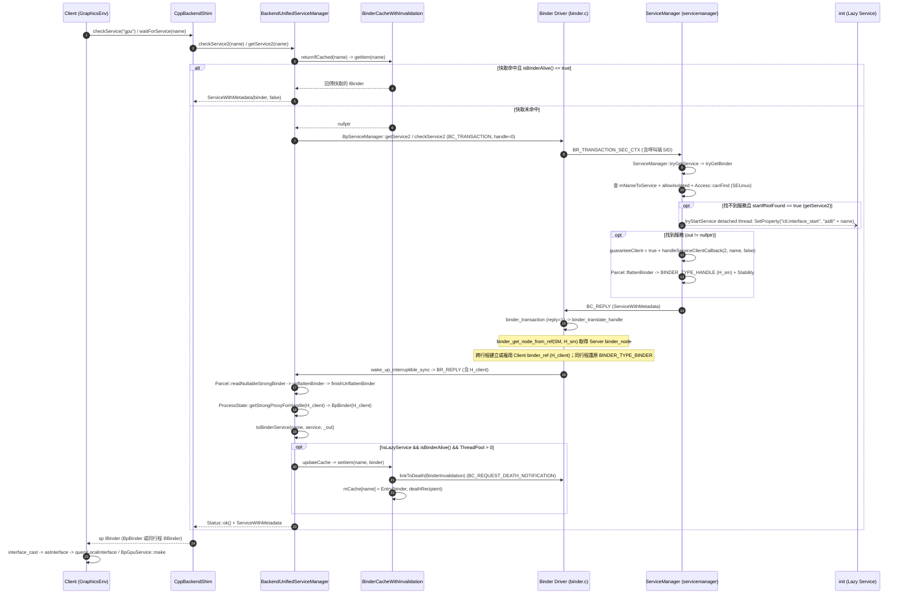

# 5.9 Service 代理物件的取得過程

- **情景說明**：接續 5.8 節 `GpuService` 註冊進 ServiceManager 並啟動 Binder 執行緒池之後，原生 C++ Client 行程（以 `GraphicsEnv::getGpuService()` 查詢 `"gpu"` 服務為例，並併同對照 `getService`、`checkService` 與現代推薦的 `waitForService`）呼叫 `defaultServiceManager()` 取得 ServiceManager 代理，嘗試查詢目標 Service 的代理物件。本節完整追蹤：Client 端 `CppBackendShim` 與 `BackendUnifiedServiceManager` 的快取命中快速路徑、快取未命中時經 AIDL `IServiceManager::getService2` / `checkService2` 進入 `servicemanager` 行程（SELinux `Access::canFind` 檢查、查 `mNameToService`、Lazy Service `tryStartService` 動態拉起與 `handleServiceClientCallback` 防誤關保護）、核心驅動 `binder_transaction` → `binder_translate_handle` 將 ServiceManager 的 `binder_ref` 句柄轉譯為 Client 行程的新 `binder_ref`（或同行程還原為 `BINDER_TYPE_BINDER`），以及 Client 端經 `Parcel::unflattenBinder`、`ProcessState::getStrongProxyForHandle` 建構 `BpBinder`、由 `BinderCacheWithInvalidation` 註冊 `linkToDeath` 回填快取，最終以 `interface_cast` 封裝成業務代理 `Bp<Service>` 的完整過程。
- **對應原書**：第 5 章 5.9 節〈Service 代理对象的获取过程〉（p.299–308）
- **涉及專案與版本基準**：
  - `platform/frameworks/native` 〔`android-17.0.0_r1`，commit `ae266dc`〕
  - `kernel/common` 〔`android17-6.18`，commit `1e0de07`〕

---

## 5.9.1 Client 端發起查詢與快取命中路徑

> 對應原書 5.9（p.299–302）。原書中 `FregClient` 呼叫 `defaultServiceManager()->getService(name)` 後直接進入 `BpServiceManager::getService`，以最多 5 次迴圈呼叫 `checkService` 發起 `CHECK_SERVICE_TRANSACTION` 跨行程交易。在 Android 17 中，`defaultServiceManager()` 回傳的是 `CppBackendShim` 包裝的 `BackendUnifiedServiceManager`（見 5.7 節）：不僅將查詢 API 分化為非阻塞 `checkService`、已棄用的輪詢 `getService` 與事件驅動 `waitForService`，更在 Client 端引入了 **帶死亡通知自動失效的快取層（`BinderCacheWithInvalidation`）**，常駐系統服務在首次查詢後即可命中本機快取，免除重複跨行程 IPC。

### Step 1：Client 查詢入口與 `CppBackendShim` 的三種查詢路徑

**位置**：`platform/frameworks/native/libs/graphicsenv/GraphicsEnv.cpp` 〔`android-17.0.0_r1`，lines 192–200〕、`platform/frameworks/native/libs/binder/include/binder/IServiceManager.h` 〔`android-17.0.0_r1`，lines 73–109、198–244〕與 `platform/frameworks/native/libs/binder/IServiceManager.cpp` 〔`android-17.0.0_r1`，lines 159–165、587–637、660–749〕

以 5.8 節所啟動 `GpuService` 的真實呼叫端 `GraphicsEnv` 為例，Client 透過 `defaultServiceManager()` 取得服務的 `IBinder` 後再以 `interface_cast` 轉型：

```cpp
static sp<IGpuService> getGpuService() {
    static const sp<IBinder> binder = defaultServiceManager()->checkService(String16("gpu"));
    if (!binder) {
        ALOGE("Failed to get gpu service");
        return nullptr;
    }

    return interface_cast<IGpuService>(binder);
}
```

而在 `IServiceManager.h` 中，Android 17 明確標註傳統的 `getService()` 已棄用（deprecated），鼓勵改用事件驅動的 `waitForService()` 或非阻塞的 `checkService()`，並提供泛型模板函式直接整合 `interface_cast`：

```cpp
    [[deprecated("this polls for 5s, prefer waitForService or checkService")]]
    virtual sp<IBinder> getService(const String16& name) const = 0;

    /**
     * Retrieve an existing service, non-blocking.
     */
    virtual sp<IBinder>         checkService( const String16& name) const = 0;
...
    virtual sp<IBinder> waitForService(const String16& name) = 0;
...
template<typename INTERFACE>
sp<INTERFACE> waitForService(const String16& name) {
    const sp<IServiceManager> sm = defaultServiceManager();
    return interface_cast<INTERFACE>(sm->waitForService(name));
}
...
template<typename INTERFACE>
status_t getService(const String16& name, sp<INTERFACE>* outService)
{
    const sp<IServiceManager> sm = defaultServiceManager();
    if (sm != nullptr) {
#pragma clang diagnostic push
#pragma clang diagnostic ignored "-Wdeprecated-declarations"
        *outService = interface_cast<INTERFACE>(sm->getService(name));
#pragma clang diagnostic pop // getService deprecation
        if ((*outService) != nullptr) return NO_ERROR;
    }
    return NAME_NOT_FOUND;
}
```

接著觀察 `CppBackendShim` 如何實作這三個查詢函式以及內部的 `realGetService()`（`IServiceManager.cpp`）：

```cpp
    virtual Status realGetService(const std::string& name, sp<IBinder>* _aidl_return) {
        Service service;
        Status status = mUnifiedServiceManager->getService2(name, &service);
        auto serviceWithMetadata = service.get<Service::Tag::serviceWithMetadata>();
        *_aidl_return = serviceWithMetadata.service;
        return status;
    }
```

```cpp
sp<IBinder> CppBackendShim::getService(const String16& name) const {
    static bool gSystemBootCompleted = false;

    if (sp<IBinder> svc = checkService(name); svc != nullptr) return svc;

    sp<ProcessState> self = ProcessState::selfOrNull();
    const bool isVendorService =
            self && strcmp(self->getDriverName().c_str(), "/dev/vndbinder") == 0;
    constexpr auto timeout = 5s;
    const auto startTime = std::chrono::steady_clock::now();
    // Vendor code can't access system properties
    if (!gSystemBootCompleted && !isVendorService) {
#ifdef __ANDROID__
        char bootCompleted[PROPERTY_VALUE_MAX];
        property_get("sys.boot_completed", bootCompleted, "0");
        gSystemBootCompleted = strcmp(bootCompleted, "1") == 0 ? true : false;
#else
        gSystemBootCompleted = true;
#endif
    }
    // retry interval in millisecond; note that vendor services stay at 100ms
    const useconds_t sleepTime = gSystemBootCompleted ? 1000 : 100;

    ALOGI("Waiting for service '%s' on '%s'...", String8(name).c_str(),
          self ? self->getDriverName().c_str() : "RPC accessors only");

    int n = 0;
    while (std::chrono::steady_clock::now() - startTime < timeout) {
        n++;
        usleep(1000*sleepTime);

        sp<IBinder> svc = checkService(name);
        if (svc != nullptr) {
            const auto waitTime = std::chrono::steady_clock::now() - startTime;
            ALOGI("Waiting for service '%s' on '%s' successful after waiting %" PRIu64 "ms",
                  String8(name).c_str(), ProcessState::self()->getDriverName().c_str(),
                  to_ms(waitTime));
            return svc;
        }
    }
    ALOGW("Service %s didn't start. Returning NULL", String8(name).c_str());
    return nullptr;
}

sp<IBinder> CppBackendShim::checkService(const String16& name) const {
    Service ret;
    if (!mUnifiedServiceManager->checkService2(String8(name).c_str(), &ret).isOk()) {
        return nullptr;
    }
    return ret.get<Service::Tag::serviceWithMetadata>().service;
}
```

以及事件驅動的 `waitForService()`：

```cpp
sp<IBinder> CppBackendShim::waitForService(const String16& name16) {
    class Waiter : public android::os::BnServiceCallback {
        Status onRegistration(const std::string& /*name*/,
                              const sp<IBinder>& binder) override {
            std::unique_lock<std::mutex> lock(mMutex);
            mBinder = binder;
            lock.unlock();
            // Flushing here helps ensure the service's ref count remains accurate
            IPCThreadState::self()->flushCommands();
            mCv.notify_one();
            return Status::ok();
        }
    public:
        sp<IBinder> mBinder;
        std::mutex mMutex;
        std::condition_variable mCv;
    };
...
    const std::string name = String8(name16).c_str();

    sp<IBinder> out;
    if (Status status = realGetService(name, &out); !status.isOk()) {
        ALOGW("Failed to getService in waitForService for %s: %s", name.c_str(),
              status.toString8().c_str());
        sp<ProcessState> self = ProcessState::selfOrNull();
        if (self && 0 == self->getThreadPoolMaxTotalThreadCount()) {
            ALOGW("Got service, but may be racey because we could not wait efficiently for it. "
                  "Threadpool has 0 guaranteed threads. "
                  "Is the threadpool configured properly? "
                  "See ProcessState::startThreadPool and "
                  "ProcessState::setThreadPoolMaxThreadCount.");
        }
        return nullptr;
    }
    if (out != nullptr) return out;

    sp<Waiter> waiter = sp<Waiter>::make();
    if (Status status = mUnifiedServiceManager->registerForNotifications(name, waiter);
        !status.isOk()) {
        ALOGW("Failed to registerForNotifications in waitForService for %s: %s", name.c_str(),
              status.toString8().c_str());
        return nullptr;
    }
    Defer unregister([&] { mUnifiedServiceManager->unregisterForNotifications(name, waiter); });

    while(true) {
        {
            std::unique_lock<std::mutex> lock(waiter->mMutex);
            waiter->mCv.wait_for(lock, 1s, [&] {
                return waiter->mBinder != nullptr;
            });
            if (waiter->mBinder != nullptr) return waiter->mBinder;
        }
...
        if (Status status = realGetService(name, &out); !status.isOk()) {
            ALOGW("Failed to getService in waitForService on later try for %s: %s", name.c_str(),
                  status.toString8().c_str());
            return nullptr;
        }
        if (out != nullptr) return out;
    }
}
```

**解說**：
1. **`getService` vs `checkService` vs `waitForService` 的底層差異**：
   - `CppBackendShim::checkService(name)` 直接轉發給 `mUnifiedServiceManager->checkService2(...)`，在 ServiceManager 端以 `startIfNotFound = false` 查詢，**只查不拉起**。
   - `CppBackendShim::getService(name)` 實際上是對 `checkService(name)` 做最長 `5s` 的輪詢（開機完成前或 `/dev/vndbinder` 上每 `100ms` 一次，開機完成後每 `1000ms` 一次），與 `checkService` 一樣走 `checkService2`，**不會**在 ServiceManager 端觸發 Lazy Service 拉起。
   - `CppBackendShim::waitForService(name16)` 才是走 `realGetService()` → `mUnifiedServiceManager->getService2(...)`（`startIfNotFound = true`，可觸發 Lazy Service 動態啟動）。若服務當下仍未註冊，它會註冊一個實作 `BnServiceCallback` 的本地 `Waiter` 到 ServiceManager（`registerForNotifications`），以條件變數等待服務註冊時的 `onRegistration` 推播，並每秒再補呼叫一次 `realGetService` 以防範 Lazy Service 剛崩潰而 `init` 尚未處理完畢的競態條件；離開作用域時由 RAII `Defer` 自動 `unregisterForNotifications`。
2. **執行緒池前提**：`waitForService` 仰賴 `BnServiceCallback::onRegistration` 跨行程回呼，因此若 Client 行程的 Binder 執行緒池上限為 0，無法即時收到推播，只能退化靠每秒一次的 `realGetService` 取回（程式碼亦會印出警告）。

> 〔與 2.3 差異〕**邏輯改變 + 新增**：原書 2.3（p.301）的 `BpServiceManager::getService` 僅用 `for (n = 0; n < 5; n++)` + `sleep(1)` 輪詢 `checkService`，且沒有 `waitForService` 或 Lazy Service 通知機制；Android 17 改由 `CppBackendShim` 承接舊 C++ 介面，`getService` 標記為 `[[deprecated]]` 並依開機狀態動態調整輪詢間隔，並新增事件驅動的 `waitForService` 與 `realGetService` 走 `getService2`。

---

### Step 2：`BackendUnifiedServiceManager::getService2` / `checkService2` 與快取命中路徑

**位置**：`platform/frameworks/native/libs/binder/BackendUnifiedServiceManager.cpp` 〔`android-17.0.0_r1`，lines 183–255〕與 `platform/frameworks/native/libs/binder/BackendUnifiedServiceManager.h` 〔`android-17.0.0_r1`，lines 53–60〕

無論從 `realGetService` 進入 `getService2`，還是從 `checkService` / `getService` 進入 `checkService2`，兩條路徑在 `BackendUnifiedServiceManager` 中都會**先查 Client 端快取**：

```cpp
bool BackendUnifiedServiceManager::returnIfCached(const std::string& serviceName,
                                                  os::Service* _out) {
    sp<IBinder> item = mCacheForGetService->getItem(serviceName);
    // TODO(b/363177618): Enable caching for binders which are always null.
    if (item != nullptr && item->isBinderAlive()) {
        *_out = createServiceWithMetadata(item, false);
        return true;
    }
    return false;
}
```

`BinderCacheWithInvalidation::getItem`（`BackendUnifiedServiceManager.h`）：

```cpp
    sp<IBinder> getItem(const std::string& key) const {
        std::lock_guard<std::mutex> lock(mCacheMutex);

        if (auto it = mCache.find(key); it != mCache.end()) {
            return it->second.service;
        }
        return nullptr;
    }
```

以及 `getService2` 與 `checkService2` 的主體（`BackendUnifiedServiceManager.cpp`）：

```cpp
Status BackendUnifiedServiceManager::getService2(const ::std::string& name, os::Service* _out) {
    if (returnIfCached(name, _out)) {
        return Status::ok();
    }
    os::Service service;
    Status status = Status::ok();
    if (mTheRealServiceManager) {
        status = mTheRealServiceManager->getService2(name, &service);
    }

    if (status.isOk()) {
        status = toBinderService(name, service, _out);
        if (status.isOk()) {
            return updateCache(name, service);
        }
    }
    return status;
}
...
Status BackendUnifiedServiceManager::checkService2(const ::std::string& name, os::Service* _out) {
    os::Service service;
    if (returnIfCached(name, _out)) {
        return Status::ok();
    }

    Status status = Status::ok();
    if (mTheRealServiceManager) {
        status = mTheRealServiceManager->checkService2(name, &service);
    }
    if (status.isOk()) {
        status = toBinderService(name, service, _out);
        if (status.isOk()) {
            return updateCache(name, service);
        }
    }
    return status;
}
```

**解說**：
1. **快取命中路徑（Fast Path）**：`returnIfCached` 在互斥鎖 `mCacheMutex` 保護下於 `mCache`（`std::map<std::string, Entry, std::less<>>`）查找 `serviceName`。若找到且 `item->isBinderAlive()` 為真（即對應 `BpBinder` 尚未收到 `BR_DEAD_BINDER`），立刻用 `createServiceWithMetadata(item, false)` 打包填入 `*_out` 並回傳 `Status::ok()`。整個過程**完全停留在 Client 使用者空間**，不觸發任何系統呼叫或 `servicemanager` 行程排程。
2. **為何 `isLazyService` 固定填 `false`**：只有非 Lazy 服務才會被寫入 `mCacheForGetService`（詳見 Step 11），因此命中快取的服務必然不是 Lazy Service。
3. **快取未命中路徑（Slow Path）**：若快取未命中（首次查詢、Lazy Service，或先前 Server 崩潰已觸發 `binderDied` 清除快取），則透過 `mTheRealServiceManager`（即 5.7 節建立的 AIDL `android::os::BpServiceManager`，底層持有 handle `0` 的 `BpBinder`）跨行程呼叫 `getService2` 或 `checkService2`。
4. **Java 與 C++ 共用同一份快取**：因 Android 17 的 Java `ServiceManagerProxy` 亦透過 JNI 橋接至此單例 `BackendUnifiedServiceManager`（將於 5.10 節詳述），本機快取可同時惠及原生與 Java 呼叫端。

> 〔與 2.3 差異〕**新增**：原書 2.3（p.301）C++ 層沒有任何 Client 端快取，每次 `checkService` 皆必須執行一次完整的 Binder 跨行程交易；Android 17 新增 `BackendUnifiedServiceManager` 與 `BinderCacheWithInvalidation`，將快取查詢前置於 IPC 之前。

---

## 5.9.2 快取未命中進入 ServiceManager 查詢服務

> 對應原書 5.9（p.301–304）。原書 2.3 由手寫 `BpServiceManager::checkService` 打包 `CHECK_SERVICE_TRANSACTION` 與 `String16` 服務名，送到 C 語言 `servicemanager` 的 `svcmgr_handler` → `do_find_service` → `bio_put_ref`。在 Android 17 中，兩端改以 AIDL 定義的 `IServiceManager.aidl` 溝通，並以 `union Service` + `parcelable ServiceWithMetadata` 傳遞額外中繼資料；ServiceManager 端改寫為 C++ `ServiceManager` 類別，並整合了 SELinux `Access::canFind`、isolated app 檢查、Lazy Service 動態拉起與客戶端參考計數監控。

### Step 3：AIDL 介面協定（`IServiceManager.aidl`、`Service.aidl`、`ServiceWithMetadata.aidl`）

**位置**：`platform/frameworks/native/libs/binder/aidl/android/os/IServiceManager.aidl` 〔`android-17.0.0_r1`，lines 69–100〕、`Service.aidl` 〔lines 27–30〕與 `ServiceWithMetadata.aidl` 〔lines 23–32〕

`IServiceManager.aidl` 定義了舊版與新版查詢介面：

```aidl
    @UnsupportedAppUsage
    @nullable IBinder getService(@utf8InCpp String name);

    /**
     * Retrieve an existing service called @a name from the
     * service manager.
     *
     * This is the same as checkService (returns immediately) but
     * exists for legacy purposes.
     *
     * Returns an enum Service that can be of different types. The
     * enum value is null if the service does not exist.
     */
    Service getService2(@utf8InCpp String name);

    /**
     * Retrieve an existing service called @a name from the service
     * manager. Non-blocking. Returns null if the service does not exist.
     *
     * @deprecated TODO(b/355394904): Use checkService2 instead. This does not
     * return metadata that is included in ServiceWithMetadata
     */
    @UnsupportedAppUsage
    @nullable IBinder checkService(@utf8InCpp String name);

    /**
     * Retrieve an existing service called @a name from the service
     * manager. Non-blocking. Returns null if the service does not
     * exist.
     */
    Service checkService2(@utf8InCpp String name);
```

回傳型別 `Service` 與 `ServiceWithMetadata` 定義如下：

```aidl
union Service {
    ServiceWithMetadata serviceWithMetadata;
    @nullable IBinder accessor;
}
```

```aidl
parcelable ServiceWithMetadata {
    /**
     * IBinder to service
     */
    @nullable IBinder service;
    /**
     * boolean if the IBinder can be cached by client.
     */
    boolean isLazyService;
}
```

**解說**：
1. **為何從 `getService` 升級到 `getService2`**：舊版 `getService`/`checkService` 僅回傳單一 `IBinder`，Client 無法得知該服務是否為 Lazy Service（若 Client 誤將 Lazy Service 寫入本機快取，會永久鎖住強引用導致服務永遠無法自動退出），也無法區分核心 Binder 服務與跨 VM 的 RPC `IAccessor` 服務。因此 Android 17 引入 `union Service`：
   - 一般核心 Binder 服務走 `serviceWithMetadata` 分支，同時攜帶 `@nullable IBinder service` 與 `boolean isLazyService`。
   - 透過 VINTF 宣告為遠端 Socket / VM 的服務走 `accessor` 分支，回傳 `IAccessor` 代理讓 Client 端在 `toBinderService` 建立 `RpcSession`。
2. **AIDL 代理發送過程**：編譯時期由 `aidl --lang=cpp` 產生的 `android::os::BpServiceManager::getService2`（或 `checkService2`）將介面描述符與 UTF-8 轉 UTF-16 的服務名寫入 `Parcel data`，透過 handle `0` 的 `remote()->transact(...)` 送出 `BC_TRANSACTION`；核心驅動查得 `context->binder_context_mgr_node` 並攜帶呼叫端 SELinux SID（`BR_TRANSACTION_SEC_CTX`，詳見 5.6 與 5.8 節）喚醒 `servicemanager` 主迴圈，經 `IPCThreadState::executeCommand` → `the_context_object->transact` → `BnServiceManager::onTransact` 分派至 `ServiceManager::getService2` 或 `checkService2`。

> 〔與 2.3 差異〕**已移除並重寫**：原書 2.3（p.301）使用手寫交易碼 `CHECK_SERVICE_TRANSACTION` / `GET_SERVICE_TRANSACTION`，僅收發 `String16` 與單一 `IBinder`；Android 17 全面改由 AIDL 定義與產生序列化程式碼，並以 `Service` / `ServiceWithMetadata` 攜帶 `isLazyService` 與 RPC `accessor` 支援。

---

### Step 4：`ServiceManager::getService2` / `checkService2` → `tryGetService` → `tryGetBinder` 與 SELinux 檢查

**位置**：`platform/frameworks/native/cmds/servicemanager/ServiceManager.cpp` 〔`android-17.0.0_r1`，lines 404–492〕與 `platform/frameworks/native/cmds/servicemanager/Access.cpp` 〔`android-17.0.0_r1`，lines 130–175〕

```cpp
Status ServiceManager::getService2(const std::string& name, os::Service* outService) {
    SM_PERFETTO_TRACE_FUNC(PERFETTO_TE_PROTO_FIELDS(
            PERFETTO_TE_PROTO_FIELD_CSTR(kProtoServiceName, name.c_str())));

    *outService = tryGetService(name, true);
    // returns ok regardless of result for legacy reasons
    return Status::ok();
}
...
Status ServiceManager::checkService2(const std::string& name, os::Service* outService) {
    SM_PERFETTO_TRACE_FUNC(PERFETTO_TE_PROTO_FIELDS(
            PERFETTO_TE_PROTO_FIELD_CSTR(kProtoServiceName, name.c_str())));

    *outService = tryGetService(name, false);
    // returns ok regardless of result for legacy reasons
    return Status::ok();
}

os::Service ServiceManager::tryGetService(const std::string& name, bool startIfNotFound) {
    std::optional<std::string> accessorName;
#ifndef VENDORSERVICEMANAGER
    accessorName = getVintfAccessorName(name);
#endif
    if (accessorName.has_value()) {
        auto ctx = mAccess->getCallingContext();
        if (!mAccess->canFind(ctx, name)) {
            return os::Service::make<os::Service::Tag::accessor>(nullptr);
        }
        return os::Service::make<os::Service::Tag::accessor>(
                tryGetBinder(*accessorName, startIfNotFound).service);
    } else {
        return os::Service::make<os::Service::Tag::serviceWithMetadata>(
                tryGetBinder(name, startIfNotFound));
    }
}

os::ServiceWithMetadata ServiceManager::tryGetBinder(const std::string& name,
                                                     bool startIfNotFound) {
    SM_PERFETTO_TRACE_FUNC(PERFETTO_TE_PROTO_FIELDS(
            PERFETTO_TE_PROTO_FIELD_CSTR(kProtoServiceName, name.c_str())));

    auto ctx = mAccess->getCallingContext();

    sp<IBinder> out;
    Service* service = nullptr;
    if (auto it = mNameToService.find(name); it != mNameToService.end()) {
        service = &(it->second);

        if (!service->allowIsolated && is_multiuser_uid_isolated(ctx.uid)) {
            LOG(WARNING) << "Isolated app with UID " << ctx.uid << " requested '" << name
                         << "', but the service is not allowed for isolated apps.";
            return os::ServiceWithMetadata();
        }
        out = service->binder;
    }

    if (!mAccess->canFind(ctx, name)) {
        return os::ServiceWithMetadata();
    }

    if (!out && startIfNotFound) {
        tryStartService(ctx, name);
    }

    if (out) {
        // Force onClients to get sent, and then make sure the timerfd won't clear it
        // by setting guaranteeClient again. This logic could be simplified by using
        // a time-based guarantee. However, forcing onClients(true) to get sent
        // right here is always going to be important for processes serving multiple
        // lazy interfaces.
        service->guaranteeClient = true;
        CHECK(handleServiceClientCallback(2 /* sm + transaction */, name, false));
        service->guaranteeClient = true;
    }
    os::ServiceWithMetadata serviceWithMetadata = os::ServiceWithMetadata();
    serviceWithMetadata.service = out;
    serviceWithMetadata.isLazyService =
            service ? service->dumpPriority & FLAG_IS_LAZY_SERVICE : false;
    return serviceWithMetadata;
}
```

其中權限檢查 `mAccess->canFind(ctx, name)` 位於 `Access.cpp`：

```cpp
bool Access::canFind(const CallingContext& ctx,const std::string& name) {
    return actionAllowedFromLookup(ctx, name, "find");
}
...
bool Access::actionAllowed(const CallingContext& sctx, const char* tctx, const char* perm,
        const std::string& tname) {
#ifdef __ANDROID__
    const char* tclass = "service_manager";

    AuditCallbackData data = {
        .context = &sctx,
        .tname = &tname,
    };

    return 0 == selinux_check_access(sctx.sid.c_str(), tctx, tclass, perm,
        reinterpret_cast<void*>(&data));
#else
    (void)sctx;
    (void)tctx;
    (void)perm;
    (void)tname;

    return true;
#endif
}

bool Access::actionAllowedFromLookup(const CallingContext& sctx, const std::string& name, const char *perm) {
#ifdef __ANDROID__
    char *tctx = nullptr;
    if (selabel_lookup(getSehandle(), &tctx, name.c_str(), SELABEL_CTX_ANDROID_SERVICE) != 0) {
        LOG(ERROR) << "SELinux: No match for " << name << " in service_contexts.\n";
        return false;
    }

    bool allowed = actionAllowed(sctx, tctx, perm, name);
    freecon(tctx);
    return allowed;
#else
    (void)sctx;
    (void)name;
    (void)perm;
    (void)kIsVendor;

    return true;
#endif
}
```

**解說**：
1. **`getService2` 與 `checkService2` 的唯一差別**：前者傳入 `startIfNotFound = true`，後者傳入 `false`。兩者即便找不到服務或被拒絕，仍基於歷史相容性回傳 `Status::ok()`，由空的 `ServiceWithMetadata`（`service == nullptr`）表達未取得。
2. **查表與隔離檢查**：`mNameToService` 是 `std::map<std::string, Service>`（取代原書單向鏈結串列 `svclist`）。找到目標服務後，先檢查 `allowIsolated`：若呼叫端屬於沙盒隔離行程（`AID_ISOLATED_START..AID_ISOLATED_END`）且該服務註冊時未允許隔離行程存取，則直接拒絕並回傳空結構。
3. **SELinux `find` 權限強制檢查**：即便查到服務（或尚未註冊準備啟動 Lazy Service 前），一律執行 `mAccess->canFind(ctx, name)`：
   - 呼叫端安全上下文 `ctx.sid` 直接來自核心透過 `BR_TRANSACTION_SEC_CTX` 隨交易傳入的 `IPCThreadState::getCallingSid()`（見 5.6.2 與 5.8 節），避免透過 `/proc/<pid>/attr/current` 查詢的 TOCTOU 競態。
   - `selabel_lookup` 依 `service_contexts` 查出服務名稱對應的目標 SELinux label `tctx`，再由 `selinux_check_access` 驗證類別 `"service_manager"` 上的 `"find"` 權限。
4. **填寫 `isLazyService` 中繼資料**：若服務註冊時 `dumpPriority` 帶有 `FLAG_IS_LAZY_SERVICE`（`1 << 30`），則回傳 `serviceWithMetadata.isLazyService = true`，明確告知 Client 端 `BackendUnifiedServiceManager::updateCache` 不得快取此 Binder。

> 〔與 2.3 差異〕**已移除並重寫**：原書 2.3（p.302–303）的 `svcmgr_handler` 與 `do_find_service` 僅線性遍歷 `svclist` 找 `svcinfo->ptr`，完全沒有 SELinux 檢查、isolated app 隔離檢查、`accessor` 轉發、Lazy Service 邏輯或 `ServiceWithMetadata` 封裝；Android 17 全部整合於 `ServiceManager::tryGetService` / `tryGetBinder` 與 `Access::canFind`。

---

### Step 5：Lazy Service 動態拉起（`tryStartService`）與客戶端計數保護

**位置**：`platform/frameworks/native/cmds/servicemanager/ServiceManager.cpp` 〔`android-17.0.0_r1`，lines 873–886、981–1024〕

當 `tryGetBinder` 未在 `mNameToService` 找到服務且 `startIfNotFound == true`（由 `getService2` 進入）時，觸發 `tryStartService`：

```cpp
void ServiceManager::tryStartService(const Access::CallingContext& ctx, const std::string& name) {
    ALOGI("%s Since '%s' could not be found trying to start it as a lazy AIDL service. (if it's "
          "not configured to be a lazy service, it may be stuck starting or still starting).",
          ctx.toDebugString().c_str(), name.c_str());

    std::thread([=] {
        if (!base::SetProperty("ctl.interface_start", "aidl/" + name)) {
            ALOGI("%s Tried to start aidl service %s as a lazy service, but was unable to. Usually "
                  "this happens when a service is not installed, but if the service is intended to "
                  "be used as a lazy service, then it may be configured incorrectly.",
                  ctx.toDebugString().c_str(), name.c_str());
        }
    }).detach();
}
```

反之，若找到服務且該服務有註冊 `IClientCallback`（即受 `LazyServiceRegistrar` 管理的 Lazy Service），`tryGetBinder` 在組裝回傳值前會呼叫 `handleServiceClientCallback(2 /* sm + transaction */, name, false)`：

```cpp
bool ServiceManager::handleServiceClientCallback(size_t knownClients,
                                                 const std::string& serviceName,
                                                 bool isCalledOnInterval) {
    auto serviceIt = mNameToService.find(serviceName);
    if (serviceIt == mNameToService.end() || mNameToClientCallback.count(serviceName) < 1) {
        return true; // return we do have clients a.k.a. DON'T DO ANYTHING
    }

    Service& service = serviceIt->second;
    ssize_t count = service.getNodeStrongRefCount();

    // binder driver doesn't support this feature, consider we have clients
    if (count == -1) return true;

    bool hasKernelReportedClients = static_cast<size_t>(count) > knownClients;

    if (service.guaranteeClient) {
        if (!service.hasClients && !hasKernelReportedClients) {
            sendClientCallbackNotifications(serviceName, true,
                                            "service is guaranteed to be in use");
        }

        // guarantee is temporary
        service.guaranteeClient = false;
    }

    // Regardless of this situation, we want to give this notification as soon as possible.
    // This way, we have a chance of preventing further thrashing.
    if (hasKernelReportedClients && !service.hasClients) {
        sendClientCallbackNotifications(serviceName, true, "we now have a record of a client");
    }

    // But limit rate of shutting down service.
    if (isCalledOnInterval) {
        if (!hasKernelReportedClients && service.hasClients) {
            sendClientCallbackNotifications(serviceName, false,
                                            "we now have no record of a client");
        }
    }

    // May be different than 'hasKernelReportedClients'. We intentionally delay
    // information about clients going away to reduce thrashing.
    return service.hasClients;
}
```

**解說**：
1. **為何 `tryStartService` 必須另開 detached 執行緒**：`servicemanager` 是單執行緒事件迴圈（見 5.6.3 節），且設定 `ctl.interface_start` 需透過 property socket 與 `init` 同步通訊；若在主執行緒直接呼叫 `SetProperty`，會阻塞全系統所有服務查詢，甚至在 `init` 反向查詢服務時導致死鎖。
2. **`guaranteeClient` 設兩次的精巧防競態設計**：當 `tryGetBinder` 查到服務並準備回傳給 Client 時，核心驅動**尚未**收到 `BC_REPLY`，Client 端也還沒建立 `binder_ref`，因此核心回報的 `getNodeStrongRefCount()` 可能只看到 ServiceManager 自己的引用。透過先設 `service->guaranteeClient = true` 呼叫 `handleServiceClientCallback(2, name, false)`，會立刻透過 `IClientCallback::onClients(..., true)` 通知 Lazy Service 保持存活；隨後**再次**設為 `true`，確保在 Client 真正收到 reply 並持有強引用之前的這段空窗期內，即使 5 秒週期 `timerfd`（見 5.6.3 節）到期或服務嘗試呼叫 `tryUnregisterService`，也不會誤判無 Client 而把剛被查詢的服務關掉。

> 〔與 2.3 差異〕**新增**：原書 2.3（p.302–303）沒有 Lazy Service 概念；Android 17 新增 `tryStartService`（連動 `init` 的 `ctl.interface_start`）與基於核心節點引用計數的 `handleServiceClientCallback` 生命週期保護。

---

### Step 6：ServiceManager 端將 `BpBinder` 序列化回傳（`Parcel::flattenBinder`）

**位置**：`platform/frameworks/native/libs/binder/Parcel.cpp` 〔`android-17.0.0_r1`，lines 225–229、252–308〕

`ServiceManager::getService2` / `checkService2` 返回後，AIDL 產生的 `BnServiceManager::onTransact` 將 `os::Service` 寫入 `reply` `Parcel`；在序列化 `ServiceWithMetadata.service`（`sp<IBinder>`）時呼叫 `Parcel::writeNullableStrongBinder` → `Parcel::flattenBinder`：

```cpp
status_t Parcel::flattenBinder(const sp<IBinder>& binder) {
    BBinder* local = nullptr;
    if (binder) local = binder->localBinder();
    if (local) local->setParceled();
...
#ifdef BINDER_WITH_KERNEL_IPC
    flat_binder_object obj;

    int schedBits = 0;
    if (!IPCThreadState::self()->backgroundSchedulingDisabled()) {
        schedBits = schedPolicyMask(SCHED_NORMAL, 19);
    }

    if (binder != nullptr) {
        if (!local) {
            BpBinder *proxy = binder->remoteBinder();
            if (proxy == nullptr) {
                ALOGE("null proxy");
            } else {
                if (proxy->isRpcBinder()) {
                    ALOGE("Sending a socket binder over kernel binder is prohibited");
                    return INVALID_OPERATION;
                }
            }
            const int32_t handle = proxy ? proxy->getPrivateAccessor().binderHandle() : 0;
            obj.hdr.type = BINDER_TYPE_HANDLE;
            obj.binder = 0; /* Don't pass uninitialized stack data to a remote process */
            obj.flags = 0;
            obj.handle = handle;
            obj.cookie = 0;
        } else {
...
```

寫入 `flat_binder_object` 與其偏移量到 `Parcel` 之後，緊接著呼叫 `finishFlattenBinder` 附加穩定性標記：

```cpp
    internal::Stability::tryMarkCompilationUnit(binder.get());
    int16_t rep = internal::Stability::getRepr(binder.get());
    return writeInt32(rep);
```

**解說**：
1. **為何寫入的是 `BINDER_TYPE_HANDLE`**：在 5.8 節 `GpuService` 註冊進 ServiceManager 時，核心驅動在 ServiceManager 行程中建立了一個指向 `GpuService` 實體節點 `binder_node` 的引用 `binder_ref`，因此 ServiceManager 端 `mNameToService["gpu"].binder` 持有的是一個 `BpBinder`（而非本地 `BBinder`）。`binder->localBinder()` 為 `nullptr`，故 `flattenBinder` 進入 `!local` 分支，取出該 `BpBinder` 在 ServiceManager 行程中的句柄值 `handle`（記為 `H_sm`），構造 `obj.hdr.type = BINDER_TYPE_HANDLE`、`obj.handle = H_sm`，並記錄此 `flat_binder_object` 在資料緩衝區的偏移量至 `mObjects` 陣列。
2. **附帶 Stability 資訊**：`finishFlattenBinder` 會緊接在 `flat_binder_object` 之後寫入一個 `int32_t` 的 `Stability` 等級（例如 System / Vendor / VINTF），確保 Client 端反序列化後能執行跨分區穩定性檢查。
3. **回覆交給驅動**：`BnServiceManager::onTransact` 結束後，`IPCThreadState::executeCommand` 呼叫 `sendReply(reply, 0)`，將帶有此 `flat_binder_object` 與 `offsets` 的資料透過 `BC_REPLY` 交給 Binder 驅動。

> 〔與 2.3 差異〕**改名搬家 + 邏輯改變**：原書 2.3（p.303–304）由 C 版 `servicemanager/binder.c` 的 `bio_put_ref` → `bio_alloc_obj` 手動寫入 `binder_object`；Android 17 因 `servicemanager` 改用 `libbinder`，統一由 `Parcel::flattenBinder` 執行序列化，並新增 RPC Binder 檢查（禁止將 socket binder 塞入核心 Binder 交易）與 `Stability` 標記。

---

## 5.9.3 核心驅動 Handle 轉譯與回覆分發

> 對應原書 5.9（p.304–306）。核心驅動收到 ServiceManager 發來的 `BC_REPLY` 後，在 `binder_transaction` 中必須完成跨行程句柄轉譯：ServiceManager 的句柄 `H_sm` 只在 ServiceManager 行程的引用表內有效，對 Client 行程毫無意義；驅動必須循 `H_sm` 找出背後的 Server 實體節點 `binder_node`，再為 Client 行程建立（或複用）屬於 Client 自己的 `binder_ref` 與新句柄 `H_client`（或者若 Client 就是 Server 自己，則直接還原為本地 `BINDER_TYPE_BINDER`）。

### Step 7：`binder_transaction` 處理 `BC_REPLY` 與掃描 `BINDER_TYPE_HANDLE`

**位置**：`kernel/common/drivers/android/binder.c` 〔`android17-6.18`，lines 3276–3280、3352–3409、3754–3795、3985–4008〕

`binder_transaction` 在 `reply == 1` 時，先由 ServiceManager 執行緒的 `transaction_stack` 找回正在等待回覆的 Client 執行緒與行程：

```c
static void binder_transaction(struct binder_proc *proc,
			       struct binder_thread *thread,
			       struct binder_transaction_data *tr, int reply,
			       binder_size_t extra_buffers_size)
{
...
	if (reply) {
		binder_inner_proc_lock(proc);
		in_reply_to = thread->transaction_stack;
		if (in_reply_to == NULL) {
			binder_inner_proc_unlock(proc);
			binder_user_error("%d:%d got reply transaction with no transaction stack\n",
					  proc->pid, thread->pid);
			return_error = BR_FAILED_REPLY;
			return_error_param = -EPROTO;
			return_error_line = __LINE__;
			goto err_empty_call_stack;
		}
		if (in_reply_to->to_thread != thread) {
			spin_lock(&in_reply_to->lock);
			binder_user_error("%d:%d got reply transaction with bad transaction stack, transaction %d has target %d:%d\n",
				proc->pid, thread->pid, in_reply_to->debug_id,
				in_reply_to->to_proc ?
				in_reply_to->to_proc->pid : 0,
				in_reply_to->to_thread ?
				in_reply_to->to_thread->pid : 0);
			spin_unlock(&in_reply_to->lock);
			binder_inner_proc_unlock(proc);
			return_error = BR_FAILED_REPLY;
			return_error_param = -EPROTO;
			return_error_line = __LINE__;
			in_reply_to = NULL;
			goto err_bad_call_stack;
		}
		thread->transaction_stack = in_reply_to->to_parent;
		binder_inner_proc_unlock(proc);
		target_thread = binder_get_txn_from_and_acq_inner(in_reply_to);
		if (target_thread == NULL) {
			/* annotation for sparse */
			__release(&target_thread->proc->inner_lock);
			binder_txn_error("%d:%d reply target not found\n",
				thread->pid, proc->pid);
			return_error = BR_DEAD_REPLY;
			return_error_line = __LINE__;
			goto err_dead_binder;
		}
		if (target_thread->transaction_stack != in_reply_to) {
			binder_user_error("%d:%d got reply transaction with bad target transaction stack %d, expected %d\n",
				proc->pid, thread->pid,
				target_thread->transaction_stack ?
				target_thread->transaction_stack->debug_id : 0,
				in_reply_to->debug_id);
			binder_inner_proc_unlock(target_thread->proc);
			return_error = BR_FAILED_REPLY;
			return_error_param = -EPROTO;
			return_error_line = __LINE__;
			in_reply_to = NULL;
			target_thread = NULL;
			goto err_dead_binder;
		}
		target_proc = target_thread->proc;
		target_proc->tmp_ref++;
		binder_inner_proc_unlock(target_thread->proc);
		trace_android_vh_binder_reply(target_proc, proc, thread, tr);
	} else {
```

在目標行程 `target_proc`（Client）的 `binder_alloc` 緩衝區配置好 `t->buffer` 後，驅動逐一拷貝並掃描每個 Binder 物件；當遇到 `BINDER_TYPE_HANDLE` 時呼叫 `binder_translate_handle` 並寫回目標緩衝區：

```c
		hdr = &object.hdr;
		off_min = object_offset + object_size;
		switch (hdr->type) {
...
		case BINDER_TYPE_HANDLE:
		case BINDER_TYPE_WEAK_HANDLE: {
			struct flat_binder_object *fp;

			fp = to_flat_binder_object(hdr);
			ret = binder_translate_handle(fp, t, thread);
			if (ret < 0 ||
			    binder_alloc_copy_to_buffer(&target_proc->alloc,
							t->buffer,
							object_offset,
							fp, sizeof(*fp))) {
				binder_txn_error("%d:%d translate handle failed\n",
					thread->pid, proc->pid);
				return_error = BR_FAILED_REPLY;
				return_error_param = ret;
				return_error_line = __LINE__;
				goto err_translate_failed;
			}
		} break;
```

所有物件轉譯與剩餘資料拷貝完成後，在 `if (reply)` 分支將 `tcomplete` 掛入 ServiceManager 執行緒、將 `t->work` 掛入 Client 執行緒並喚醒之：

```c
	if (reply) {
		binder_enqueue_thread_work(thread, tcomplete);
		binder_inner_proc_lock(target_proc);
		if (target_thread->is_dead) {
			return_error = BR_DEAD_REPLY;
			binder_inner_proc_unlock(target_proc);
			goto err_dead_proc_or_thread;
		}
		BUG_ON(t->buffer->async_transaction != 0);
		binder_pop_transaction_ilocked(target_thread, in_reply_to);
		binder_enqueue_thread_work_ilocked(target_thread, &t->work);
		target_proc->outstanding_txns++;
		binder_inner_proc_unlock(target_proc);
		if (in_reply_to->is_nested) {
			spin_lock(&thread->prio_lock);
			thread->prio_state = BINDER_PRIO_PENDING;
			thread->prio_next = in_reply_to->saved_priority;
			spin_unlock(&thread->prio_lock);
		}
		wake_up_interruptible_sync(&target_thread->wait);
		trace_android_vh_binder_restore_priority(in_reply_to);
		binder_restore_priority(thread, &in_reply_to->saved_priority);
		binder_free_transaction(in_reply_to);
	} else if (!(t->flags & TF_ONE_WAY)) {
```

**解說**：
1. **無核心 VA 映射的物件讀取與寫回**：與原書 2.3 直接透過核心虛擬位址 `t->buffer->data + *offp` 原地修改 `fp` 不同，Android 17（Linux 6.18）的 `binder_alloc` 已移除共享緩衝區的核心永久 VA 映射（見 5.1.5 節）。因此驅動必須先透過 `binder_get_object` 從來源緩衝區複製一份 `struct binder_object` 到核心堆疊變數 `object`，轉譯修改完 `fp` 後，再以 `binder_alloc_copy_to_buffer`（底層 `kmap_local_page`）逐頁寫回 Client 的 `t->buffer`。
2. **同步喚醒與優先權還原**：`binder_pop_transaction_ilocked` 將 `in_reply_to` 從 Client 執行緒的 `transaction_stack` 彈出並掛上回覆工作項 `t->work`，隨後以 `wake_up_interruptible_sync` 喚醒沉睡在 `binder_thread_read` 中的 Client 執行緒，最後以 `binder_restore_priority` 還原 ServiceManager 執行緒在處理此次呼叫期間繼承的排程優先權。

> 〔與 2.3 差異〕**邏輯改變**：原書 2.3（p.304–306）在單一全域 `binder_lock` 下直接就地改寫 `t->buffer->data + *offp`；Android 17 改採三級細粒度自旋鎖（`inner_lock`、`outer_lock`、`node->lock`）、堆疊暫存 + `binder_alloc_copy_to_buffer` 逐頁拷貝、將 handle 轉譯抽出為獨立函式 `binder_translate_handle`，並加入優先權繼承還原與 `tmp_ref` 存活保護。

---

### Step 8：`binder_translate_handle` 跨行程建立 `binder_ref` 與同行程還原

**位置**：`kernel/common/drivers/android/binder.c` 〔`android17-6.18`，lines 2479–2550、1503–1530、1646–1688〕

```c
static int binder_translate_handle(struct flat_binder_object *fp,
				   struct binder_transaction *t,
				   struct binder_thread *thread)
{
	struct binder_proc *proc = thread->proc;
	struct binder_proc *target_proc = t->to_proc;
	struct binder_node *node;
	struct binder_ref_data src_rdata;
	int ret = 0;

	node = binder_get_node_from_ref(proc, fp->handle,
			fp->hdr.type == BINDER_TYPE_HANDLE, &src_rdata);
	if (!node) {
		binder_user_error("%d:%d got transaction with invalid handle, %d\n",
				  proc->pid, thread->pid, fp->handle);
		return -EINVAL;
	}
	if (security_binder_transfer_binder(proc->cred, target_proc->cred)) {
		ret = -EPERM;
		goto done;
	}

	binder_node_lock(node);
	if (node->proc == target_proc) {
		if (fp->hdr.type == BINDER_TYPE_HANDLE)
			fp->hdr.type = BINDER_TYPE_BINDER;
		else
			fp->hdr.type = BINDER_TYPE_WEAK_BINDER;
		fp->binder = node->ptr;
		fp->cookie = node->cookie;
		if (node->proc)
			binder_inner_proc_lock(node->proc);
		else
			__acquire(&node->proc->inner_lock);
		binder_inc_node_nilocked(node,
					 fp->hdr.type == BINDER_TYPE_BINDER,
					 0, NULL);
		if (node->proc)
			binder_inner_proc_unlock(node->proc);
		else
			__release(&node->proc->inner_lock);
		trace_binder_transaction_ref_to_node(t, node, &src_rdata);
		binder_debug(BINDER_DEBUG_TRANSACTION,
			     "        ref %d desc %d -> node %d u%016llx\n",
			     src_rdata.debug_id, src_rdata.desc, node->debug_id,
			     (u64)node->ptr);
		binder_node_unlock(node);
	} else {
		struct binder_ref_data dest_rdata;

		binder_node_unlock(node);
		ret = binder_inc_ref_for_node(target_proc, node,
				fp->hdr.type == BINDER_TYPE_HANDLE,
				NULL, &dest_rdata);
		if (ret)
			goto done;

		fp->binder = 0;
		fp->handle = dest_rdata.desc;
		fp->cookie = 0;
		trace_binder_transaction_ref_to_ref(t, node, &src_rdata,
						    &dest_rdata);
		binder_debug(BINDER_DEBUG_TRANSACTION,
			     "        ref %d desc %d -> ref %d desc %d (node %d)\n",
			     src_rdata.debug_id, src_rdata.desc,
			     dest_rdata.debug_id, dest_rdata.desc,
			     node->debug_id);
	}
done:
	binder_put_node(node);
	return ret;
}
```

它所呼叫的兩個核心輔助函式分別負責「從來源行程句柄找實體節點」與「在目標行程查找或新建引用並遞增計數」：

```c
static struct binder_node *binder_get_node_from_ref(
		struct binder_proc *proc,
		u32 desc, bool need_strong_ref,
		struct binder_ref_data *rdata)
{
	struct binder_node *node;
	struct binder_ref *ref;

	binder_proc_lock(proc);
	ref = binder_get_ref_olocked(proc, desc, need_strong_ref);
	if (!ref)
		goto err_no_ref;
	node = ref->node;
	/*
	 * Take an implicit reference on the node to ensure
	 * it stays alive until the call to binder_put_node()
	 */
	binder_inc_node_tmpref(node);
	if (rdata)
		*rdata = ref->data;
	binder_proc_unlock(proc);

	return node;

err_no_ref:
	binder_proc_unlock(proc);
	return NULL;
}
```

```c
static int binder_inc_ref_for_node(struct binder_proc *proc,
			struct binder_node *node,
			bool strong,
			struct list_head *target_list,
			struct binder_ref_data *rdata)
{
	struct binder_ref *ref;
	struct binder_ref *new_ref = NULL;
	int ret = 0;

	binder_proc_lock(proc);
	ref = binder_get_ref_for_node_olocked(proc, node, NULL);
	if (!ref) {
		binder_proc_unlock(proc);
		new_ref = kzalloc(sizeof(*ref), GFP_KERNEL);
		if (!new_ref)
			return -ENOMEM;
		binder_proc_lock(proc);
		ref = binder_get_ref_for_node_olocked(proc, node, new_ref);
	}
	ret = binder_inc_ref_olocked(ref, strong, target_list);
	*rdata = ref->data;
	if (ret && ref == new_ref) {
		/*
		 * Cleanup the failed reference here as the target
		 * could now be dead and have already released its
		 * references by now. Calling on the new reference
		 * with strong=0 and a tmp_refs will not decrement
		 * the node. The new_ref gets kfree'd below.
		 */
		binder_cleanup_ref_olocked(new_ref);
		ref = NULL;
	}

	binder_proc_unlock(proc);
	if (new_ref && ref != new_ref)
		/*
		 * Another thread created the ref first so
		 * free the one we allocated
		 */
		kfree(new_ref);
	return ret;
}
```

**解說**：
1. **反查實體節點與 SELinux LSM 驗證**：`binder_get_node_from_ref` 在 `proc`（ServiceManager）持有 `outer_lock` 下查出 `fp->handle` 對應的 `binder_ref`，取出 `node = ref->node`（即指向 `GpuService` 行程中的 `binder_node`）並立刻加上 `binder_inc_node_tmpref(node)`，確保解開鎖後 `node` 不會被並發釋放。接著執行 `security_binder_transfer_binder(proc->cred, target_proc->cred)`，在核心 LSM 層確認 ServiceManager 有權將 Binder 傳遞給 Client。
2. **分支一：同行程還原（`node->proc == target_proc`）**：
   - 若查詢該服務的 Client 與提供該服務的 Server **恰好是同一個行程**（例如 `GpuService` 所在行程查詢 `"gpu"`），根本不需要建立 `binder_ref` 或 `BpBinder` 繞核心一圈。
   - 核心直接將 `fp->hdr.type` 由 `BINDER_TYPE_HANDLE` 改回 `BINDER_TYPE_BINDER`，填回當初註冊時保存於 `node` 中的 `node->ptr`（`weakref_impl*`）與 `node->cookie`（`BBinder*`），並呼叫 `binder_inc_node_nilocked` 增加實體節點強引用計數（之後 Client 讀取並 `BC_FREE_BUFFER` 時平衡）。
3. **分支二：跨行程建立引用（`node->proc != target_proc`）**：
   - 先解開 `node->lock` 以遵守「`outer_lock → node->lock → inner_lock`」的三級鎖序（避免與 `binder_inc_ref_for_node` 內部加 `target_proc->outer_lock` 發生死鎖）。
   - `binder_inc_ref_for_node` 在 `target_proc`（Client）中呼叫 `binder_get_ref_for_node_olocked`：若 Client 尚未引用過該 `node`，就在解鎖狀態下以 `GFP_KERNEL` 配置新的 `binder_ref`，重新加鎖後以 `dbitmap` 分配屬於 Client 行程的新句柄 `desc`（記為 `H_client`）並掛入 Client 的 `refs_by_node` 與 `refs_by_desc` 紅黑樹；若並發期間另一執行緒搶先建立，則回收多餘的 `new_ref`。
   - `binder_inc_ref_olocked` 遞增此 `binder_ref` 的強引用計數（代表 reply buffer 持有該引用），最後把 `fp->handle` 改寫為 `dest_rdata.desc`（`H_client`），並清零 `fp->binder` 與 `fp->cookie`。
4. **暫時引用釋放**：函式出口統一執行 `binder_put_node(node)` 扣回 `tmp_refs`。

> 〔與 2.3 差異〕**邏輯改變**：原書 2.3（p.305–306）將這段邏輯直接內聯在 `binder_transaction` 的 `switch` 中，且未呈現同行程還原與 LSM 檢查細節；Android 17 獨立為 `binder_translate_handle`，嚴格遵守三級鎖序（在呼叫 `binder_inc_ref_for_node` 前先解開 `node->lock`），以 `tmp_refs` 保護無鎖區間，並透過 `security_binder_transfer_binder` 強化核心層存取控制。

---

## 5.9.4 Client 端還原代理、回填快取與介面轉型

> 對應原書 5.9（p.306–308）。Client 執行緒被驅動喚醒、從 `waitForResponse` 收到 `BR_REPLY` 並將回覆緩衝區交給 `Parcel reply` 之後，AIDL 生成的 `BpServiceManager::getService2` / `checkService2` 反序列化 `os::Service` 與 `ServiceWithMetadata`，經由 `Parcel::unflattenBinder` 與 `ProcessState::getStrongProxyForHandle` 建構出 `BpBinder(H_client)`。在 Android 17 中，返回呼叫端之前還會經過 `BackendUnifiedServiceManager::toBinderService` 與 `updateCache` 將非 Lazy 服務寫入快取（並註冊 `linkToDeath` 自動失效），最後才由呼叫端以 `interface_cast` 封裝為業務代理 `Bp<Service>`。

### Step 9：`Parcel::readNullableStrongBinder` → `unflattenBinder` → `finishUnflattenBinder`

**位置**：`platform/frameworks/native/libs/binder/Parcel.cpp` 〔`android-17.0.0_r1`，lines 2555–2580、398–483、231–244〕

AIDL 反序列化 `ServiceWithMetadata` 中的 `@nullable IBinder service` 時呼叫 `Parcel::readNullableStrongBinder(&val)`（或舊式手寫介面呼叫 `readStrongBinder()`），統一進入 `Parcel::unflattenBinder`：

```cpp
status_t Parcel::readStrongBinder(sp<IBinder>* val) const
{
    status_t status = readNullableStrongBinder(val);
    if (status == OK && !val->get()) {
        if (!mServiceFuzzing) {
            ALOGW("Expecting binder but got null!");
        }
        status = UNEXPECTED_NULL;
    }
    return status;
}

status_t Parcel::readNullableStrongBinder(sp<IBinder>* val) const
{
    return unflattenBinder(val);
}

sp<IBinder> Parcel::readStrongBinder() const
{
    sp<IBinder> val;
    // Note that a lot of code in Android reads binders by hand with this
    // method, and that code has historically been ok with getting nullptr
    // back (while ignoring error codes).
    readNullableStrongBinder(&val);
    return val;
}
```

`Parcel::unflattenBinder` 與 `finishUnflattenBinder`：

```cpp
status_t Parcel::unflattenBinder(sp<IBinder>* out) const
{
    if (const auto* rpcFields = maybeRpcFields()) {
...
        return finishUnflattenBinder(binder, out);
    }

#ifdef BINDER_WITH_KERNEL_IPC
    const flat_binder_object* flat = readObject(false);

    if (flat) {
        switch (flat->hdr.type) {
            case BINDER_TYPE_BINDER: {
                sp<IBinder> binder =
                        sp<IBinder>::fromExisting(reinterpret_cast<IBinder*>(flat->cookie));
                return finishUnflattenBinder(binder, out);
            }
            case BINDER_TYPE_HANDLE: {
                sp<IBinder> binder =
                    ProcessState::self()->getStrongProxyForHandle(flat->handle);
                return finishUnflattenBinder(binder, out);
            }
        }
    }
    return BAD_TYPE;
#else  // BINDER_WITH_KERNEL_IPC
    LOG_ALWAYS_FATAL("Binder kernel driver disabled at build time");
    return INVALID_OPERATION;
#endif // BINDER_WITH_KERNEL_IPC
}
```

```cpp
status_t Parcel::finishUnflattenBinder(
    const sp<IBinder>& binder, sp<IBinder>* out) const
{
    int32_t stability;
    status_t status = readInt32(&stability);
    if (status != OK) return status;

    status = internal::Stability::setRepr(binder.get(), static_cast<int16_t>(stability),
                                          true /*log*/);
    if (status != OK) return status;

    *out = binder;
    return OK;
}
```

**解說**：
1. **兩種 `flat->hdr.type` 的對稱還原**：
   - **`BINDER_TYPE_HANDLE`（跨行程常態）**：此時 `flat->handle` 已經被核心 `binder_translate_handle` 替換為 Client 行程專屬的新句柄 `H_client`。呼叫 `ProcessState::self()->getStrongProxyForHandle(flat->handle)` 取得或建立對應的 `BpBinder`。
   - **`BINDER_TYPE_BINDER`（同行程還原或空指標）**：若 Client 與 Server 在同一行程，核心會把類型還原為 `BINDER_TYPE_BINDER` 並帶回本地 `BBinder*`（`flat->cookie`），這裡以 `sp<IBinder>::fromExisting(...)` 直接取回本地強指標；若 ServiceManager 沒找到服務而寫入 `nullptr`，`flattenBinder` 寫入的也是 `BINDER_TYPE_BINDER` 且 `cookie == 0`，此時 `binder` 為 `nullptr`。
2. **還原穩定性層級**：`finishUnflattenBinder` 讀出先前 `finishFlattenBinder` 緊跟寫入的 `int32_t stability`，呼叫 `internal::Stability::setRepr` 標記在還原出的 `IBinder` 上，供後續交易檢查系統與供應商分區之間的 VINTF 穩定性邊界。

> 〔與 2.3 差異〕**改名 + 邏輯改變**：原書 2.3（p.307）為自由函式 `unflatten_binder` 與 `finish_unflatten_binder`（當時 `finish_unflatten_binder` 幾乎為空）；Android 17 改為 `Parcel` 成員函式 `unflattenBinder` 與 `finishUnflattenBinder`，加入 RPC Binder 路徑、改用 `sp<IBinder>::fromExisting` 安全重建強指標，並讀寫 `Stability` 層級。

---

### Step 10：`ProcessState::getStrongProxyForHandle` 建立或複用 `BpBinder`

**位置**：`platform/frameworks/native/libs/binder/ProcessState.cpp` 〔`android-17.0.0_r1`，lines 323–408〕

```cpp
ProcessState::handle_entry* ProcessState::lookupHandleLocked(int32_t handle)
{
    const size_t N=mHandleToObject.size();
    if (N <= (size_t)handle) {
        handle_entry e;
        e.binder = nullptr;
        e.refs = nullptr;
        status_t err = mHandleToObject.insertAt(e, N, handle+1-N);
        if (err < NO_ERROR) return nullptr;
    }
    return &mHandleToObject.editItemAt(handle);
}
...
sp<IBinder> ProcessState::getStrongProxyForHandle(int32_t handle)
{
    sp<IBinder> result;
    std::function<void()> postTask;

    std::unique_lock<std::mutex> _l(mLock);

    if (handle == 0 && the_context_object != nullptr) return the_context_object;

    handle_entry* e = lookupHandleLocked(handle);

    if (e != nullptr) {
        // We need to create a new BpBinder if there isn't currently one, OR we
        // are unable to acquire a weak reference on this current one.  The
        // attemptIncWeak() is safe because we know the BpBinder destructor will always
        // call expungeHandle(), which acquires the same lock we are holding now.
        // We need to do this because there is a race condition between someone
        // releasing a reference on this BpBinder, and a new reference on its handle
        // arriving from the driver.
        IBinder* b = e->binder;
        if (b == nullptr || !e->refs->attemptIncWeak(this)) {
            if (handle == 0) {
...
            }

            sp<BpBinder> bp = BpBinder::PrivateAccessor::create(handle, &postTask);
            e->binder = bp.get();
            if (bp) e->refs = bp->getWeakRefs();
            result = bp;
        } else {
            // This little bit of nastyness is to allow us to add a primary
            // reference to the remote proxy when this team doesn't have one
            // but another team is sending the handle to us.
            result.force_set(b);
            e->refs->decWeak(this);
        }
    }

    _l.unlock();

    if (postTask) postTask();

    return result;
}
```

**解說**：
1. **行程內 `handle → BpBinder` 唯一對應**：`mHandleToObject` 以句柄 `H_client` 為索引快取該行程內的 `BpBinder`。
   - **首次建立**：`b == nullptr`（或既有物件正要銷毀，`attemptIncWeak` 失敗），透過工廠方法 `BpBinder::PrivateAccessor::create(handle, &postTask)` 建立新的 `BpBinder(H_client)`。當 `bp` 獲得第一個強引用時，觸發 `BpBinder::onFirstRef()` 向驅動發送 `BC_ACQUIRE(H_client)`（見 5.4.4 節），使核心中 Client 的 `binder_ref` 強引用計數由 reply buffer 暫持轉由使用者空間 `BpBinder` 正式持有；待 reply `Parcel` 釋放發出 `BC_FREE_BUFFER` 後，核心 `binder_ref` 強引用計數正好穩定維持為 1。
   - **已有代理物件**：若 Client 行程之前已透過其他路徑取得同一個 `GpuService` 代理，核心在 Step 8 會回傳相同的 `H_client`，此時 `attemptIncWeak` 成功，以 `result.force_set(b)` 直接複用同一個 `BpBinder` 實例。
2. **鎖外回呼 `postTask`**：若建立 `BpBinder` 觸發了 `BpBinder` 數量上限警戒回呼（Watermark callback），會記錄在 `postTask` 並於 `_l.unlock()` 之後才執行，避免在持有 `ProcessState::mLock` 期間發生重入死鎖。

> 〔與 2.3 差異〕**邏輯改變**：整體 `mHandleToObject` 查找與 `attemptIncWeak`/`force_set` 機制延續原書 2.3（p.307、p.249）；Android 17 改以 `BpBinder::PrivateAccessor::create(handle, &postTask)` 工廠方法建立（支援 `BpBinder` 計數監控與鎖外回呼），並新增 `handle == 0 && the_context_object != nullptr` 短路。

---

### Step 11：`BackendUnifiedServiceManager::toBinderService` 與 `updateCache`（快取回填與死亡失效）

**位置**：`platform/frameworks/native/libs/binder/BackendUnifiedServiceManager.cpp` 〔`android-17.0.0_r1`，lines 123–181、257–284〕與 `platform/frameworks/native/libs/binder/BackendUnifiedServiceManager.h` 〔`android-17.0.0_r1`，lines 27–117〕

`mTheRealServiceManager->getService2`（或 `checkService2`）完成反序列化返回 `BackendUnifiedServiceManager` 後，會依序執行 `toBinderService` 與 `updateCache`：

```cpp
Status BackendUnifiedServiceManager::toBinderService(const ::std::string& name,
                                                     const os::Service& in, os::Service* _out) {
    switch (in.getTag()) {
        case os::Service::Tag::serviceWithMetadata: {
            auto serviceWithMetadata = in.get<os::Service::Tag::serviceWithMetadata>();
            if (serviceWithMetadata.service == nullptr) {
                // failed to find a service. Check to see if we have any local
                // injected Accessors for this service.
                os::Service accessor;
                Status status = getInjectedAccessor(name, &accessor);
                if (!status.isOk()) {
                    *_out = os::Service::make<os::Service::Tag::serviceWithMetadata>(
                            createServiceWithMetadata(nullptr, false));
                    return status;
                }
                if (accessor.getTag() == os::Service::Tag::accessor &&
                    accessor.get<os::Service::Tag::accessor>() != nullptr) {
                    ALOGI("Found local injected service for %s, will attempt to create connection",
                          name.c_str());
                    // Call this again using the accessor Service to get the real
                    // service's binder into _out
                    return toBinderService(name, accessor, _out);
                }
            }

            *_out = in;
            return Status::ok();
        }
```

（若 `in.getTag() == os::Service::Tag::accessor`，則由 `IAccessor::addConnection` 取得 socket fd 並建立 `RpcSession`，把 `session->getRootObject()` 包成 `serviceWithMetadata` 輸出。）

確認 `toBinderService` 成功後，進入 `updateCache` 決定是否將取得的 `IBinder` 寫入 Client 端快取：

```cpp
bool BinderCacheWithInvalidation::isClientSideCachingEnabled(const std::string& serviceName) const {
    sp<ProcessState> self = ProcessState::selfOrNull();
    // Should not cache if process state could not be found, or if thread pool
    // max could is not greater than zero.
    if (!self) {
        ALOGW("Service retrieved before binder threads started. If they are to be started, "
              "consider starting binder threads earlier.");
        return false;
    } else if (self->getThreadPoolMaxTotalThreadCount() <= 0) {
        ALOGW("Thread Pool max thread count is 0. Cannot cache binder as linkToDeath cannot be "
              "implemented. serviceName: %s",
              serviceName.c_str());
        return false;
    }
    return true;
}

Status BackendUnifiedServiceManager::updateCache(const std::string& serviceName,
                                                 const os::Service& service) {
    if (service.getTag() == os::Service::Tag::serviceWithMetadata) {
        auto serviceWithMetadata = service.get<os::Service::Tag::serviceWithMetadata>();
        return updateCache(serviceName, serviceWithMetadata.service,
                           serviceWithMetadata.isLazyService);
    }
    return Status::ok();
}

Status BackendUnifiedServiceManager::updateCache(const std::string& serviceName,
                                                 const sp<IBinder>& binder, bool isServiceLazy) {
    std::string traceStr;
    // Don't cache if service is lazy
    if (isServiceLazy) {
        return Status::ok();
    }
    if (atrace_is_tag_enabled(ATRACE_TAG_AIDL)) {
        traceStr = "BinderCacheWithInvalidation::updateCache : " + serviceName;
    }
    binder::ScopedTrace outerAidlTrace(ATRACE_TAG_AIDL, traceStr.c_str());
    if (!binder) {
        binder::ScopedTrace
                aidlTrace(ATRACE_TAG_AIDL,
                          "BinderCacheWithInvalidation::updateCache failed: binder_null");
    } else if (!binder->isBinderAlive()) {
        binder::ScopedTrace aidlTrace(ATRACE_TAG_AIDL,
                                      "BinderCacheWithInvalidation::updateCache failed: "
                                      "isBinderAlive_false");
    }
    // If we reach here we know service isn't lazy
    else if (mCacheForGetService->isClientSideCachingEnabled(serviceName)) {
        binder::ScopedTrace aidlTrace(ATRACE_TAG_AIDL,
                                      "BinderCacheWithInvalidation::updateCache successful");
        return mCacheForGetService->setItem(serviceName, binder);
    } else {
        binder::ScopedTrace aidlTrace(ATRACE_TAG_AIDL,
                                      "BinderCacheWithInvalidation::updateCache failed: "
                                      "caching_not_enabled");
    }
    return Status::ok();
}
```

實際寫入與死亡自動失效的實作位於 `BinderCacheWithInvalidation`（`BackendUnifiedServiceManager.h`）：

```cpp
class BinderCacheWithInvalidation
      : public std::enable_shared_from_this<BinderCacheWithInvalidation> {
    class BinderInvalidation : public IBinder::DeathRecipient {
    public:
        BinderInvalidation(std::weak_ptr<BinderCacheWithInvalidation> cache, const std::string& key)
              : mCache(std::move(cache)), mKey(key) {}

        void binderDied(const wp<IBinder>& who) override {
            sp<IBinder> binder = who.promote();
            if (std::shared_ptr<BinderCacheWithInvalidation> cache = mCache.lock()) {
                cache->removeItem(mKey, binder);
            } else {
                ALOGI("Binder Cache pointer expired: %s", mKey.c_str());
            }
        }

    private:
        std::weak_ptr<BinderCacheWithInvalidation> mCache;
        std::string mKey;
    };
    struct Entry {
        sp<IBinder> service;
        sp<BinderInvalidation> deathRecipient;
    };
...
    bool removeItem(const std::string& key, const sp<IBinder>& who) {
        std::string traceStr;
        uint64_t tag = ATRACE_TAG_AIDL;
        if (atrace_is_tag_enabled(tag)) {
            traceStr = "BinderCacheWithInvalidation::removeItem " + key;
        }
        binder::ScopedTrace aidlTrace(tag, traceStr.c_str());
        std::lock_guard<std::mutex> lock(mCacheMutex);
        if (auto it = mCache.find(key); it != mCache.end()) {
            if (it->second.service == who) {
                status_t result = who->unlinkToDeath(it->second.deathRecipient);
                if (result != DEAD_OBJECT) {
                    ALOGW("Unlinking to dead binder resulted in: %d", result);
                }
                mCache.erase(it);
                return true;
            }
        }
        return false;
    }

    binder::Status setItem(const std::string& key, const sp<IBinder>& item) {
        sp<BinderInvalidation> deathRecipient =
                sp<BinderInvalidation>::make(shared_from_this(), key);

        // linkToDeath if binder is a remote binder.
        if (item->localBinder() == nullptr) {
            status_t status = item->linkToDeath(deathRecipient);
            if (status != android::OK) {
                std::string traceStr;
                uint64_t tag = ATRACE_TAG_AIDL;
                if (atrace_is_tag_enabled(tag)) {
                    traceStr =
                            "BinderCacheWithInvalidation::setItem Failed LinkToDeath for service " +
                            key + " : " + std::to_string(status);
                }
                binder::ScopedTrace aidlTrace(tag, traceStr.c_str());

                ALOGE("Failed to linkToDeath binder for service %s. Error: %d", key.c_str(),
                      status);
                return binder::Status::fromStatusT(status);
            }
        }
        binder::ScopedTrace aidlTrace(ATRACE_TAG_AIDL,
                                      "BinderCacheWithInvalidation::setItem Successfully Cached");
        std::lock_guard<std::mutex> lock(mCacheMutex);
        mCache[key] = {.service = item, .deathRecipient = std::move(deathRecipient)};
        return binder::Status::ok();
    }
```

**解說**：
1. **寫入快取的四道把關條件**：
   - `isServiceLazy == false`：Lazy Service 必須隨時在無人使用時歸零並退出，絕不可快取。
   - `binder != nullptr && binder->isBinderAlive()`：空物件或剛取得就已死亡的代理不寫入。
   - `isClientSideCachingEnabled(serviceName)`：確認 `ProcessState` 已初始化且 `getThreadPoolMaxTotalThreadCount() > 0`。因為死亡通知（`BR_DEAD_BINDER`，見 5.5 節）需要 Binder 執行緒池接收；若行程沒有任何 Binder 工作執行緒，一旦 Server 重啟，快取就永遠不會收到 `binderDied` 而永久回傳死物件！
   - `item->linkToDeath(deathRecipient)` 成功（僅對遠端代理 `localBinder() == nullptr` 註冊；同行程本地物件不會單獨死亡）。
2. **死亡自動失效**：當遠端 Server 行程崩潰時，核心投遞 `BR_DEAD_BINDER`，Client 的 Binder 執行緒觸發 `BinderInvalidation::binderDied` → `cache->removeItem(mKey, binder)`，比對 `it->second.service == who` 後執行 `unlinkToDeath` 並自 `mCache` 移除。下次呼叫 `getService2` / `checkService2` 時就會自然 miss 並向 ServiceManager 取得重啟後的新服務代理。

> 〔與 2.3 差異〕**新增**：原書 2.3（p.307）無此步驟，取得 `BpBinder` 後直接回傳給 Client；Android 17 新增 `toBinderService`（支援 RPC `IAccessor` 連線）與 `BinderCacheWithInvalidation` 快取回填及死亡通知失效保護。

---

### Step 12：`interface_cast` 封裝為業務代理 `Bp<Service>`

**位置**：`platform/frameworks/native/libs/binder/include/binder/IInterface.h` 〔`android-17.0.0_r1`，lines 47–65、124–147〕與 `platform/frameworks/native/libs/graphicsenv/IGpuService.cpp` 〔`android-17.0.0_r1`，lines 26–29、153〕

取得 `sp<IBinder>` 之後，Client（如 Step 1 的 `GraphicsEnv::getGpuService()`）呼叫 `interface_cast<IGpuService>(binder)`：

```cpp
template<typename INTERFACE>
inline sp<INTERFACE> interface_cast(const sp<IBinder>& obj)
{
    return INTERFACE::asInterface(obj);
}

/**
 * This is the same as interface_cast, except that it always checks to make sure
 * the descriptor matches, and if it doesn't match, it will return nullptr.
 */
template<typename INTERFACE>
inline sp<INTERFACE> checked_interface_cast(const sp<IBinder>& obj)
{
    if (obj->getInterfaceDescriptor() != INTERFACE::descriptor) {
        return nullptr;
    }

    return interface_cast<INTERFACE>(obj);
}
```

無論是列在白名單內以 `IMPLEMENT_META_INTERFACE` 展開的介面（如 `IGpuService`），或是由 `aidl --lang=cpp` 自動產生的介面（如 5.3 節的 `ICppJavaTests`），`asInterface` 的核心邏輯皆同於 `DO_NOT_DIRECTLY_USE_ME_IMPLEMENT_META_INTERFACE0`：

```cpp
#define DO_NOT_DIRECTLY_USE_ME_IMPLEMENT_META_INTERFACE0(ITYPE, INAME, BPTYPE)              \
    const ::android::String16& ITYPE::getInterfaceDescriptor() const {                      \
        return ITYPE::descriptor;                                                           \
    }                                                                                       \
    ::android::sp<ITYPE> ITYPE::asInterface(const ::android::sp<::android::IBinder>& obj) { \
        ::android::sp<ITYPE> intr;                                                          \
        if (obj != nullptr) {                                                               \
            intr = ::android::sp<ITYPE>::cast(obj->queryLocalInterface(ITYPE::descriptor)); \
            if (intr == nullptr) {                                                          \
                intr = ::android::sp<BPTYPE>::make(obj);                                    \
            }                                                                               \
        }                                                                                   \
        return intr;                                                                        \
    }                                                                                       \
    ITYPE::INAME() {}                                                                       \
    ITYPE::~INAME() {}
```

對 `IGpuService` 而言（`IGpuService.cpp`）：

```cpp
class BpGpuService : public BpInterface<IGpuService> {
public:
    explicit BpGpuService(const sp<IBinder>& impl) : BpInterface<IGpuService>(impl) {}
...
IMPLEMENT_META_INTERFACE(GpuService, "android.graphicsenv.IGpuService");
```

**解說**：
1. **跨行程路徑**：`obj` 是 Step 10 建立的 `BpBinder(H_client)`，其 `IBinder::queryLocalInterface()` 預設回傳 `nullptr`；因此 `asInterface` 呼叫 `sp<BpGpuService>::make(obj)`（底層透過 `BpRefBase` 持有 `mRemote = obj.get()` 並維持對 `BpBinder` 的引用），回傳業務介面 `sp<IGpuService>`。至此 Client 呼叫 `gpuService->getUpdatableDriverPath()` 等方法時，就會透過 `remote()->transact(...)` 與 `GpuService` 行程進行 Binder 通訊。
2. **同行程短路路徑**：若 Step 8 核心已將 `BINDER_TYPE_HANDLE` 還原為 `BINDER_TYPE_BINDER`，則 `obj` 直接是本地的 `BnGpuService`（繼承自 `BnInterface<IGpuService>`）；呼叫 `obj->queryLocalInterface(IGpuService::descriptor)` 會比對描述符相符並直接回傳本地服務物件指標，跳過 `BpGpuService` 與所有 Binder IPC。
3. **安全性強化 `checked_interface_cast`**：標準 `interface_cast` 對遠端 `BpBinder` 不會驗證介面描述符（若型別錯誤要到真正發起遠端呼叫、Server 端執行 `CHECK_INTERFACE` 時才失敗）；若需要即刻驗證，Android 17 提供 `checked_interface_cast`，會先透過 `INTERFACE_TRANSACTION` 向對端查詢 `getInterfaceDescriptor()` 比對無誤後才轉型。

> 〔與 2.3 差異〕**邏輯改變 + 擴充**：核心 `queryLocalInterface` → 建立 `Bp<Service>` 的雙路徑設計與原書 2.3（p.307–308）一致；Android 17 改以 `sp<ITYPE>::cast` 與 `sp<BPTYPE>::make(obj)` 取代裸指標 `static_cast` / `new`，對 `IMPLEMENT_META_INTERFACE` 加入編譯期白名單（新介面改由 AIDL 產生同邏輯的 `asInterface`），並新增 `checked_interface_cast`。

---

## 整節呼叫鏈總結

以下時序圖以 `waitForService` / `checkService` 取得 `"gpu"` 服務為例，同時呈現 **Client 快取命中** 與 **快取未命中（完整跨行程 + 核心 Handle 轉譯 + 快取回填）** 兩條路徑：



### Android 2.3 與 Android 17 關鍵對照

| 階段 | Android 2.3（原書 p.299–308） | Android 17（`android-17.0.0_r1` / `android17-6.18`） |
|---|---|---|
| **Client 查詢 API** | `BpServiceManager::getService` 固定輪詢 5 次 `checkService`（`sleep(1)`） | `CppBackendShim`：`getService` 標記棄用（5 秒動態輪詢 `checkService2`）；推薦 `waitForService`（`realGetService` → `getService2` + `BnServiceCallback` 推播）或 `checkService` |
| **Client 端快取** | C++ 層無快取，每次必經 IPC | `BackendUnifiedServiceManager` + `BinderCacheWithInvalidation`：命中直接回傳；非 Lazy 服務寫入快取並以 `linkToDeath` 自動失效 |
| **跨行程協定** | 手寫 `CHECK_SERVICE_TRANSACTION`，僅回傳單一 `IBinder` | AIDL `IServiceManager::getService2` / `checkService2`，回傳 `union Service`（`ServiceWithMetadata{service, isLazyService}` 或 RPC `accessor`） |
| **ServiceManager 查詢** | C 語言 `svcmgr_handler` → `do_find_service` 線性掃 `svclist` → `bio_put_ref` | C++ `ServiceManager::tryGetService` → `tryGetBinder`（`mNameToService`、`allowIsolated`、SELinux `Access::canFind`、Lazy Service `tryStartService` 與 `handleServiceClientCallback`、`Parcel::flattenBinder` + `Stability`） |
| **核心 Handle 轉譯** | 全域 `binder_lock` 下直接於核心 VA 改寫 `flat_binder_object` | 三級細粒度鎖 + `binder_translate_handle` + `security_binder_transfer_binder` + `binder_alloc_copy_to_buffer`（跨行程 `binder_inc_ref_for_node` 建新 `desc`，同行程還原 `BINDER_TYPE_BINDER`） |
| **Client 還原與轉型** | `unflatten_binder` → `getStrongProxyForHandle` → `IMPLEMENT_META_INTERFACE`（`new Bp<Name>`） | `Parcel::unflattenBinder` + `finishUnflattenBinder`（`Stability`）→ `BpBinder::PrivateAccessor::create` → `updateCache` → `interface_cast` / `checked_interface_cast` |
