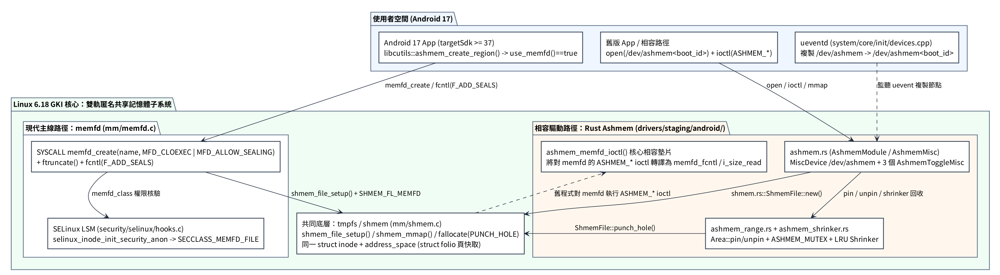
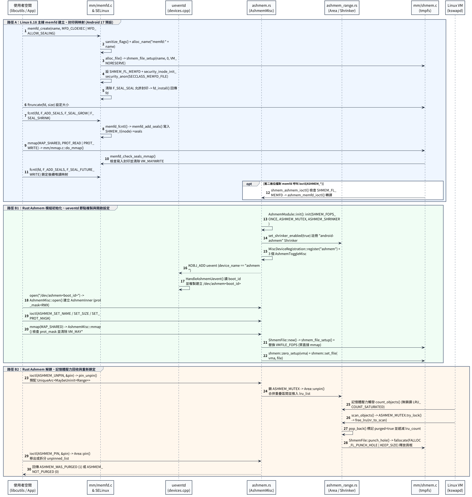

# 6.1 核心層匿名共享記憶體：`memfd` 與 Rust 版 Ashmem 驅動

- **情景說明**：在 Android 17（Linux 6.18 GKI 核心）中，核心層匿名共享記憶體呈現「**Linux 主線 `memfd` 為主、Rust 重寫的 `ashmem_rust` 驅動為相容後端**」的雙軌架構：
  1. **現代主線路徑（`memfd`）**：Android 17 應用程式（`targetSdk >= 37`）呼叫 `memfd_create(name, MFD_CLOEXEC | MFD_ALLOW_SEALING)` 建立基於 `shmem`/`tmpfs` 的匿名記憶體檔案，通過 SELinux `memfd_class` 核驗，再經 `ftruncate` 定長與 `fcntl(F_ADD_SEALS)` 施加不可逆封印（`F_SEAL_GROW | F_SEAL_SHRINK`，寫完後加 `F_SEAL_FUTURE_WRITE` 鎖定後續唯讀映射）；若舊二進位程式誤對該 `memfd` 發送 `ASHMEM_*` ioctl，GKI 核心還透過 `shmem_ashmem_ioctl` → `ashmem_memfd_ioctl` 透明轉譯。
  2. **相容驅動路徑（Rust `ashmem_rust`）**：開機時核心載入以 Rust 改寫的 `ashmem_rust` 驅動，註冊 `/dev/ashmem` 與三個動態控制雜項裝置，`ueventd` 另行複製 `/dev/ashmem<boot_id>` 以封鎖硬編碼直開路徑；舊行程開啟該裝置後設定名稱、大小、權限並執行 `mmap` 綁定底層 `ShmemFile`，最後展示 `ASHMEM_UNPIN`／`ASHMEM_PIN` 與記憶體壓力下的 `Shrinker` 回收全鏈路。
- **對應原書**：第 6 章引言與 6.1 節〈Ashmem 驱动程序〉（p.335–353）
- **涉及專案與版本基準**：
  - `kernel/common` 〔`android17-6.18`，Linux 6.18，commit `028363aa3cfa`〕
  - `platform/system/core` 〔`android-17.0.0_r1`，commit `545d248`〕

---

## 6.1.1 核心架構轉型：從 C 版 `ashmem.c` 到「`memfd` + Rust 版 `ashmem_rust`」雙軌並存

> 對應原書第 6 章引言（p.335–336）與 6.1.1（p.336–338）。原書 2.3 時代，Linux 主線尚未提供可匿名建立且支援權限封印的記憶體檔案系統呼叫（`memfd_create` 直到 Linux 3.17 才合入），因此 Android 在 `drivers/staging/android/ashmem.c` 自建了 C 語言 Ashmem 驅動，透過 `/dev/ashmem` 雜項裝置封裝 `tmpfs`/`shmem`，額外提供「權限縮限（`prot_mask`）」與「鎖定／解鎖回收（`pin`/`unpin` + `shrinker`）」兩大特性。到了 **Android 17 + Linux 6.18 GKI**，核心端已發生兩次根本性演進：
> 1. **主線化（`memfd`）**：`memfd_create()` + `F_ADD_SEALS` 搭配 SELinux `memfd_class` policy capability 已能完整取代 Ashmem 的匿名建立與不可逆唯讀保護，Android 17 正式讓 `targetSdk >= 37` 預設走 `memfd`。
> 2. **Rust 化（`ashmem_rust`）**：為了消除傳統 C 驅動的記憶體安全與鎖序風險，GKI 6.18 徹底移除 `ashmem.c`，由 Google（Alice Ryhl）以 Rust 完整重寫為 `ashmem.rs` 系列檔案，既維繫既有相容裝置 `/dev/ashmem`，又在核心內為 `memfd` 提供 `ASHMEM_*` ioctl 轉譯墊片。



### Step 1：核心編譯設定 `CONFIG_ASHMEM` 與符號匯出（`Kconfig`、`ashmem_exports.c`）
**位置**：`kernel/common/drivers/staging/android/Kconfig` 〔`android17-6.18`，lines 1–12〕、`kernel/common/drivers/staging/android/Makefile` 〔`android17-6.18`，lines 1–4〕、`kernel/common/drivers/staging/android/ashmem_exports.c` 〔`android17-6.18`，lines 19–22〕

```kconfig
config ASHMEM
	bool "Enable the Anonymous Shared Memory Subsystem"
	depends on SHMEM && RUST
	help
	  The ashmem subsystem is a new shared memory allocator, similar to
	  POSIX SHM but with different behavior and sporting a simpler
	  file-based API.

	  It is, in theory, a good memory allocator for low-memory devices,
	  because it can discard shared memory units when under memory pressure.
```

```makefile
ccflags-y += -I$(src)			# needed for trace events

obj-$(CONFIG_ASHMEM)		+= ashmem.o ashmem_exports.o
```

```c
EXPORT_SYMBOL_GPL(is_ashmem_file);
EXPORT_SYMBOL_GPL(ashmem_area_name);
EXPORT_SYMBOL_GPL(ashmem_area_size);
EXPORT_SYMBOL_GPL(ashmem_area_vmfile);
```

`Kconfig` 第 4 行明定 `depends on SHMEM && RUST`——換言之，在 Linux 6.18 GKI 中已**不再存在 C 語言版本的 Ashmem**，`ashmem.o` 直接由 Rust 源碼 `ashmem.rs` 編譯而成。由於目前核心 Rust 符號匯出機制僅自動處理根目錄 `rust/` 底下的 crate，因此額外配了一個極簡的 `ashmem_exports.c`，將 `ashmem.rs` 以 `#[no_mangle] unsafe extern "C"` 實作的四個查詢介面（判斷是否為 ashmem 檔案、讀取名稱／大小／底層 `vmfile`）透過 `EXPORT_SYMBOL_GPL` 匯出給其他核心模組使用。

> 〔與 2.3 差異〕邏輯改變 + 語言重寫：原書 2.3（p.336）為純 C 實作 `drivers/staging/android/ashmem.c`，無需 Rust 工具鏈，亦無 `ashmem_exports.c`；GKI 6.18 全面改由 Rust `ashmem_rust` 實作並保留對外 C ABI 匯出。

---

### Step 2：核心資料結構對照（`Ashmem` / `AshmemInner` / `Range` / `AshmemLru`）
**位置**：`kernel/common/drivers/staging/android/ashmem.rs` 〔`android17-6.18`，lines 144–157〕、`kernel/common/drivers/staging/android/ashmem_range.rs` 〔`android17-6.18`，lines 30–35、114–141、217–222〕

```rust
/// Represents an open ashmem file.
#[pin_data]
struct Ashmem {
    #[pin]
    inner: Mutex<AshmemInner>,
}

struct AshmemInner {
    size: usize,
    prot_mask: usize,
    /// If set, then this holds the ashmem name without the dev/ashmem/ prefix. No zero terminator.
    name: Option<KVec<u8>>,
    file: Option<ShmemFile>,
    area: Area,
}
```

```rust
static LRU_COUNT_SATURATED: AtomicUsize = AtomicUsize::new(0);

pub(crate) struct AshmemLru {
    lru_list: List<Range, 0>,
    lru_count: u128,
}
...
kernel::sync::global_lock! {
    pub(crate) unsafe(uninit) static ASHMEM_MUTEX: Mutex<AshmemLru> = AshmemLru {
        lru_list: List::new(),
        lru_count: 0,
    };
}

#[pin_data]
pub(crate) struct Range {
    #[pin]
    lru: ListLinks<0>,
    #[pin]
    unpinned: ListLinks<1>,
    file: ShmemFile,
    pub(crate) inner: GlobalLockedBy<RangeInner, ASHMEM_MUTEX>,
}

pub(crate) struct RangeInner {
    pub(crate) pgstart: usize,
    pub(crate) pgend: usize,
    pub(crate) purged: bool,
}
...
pub(crate) struct Area {
    /// List of page ranges that have been unpinned by `ASHMEM_UNPIN`.
    ///
    /// The ranges are sorted in descending order.
    unpinned_list: List<Range, 1>,
}
```

與原書 2.3 的單一大鎖設計相比，Rust 版資料結構在**鎖分層**與**型別安全**上有三大關鍵改進：
1. **雙層鎖分離**：每個打開的檔案實例 `Ashmem` 自帶一把細粒度 `inner: Mutex<AshmemInner>`（保護 `size`、`prot_mask`、`name`、`file`、`area`）；而全域 `ASHMEM_MUTEX` 僅負責保護 `AshmemLru`（所有已解鎖區間的全局 LRU 鏈表 `lru_list`、頁數總計 `lru_count`）以及每個 `Range` 的 `GlobalLockedBy<RangeInner, ASHMEM_MUTEX>`。
2. **編譯期雙重侵入式鏈表**：`Range` 同時掛載在兩個鏈表上——編號 `0` 的 `lru: ListLinks<0>` 掛入全域 `AshmemLru::lru_list`，編號 `1` 的 `unpinned: ListLinks<1>` 掛入單一區域的 `Area::unpinned_list`（按頁號降序排列），並以 `ListArc<Range, 0>` / `ListArc<Range, 1>` 在編譯期保證引用計數與節點生命週期安全。
3. **無鎖統計供 Shrinker 查詢**：`LRU_COUNT_SATURATED` 為 `lru_count` 的飽和快取副本，讓記憶體管理子系統呼叫 `Shrinker::count_objects()` 時無須爭搶 `ASHMEM_MUTEX`。

相對地，Linux 主線 **`memfd`** 完全不需自建這些驅動結構：它直接復用核心標準的 `struct shmem_inode_info`（透過 `SHMEM_I(inode)` 存取），只額外使用其中的 `flags`（標記 `SHMEM_FL_MEMFD`）與 `seals`（存放封印位元遮罩），頁快取與回收交由標準 `tmpfs`/`shmem` 處理。

> 〔與 2.3 差異〕邏輯改變：原書 2.3（p.336–338）的 `struct ashmem_area` 與 `struct ashmem_range` 全部共用同一把全域 `ashmem_mutex`，且須手動維護 `ashmem_area_cachep`／`ashmem_range_cachep` 兩個 slab cache 與原始 `list_head`；Rust 版拆分為每檔獨立鎖 + 全域 LRU 鎖，並以 `GlobalLockedBy` 與 `ListArc` 由編譯器靜態強制鎖定不變量。

---

## 6.1.2 Linux 6.18 主線 `memfd`：建立、SELinux 授權與檔案封印

> 對應原書 6.1.3–6.1.4（p.340–344）的「建立與權限設定」職責，但在 Android 17 已由 Linux 主線系統呼叫 `memfd_create()` + `fcntl(F_ADD_SEALS)` 承接。不同於 Ashmem 必須先 `open("/dev/ashmem")` 再 `ioctl(ASHMEM_SET_NAME / SET_SIZE)` 並延遲到 `mmap` 才建出 `shmem` 檔案，`memfd_create()` 在建立當下就一步產出匿名 `shmem` 檔案與 fd。

### Step 3：`SYSCALL_DEFINE2(memfd_create)` 與旗標／名稱校驗
**位置**：`kernel/common/include/uapi/linux/memfd.h` 〔`android17-6.18`，lines 8–14〕、`kernel/common/mm/memfd.c` 〔`android17-6.18`，lines 339–366、410–457、510–547〕

```c
/* flags for memfd_create(2) (unsigned int) */
#define MFD_CLOEXEC		0x0001U
#define MFD_ALLOW_SEALING	0x0002U
#define MFD_HUGETLB		0x0004U
/* not executable and sealed to prevent changing to executable. */
#define MFD_NOEXEC_SEAL		0x0008U
/* executable */
#define MFD_EXEC		0x0010U
```

```c
SYSCALL_DEFINE2(memfd_create,
		const char __user *, uname,
		unsigned int, flags)
{
	struct file *file;
	int fd, error;
	char *name;

	error = sanitize_flags(&flags);
	if (error < 0)
		return error;

	name = alloc_name(uname);
	if (IS_ERR(name))
		return PTR_ERR(name);

	fd = get_unused_fd_flags((flags & MFD_CLOEXEC) ? O_CLOEXEC : 0);
	if (fd < 0) {
		error = fd;
		goto err_free_name;
	}

	file = alloc_file(name, flags);
	if (IS_ERR(file)) {
		error = PTR_ERR(file);
		goto err_free_fd;
	}

	fd_install(fd, file);
	kfree(name);
	return fd;

err_free_fd:
	put_unused_fd(fd);
err_free_name:
	kfree(name);
	return error;
}
```

呼叫流程分四步：
1. **`sanitize_flags()`**：驗證旗標位元合法性（禁止同時指定 `MFD_EXEC` 與 `MFD_NOEXEC_SEAL`），並呼叫 `check_sysctl_memfd_noexec()` 依當前 PID namespace 的 `vm.memfd_noexec` sysctl 決定預設可執行性或拒絕未設 `MFD_NOEXEC_SEAL` 的請求。
2. **`alloc_name()`**：分配核心緩衝區，加上固定前綴 `"memfd:"`（`MFD_NAME_PREFIX`）後以 `strncpy_from_user()` 複製使用者傳入的偵錯名稱。這正是使用者空間 `libcutils` 透過 `readlink("/proc/self/fd/<fd>")` 檢查前綴 `"/memfd:"` 的來源。
3. **`get_unused_fd_flags()`**：在當前行程的檔案描述符表中預留空槽，並依 `MFD_CLOEXEC` 加上 `O_CLOEXEC`。
4. **`alloc_file()` → `fd_install()`**：建立底層匿名 `shmem`（或 `hugetlb`）`struct file`，成功後綁定到 `fd` 回傳使用者空間。

> 〔與 2.3 差異〕新增：Android 2.3 時代尚無 `memfd_create` 系統呼叫，建立匿名共享記憶體必須走 `/dev/ashmem` 字元裝置。

---

### Step 4：`alloc_file` 建立 `shmem` 檔案、標記 `SHMEM_FL_MEMFD` 與初始化封印位元
**位置**：`kernel/common/mm/memfd.c` 〔`android17-6.18`，lines 459–508〕

```c
static struct file *alloc_file(const char *name, unsigned int flags)
{
	unsigned int *file_seals;
	struct file *file;
	struct inode *inode;
	int err = 0;

	if (flags & MFD_HUGETLB) {
		file = hugetlb_file_setup(name, 0, VM_NORESERVE,
					HUGETLB_ANONHUGE_INODE,
					(flags >> MFD_HUGE_SHIFT) &
					MFD_HUGE_MASK);
	} else {
		file = shmem_file_setup(name, 0, VM_NORESERVE);
	}
	if (IS_ERR(file))
		return file;

	inode = file_inode(file);

	if (!(flags & MFD_HUGETLB))
		SHMEM_I(inode)->flags |= SHMEM_FL_MEMFD;

	err = security_inode_init_security_anon(inode,
			&QSTR(MEMFD_ANON_NAME), NULL);
	if (err) {
		fput(file);
		file = ERR_PTR(err);
		return file;
	}

	file->f_mode |= FMODE_LSEEK | FMODE_PREAD | FMODE_PWRITE;
	file->f_flags |= O_LARGEFILE;

	if (flags & MFD_NOEXEC_SEAL) {
		inode->i_mode &= ~0111;
		file_seals = memfd_file_seals_ptr(file);
		if (file_seals) {
			*file_seals &= ~F_SEAL_SEAL;
			*file_seals |= F_SEAL_EXEC;
		}
	} else if (flags & MFD_ALLOW_SEALING) {
		/* MFD_EXEC and MFD_ALLOW_SEALING are set */
		file_seals = memfd_file_seals_ptr(file);
		if (file_seals)
			*file_seals &= ~F_SEAL_SEAL;
	}

	return file;
}
```

此函式有四個對 Android 17 極為關鍵的細節：
1. **初始大小為 0 且掛載 `VM_NORESERVE`**：`shmem_file_setup(name, 0, VM_NORESERVE)` 建立未掛載於任何目錄樹的匿名 tmpfs 檔案；使用者空間後續透過 `ftruncate(fd, size)` 調整大小。
2. **標記 `SHMEM_FL_MEMFD`**：這是 Android GKI 核心後續在 `mm/shmem.c::shmem_ashmem_ioctl()` 辨識「此 `shmem` 檔案來自 `memfd` 而非一般 `tmpfs`」的關鍵旗標。
3. **呼叫 `security_inode_init_security_anon()`**：將 `MEMFD_ANON_NAME` 傳入 LSM（SELinux），觸發獨立的 `memfd_file` 安全類別初始化與建立權限核驗（見 Step 5）。
4. **預設封印鎖死策略**：`shmem_file_setup()` 預設會把 `seals` 設為 `F_SEAL_SEAL`（禁止任何後續封印）；只有當呼叫端明確傳入 `MFD_ALLOW_SEALING`（或 `MFD_NOEXEC_SEAL`）時，才清除 `F_SEAL_SEAL`，讓後續 `fcntl(F_ADD_SEALS)` 得以生效。

> 〔與 2.3 差異〕邏輯改變：原書 2.3（p.343）的 Ashmem 是在首次 `mmap` 時才呼叫 `shmem_file_setup()` 延遲建檔；`memfd` 則在 `memfd_create()` 當下即完成 `shmem_file_setup()`、LSM 安全標籤綁定與封印開關配置。

---

### Step 5：SELinux `memfd_class` 安全類別核驗（`selinux_inode_init_security_anon`）
**位置**：`kernel/common/security/selinux/hooks.c` 〔`android17-6.18`，lines 2979–3043〕

```c
static int selinux_inode_init_security_anon(struct inode *inode,
					    const struct qstr *name,
					    const struct inode *context_inode)
{
	u32 sid = current_sid();
	struct common_audit_data ad;
	struct inode_security_struct *isec;
	int rc;
	bool is_memfd = false;

	if (unlikely(!selinux_initialized()))
		return 0;

	if (name != NULL && name->name != NULL &&
	    !strcmp(name->name, MEMFD_ANON_NAME)) {
		if (!selinux_policycap_memfd_class())
			return 0;
		is_memfd = true;
	}

	isec = selinux_inode(inode);
...
	if (context_inode) {
		...
	} else {
		if (is_memfd)
			isec->sclass = SECCLASS_MEMFD_FILE;
		else
			isec->sclass = SECCLASS_ANON_INODE;
		rc = security_transition_sid(
			sid, sid,
			isec->sclass, name, &isec->sid);
		if (rc)
			return rc;
	}

	isec->initialized = LABEL_INITIALIZED;
...
	ad.type = LSM_AUDIT_DATA_ANONINODE;
	ad.u.anonclass = name ? (const char *)name->name : "?";

	return avc_has_perm(sid,
			    isec->sid,
			    isec->sclass,
			    FILE__CREATE,
			    &ad);
}
```

為何 Android 過去多年不敢直接把所有 `ashmem` 預設切到 `memfd`？主因就在於 SELinux 規則隔離：早期 Linux 的 `memfd` 與一般 `tmpfs` 檔案共用 `SECCLASS_FILE`，會與裝置上現有的 tmpfs SELinux 策略互相污染。Linux 6.18 引入 **`memfd_class` policy capability**（對應 sysfs 節點 `/sys/fs/selinux/policy_capabilities/memfd_class`）後：
- 當策略啟用 `selinux_policycap_memfd_class()` 時，`memfd` 的 inode 會被賦予專屬類別 **`SECCLASS_MEMFD_FILE`**，並執行 `security_transition_sid()` 計算專屬 SID（例如區分不同 domain 建立的 memfd）；
- 隨後透過 `avc_has_perm(..., SECCLASS_MEMFD_FILE, FILE__CREATE, ...)` 檢查當前行程是否有權建立該 `memfd`，後續跨 Binder 傳遞與 `mmap` 也能對 `memfd_file` 實施獨立於 `tmpfs` 的細粒度 SELinux 管控。這也是 Android 17 `libcutils::use_memfd()` 必檢 `memfd_class` 的根本原因。

> 〔與 2.3 差異〕新增：原書 2.3 尚未啟用 SELinux（Android 4.3 才引入），更無 `SECCLASS_MEMFD_FILE` 獨立類別。

---

### Step 6：`memfd_fcntl` 與 `memfd_add_seals` 不可逆檔案封印
**位置**：`kernel/common/mm/memfd.c` 〔`android17-6.18`，lines 224–337〕

```c
#define F_ALL_SEALS (F_SEAL_SEAL | \
		     F_SEAL_EXEC | \
		     F_SEAL_SHRINK | \
		     F_SEAL_GROW | \
		     F_SEAL_WRITE | \
		     F_SEAL_FUTURE_WRITE)

static int memfd_add_seals(struct file *file, unsigned int seals)
{
	struct inode *inode = file_inode(file);
	unsigned int *file_seals;
	int error;

	if (!(file->f_mode & FMODE_WRITE))
		return -EPERM;
	if (seals & ~(unsigned int)F_ALL_SEALS)
		return -EINVAL;

	inode_lock(inode);

	file_seals = memfd_file_seals_ptr(file);
	if (!file_seals) {
		error = -EINVAL;
		goto unlock;
	}

	if (*file_seals & F_SEAL_SEAL) {
		error = -EPERM;
		goto unlock;
	}

	/*
	 * SEAL_EXEC implies SEAL_WRITE, making W^X from the start.
	 */
	if (seals & F_SEAL_EXEC && inode->i_mode & 0111)
		seals |= F_SEAL_SHRINK|F_SEAL_GROW|F_SEAL_WRITE|F_SEAL_FUTURE_WRITE;

	if ((seals & F_SEAL_WRITE) && !(*file_seals & F_SEAL_WRITE)) {
		error = mapping_deny_writable(file->f_mapping);
		if (error)
			goto unlock;

		error = memfd_wait_for_pins(file->f_mapping);
		if (error) {
			mapping_allow_writable(file->f_mapping);
			goto unlock;
		}
	}

	*file_seals |= seals;
	error = 0;

unlock:
	inode_unlock(inode);
	return error;
}
```

```c
long memfd_fcntl(struct file *file, unsigned int cmd, unsigned int arg)
{
	long error;

	switch (cmd) {
	case F_ADD_SEALS:
		error = memfd_add_seals(file, arg);
		break;
	case F_GET_SEALS:
		error = memfd_get_seals(file);
		break;
	default:
		error = -EINVAL;
		break;
	}

	return error;
}
```

封印只能透過 `*file_seals |= seals` 單向疊加、永不撤銷，且影響整個底層 `inode`（所有持有該 fd 或其複本的行程）。請特別留意 **`F_SEAL_WRITE` 與 `F_SEAL_FUTURE_WRITE` 的關鍵差別**：
- **`F_SEAL_WRITE`**：呼叫 `mapping_deny_writable()` 要求**當下不能存在任何可寫的 `MAP_SHARED` 映射**，還必須執行 `memfd_wait_for_pins()` 確認沒有進行中的 GUP（`get_user_pages`）DMA 寫入，否則回傳 `-EBUSY`。這意味著生產者自己若保持著可寫映射（例如 `system_server` 持續更新 `ApplicationSharedMemory` 或 `MemoryHeapBase(READ_ONLY)` 寫端保留寫權限、讀端只准唯讀），就無法使用 `F_SEAL_WRITE`。
- **`F_SEAL_FUTURE_WRITE`**（Android 推動合入 Linux 5.1）：允許**既有**的可寫映射繼續寫入，但禁止之後透過 `write()` 系統呼叫或新建 `PROT_WRITE | MAP_SHARED` 映射來寫入——完美對應 Ashmem 原先「先自己 `mmap(PROT_READ | PROT_WRITE)`，再降權為 `PROT_READ` 後交給接收方」的單寫多讀（SWMR）語意！
- **`F_SEAL_GROW | F_SEAL_SHRINK`**：Android 建立 `memfd` 時一定立刻加上這兩道封印，保證區域大小固定不變，與 Ashmem `ASHMEM_SET_SIZE` 後不可再改大小（且避免接收方因檔案被截斷收到 `SIGBUS`）的行為完全一致。

> 〔與 2.3 差異〕邏輯改變：原書 2.3（p.341–342）靠 `ashmem_area` 私有欄位 `prot_mask` 與「已 `mmap` 後禁止 `ASHMEM_SET_SIZE`」來防護；`memfd` 改用核心原生且不可逆的 `F_SEAL_*` 封印位元，直接作用於 `inode`。

---

### Step 7：映射期封印檢查（`do_mmap` → `memfd_check_seals_mmap`）
**位置**：`kernel/common/mm/mmap.c` 〔`android17-6.18`，lines 492–498〕、`kernel/common/mm/memfd.c` 〔`android17-6.18`，lines 368–408〕

```c
		/*
		 * Check to see if we are violating any seals and update VMA
		 * flags if necessary to avoid future seal violations.
		 */
		err = memfd_check_seals_mmap(file, &vm_flags);
		if (err)
			return (unsigned long)err;
```

```c
static inline bool is_write_sealed(unsigned int seals)
{
	return seals & (F_SEAL_WRITE | F_SEAL_FUTURE_WRITE);
}

static int check_write_seal(vm_flags_t *vm_flags_ptr)
{
	vm_flags_t vm_flags = *vm_flags_ptr;
	vm_flags_t mask = vm_flags & (VM_SHARED | VM_WRITE);

	/* If a private mapping then writability is irrelevant. */
	if (!(mask & VM_SHARED))
		return 0;

	/*
	 * New PROT_WRITE and MAP_SHARED mmaps are not allowed when
	 * write seals are active.
	 */
	if (mask & VM_WRITE)
		return -EPERM;

	/*
	 * This is a read-only mapping, disallow mprotect() from making a
	 * write-sealed mapping writable in future.
	 */
	*vm_flags_ptr &= ~VM_MAYWRITE;

	return 0;
}

int memfd_check_seals_mmap(struct file *file, vm_flags_t *vm_flags_ptr)
{
	int err = 0;
	unsigned int *seals_ptr = memfd_file_seals_ptr(file);
	unsigned int seals = seals_ptr ? *seals_ptr : 0;

	if (is_write_sealed(seals))
		err = check_write_seal(vm_flags_ptr);

	return err;
}
```

每當任一行程對 `memfd` 呼叫 `mmap()`，核心在 `mm/mmap.c::do_mmap()` 建立 VMA 前便先執行 `memfd_check_seals_mmap()`：
1. 若為 `MAP_PRIVATE`（寫時拷貝不影響共享頁），放行；
2. 若已施加 `F_SEAL_WRITE` 或 `F_SEAL_FUTURE_WRITE`，且請求 `MAP_SHARED | PROT_WRITE`，立即以 `-EPERM` 拒絕；
3. 若請求 `MAP_SHARED | PROT_READ`，雖允許映射，但會主動清除 **`VM_MAYWRITE`**，徹底堵死惡意行程「先以唯讀 `mmap`、再呼叫 `mprotect(PROT_READ | PROT_WRITE)` 提權竄改」的攻擊路徑。

> 〔與 2.3 差異〕邏輯改變：原書 2.3 的權限保護攔截在驅動自己的 `ashmem_mmap` 中完成；`memfd` 則直接整合進 Linux 通用 `do_mmap()` 主路徑，由 `memfd_check_seals_mmap()` 統一把關。

---

### Step 8：GKI 專屬核心相容墊片（`shmem_ashmem_ioctl` → `ashmem_memfd_ioctl`）
**位置**：`kernel/common/mm/shmem.c` 〔`android17-6.18`，lines 5297–5325〕、`kernel/common/drivers/staging/android/ashmem.rs` 〔`android17-6.18`，lines 549–685〕

```c
#ifdef CONFIG_ASHMEM
static long shmem_ashmem_ioctl(struct file *file, unsigned int cmd, unsigned long arg)
{
	if (!(SHMEM_I(file_inode(file))->flags & SHMEM_FL_MEMFD))
		return -ENOTTY;
	return ashmem_memfd_ioctl(file, cmd, arg);
}
#endif

static const struct file_operations shmem_file_operations = {
	.mmap		= shmem_mmap,
	.open		= shmem_file_open,
	.get_unmapped_area = shmem_get_unmapped_area,
...
#ifdef CONFIG_ASHMEM
	.unlocked_ioctl	= shmem_ashmem_ioctl,
#ifdef CONFIG_COMPAT
	.compat_ioctl	= shmem_ashmem_ioctl,
#endif
#endif
};
```

```rust
fn ashmem_memfd_ioctl_inner(file: &File, cmd: u32, arg: usize) -> Result<isize> {
    use kernel::bindings::{F_ADD_SEALS, F_GET_SEALS, F_SEAL_FUTURE_WRITE, F_SEAL_WRITE};
    const WRITE_SEALS_MASK: usize = (F_SEAL_WRITE | F_SEAL_FUTURE_WRITE) as usize;
...
    let size = _IOC_SIZE(cmd);
    match cmd {
        bindings::ASHMEM_GET_NAME => {
            pin_init::stack_pin_init! {
                let full_name = shmem::DentryNameSnapshot::new(file)
            }
            let name = full_name.strip_prefix(b"memfd:").unwrap_or(&full_name);
            ...
        }
        bindings::ASHMEM_GET_SIZE => {
            let file_ptr = file.as_ptr();
            let inode = unsafe { (*file_ptr).f_inode };
            let size = unsafe { bindings::i_size_read(inode) };
            Ok(size as isize)
        }
        bindings::ASHMEM_SET_PROT_MASK => {
            let seals = get_seals(file)?;
            let mut prot = arg;

            // The memfd compat layer does not support unsetting these.
            prot |= PROT_READ | PROT_EXEC;

            let is_writable = seals & WRITE_SEALS_MASK == 0;
            let should_be_writable = prot & PROT_WRITE != 0;

            if !is_writable && should_be_writable {
                // Can't add PROT bits.
                return Err(EINVAL);
            }

            if is_writable && !should_be_writable {
                let ret = unsafe {
                    bindings::memfd_fcntl(file.as_ptr(), F_ADD_SEALS, F_SEAL_FUTURE_WRITE)
                };
                if ret < 0 {
                    return Err(Error::from_errno(ret as i32));
                }
            }
            Ok(0)
        }
        bindings::ASHMEM_GET_PROT_MASK => {
            let seals = get_seals(file)?;
            let mut prot = PROT_READ | PROT_EXEC;
            if seals & WRITE_SEALS_MASK == 0 {
                prot |= PROT_WRITE;
            }
            Ok(prot as isize)
        }
        bindings::ASHMEM_GET_FILE_ID => {
            let ino = unsafe { (*(*file.as_ptr()).f_inode).i_ino as usize };
            let mut writer = UserSlice::new(UserPtr::from_addr(arg), size).writer();
            writer.write(&ino)?;
            Ok(0)
        }
        // Just ignore unpin requests.
        ASHMEM_PIN => Ok(bindings::ASHMEM_NOT_PURGED as isize),
        ASHMEM_UNPIN => Ok(0),
        ASHMEM_GET_PIN_STATUS => Ok(bindings::ASHMEM_IS_PINNED as isize),
        bindings::ASHMEM_PURGE_ALL_CACHES => {
            if !has_cap_sys_admin() {
                return Err(EPERM);
            }
            Ok(0)
        }
        bindings::ASHMEM_SET_NAME => Err(EINVAL),
        bindings::ASHMEM_SET_SIZE => Err(EINVAL),
        _ => Err(ENOTTY),
    }
}
```

這是 Android 17 能平順切換 `memfd` 的**最後一塊拼圖**：試想一個 Android 17 App（走 `memfd`）把共享記憶體 fd 經 Binder 傳給一個舊版預編譯 Vendor HAL 或第三方 `.so`，後者以為收到的是 Ashmem fd，直接呼叫 `ioctl(fd, ASHMEM_GET_SIZE)` 或 `ioctl(fd, ASHMEM_SET_PROT_MASK, PROT_READ)`。在 Linux 6.18 GKI 中：
- `shmem_file_operations` 在啟用 `CONFIG_ASHMEM` 時會掛上 `shmem_ashmem_ioctl()`；
- 它先檢查 `SHMEM_I(inode)->flags & SHMEM_FL_MEMFD`（確保不影響一般 tmpfs），接著轉入 Rust 實作的 `ashmem_memfd_ioctl_inner()`；
- `ASHMEM_GET_NAME` 剝離 `"memfd:"` 前綴回傳、`ASHMEM_GET_SIZE` 轉為 `i_size_read(inode)`、`ASHMEM_SET_PROT_MASK` 移除 `PROT_WRITE` 時自動轉呼 `memfd_fcntl(F_ADD_SEALS, F_SEAL_FUTURE_WRITE)`、`ASHMEM_PIN`/`UNPIN` 則作為無害 no-op 直接回傳未回收。

> 〔與 2.3 差異〕新增：原書 2.3 完全沒有 `memfd` 與相容墊片機制；此設計專為 Android 17 漸進汰換 Ashmem 而打造。

---

## 6.1.3 Rust 版 Ashmem 驅動初始化、動態開關與 `ueventd` 裝置隔離

> 對應原書 6.1.2（p.338–340）。對於尚未滿足 `use_memfd()` 條件的舊版 App（`targetSdk < 37`）或舊 Vendor 裝置，核心仍會透過 Rust 版 `ashmem_rust` 驅動提供完整的 Ashmem 語意。

### Step 9：`AshmemModule::init` 與三個 `AshmemToggleMisc` 動態控制裝置
**位置**：`kernel/common/drivers/staging/android/ashmem.rs` 〔`android17-6.18`，lines 91–141〕、`kernel/common/drivers/staging/android/ashmem_toggle.rs` 〔`android17-6.18`，lines 24–104〕

```rust
module! {
    type: AshmemModule,
    name: "ashmem_rust",
    authors: ["Alice Ryhl"],
    description: "Anonymous Shared Memory Subsystem",
    license: "GPL",
}

struct AshmemModule {
    _misc: Pin<KBox<MiscDeviceRegistration<AshmemMisc>>>,
    _toggle_unpin: Pin<KBox<MiscDeviceRegistration<AshmemToggleMisc<AshmemToggleShrinker>>>>,
    _toggle_read: Pin<KBox<MiscDeviceRegistration<AshmemToggleMisc<AshmemToggleRead>>>>,
    _toggle_exec: Pin<KBox<MiscDeviceRegistration<AshmemToggleMisc<AshmemToggleExec>>>>,
}

impl kernel::Module for AshmemModule {
    fn init(_module: &'static kernel::ThisModule) -> Result<Self> {
        unsafe { shmem::SHMEM_FOPS_ONCE.init() };
        unsafe { ASHMEM_MUTEX.init() };
        unsafe { ashmem_range::ASHMEM_SHRINKER.init() };

        pr_info!("Using Rust implementation.");

        ashmem_range::set_shrinker_enabled(true)?;

        let ashmem_miscdevice_registration = KBox::pin_init(
            MiscDeviceRegistration::register(
                MiscDeviceOptions {
                    name: c_str!("ashmem"),
                },
                Ok(AshmemMisc),
            ),
            GFP_KERNEL,
        )?;
        let ashmem_miscdevice_ptr = ashmem_miscdevice_registration.as_raw();
        let fops_ptr = unsafe { (*ashmem_miscdevice_ptr).fops };
        ASHMEM_FOPS_PTR.store(fops_ptr.cast_mut(), Ordering::Relaxed);

        Ok(Self {
            _misc: ashmem_miscdevice_registration,
            _toggle_unpin: AshmemToggleMisc::<AshmemToggleShrinker>::new()?,
            _toggle_read: AshmemToggleMisc::<AshmemToggleRead>::new()?,
            _toggle_exec: AshmemToggleMisc::<AshmemToggleExec>::new()?,
        })
    }
}
```

```rust
pub(crate) struct AshmemToggleShrinker;

impl AshmemToggle for AshmemToggleShrinker {
    const NAME: &'static CStr = c_str!("ashmem_unpinning_enable");
    fn set(enabled: bool) -> Result<()> {
        ashmem_range::set_shrinker_enabled(enabled)
    }
    fn get() -> bool {
        ashmem_range::get_shrinker_enabled()
    }
}

pub(crate) struct AshmemToggleRead;

impl AshmemToggle for AshmemToggleRead {
    const NAME: &'static CStr = c_str!("ashmem_ignore_unset_prot_read");
    fn set(enabled: bool) -> Result<()> {
        IGNORE_UNSET_PROT_READ.store(enabled, Ordering::Relaxed);
        Ok(())
    }
    fn get() -> bool {
        IGNORE_UNSET_PROT_READ.load(Ordering::Relaxed)
    }
}

pub(crate) struct AshmemToggleExec;

impl AshmemToggle for AshmemToggleExec {
    const NAME: &'static CStr = c_str!("ashmem_ignore_unset_prot_exec");
    fn set(enabled: bool) -> Result<()> {
        IGNORE_UNSET_PROT_EXEC.store(enabled, Ordering::Relaxed);
        Ok(())
    }
    fn get() -> bool {
        IGNORE_UNSET_PROT_EXEC.load(Ordering::Relaxed)
    }
}
```

模組初始化完成四件工作：
1. 初始化三把全域靜態鎖：`SHMEM_FOPS_ONCE`、`ASHMEM_MUTEX`、`ASHMEM_SHRINKER`；
2. 呼叫 `ashmem_range::set_shrinker_enabled(true)` 向核心 VM 註冊名為 `"android-ashmem"` 的記憶體回收器；
3. 註冊主雜項裝置 `/dev/ashmem`（`AshmemMisc`），並將產生的 `file_operations` 指標存入 `ASHMEM_FOPS_PTR`，供 `is_ashmem_file()` 透過比對 `(*file).f_op == ashmem_fops_ptr` 快速驗證檔案身份；
4. 額外註冊三個**動態遷移開關**雜項裝置（`/dev/ashmem_unpinning_enable`、`/dev/ashmem_ignore_unset_prot_read`、`/dev/ashmem_ignore_unset_prot_exec`），讓系統可在執行期動態關閉 unpin 回收或忽略清除 `PROT_READ`/`PROT_EXEC`（對齊 `memfd` 的語意以測試遷移相容性）。

> 〔與 2.3 差異〕邏輯改變 + 新增：原書 2.3（p.338–340）的 `ashmem_init` 需以 `kmem_cache_create` 建立兩個 slab cache 並呼叫 `misc_register` + `register_shrinker`；Rust 版透過 `KBox`/`UniqueArc` 直接走核心 allocator，不需自建 slab cache，並新增 3 個 `AshmemToggleMisc` 控制裝置。

---

### Step 10：`ueventd` 複製 `/dev/ashmem<boot_id>` 節點
**位置**：`platform/system/core/init/devices.cpp` 〔`android-17.0.0_r1`，lines 689–705〕、`platform/system/core/rootdir/ueventd.rc` 〔`android-17.0.0_r1`，line 47〕

```cpp
void DeviceHandler::HandleAshmemUevent(const Uevent& uevent) {
    if (uevent.device_name == "ashmem") {
        [[clang::no_destroy]] static const std::string boot_id_path =
                "/proc/sys/kernel/random/boot_id";
        std::string boot_id;
        if (!ReadFileToString(boot_id_path, &boot_id)) {
            PLOG(ERROR) << "Cannot duplicate ashmem device node. Failed to read " << boot_id_path;
            return;
        }
        boot_id = Trim(boot_id);

        Uevent dup_ashmem_uevent = uevent;
        dup_ashmem_uevent.device_name += boot_id;
        dup_ashmem_uevent.path += boot_id;
        HandleUevent(dup_ashmem_uevent);
    }
}
```

```rc
/dev/ashmem*              0666   root       root
```

當核心 `MiscDeviceRegistration::register("ashmem")` 發出 `KOBJ_ADD` uevent 時，使用者空間的 `ueventd` 在 `HandleAshmemUevent()` 攔截 `uevent.device_name == "ashmem"`，讀取每次開機隨機生成的 `/proc/sys/kernel/random/boot_id`（UUID），並複製出一份相同主次裝置號（major/minor）的節點 **`/dev/ashmem<boot_id>`**。搭配 SELinux 禁止一般 App 直接開啟 `/dev/ashmem`、只允許開啟 `/dev/ashmem<boot_id>`（由 `libcutils` 封裝讀取 `boot_id`），迫使應用程式必須改用標準 `ASharedMemory` / `SharedMemory` / `libcutils` API，不再硬編碼 `/dev/ashmem`，為透明切換至 `memfd` 鋪平道路。

> 〔與 2.3 差異〕新增：原書 2.3 僅建立單一固定路徑 `/dev/ashmem`，任何行程皆可直接 `open("/dev/ashmem")`。

---

## 6.1.4 Rust 版 Ashmem 裝置開啟、屬性設定與記憶體映射

> 對應原書 6.1.3（p.340–342）與 6.1.4（p.342–344）。

### Step 11：`AshmemMisc::open` 與 `ioctl`（`set_name`、`set_size`、`set_prot_mask`）
**位置**：`kernel/common/drivers/staging/android/ashmem.rs` 〔`android17-6.18`，lines 161–180、271–295、324–400〕

```rust
#[vtable]
impl MiscDevice for AshmemMisc {
    type File = Pin<KBox<Ashmem>>;

    fn open(_: &File, _: &MiscDeviceRegistration<Self>) -> Result<Self::File> {
        KBox::try_pin_init(
            try_pin_init! {
                Ashmem {
                    inner <- new_mutex!(AshmemInner {
                        size: 0,
                        prot_mask: PROT_MASK,
                        name: None,
                        file: None,
                        area: Area::new(),
                    }),
                }
            },
            GFP_KERNEL,
        )
    }
```

```rust
    fn set_name(&self, reader: UserSliceReader) -> Result<isize> {
        let mut buf = [0u8; ASHMEM_NAME_LEN];
        let name = reader.strcpy_into_buf(&mut buf)?.as_bytes();

        let mut v = KVec::with_capacity(name.len(), GFP_KERNEL)?;
        v.extend_from_slice(name, GFP_KERNEL)?;

        let mut asma = self.inner.lock();
        if asma.file.is_some() {
            return Err(EINVAL);
        }
        asma.name = Some(v);
        Ok(0)
    }
...
    fn set_size(&self, size: usize) -> Result<isize> {
        let mut asma = self.inner.lock();
        if asma.file.is_some() {
            return Err(EINVAL);
        }
        asma.size = size;
        Ok(0)
    }
...
    fn set_prot_mask(&self, mut prot: usize) -> Result<isize> {
        let mut asma = self.inner.lock();

        if (prot & PROT_READ != 0) && read_implies_exec(current!()) {
            prot |= PROT_EXEC;
        }

        if IGNORE_UNSET_PROT_READ.load(Ordering::Relaxed) {
            // Add back PROT_READ if asma.prot_mask has it.
            prot |= asma.prot_mask & PROT_READ;
        }

        if IGNORE_UNSET_PROT_EXEC.load(Ordering::Relaxed) {
            // Add back PROT_EXEC if asma.prot_mask has it.
            prot |= asma.prot_mask & PROT_EXEC;
        }

        // The user can only remove, not add, protection bits.
        if (asma.prot_mask & prot) != prot {
            return Err(EINVAL);
        }

        asma.prot_mask = prot;
        Ok(0)
    }
```

幾個重要設計細節：
- **開啟預設權限**：`AshmemMisc::open()` 配置一塊 `Pin<KBox<Ashmem>>`（由 `MiscDevice` 框架存於 `file->private_data`，檔案關閉時自動觸發 `Drop` 釋放，而 `Area::drop()` 會把所有殘留的 `unpinned_list` 節點從全域 `lru_list` 摘除），`prot_mask` 預設為 `PROT_READ | PROT_WRITE | PROT_EXEC`。
- **先拷貝、後上鎖**：`set_name()` 先在鎖外完成 `reader.strcpy_into_buf()` 與 `KVec` 記憶體配置，再獲取 `self.inner.lock()` 檢查 `asma.file.is_some()`（一旦已經 `mmap` 建出底層 `ShmemFile`，即拒絕修改名稱與大小），避免持鎖期間發生 page fault 或睡眠配置。
- **單向縮限保護位元**：`set_prot_mask()` 透過 `(asma.prot_mask & prot) != prot` 嚴格保證權限只能減少、不能增加；同時支援 `ashmem_ignore_unset_prot_read` / `exec` 兩個開關，以及 `ASHMEM_GET_FILE_ID`（回傳底層 `shmem` inode 編號 `i_ino`）與 `/proc/<pid>/fdinfo/<fd>` 的 `show_fdinfo()`（輸出 `inode`、`name`、`size` 供除錯工具統計共享記憶體）。

> 〔與 2.3 差異〕邏輯改變 + 擴充：原書 2.3（p.340–342）在 `set_name` 內持全域 `ashmem_mutex` 執行 `strncpy_from_user`，且無 `ASHMEM_GET_FILE_ID`、`show_fdinfo` 與 `IGNORE_UNSET_PROT_*` 開關；Rust 版改為鎖外使用者空間拷貝 + 細粒度檔案鎖，並支援 `compat_ioctl` 處理 32-bit 應用程式呼叫 64-bit 核心。

---

### Step 12：`AshmemMisc::mmap` 與 `ShmemFile::new`（綁定底層 `shmem` 與防繞過保護）
**位置**：`kernel/common/drivers/staging/android/ashmem.rs` 〔`android17-6.18`，lines 182–225〕、`kernel/common/drivers/staging/android/shmem.rs` 〔`android17-6.18`，lines 56–83、146–232〕

```rust
    fn mmap(me: Pin<&Ashmem>, _file: &File, vma: &VmaNew) -> Result<()> {
        let asma = &mut *me.inner.lock();

        // User needs to SET_SIZE before mapping.
        if asma.size == 0 || asma.size >= ASHMEM_MAX_SIZE {
            return Err(EINVAL);
        }

        // Requested mapping size larger than object size.
        if vma.end() - vma.start() > __page_align(asma.size) {
            return Err(EINVAL);
        }

        if asma.prot_mask & PROT_WRITE == 0 {
            vma.try_clear_maywrite().map_err(|_| EPERM)?;
        }
        if asma.prot_mask & PROT_EXEC == 0 {
            vma.try_clear_mayexec().map_err(|_| EPERM)?;
        }
        if asma.prot_mask & PROT_READ == 0 {
            vma.try_clear_mayread().map_err(|_| EPERM)?;
        }

        let file = match asma.file.as_ref() {
            Some(file) => file,
            None => {
                let mut name_buffer = [0u8; ASHMEM_FULL_NAME_LEN];
                let name = asma.full_name(&mut name_buffer);
                asma.file
                    .insert(ShmemFile::new(name, asma.size, vma.flags())?)
            }
        };

        if vma.flags() & vma_flags::SHARED != 0 {
            // We're really using this just to set vm_ops to `shmem_anon_vm_ops`. Anything else it
            // does is undone by the call to `set_file` below.
            shmem::zero_setup(vma)?;
        } else {
            shmem::vma_set_anonymous(vma);
        }

        shmem::set_file(vma, file.file());
        Ok(())
    }
```

```rust
    pub(crate) fn new(name: &CStr, size: usize, flags: vm_flags_t) -> Result<Self> {
        let vmfile = from_err_ptr(unsafe {
            bindings::shmem_file_setup(name.as_char_ptr(), size as _, flags)
        })?;

        let vmfile = unsafe { ARef::<File>::from_raw(NonNull::new_unchecked(vmfile.cast())) };

        set_inode_lockdep_class(&vmfile);

        unsafe { (*vmfile.as_ptr()).f_op = get_shmem_fops((*vmfile.as_ptr()).f_op) };

        Ok(Self { inner: vmfile })
    }
```

```rust
        let mut new_fops = unsafe { *shmem_fops };
        new_fops.mmap = Some(ashmem_vmfile_mmap);
        new_fops.get_unmapped_area = Some(ashmem_vmfile_get_unmapped_area);
...
extern "C" fn ashmem_vmfile_mmap(
    _file: *mut bindings::file,
    _vma: *mut bindings::vm_area_struct,
) -> c_int {
    EPERM.to_errno()
}
```

`AshmemMisc::mmap` 的核心步驟非常俐落：
1. **大小與邊界檢查**：確認已先透過 `ASHMEM_SET_SIZE` 設定有效大小，且 `vma.end() - vma.start()` 不超過頁對齊後的 `asma.size`（支援 4KB/16KB 頁大小相容巨集 `__page_align`）。
2. **權限檢查與清除 `VM_MAY*`**：若 `asma.prot_mask` 移除了 `PROT_WRITE`/`PROT_EXEC`/`PROT_READ`，則呼叫 `vma.try_clear_maywrite()` 等（若 VMA 請求了 `VM_WRITE` 則直接回傳 `EPERM`，否則清掉 `VM_MAYWRITE` 防止事後 `mprotect` 提權）。
3. **首次映射時惰性建立 `ShmemFile`**：組出 `"dev/ashmem/<name>"` 呼叫 `shmem_file_setup()` 建立底層 tmpfs 檔案，設定獨立的 lockdep class（避免 `kswapd` 觸發 `fs_reclaim` 與 `inode_lock` 誤報死鎖），並把該 `vmfile` 的 `f_op` 換成自訂的 `VMFILE_FOPS`——其中 `mmap` 固定回傳 `-EPERM`，防止攻擊者透過 `/proc/<pid>/map_files/` 繞過 Ashmem 驅動直接對底層 `shmem` 檔進行 `mmap` 規避 `prot_mask`！
4. **替換 `vma->vm_file`**：對 `MAP_SHARED` 呼叫 `shmem_zero_setup(vma)` 安裝 `shmem_anon_vm_ops`，再以 `shmem::set_file(vma, file.file())` 將 `vma->vm_file` 指向 `ShmemFile` 並釋放對 `/dev/ashmem` 的舊參考。從此缺頁異常全部直通 `shmem` 頁快取。

> 〔與 2.3 差異〕邏輯改變：原書 2.3（p.342–344）的 `ashmem_mmap` 未檢查 `vma` 長度是否超過 `asma->size`、未覆寫 `vmfile->f_op->mmap` 防堵 `/proc/pid/map_files/` 繞過，也未處理 `lockdep` 類別與 16KB 頁對齊（`__page_align`）；Rust 版已全面補齊上述安全修補。

---

## 6.1.5 鎖定／解鎖與 Shrinker 記憶體壓力回收

> 對應原書 6.1.5（p.344–352）與 6.1.6（p.352–353）。在 Android 17 中，**`memfd` 路徑已全面放棄 pin/unpin 語意**（由應用程式監聽 `ComponentCallbacks2.onTrimMemory()` 主動釋放）；但 Rust 版 Ashmem 驅動仍完整保留此機制以相容舊程式。

### Step 13：`Ashmem::pin_unpin` 鎖外預配與 Shrinker 讓步機制
**位置**：`kernel/common/drivers/staging/android/ashmem.rs` 〔`android17-6.18`，lines 423–504〕

```rust
    fn pin_unpin(&self, cmd: u32, mut reader: UserSliceReader) -> Result<isize> {
        let (offset, cmd_len) = {
            #[allow(dead_code)] // spurious warning because it is never explicitly constructed
            #[repr(transparent)]
            struct AshmemPin(bindings::ashmem_pin);
            unsafe impl kernel::transmute::FromBytes for AshmemPin {}
            let AshmemPin(pin) = reader.read()?;
            (pin.offset as usize, pin.len as usize)
        };

        let new_range = if cmd == ASHMEM_GET_PIN_STATUS {
            None
        } else {
            Some(UniqueArc::new_uninit(GFP_KERNEL)?)
        };

        NUM_PIN_IOCTLS_WAITING.fetch_add(1, Ordering::Relaxed);
        let mut guard = AshmemGuard(ASHMEM_MUTEX.lock());
        NUM_PIN_IOCTLS_WAITING.fetch_sub(1, Ordering::Relaxed);

        let asma = &mut *self.inner.lock();
        let mut new_range = match asma.file.as_ref() {
            Some(file) => new_range.map(|alloc| NewRange { file, alloc }),
            None => return Err(EINVAL),
        };

        let max_size = page_align(asma.size);
        let remaining = max_size.checked_sub(offset).ok_or(EINVAL)?;
        let len = if cmd_len == 0 { remaining } else { cmd_len };

        if (offset | len) & !PAGE_MASK != 0 {
            return Err(EINVAL);
        }
        let len_plus_offset = offset.checked_add(len).ok_or(EINVAL)?;
        if max_size < len_plus_offset {
            return Err(EINVAL);
        }
        if len == 0 {
            return match cmd {
                ASHMEM_PIN => Ok(bindings::ASHMEM_NOT_PURGED as isize),
                ASHMEM_UNPIN => Ok(0),
                ASHMEM_GET_PIN_STATUS => Ok(bindings::ASHMEM_IS_PINNED as isize),
                _ => unreachable!(),
            };
        }

        let pgstart = offset / PAGE_SIZE;
        let pgend = pgstart + (len / PAGE_SIZE) - 1;

        match cmd {
            ASHMEM_PIN => {
                if asma.area.pin(pgstart, pgend, &mut new_range, &mut guard) {
                    Ok(bindings::ASHMEM_WAS_PURGED as isize)
                } else {
                    Ok(bindings::ASHMEM_NOT_PURGED as isize)
                }
            }
            ASHMEM_UNPIN => {
                asma.area.unpin(pgstart, pgend, &mut new_range, &mut guard);
                Ok(0)
            }
            ASHMEM_GET_PIN_STATUS => {
                if asma
                    .area
                    .range_has_unpinned_page(pgstart, pgend, &mut guard)
                {
                    Ok(bindings::ASHMEM_IS_UNPINNED as isize)
                } else {
                    Ok(bindings::ASHMEM_IS_PINNED as isize)
                }
            }
            _ => unreachable!(),
        }
    }
```

這段程式碼體現了極高的核心工程精細度：
1. **鎖外預配記憶體**：在取得 `ASHMEM_MUTEX` 與 `self.inner` 前，就先以 `UniqueArc::new_uninit(GFP_KERNEL)` 預先配置好最多一個 `Range` 節點。如此一來，進入臨界區後的 `Area::unpin()`／`Area::pin()` 完全不會失敗、也不會在持鎖時觸發記憶體回收而引發與 Shrinker 之間的死鎖！若最後沒用到，該 `Option` 會在函數返回、釋放兩把鎖之後才自動釋放。
2. **鎖序嚴格固定**：永遠先鎖全域 `ASHMEM_MUTEX`，再鎖檔案的 `self.inner`。
3. **優先讓路給使用者**：上鎖前先遞增 `NUM_PIN_IOCTLS_WAITING`；正在執行的 Shrinker 迴圈每回收完一個區間便檢查 `shrinker_should_stop()`，只要偵測到使用者執行緒在等 `pin`/`unpin`，立即中斷回收把鎖讓出來，降低前景延遲。
4. **參數規範**：`len == 0` 代表「從 `offset` 到結尾全部區域」，且 `offset` 與 `len` 皆必須頁對齊（`PAGE_MASK`）。

> 〔與 2.3 差異〕邏輯改變：原書 2.3（p.344–346）在持 `ashmem_mutex` 期間呼叫 `kmem_cache_zalloc(ashmem_range_cachep, GFP_KERNEL)`，且無 `NUM_PIN_IOCTLS_WAITING` 讓路機制；Rust 版改為鎖外預配 + 優先讓路，徹底杜絕持鎖重入回收風險。

---

### Step 14：`Area::unpin` 合併重疊區間並插入全域 LRU 鏈表
**位置**：`kernel/common/drivers/staging/android/ashmem_range.rs` 〔`android17-6.18`，lines 245–288〕

```rust
    pub(crate) fn unpin(
        &mut self,
        mut pgstart: usize,
        mut pgend: usize,
        new_range: &mut Option<NewRange<'_>>,
        guard: &mut AshmemGuard,
    ) {
        let mut purged = false;
        let mut cursor = self.unpinned_list.cursor_front();
        while let Some(next) = cursor.peek_next() {
            // Short-circuit: this is our insertion point.
            if next.is_before_page(pgstart, guard) {
                break;
            }

            // If the entire range is already unpinned, just return.
            if next.is_superset_of_range(pgstart, pgend, guard) {
                return;
            }

            if next.overlaps_with_range(pgstart, pgend, guard) {
                pgstart = usize::min(pgstart, next.pgstart(guard));
                pgend = usize::max(pgend, next.pgend(guard));
                purged |= next.purged(guard);
                guard.remove_lru(&next.remove());

                // restart loop
                cursor = self.unpinned_list.cursor_front();
                continue;
            }

            cursor.move_next();
        }

        let new_range = new_range.take().unwrap().init(RangeInner {
            pgstart,
            pgend,
            purged,
        });

        let (range_lru, new_range) = ListArc::<Range, 0>::pair_from_pin_unique::<1>(new_range);
        guard.insert_lru(range_lru);
        cursor.insert(new_range);
    }
```

`unpinned_list` 維持「互不重疊、依頁號**降序**排列」的不變量：
- 若目標區間 `[pgstart, pgend]` 已被既有節點完整覆蓋（`is_superset_of_range`），直接返回；
- 若與既有節點重疊，將邊界向外擴張（取最小 `pgstart`、最大 `pgend`）、繼承 `purged` 狀態、移除舊節點並從全域 `lru_list` 摘除，重頭掃描直到不再與任何節點重疊；
- 最後從 `new_range` 取出預配好的記憶體初始化 `Range`，透過 `pair_from_pin_unique` 拆出指向同一物件的兩份侵入式智慧指標——一份 `push_front` 進全域 `lru_list`（最新解鎖的放頭部，尾部為最久未用），一份插回 `unpinned_list` 對應位置。

> 〔與 2.3 差異〕邏輯不變（語言重寫）：與原書 2.3（p.346–350）`ashmem_unpin` 演算法核心一致，差別在於 Rust 版將 `unpinned_list` 改由 `cursor` 安全操作，且 `lru_list` 改採 `push_front` / `pop_back`（原書為 `list_add_tail` + 正向遍歷，FIFO/LRU 語意等價）。

---

### Step 15：`Area::pin` 四種重疊情況切分與回收狀態回報
**位置**：`kernel/common/drivers/staging/android/ashmem_range.rs` 〔`android17-6.18`，lines 297–366〕

```rust
    pub(crate) fn pin(
        &mut self,
        pgstart: usize,
        pgend: usize,
        new_range: &mut Option<NewRange<'_>>,
        guard: &mut AshmemGuard,
    ) -> bool {
        let mut purged = false;
        let mut cursor = self.unpinned_list.cursor_front();
        while let Some(next) = cursor.peek_next() {
            // moved past last applicable page; we can short circuit
            if next.is_before_page(pgstart, guard) {
                break;
            }

            if next.overlaps_with_range(pgstart, pgend, guard) {
                purged |= next.purged(guard);

                let curr_pgstart = next.pgstart(guard);
                let curr_pgend = next.pgend(guard);

                if next.is_subset_of_range(pgstart, pgend, guard) {
                    // Case #1: Easy. Just nuke the whole thing.
                    let removed = next.remove();
                    guard.remove_lru(&removed);
                    continue;
                } else if curr_pgstart >= pgstart {
                    // Case #2: We overlap from the start, so adjust it.
                    guard.shrink_range(&next, pgend + 1, curr_pgend);
                } else if curr_pgend <= pgend {
                    // Case #3: We overlap from the rear, so adjust it.
                    guard.shrink_range(&next, curr_pgstart, pgstart - 1);
                } else {
                    // Case #4: We eat a chunk out of the middle.
                    guard.shrink_range(&next, curr_pgstart, pgstart - 1);
                    let purged = next.purged(guard);

                    let new_range = new_range.take().unwrap().init(RangeInner {
                        pgstart: pgend + 1,
                        pgend: curr_pgend,
                        purged,
                    });

                    let (range_lru, new_range) =
                        ListArc::<Range, 0>::pair_from_pin_unique::<1>(new_range);
                    guard.insert_lru(range_lru);
                    cursor.insert(new_range);
                    break;
                }
            }

            cursor.move_next();
        }
        purged
    }
```

重新鎖定 `[pgstart, pgend]` 時，遍歷 `unpinned_list` 並依序處理四種幾何關係：
1. **完全涵蓋既有區間（Case #1）**：直接移除整個 `Range` 並退出 `lru_list`；
2. **重疊既有區間前半段（Case #2）**：將其起點往後縮至 `pgend + 1`；
3. **重疊既有區間後半段（Case #3）**：將其終點往前縮至 `pgstart - 1`；
4. **從既有區間正中央挖洞（Case #4）**：把原區間縮為前半段 `[curr_pgstart, pgstart - 1]`，並消耗鎖外預配的 `new_range` 建立後半段 `[pgend + 1, curr_pgend]`（繼承原 `purged` 狀態）。

只要任一被鎖定頁面所屬區間曾遭 Shrinker 回收（`purged == true`），`pin_unpin()` 便回傳 `ASHMEM_WAS_PURGED`，通知使用者空間必須重建資料，否則回傳 `ASHMEM_NOT_PURGED`。

> 〔與 2.3 差異〕邏輯不變（語言重寫）：與原書 2.3（p.350–352）`ashmem_pin` 四種情況完全對應，差別在 Case #4 使用預配 `new_range` 消除記憶體不足錯誤分支。

---

### Step 16：記憶體壓力回收器 `Shrinker`、`free_lru` 與 `ShmemFile::punch_hole`
**位置**：`kernel/common/drivers/staging/android/ashmem_range.rs` 〔`android17-6.18`，lines 404–492〕、`kernel/common/drivers/staging/android/shmem.rs` 〔`android17-6.18`，lines 115–132〕、`kernel/common/drivers/staging/android/ashmem.rs` 〔`android17-6.18`，lines 506–516〕

```rust
impl AshmemGuard {
    pub(crate) fn free_lru(&mut self, stop_after: Option<usize>) -> usize {
        let mut freed: usize = 0;
        while let Some(range) = self.lru_list.pop_back() {
            let start = range.pgstart(self) * PAGE_SIZE;
            let end = (range.pgend(self) + 1) * PAGE_SIZE;
            let size = range.size(self);
            range.set_purged(self);
            freed = freed.saturating_add(size);

            self.sub_lru_count(size);

            range.file.punch_hole(start, end - start);

            if let Some(stop_after) = stop_after {
                if freed >= stop_after {
                    break;
                }
            }

            if super::shrinker_should_stop() {
                break;
            }
        }
        freed
    }
}

impl Shrinker for super::AshmemModule {
    type Ptr = ();

    fn count_objects(_: (), _sc: ShrinkControl<'_>) -> CountObjects {
        let count = LRU_COUNT_SATURATED.load(super::Ordering::Relaxed);
        if count == 0 {
            CountObjects::EMPTY
        } else {
            CountObjects::new(count)
        }
    }

    fn scan_objects(_: (), mut sc: ShrinkControl<'_>) -> ScanObjects {
        if !sc.reclaim_fs_allowed() {
            return ScanObjects::STOP;
        }

        let Some(guard) = super::ASHMEM_MUTEX.try_lock() else {
            return ScanObjects::STOP;
        };
        let mut guard = AshmemGuard(guard);

        let nr_to_scan = sc.nr_to_scan();
        let num_freed = guard.free_lru(Some(nr_to_scan));
        if num_freed == 0 {
            return ScanObjects::STOP;
        }
        if num_freed > nr_to_scan {
            sc.set_nr_scanned(num_freed);
        }
        ScanObjects::from_count(num_freed)
    }
}
```

```rust
    pub(crate) fn punch_hole(&self, start: usize, len: usize) {
        use kernel::bindings::{FALLOC_FL_KEEP_SIZE, FALLOC_FL_PUNCH_HOLE};

        let f = self.inner.as_ptr();
        let fallocate = unsafe { (*(*f).f_op).fallocate };

        if let Some(fallocate) = fallocate {
            unsafe {
                fallocate(
                    f,
                    (FALLOC_FL_PUNCH_HOLE | FALLOC_FL_KEEP_SIZE) as _,
                    start as _,
                    len as _,
                )
            };
        }
    }
```

```rust
    fn purge_all_caches(&self) -> Result<isize> {
        if !has_cap_sys_admin() {
            return Err(EPERM);
        }
        let mut guard = AshmemGuard(ASHMEM_MUTEX.lock());
        let total_num_pages = guard.lru_count();
        let _num_freed = guard.free_lru(None);
        Ok(u128::min(total_num_pages, c_int::MAX as u128) as isize)
    }
```

回收鏈路運作如下：
1. **數量查詢（`count_objects`）**：現代 Linux `struct shrinker` 拆分為 `count_objects` 與 `scan_objects` 兩階段回呼；`count_objects` 無鎖讀取 `LRU_COUNT_SATURATED` 立即回報可回收頁數（若為 0 則回 `CountObjects::EMPTY` 避免空轉）。
2. **安全掃描（`scan_objects`）**：先檢查 `__GFP_FS`（`sc.reclaim_fs_allowed()`）避免在檔案系統上下文重入死鎖，再以非阻塞 `ASHMEM_MUTEX.try_lock()` 嘗試加鎖（拿不到立即回 `ScanObjects::STOP` 放棄本輪回收）。
3. **打洞釋放實體頁（`free_lru` → `punch_hole`）**：從 `lru_list` 尾端 `pop_back()` 取出最久未用的 `Range`，標記 `purged = true`、扣減 `lru_count`，並呼叫底層 `shmem` 的 `fallocate(FALLOC_FL_PUNCH_HOLE | FALLOC_FL_KEEP_SIZE)` 將該範圍對應的實體頁框歸還給系統（同時保留檔案長度不變）。每釋放完一塊即檢查是否達到 `nr_to_scan` 或是否有 `NUM_PIN_IOCTLS_WAITING > 0` 等待讓路。
4. **特權全清（`ASHMEM_PURGE_ALL_CACHES`）**：需具備 `CAP_SYS_ADMIN`，呼叫 `guard.free_lru(None)` 一次清空全部已解鎖區間。

> 〔與 2.3 差異〕邏輯改變：
> 1. 原書 2.3（p.352–353）使用舊版單一 `ashmem_shrink(nr_to_scan, gfp_mask)` 回呼，且直接透過 `vmtruncate_range(inode, start, end)` 回收頁框；Linux 6.18 改為標準兩段式 `count_objects` / `scan_objects` Shrinker API，並改走 VFS `fallocate(FALLOC_FL_PUNCH_HOLE | FALLOC_FL_KEEP_SIZE)`。
> 2. 原書 2.3 因為 `ashmem_mutex` 保護所有操作，回收時被迫 `mutex_trylock` 並額外處理釋放鎖後的競態；Rust 版因 `ASHMEM_MUTEX` 只負責 `pin_unpin` 與 `free_lru`（不涵蓋 `mmap`/`ioctl`），得以在持有 `ASHMEM_MUTEX` 狀態下安全完成 `punch_hole`，省去複雜的鎖釋放重試機制。

---

## 整節呼叫鏈總結



### `memfd` vs Rust 版 Ashmem 核心機制對照

| 比較面向 | Linux 6.18 主線 `memfd`（Android 17 預設） | Rust 版 `ashmem_rust`（相容後端） |
|---|---|---|
| 建立方式 | `memfd_create(name, MFD_CLOEXEC \| MFD_ALLOW_SEALING)` + `ftruncate(fd, size)` | `open("/dev/ashmem<boot_id>")` + `ASHMEM_SET_NAME` + `ASHMEM_SET_SIZE` |
| 裝置節點 | 無需 `/dev/*` 節點，不受裝置路徑暴露影響 | `/dev/ashmem`（`ueventd` 複製 `/dev/ashmem<boot_id>` 隔離） |
| 底層頁儲存 | `shmem_file_setup()`（`SHMEM_FL_MEMFD` 標記） | `ShmemFile::new()` → `shmem_file_setup()` + 自訂 `VMFILE_FOPS` 禁直接 `mmap` |
| SELinux 隔離 | `SECCLASS_MEMFD_FILE`（需啟用 `memfd_class` policycap） | 傳統裝置節點 + `tmpfs` 安全標籤 |
| 權限縮限 | 不可逆檔案封印：`F_SEAL_GROW \| F_SEAL_SHRINK \| F_SEAL_FUTURE_WRITE`（於 `do_mmap` 檢查並清 `VM_MAYWRITE`） | `AshmemInner::prot_mask` 單向縮限（於 `AshmemMisc::mmap` 清 `VM_MAY*`），另支援 `AshmemToggle{Read,Exec}` |
| 鎖定與主動回收 | **不支援**（Android Q 起棄用，改由 `onTrimMemory` 主動釋放） | 完整保留 `ASHMEM_PIN`/`UNPIN` + `Area` 雙鏈表 + `Shrinker` → `fallocate(PUNCH_HOLE)` |
| 跨舊碼相容 | `mm/shmem.c::shmem_ashmem_ioctl()` → `ashmem_memfd_ioctl()` 透明轉譯常用 `ASHMEM_*` ioctl | 原生實作全部 `ASHMEM_*` ioctl 與 `compat_ioctl` |
