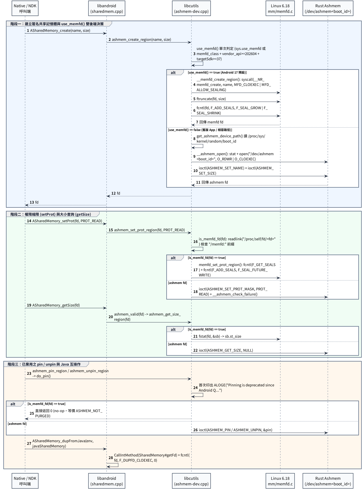

# 6.2 執行期函式庫 `libcutils` 與 NDK `ASharedMemory` 存取介面

- **情景說明**：系統服務、JNI 或 NDK 原生程式碼呼叫 `ashmem_create_region`（`libcutils`）或公開 NDK 介面 `ASharedMemory_create`（`libandroid`）建立一塊匿名共享記憶體；寫入資料後再呼叫 `ashmem_set_prot_region(fd, PROT_READ)`／`ASharedMemory_setProt` 將後續映射鎖定為唯讀，並於接收端以 `ashmem_valid`、`ashmem_get_size_region`／`ASharedMemory_getSize` 檢驗合法性與大小。本節完整追蹤 Android 17 如何在不更動上層 API 簽名的前提下，於 `libcutils/ashmem-dev.cpp` 達成 **`memfd` 與 `/dev/ashmem<boot_id>` 的無縫雙後端切換**，以及 NDK `ASharedMemory_*` 與 Java `SharedMemory` 的互操作橋接。
- **對應原書**：6.2 節〈运行时库 cutils 的匿名共享内存访问接口〉（p.353–357）
- **涉及專案與版本基準**：
  - `platform/system/core` 〔`android-17.0.0_r1`，commit `545d248`〕
  - `platform/frameworks/base` 〔`android-17.0.0_r1`，commit `94b4c163b`〕

---

## 6.2.1 `libcutils` 對外介面與 Android 17 `use_memfd()` 切換條件

> 對應原書 6.2（p.353–354）。原書 2.3 的 `system/core/libcutils/ashmem-dev.c` 是極薄的 C 包裝層，所有操作都無條件對 `/dev/ashmem` 發出 `open`/`ioctl`。Android 17 的 `ashmem-dev.cpp` 則演進為**雙後端調度器**：在建立期依執行環境與 App Target SDK 決定走 `memfd` 還是 `/dev/ashmem<boot_id>`，在操作期（`set_prot`、`pin`/`unpin`、`get_size`、`valid`）則自動辨識傳入 fd 的實際類型，確保「Android 17 行程建的 `memfd` 交給舊行程、或舊行程建的 `ashmem` 交給 Android 17 行程」都能正確互通。

### Step 1：標頭宣告（`ashmem.h` 與 `ashmem-internal.h`）
**位置**：`platform/system/core/libcutils/include/cutils/ashmem.h` 〔`android-17.0.0_r1`，lines 29–35〕、`platform/system/core/libcutils/ashmem-internal.h` 〔`android-17.0.0_r1`，lines 19–21〕

```c
int ashmem_valid(int fd);
int ashmem_create_region(const char *name, size_t size);
int ashmem_set_prot_region(int fd, int prot);
int ashmem_pin_region(int fd, size_t offset, size_t len);
int ashmem_unpin_region(int fd, size_t offset, size_t len);
int ashmem_get_size_region(int fd);
```

```cpp
bool use_memfd();
int __ashmem_create_region(const char* name, size_t size);
int __memfd_create_region(const char* name, size_t size);
```

對外保留原書的五個經典函式外，新增了 `ashmem_valid(int fd)` 供安全校驗使用（防止惡意行程拿一般檔案 fd 冒充共享記憶體）；內部標頭 `ashmem-internal.h` 則明確切出 `__memfd_create_region` 與 `__ashmem_create_region` 兩條路徑供單元測試與核心切換邏輯使用。

> 〔與 2.3 差異〕改名 + 擴充：實作檔從 `ashmem-dev.c` 改寫為 C++ `ashmem-dev.cpp`，並新增 `ashmem_valid()` 與內部 `memfd` 後端函式（原書 p.353–354）。

---

### Step 2：`__use_memfd()` 與 `use_memfd()` 四條件判定（Android 17 預設啟用分水嶺）
**位置**：`platform/system/core/libcutils/ashmem-dev.cpp` 〔`android-17.0.0_r1`，lines 58–111〕

```cpp
static bool __use_memfd() {
    // Used to force enable memfd usage. In the future this property will be removed once we switch
    // everything over to memfd.
    if (android::base::GetBoolProperty("sys.use_memfd", false)) {
        if (debug_log) {
            ALOGD("sys.use_memfd=true so using memfd");
        }
        return true;
    }

    // Ensure that the kernel supports the memfd_class policy capability.
    if (access("/sys/fs/selinux/policy_capabilities/memfd_class", F_OK) != 0) {
        if (debug_log) {
            ALOGD("Not using memfd: kernel does not support memfd_class sepolicy capability");
        }
        return false;
    }

    // Per VSR-3.5.2-004, the memfd_class policy capability is required for devices with vendor API
    // level 202604+, so use memfd on those devices.
    const int min_vendor_api_level = 202604;
    const int vendor_api_level = android::base::GetIntProperty("ro.vendor.api_level", -1);
    if (vendor_api_level < min_vendor_api_level) {
        if (debug_log) {
            ALOGD("Not using memfd: device vendor API level %d < %d the minimum vendor API level required for memfd",
                  vendor_api_level, min_vendor_api_level);
        }
        return false;
    }

    // Make the minimum target SDK version match vendor API level 202604 to avoid breaking
    // assumptions that older applications might make about the fd they allocate.
    const int min_app_target_sdk_version = 37;
    const int app_target_sdk_version = android_get_application_target_sdk_version();
    if (app_target_sdk_version < min_app_target_sdk_version) {
        if (debug_log) {
            ALOGD("Not using memfd: application target SDK version %d < %d the minimum target SDK version required for memfd",
                  app_target_sdk_version, min_app_target_sdk_version);
        }
        return false;
    }

    if (debug_log) {
        ALOGD("memfd requirements satisfied: memfd_class capability supported, device vendor API level: %d, and application target SDK version: %d",
              vendor_api_level, app_target_sdk_version);
    }

    return true;
}

bool use_memfd() {
    static bool use_memfd = __use_memfd();
    return use_memfd;
}
```

這段邏輯是 **Android 17 共享記憶體架構切換的核心開關**（以 C++ 函式內 `static bool` 保證每行程只判定一次）：
1. **強制開關**：若系統屬性 `sys.use_memfd=true`，立即啟用 `memfd`；
2. **核心能力**：檢查 `/sys/fs/selinux/policy_capabilities/memfd_class` 存在，確認核心支援 6.1.2 所述之 `SECCLASS_MEMFD_FILE`；
3. **裝置基準（VSR-3.5.2-004）**：要求 `ro.vendor.api_level >= 202604`（對應 Android 17 出廠裝置的 Vendor API Level），避免舊 Vendor 分區 SELinux 規則未涵蓋 `memfd_file`；
4. **應用程式門檻**：要求 `android_get_application_target_sdk_version() >= 37`（即 **Android 17 / API 37**；原生無 App targetSdk 的系統守護行程預設回傳 `INT_MAX` 亦通過），確保未升級至 API 37 的舊 App 若對回傳的 fd 做 Ashmem 假設不會突然失效。

> 〔與 2.3 差異〕新增：原書 2.3 完全沒有 `memfd` 路徑與版本分流邏輯。

---

## 6.2.2 建立共享記憶體區域與 fd 類型鑑別

### Step 3：`ashmem_create_region`、`__memfd_create_region` 與 `__ashmem_create_region`
**位置**：`platform/system/core/libcutils/ashmem-dev.cpp` 〔`android-17.0.0_r1`，lines 113–164、215–263〕

```cpp
static std::string get_ashmem_device_path() {
    static const std::string boot_id_path = "/proc/sys/kernel/random/boot_id";
    std::string boot_id;
    if (!android::base::ReadFileToString(boot_id_path, &boot_id)) {
        ALOGE("Failed to read %s: %m", boot_id_path.c_str());
        return "";
    }
    boot_id = android::base::Trim(boot_id);

    return "/dev/ashmem" + boot_id;
}

static bool __init_ashmem_rdev() {
    const std::string ashmem_device_path = get_ashmem_device_path();
    if (ashmem_device_path.empty()) {
        return false;
    }

    struct stat st;
    if (TEMP_FAILURE_RETRY(stat(ashmem_device_path.c_str(), &st)) == -1) {
        ALOGE("Unable to stat ashmem device: %m");
        return false;
    }
    if (!S_ISCHR(st.st_mode)) {
        ALOGE("ashmem device is not a character device");
        errno = ENOTTY;
        return false;
    }

    __ashmem_rdev = st.st_rdev;
    return true;
}

int __ashmem_open() {
    static const std::string ashmem_device_path = get_ashmem_device_path();

    if (ashmem_device_path.empty()) {
        return -1;
    }

    if (__ashmem_rdev == 0 && !__init_ashmem_rdev()) {
        return -1;
    }

    android::base::unique_fd fd(TEMP_FAILURE_RETRY(open(ashmem_device_path.c_str(), O_RDWR | O_CLOEXEC)));
    if (!fd.ok()) {
        ALOGE("Unable to open ashmem device: %m");
        return -1;
    }

    return fd.release();
}
```

```cpp
int __memfd_create_region(const char* name, size_t size) {
    // This code needs to build on API levels before 30,
    // so we can't use the libc wrapper.
    android::base::unique_fd fd(syscall(__NR_memfd_create, name, MFD_CLOEXEC | MFD_ALLOW_SEALING));

    if (fd == -1) {
        ALOGE("memfd_create(%s, %zd) failed: %m", name, size);
        return -1;
    }

    if (ftruncate(fd, size) == -1) {
        ALOGE("ftruncate(%s, %zd) failed for memfd creation: %m", name, size);
        return -1;
    }

    // forbid size changes to match ashmem behaviour
    if (fcntl(fd, F_ADD_SEALS, F_SEAL_GROW | F_SEAL_SHRINK) == -1) {
        ALOGE("memfd_create(%s, %zd) F_ADD_SEALS failed: %m", name, size);
        return -1;
    }

    if (debug_log) {
        ALOGE("memfd_create(%s, %zd) success. fd=%d", name, size, fd.get());
    }
    return fd.release();
}

int __ashmem_create_region(const char* name, size_t size) {
    android::base::unique_fd fd(__ashmem_open());
    if (!fd.ok() || TEMP_FAILURE_RETRY(ioctl(fd, ASHMEM_SET_NAME, name)) < 0 ||
        TEMP_FAILURE_RETRY(ioctl(fd, ASHMEM_SET_SIZE, size)) < 0) {
        return -1;
    }
    return fd.release();
}

int ashmem_create_region(const char* name, size_t size) {
    if (name == NULL) name = "none";

    auto create_region = use_memfd() ? __memfd_create_region : __ashmem_create_region;
    return create_region(name, size);
}
```

兩條建立路徑對照清晰：
- **`__memfd_create_region`**：直接呼叫 `syscall(__NR_memfd_create, name, MFD_CLOEXEC | MFD_ALLOW_SEALING)`（刻意不用 Bionic wrapper 以相容 API < 30 靜態連結編譯），接著 `ftruncate(fd, size)` 定長，最後立刻加上 **`F_SEAL_GROW | F_SEAL_SHRINK`** 封印禁止後續改變大小，但**刻意不加 `F_SEAL_SEAL`**，保留日後呼叫 `ashmem_set_prot_region` 追加 `F_SEAL_FUTURE_WRITE` 的能力。
- **`__ashmem_create_region`**：透過 `get_ashmem_device_path()` 拼出 `/dev/ashmem<boot_id>`，先以 `__init_ashmem_rdev()` 快取裝置的 `st_rdev`（供日後檢驗任意 fd 是否真的指向 ashmem 字元裝置），再以 `O_RDWR | O_CLOEXEC` 開啟並依序送出 `ASHMEM_SET_NAME` 與 `ASHMEM_SET_SIZE`。兩條路徑皆以 `android::base::unique_fd` RAII 確保任一步失敗時自動 `close(fd)`。

> 〔與 2.3 差異〕邏輯改變：原書 2.3（p.354）的 `ashmem_create_region` 直接 `open("/dev/ashmem", O_RDWR)`（未設 `O_CLOEXEC`）且只有單一後端；17 改為雙後端分流、`O_CLOEXEC` 防 fd 洩漏至子行程、`boot_id` 路徑隔離與 `unique_fd` 自動清理。

---

### Step 4：`is_memfd_fd`、`__ashmem_is_ashmem` 與 `ashmem_valid`
**位置**：`platform/system/core/libcutils/ashmem-dev.cpp` 〔`android-17.0.0_r1`，lines 168–213〕

```cpp
static int __ashmem_is_ashmem(int fd, bool fatal) {
    if (__ashmem_rdev == 0 && !__init_ashmem_rdev()) {
        return -1;
    }

    struct stat st;
    if (fstat(fd, &st) == -1) return -1;
    if (S_ISCHR(st.st_mode) && st.st_rdev == __ashmem_rdev) {
      return 0;
    }

    if (fatal) {
        LOG_ALWAYS_FATAL("illegal fd=%d mode=0%o rdev=%d:%d expected 0%o %d:%d",
            fd, st.st_mode, major(st.st_rdev), minor(st.st_rdev),
            S_IFCHR | S_IRUSR | S_IWUSR | S_IRGRP | S_IWGRP | S_IROTH | S_IRGRP,
            major(__ashmem_rdev), minor(__ashmem_rdev));
        /* NOTREACHED */
    }

    errno = ENOTTY;
    return -1;
}

static int __ashmem_check_failure(int fd, int result) {
    if (result == -1 && errno == ENOTTY) __ashmem_is_ashmem(fd, true);
    return result;
}

static bool is_memfd_fd(int fd) {
    std::string fd_path = android::base::StringPrintf("/proc/self/fd/%d", fd);
    std::string result;
    if (!android::base::Readlink(fd_path, &result)) {
        ALOGE("readlink(%s) failed: %m", fd_path.c_str());
        return false;
    }
    return result.starts_with("/memfd:");
}

int ashmem_valid(int fd) {
    if (is_memfd_fd(fd)) {
        return 1;
    }

    return __ashmem_is_ashmem(fd, false) >= 0;
}
```

每當拿到一個未知來源的 `fd`（例如經由 Binder 從對端行程收到）：
1. **`is_memfd_fd(fd)`** 讀取 `/proc/self/fd/<fd>` 的符號連結目標，因 `mm/memfd.c::alloc_name()` 會在檔名開頭強制加上 `"memfd:"`，故在 procfs 中呈現為 `"/memfd:<name>"`（已刪除則附 `" (deleted)"`），以 `starts_with("/memfd:")` 即可精準判別。
2. 若非 `memfd`，則交由 **`__ashmem_is_ashmem(fd)`** 透過 `fstat()` 核對 `S_ISCHR(st.st_mode)` 且裝置號 `st.st_rdev == __ashmem_rdev`。而 `__ashmem_check_failure()` 更會在 `ioctl` 誤回 `ENOTTY` 時以 `fatal = true` 直接中止異常行程，防範類型混淆攻擊。

> 〔與 2.3 差異〕新增：原書 2.3 無 `ashmem_valid()`、`is_memfd_fd()` 與 `st_rdev` 裝置號驗證。

---

## 6.2.3 權限縮限、大小查詢與已棄用的鎖定／解鎖

### Step 5：`ashmem_set_prot_region`、`ashmem_pin_region` / `unpin_region` 與 `ashmem_get_size_region`
**位置**：`platform/system/core/libcutils/ashmem-dev.cpp` 〔`android-17.0.0_r1`，lines 265–337〕

```cpp
static int memfd_set_prot_region(int fd, int prot) {
    int seals = fcntl(fd, F_GET_SEALS);
    if (seals == -1) {
        ALOGE("memfd_set_prot_region(%d, %d): F_GET_SEALS failed: %m", fd, prot);
        return -1;
    }

    if (prot & PROT_WRITE) {
        /* Now we want the buffer to be read-write, let's check if the buffer
         * has been previously marked as read-only before, if so return error
         */
        if (seals & F_SEAL_FUTURE_WRITE) {
            ALOGE("memfd_set_prot_region(%d, %d): region is write protected", fd, prot);
            errno = EINVAL;  // inline with ashmem error code, if already in
                             // read-only mode
            return -1;
        }
        return 0;
    }

    /* We would only allow read-only for any future file operations */
    if (fcntl(fd, F_ADD_SEALS, F_SEAL_FUTURE_WRITE) == -1) {
        ALOGE("memfd_set_prot_region(%d, %d): F_SEAL_FUTURE_WRITE seal failed: %m", fd, prot);
        return -1;
    }

    return 0;
}

int ashmem_set_prot_region(int fd, int prot) {
    if (is_memfd_fd(fd)) {
        return memfd_set_prot_region(fd, prot);
    }

    return __ashmem_check_failure(fd, TEMP_FAILURE_RETRY(ioctl(fd, ASHMEM_SET_PROT_MASK, prot)));
}

static int do_pin(int op, int fd, size_t offset, size_t length) {
    static bool already_warned_about_pin_deprecation = false;
    if (!already_warned_about_pin_deprecation || debug_log) {
        ALOGE("Pinning is deprecated since Android Q. Please use trim or other methods.");
        already_warned_about_pin_deprecation = true;
    }

    if (is_memfd_fd(fd)) {
        return 0;
    }

    ashmem_pin pin = { static_cast<uint32_t>(offset), static_cast<uint32_t>(length) };
    return __ashmem_check_failure(fd, TEMP_FAILURE_RETRY(ioctl(fd, op, &pin)));
}

int ashmem_pin_region(int fd, size_t offset, size_t length) {
    return do_pin(ASHMEM_PIN, fd, offset, length);
}

int ashmem_unpin_region(int fd, size_t offset, size_t length) {
    return do_pin(ASHMEM_UNPIN, fd, offset, length);
}

int ashmem_get_size_region(int fd) {
    if (is_memfd_fd(fd)) {
        struct stat sb;
        if (fstat(fd, &sb) == -1) {
            ALOGE("ashmem_get_size_region(%d): fstat failed: %m", fd);
            return -1;
        }
        return sb.st_size;
    }

    return __ashmem_check_failure(fd, TEMP_FAILURE_RETRY(ioctl(fd, ASHMEM_GET_SIZE, NULL)));
}
```

三組操作的雙後端語意對應如下：
1. **`ashmem_set_prot_region`**：對 `memfd` 先以 `F_GET_SEALS` 檢查現有封印；若呼叫端要求保留 `PROT_WRITE` 卻早已被施加 `F_SEAL_FUTURE_WRITE`，回傳 `-1` 並設定 `errno = EINVAL`（對齊 Ashmem 不可加回權限的錯誤碼）；若要求移除 `PROT_WRITE`，則以 `fcntl(fd, F_ADD_SEALS, F_SEAL_FUTURE_WRITE)` 封死後續可寫映射。
2. **`ashmem_pin_region` / `ashmem_unpin_region`**：自 Android 10（Q）起已正式棄用；呼叫時會印出一次性 `ALOGE` 警告，且對 `memfd` 直接回傳 `0`（對應 `ASHMEM_NOT_PURGED` / 成功）不做任何系統呼叫，僅在傳統 ashmem fd 上才轉送 `ASHMEM_PIN`/`ASHMEM_UNPIN` ioctl。
3. **`ashmem_get_size_region`**：對 `memfd` 直接走標準 POSIX `fstat(fd, &sb)` 讀 `sb.st_size`；對 ashmem 則送 `ASHMEM_GET_SIZE` ioctl。

> 〔與 2.3 差異〕邏輯改變：原書 2.3（p.355–357）的三組函式都只是單純一行 `ioctl()` 包裝，且 `pin`/`unpin` 是核心賣點；Android 17 中 `pin`/`unpin` 已被棄用，並全面支援 `memfd` 的 `F_SEAL_FUTURE_WRITE` 與 `fstat()` 語意。

---

## 6.2.4 NDK 穩定公開介面 `ASharedMemory_*`（`libandroid`）

> `libcutils` 的 `<cutils/ashmem.h>` 屬於 AOSP 內部非公開函式庫（第三方 NDK 應用程式不可直接連結）。自 Android 8.0（API 26）起，NDK 在 `libandroid.so` 提供穩定的公開 C ABI `<android/sharedmem.h>` 與 `<android/sharedmem_jni.h>`，底層正是直接委派給 `libcutils`。

### Step 6：`ASharedMemory_{create,getSize,setProt,dupFromJava}`
**位置**：`platform/frameworks/base/native/android/sharedmem.cpp` 〔`android-17.0.0_r1`，lines 30–79〕

```cpp
static struct {
    jclass clazz;
    jmethodID getFd;
} sSharedMemory;

static void jniInit(JNIEnv* env) {
    static std::once_flag sJniInitialized;
    std::call_once(sJniInitialized, [](JNIEnv* env) {
        jclass clazz = env->FindClass("android/os/SharedMemory");
        LOG_ALWAYS_FATAL_IF(clazz == nullptr, "Failed to find android.os.SharedMemory");
        sSharedMemory.clazz = (jclass) env->NewGlobalRef(clazz);
        LOG_ALWAYS_FATAL_IF(sSharedMemory.clazz == nullptr,
                "Failed to create global ref of android.os.SharedMemory");
        sSharedMemory.getFd = env->GetMethodID(sSharedMemory.clazz, "getFd", "()I");
        LOG_ALWAYS_FATAL_IF(sSharedMemory.getFd == nullptr,
                "Failed to find method SharedMemory#getFd()");
    }, env);
}

int ASharedMemory_create(const char *name, size_t size) {
    if (size == 0) {
        return android::BAD_VALUE;
    }
    return ashmem_create_region(name, size);
}

size_t ASharedMemory_getSize(int fd) {
    return ashmem_valid(fd) ? ashmem_get_size_region(fd) : 0;
}

int ASharedMemory_setProt(int fd, int prot) {
    return ashmem_set_prot_region(fd, prot);
}

int ASharedMemory_dupFromJava(JNIEnv* env, jobject javaSharedMemory) {
    if (env == nullptr || javaSharedMemory == nullptr) {
        return -1;
    }
    jniInit(env);
    if (!env->IsInstanceOf(javaSharedMemory, sSharedMemory.clazz)) {
        ALOGW("ASharedMemory_dupFromJava called with object "
                "that's not an instanceof android.os.SharedMemory");
        return -1;
    }
    int fd = env->CallIntMethod(javaSharedMemory, sSharedMemory.getFd);
    if (fd != -1) {
        fd = fcntl(fd, F_DUPFD_CLOEXEC, 0);
    }
    return fd;
}
```

可以看到 NDK 公開 API 非常乾淨：
- 刻意**不暴露**已棄用的 `pin`/`unpin` 介面，只提供 `create`、`getSize`（先過 `ashmem_valid(fd)` 防止對非共享記憶體 fd 誤查）與 `setProt`；
- 透過 `ASharedMemory_dupFromJava()`，原生 C/C++ 程式碼可以直接從 Java 傳入的 `android.os.SharedMemory` 物件取出獨立擁有權的 fd（透過 `fcntl(fd, F_DUPFD_CLOEXEC, 0)` 複製，避免 Java 端 `SharedMemory.close()` 提前關閉底層描述符），實現 Java 層與 NDK 層的零拷貝互通；
- 因為底層全部走 `libcutils/ashmem-dev.cpp`，第三方 App 只要升級至 `targetSdk >= 37`，原本呼叫 `ASharedMemory_create()` 的 NDK 程式碼不用改半行，就會在 Android 17 上自動受惠於 `memfd`。

> 〔與 2.3 差異〕新增：原書 2.3 無 NDK 公開共享記憶體 C API，原生 App 若想用 Ashmem 只能違法私開 `/dev/ashmem` 或私連 `libcutils.so`。

---

## 整節呼叫鏈總結


