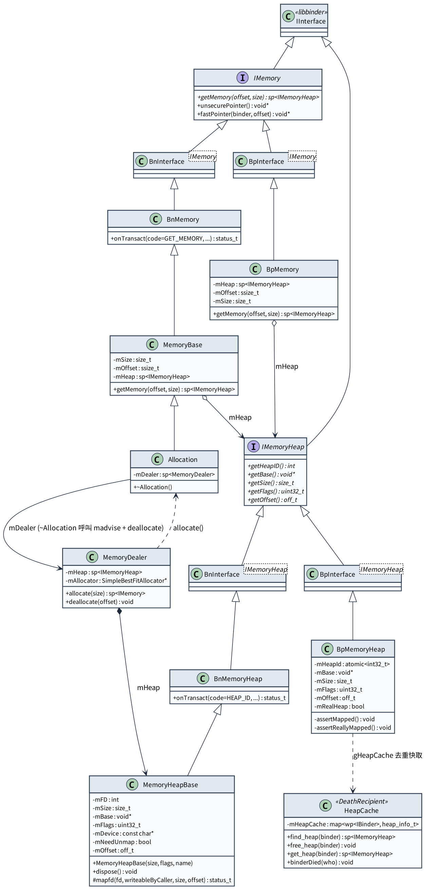
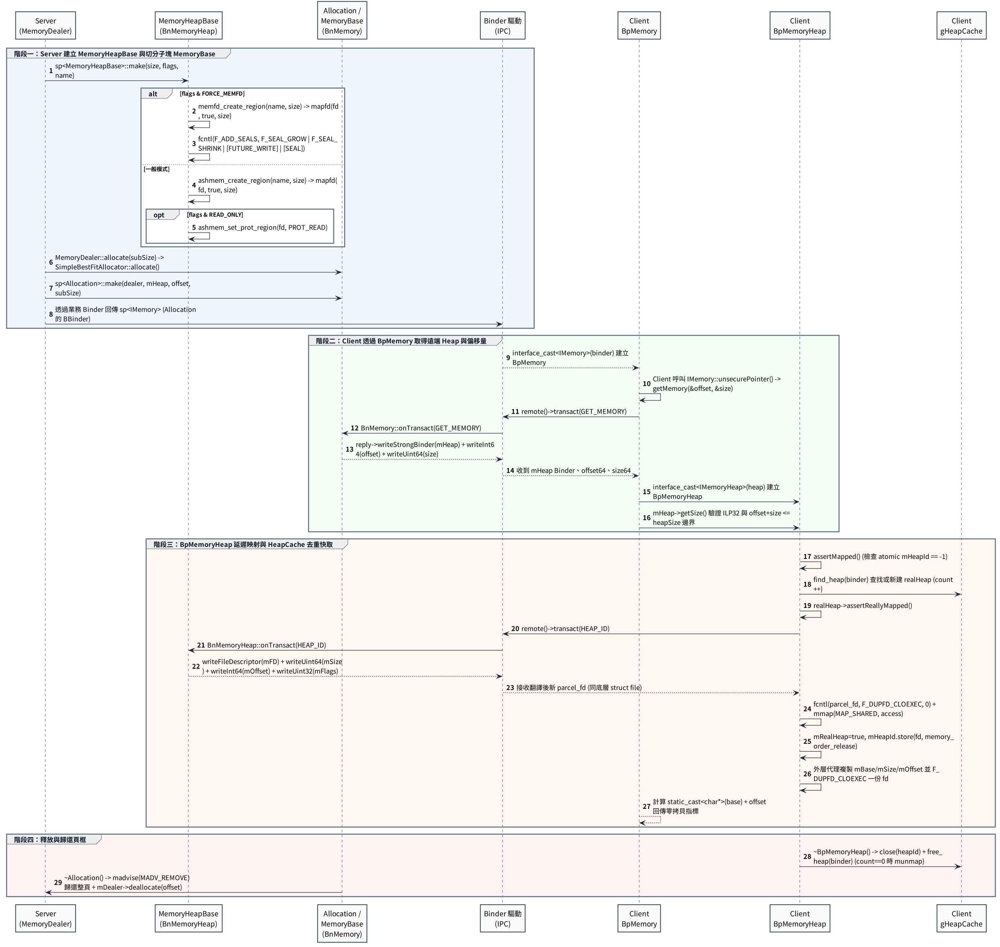

# 6.3 匿名共享記憶體的 C++ 存取介面（`IMemoryHeap` / `MemoryHeapBase` / `MemoryBase` / `MemoryDealer`）

- **情景說明**：原生 C++ 系統服務（例如音訊／媒體緩衝區管理器）透過 `MemoryHeapBase` 建立一大塊匿名共享記憶體（支援強制 `FORCE_MEMFD` 封印與 `READ_ONLY` 單寫多讀保護），再經由 `MemoryDealer` 以最佳適配演算法（`SimpleBestFitAllocator`）切分出多塊小型子區域 `MemoryBase`（`Allocation`），透過 Binder IPC 將 `sp<IMemory>` 回傳給 Client；Client 首次存取指標時，經由 `BpMemory` → `BpMemoryHeap` → 全域去重快取 `HeapCache` 透明完成跨行程 `mmap`，最後在物件析構時自動以 `madvise(MADV_REMOVE)` 歸還整頁記憶體並解除映射。
- **對應原書**：6.3 節〈匿名共享内存的 C++ 访问接口〉（p.357–378）
- **涉及專案與版本基準**：
  - `platform/frameworks/native` 〔`android-17.0.0_r1`，commit `ae266dc`〕

---

## 6.3.1 C++ 共享記憶體類別階層與 `MemoryHeapBase`

> 對應原書 6.3.1（p.357–367）。原書將 C++ 匿名共享記憶體拆為「整塊記憶體（`IMemoryHeap` / `MemoryHeapBase`）」與「子塊記憶體（`IMemory` / `MemoryBase`）」兩組 Binder 服務／代理對：這樣同一個大型共享記憶體只需在 Client 端 `mmap` 一次，就能被多個子區域重複共享，避免耗盡行程的虛擬位址空間與檔案描述符配額。在 Android 17 中，這套類別已從 `frameworks/base/libs/binder/` 搬家至 `platform/frameworks/native/libs/binder/`，並針對 **`memfd` 強制封印、64-bit 跨 ABI 邊界安全檢查、無鎖原子讀取與 `O_CLOEXEC`** 做了重要升級。



### Step 1：`MemoryHeapBase` 建構子與 `FORCE_MEMFD` / `READ_ONLY` 封印流程
**位置**：`platform/frameworks/native/libs/binder/MemoryHeapBase.cpp` 〔`android-17.0.0_r1`，lines 40–97、146–207〕

```cpp
#ifdef __BIONIC__
static int memfd_create_region(const char* name, size_t size) {
    int fd = memfd_create(name, MFD_CLOEXEC | MFD_ALLOW_SEALING);
    if (fd == -1) {
        ALOGE("%s: memfd_create(%s, %zd) failed: %s\n", __func__, name, size, strerror(errno));
        return -1;
    }

    if (ftruncate(fd, size) == -1) {
        ALOGE("%s, ftruncate(%s, %zd) failed for memfd creation: %s\n", __func__, name, size,
              strerror(errno));
        close(fd);
        return -1;
    }
    return fd;
}
#endif
```

```cpp
MemoryHeapBase::MemoryHeapBase(size_t size, uint32_t flags, char const * name)
    : mFD(-1), mSize(0), mBase(MAP_FAILED), mFlags(flags),
      mDevice(nullptr), mNeedUnmap(false), mOffset(0)
{
    const size_t pagesize = getpagesize();
    size = ((size + pagesize - 1) & ~(pagesize - 1));
    int fd = -1;
    if (mFlags & FORCE_MEMFD) {
#ifdef __BIONIC__
        ALOGV("MemoryHeapBase: Attempting to force MemFD");
        fd = memfd_create_region(name ? name : "MemoryHeapBase", size);
        if (fd < 0 || (mapfd(fd, true, size) != NO_ERROR)) return;
        const int SEAL_FLAGS = ((mFlags & READ_ONLY) ? F_SEAL_FUTURE_WRITE : 0) | F_SEAL_GROW |
                F_SEAL_SHRINK | ((mFlags & MEMFD_ALLOW_SEALING_FLAG) ? 0 : F_SEAL_SEAL);
        if (SEAL_FLAGS && (fcntl(fd, F_ADD_SEALS, SEAL_FLAGS) == -1)) {
            ALOGE("MemoryHeapBase: MemFD %s sealing with flags %x failed with error  %s", name,
                  SEAL_FLAGS, strerror(errno));
            if (mNeedUnmap) munmap(mBase, mSize);
            mBase = nullptr;
            mSize = 0;
            close(fd);
        }
        return;
#else
        mFlags &= ~(FORCE_MEMFD | MEMFD_ALLOW_SEALING_FLAG);
#endif
    }
    fd = ashmem_create_region(name ? name : "MemoryHeapBase", size);
    ALOGE_IF(fd < 0, "MemoryHeapBase: error creating ashmem region: %s", strerror(errno));
    if (fd < 0 || (mapfd(fd, true, size) != NO_ERROR)) return;
    if (mFlags & READ_ONLY) {
        ashmem_set_prot_region(fd, PROT_READ);
    }
}
```

```cpp
status_t MemoryHeapBase::mapfd(int fd, bool writeableByCaller, size_t size, off_t offset)
{
    if (size == 0) {
        struct stat sb;
        if (fstat(fd, &sb) == 0) {
            size = (size_t)sb.st_size;
            if ((off_t)size != sb.st_size) {
                ALOGE("%s: size of file %lld cannot fit in memory",
                        __func__, (long long)sb.st_size);
                close(fd);
                return INVALID_OPERATION;
            }
        }
    }

    if ((mFlags & DONT_MAP_LOCALLY) == 0) {
        int prot = PROT_READ;
        if (writeableByCaller || (mFlags & READ_ONLY) == 0) {
            prot |= PROT_WRITE;
        }
        void* base = (uint8_t*)mmap(nullptr, size,
                prot, MAP_SHARED, fd, offset);
        if (base == MAP_FAILED) {
            ALOGE("mmap(fd=%d, size=%zu) failed (%s)",
                    fd, size, strerror(errno));
            close(fd);
            return -errno;
        }
        mBase = base;
        mNeedUnmap = true;
    } else  {
        mBase = nullptr; // not MAP_FAILED
        mNeedUnmap = false;
    }
    mFD = fd;
    mSize = size;
    mOffset = offset;
    return NO_ERROR;
}
```

請特別留意 `MemoryHeapBase` 巧妙的「**先本端可寫映射、再封印對端唯讀**」順序：
1. 無論是 `FORCE_MEMFD` 路徑還是 `ashmem_create_region()` 路徑，建立 `fd` 後都先以 `mapfd(fd, /*writeableByCaller=*/true, size)` 在建立端（Server）映射出 **`PROT_READ | PROT_WRITE`** 的本端指標 `mBase`；
2. 隨後若指定了 `READ_ONLY`：
   - `FORCE_MEMFD` 路徑會施加 `F_SEAL_FUTURE_WRITE | F_SEAL_GROW | F_SEAL_SHRINK`（且除非呼叫端指定 `MEMFD_ALLOW_SEALING_FLAG`，否則一併加上 `F_SEAL_SEAL` 徹底鎖死封印操作）；
   - 一般路徑則呼叫 `ashmem_set_prot_region(fd, PROT_READ)`（在 Android 17 上同樣對應 `F_SEAL_FUTURE_WRITE`）。
3. 因此 Server 本端已取得的 `mBase` 仍可持續寫入，但任何經由 Binder 收到此 fd 的 Client 都只能以唯讀方式映射，構成安全高效的單寫多讀通道。

> 〔與 2.3 差異〕搬家 + 邏輯改變：原書 2.3（p.358–361）位於 `frameworks/base/libs/binder/MemoryHeapBase.cpp`，沒有 `FORCE_MEMFD` / `MEMFD_ALLOW_SEALING` 與 `writeableByCaller` 參數（2.3 僅在 `READ_ONLY` 下本端先 `mmap` 再 `ashmem_set_prot_region`）；Android 17 另在 `MemoryHeapBase(int fd, ...)` 改用 `fcntl(fd, F_DUPFD_CLOEXEC, 0)` 取代 `dup(fd)`，並在 `mapfd` 加入 ILP32 大小溢位檢查。

---

### Step 2：`BnMemoryHeap::onTransact`、`BpMemoryHeap::assertMapped` / `assertReallyMapped` 與 `HeapCache`
**位置**：`platform/frameworks/native/libs/binder/IMemory.cpp` 〔`android-17.0.0_r1`，lines 256–361、399–484〕

```cpp
status_t BnMemoryHeap::onTransact(
        uint32_t code, const Parcel& data, Parcel* reply, uint32_t flags)
{
    switch(code) {
       case HEAP_ID: {
            CHECK_INTERFACE(IMemoryHeap, data, reply);
            reply->writeFileDescriptor(getHeapID());
            reply->writeUint64(getSize());
            reply->writeInt64(getOffset());
            reply->writeUint32(getFlags());
            return NO_ERROR;
        } break;
        default:
            return BBinder::onTransact(code, data, reply, flags);
    }
}
```

```cpp
void BpMemoryHeap::assertMapped() const
{
    int32_t heapId = mHeapId.load(std::memory_order_acquire);
    if (heapId == -1) {
        sp<IBinder> binder(IInterface::asBinder(const_cast<BpMemoryHeap*>(this)));
        sp<BpMemoryHeap> heap = sp<BpMemoryHeap>::cast(find_heap(binder));
        heap->assertReallyMapped();
        if (heap->mBase != MAP_FAILED) {
            Mutex::Autolock _l(mLock);
            if (mHeapId.load(std::memory_order_relaxed) == -1) {
                mBase   = heap->mBase;
                mSize   = heap->mSize;
                mOffset = heap->mOffset;
                int fd = fcntl(heap->mHeapId.load(std::memory_order_relaxed), F_DUPFD_CLOEXEC, 0);
                ALOGE_IF(fd == -1, "cannot dup fd=%d",
                         heap->mHeapId.load(std::memory_order_relaxed));
                mHeapId.store(fd, std::memory_order_release);
            }
        } else {
            // something went wrong
            free_heap(binder);
        }
    }
}

void BpMemoryHeap::assertReallyMapped() const
{
    int32_t heapId = mHeapId.load(std::memory_order_acquire);
    if (heapId == -1) {
        Parcel data, reply;
        data.writeInterfaceToken(IMemoryHeap::getInterfaceDescriptor());
        status_t err = remote()->transact(HEAP_ID, data, &reply);
        int parcel_fd = reply.readFileDescriptor();
        const uint64_t size64 = reply.readUint64();
        const int64_t offset64 = reply.readInt64();
        const uint32_t flags = reply.readUint32();
        const size_t size = (size_t)size64;
        const off_t offset = (off_t)offset64;
        if (err != NO_ERROR || // failed transaction
                size != size64 || offset != offset64) { // ILP32 size check
            ALOGE("binder=%p transaction failed fd=%d, size=%zu, err=%d (%s)",
                  IInterface::asBinder(this).get(), parcel_fd, size, err,
                  statusToString(err).c_str());
            return;
        }

        Mutex::Autolock _l(mLock);
        if (mHeapId.load(std::memory_order_relaxed) == -1) {
            int fd = fcntl(parcel_fd, F_DUPFD_CLOEXEC, 0);
            ALOGE_IF(fd == -1, "cannot dup fd=%d, size=%zu, err=%d (%s)",
                    parcel_fd, size, err, strerror(errno));

            int access = PROT_READ;
            if (!(flags & READ_ONLY)) {
                access |= PROT_WRITE;
            }
            mRealHeap = true;
            mBase = mmap(nullptr, size, access, MAP_SHARED, fd, offset);
            if (mBase == MAP_FAILED) {
                ALOGE("cannot map BpMemoryHeap (binder=%p), size=%zu, fd=%d (%s)",
                        IInterface::asBinder(this).get(), size, fd, strerror(errno));
                close(fd);
            } else {
                mSize = size;
                mFlags = flags;
                mOffset = offset;
                mHeapId.store(fd, std::memory_order_release);
            }
        }
    }
}
```

```cpp
sp<IMemoryHeap> HeapCache::find_heap(const sp<IBinder>& binder)
{
    Mutex::Autolock _l(mHeapCacheLock);
    auto i = mHeapCache.find(binder);
    if (i != mHeapCache.end()) {
        heap_info_t& info = i->second;
        ++info.count;
        return info.heap;
    } else {
        heap_info_t info;
        info.heap = interface_cast<IMemoryHeap>(binder);
        info.count = 1;
        mHeapCache.insert({binder, info});
        return info.heap;
    }
}
```

`BpMemoryHeap` 採用「**惰性映射（Lazy Mapping）+ 全域行程快取（`gHeapCache`）**」設計：
1. 剛由 `interface_cast<IMemoryHeap>(binder)` 建出來的 `BpMemoryHeap` 並不會立刻發 Binder IPC 或呼叫 `mmap`（`mHeapId == -1`）；
2. 直到首次呼叫 `getBase()` / `getSize()` / `getHeapID()` 時，才進入 `assertMapped()`：它以 `memory_order_acquire` 檢查 `mHeapId`，若尚未映射，便以底層 `BpBinder` 指標為鍵值查詢進程內單例 `gHeapCache`（`std::map<wp<IBinder>, heap_info_t>`）；
3. 同一個 Server `MemoryHeapBase` 即使被多個 `BpMemory` 多次傳入 Client 行程，所有外層 `BpMemoryHeap` 代理都會共用 `gHeapCache` 內唯一一個 `mRealHeap = true` 的實例，僅執行**一次** `HEAP_ID` Binder 交易與**一次** `mmap(MAP_SHARED)`；外層代理僅複用 `mBase` 並以 `F_DUPFD_CLOEXEC` 複製一份獨立 fd；
4. 析構時外層代理呼叫 `free_heap(binder)` 遞減引用計數 `info.count`，直到歸零（或 Server 異常死亡觸發 `HeapCache::binderDied()`）才從快取移除 `realHeap`，由 `~BpMemoryHeap()` 執行唯一一次 `munmap(mBase, mSize)`。

> 〔與 2.3 差異〕邏輯改變：原書 2.3（p.362–367）的 `mHeapId` 是普通 `int32_t`（靠 `android_atomic_release_store`）、傳輸 `size`/`offset` 使用 32-bit `writeInt32`、`HeapCache` 使用 `KeyedVector` 並直接呼叫 `dup(parcel_fd)`；Android 17 改用標準 `std::atomic<int32_t>`（acquire/release）、64-bit `writeUint64`/`writeInt64` + ILP32 溢位驗證、`std::map` 與 `fcntl(F_DUPFD_CLOEXEC)`，且明確註記 `reply.readFileDescriptor()` 回傳的 fd 歸 `reply` Parcel 所有，必須先 `dup` 才能在 `reply` 析構後存活。

---

## 6.3.2 `IMemory`、`MemoryBase` 與 `MemoryDealer`

> 對應原書 6.3.2（p.367–372）。`MemoryBase` 本身只記錄 `(mHeap, mOffset, mSize)` 三元組，不負責切分管理；AOSP 在同目錄提供的 `MemoryDealer` 則將 `MemoryHeapBase` 與 `SimpleBestFitAllocator` 結合，成為實際切分子塊並自動回收頁框的標準工具。

### Step 3：`MemoryBase`、`BnMemory::onTransact` 與 `BpMemory::getMemory`（邊界安全檢查）
**位置**：`platform/frameworks/native/libs/binder/MemoryBase.cpp` 〔`android-17.0.0_r1`，lines 28–39〕、`platform/frameworks/native/libs/binder/IMemory.cpp` 〔`android-17.0.0_r1`，lines 152–161、187–251〕

```cpp
MemoryBase::MemoryBase(const sp<IMemoryHeap>& heap,
        ssize_t offset, size_t size)
    : mSize(size), mOffset(offset), mHeap(heap)
{
}

sp<IMemoryHeap> MemoryBase::getMemory(ssize_t* offset, size_t* size) const
{
    if (offset) *offset = mOffset;
    if (size)   *size = mSize;
    return mHeap;
}
```

```cpp
void* IMemory::unsecurePointer() const {
    ssize_t offset;
    sp<IMemoryHeap> heap = getMemory(&offset);
    void* const base = heap!=nullptr ? heap->base() : MAP_FAILED;
    if (base == MAP_FAILED)
        return nullptr;
    return static_cast<char*>(base) + offset;
}

void* IMemory::pointer() const { return unsecurePointer(); }
```

```cpp
sp<IMemoryHeap> BpMemory::getMemory(ssize_t* offset, size_t* size) const
{
    if (mHeap == nullptr) {
        Parcel data, reply;
        data.writeInterfaceToken(IMemory::getInterfaceDescriptor());
        if (remote()->transact(GET_MEMORY, data, &reply) == NO_ERROR) {
            sp<IBinder> heap = reply.readStrongBinder();
            if (heap != nullptr) {
                mHeap = interface_cast<IMemoryHeap>(heap);
                if (mHeap != nullptr) {
                    const int64_t offset64 = reply.readInt64();
                    const uint64_t size64 = reply.readUint64();
                    const ssize_t o = (ssize_t)offset64;
                    const size_t s = (size_t)size64;
                    size_t heapSize = mHeap->getSize();
                    if (s == size64 && o == offset64 // ILP32 bounds check
                            && s <= heapSize
                            && o >= 0
                            && (static_cast<size_t>(o) <= heapSize - s)) {
                        mOffset = o;
                        mSize = s;
                    } else {
                        // Hm.
                        android_errorWriteWithInfoLog(0x534e4554,
                            "26877992", -1, nullptr, 0);
                        mOffset = 0;
                        mSize = 0;
                    }
                }
            }
        }
    }
    if (offset) *offset = mOffset;
    if (size) *size = mSize;
    return (mSize > 0) ? mHeap : nullptr;
}
```

注意 Android 17 在 `BpMemory::getMemory()` 加入的**安全邊界檢查**（對應歷史安全漏洞 CVE / bug `26877992`）：若惡意 Server 端偽造負值 `offset` 或讓 `offset + size > heapSize`，會先觸發 `mHeap->getSize()`（亦順帶完成 `BpMemoryHeap` 映射）並以無溢位寫法 `static_cast<size_t>(o) <= heapSize - s` 嚴格檢核；一旦越界即寫入 SafetyNet 日誌 `0x534e4554` 並將 `mSize` 歸零回傳 `nullptr`，防止 Client 發生越界讀寫。此外，`IMemory::pointer()` 也顯式重命名底層實作為 `unsecurePointer()`，提醒開發者跨行程共享記憶體內容可能隨時被對端修改，讀取前必須檢查長度或複製快照。

> 〔與 2.3 差異〕邏輯改變：原書 2.3（p.371–372）的 `BpMemory::getMemory` 直接信任遠端傳回的 32-bit `offset`/`size` 且無任何邊界檢核；17 改為 64-bit 傳輸並強制檢查 `offset >= 0 && offset + size <= heapSize`。

---

### Step 4：`MemoryDealer` 與 `Allocation::~Allocation`（最佳適配切分與 `madvise(MADV_REMOVE)` 歸還頁框）
**位置**：`platform/frameworks/native/libs/binder/MemoryDealer.cpp` 〔`android-17.0.0_r1`，lines 180–251〕

```cpp
    if (freedSize) {
        size_t pagesize = getpagesize();
        size_t start = freedOffset;
        size_t end = start + freedSize;
        start &= ~(pagesize-1);
        end = (end + pagesize-1) & ~(pagesize-1);

        // give back to the kernel the pages we don't need
        size_t free_start = freedOffset;
        size_t free_end = free_start + freedSize;
        if (start < free_start)
            start = free_start;
        if (end > free_end)
            end = free_end;
        start = (start + pagesize-1) & ~(pagesize-1);
        end &= ~(pagesize-1);

        if (start < end) {
            void* const start_ptr = (void*)(intptr_t(getHeap()->base()) + start);
            size_t size = end-start;
...
#ifdef MADV_REMOVE
            if (size) {
                int err = madvise(start_ptr, size, MADV_REMOVE);
                ALOGW_IF(err, "madvise(%p, %zu, MADV_REMOVE) returned %s",
                        start_ptr, size, err<0 ? strerror(errno) : "Ok");
            }
#endif
        }

        mDealer->deallocate(freedOffset);
    }
```

```cpp
MemoryDealer::MemoryDealer(size_t size, const char* name, uint32_t flags)
      : mHeap(sp<MemoryHeapBase>::make(size, flags, name)),
        mAllocator(new SimpleBestFitAllocator(size)) {}

sp<IMemory> MemoryDealer::allocate(size_t size)
{
    sp<IMemory> memory;
    const ssize_t offset = allocator()->allocate(size);
    if (offset >= 0) {
        memory = sp<Allocation>::make(sp<MemoryDealer>::fromExisting(this), heap(), offset, size);
    }
    return memory;
}
```

`MemoryDealer` 內部持有一個 `MemoryHeapBase` 與一個 32-byte 對齊的 `SimpleBestFitAllocator`：每次 `allocate(size)` 配置出子區間並包裝為繼承 `MemoryBase` 的 `Allocation`；當 Client 與 Server 都不再持有該 `sp<IMemory>` 而觸發 `~Allocation()` 時，它會把完全落在釋放區間內的整頁邊界算出來，先以 **`madvise(start_ptr, size, MADV_REMOVE)`** 通知核心對底層 `shmem` 打洞釋放實體頁框（對 `memfd` 與 `ashmem` 均有效，取代了已棄用的 `ASHMEM_UNPIN`！），再呼叫 `mDealer->deallocate(freedOffset)` 將偏移量歸還配置器。

> 〔與 2.3 差異〕補充（原書 6.3 未展開 `MemoryDealer` 原始碼，但該類別自早期即存在，且其 `madvise(MADV_REMOVE)` 成為 `memfd` 時代釋放子區間實體頁的標準作法）。

---

## 6.3.3 Android 17 官方測試實例（`binderMemoryHeapBaseUnitTest.cpp`）

> 對應原書 6.3.3〈应用实例〉（p.372–378）。原書透過手寫 `IMemoryService` / `MemoryServer` / `MemoryClient` 示範 C++ 共享記憶體用法；在 Android 17 中，`platform/frameworks/native/libs/binder/tests/binderMemoryHeapBaseUnitTest.cpp` 直接驗證了 `MemoryHeapBase` 結合 `FORCE_MEMFD`、`READ_ONLY` 與 `MEMFD_ALLOW_SEALING` 四種封印組合的精確行為。

### Step 5：`MemoryHeapBase` 的 `FORCE_MEMFD` 四種封印組合驗證
**位置**：`platform/frameworks/native/libs/binder/tests/binderMemoryHeapBaseUnitTest.cpp` 〔`android-17.0.0_r1`，lines 45–96〕

```cpp
TEST(MemoryHeapBase, MemfdSealed) {
    auto mHeap = sp<MemoryHeapBase>::make(8192,
                                          MemoryHeapBase::FORCE_MEMFD,
                                          "Test mapping");
    ASSERT_NE(mHeap.get(), nullptr);
    int fd = mHeap->getHeapID();
    EXPECT_NE(fd, -1);
    EXPECT_TRUE(is_memfd_fd(fd));
    EXPECT_EQ(fcntl(fd, F_GET_SEALS), F_SEAL_GROW | F_SEAL_SHRINK | F_SEAL_SEAL);
    EXPECT_EQ(ftruncate(fd, 4096), -1);
}
...
TEST(MemoryHeapBase, MemfdSealedProtected) {
    auto mHeap = sp<MemoryHeapBase>::make(8192,
                                          MemoryHeapBase::FORCE_MEMFD |
                                          MemoryHeapBase::READ_ONLY,
                                          "Test mapping");
    ASSERT_NE(mHeap.get(), nullptr);
    int fd = mHeap->getHeapID();
    EXPECT_NE(fd, -1);
    EXPECT_TRUE(is_memfd_fd(fd));
    EXPECT_EQ(fcntl(fd, F_GET_SEALS),
              F_SEAL_GROW | F_SEAL_SHRINK | F_SEAL_SEAL | F_SEAL_FUTURE_WRITE);
    EXPECT_EQ(ftruncate(fd, 4096), -1);
}

TEST(MemoryHeapBase, MemfdUnsealedProtected) {
    auto mHeap = sp<MemoryHeapBase>::make(8192,
                                          MemoryHeapBase::FORCE_MEMFD |
                                          MemoryHeapBase::READ_ONLY |
                                          MemoryHeapBase::MEMFD_ALLOW_SEALING,
                                          "Test mapping");
    ASSERT_NE(mHeap.get(), nullptr);
    int fd = mHeap->getHeapID();
    EXPECT_NE(fd, -1);
    EXPECT_TRUE(is_memfd_fd(fd));
    EXPECT_EQ(fcntl(fd, F_GET_SEALS), F_SEAL_GROW | F_SEAL_SHRINK | F_SEAL_FUTURE_WRITE);
    EXPECT_EQ(ftruncate(fd, 4096), -1);
}
```

測試清楚印證了 `MemoryHeapBase` 的預設防禦立場：只要指定 `FORCE_MEMFD`，除了定長封印 `F_SEAL_GROW | F_SEAL_SHRINK`（導致後續 `ftruncate(fd, 4096)` 回傳 `-1`）外，**預設還會加上 `F_SEAL_SEAL`** 禁止對端擅自追加封印；若同時指定 `READ_ONLY`，則一併鎖入 `F_SEAL_FUTURE_WRITE`。

> 〔與 2.3 差異〕邏輯改變：原書 6.3.3（p.372–378）為手寫獨立範例，僅展示 `ashmem` 基礎讀寫；Android 17 實戰重點已轉為 `FORCE_MEMFD` + `F_SEAL_*` 的防禦性契約驗證。

---

## 整節呼叫鏈總結


