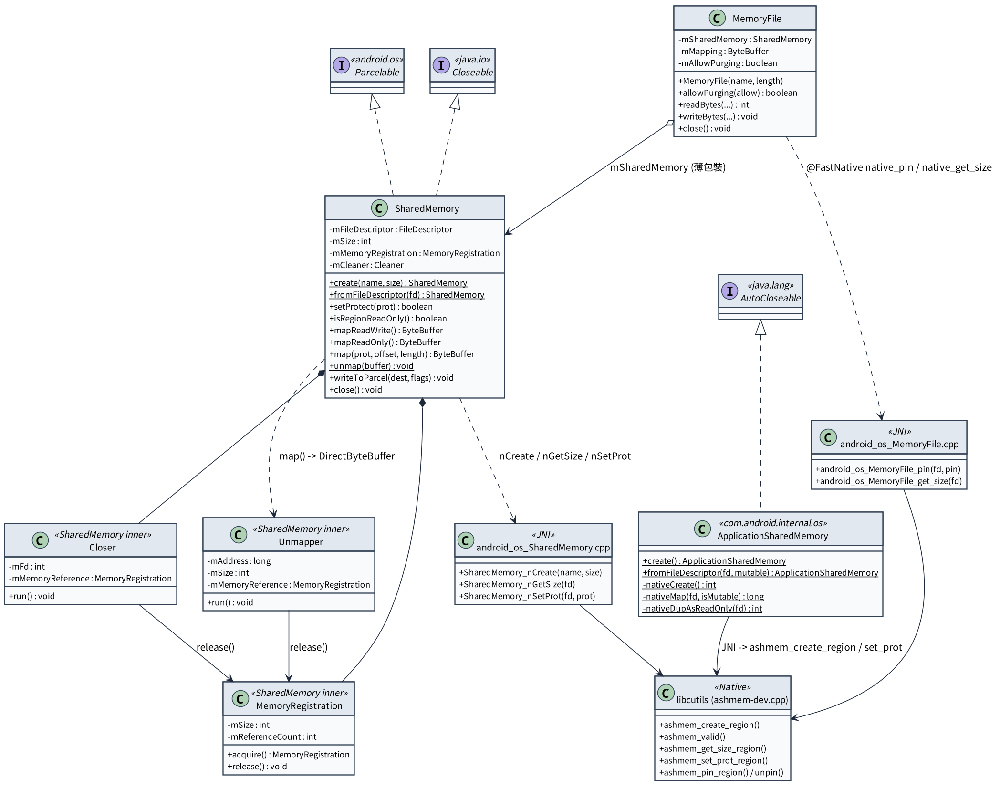
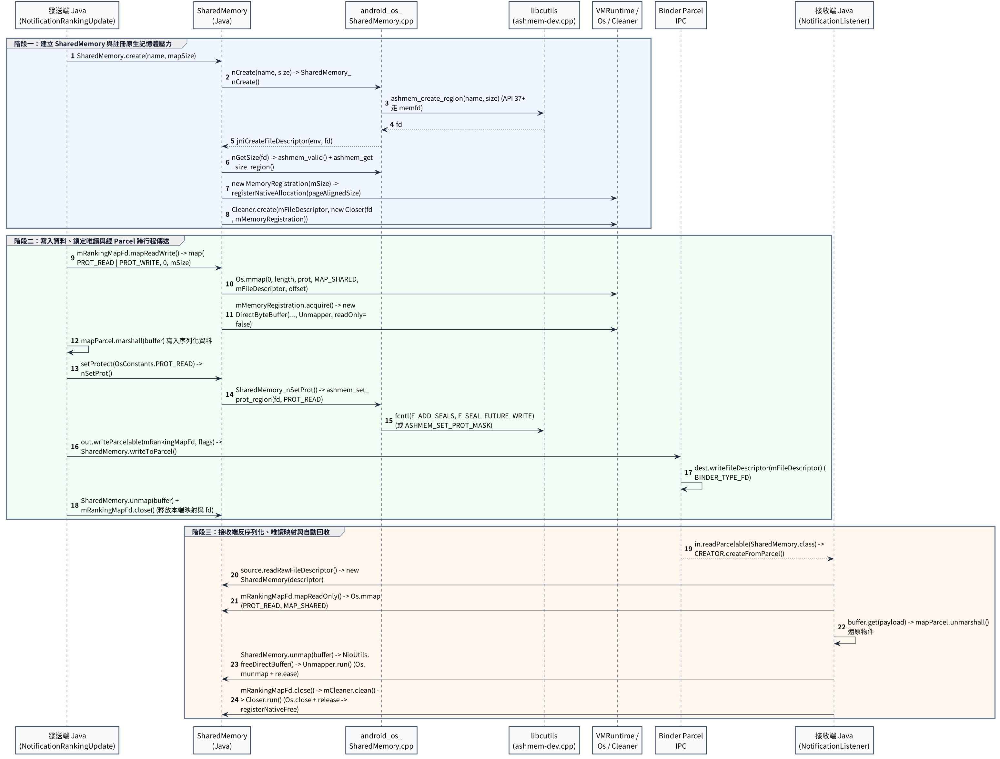

# 6.4 匿名共享記憶體的 Java 存取介面（`SharedMemory` 與 `MemoryFile`）

- **情景說明**：Java 系統服務或應用程式需要跨行程傳遞大型資料（如通知排序表 `NotificationRankingUpdate`），或需要由 `system_server` 向所有 App 行程單向發布唯讀狀態（如 `ApplicationSharedMemory`）。在 Android 17 中，Java 層的核心類別已從原書 2.3 的 `MemoryFile` 全面升級為 **`android.os.SharedMemory`**：開發者呼叫 `SharedMemory.create()` 建立共享區、`mapReadWrite()` 取得零拷貝 `DirectByteBuffer` 寫入、`setProtect(PROT_READ)` 鎖定唯讀並直接以 `Parcelable` 跨 Binder 傳遞；接收端反序列化取得 `SharedMemory` 後以 `mapReadOnly()` 映射讀取，所有原生記憶體壓力與 fd／mapping 生命週期均由 `MemoryRegistration`、`Closer` 與 `Unmapper` 精確托管。舊版 `MemoryFile` 則已退化為 `SharedMemory` 的薄包裝。
- **對應原書**：6.4 節〈匿名共享内存的 Java 访问接口〉（p.378–394）
- **涉及專案與版本基準**：
  - `platform/frameworks/base` 〔`android-17.0.0_r1`，commit `94b4c163b`〕

---

## 6.4.1 現代核心：`android.os.SharedMemory` 與 JNI 橋接

> 對應原書 6.4.1（p.378–383）。原書 2.3 的 Java 層只有 `MemoryFile`，它存在三大限制：不實作 `Parcelable`（跨行程必須呼叫 `@hide` 的 `getFileDescriptor()` 再手動包裝 `ParcelFileDescriptor`）、只能透過 `byte[]` 複製讀寫（每次 `readBytes`/`writeBytes` 都有額外陣列拷貝）、且不支援公開的唯讀降權保護。Android 8.1（API 27）起引入 `SharedMemory` 一次補齊這三塊拼圖，並在 Android 17 新增 `isRegionReadOnly()` 同時檢查 `F_GET_SEALS` 與 `ASHMEM_GET_PROT_MASK`。



### Step 1：`SharedMemory.create`、`fromFileDescriptor` 與 JNI `SharedMemory_nCreate` / `nGetSize`
**位置**：`platform/frameworks/base/core/java/android/os/SharedMemory.java` 〔`android-17.0.0_r1`，lines 41–115〕、`platform/frameworks/base/core/jni/android_os_SharedMemory.cpp` 〔`android-17.0.0_r1`，lines 39–87〕

```java
public final class SharedMemory implements Parcelable, Closeable {

    private final FileDescriptor mFileDescriptor;
    private final int mSize;
    private final MemoryRegistration mMemoryRegistration;
    private Cleaner mCleaner;

    private SharedMemory(FileDescriptor fd) {
        if (fd == null) {
            throw new IllegalArgumentException(
                    "Unable to create SharedMemory from a null FileDescriptor");
        }
        if (!fd.valid()) {
            throw new IllegalArgumentException(
                    "Unable to create SharedMemory from closed FileDescriptor");
        }
        mFileDescriptor = fd;
        mSize = nGetSize(mFileDescriptor);
        if (mSize <= 0) {
            throw new IllegalArgumentException("FileDescriptor is not a valid ashmem fd");
        }

        mMemoryRegistration = new MemoryRegistration(mSize);
        mCleaner = Cleaner.create(mFileDescriptor,
                new Closer(mFileDescriptor.getInt$(), mMemoryRegistration));
    }

    public static @NonNull SharedMemory create(@Nullable String name, int size)
            throws ErrnoException {
        if (size <= 0) {
            throw new IllegalArgumentException("Size must be greater than zero");
        }
        return new SharedMemory(nCreate(name, size));
    }

    public static @NonNull SharedMemory fromFileDescriptor(@NonNull ParcelFileDescriptor fd) {
        FileDescriptor f = new FileDescriptor();
        f.setInt$(fd.detachFd());
        return new SharedMemory(f);
    }
```

```cpp
jobject SharedMemory_nCreate(JNIEnv* env, jobject, jstring jname, jint size) {

    // Name is optional so we can't use ScopedUtfChars for this as it throws NPE on null
    const char* name = jname ? env->GetStringUTFChars(jname, nullptr) : nullptr;

    int fd = ashmem_create_region(name, size);

    // Capture the error, if there is one, before calling ReleaseStringUTFChars
    int err = fd < 0 ? errno : 0;

    if (name) {
        env->ReleaseStringUTFChars(jname, name);
    }

    if (fd < 0) {
        jniThrowErrnoException(env, "SharedMemory_create", err);
        return nullptr;
    }

    jobject jifd = jniCreateFileDescriptor(env, fd);
    if (jifd == nullptr) {
        close(fd);
    }
    return jifd;
}

jint SharedMemory_nGetSize(JNIEnv* env, jobject, jobject fileDescriptor) {
    int fd = jniGetFDFromFileDescriptor(env, fileDescriptor);
    if (!ashmem_valid(fd)) {
        return -1;
    }
    size_t size = ashmem_get_size_region(fd);
    return static_cast<jint>(std::min(size, static_cast<size_t>(std::numeric_limits<jint>::max())));
}

jint SharedMemory_nSetProt(JNIEnv* env, jobject, jobject fileDescriptor, jint prot) {
    int fd = jniGetFDFromFileDescriptor(env, fileDescriptor);
    int err = 0;
    if (ashmem_set_prot_region(fd, prot)) {
        err = errno;
    }
    return err;
}
```

建構流程極為嚴謹：
1. 無論是新建（`SharedMemory.create`）、從 Native/NDK 轉入（`fromFileDescriptor` 透過 `fd.detachFd()` 接管所有權），或是從 `Parcel` 反序列化（`CREATOR.createFromParcel`），都統一匯流至私有建構子 `SharedMemory(FileDescriptor fd)`；
2. 建構子立刻呼叫 `nGetSize` → `ashmem_valid(fd)`（相容 `memfd` 與 `ashmem`）+ `ashmem_get_size_region(fd)`，確保任何非共享記憶體的偽造 fd 都會拋出 `IllegalArgumentException`；
3. 接著建立 `MemoryRegistration` 向 ART 虛擬機申報原生記憶體占用，並用 `sun.misc.Cleaner` 掛上 `Closer` 防止忘記 `close()` 造成 fd 洩漏。

> 〔與 2.3 差異〕新增：原書 2.3 尚無 `SharedMemory` 與 `android_os_SharedMemory.cpp`。

---

### Step 2：權限降權（`setProtect`、`isRegionReadOnly`）與零拷貝映射（`map`、`unmap`、`MemoryRegistration`）
**位置**：`platform/frameworks/base/core/java/android/os/SharedMemory.java` 〔`android-17.0.0_r1`，lines 151–185、234–325、341–436〕

```java
    public boolean setProtect(int prot) {
        checkOpen();
        validateProt(prot);
        int errno = nSetProt(mFileDescriptor, prot);
        return errno == 0;
    }

    @FlaggedApi(com.android.libcore.Flags.FLAG_ENABLE_PCC_FRAMEWORK_SUPPORT)
    public boolean isRegionReadOnly() {
        checkOpen();
        try {
            int seals = Os.fcntlInt(mFileDescriptor, OsConstants.F_GET_SEALS, 0);
            if (seals >= 0) {
                return (seals & (OsConstants.F_SEAL_WRITE | OsConstants.F_SEAL_FUTURE_WRITE)) != 0;
            }
        } catch (ErrnoException e) {
            // Ignore and try fallback
        }

        try {
            int prot = Os.ioctlRet(mFileDescriptor, OsConstants.ASHMEM_GET_PROT_MASK);
            return (prot & OsConstants.PROT_WRITE) == 0;
        } catch (ErrnoException e) {
            throw new IllegalStateException(
                    "SharedMemory could not be examined for read only status", e);
        }
    }
```

```java
    public @NonNull ByteBuffer map(int prot, int offset, int length) throws ErrnoException {
        checkOpen();
        validateProt(prot);
        if (offset < 0) {
            throw new IllegalArgumentException("Offset must be >= 0");
        }
        if (length <= 0) {
            throw new IllegalArgumentException("Length must be > 0");
        }
        if (offset + length > mSize) {
            throw new IllegalArgumentException("offset + length must not exceed getSize()");
        }
        long address = Os.mmap(0, length, prot, OsConstants.MAP_SHARED, mFileDescriptor, offset);
        boolean readOnly = (prot & OsConstants.PROT_WRITE) == 0;
        Runnable unmapper = new Unmapper(address, length, mMemoryRegistration.acquire());
        return new DirectByteBuffer(length, address, mFileDescriptor, unmapper, readOnly);
    }

    public static void unmap(@NonNull ByteBuffer buffer) {
        if (buffer instanceof DirectByteBuffer) {
            NioUtils.freeDirectBuffer(buffer);
        } else {
            throw new IllegalArgumentException(
                    "ByteBuffer wasn't created by #map(int, int, int); can't unmap");
        }
    }

    @Override
    public void close() {
        mFileDescriptor.setInt$(-1);
        if (mCleaner != null) {
            mCleaner.clean();
            mCleaner = null;
        }
    }

    @Override
    public void writeToParcel(@NonNull Parcel dest, int flags) {
        checkOpen();
        dest.writeFileDescriptor(mFileDescriptor);
    }
```

```java
    private static final class MemoryRegistration {
        private int mSize;
        private int mReferenceCount;

        private MemoryRegistration(int size) {
            final int PAGE_SIZE = OsConstants._SC_PAGE_SIZE;
            if (PAGE_SIZE > 0) {
                final int remainder = size % PAGE_SIZE;
                if (remainder != 0) {
                    size += PAGE_SIZE - remainder;
                }
            }
            mSize = size;
            mReferenceCount = 1;
            VMRuntime.getRuntime().registerNativeAllocation(mSize);
        }

        public synchronized MemoryRegistration acquire() {
            mReferenceCount++;
            return this;
        }

        public synchronized void release() {
            mReferenceCount--;
            if (mReferenceCount == 0) {
                VMRuntime.getRuntime().registerNativeFree(mSize);
            }
        }
    }
```

這裡有三個現代 Java 系統設計亮點：
1. **雙後端唯讀偵測（`isRegionReadOnly`）**：先嘗試以 `Os.fcntlInt(fd, F_GET_SEALS, 0)` 檢查 `F_SEAL_WRITE | F_SEAL_FUTURE_WRITE`（針對 `memfd`），失敗才退回 `Os.ioctlRet(fd, ASHMEM_GET_PROT_MASK)`（針對傳統 `ashmem`），讓接收端可明確確認共享記憶體是否已被封印為唯讀。
2. **直接映射為 `DirectByteBuffer`**：`map()` 直接呼叫 libcore `Os.mmap(..., MAP_SHARED, ...)` 取得原生位址，包裝成 `DirectByteBuffer`（無須 JNI 額外封裝 `read`/`write` 拷貝），並把 `Unmapper` 掛到 `DirectByteBuffer` 的 cleaner；呼叫 `SharedMemory.unmap(buffer)` 時透過 `NioUtils.freeDirectBuffer()` 立即執行 `Os.munmap()`。
3. **跨 `close()` 與 `unmap()` 的引用計數記憶體記帳（`MemoryRegistration`）**：在 Linux 中，關閉 fd 並不會釋放已建立的 `mmap` 映射；反之，解除所有 `mmap` 但 fd 未關，實體頁依然存在。`MemoryRegistration` 初始計數為 `1`（代表 fd 本身）並呼叫 `VMRuntime.getRuntime().registerNativeAllocation(mSize)`，每次 `map()` 呼叫 `acquire()` 加 1，每次 `Closer.run()` 或 `Unmapper.run()` 呼叫 `release()` 減 1——直到 fd **與**所有 mapping 全數歸零，才呼叫 `registerNativeFree(mSize)`，精確向 ART GC 反映真實原生記憶體壓力。

> 〔與 2.3 差異〕新增：原書 2.3 的 `MemoryFile` 未實作 `Parcelable`，也沒有 `DirectByteBuffer` 零拷貝映射與 `VMRuntime.registerNativeAllocation` 壓力追蹤。

---

## 6.4.2 傳統 `MemoryFile` 的現代重構（薄包裝與棄用 `allowPurging`）

> 對應原書 6.4.1（p.378–383）。為了維持舊 App 的二進位與原始碼相容性，Android 17 保留了 `android.os.MemoryFile`，但內部已徹底重寫：不再自己透過 JNI 呼叫 `ashmem_create_region`/`mmap`/`read`/`write`，而是直接組合一個 `SharedMemory` 與 `ByteBuffer`。

### Step 3：`MemoryFile.java` 委派 `SharedMemory` 與 `android_os_MemoryFile.cpp`
**位置**：`platform/frameworks/base/core/java/android/os/MemoryFile.java` 〔`android-17.0.0_r1`，lines 42–80、103–116、152–160、191–222〕、`platform/frameworks/base/core/jni/android_os_MemoryFile.cpp` 〔`android-17.0.0_r1`，lines 29–63〕

```java
public class MemoryFile {
    private static String TAG = "MemoryFile";

    @FastNative
    @UnsupportedAppUsage(maxTargetSdk = Build.VERSION_CODES.R, trackingBug = 170729553)
    private static native boolean native_pin(FileDescriptor fd, boolean pin) throws IOException;
    @FastNative
    @UnsupportedAppUsage
    private static native int native_get_size(FileDescriptor fd) throws IOException;

    private SharedMemory mSharedMemory;
    private ByteBuffer mMapping;
    private boolean mAllowPurging = false;  // true if our ashmem region is unpinned

    public MemoryFile(String name, int length) throws IOException {
        try {
            mSharedMemory = SharedMemory.create(name, length);
            mMapping = mSharedMemory.mapReadWrite();
        } catch (ErrnoException ex) {
            ex.rethrowAsIOException();
        }
    }

    public void close() {
        deactivate();
        mSharedMemory.close();
    }
```

```java
    private void beginAccess() throws IOException {
        checkActive();
        if (mAllowPurging) {
            if (native_pin(mSharedMemory.getFileDescriptor(), true)) {
                throw new IOException("MemoryFile has been purged");
            }
        }
    }

    private void endAccess() throws IOException {
        if (mAllowPurging) {
            native_pin(mSharedMemory.getFileDescriptor(), false);
        }
    }

    @Deprecated
    synchronized public boolean allowPurging(boolean allowPurging) throws IOException {
        boolean oldValue = mAllowPurging;
        if (oldValue != allowPurging) {
            native_pin(mSharedMemory.getFileDescriptor(), !allowPurging);
            mAllowPurging = allowPurging;
        }
        return oldValue;
    }

    public int readBytes(byte[] buffer, int srcOffset, int destOffset, int count)
            throws IOException {
        beginAccess();
        try {
            mMapping.position(srcOffset);
            mMapping.get(buffer, destOffset, count);
        } finally {
            endAccess();
        }
        return count;
    }

    public void writeBytes(byte[] buffer, int srcOffset, int destOffset, int count)
            throws IOException {
        beginAccess();
        try {
            mMapping.position(destOffset);
            mMapping.put(buffer, srcOffset, count);
        } finally {
            endAccess();
        }
    }
```

```cpp
static jboolean android_os_MemoryFile_pin(JNIEnv* env, jobject clazz, jobject fileDescriptor,
        jboolean pin) {
    int fd = jniGetFDFromFileDescriptor(env, fileDescriptor);
    int result = (pin ? ashmem_pin_region(fd, 0, 0) : ashmem_unpin_region(fd, 0, 0));
    if (result < 0) {
        jniThrowException(env, "java/io/IOException", NULL);
    }
    return result == ASHMEM_WAS_PURGED;
}
```

對比原書 2.3（p.379–383）有 7 個 JNI 方法（`native_open`、`native_mmap`、`native_close`、`native_read`、`native_write`、`native_pin`、`native_get_size`），Android 17 的 `android_os_MemoryFile.cpp` 只剩下 2 個 `@FastNative` 遺留相容方法（`native_pin` 與 `native_get_size`）——連讀寫也改由 `mMapping`（`DirectByteBuffer`）在 Java 層直接完成；而 `allowPurging()` 與 `isPurgingAllowed()` 已標註 `@Deprecated`，在 Android 17 預設 `memfd` 後端下 `native_pin` 最終只會進入 `ashmem-dev.cpp::do_pin()` 直接返回 `0`（不回收）。

> 〔與 2.3 差異〕邏輯改變 + 簡化：原書 2.3（p.378–383）的 `MemoryFile` 直接透過 JNI 操作 `/dev/ashmem` 與手動 `memcpy`；Android 17 改為 `SharedMemory` 的薄包裝，`android_os_MemoryFile.cpp` 由 7 個 JNI 精簡為 2 個 `@FastNative` 方法。

---

## 6.4.3 AOSP 17 真實系統案例：`NotificationRankingUpdate` 與 `ApplicationSharedMemory`

> 對應原書 6.4.2〈应用实例〉（p.383–394）。原書寫了一個兩行程 App 透過 AIDL 傳 `ParcelFileDescriptor` 共享 `MemoryFile`；在 Android 17 原始碼中，有兩個極具代表性的真實框架應用正好展現了「一次性大型傳輸」與「長期零 Binder 廣播」兩種典型模式。

### Step 4：一次性跨行程唯讀傳輸 — `NotificationRankingUpdate`
**位置**：`platform/frameworks/base/core/java/android/service/notification/NotificationRankingUpdate.java` 〔`android-17.0.0_r1`，lines 61–100、205–238〕

```java
        try {
            mapParcel.writeParcelable(marshalableRankingMap, flags);
            int mapSize = mapParcel.dataSize();

            mRankingMapFd = SharedMemory.create(mSharedMemoryName, mapSize);

            buffer = mRankingMapFd.mapReadWrite();
            mapParcel.marshall(buffer);
            mRankingMapFd.setProtect(OsConstants.PROT_READ);
            out.writeParcelable(mRankingMapFd, flags);
            if (smartActionsBundle.size() > 0) {
                out.writeBundle(smartActionsBundle);
            } else {
                out.writeBundle(null);
            }
        } catch (ErrnoException e) {
            Slog.wtf(TAG, "Failed to write ranking map to shared memory", e);
        } finally {
            mapParcel.recycle();
            if (buffer != null && mRankingMapFd != null) {
                SharedMemory.unmap(buffer);
                mRankingMapFd.close();
            }
        }
```

```java
    public NotificationRankingUpdate(Parcel in) {
        final Parcel mapParcel = Parcel.obtain();
        ByteBuffer buffer = null;
        try {
            mRankingMapFd = in.readParcelable(getClass().getClassLoader(), SharedMemory.class);
            Bundle smartActionsBundle = in.readBundle(getClass().getClassLoader());

            if (mRankingMapFd == null) {
                mRankingMap = null;
                return;
            }
            buffer = mRankingMapFd.mapReadOnly();
            byte[] payload = new byte[buffer.remaining()];
            buffer.get(payload);
            mapParcel.unmarshall(payload, 0, payload.length);
            mapParcel.setDataPosition(0);

            mRankingMap =
                    mapParcel.readParcelable(
                            getClass().getClassLoader(),
                            NotificationListenerService.RankingMap.class);

            addSmartActionsFromBundleToRankingMap(smartActionsBundle);

        } catch (ErrnoException e) {
            throw new RuntimeException(e);
        } finally {
            mapParcel.recycle();
            if (buffer != null && mRankingMapFd != null) {
                SharedMemory.unmap(buffer);
                mRankingMapFd.close();
            }
        }
    }
```

這是使用 `SharedMemory` 繞過 Binder 1 MB 交易緩衝區上限（避免 `TransactionTooLargeException`）的標準教科書範本：
1. 發送端先將 `RankingMap` 序列化到暫存 `mapParcel` 測出實際 `mapSize`；
2. `SharedMemory.create()` → `mapReadWrite()` → `mapParcel.marshall(buffer)` 寫入共享區 → `setProtect(PROT_READ)` 鎖定唯讀 → `out.writeParcelable(mRankingMapFd, flags)` 僅傳遞一個極小的 `BINDER_TYPE_FD`；
3. `finally` 中發送端立刻 `unmap(buffer)` 並 `close()` 自己的 fd（不影響已被 Binder 複製到目標行程或仍在傳輸途中的核心 `struct file` 引用）；
4. 接收端讀出 `SharedMemory` 後以 `mapReadOnly()` 還原，用畢立即 `unmap` + `close`，零殘留。

---

### Step 5：長期單寫多讀零 Binder 通道 — `ApplicationSharedMemory`
**位置**：`platform/frameworks/base/core/java/com/android/internal/os/ApplicationSharedMemory.java` 〔`android-17.0.0_r1`，lines 99–131〕、`platform/frameworks/base/core/jni/com_android_internal_os_ApplicationSharedMemory.cpp` 〔`android-17.0.0_r1`，lines 194–243〕

```java
    public static ApplicationSharedMemory create() {
        int fd = nativeCreate();
        FileDescriptor fileDescriptor = new FileDescriptor();
        fileDescriptor.setInt$(fd);

        final boolean mutable = true;
        long ptr = nativeMap(fd, mutable);
        nativeInit(ptr);

        return new ApplicationSharedMemory(fileDescriptor, mutable, ptr);
    }

    public static ApplicationSharedMemory fromFileDescriptor(
            @NonNull FileDescriptor fileDescriptor, boolean mutable) {
        long ptr = nativeMap(fileDescriptor.getInt$(), mutable);
        return new ApplicationSharedMemory(fileDescriptor, mutable, ptr);
    }
```

```cpp
static jint nativeCreate(JNIEnv* env, jclass) {
    // Create anonymous shared memory region
    int fd = ashmem_create_region("ApplicationSharedMemory", sizeof(SharedMemory));
    if (fd < 0) {
        jniThrowExceptionFmt(env, "java/lang/RuntimeException", "Failed to create ashmem: %s",
                             strerror(errno));
    }
    return fd;
}

static jlong nativeMap(JNIEnv* env, jclass, jint fd, jboolean isMutable) {
    void* ptr = mmap(nullptr, sizeof(SharedMemory), isMutable ? PROT_READ | PROT_WRITE : PROT_READ,
                     MAP_SHARED, fd, 0);
    if (ptr == MAP_FAILED) {
        close(fd);
        jniThrowExceptionFmt(env, "java/lang/RuntimeException", "Failed to mmap shared memory: %s",
                             strerror(errno));
    }

    return reinterpret_cast<jlong>(ptr);
}

static jint nativeDupAsReadOnly(JNIEnv* env, jclass, jint fd) {
    // Duplicate file descriptor
    fd = fcntl(fd, F_DUPFD_CLOEXEC, 0);
    if (fd < 0) {
        jniThrowExceptionFmt(env, "java/lang/RuntimeException", "Failed to dup fd: %s",
                             strerror(errno));
    }

    // Set new file descriptor to read-only
    if (ashmem_set_prot_region(fd, PROT_READ)) {
        close(fd);
        jniThrowExceptionFmt(env, "java/lang/RuntimeException",
                             "Failed to ashmem_set_prot_region: %s", strerror(errno));
    }

    return fd;
}
```

`ApplicationSharedMemory` 完美展示了 `F_SEAL_FUTURE_WRITE`（單寫多讀）在 Android 17 框架層的威力：`system_server` 建立共享記憶體並以 `PROT_READ | PROT_WRITE` 映射為固定跨 32/64-bit ABI 對齊的無鎖原子結構（存放網路時間、動畫縮放比、系統特性快取 `SystemFeaturesCache`、`PropertyInvalidatedCache` nonce 區塊），再透過 `nativeDupAsReadOnly()` 呼叫 `ashmem_set_prot_region(fd, PROT_READ)` 封印後續寫入後分發給所有 App 行程；App 直接用 `@CriticalNative`／`@FastNative` 讀取映射記憶體，**完全省去高頻 Binder IPC 開銷**，同時保證 App 絕無法篡改核心狀態。

> 〔與 2.3 差異〕新增：原書 6.4.2（p.383–394）使用手寫範例 App 示範；Android 17 系統內部已廣泛採用 `SharedMemory` 與 `ApplicationSharedMemory` 作為標準高速資料通道。

---

## 整節呼叫鏈總結


