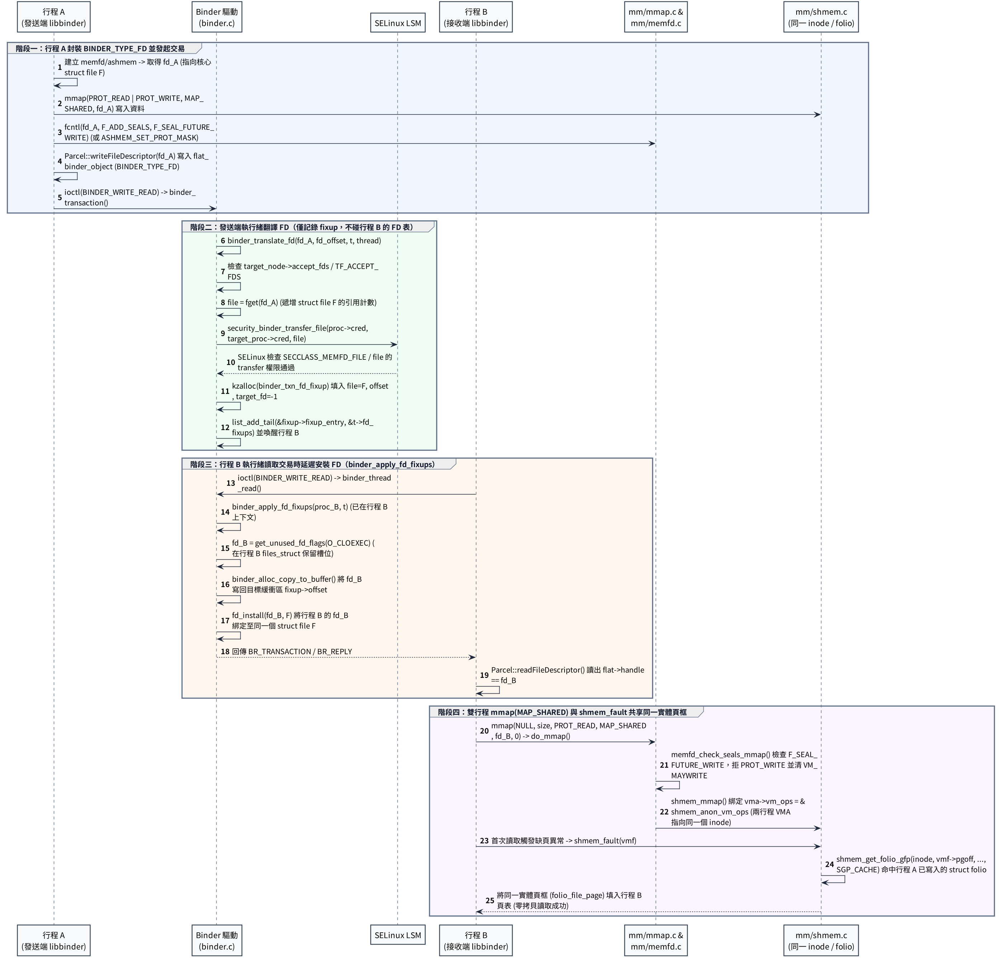

# 6.5 跨行程共享原理（Binder FD 傳遞與 `shmem` 頁快取映射）

- **情景說明**：行程 A 建立一塊匿名共享記憶體（`memfd` 或 Rust `ashmem`），先以 `mmap(PROT_READ | PROT_WRITE, MAP_SHARED)` 寫入資料，再施加 `F_SEAL_FUTURE_WRITE`（或 `PROT_READ`）防止對端竄改，接著經由 Binder IPC 將該檔案描述符 `fd_A` 傳給行程 B。行程 B 收到屬於自己進程空間的新檔案描述符 `fd_B` 後，呼叫 `mmap(PROT_READ, MAP_SHARED)` 並讀取行程 A 寫入的資料。本節串聯第 5 章 Binder 驅動與第 6 章記憶體管理子系統，剖析 Linux 6.18 中「**FD 延遲安裝（`binder_txn_fd_fixup`）→ 同一個 `struct file`／`struct inode` → 兩行程頁表指向同一批 `shmem` 實體頁框（`struct folio`）**」的完整零拷貝共享原理。
- **對應原書**：6.5 節〈匿名共享内存的共享原理〉（p.394–400）
- **涉及專案與版本基準**：
  - `platform/frameworks/native` 〔`android-17.0.0_r1`，commit `ae266dc`〕
  - `kernel/common` 〔`android17-6.18`，Linux 6.18，commit `028363aa3cfa`〕

---

## 6.5.1 使用者空間封裝 `BINDER_TYPE_FD`（`Parcel::writeFileDescriptor` / `readFileDescriptor`）

> 對應原書 6.5（p.394–397）。檔案描述符（fd）本質上只是行程私有陣列 `current->files`（`struct files_struct`）的整數索引，直接把整數 `fd_A` 當成普通 `int32_t` 傳給行程 B 毫無意義。要讓兩個行程共享同一個核心 `struct file` 物件，發送端必須把 fd 標記為 Binder 物件 **`BINDER_TYPE_FD`**，讓 Binder 驅動在核心態完成跨行程的檔案指標傳遞與目標 fd 翻譯。

### Step 1：`Parcel::writeFileDescriptor` 與 `Parcel::readFileDescriptor`
**位置**：`platform/frameworks/native/libs/binder/Parcel.cpp` 〔`android-17.0.0_r1`，lines 1727–1784、2624–2665〕

```cpp
status_t Parcel::writeFileDescriptor(int fd, bool takeOwnership) {
    if (auto* rpcFields = maybeRpcFields()) {
        ...
    }

#ifdef BINDER_WITH_KERNEL_IPC
    flat_binder_object obj;
    obj.hdr.type = BINDER_TYPE_FD;
    obj.flags = 0;
    obj.binder = 0; /* Don't pass uninitialized stack data to a remote process */
    obj.handle = fd;
    obj.cookie = takeOwnership ? 1 : 0;
    return writeObject(obj, true);
#else  // BINDER_WITH_KERNEL_IPC
    LOG_ALWAYS_FATAL("Binder kernel driver disabled at build time");
    (void)fd;
    (void)takeOwnership;
    return INVALID_OPERATION;
#endif // BINDER_WITH_KERNEL_IPC
}
```

```cpp
int Parcel::readFileDescriptor() const {
    if (const auto* rpcFields = maybeRpcFields()) {
        ...
    }

#ifdef BINDER_WITH_KERNEL_IPC
    const flat_binder_object* flat = readObject(true);

    if (flat && flat->hdr.type == BINDER_TYPE_FD) {
        return flat->handle;
    }

    return BAD_TYPE;
#else  // BINDER_WITH_KERNEL_IPC
    LOG_ALWAYS_FATAL("Binder kernel driver disabled at build time");
    return INVALID_OPERATION;
#endif // BINDER_WITH_KERNEL_IPC
}
```

無論上層是 C++ 的 `BnMemoryHeap::onTransact()`（`reply->writeFileDescriptor(getHeapID())`），還是 Java 的 `SharedMemory.writeToParcel()`（`dest.writeFileDescriptor(mFileDescriptor)` → JNI → `Parcel::writeFileDescriptor`），最終都在 Parcel 資料區寫入一個 `flat_binder_object`（其中 `hdr.type = BINDER_TYPE_FD`、`handle = fd_A`、`cookie = takeOwnership ? 1 : 0`），並由 `writeObject(obj, true)` 把它在 Parcel 中的偏移量記錄到 `mObjects[]` 偏移陣列，好讓 Binder 驅動逐一掃描翻譯。

> 〔與 2.3 差異〕邏輯改變 + 擴充：核心 IPC 路徑的 `flat_binder_object`（`BINDER_TYPE_FD`）格式與原書 2.3（p.395–396）一致；Android 17 另在 `Parcel` 開頭支援 RPC Binder（透過 Unix Domain Socket `SCM_RIGHTS` 傳遞 FD），並顯式將 `obj.binder = 0` 避免堆疊未初始化資料外洩。

---

## 6.5.2 核心 Binder 驅動兩階段 FD 延遲翻譯與安裝

> 對應原書 6.5（p.396–399）。這是 Android 17 / Linux 6.18 與原書 2.3 **最重大的底層實作差異之一**：
> - 在原書 2.3 中，發送端行程 A 執行 `binder_transaction()` 時，直接在核心裡鎖定目標行程 B 的 `files_struct`（`task_get_unused_fd_flags` + `task_fd_install`），強行把新 fd 塞進**另一個行程**的描述符表！這種跨行程操作另一進程 `files_struct` 的做法違反 Linux VFS 規範，極易引發鎖序競爭、fd 洩漏（若行程 B 根本沒讀到這筆交易）甚至安全漏洞。
> - 現代 Linux 6.18 Binder 驅動將其徹底改寫為**兩階段延遲安裝**：發送端在 `binder_translate_fd()` 僅取出 `struct file*` 引用並記錄一筆 `binder_txn_fd_fixup` 掛在交易上；直到目標行程 B 的執行緒真正進到 `binder_thread_read()` 接收交易時，才由 `binder_apply_fd_fixups()` 在**行程 B 自己的上下文中**分配 `fd_B`、回寫緩衝區並呼叫標準 `fd_install()`！

### Step 2：發送端階段 — `binder_translate_fd` 取出 `struct file`、SELinux 檢查與建立 fixup
**位置**：`kernel/common/drivers/android/binder.c` 〔`android17-6.18`，lines 2552–2614〕

```c
static int binder_translate_fd(u32 fd, binder_size_t fd_offset,
			       struct binder_transaction *t,
			       struct binder_thread *thread,
			       struct binder_transaction *in_reply_to)
{
	struct binder_proc *proc = thread->proc;
	struct binder_proc *target_proc = t->to_proc;
	struct binder_txn_fd_fixup *fixup;
	struct file *file;
	int ret = 0;
	bool target_allows_fd;

	if (in_reply_to)
		target_allows_fd = !!(in_reply_to->flags & TF_ACCEPT_FDS);
	else
		target_allows_fd = t->buffer->target_node->accept_fds;
	if (!target_allows_fd) {
		binder_user_error("%d:%d got %s with fd, %d, but target does not allow fds\n",
				  proc->pid, thread->pid,
				  in_reply_to ? "reply" : "transaction",
				  fd);
		ret = -EPERM;
		goto err_fd_not_accepted;
	}

	file = fget(fd);
	if (!file) {
		binder_user_error("%d:%d got transaction with invalid fd, %d\n",
				  proc->pid, thread->pid, fd);
		ret = -EBADF;
		goto err_fget;
	}
	ret = security_binder_transfer_file(proc->cred, target_proc->cred, file);
	if (ret < 0) {
		ret = -EPERM;
		goto err_security;
	}

	/*
	 * Add fixup record for this transaction. The allocation
	 * of the fd in the target needs to be done from a
	 * target thread.
	 */
	fixup = kzalloc(sizeof(*fixup), GFP_KERNEL);
	if (!fixup) {
		ret = -ENOMEM;
		goto err_alloc;
	}
	fixup->file = file;
	fixup->offset = fd_offset;
	fixup->target_fd = -1;
	trace_binder_transaction_fd_send(t, fd, fixup->offset);
	list_add_tail(&fixup->fixup_entry, &t->fd_fixups);

	return ret;

err_alloc:
err_security:
	fput(file);
err_fget:
err_fd_not_accepted:
	return ret;
}
```

發送端執行四道關卡：
1. **接收端意願檢查**：確認目標節點允許接收 FD（`target_node->accept_fds` 或回覆交易 `TF_ACCEPT_FDS`）；
2. **抓取並釘住核心 `struct file`**：呼叫 `fget(fd)` 在行程 A 的描述符表中取得 `struct file*` 並**遞增 `f_count` 引用計數**——因此就算行程 A 在發完交易後（例如 `NotificationRankingUpdate.writeToParcel` 的 `finally`）立刻 `close(fd_A)`，底層 `struct file` 與其 `shmem` 頁快取依然存活；
3. **SELinux 跨行程傳遞授權**：呼叫 `security_binder_transfer_file(proc->cred, target_proc->cred, file)`，依 `memfd` 的 `SECCLASS_MEMFD_FILE` 或 `ashmem` 的裝置／tmpfs 標籤核驗行程 B 是否有權接收與使用此檔案；
4. **掛入延遲清單**：配置 `binder_txn_fd_fixup` 記錄 `file` 與 `fd_offset`（`flat_binder_object.handle` 在目標 `binder_buffer` 中的偏移量），掛入 `t->fd_fixups`，完全不碰行程 B 的 `files_struct`。

> 〔與 2.3 差異〕邏輯改變：原書 2.3（p.396–399）在 `binder_transaction()` 內直接呼叫 `task_get_unused_fd_flags(target_proc)` 與 `task_fd_install(target_proc, ...)` 立即改寫對端 FD 表，且無 `security_binder_transfer_file` 檢查；Linux 6.18 改採 `binder_txn_fd_fixup` 延遲安裝並加入強制 SELinux 檢查。

---

### Step 3：接收端階段 — `binder_apply_fd_fixups` 在行程 B 上下文原子安裝 `fd_B`
**位置**：`kernel/common/drivers/android/binder.c` 〔`android17-6.18`，lines 4942–4981、5327〕

```c
static int binder_apply_fd_fixups(struct binder_proc *proc,
				  struct binder_transaction *t)
{
	struct binder_txn_fd_fixup *fixup, *tmp;
	int ret = 0;

	list_for_each_entry(fixup, &t->fd_fixups, fixup_entry) {
		int fd = get_unused_fd_flags(O_CLOEXEC);

		if (fd < 0) {
			binder_debug(BINDER_DEBUG_TRANSACTION,
				     "failed fd fixup txn %d fd %d\n",
				     t->debug_id, fd);
			ret = -ENOMEM;
			goto err;
		}
		binder_debug(BINDER_DEBUG_TRANSACTION,
			     "fd fixup txn %d fd %d\n",
			     t->debug_id, fd);
		trace_binder_transaction_fd_recv(t, fd, fixup->offset);
		fixup->target_fd = fd;
		if (binder_alloc_copy_to_buffer(&proc->alloc, t->buffer,
						fixup->offset, &fd,
						sizeof(u32))) {
			ret = -EINVAL;
			goto err;
		}
	}
	list_for_each_entry_safe(fixup, tmp, &t->fd_fixups, fixup_entry) {
		fd_install(fixup->target_fd, fixup->file);
		list_del(&fixup->fixup_entry);
		kfree(fixup);
	}

	return ret;

err:
	binder_free_txn_fixups(t);
	return ret;
}
```

當行程 B 的 Binder 執行緒於 `binder_thread_read()` 取出這筆交易時（`binder.c:5327`），呼叫 `binder_apply_fd_fixups(proc, t)` 完成「全有或全無」的兩階段安裝：
1. **第一迴圈（預留槽位 + 覆寫目標緩衝區）**：在行程 B 自己上下文呼叫標準 `get_unused_fd_flags(O_CLOEXEC)` 取得空閒編號 `fd_B`（強制帶 `O_CLOEXEC` 防止 `execve` 外洩），再經 `binder_alloc_copy_to_buffer()`（第 5 章 5.1.5 的 `kmap_local_page` 寫入）將 `fd_B` 覆寫到目標 `binder_buffer` 中原 `flat_binder_object.handle` 的位置；若其中任何一個 FD 失敗（例如行程 B 的 `RLIMIT_NOFILE` 耗盡），直接跳 `err:` 透過 `binder_free_txn_fixups(t)` 把前面預留的空槽全數 `put_unused_fd()` 並 `fput(file)` 乾淨回滾；
2. **第二迴圈（提交安裝）**：確認全部 FD 預留與寫回成功後，才逐一執行 `fd_install(fixup->target_fd, fixup->file)`，將行程 B 的 `fd_B` 正式綁定到與行程 A `fd_A` 完全相同的核心 `struct file` 物件，並釋放 `fixup` 節點。

如果行程 B 最終釋放該筆交易緩衝區（`BC_FREE_BUFFER`）卻沒有自己把 `fd_B` 轉移走，驅動會在 `binder_transaction_buffer_release` 透過 `binder_deferred_fd_close(fd)` 排入 `task_work` 安全關閉，確保不遺留孤兒 FD。

> 〔與 2.3 差異〕新增：原書 2.3 無 `binder_apply_fd_fixups()` 兩階段原子回滾機制，亦未強制為接收端 FD 加上 `O_CLOEXEC`。

---

## 6.5.3 雙行程 `mmap(MAP_SHARED)` 與 `shmem_fault` 共享實體頁框

> 對應原書 6.5（p.399–400）。完成 FD 跨行程傳遞後，行程 A 的 `fd_A` 與行程 B 的 `fd_B` 已指向同一個核心 `struct file`（進而指向同一個 `shmem` `struct inode` 與其頁快取 `inode->i_mapping`）。接下來行程 B 呼叫 `mmap(MAP_SHARED)`，兩行程的獨立虛擬位址空間便會映射到完全同一批實體頁框。

### Step 4：`shmem_mmap` 與 `shmem_fault`（兩行程頁表指向同一 `struct folio`）
**位置**：`kernel/common/mm/shmem.c` 〔`android17-6.18`，lines 2789–2826、3010–3021〕

```c
static int shmem_mmap(struct file *file, struct vm_area_struct *vma)
{
	struct inode *inode = file_inode(file);

	file_accessed(file);
	/* This is anonymous shared memory if it is unlinked at the time of mmap */
	if (inode->i_nlink)
		vma->vm_ops = &shmem_vm_ops;
	else
		vma->vm_ops = &shmem_anon_vm_ops;
	return 0;
}
```

```c
static vm_fault_t shmem_fault(struct vm_fault *vmf)
{
	struct inode *inode = file_inode(vmf->vma->vm_file);
	gfp_t gfp = mapping_gfp_mask(inode->i_mapping);
	struct folio *folio = NULL;
	vm_fault_t ret = 0;
	int err;
	pgoff_t max_idx;

	max_idx = DIV_ROUND_UP(i_size_read(inode), __PAGE_SIZE) * (__PAGE_SIZE / PAGE_SIZE);
	if (unlikely(vmf->pgoff >= max_idx))
		return VM_FAULT_SIGBUS;

	max_idx = DIV_ROUND_UP(i_size_read(inode), PAGE_SIZE);
	if (unlikely(vmf->pgoff >= max_idx))
		return VM_FAULT_NEED_ANONPAGE;

	if (unlikely(inode->i_private)) {
		ret = shmem_falloc_wait(vmf, inode);
		if (ret)
			return ret;
	}

	WARN_ON_ONCE(vmf->page != NULL);
	err = shmem_get_folio_gfp(inode, vmf->pgoff, 0, &folio, SGP_CACHE,
				  gfp, vmf, &ret);
	if (err)
		return vmf_error(err);
	if (folio) {
		vmf->page = folio_file_page(folio, vmf->pgoff);
		ret |= VM_FAULT_LOCKED;
	}
	return ret;
}
```

完整實體記憶體共享機理一覽無遺：
1. **建立 VMA 與安全檢查**：
   - **`memfd` 路徑**：行程 B 呼叫 `mmap(..., PROT_READ, MAP_SHARED, fd_B, 0)`，先經過 6.1.2 的 `mm/mmap.c::do_mmap()` → `memfd_check_seals_mmap()`（確認 `F_SEAL_FUTURE_WRITE` 禁止 `PROT_WRITE` 並清掉 `VM_MAYWRITE`），再進入 `shmem_mmap()` 將 `vma->vm_ops` 設為 `shmem_anon_vm_ops`（因匿名 `memfd` 的 `i_nlink == 0`），且 `vma->vm_file` 指向該 `struct file`。
   - **Rust `ashmem` 路徑**：進入 6.1.4 的 `AshmemMisc::mmap()`，核對 `asma.prot_mask` 並清除 `VM_MAY*`，再將 `vma->vm_file` 替換為 `asma.file`（底層 `ShmemFile`），同樣綁定 `shmem_anon_vm_ops`。
2. **按需缺頁共享同一 `struct folio`**：
   - 行程 A 首次寫入偏移 `pgoff` 處時觸發缺頁異常，進入 `shmem_fault()` → `shmem_get_folio_gfp(inode, pgoff, ..., SGP_CACHE)`，在 `inode->i_mapping`（XArray 頁快取）中分配一頁全新清零的實體頁框（`struct folio`）並填入行程 A 的頁表（PTE）；
   - 當行程 B 讀取相同偏移 `pgoff` 觸發缺頁時，`shmem_fault()` 透過 `file_inode(vmf->vma->vm_file)` 查的是**完全同一個 `struct inode`**，因此 `shmem_get_folio_gfp()` 直接命中頁快取中行程 A 剛剛寫入的那個 `struct folio`，將 `folio_file_page(folio, vmf->pgoff)` 填入行程 B 的頁表（帶唯讀 PTE 權限）。
3. **零拷貝與單寫多讀隔離**：
   - 此後行程 A 對其可寫虛擬位址的每一次寫入，直接落在共享實體頁框中，行程 B 透過自己的唯讀虛擬位址立刻可見（搭配無鎖原子操作與記憶體屏障如 `ApplicationSharedMemory`，完全無須系統呼叫或資料拷貝）；
   - 若行程 B 企圖寫入該唯讀頁，CPU MMU 直接觸發 `SIGSEGV`；若企圖 `mprotect(PROT_WRITE)` 提權，核心因 `VM_MAYWRITE` 已被清除而回傳 `-EACCES`；若企圖重新 `mmap(PROT_WRITE, MAP_SHARED, fd_B)`，核心因 `F_SEAL_FUTURE_WRITE`／`prot_mask` 而回傳 `-EPERM`；若企圖 `ftruncate(fd_B, 0)` 製造 `SIGBUS` 攻擊行程 A，核心因 `F_SEAL_SHRINK` 而回傳 `-EPERM`！

> 〔與 2.3 差異〕邏輯改變 + 深化：底層透過同一 `shmem` `inode` 頁快取達成零拷貝的原理與原書 2.3（p.399–400）一脈相承；但在 Linux 6.18 中，頁快取管理已由 `struct page` 演進為 `struct folio`（`shmem_get_folio_gfp`），並多了 4KB/16KB 混合頁大小邊界處理（`__PAGE_SIZE` vs `PAGE_SIZE`）、`fallocate` 打洞同步（`shmem_falloc_wait`）以及 `F_SEAL_*` + `VM_MAYWRITE` 的完整防禦閉環。

---

## 整節呼叫鏈總結


