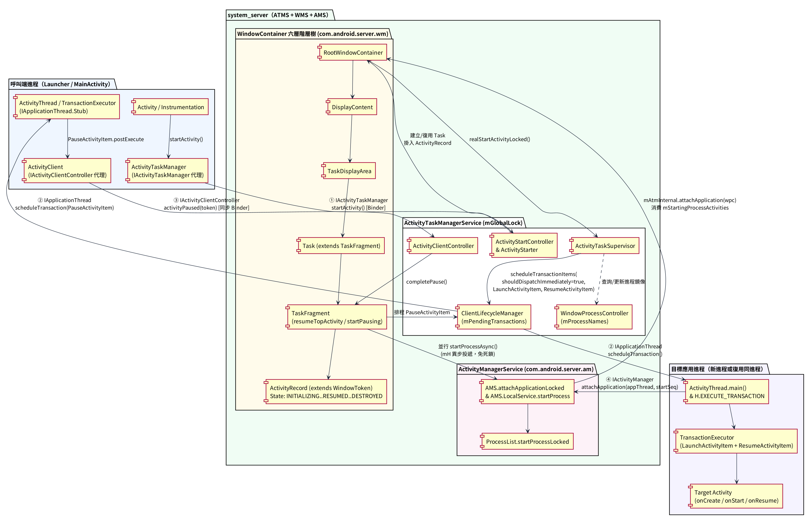
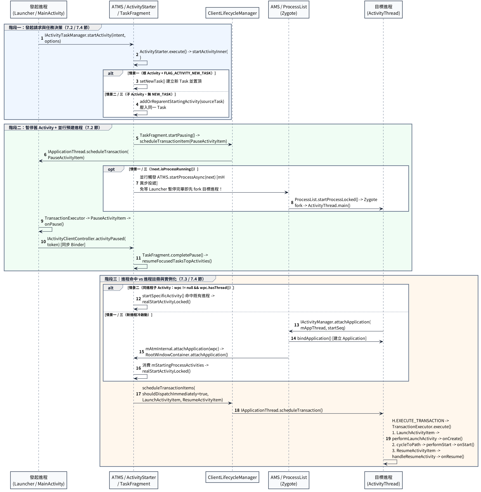

# 7.1 現代 Activity 啟動架構與三情景總覽（ATMS、`WindowContainer` 樹與 `ClientTransaction`）

- **情景說明**：為了讓後續 7.2–7.4 節能像原書一樣沿著單一具體呼叫鏈一路讀透原始碼，本節先確立貫穿全章的三個典型啟動情景，並拆解 Android 17 在 `system_server` 與應用進程之間搭建的現代 Activity 管理骨架：
  1. **情景一（根 Activity 冷啟動，見 7.2–7.3 節）**：使用者於 Launcher 點擊應用圖示，Launcher 帶 `Intent.FLAG_ACTIVITY_NEW_TASK` 啟動目標應用根元件 `MainActivity`（宣告獨立或預設 `android:process`，進程尚未運行）→ 系統建立**新 `Task` + 新進程**；
  2. **情景二（同進程子 Activity，見 7.4 節）**：已運行的 `MainActivity` 不帶 `FLAG_ACTIVITY_NEW_TASK` 啟動同進程的 `SubActivityInProcess` → 系統復用**同一 `Task` + 同一進程**；
  3. **情景三（跨進程同任務子 Activity，見 7.4 節）**：`MainActivity` 不帶 `FLAG_ACTIVITY_NEW_TASK` 啟動宣告獨立 `android:process` 的 `SubActivityInNewProcess` → 系統復用**同一 `Task` + 建立新進程**。
- **對應原書**：第 7 章引言與 7.1 節〈Activity 组件应用实例〉（p.400–406）
- **涉及專案與版本基準**：
  - `platform/frameworks/base` 〔`android-17.0.0_r1`，commit `94b4c163b`〕

---

## 7.1.1 三大啟動情景與現代觀察座標

> 對應原書 7.1（p.400–406）。原書透過在 `packages/experimental/Activity/` 撰寫一個包含 `MainActivity`、`SubActivityInProcess` 與 `SubActivityInNewProcess`（三者在 `AndroidManifest.xml` 中分別指定相同或不同的 `android:process`）的範例 App，來對照「是否建新 Task」與「是否建新進程」兩條正交軸線。這套三情景切法在 Android 17 依然完全適用，差別在於底層實作已從 2.3 的「單一 `ActivityManagerService` + 扁平 `ActivityStack`」徹底演進為 **`ActivityTaskManagerService`（ATMS）+ `WindowContainer` 視窗階層樹 + `ClientTransaction` 統一事務管線**。

三個情景在 Android 17 系統內的物件配置矩陣如下（可透過 `adb shell dumpsys activity activities` 與 `adb shell dumpsys activity processes` 即時驗證）：

| 情景 | 發起者與關鍵旗標 | 目標 `android:process` | `Task` 歸屬（`ActivityStarter`） | 進程配置（`WindowProcessController`） | 詳見小節 |
|---|---|---|---|---|---|
| **情景一：根 Activity 冷啟動** | Launcher + `FLAG_ACTIVITY_NEW_TASK` | 目標 App 進程尚未啟動 | 新建 `Task`（`setNewTask`）並移至 `TaskDisplayArea` 頂端 | `getProcessController == null` → **並行 `startProcessAsync`** + `attachApplication` | 7.2、7.3 |
| **情景二：同進程子 Activity** | `MainActivity`（無 `NEW_TASK`） | 與 `MainActivity` 相同 | 壓入 `mSourceRecord.getTask()`（`addOrReparentStartingActivity`） | `wpc != null && wpc.hasThread()` → 熱路徑直走 `realStartActivityLocked` | 7.4 |
| **情景三：跨進程子 Activity** | `MainActivity`（無 `NEW_TASK`） | 獨立新進程名（同 UID 或異 UID） | 壓入 `mSourceRecord.getTask()`（跨進程共享同一 `Task`） | `getProcessController == null` → 並行 `startProcessAsync` + `attachApplication` | 7.4 |

> 〔與 2.3 差異〕架構與觀測介面更新：原書 7.1（p.400–406）以 `Android.mk` 建置自訂測試 App 並以 `dumpsys activity` 觀察 `TaskRecord` 與 `HistoryRecord`；Android 17 中 `HistoryRecord` 與 `TaskRecord` 已全數併入 `wm/` 視窗樹（以 `Task`、`TaskFragment` 與 `ActivityRecord` 呈現），原書的三情景對照矩陣則原封不動地對應到 `ActivityStarter` 與 `ActivityTaskSupervisor` 的兩處核心分支。

---

## 7.1.2 `WindowContainer` 視窗與任務階層樹（取代原書 `ActivityStack.mHistory`）

> 對應原書 7.2 開頭對堆疊與任務的概念說明（p.406–407）。原書 2.3 中，AMS 以單一線性清單 `ActivityStack.mHistory` 存放 `HistoryRecord`，另用 `TaskRecord` 邏輯分組，視窗管理（WMS）則維護另一套獨立的 `AppWindowToken` 樹——兩邊同步極易產生競態與狀態不一致。Android 17 已將 Activity 生命週期與視窗階層徹底合一於 `com.android.server.wm`：每個 `ActivityRecord` 本身就是視窗樹的葉節點容器。



### Step 1：`WindowContainer` 六層繼承鏈與 `ActivityRecord` 核心狀態機
**位置**：`platform/frameworks/base/services/core/java/com/android/server/wm/RootWindowContainer.java` 〔`android-17.0.0_r1`，line 167〕、`platform/frameworks/base/services/core/java/com/android/server/wm/DisplayContent.java` 〔`android-17.0.0_r1`，line 299〕、`platform/frameworks/base/services/core/java/com/android/server/wm/TaskDisplayArea.java` 〔`android-17.0.0_r1`，line 73〕、`platform/frameworks/base/services/core/java/com/android/server/wm/TaskFragment.java` 〔`android-17.0.0_r1`，line 123〕、`platform/frameworks/base/services/core/java/com/android/server/wm/Task.java` 〔`android-17.0.0_r1`，line 207〕、`platform/frameworks/base/services/core/java/com/android/server/wm/ActivityRecord.java` 〔`android-17.0.0_r1`，lines 372、424–464、553–565〕

```java
class RootWindowContainer extends WindowContainer<DisplayContent>
```

```java
class DisplayContent extends RootDisplayArea implements WindowManagerPolicy.DisplayContentInfo {
```

```java
final class TaskDisplayArea extends DisplayArea<WindowContainer> {
```

```java
class TaskFragment extends WindowContainer<WindowContainer> {
```

```java
class Task extends TaskFragment {
```

```java
final class ActivityRecord extends WindowToken {
    ...
    final ActivityTaskManagerService mAtmService;
    final ActivityCallerState mCallerState;
    @NonNull
    final ActivityInfo info; // activity info provided by developer in AndroidManifest
    // Which user is this running for?
    final int mUserId;
    // The package implementing intent's component
    final String packageName;
    // the intent component, or target of an alias.
    final ComponentName mActivityComponent;
    ...
    final Intent intent;    // the original intent that generated us
    final String shortComponentName; // the short component name of the intent
    final String resolvedType; // as per original caller;
    final String processName; // process where this component wants to run
    final String taskAffinity; // as per ActivityInfo.taskAffinity
    ...
    private Task task;              // the task this is in.
    ...
    enum State {
        INITIALIZING,
        STARTED,
        RESUMED,
        PAUSING,
        PAUSED,
        STOPPING,
        STOPPED,
        FINISHING,
        DESTROYING,
        DESTROYED,
        RESTARTING_PROCESS
    }
```

自上而下拆解這棵六層視窗樹在 Activity 啟動過程中的職責：
1. **`RootWindowContainer`**：全系統視窗樹根節點，管轄所有實體／虛擬螢幕（`DisplayContent`），負責跨螢幕尋找焦點任務並呼叫 `resumeFocusedTasksTopActivities()`，以及在新進程 `attachApplication()` 時認領待啟動的 `ActivityRecord`。
2. **`DisplayContent` → `TaskDisplayArea`**：每個螢幕可包含一或多個放置應用任務的區域（`TaskDisplayArea`），維護焦點根任務（`getFocusedRootTask()`）與背景任務暫停（`pauseBackTasks()`）。
3. **`Task`（繼承自 `TaskFragment`）**：直接取代原書的 `TaskRecord` 與 `ActivityStack`——頂層的根任務稱為 **Root Task**（扮演舊版 `ActivityStack` 的角色），其內可直接包含子 `ActivityRecord`、巢狀子 `Task` 或子 `TaskFragment`（供大螢幕／摺疊機的 Activity Embedding 並排顯示）。
4. **`TaskFragment`**：所有生命週期流轉（`resumeTopActivity`、`startPausing`、`completePause`）的實際執行單元，維護 `mResumedActivity`、`mPausingActivity`、`mLastPausedActivity` 狀態指標。
5. **`ActivityRecord`（繼承自 `WindowToken`）**：直接取代原書 `HistoryRecord`，既是 Activity 的系統端元資料與 `State` 狀態機（11 個狀態，涵蓋 `INITIALIZING → STARTED → RESUMED → PAUSING → PAUSED → STOPPING → STOPPED → FINISHING → DESTROYING → DESTROYED`，以及冷重啟專用的 `RESTARTING_PROCESS`），同時也是其下所有 `WindowState` 的父容器，其 `token`（`IApplicationToken` Binder 實體）唯一識別一個 Activity 實例。

> 〔與 2.3 差異〕架構重寫：原書 2.3（p.406、p.418、p.444）由 `com.android.server.am.ActivityStack` 以線性陣列 `ArrayList mHistory` 存放 `HistoryRecord` 與 `TaskRecord`，且與 WMS 視窗樹分離；Android 17 徹底廢棄 `ActivityStack` / `HistoryRecord` / `TaskRecord`，改由 `com.android.server.wm` 下的六層 `WindowContainer` 樹統一管理生命週期與視窗 Z-order。

---

### Step 2：`ActivityTaskManagerService` 核心協調元件與 `WindowProcessController`
**位置**：`platform/frameworks/base/services/core/java/com/android/server/wm/ActivityTaskManagerService.java` 〔`android-17.0.0_r1`，lines 412–436、517–527〕、`platform/frameworks/base/services/core/java/com/android/server/wm/WindowProcessController.java` 〔`android-17.0.0_r1`，lines 127–185〕

```java
    final ArrayList<ActivityRecord> mStartingProcessActivities = new ArrayList<>();
    ...
    final WindowManagerGlobalLock mGlobalLock = new WindowManagerGlobalLock();
    ...
    ActivityTaskSupervisor mTaskSupervisor;
    ActivityClientController mActivityClientController;
    ...
    RootWindowContainer mRootWindowContainer;
    ...
    final ProcessMap<WindowProcessController> mProcessNames = new ProcessMap<>();
    ...
    private final ClientLifecycleManager mLifecycleManager;
    ...
    private ActivityStartController mActivityStartController;
```

```java
public class WindowProcessController extends ConfigurationContainer<ConfigurationContainer>
        implements ConfigurationContainerListener, ProcessRecordInternal.Observer {
    ...
    volatile ApplicationInfo mInfo;
    final String mName;
    final int mUid;

    // The process of this application; 0 if none
    private volatile int mPid;
    // user of process.
    final int mUserId;
    @NonNull
    public final ProcessRecordInternal mOwner;
    ...
    private IApplicationThread mThread;
    private volatile @SchedGroup int mCurSchedGroup;
    private volatile @ProcessState int mCurProcState = PROCESS_STATE_NONEXISTENT;
```

`ActivityTaskManagerService`（ATMS）把所有 Activity 啟動流程串聯在六個關鍵協作物件上，並統一受 `mGlobalLock`（與 WMS 共用的單一全域視窗鎖）保護：
- **`mActivityStartController`**：透過物件池管理 `ActivityStarter`（負責解析 `Intent`、BAL 背景啟動與權限檢核、決定建新 `Task` 或壓入既有 `Task`）。
- **`mTaskSupervisor`（`ActivityTaskSupervisor`）**：負責跨任務協調、判斷目標進程是否已啟動（`startSpecificActivity`）與打包下發啟動事務（`realStartActivityLocked`）。
- **`mRootWindowContainer`**：整個 `WindowContainer` 樹的入口，與 WMS 的 `wm.mRoot` 指向同一個實例。
- **`mActivityClientController`**：承接客戶端回報 `activityPaused` / `activityResumed` / `activityStopped` 的獨立 Binder 服務端。
- **`mLifecycleManager`（`ClientLifecycleManager`）**：統一將所有生命週期指令打包為 `ClientTransaction` 發往各應用進程。
- **`mProcessNames` 與 `mStartingProcessActivities`**：前者以 `(processName, uid)` 為鍵索引 WM 端的進程鏡像 **`WindowProcessController`**（持有 `mThread` 即對方的 `IApplicationThread` Binder 代理，讓 WM/ATMS 查詢與發送事務時無須搶佔 AMS 全域鎖）；後者則記錄所有「已排程異步建程、正等待目標進程 `attachApplication` 認領」的 `ActivityRecord`（按 Z-order 排序）。

> 〔與 2.3 差異〕拆分 + 鎖域隔離：原書 2.3（p.414、p.428）所有欄位皆由 `ActivityManagerService` 一手包辦並共用同一把 `synchronized (this)` 大鎖，且直接使用 `ProcessRecord`；Android 17 將 Activity 排程拆給 ATMS 並與 WMS 共用 `mGlobalLock`，以 `WindowProcessController` 作為 `ProcessRecord` 在 WM 側的鏡像，並以 `mStartingProcessActivities` 支援異步預建進程。

---

## 7.1.3 四組 AIDL Binder 介面邊界（取代原書手寫單一 `IActivityManager`）

> 對應原書 7.2 Step 5、Step 12、Step 17、Step 25（p.412–432）。一次完整的冷啟動會跨過 Launcher、ATMS/AMS（`system_server`）與目標 App 三個進程、來回數次 Binder IPC。原書 2.3 中，所有 App → `system_server` 呼叫都擠在手寫的 `ActivityManagerProxy`（`IActivityManager`），反向呼叫則由手寫 `ApplicationThreadProxy` 承接。Android 17 已全數改由 AIDL 生成，並將上行通道拆解為三大介面、下行通道收斂為統一事務介面。

### Step 3：啟動請求入口——`IActivityTaskManager.aidl` 與 `ActivityTaskManager.getService()`
**位置**：`platform/frameworks/base/core/java/android/app/IActivityTaskManager.aidl` 〔`android-17.0.0_r1`，lines 96–107〕、`platform/frameworks/base/core/java/android/app/ActivityTaskManager.java` 〔`android-17.0.0_r1`，lines 149–161〕

```aidl
interface IActivityTaskManager {
    int startActivity(in IApplicationThread caller, in String callingPackage,
            in String callingFeatureId, in Intent intent, in String resolvedType,
            in IBinder resultTo, in String resultWho, int requestCode,
            int flags, in ProfilerInfo profilerInfo, in Bundle options);
    int startActivities(in IApplicationThread caller, in String callingPackage,
            in String callingFeatureId, in Intent[] intents, in String[] resolvedTypes,
            in IBinder resultTo, in Bundle options, int userId);
    int startActivityAsUser(in IApplicationThread caller, in String callingPackage,
            in String callingFeatureId, in Intent intent, in String resolvedType,
            in IBinder resultTo, in String resultWho, int requestCode, int flags,
            in ProfilerInfo profilerInfo, in Bundle options, int userId);
```

```java
    public static IActivityTaskManager getService() {
        return IActivityTaskManagerSingleton.get();
    }

    @UnsupportedAppUsage(trackingBug = 129726065)
    private static final Singleton<IActivityTaskManager> IActivityTaskManagerSingleton =
            new Singleton<IActivityTaskManager>() {
                @Override
                protected IActivityTaskManager create() {
                    final IBinder b = ServiceManager.getService(Context.ACTIVITY_TASK_SERVICE);
                    return IActivityTaskManager.Stub.asInterface(b);
                }
            };
```

App 呼叫 `Instrumentation.execStartActivity()` 時，不再像 2.3 那樣透過 `ActivityManagerNative.getDefault()` 查 `"activity"` 服務，而是經由 `ActivityTaskManager.getService()` 向 ServiceManager 取得 `"activity_task"`（`Context.ACTIVITY_TASK_SERVICE`）的 AIDL 代理，直接發起 `IActivityTaskManager.startActivity(...)`（相較 2.3 新增了 `callingPackage`、`callingFeatureId`、`ProfilerInfo` 與 `Bundle options`）。

> 〔與 2.3 差異〕改名搬家 + AIDL 化：原書 2.3（p.412–414）由手寫 `ActivityManagerNative.getDefault()` 透過 `"activity"` 服務呼叫 `ActivityManagerProxy.startActivity`；Android 17 改走 AIDL 生成之 `IActivityTaskManager` 與 `"activity_task"` 服務。

---

### Step 4：生命週期回報通道——`IActivityClientController.aidl` 與 `ActivityClient` 夾帶快取優化
**位置**：`platform/frameworks/base/core/java/android/app/IActivityClientController.aidl` 〔`android-17.0.0_r1`，lines 41–63〕、`platform/frameworks/base/core/java/android/app/ActivityClient.java` 〔`android-17.0.0_r1`，lines 90–97、698–744〕

```aidl
interface IActivityClientController {
    oneway void activityIdle(in IBinder token, in Configuration config, in boolean stopProfiling);
    oneway void activityResumed(in IBinder token, in boolean handleSplashScreenExit);
    oneway void activityRefreshed(in IBinder token);
    void activityTopResumedStateLost(in IBinder token);
    /**
     * Notifies that the activity has completed paused. This call is not one-way because it can make
     * consecutive launch in the same process more coherent. About the order of binder call, it
     * should be fine with other one-way calls because if pause hasn't completed on the server side,
     * there won't be other lifecycle changes.
     */
    void activityPaused(in IBinder token);
    oneway void activityStopped(
        in IBinder token,
        in Bundle state,
        in PersistableBundle persistentState,
        in HandoffActivityData handoffActivityData,
        in CharSequence description);
    oneway void activityDestroyed(in IBinder token);
```

```java
    /** Reports {@link Activity#onPause()} is done. */
    public void activityPaused(IBinder token) {
        try {
            getActivityClientController().activityPaused(token);
        } catch (RemoteException e) {
            e.rethrowFromSystemServer();
        }
    }
...
    public static ActivityClient getInstance() {
        return sInstance.get();
    }

    public static IActivityClientController setActivityClientController(
            IActivityClientController activityClientController) {
        return INTERFACE_SINGLETON.mKnownInstance = activityClientController;
    }

    private static IActivityClientController getActivityClientController() {
        final IActivityClientController controller = INTERFACE_SINGLETON.mKnownInstance;
        return controller != null ? controller : INTERFACE_SINGLETON.get();
    }
...
    private static class ActivityClientControllerSingleton
            extends Singleton<IActivityClientController> {
        IActivityClientController mKnownInstance;

        @Override
        protected IActivityClientController create() {
            try {
                return ActivityTaskManager.getService().getActivityClientController();
            } catch (RemoteException e) {
                throw e.rethrowFromSystemServer();
            }
        }
    }
```

`IActivityClientController` 專責處理所有由單一 Activity 實例發起、以 `IBinder token` 為識別的回報與控制請求，其中藏著兩個極精巧的系統效能設計：
1. **同步 vs `oneway` 的精準切分**：`activityIdle`、`activityResumed`、`activityStopped`、`activityDestroyed` 皆標記為 **`oneway`**（非同步單向 Binder 呼叫，不阻塞 App 主執行緒）；但 **`activityPaused` 刻意保持同步（非 `oneway`）**，如註解明述，藉此讓同進程連續啟動下一個 Activity 的執行序更加連貫，並與 `activityTopResumedStateLost` 維持嚴格順序。
2. **首次夾帶零查詢優化**：`IActivityClientController` 並未直接註冊在 ServiceManager，若走冷查詢得先查 `activity_task` 再呼叫 `getActivityClientController()`（多 2 次 Binder 往返）。因此 `ActivityTaskSupervisor.realStartActivityLocked()` 在進程**第一次**啟動 Activity 時（`!proc.hasEverLaunchedActivity()`），會直接把 `mService.mActivityClientController` 塞進 `LaunchActivityItem` 一起下發；客戶端收到後呼叫 `ActivityClient.setActivityClientController()` 填入 `mKnownInstance`，後續所有回報立即零額外查詢直達 `system_server`！

> 〔與 2.3 差異〕拆分 + 新增優化：原書 2.3（p.423–424）的 `activityPaused` 混在 `IActivityManager` 中；Android 17 獨立抽離至 `IActivityClientController` 並精細區分 `oneway`／同步語意與夾帶快取。

---

### Step 5：進程註冊與下行事務通道——`IActivityManager.aidl` 與 `IApplicationThread.aidl`
**位置**：`platform/frameworks/base/core/java/android/app/IActivityManager.aidl` 〔`android-17.0.0_r1`，line 209〕、`platform/frameworks/base/core/java/android/app/IApplicationThread.aidl` 〔`android-17.0.0_r1`，lines 86、170〕

```aidl
    void attachApplication(in IApplicationThread app, long startSeq);
```

```aidl
    void bindApplication(in String packageName, in ApplicationInfo info,
    ...
    void scheduleTransaction(in ClientTransaction transaction);
```

- **上行進程註冊（`IActivityManager.attachApplication`）**：新進程經 Zygote 孵化進入 `ActivityThread.main()` 後，仍向 AMS（`"activity"` 服務）呼叫 `attachApplication(mAppThread, startSeq)`（新增了單調遞增序號 `startSeq` 以精準匹配 `ProcessRecord` 防止 PID 複用誤認），再由 AMS 內部經 `mAtmInternal.attachApplication(wpc)` 轉交給 ATMS 啟動待辦 Activity。
- **下行統一生命週期通道（`IApplicationThread` 整份介面為 `oneway interface IApplicationThread`）**：取代原書數十個零散的 `schedulePauseActivity` / `scheduleLaunchActivity` / `scheduleResumeActivity`，全部統一改走 **`scheduleTransaction(in ClientTransaction transaction)`**；僅進程初始化階段的 `bindApplication` 仍維持獨立方法。

> 〔與 2.3 差異〕邏輯改變：原書 2.3（p.419、p.434）的 `IApplicationThread` 為手寫介面且為每個生命週期事件單獨定義交易碼；Android 17 全面 AIDL 化並將 Activity 生命週期統一收斂為 `scheduleTransaction(ClientTransaction)`。

---

## 7.1.4 統一生命週期事務管線：`ClientLifecycleManager` → `ClientTransaction`

> 對應原書 7.2 Step 12–15 與 Step 29–32（p.419–422、p.434–438）的通訊協議層。理解這套事務管線是讀懂現代 7.2 與 7.3 節的前提：在 Android 17 中，系統端不再直接對 `IApplicationThread` 發送單筆「暫停」或「啟動」命令，而是把每個動作封裝為 `ClientTransactionItem`，交由 `ClientLifecycleManager` 決定是「累積到同一幀版面配置完成時合併發送」還是「立即發送」。

### Step 6：`ClientTransaction` 有序事務容器與 `ActivityLifecycleItem` 目標狀態碼
**位置**：`platform/frameworks/base/core/java/android/app/servertransaction/ClientTransaction.java` 〔`android-17.0.0_r1`，lines 50–58、121–139、223–259〕、`platform/frameworks/base/core/java/android/app/servertransaction/ActivityLifecycleItem.java` 〔`android-17.0.0_r1`，lines 32–76〕

```java
public class ClientTransaction implements Parcelable {

    /**
     * List of transaction items that should be executed in order. Including both
     * {@link ActivityLifecycleItem} and other {@link ClientTransactionItem}.
     */
    @NonNull
    private final List<ClientTransactionItem> mTransactionItems = new ArrayList<>();
    ...
    public void addTransactionItem(@NonNull ClientTransactionItem item) {
        mTransactionItems.add(item);

        // Populate even if mTransactionItems is set to support the UnsupportedAppUsage.
        if (item.isActivityLifecycleItem()) {
            setLifecycleStateRequest((ActivityLifecycleItem) item);
        } else {
            addCallback(item);
        }
    }

    @NonNull
    public List<ClientTransactionItem> getTransactionItems() {
        return mTransactionItems;
    }
    ...
    public void preExecute(@NonNull ClientTransactionHandler clientTransactionHandler) {
        final int size = mTransactionItems.size();
        for (int i = 0; i < size; ++i) {
            mTransactionItems.get(i).preExecute(clientTransactionHandler);
        }
    }

    @Nullable
    public RemoteException schedule() {
        try {
            mClient.scheduleTransaction(this);
            return null;
        } catch (RemoteException e) {
            return e;
        }
    }

    @Override
    public void writeToParcel(@NonNull Parcel dest, int flags) {
        dest.writeParcelableList(mTransactionItems, flags);
    }
```

```java
public abstract class ActivityLifecycleItem extends ActivityTransactionItem {
    ...
    public static final int UNDEFINED = -1;
    public static final int PRE_ON_CREATE = 0;
    public static final int ON_CREATE = 1;
    public static final int ON_START = 2;
    public static final int ON_RESUME = 3;
    public static final int ON_PAUSE = 4;
    public static final int ON_STOP = 5;
    public static final int ON_DESTROY = 6;
    public static final int ON_RESTART = 7;
    ...
    @Override
    public boolean isActivityLifecycleItem() {
        return true;
    }

    /** A final lifecycle state that an activity should reach. */
    @LifecycleState
    public abstract int getTargetState();
}
```

特別注意 Android 17 `ClientTransaction` 的一個**最新演進**（相較 Android 9–14 早期版本亦已再進化）：
- 早期 `ClientTransaction` 把一筆事務拆成「一個 `mActivityCallbacks` 清單 + 最多一個最終 `mLifecycleStateRequest`」，只能針對單一 Activity 下發一次狀態轉換。
- Android 17 已將兩者合併為單一有序清單 **`mTransactionItems`**（原本的 `mActivityCallbacks` / `mLifecycleStateRequest` 皆標記 `@Deprecated`，僅為相容舊版 `@UnsupportedAppUsage` 反射而同步填入），序列化時也只寫入 `dest.writeParcelableList(mTransactionItems, flags)`。這使得同一進程在單次 Binder IPC 中可以一次打包**多個不同 Activity 或多個視窗回呼與生命週期請求**（例如先打包 `LaunchActivityItem` 再接 `ResumeActivityItem`，甚至連同組態與視窗尺寸變更一起送出）。
- 每筆事務在客戶端會依序經歷兩個階段：Binder 執行緒收到 `scheduleTransaction()` 時立刻執行 `preExecute()`（處理不需主執行緒的前置動作，例如向 `ActivityThread` 預註冊即將銷毀清單或設定 `IActivityClientController`），接著才投遞 `H.EXECUTE_TRANSACTION` 到主執行緒由 `TransactionExecutor` 依序執行。

> 〔與 2.3 差異〕新增：原書 2.3 完全沒有 `ClientTransaction` 與 `ActivityLifecycleItem` 抽象，所有生命週期轉換都靠手寫獨立 IPC 與 `ActivityThread.H` 的大量訊息常數逐一處理。

---

### Step 7：`ClientLifecycleManager` 幀內批次聚合與冷啟動立即派發
**位置**：`platform/frameworks/base/services/core/java/com/android/server/wm/ClientLifecycleManager.java` 〔`android-17.0.0_r1`，lines 56–58、106–172、195–242〕

```java
    /** Mapping from client process binder to its pending transaction. */
    @VisibleForTesting
    final ArrayMap<IBinder, ClientTransaction> mPendingTransactions = new ArrayMap<>();
...
    boolean scheduleTransactionItem(@NonNull IApplicationThread client,
            @NonNull ClientTransactionItem item) {
        // Wait until RootWindowContainer#performSurfacePlacementNoTrace to dispatch all pending
        // transactions at once.
        final ClientTransaction clientTransaction = getOrCreatePendingTransaction(client);
        clientTransaction.addTransactionItem(item);

        return onClientTransactionItemScheduled(clientTransaction,
                false /* shouldDispatchImmediately */);
    }
...
    boolean scheduleTransactionItems(@NonNull IApplicationThread client,
            boolean shouldDispatchImmediately,
            @NonNull ClientTransactionItem... items) {
        final ClientTransaction clientTransaction = getOrCreatePendingTransaction(client);

        final int size = items.length;
        for (int i = 0; i < size; i++) {
            clientTransaction.addTransactionItem(items[i]);
        }

        return onClientTransactionItemScheduled(clientTransaction, shouldDispatchImmediately);
    }

    /** Executes all the pending transactions. */
    void dispatchPendingTransactions() {
        if (mPendingTransactions.isEmpty()) {
            return;
        }
        Trace.traceBegin(Trace.TRACE_TAG_WINDOW_MANAGER, "clientTransactionsDispatched");
        final int size = mPendingTransactions.size();
        for (int i = 0; i < size; i++) {
            final ClientTransaction transaction = mPendingTransactions.valueAt(i);
            scheduleTransaction(transaction);
        }
        mPendingTransactions.clear();
        Trace.traceEnd(Trace.TRACE_TAG_WINDOW_MANAGER);
    }
...
    private boolean onClientTransactionItemScheduled(
            @NonNull ClientTransaction clientTransaction,
            boolean shouldDispatchImmediately) {
        if (shouldDispatchImmediately || shouldDispatchPendingTransactionsImmediately()) {
            // Dispatch the pending transaction immediately.
            mPendingTransactions.remove(clientTransaction.getClient().asBinder());
            return scheduleTransaction(clientTransaction);
        }
        return true;
    }

    /** Must only be called with WM lock. */
    private boolean shouldDispatchPendingTransactionsImmediately() {
        if (mWms == null) {
            return true;
        }
        return !mWms.mWindowPlacerLocked.isLayoutDeferred()
                && !mWms.mWindowPlacerLocked.isTraversalScheduled()
                && !mWms.mWindowPlacerLocked.isInLayout();
    }
```

`ClientLifecycleManager` 以目標進程的 `IApplicationThread.asBinder()` 為鍵維護 `mPendingTransactions`：
- **一般情況（如 `schedulePauseActivity` 呼叫 `scheduleTransactionItem`）**：`shouldDispatchImmediately == false`。如果此時 WMS 正處於版面配置延遲（`isLayoutDeferred()`）、已排程遍歷（`isTraversalScheduled()`）或正在配置中（`isInLayout()`），該 `ClientTransactionItem` 會先留在 `mPendingTransactions` 中與同一進程的其他變更合併，直到 `RootWindowContainer.performSurfacePlacementNoTrace()` 呼叫 `dispatchPendingTransactions()` 一次透過單筆 Binder IPC 派發，大幅削減 Binder 往返次數與主執行緒抖動。
- **冷／熱啟動 Activity（`tryRealStartActivityInner` 呼叫 `scheduleTransactionItems(..., shouldDispatchImmediately = true, launchActivityItem, lifecycleItem)`）**：系統端必須**立刻得知**該目標進程是否已經死亡（`scheduleTransaction` 回傳 `false` 代表拋出 `RemoteException`）以便立刻重啟進程並重試啟動，因此顯式傳入 `shouldDispatchImmediately = true` 繞過佇列立即派發。

> 〔與 2.3 差異〕新增：原書 2.3 每次生命週期事件皆立即發起一次獨立 Binder 呼叫；Android 17 透過 `ClientLifecycleManager` 實作以進程為單位的事務聚合與可控立即派發機制。

---

## 7.1.5 本節總結與三情景全局呼叫鏈總覽圖



### 本章閱讀導航（接續 7.2–7.4 節）

有了本節建立的四個核心座標——**六層 `WindowContainer` 樹**、**`WindowProcessController` 進程鏡像**、**四組 AIDL Binder 邊界**與**`ClientLifecycleManager` / `ClientTransaction` 管線**——接下來三節將沿著圖中的真實呼叫鏈逐行精讀：
- **7.2 節**：追完「Launcher 呼叫 `startActivity` → `ActivityStarter` 建構新 `Task` → `TaskFragment.startPausing` + **並行 `ATMS.startProcessAsync`** → Launcher `PauseActivityItem` → `ActivityClientController.activityPaused` → `completePause`」。
- **7.3 節**：追完「`ATMS.startProcessAsync` → `AMS`/`ProcessList` → 新進程 `ActivityThread.main()` → `attachApplication` → `RootWindowContainer.attachApplication` → `realStartActivityLocked` → `TransactionExecutor` 驅動 `onCreate` / `onStart` / `onResume`」。
- **7.4 節**：對照同進程子 Activity（熱路徑）與跨進程同任務子 Activity（同 `Task` 異 `WindowProcessController`）的分流原始碼。
