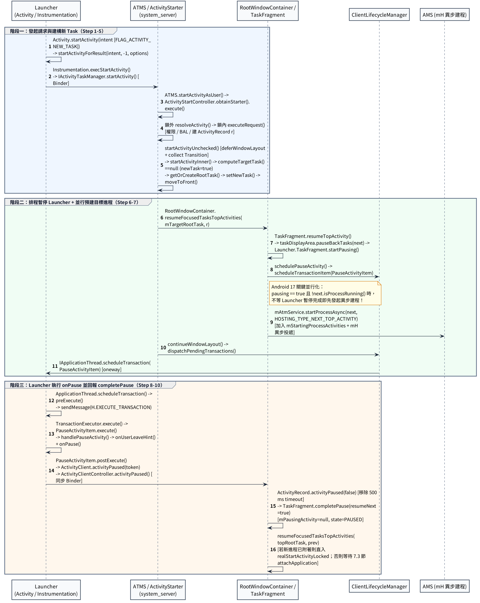

# 7.2 根 Activity 啟動（上）：啟動請求、`ActivityStarter` 建構任務與並行暫停／預建進程

- **情景說明**：延續 7.1 節的情景一——使用者在 Launcher 桌面點擊某應用程式圖示，目標應用的進程尚未啟動。Launcher 建構帶 `Intent.FLAG_ACTIVITY_NEW_TASK` 的 `Intent` 並呼叫 `startActivity(intent)`，經由 `Instrumentation` 與 `IActivityTaskManager` 跨進程送達 `system_server` 的 `ActivityTaskManagerService`。系統端經 `ActivityStarter` 建出 `ActivityRecord` 與新 `Task` 並將其移至焦點頂端，接著排程暫停 Launcher（下發 `PauseActivityItem`）並**同時透過 `ATMS.startProcessAsync` 並行預先啟動目標進程**；最後 Launcher 完成 `onPause()` 並經由 `IActivityClientController.activityPaused` 回報系統端觸發 `TaskFragment.completePause()`。
- **對應原書**：7.2 節〈根 Activity 组件的启动过程〉Step 1–Step 21（p.406–427）
- **涉及專案與版本基準**：
  - `platform/frameworks/base` 〔`android-17.0.0_r1`，commit `94b4c163b`〕

---

## 7.2.1 呼叫端進程發起啟動請求（Launcher → `Instrumentation` → `IActivityTaskManager`）

> 對應原書 7.2 Step 1–Step 5（p.407–414）。Launcher 點擊圖示後為根 Activity 加上 `Intent.FLAG_ACTIVITY_NEW_TASK`（要求建立獨立任務）並呼叫 `Activity.startActivity(intent)`；隨後沿著 `Activity` → `Instrumentation` 跨越第一道 Binder 邊界進入 `system_server` 的 ATMS。

### Step 1：`Activity.startActivity` 與 `Activity.startActivityForResult`
**位置**：`platform/frameworks/base/core/java/android/app/Activity.java` 〔`android-17.0.0_r1`，lines 6495–6532、6065–6100〕

```java
    @Override
    public void startActivity(Intent intent) {
        this.startActivity(intent, null);
    }

    @Override
    public void startActivity(Intent intent, @Nullable Bundle options) {
        getAutofillClientController().onStartActivity(intent, mIntent);
        if (options != null) {
            startActivityForResult(intent, -1, options);
        } else {
            // Note we want to go through this call for compatibility with
            // applications that may have overridden the method.
            startActivityForResult(intent, -1);
        }
    }
```

```java
    public void startActivityForResult(@RequiresPermission Intent intent, int requestCode,
            @Nullable Bundle options) {
        if (mParent == null) {
            options = transferSpringboardActivityOptions(options);
            Instrumentation.ActivityResult ar =
                mInstrumentation.execStartActivity(
                    this, mMainThread.getApplicationThread(), mToken, this,
                    intent, requestCode, options);
            if (ar != null) {
                mMainThread.sendActivityResult(
                    mToken, mEmbeddedID, requestCode, ar.getResultCode(),
                    ar.getResultData());
            }
            if (requestCode >= 0) {
                mStartedActivity = true;
            }

            cancelInputsAndStartExitTransition(options);
        } else {
            ...
        }
    }
```

Launcher 繼承自 `Activity`，其 `mParent` 為 `null`（現代 Android 已棄用 `ActivityGroup`），因此直入 `if (mParent == null)` 分支呼叫 `mInstrumentation.execStartActivity(...)`，傳入四個關鍵身分參數：
- **`mMainThread.getApplicationThread()`**：Launcher 進程自身的 `IApplicationThread` Binder 實體，供系統端反查發起進程的 `WindowProcessController`。
- **`mToken`**：代表 Launcher 這個 `ActivityRecord` 的 `IBinder` 識別權杖（作為系統端的 `resultTo` / `sourceRecord`）。
- **`requestCode = -1`**：表示不需要回傳結果（`onActivityResult`）。
- **`options`**：`ActivityOptions` Bundle（承載轉場動畫、目標 DisplayId、視窗模式等參數）。

待 `execStartActivity` 同步返回後，緊接著呼叫 `cancelInputsAndStartExitTransition(options)` 取消當前 DecorView 尚未消費的輸入事件並啟動退出轉場動畫。

> 〔與 2.3 差異〕邏輯擴充：原書 2.3（p.409–410）尚無 `Bundle options`、Autofill 通知（`getAutofillClientController().onStartActivity`）、跳板轉場傳遞（`transferSpringboardActivityOptions`）與 `cancelInputsAndStartExitTransition`。

---

### Step 2：`Instrumentation.execStartActivity` 跨進程呼叫 `IActivityTaskManager.startActivity`
**位置**：`platform/frameworks/base/core/java/android/app/Instrumentation.java` 〔`android-17.0.0_r1`，lines 1973–2027〕

```java
    public ActivityResult execStartActivity(
            Context who, IBinder contextThread, IBinder token, Activity target,
            Intent intent, int requestCode, Bundle options) {
        ...
        Objects.requireNonNull(intent);
        IApplicationThread whoThread = (IApplicationThread) contextThread;
        Uri referrer = target != null ? target.onProvideReferrer() : null;
        if (referrer != null) {
            intent.putExtra(Intent.EXTRA_REFERRER, referrer);
        }
        if (isSdkSandboxAllowedToStartActivities()) {
            adjustIntentForCtsInSdkSandboxInstrumentation(intent);
        }
        if (mActivityMonitors != null) {
            ...
        }
        try {
            intent.migrateExtraStreamToClipData(who);
            intent.prepareToLeaveProcess(who);
            int result = ActivityTaskManager.getService().startActivity(whoThread,
                    who.getOpPackageName(), who.getAttributionTag(), intent,
                    intent.resolveTypeIfNeeded(who.getContentResolver()), token,
                    target != null ? target.mEmbeddedID : null, requestCode, 0, null, options);
            notifyStartActivityResult(result, options);
            checkStartActivityResult(result, intent);
        } catch (RemoteException e) {
            throw new RuntimeException("Failure from system", e);
        }
        return null;
    }
```

離開應用進程前，`execStartActivity` 完成三件現代必備準備：
1. 寫入來源標記 `Intent.EXTRA_REFERRER`，並透過 `migrateExtraStreamToClipData` + `prepareToLeaveProcess` 處理 URI 權限遷移與跨進程序列化安全檢查（避免攜帶無權限的 `file://` URI）。
2. 透過 `ActivityTaskManager.getService()`（AIDL 生成之 `IActivityTaskManager.Stub.Proxy`，見 7.1 節 Step 3）同步發起 Binder IPC 呼叫 `startActivity(...)`，附帶 `callingPackage`（`who.getOpPackageName()`）與 `callingFeatureId`（`who.getAttributionTag()`）。
3. 系統端同步回傳啟動結果碼 `result` 後，由 `checkStartActivityResult(result, intent)` 檢查是否需要拋出 `ActivityNotFoundException` 或 `SecurityException`。

> 〔與 2.3 差異〕改名搬家 + 擴充：原書 2.3（p.410–414）呼叫 `ActivityManagerNative.getDefault().startActivity(...)`（並需手寫 `ActivityManagerProxy.startActivity` 打包 `Parcel`）；Android 17 改由 AIDL 生成代理呼叫 `ActivityTaskManager.getService().startActivity(...)`，並新增 `EXTRA_REFERRER`、`prepareToLeaveProcess`、SDK Sandbox 調整與 `callingPackage`/`attributionTag`。

---

## 7.2.2 系統端接手請求與 `ActivityStarter` 建構新任務

> 對應原書 7.2 Step 6–Step 9（p.414–419）。原書由 `AMS.startActivity` → `ActivityStack.startActivityMayWait` → `startActivityLocked` → `startActivityUncheckedLocked` 四層遞進；Android 17 則由 `ATMS.startActivity` 交給物件池化的 **`ActivityStarter`**，依序完成 `execute()` → `executeRequest()` → `startActivityUnchecked()` → `startActivityInner()`。

### Step 3：`ActivityTaskManagerService.startActivity` 與 `startActivityAsUser`
**位置**：`platform/frameworks/base/services/core/java/com/android/server/wm/ActivityTaskManagerService.java` 〔`android-17.0.0_r1`，lines 1256–1264、1302–1350〕

```java
    @Override
    public final int startActivity(IApplicationThread caller, String callingPackage,
            String callingFeatureId, Intent intent, String resolvedType, IBinder resultTo,
            String resultWho, int requestCode, int startFlags, ProfilerInfo profilerInfo,
            Bundle bOptions) {
        return startActivityAsUser(caller, callingPackage, callingFeatureId, intent, resolvedType,
                resultTo, resultWho, requestCode, startFlags, profilerInfo, bOptions,
                UserHandle.getCallingUserId());
    }
```

```java
    private int startActivityAsUser(IApplicationThread caller, String callingPackage,
            @Nullable String callingFeatureId, Intent intent, String resolvedType,
            IBinder resultTo, String resultWho, int requestCode, int startFlags,
            ProfilerInfo profilerInfo, Bundle bOptions, int userId, boolean validateIncomingUser) {
        mAmInternal.addCreatorToken(intent, callingPackage);
        final int callingPid = Binder.getCallingPid();
        final int callingUid = Binder.getCallingUid();
        final SafeActivityOptions opts = SafeActivityOptions.fromBundle(
                bOptions, callingPid, callingUid);

        assertPackageMatchesCallingUid(callingPackage);
        enforceNotIsolatedCaller("startActivityAsUser");
        ...
        userId = getActivityStartController().checkTargetUser(userId, validateIncomingUser,
                callingPid, callingUid, "startActivityAsUser");

        return getActivityStartController().obtainStarter(intent, "startActivityAsUser")
                .setCaller(caller)
                .setCallingPackage(callingPackage)
                .setCallingFeatureId(callingFeatureId)
                .setResolvedType(resolvedType)
                .setResultTo(resultTo)
                .setResultWho(resultWho)
                .setRequestCode(requestCode)
                .setStartFlags(startFlags)
                .setProfilerInfo(profilerInfo)
                .setActivityOptions(opts)
                .setUserId(userId)
                .execute();
    }
```

ATMS 入口先完成多使用者與安全前置核驗（記錄發起端 `CreatorToken`、核對 `callingPackage` 與 `Binder.getCallingUid()` 一致、禁止 Isolated 進程直接啟動 Activity、檢查 SDK Sandbox 與目標 `userId`），隨即透過 `ActivityStartController.obtainStarter()` 從物件池借出一個 `ActivityStarter` 實例，以 Builder 鏈式語法填入全部請求參數並呼叫 `.execute()`。

> 〔與 2.3 差異〕改名搬家 + 新增：原書 2.3（p.414）在 `ActivityManagerService.startActivity` 直接呼叫 `mMainStack.startActivityMayWait`；Android 17 遷至 ATMS、加入多使用者與安全防線，並改由 `ActivityStartController.obtainStarter(...).execute()` 執行。

---

### Step 4：`ActivityStarter.execute` 與 `executeRequest`（解析 `ActivityInfo` 與建構 `ActivityRecord`）
**位置**：`platform/frameworks/base/services/core/java/com/android/server/wm/ActivityStarter.java` 〔`android-17.0.0_r1`，lines 837–905、1534–1566〕

```java
    int execute() {
        String callerActivityName = null;
        ActivityRecord launchingRecord = null;
        try {
            onExecutionStarted();

            if (mRequest.intent != null) {
                if (mRequest.intent.hasFileDescriptors()) {
                    throw new IllegalArgumentException("File descriptors passed in Intent");
                }
                mRequest.intent.removeExtendedFlags(Intent.EXTENDED_FLAG_FILTER_MISMATCH);
            }

            final ActivityRecord caller;
            final int callingUid;
            final LaunchingState launchingState;
            synchronized (mService.mGlobalLock) {
                caller = ActivityRecord.forTokenLocked(mRequest.resultTo);
                callingUid = mRequest.realCallingUid == Request.DEFAULT_REAL_CALLING_UID
                        ?  Binder.getCallingUid() : mRequest.realCallingUid;
                launchingState = mSupervisor.getActivityMetricsLogger().notifyActivityLaunching(
                        mRequest.intent, caller, callingUid);
                callerActivityName = caller != null ? caller.info.name : null;
            }
            ...
            if (mRequest.activityInfo == null) {
                mRequest.resolveActivity(mSupervisor);
            }
            ...
            int res = START_CANCELED;
            synchronized (mService.mGlobalLock) {
                ...
                    res = executeRequest(mRequest);
```

```java
        if (callerApp == null && realCallingPid > 0) {
            final WindowProcessController wpc = mService.mProcessMap.getProcess(realCallingPid);
            if (wpc != null) {
                callerApp = wpc;
            }
        }
        final ActivityRecord r = new ActivityRecord.Builder(mService)
                .setCaller(callerApp)
                .setLaunchedFromPid(callingPid)
                .setLaunchedFromUid(callingUid)
                .setLaunchedFromPackage(callingPackage)
                .setLaunchedFromFeature(callingFeatureId)
                .setIntent(intent)
                .setResolvedType(resolvedType)
                .setActivityInfo(aInfo)
                .setConfiguration(mService.getGlobalConfiguration())
                .setResultTo(resultRecord)
                .setResultWho(resultWho)
                .setRequestCode(requestCode)
                .setComponentSpecified(request.componentSpecified)
                .setRootVoiceInteraction(voiceSession != null)
                .setActivityOptions(checkedOptions)
                .setSourceRecord(sourceRecord)
                .build();

        if (r.mLaunchTaskBehind && balVerdict.blocks()) {
            Slog.w(TAG, "Disallowed launching behind for a background launch");
            r.mLaunchTaskBehind = false;
        }

        mLastStartActivityRecord = r;
```

請注意 `execute()` 的鎖粒設計：
1. **在鎖外執行 `mRequest.resolveActivity(mSupervisor)`**：透過 `PackageManagerInternal` 解析出目標 `ActivityInfo`（含 `packageName`、`processName`、`taskAffinity`、`launchMode`），刻意不持 `mGlobalLock`，避免向 PackageManager 查詢時阻塞全系統視窗與輸入排程。
2. **持 `mGlobalLock` 進入 `executeRequest(mRequest)`**：依序驗證呼叫者進程 `callerApp`（`WindowProcessController`）、元件權限、**BAL（Background Activity Launch）背景啟動限制**（產出 `BalVerdict`）與權限審查需求，全部通過後透過 `ActivityRecord.Builder` 建構代表目標 `MainActivity` 的 **`ActivityRecord r`**（記住 `sourceRecord` 為 Launcher 的 `ActivityRecord`），最後呼叫 `startActivityUnchecked(...)`。

> 〔與 2.3 差異〕邏輯改變 + 新增：原書 2.3（p.414–417）在 `startActivityMayWait` / `startActivityLocked` 中直接 `new ActivityRecord`（書中實為 `HistoryRecord`）；Android 17 將 PMS 解析抽到 `mGlobalLock` 鎖外執行，新增 `ActivityMetricsLogger`、BAL 背景啟動攔截與 `ActivityRecord.Builder`。

---

### Step 5：`ActivityStarter.startActivityUnchecked` → `startActivityInner` → `setNewTask`
**位置**：`platform/frameworks/base/services/core/java/com/android/server/wm/ActivityStarter.java` 〔`android-17.0.0_r1`，lines 1770–1814、2015–2058、2144–2183、2233–2250、3332–3346〕

```java
    private int startActivityUnchecked(final ActivityRecord r, ActivityRecord sourceRecord,
            IVoiceInteractionSession voiceSession, IVoiceInteractor voiceInteractor,
            int startFlags, ActivityOptions options, Task inTask,
            TaskFragment inTaskFragment,
            BalVerdict balVerdict,
            NeededUriGrants intentGrants, int realCallingUid, Transition transition,
            boolean isIndependentLaunch, @AllowlistStatus int allowlistStatus) {
        int result = START_CANCELED;
        final Task startedActivityRootTask;
        ...
        try {
            mService.deferWindowLayout();
            r.mTransitionController.collect(r);
            try {
                Trace.traceBegin(Trace.TRACE_TAG_WINDOW_MANAGER, "startActivityInner");
                result = startActivityInner(r, sourceRecord, voiceSession, voiceInteractor,
                        startFlags, options, inTask, inTaskFragment, balVerdict,
                        intentGrants, realCallingUid);
            } catch (Exception ex) {
                Slog.e(TAG, "Exception on startActivityInner", ex);
            } finally {
                Trace.traceEnd(Trace.TRACE_TAG_WINDOW_MANAGER);
                startedActivityRootTask = handleStartResult(r, options, result, isIndependentLaunch,
                        remoteTransition, transition, allowlistStatus);
            }
        } finally {
            mService.continueWindowLayout();
        }
        postStartActivityProcessing(r, result, startedActivityRootTask);

        return result;
    }
```

```java
    int startActivityInner(final ActivityRecord r, ActivityRecord sourceRecord,
            IVoiceInteractionSession voiceSession, IVoiceInteractor voiceInteractor,
            int startFlags, ActivityOptions options, Task inTask,
            TaskFragment inTaskFragment, BalVerdict balVerdict,
            NeededUriGrants intentGrants, int realCallingUid) {
        setInitialState(r, options, inTask, inTaskFragment, startFlags, sourceRecord,
                voiceSession, voiceInteractor, balVerdict, realCallingUid);

        computeLaunchingTaskFlags();
        mIntent.setFlags(mLaunchFlags);
        ...
        final Task reusedTask = resolveReusableTask(includeLaunchedFromBubble);
        ...
        // Compute if there is an existing task that should be used for.
        final Task targetTask = reusedTask != null ? reusedTask : computeTargetTask();
        final boolean newTask = targetTask == null;
        mTargetTask = targetTask;
        ...
        if (mTargetRootTask == null) {
            mTargetRootTask = getOrCreateRootTask(mStartActivity, mLaunchFlags, targetTask,
                    mOptions);
        }
        if (newTask) {
            final Task taskToAffiliate = (mLaunchTaskBehind && mSourceRecord != null)
                    ? mSourceRecord.getTask() : null;
            setNewTask(taskToAffiliate);
        } else if (mAddingToTask) {
            mSupervisor.getLaunchParamsController().layoutTask(targetTask,
                    mStartActivity.info.windowLayout, mStartActivity, mSourceRecord, options);
            addOrReparentStartingActivity(targetTask, "adding to task");
        }
        ...
        if (mDoResume) {
            if (!avoidMoveToFront()) {
                mTargetRootTask.getRootTask().moveToFront("reuseOrNewTask", targetTask);
                ...
            }
        }
        ...
                if (mTargetRootTask.isTopActivityFocusable()
                        && !mRootWindowContainer.isTopDisplayFocusedRootTask(mTargetRootTask)) {
                    if (!avoidMoveToFront()) {
                        mTargetRootTask.moveToFront("startActivityInner");
                    } else {
                        logPIOnlyCreatorAllowsBAL();
                    }
                }
                mRootWindowContainer.resumeFocusedTasksTopActivities(
                        mTargetRootTask, mStartActivity, mOptions, mTransientLaunch);
```

```java
    private void setNewTask(Task taskToAffiliate) {
        final boolean toTop = !mLaunchTaskBehind && !avoidMoveToFront();
        final Task task = mTargetRootTask.reuseOrCreateTask(
                mStartActivity.info, mIntent, mVoiceSession,
                mVoiceInteractor, toTop, mStartActivity, mSourceRecord, mOptions);
        task.mTransitionController.collectExistenceChange(task);
        addOrReparentStartingActivity(task, "setTaskFromReuseOrCreateNewTask");
        ...
    }
```

沿著情景一（Launcher 帶 `FLAG_ACTIVITY_NEW_TASK` 冷啟動 `MainActivity`）追蹤這段核心邏輯：
1. **`deferWindowLayout()` 包裹**：整個 `startActivityInner` 被包在 `deferWindowLayout()` / `continueWindowLayout()` 中——這也直接連動 7.1 節 Step 7 的 `ClientLifecycleManager`：期間排程的 `PauseActivityItem` 會等到 `continueWindowLayout()` → `performSurfacePlacementNoTrace()` 時連同視窗樹更新一次派發！同時 `r.mTransitionController.collect(r)` 將新 Activity 納入 Shell Transitions 轉場收集。
2. **判定建新任務（`newTask == true`）**：因 Launcher 帶 `FLAG_ACTIVITY_NEW_TASK` 且系統內無對應既有的 `reusedTask`，`computeTargetTask()` 回傳 `null`（詳見 7.4 節與子 Activity 的對照），故 `newTask == true`。
3. **`getOrCreateRootTask` + `setNewTask`**：在預設 `TaskDisplayArea` 建立新的 Root `Task`（`mTargetRootTask`），呼叫 `setNewTask()` 透過 `addOrReparentStartingActivity()` 把 `MainActivity` 的 `ActivityRecord r` 正式掛進該新 `Task` 樹節點下，並以 `moveToFront()` 把新 `Task` 拉至 `TaskDisplayArea` 最頂端（高於 Launcher 所在的 Home Task）。
4. **交棒給 `RootWindowContainer.resumeFocusedTasksTopActivities()`**：啟動新焦點任務頂端 `ActivityRecord` 的恢復流程。

> 〔與 2.3 差異〕邏輯改變：原書 2.3（p.417–419）在 `ActivityStack.startActivityUncheckedLocked` 內新建 `TaskRecord` 並將 `HistoryRecord` 直接 `mHistory.add(r)` 塞進單一扁平陣列後呼叫 `resumeTopActivityLocked`；Android 17 拆為 `startActivityUnchecked`（`deferWindowLayout` + Shell Transition 收集）與 `startActivityInner`（建立樹狀 `Task` 節點並 `moveToFront`），最後透過 `RootWindowContainer.resumeFocusedTasksTopActivities` 跨螢幕調度。

---

## 7.2.3 暫停 Launcher 與「並行預建目標進程」（Android 17 關鍵演進）

> 對應原書 7.2 Step 10–Step 12（p.419–421）。此處是 Android 17 與原書 2.3 **時序差異最大**的轉折點：在 2.3 中，必須等 Launcher 完整做完 `onPause()` 並回報 `activityPaused` 之後才開始 fork 目標進程；在 Android 17 中，當 `TaskFragment.resumeTopActivity` 剛把 `PauseActivityItem` 送給 Launcher，便**當場檢查 `!next.isProcessRunning()` 並並行呼叫 `ATMS.startProcessAsync` 預先啟動目標進程**！

### Step 6：`RootWindowContainer.resumeFocusedTasksTopActivities` → `TaskFragment.resumeTopActivity`（暫停背景任務 + 並行 `startProcessAsync`）
**位置**：`platform/frameworks/base/services/core/java/com/android/server/wm/RootWindowContainer.java` 〔`android-17.0.0_r1`，lines 2552–2565〕、`platform/frameworks/base/services/core/java/com/android/server/wm/TaskFragment.java` 〔`android-17.0.0_r1`，lines 1357–1363、1442–1471〕

```java
    boolean resumeFocusedTasksTopActivities(
            Task targetRootTask, ActivityRecord target, ActivityOptions targetOptions,
            boolean deferPause) {
        if (!mTaskSupervisor.readyToResume()) {
            return false;
        }

        boolean result = false;
        if (targetRootTask != null && (targetRootTask.isTopRootTaskInDisplayArea()
                || getTopDisplayFocusedRootTask() == targetRootTask)) {
            result = targetRootTask.resumeTopActivityUncheckedLocked(target, targetOptions,
                    deferPause);
        }
```

```java
    final boolean resumeTopActivity(ActivityRecord prev, ActivityOptions options,
            boolean skipPause) {
        ActivityRecord next = topRunningActivity(true /* focusableOnly */);
        if (next == null || !next.canResumeByCompat()) {
            return false;
        }
        ...
        boolean pausing = !skipPause && taskDisplayArea.pauseBackTasks(next);
        if (mResumedActivity != null) {
            ProtoLog.d(WM_DEBUG_STATES, "resumeTopActivity: Pausing %s", mResumedActivity);
            pausing |= startPausing(mTaskSupervisor.mUserLeaving, false /* uiSleeping */,
                    next, "resumeTopActivity");
        }
        if (pausing) {
            ProtoLog.v(WM_DEBUG_STATES, "resumeTopActivity: Skip resume: need to"
                    + " start pausing");
            if (next.attachedToProcess()) {
                next.app.updateProcessInfo(false /* updateServiceConnectionActivities */,
                        true /* activityChange */, false /* updateOomAdj */,
                        false /* addPendingTopUid */);
            } else if (!next.isProcessRunning()) {
                // Since the start-process is asynchronous, if we already know the process of next
                // activity isn't running, we can start the process earlier to save the time to wait
                // for the current activity to be paused.
                final boolean isTop = this == taskDisplayArea.getFocusedRootTask();
                mAtmService.startProcessAsync(next, false /* knownToBeDead */, isTop,
                        isTop ? HostingRecord.HOSTING_TYPE_NEXT_TOP_ACTIVITY
                                : HostingRecord.HOSTING_TYPE_NEXT_ACTIVITY);
            }
            if (lastResumed != null) {
                lastResumed.setWillCloseOrEnterPip(true);
            }
            return true;
        }
```

逐行看懂 `TaskFragment.resumeTopActivity` 裡這兩個精準動作：
1. **區分「跨任務暫停」與「同任務暫停」**：
   - 在情景一中，新建立的 `Task`（裝著 `MainActivity`）還沒有任何 `mResumedActivity`，先前處於 `RESUMED` 狀態的 Launcher 位在底下的另一個 Home Task 裡。因此是由 **`taskDisplayArea.pauseBackTasks(next)`** 遍歷該螢幕上所有背景 Task，找到 Launcher 所在的 `TaskFragment` 並呼叫它的 `startPausing(...)`，回傳 `pausing = true`。
   - （若是 7.4 節的同任務子 Activity，則由緊接的 `if (mResumedActivity != null)` 直接暫停同一個 `TaskFragment` 內的 `MainActivity`。）
2. **核心效能演進——`else if (!next.isProcessRunning())` 並行預建進程**：
   - 雖然因為 `pausing == true` 本次還不能立刻啟動 `next`（須等 Launcher 完成 Pause），但系統已經知道 `MainActivity` 所屬進程根本還沒跑（`!next.isProcessRunning()`）。
   - 因此 **不等 Launcher 回報 `activityPaused`**，當場就呼叫 `mAtmService.startProcessAsync(next, false, isTop, HostingRecord.HOSTING_TYPE_NEXT_TOP_ACTIVITY)`，把 `MainActivity` 加入 `mStartingProcessActivities` 並透過 `mH` 異步派給 AMS 去向 Zygote fork 進程（詳見 7.3 節 Step 1），讓「Launcher 執行 `onPause()`」與「Zygote fork + 新進程初始化 ART/Application」在時間軸上**完全重疊並行**！

> 〔與 2.3 差異〕邏輯改變（關鍵並行化）：原書 2.3（p.419）的 `ActivityStack.resumeTopActivityLocked` 在排程 `startPausingLocked` 後直接 `return true` 乾等 Launcher 完成暫停，直到 Step 22–23 才同步呼叫 `startProcessLocked`；Android 17 在 `pausing == true` 分支立即呼叫 `mAtmService.startProcessAsync` 提前並行啟動進程。

---

### Step 7：`TaskFragment.startPausing` 與 `schedulePauseActivity`（排程 `PauseActivityItem`）
**位置**：`platform/frameworks/base/services/core/java/com/android/server/wm/TaskFragment.java` 〔`android-17.0.0_r1`，lines 1761–1842、1921–1937〕

```java
    boolean startPausing(boolean userLeaving, boolean uiSleeping, ActivityRecord pausing,
            ActivityRecord resuming, String reason) {
        ...
        ProtoLog.v(WM_DEBUG_STATES, "Moving to PAUSING: %s", pausing);
        mPausingActivity = pausing;
        mLastPausedActivity = pausing;
        if (!pausing.finishing && pausing.isNoHistory()
                && !mTaskSupervisor.mNoHistoryActivities.contains(pausing)) {
            mTaskSupervisor.mNoHistoryActivities.add(pausing);
        }
        pausing.setState(PAUSING, "startPausingLocked");
        pausing.getTask().touchActiveTime();
        ...
        if (pausing.attachedToProcess()) {
            if (shouldAutoPip && ActivityTaskManagerService.isPip2ExperimentEnabled()) {
                ...
            } else if (shouldAutoPip) {
                ...
            } else {
                schedulePauseActivity(pausing, userLeaving, pauseImmediately,
                        false /* autoEnteringPip */, reason);
            }
        }
```

```java
    void schedulePauseActivity(ActivityRecord prev, boolean userLeaving,
            boolean pauseImmediately, boolean autoEnteringPip, String reason) {
        ProtoLog.v(WM_DEBUG_STATES, "Enqueueing pending pause: %s", prev);
        prev.mPauseSchedulePendingForPip = false;
        EventLogTags.writeWmPauseActivity(prev.mUserId, System.identityHashCode(prev),
                prev.shortComponentName, "userLeaving=" + userLeaving, reason);

        final PauseActivityItem item = new PauseActivityItem(prev.token, prev.finishing,
                userLeaving, pauseImmediately, autoEnteringPip);
        final boolean isSuccessful = mAtmService.getLifecycleManager().scheduleTransactionItem(
                prev.app.getThread(), item);
        if (!isSuccessful) {
            mPausingActivity = null;
            mLastPausedActivity = null;
            mTaskSupervisor.mNoHistoryActivities.remove(prev);
        }
    }
```

`startPausing` 將 Launcher 的 `ActivityRecord` 設為 `mPausingActivity` 與 `PAUSING` 狀態，檢查是否須自動進入畫中畫（Auto-PiP），若否則呼叫 `schedulePauseActivity` 建構 `PauseActivityItem`（傳入 Launcher 的 `prev.token`、`userLeaving` 與 `pauseImmediately`）並交給 `ClientLifecycleManager.scheduleTransactionItem(prev.app.getThread(), item)`。同時啟動一個 `PAUSE_TIMEOUT`（500 ms，`ActivityRecord.schedulePauseTimeout`）的逾時保險絲，避免 Launcher 卡死拖慢新 App 啟動。當外層 `startActivityUnchecked` 執行 `continueWindowLayout()` 時，`ClientLifecycleManager.dispatchPendingTransactions()` 便透過 `IApplicationThread.scheduleTransaction` 將此 `PauseActivityItem` 派送至 Launcher 進程。

> 〔與 2.3 差異〕邏輯改變：原書 2.3（p.419–420）在 `ActivityStack.startPausingLocked` 直接呼叫 `prev.app.thread.schedulePauseActivity(...)`；Android 17 改為建立 `PauseActivityItem` 交由 `ClientLifecycleManager` 統一排程，並新增 Auto-PiP 與 `PAUSE_TIMEOUT` 掛在 `ActivityRecord` 自身。

---

## 7.2.4 Launcher 執行暫停並透過 `IActivityClientController` 回報完成

> 對應原書 7.2 Step 13–Step 21（p.421–427）。Launcher 的 Binder 執行緒收到 `ClientTransaction` 後，投遞 `H.EXECUTE_TRANSACTION` 至主執行緒，交由 `TransactionExecutor` 執行 `PauseActivityItem`，並在 `postExecute` 中同步回報 `ActivityClientController.activityPaused` 觸發 `TaskFragment.completePause`。

### Step 8：Launcher 端接收事務——`ApplicationThread.scheduleTransaction` → `H.EXECUTE_TRANSACTION` → `TransactionExecutor.execute`
**位置**：`platform/frameworks/base/core/java/android/app/ActivityThread.java` 〔`android-17.0.0_r1`，lines 2394–2396、3026–3036〕、`platform/frameworks/base/core/java/android/app/ClientTransactionHandler.java` 〔`android-17.0.0_r1`，lines 57–60〕、`platform/frameworks/base/core/java/android/app/servertransaction/TransactionExecutor.java` 〔`android-17.0.0_r1`，lines 95–107、146–171〕

```java
        public void scheduleTransaction(ClientTransaction transaction) throws RemoteException {
            ActivityThread.this.scheduleTransaction(transaction);
        }
```

```java
    void scheduleTransaction(ClientTransaction transaction) {
        transaction.preExecute(this);
        sendMessage(ActivityThread.H.EXECUTE_TRANSACTION, transaction);
    }
```

```java
                case EXECUTE_TRANSACTION:
                    final ClientTransaction transaction = (ClientTransaction) msg.obj;
                    final ClientTransactionListenerController controller =
                            ClientTransactionListenerController.getInstance();
                    controller.onClientTransactionStarted();
                    try {
                        mTransactionExecutor.execute(transaction);
                    } finally {
                        controller.onClientTransactionFinished();
                    }
                    break;
```

```java
    public void executeTransactionItems(@NonNull ClientTransaction transaction) {
        final List<ClientTransactionItem> items = transaction.getTransactionItems();
        final int size = items.size();
        for (int i = 0; i < size; i++) {
            final ClientTransactionItem item = items.get(i);
            if (item.isActivityLifecycleItem()) {
                executeLifecycleItem(transaction, (ActivityLifecycleItem) item);
            } else {
                executeNonLifecycleItem(transaction, item,
                        shouldExcludeLastLifecycleState(items, i));
            }
        }
    }
...
    private void executeLifecycleItem(@NonNull ClientTransaction transaction,
            @NonNull ActivityLifecycleItem lifecycleItem) {
        final IBinder token = lifecycleItem.getActivityToken();
        final ActivityClientRecord r = mTransactionHandler.getActivityClient(token);
        ...
        // Cycle to the state right before the final requested state.
        cycleToPath(r, lifecycleItem.getTargetState(), true /* excludeLastState */, transaction);

        // Execute the final transition with proper parameters.
        lifecycleItem.execute(mTransactionHandler, mPendingActions);
        lifecycleItem.postExecute(mTransactionHandler, mPendingActions);
    }
```

Binder 執行緒收到 `scheduleTransaction(transaction)` 後，先在 Binder 執行緒跑 `transaction.preExecute(this)`，再透過 `sendMessage(H.EXECUTE_TRANSACTION, transaction)` 切換到 Launcher 主執行緒。主執行緒的 `H.handleMessage` 交給 `mTransactionExecutor.execute(transaction)`；由於 `PauseActivityItem` 繼承自 `ActivityLifecycleItem`（`isActivityLifecycleItem() == true`），於是進入 `executeLifecycleItem`：
1. 呼叫 `cycleToPath(r, ON_PAUSE, excludeLastState = true)`（Launcher 本就處於 `ON_RESUME`，無需補齊中間狀態）；
2. 依序呼叫 `PauseActivityItem.execute(...)` 與 `PauseActivityItem.postExecute(...)`。

> 〔與 2.3 差異〕邏輯改變：原書 2.3（p.421–422）由 `ApplicationThread.schedulePauseActivity` 透過 `queueOrSendMessage(H.PAUSE_ACTIVITY)` 派發獨立訊息；Android 17 全部改走 `H.EXECUTE_TRANSACTION`（`159`）+ `TransactionExecutor`。

---

### Step 9：`PauseActivityItem` 執行暫停並呼叫 `ActivityClient.getInstance().activityPaused`
**位置**：`platform/frameworks/base/core/java/android/app/servertransaction/PauseActivityItem.java` 〔`android-17.0.0_r1`，lines 56–78〕、`platform/frameworks/base/core/java/android/app/ActivityThread.java` 〔`android-17.0.0_r1`，lines 6163–6224〕

```java
    @Override
    public void execute(@NonNull ClientTransactionHandler client, @NonNull ActivityClientRecord r,
            @NonNull PendingTransactionActions pendingActions) {
        Trace.traceBegin(TRACE_TAG_ACTIVITY_MANAGER, "activityPause");
        client.handlePauseActivity(r, mFinished, mUserLeaving, mAutoEnteringPip,
                pendingActions, "PAUSE_ACTIVITY_ITEM");
        Trace.traceEnd(TRACE_TAG_ACTIVITY_MANAGER);
    }
...
    @Override
    public void postExecute(@NonNull ClientTransactionHandler client,
            @NonNull PendingTransactionActions pendingActions) {
        if (mDontReport) {
            return;
        }
        ActivityClient.getInstance().activityPaused(getActivityToken());
    }
```

```java
    @Override
    public void handlePauseActivity(ActivityClientRecord r, boolean finished, boolean userLeaving,
            boolean autoEnteringPip, PendingTransactionActions pendingActions,
            String reason) {
        if (userLeaving) {
            performUserLeavingActivity(r);
        }

        if (autoEnteringPip) {
            r.activity.mIsInPictureInPictureMode = true;
        }
        performPauseActivity(r, finished, reason, pendingActions);

        // Make sure any pending writes are now committed.
        if (r.isPreHoneycomb()) {
            QueuedWork.waitToFinish();
        }
        mSomeActivitiesChanged = true;
    }
```

注意一個容易忽略的現代變更：
- 在 `handlePauseActivity` 中，若 `userLeaving` 為真會先回呼 `onUserLeaveHint()`，隨後由 `performPauseActivity` → `performPauseActivityIfNeeded` → `mInstrumentation.callActivityOnPause(r.activity)` 執行 Launcher 的 `onPause()`。且對現代 App（`!r.isPreHoneycomb()`，即 targetSdk ≥ Android 3.0）而言，**`onSaveInstanceState` 與 `QueuedWork.waitToFinish()` 都不再阻塞於 `onPause()` 階段**（延至 `onStop` 才做），大幅降低切換延遲。
- `execute()` 返回後，緊接著 `PauseActivityItem.postExecute()`（只要不是 `mDontReport`，即非 `FLAG_RESUME_WHILE_PAUSING`）便透過 `ActivityClient.getInstance().activityPaused(getActivityToken())` 同步向 `system_server` 回報暫停完畢。

> 〔與 2.3 差異〕邏輯改變 + 搬家：原書 2.3（p.422–423）在 `handlePauseActivity` 內部呼叫 `onSaveInstanceState` 與 `ActivityManagerNative.getDefault().activityPaused(token)`；Android 17 把狀態保存移出現代 App 的 `onPause()` 路徑，並把回報動作拆到 `PauseActivityItem.postExecute()` 改走 `IActivityClientController`。

---

### Step 10：`ActivityClientController.activityPaused` → `ActivityRecord.activityPaused` → `TaskFragment.completePause`
**位置**：`platform/frameworks/base/services/core/java/com/android/server/wm/ActivityClientController.java` 〔`android-17.0.0_r1`，lines 240–252〕、`platform/frameworks/base/services/core/java/com/android/server/wm/ActivityRecord.java` 〔`android-17.0.0_r1`，lines 6363–6384〕、`platform/frameworks/base/services/core/java/com/android/server/wm/TaskFragment.java` 〔`android-17.0.0_r1`，lines 1940–1987〕

```java
    @Override
    public void activityPaused(IBinder token) {
        final long origId = Binder.clearCallingIdentity();
        synchronized (mGlobalLock) {
            Trace.traceBegin(TRACE_TAG_WINDOW_MANAGER, "activityPaused");
            final ActivityRecord r = ActivityRecord.forTokenLocked(token);
            if (r != null) {
                r.activityPaused(false);
            }
            Trace.traceEnd(TRACE_TAG_WINDOW_MANAGER);
        }
        Binder.restoreCallingIdentity(origId);
    }
```

```java
    void activityPaused(boolean timeout) {
        final TaskFragment taskFragment = getTaskFragment();
        if (taskFragment != null) {
            removePauseTimeout();

            final ActivityRecord pausingActivity = taskFragment.getPausingActivity();
            if (pausingActivity == this) {
                mAtmService.deferWindowLayout();
                try {
                    taskFragment.completePause(true /* resumeNext */, null /* resumingActivity */);
                    mTaskSupervisor.handleTopResumedStateReleasedIfNeeded(this,
                            false /* timeout */);
                } finally {
                    mAtmService.continueWindowLayout();
                }
                return;
            }
```

```java
    void completePause(boolean resumeNext, ActivityRecord resuming) {
        ActivityRecord prev = mPausingActivity;

        if (prev != null) {
            prev.setWillCloseOrEnterPip(false);
            prev.supportsEnterPipOnTaskSwitch = false;
            final boolean wasStopping = prev.isState(STOPPING);
            prev.setState(PAUSED, "completePausedLocked");
            mPausingActivity = null;
            ...
        }

        if (resumeNext) {
            final Task topRootTask = mRootWindowContainer.getTopDisplayFocusedRootTask();
            if (topRootTask != null && !topRootTask.shouldSleepOrShutDownActivities()) {
                final boolean resumed =
                        mRootWindowContainer.resumeFocusedTasksTopActivities(topRootTask, prev);
```

`system_server` 收到 Launcher 的 `activityPaused(token)` 後，在 `mGlobalLock` 下迅速完成收尾：
1. 移除 `500 ms` 的 `mPauseTimeoutRunnable` 計時器；
2. 進入 `TaskFragment.completePause(resumeNext = true)`：將 Launcher 狀態從 `PAUSING` 改為 `PAUSED`，清空 `mPausingActivity = null`（此時 `mRootWindowContainer.allPausedActivitiesComplete()` 轉為 **`true`**！）；
3. 再次呼叫 `mRootWindowContainer.resumeFocusedTasksTopActivities(topRootTask, prev)`——此刻焦點頂端任務是裝著 `MainActivity` 的新 `Task`：
   - 若並行預建的新進程**尚未完成** `attachApplication()`，`startSpecificActivity` 會看到 `wpc == null` 並進入 `startProcessAsync`（發現 `mStartingProcessActivities` 已有該紀錄且進程啟動中便靜默返回，等待 7.3 節新進程附著）；
   - 若新進程**搶先完成**了 `attachApplication()`（因剛剛 `allPausedActivitiesComplete()` 仍為 `false` 而暫緩啟動），此刻 `resumeTopActivity` → `startSpecificActivity` 便直接命中已就緒的 `wpc` 進入 `realStartActivityLocked`！

> 〔與 2.3 差異〕改名搬家 + 並行會合：原書 2.3（p.424–427）走 `AMS.activityPaused` → `ActivityStack.activityPaused` → `completePauseLocked` → `resumeTopActivityLocked` 才首次啟動進程；Android 17 改由 `ActivityClientController` → `ActivityRecord.activityPaused` → `TaskFragment.completePause` 承接，且因進程早在 Step 6 已並行預啟動，這裡成為「暫停完成」與「新進程就緒」的雙向會合點。

---

## 7.2.5 本節總結與呼叫鏈時序圖


