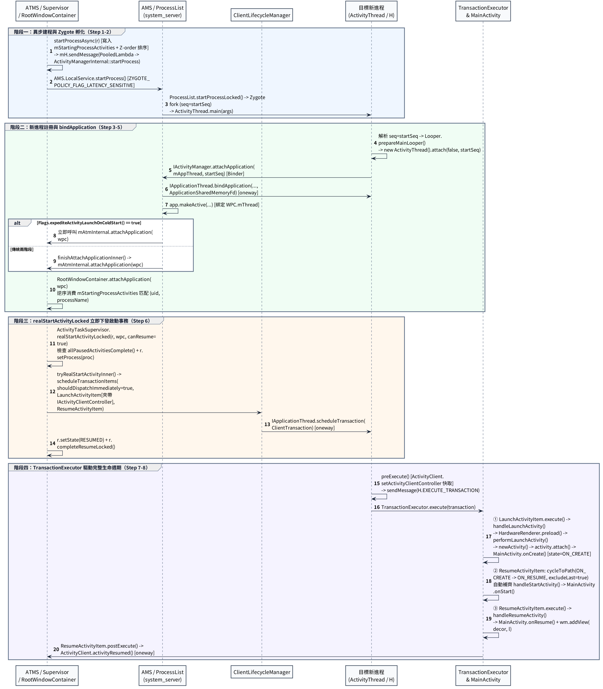

# 7.3 根 Activity 啟動（下）：異步建程、`attachApplication` 與 `TransactionExecutor` 實例化

- **情景說明**：接續 7.2 節的情景一（冷啟動根 Activity `MainActivity`）。當 `TaskFragment.resumeTopActivity` 在暫停 Launcher 的同時（或於 `completePause` 後的 `startSpecificActivity`）呼叫 `ATMS.startProcessAsync` 時，系統透過 `mH` 異步轉交 AMS / `ProcessList` 向 Zygote 孵化目標應用進程。本節一路追蹤到 `MainActivity` 完整呈現在螢幕上為止：
  1. 系統端如何透過 `ATMS.startProcessAsync` → `AMS.LocalService.startProcess` 異步啟動進程（避開 ATMS/AMS 鎖死鎖，Zygote fork 細節留待第 12 章）；
  2. 新進程進入 `ActivityThread.main()` 並以 `startSeq` 向 AMS 執行 `attachApplication`（含 Android 17 的 `bindApplication`、`expediteActivityLaunchOnColdStart` 與兩階段 `finishAttachApplicationInner`）；
  3. `RootWindowContainer.attachApplication` 從 `mStartingProcessActivities` 消費待辦 `ActivityRecord`，經 `ActivityTaskSupervisor.realStartActivityLocked` / `tryRealStartActivityInner` 將 `LaunchActivityItem` 與 `ResumeActivityItem` 打包成單筆 `ClientTransaction` 立即下發；
  4. 目標進程的 `TransactionExecutor` 驅動 `handleLaunchActivity` → `performLaunchActivity`（實例化並呼叫 `onCreate`）→ `cycleToPath` 自動補齊 `onStart` → `ResumeActivityItem` 驅動 `handleResumeActivity`（呼叫 `onResume` 並透過 `wm.addView` 掛載視窗）。
- **對應原書**：7.2 節〈根 Activity 组件的启动过程〉Step 22–Step 35（p.427–440）
- **涉及專案與版本基準**：
  - `platform/frameworks/base` 〔`android-17.0.0_r1`，commit `94b4c163b`〕

---

## 7.3.1 異步啟動目標進程（ATMS → `mH` → AMS → `ProcessList`）

> 對應原書 7.2 Step 22–Step 23（p.427–430）。原書由 `ActivityStack.startSpecificActivityLocked` 直接同步呼叫 `AMS.startProcessLocked`；在 Android 17 中，因 ATMS（`mGlobalLock`）與 AMS（各自鎖域）拆分，ATMS 透過 `startProcessAsync()` 把待啟動的 `ActivityRecord` 記進 `mStartingProcessActivities` 並投遞 `PooledLambda` 訊息給 `mH`，徹底消除跨服務鎖序死鎖。

### Step 1：`ActivityTaskSupervisor.startSpecificActivity` 與 `ATMS.startProcessAsync`
**位置**：`platform/frameworks/base/services/core/java/com/android/server/wm/ActivityTaskSupervisor.java` 〔`android-17.0.0_r1`，lines 1171–1207〕、`platform/frameworks/base/services/core/java/com/android/server/wm/ActivityTaskManagerService.java` 〔`android-17.0.0_r1`，lines 5885–5914〕

```java
    void startSpecificActivity(ActivityRecord r, boolean andResume, boolean checkConfig) {
        // Is this activity's application already running?
        final WindowProcessController wpc =
                mService.getProcessController(r.processName, r.getUid());

        boolean knownToBeDead = false;
        if (wpc != null && wpc.hasThread()) {
            try {
                realStartActivityLocked(r, wpc, andResume, checkConfig);
                return;
            } catch (RemoteException e) {
                Slog.w(TAG, "Exception when starting activity "
                        + r.intent.getComponent().flattenToShortString(), e);
            }

            knownToBeDead = true;
            mService.mProcessNames.remove(wpc.mName, wpc.mUid);
            mService.mProcessMap.remove(wpc.getPid());
        } else if (ActivityTaskManagerService.isSdkSandboxActivityIntent(
                mService.mContext, r.intent)) {
            ...
            return;
        }

        r.notifyUnknownVisibilityLaunchedForKeyguardTransition();

        final boolean isTop = andResume && r.isTopRunningActivity();
        mService.startProcessAsync(r, knownToBeDead, isTop,
                isTop ? HostingRecord.HOSTING_TYPE_TOP_ACTIVITY
                        : HostingRecord.HOSTING_TYPE_ACTIVITY);
    }
```

```java
    void startProcessAsync(ActivityRecord activity, boolean knownToBeDead, boolean isTop,
            String hostingType) {
        if (!mStartingProcessActivities.contains(activity)) {
            mStartingProcessActivities.add(activity);
            // Let the activity with higher z-order be started first.
            if (mStartingProcessActivities.size() > 1) {
                mStartingProcessActivities.sort(null /* by WindowContainer#compareTo */);
            }
        } else if (mProcessNames.get(
                activity.processName, activity.getUid()) != null) {
            // The process is already starting. Wait for it to attach.
            return;
        }
        try {
            ...
            // Post message to start process to avoid possible deadlock of calling into AMS with the
            // ATMS lock held.
            final Message m = PooledLambda.obtainMessage(ActivityManagerInternal::startProcess,
                    mAmInternal, activity.processName, activity.info.applicationInfo, knownToBeDead,
                    isTop, hostingType, activity.intent.getComponent(),
                    activity.info.shouldRunInPccSandbox(),
                    activity.launchedFromUid, activity.launchedFromProcessName);
            mH.sendMessage(m);
        } finally {
            Trace.traceEnd(TRACE_TAG_WINDOW_MANAGER);
        }
    }
```

細看 `startProcessAsync` 如何與 7.2 節 Step 6 銜接：
1. **去重與 Z-order 排序**：7.2 節 Step 6 在暫停 Launcher 時已先呼叫過一次 `startProcessAsync` 把 `MainActivity` 放入 `mStartingProcessActivities`。若稍後 `completePause` → `startSpecificActivity` 再次走到此處，且 AMS 已建好啟動中的 `WindowProcessController`（`mProcessNames.get(...) != null`），第 5893–5897 行便直接 `return`，避免重複 fork。若同一進程同時有多個 Activity 待啟動，按 `WindowContainer#compareTo` 排序讓 Z-order 較高的頂層 Activity 優先被啟動。
2. **無鎖投遞 AMS**：以 `PooledLambda.obtainMessage(ActivityManagerInternal::startProcess, ...)` 交給 ATMS 的 Handler `mH` 在釋放 `mGlobalLock` 後異步執行。

> 〔與 2.3 差異〕邏輯改變：原書 2.3（p.427–428）在 `ActivityStack.startSpecificActivityLocked` 內持鎖同步呼叫 `mService.startProcessLocked`；Android 17 改為查 `WindowProcessController` 並透過 `mStartingProcessActivities` + `mH` 異步呼叫 `ActivityManagerInternal.startProcess`。

---

### Step 2：`AMS.LocalService.startProcess` 交棒至 `ProcessList.startProcessLocked`
**位置**：`platform/frameworks/base/services/core/java/com/android/server/am/ActivityManagerService.java` 〔`android-17.0.0_r1`，lines 18604–18627〕

```java
        public void startProcess(String processName, ApplicationInfo info, boolean knownToBeDead,
                boolean isTop, String hostingType, ComponentName hostingName, boolean isPcc,
                int callerUid, String callerProcessName) {
            try {
                if (Trace.isTagEnabled(Trace.TRACE_TAG_ACTIVITY_MANAGER)) {
                    Trace.traceBegin(Trace.TRACE_TAG_ACTIVITY_MANAGER, "startProcess:"
                            + processName);
                }
                synchronized (mGlobalLock) {
                    HostingRecord hostingRecord =
                            new HostingRecord(hostingType, hostingName, isTop, isPcc,
                                    callerUid, callerProcessName);
                    ProcessRecord app = startProcessLocked(processName, info, knownToBeDead,
                            0 /* intentFlags */, hostingRecord,
                            ZYGOTE_POLICY_FLAG_LATENCY_SENSITIVE, false /* allowWhileBooting */,
                            false /* isolated */);
                }
            } finally {
                Trace.traceEnd(Trace.TRACE_TAG_ACTIVITY_MANAGER);
            }
        }
```

AMS 在內部服務 `LocalService.startProcess` 中建構 `HostingRecord`（標記 `isTop` 讓系統立即拉升前台排程優先級，並附帶 **`ZYGOTE_POLICY_FLAG_LATENCY_SENSITIVE`** 啟用 USAP 預孵化進程池以降低冷啟動延遲），隨即呼叫 `startProcessLocked` → `mProcessList.startProcessLocked(...)`。`ProcessList` 會分配單調遞增的 `startSeq`、透過 Socket 請求 Zygote fork 出新進程並把 `seq=<startSeq>` 與入口類名 `android.app.ActivityThread` 傳給新進程（Zygote 通訊與 USAP 細節將於第 12 章完整剖析）。

> 〔與 2.3 差異〕邏輯擴充：原書 2.3（p.428–430）在 `AMS.startProcessLocked` 直接呼叫 `Process.start("android.app.ActivityThread", ...)`；Android 17 委派給 `ProcessList` 統一管理並引入 `HostingRecord`、`startSeq` 與 `ZYGOTE_POLICY_FLAG_LATENCY_SENSITIVE`（USAP）。

---

## 7.3.2 新進程初始化與 `attachApplication` 雙向對接

> 對應原書 7.2 Step 24–Step 27（p.430–433）。新進程從 Zygote 分裂出來後，進入 `ActivityThread.main()` 建立主執行緒 `Looper`，隨即向 AMS 呼叫 `attachApplication(mAppThread, startSeq)` 完成進程註冊與 `bindApplication`，並喚醒 ATMS 消費 `mStartingProcessActivities`。

### Step 3：新進程入口 `ActivityThread.main()` 與 `ActivityThread.attach()`
**位置**：`platform/frameworks/base/core/java/android/app/ActivityThread.java` 〔`android-17.0.0_r1`，lines 9465–9510、9275–9291〕

```java
    public static void main(String[] args) {
        Trace.traceBegin(Trace.TRACE_TAG_ACTIVITY_MANAGER, "ActivityThreadMain");

        // Install selective syscall interception
        AndroidForwardingOs.install();
        ...
        Process.setArgV0("<pre-initialized>");

        long startSeq = 0;
        if (args != null) {
            for (int i = args.length - 1; i >= 0; --i) {
                if (args[i] != null) {
                    // Find the value for {@link #PROC_START_SEQ_IDENT} if provided on the command
                    // line. It will be in the format "seq=114"
                    if (args[i].startsWith(PROC_START_SEQ_IDENT)) {
                        startSeq = Long.parseLong(
                                args[i].substring(PROC_START_SEQ_IDENT.length()));
                    } else if (args[i].startsWith("--use-deliqueue=")) {
                        boolean useDeliQueue =
                                Boolean.parseBoolean(args[i].substring(args[i].indexOf('=') + 1));
                        MessageQueue.setUseDeliQueue(useDeliQueue);
                    }
                }
            }
        }

        Looper.prepareMainLooper();

        ActivityThread thread = new ActivityThread();
        thread.attach(false, startSeq);
```

```java
    private void attach(boolean system, long startSeq) {
        sCurrentActivityThread = this;
        mConfigurationController = new ConfigurationController(this);
        mSystemThread = system;
        mStartSeq = startSeq;
        mDdmSyncStageUpdater.next(Stage.Attach);

        if (!system) {
            android.ddm.DdmHandleAppName.setAppName("<pre-initialized>",
                                                    UserHandle.myUserId());
            RuntimeInit.setApplicationObject(mAppThread.asBinder());
            final IActivityManager mgr = ActivityManager.getService();
            try {
                mgr.attachApplication(mAppThread, startSeq);
            } catch (RemoteException ex) {
                throw ex.rethrowFromSystemServer();
            }
```

新進程在 `ActivityThread.main()` 中先解析 `args` 裡由 `ProcessList` 傳入的 `seq=<startSeq>`（以及 Android 17 新增的 `--use-deliqueue=` 無鎖 `MessageQueue` 參數），呼叫 `Looper.prepareMainLooper()` 準備主執行緒訊息迴圈，接著透過 `thread.attach(false, startSeq)` 向 AMS 發起 `IActivityManager.attachApplication(mAppThread, startSeq)`，最後於 `main()` 末尾進入 `Looper.loop()` 等待並消費主執行緒訊息。

> 〔與 2.3 差異〕邏輯擴充：原書 2.3（p.430–432）的 `main()` 無參數解析與 `startSeq`，僅呼叫 `mgr.attachApplication(mAppThread)`；Android 17 新增 `startSeq` 防 PID 複用、Mainline 模組初始化、`AndroidForwardingOs` 與 `MessageQueue.setUseDeliQueue`。

---

### Step 4：`AMS.attachApplication` → `attachApplicationLocked` → `mAtmInternal.attachApplication`
**位置**：`platform/frameworks/base/services/core/java/com/android/server/am/ActivityManagerService.java` 〔`android-17.0.0_r1`，lines 5550–5561、5451–5483、5503–5537、5612–5633〕

```java
    public final void attachApplication(IApplicationThread thread, long startSeq) {
        if (thread == null) {
            throw new SecurityException("Invalid application interface");
        }
        synchronized (mGlobalLock) {
            int callingPid = Binder.getCallingPid();
            final int callingUid = Binder.getCallingUid();
            final long origId = Binder.clearCallingIdentity();
            attachApplicationLocked(thread, callingPid, callingUid, startSeq);
            Binder.restoreCallingIdentity(origId);
        }
    }
```

```java
                thread.bindApplication(
                        processName,
                        appInfo,
                        ...
                        preBindInfo.configuration,
                        app.getCompat(),
                        getCommonServicesLocked(app.isolated),
                        mCoreSettingsObserver.getCoreSettings(app.userId),
                        buildSerial,
                        autofillOptions,
                        contentCaptureOptions,
                        ...
                        serializedSystemFontMap,
                        mApplicationSharedMemoryReadOnlyFd,
                        app.getStartElapsedTime(),
                        app.getStartUptime());
```

```java
            synchronized (mProcLock) {
                app.makeActive(new ApplicationThreadDeferred(thread), mProcessStats);
                checkTime(startTime, "attachApplicationLocked: immediately after bindApplication");
            }
            mProcessStateController.setPendingFinishAttach(app, true);
            ...
            // See if the top visible activity is waiting to run in this process...
            if (com.android.server.am.Flags.expediteActivityLaunchOnColdStart()) {
                if (normalMode) {
                    mAtmInternal.attachApplication(app.getWindowProcessController());
                }
            }
            updateOomAdjLocked(app, OOM_ADJ_REASON_PROCESS_BEGIN);
            checkTime(startTime, "attachApplicationLocked: after updateOomAdjLocked");

            if (!mConstants.mEnableWaitForFinishAttachApplication) {
                finishAttachApplicationInner(startSeq, callingUid, pid);
            }
```

```java
        synchronized (mGlobalLock) {
            mProcessStateController.setPendingFinishAttach(app, false);
            ...
            if (!com.android.server.am.Flags.expediteActivityLaunchOnColdStart()) {
                final boolean normalMode = mProcessesReady || isAllowedWhileBooting(app.info);

                if (normalMode) {
                    try {
                        didSomething |= mAtmInternal.attachApplication(
                                app.getWindowProcessController());
                    } catch (Exception e) {
                        Slog.wtf(TAG, "Exception thrown launching activities in " + app, e);
                        badApp = true;
                    }
                }
            }
```

AMS 收到新進程的 `attachApplication` 後執行三個關鍵動作：
1. **先下發 `thread.bindApplication(...)`**（`oneway` Binder，連同第 6 章分析過的 `mApplicationSharedMemoryReadOnlyFd` 一起送出）：此訊息排在新進程主執行緒佇列最前面，確保客戶端一定先完成 `Application.onCreate()` 與 `ContentProvider` 安裝，才執行後面的 Activity 啟動事務！
2. **啟動 `ProcessRecord` 與 `WindowProcessController`**：透過 `app.makeActive(...)` 綁定 `IApplicationThread` 代理（同時寫入 `WindowProcessController.mThread`，從此刻起 `wpc.hasThread() == true`）。
3. **兩階段 Attach 與 Android 17 冷啟動加速（`expediteActivityLaunchOnColdStart`）**：
   - 當開啟 `expediteActivityLaunchOnColdStart` 時，AMS 在送出 `bindApplication` 後**立刻呼叫 `mAtmInternal.attachApplication(app.getWindowProcessController())`**，不等客戶端回報 `finishAttachApplication` 就提前把 `LaunchActivityItem` + `ResumeActivityItem` 塞進客戶端佇列（緊接在 `BIND_APPLICATION` 之後）；
   - 未開啟該旗標時，則於 `finishAttachApplicationInner` 中呼叫 `mAtmInternal.attachApplication(...)`（接著才依序啟動待辦 Service 與 Broadcast）。

> 〔與 2.3 差異〕邏輯改變：原書 2.3（p.432–433）在 `AMS.attachApplicationLocked` 中直接呼叫 `mMainStack.realStartActivityLocked`；Android 17 改為跨內部介面呼叫 `mAtmInternal.attachApplication(app.getWindowProcessController())`，並新增兩階段 `finishAttachApplicationInner` 與 `expediteActivityLaunchOnColdStart` 冷啟動加速。

---

### Step 5：`ATMS.LocalService.attachApplication` → `RootWindowContainer.attachApplication`（消費 `mStartingProcessActivities`）
**位置**：`platform/frameworks/base/services/core/java/com/android/server/wm/ActivityTaskManagerService.java` 〔`android-17.0.0_r1`，lines 7653–7664〕、`platform/frameworks/base/services/core/java/com/android/server/wm/RootWindowContainer.java` 〔`android-17.0.0_r1`，lines 1875–1911〕

```java
        public boolean attachApplication(WindowProcessController wpc) throws RemoteException {
            synchronized (mGlobalLockWithoutBoost) {
                if (Trace.isTagEnabled(TRACE_TAG_WINDOW_MANAGER)) {
                    Trace.traceBegin(TRACE_TAG_WINDOW_MANAGER, "attachApplication:" + wpc.mName);
                }
                try {
                    return mRootWindowContainer.attachApplication(wpc);
                } finally {
                    Trace.traceEnd(TRACE_TAG_WINDOW_MANAGER);
                }
            }
        }
```

```java
    boolean attachApplication(WindowProcessController app) throws RemoteException {
        app.mHasEverAttached = true;
        final ArrayList<ActivityRecord> activities = mService.mStartingProcessActivities;
        RemoteException remoteException = null;
        boolean hasActivityStarted = false;
        for (int i = activities.size() - 1; i >= 0; i--) {
            final ActivityRecord r = activities.get(i);
            if (app.mUid != r.getUid() || !app.mName.equals(r.processName)) {
                // The attaching process does not match the starting activity.
                continue;
            }
            // Consume the pending record.
            activities.remove(i);
            final TaskFragment tf = r.getTaskFragment();
            if (tf == null || r.finishing || r.app != null
                    || !r.shouldBeVisible(true /* ignoringKeyguard */)
                    || !r.showToCurrentUser()) {
                continue;
            }
            try {
                final boolean canResume = r.isFocusable() && r == tf.topRunningActivity()
                        && tf.getVisibility(r) == TASK_FRAGMENT_VISIBILITY_VISIBLE;
                if (mTaskSupervisor.realStartActivityLocked(r, app, canResume,
                        true /* checkConfig */)) {
                    hasActivityStarted = true;
                }
            } catch (RemoteException e) {
                Slog.w(TAG, "Exception in new process when starting " + r, e);
                remoteException = e;
            }
        }
        if (remoteException != null) {
            throw remoteException;
        }
        return hasActivityStarted;
    }
```

`RootWindowContainer.attachApplication` 逆序掃描先前 `startProcessAsync` 存入的 `mStartingProcessActivities`（因列表按 Z-order 排序，從尾端消費即從最高 Z-order 開始）：只要 `app.mUid == r.getUid() && app.mName.equals(r.processName)`，便把該 `ActivityRecord r` 取出，計算 `canResume`（焦點頂層可見即為 `true`），然後呼叫 **`mTaskSupervisor.realStartActivityLocked(r, app, canResume, true)`**！

> 〔與 2.3 差異〕邏輯改變：原書 2.3（p.433）僅比對 `mMainStack.topRunningActivityLocked(null)` 這單一棧頂元素；Android 17 支援多螢幕與自由視窗，直接精準消費 `mStartingProcessActivities` 清單中所有歸屬該 `(uid, processName)` 的待啟動 `ActivityRecord`。

---

## 7.3.3 打包下發啟動事務與 `TransactionExecutor` 推進生命週期

> 對應原書 7.2 Step 28–Step 35（p.433–440）。系統端在 `realStartActivityLocked` 中將「建立 Activity」與「恢復至 `RESUMED`」合併成單一 `ClientTransaction` 立刻發往新進程，新進程則由 `TransactionExecutor` 一氣呵成跑完 `onCreate` → `onStart` → `onResume`。

### Step 6：`ActivityTaskSupervisor.realStartActivityLocked` 與 `tryRealStartActivityInner`
**位置**：`platform/frameworks/base/services/core/java/com/android/server/wm/ActivityTaskSupervisor.java` 〔`android-17.0.0_r1`，lines 809–853、889–891、927–960、1050–1088〕

```java
    boolean realStartActivityLocked(ActivityRecord r, WindowProcessController proc,
            boolean andResume, boolean checkConfig) throws RemoteException {

        if (!mRootWindowContainer.allPausedActivitiesComplete()) {
            ProtoLog.v(WM_DEBUG_STATES,
                    "realStartActivityLocked: Skipping start of r=%s some activities pausing...",
                    r);
            return false;
        }
        ...
        final Task rootTask = task.getRootTask();
        beginDeferResume();
        proc.pauseConfigurationDispatch();

        try {
            r.lastLaunchTime = SystemClock.uptimeMillis();
            r.setProcess(proc);
            ...
            final IActivityClientController activityClientController =
                    proc.hasEverLaunchedActivity() ? null : mService.mActivityClientController;
            r.launchCount++;
            ...
            final RemoteException e = tryRealStartActivityInner(
                    task, r, proc, activityClientController, andResume);
            if (e != null) {
                ...
                r.launchFailed = true;
                r.detachFromProcess();
                throw e;
            }
        } finally {
            endDeferResume();
            proc.resumeConfigurationDispatch();
        }

        r.launchFailed = false;

        if (andResume && readyToResume()) {
            r.setState(RESUMED, "realStartActivityLocked");
            r.completeResumeLocked();
            makeNonTopVisibleActivitiesActiveIfNeeded(r, task);
        } else if (r.isVisibleRequested()) {
```

```java
        final LaunchActivityItem launchActivityItem = new LaunchActivityItem(r.token,
                r.intent, System.identityHashCode(r), r.info,
                procConfig, overrideConfig, deviceId,
                r.getFilteredReferrer(r.launchedFromPackage), task.voiceInteractor,
                proc.getReportedProcState(), r.getSavedState(), persistentState,
                results, newIntents, r.takeSceneTransitionInfo(), isTransitionForward,
                proc.createProfilerInfoIfNeeded(), r.assistToken, activityClientController,
                r.shareableActivityToken, r.getLaunchedFromBubble(), fragmentToken,
                r.initialCallerInfoAccessToken, activityWindowInfo, r.getDisplayId());

        // Set desired final state.
        final ActivityLifecycleItem lifecycleItem;
        if (andResume) {
            lifecycleItem = new ResumeActivityItem(r.token, isTransitionForward,
                    r.shouldSendCompatFakeFocus());
        } else if (r.isVisibleRequested()) {
            lifecycleItem = new PauseActivityItem(r.token);
        } else {
            lifecycleItem = new StopActivityItem(r.token);
        }

        // Schedule transaction.
        if (shouldDispatchLaunchActivityItemIndependently(r.info.packageName, r.getUid())) {
            mService.getLifecycleManager().dispatchPendingTransaction(proc.getThread());
        }
        final boolean isSuccessful = mService.getLifecycleManager().scheduleTransactionItems(
                proc.getThread(),
                true /* shouldDispatchImmediately */,
                launchActivityItem, lifecycleItem);
        if (!isSuccessful) {
            return new DeadObjectException("Failed to dispatch the ClientTransaction to dead"
                    + " process. See earlier log for more details.");
        }
```

這段程式碼完美詮釋了 7.1 與 7.2 節埋下的所有伏筆：
1. **會合檢查 `allPausedActivitiesComplete()`**：若新進程飛快地比 Launcher 還早完成 `attachApplication`，此時第 812 行會回傳 `false` 暫緩啟動——等到幾毫秒後 Launcher 送達 `activityPaused`（7.2 節 Step 10），`completePause` 會再次呼叫 `resumeFocusedTasksTopActivities` → `startSpecificActivity` 命中已經 `hasThread()` 的 `proc` 並正式通過此處！
2. **綁定進程與夾帶 `IActivityClientController`**：`r.setProcess(proc)` 正式把 `ActivityRecord` 與 `WindowProcessController` 關聯；若為該進程首次啟動 Activity（`!proc.hasEverLaunchedActivity()`），把 `mService.mActivityClientController` 放進 `LaunchActivityItem` 帶過去省去日後 Binder 查詢。
3. **單筆事務同時打包兩項**：`tryRealStartActivityInner` 同時建出 **`LaunchActivityItem`**（非生命週期項）與 **`ResumeActivityItem`**（生命週期目標狀態 `ON_RESUME`），以 **`shouldDispatchImmediately = true`** 交由 `ClientLifecycleManager.scheduleTransactionItems()` 立即發送——因此系統端也同步在第 957 行把 `r` 的伺服器端狀態推進至 `RESUMED`。

> 〔與 2.3 差異〕邏輯改變：原書 2.3（p.433–435）呼叫 `app.thread.scheduleLaunchActivity(...)` 單獨傳遞十幾個參數；Android 17 改以 `LaunchActivityItem` + `ResumeActivityItem` 雙項打包進 `ClientTransaction` 經 `ClientLifecycleManager` 立即派發，並以 `allPausedActivitiesComplete()` 處理與並行預建進程的會合。

---

### Step 7：`LaunchActivityItem` 與 `ActivityThread.handleLaunchActivity` → `performLaunchActivity`（`onCreate`）
**位置**：`platform/frameworks/base/core/java/android/app/servertransaction/LaunchActivityItem.java` 〔`android-17.0.0_r1`，lines 203–226〕、`platform/frameworks/base/core/java/android/app/ActivityThread.java` 〔`android-17.0.0_r1`，lines 4733–4790、4414–4565〕

```java
    @Override
    public void preExecute(@NonNull ClientTransactionHandler client) {
        client.countLaunchingActivities(1);
        client.updateProcessState(mProcState, false);
        CompatibilityInfo.applyOverrideIfNeeded(mCurConfig, mDisplayId);
        CompatibilityInfo.applyOverrideIfNeeded(mOverrideConfig, mDisplayId);
        client.updatePendingConfiguration(mCurConfig);
        if (mActivityClientController != null) {
            ActivityClient.setActivityClientController(mActivityClientController);
        }
    }

    @Override
    public void execute(@NonNull ClientTransactionHandler client,
            @NonNull PendingTransactionActions pendingActions) {
        Trace.traceBegin(TRACE_TAG_ACTIVITY_MANAGER, "activityStart");
        final ActivityClientRecord r = new ActivityClientRecord(mActivityToken, mIntent, mIdent,
                mInfo, mOverrideConfig, mReferrer, mVoiceInteractor, mState, mPersistentState,
                mPendingResults, mPendingNewIntents, mSceneTransitionInfo, mIsForward,
                mProfilerInfo, client, mAssistToken, mShareableActivityToken, mLaunchedFromBubble,
                mTaskFragmentToken, mInitialCallerInfoAccessToken, mActivityWindowInfo, mDisplayId);
        client.handleLaunchActivity(r, pendingActions, mDeviceId, null /* customIntent */);
        Trace.traceEnd(TRACE_TAG_ACTIVITY_MANAGER);
    }
```

```java
    @Override
    public Activity handleLaunchActivity(ActivityClientRecord r,
            PendingTransactionActions pendingActions, int deviceId, Intent customIntent) {
        unscheduleGcIdler();
        mSomeActivitiesChanged = true;
        ...
        if (ThreadedRenderer.sRendererEnabled
                && (r.activityInfo.flags & ActivityInfo.FLAG_HARDWARE_ACCELERATED) != 0) {
            final int tid = HardwareRenderer.preload();
            if (tid > 0) {
                try {
                    ActivityManager.getService().setRenderThread(tid);
                } catch (Throwable t) {
                    Log.w(TAG, "Failed to set scheduler for RenderThread", t);
                }
            }
        }
        ...
        WindowManagerGlobal.initialize();
        GraphicsEnvironment.hintActivityLaunch();

        final Activity a = performLaunchActivity(r, customIntent);
```

```java
    private Activity performLaunchActivity(ActivityClientRecord r, Intent customIntent) {
        ActivityInfo aInfo = r.activityInfo;
        ...
        } else if (r.packageInfo == null) {
            r.packageInfo = getPackageInfo(aInfo.applicationInfo, mCompatibilityInfo,
                    Context.CONTEXT_INCLUDE_CODE);
        }

        ComponentName component = r.intent.getComponent();
        ...
        ContextImpl activityBaseContext;
        ...
            activityBaseContext = createBaseContextForActivity(r);
        Activity activity = null;
        try {
            java.lang.ClassLoader cl;
            ...
                cl = activityBaseContext.getClassLoader();
            activity = mInstrumentation.newActivity(
                    cl, component.getClassName(), r.intent);
            ...
        }
        try {
            Application app = r.packageInfo.makeApplicationInner(false, mInstrumentation);
            ...
            synchronized (mResourcesManager) {
                mActivities.put(r.token, r);
            }

            if (activity != null) {
                CharSequence title =
                        r.activityInfo.loadLabel(activityBaseContext.getPackageManager());
                ...
                activityBaseContext.setOuterContext(activity);
                activity.attach(activityBaseContext, this, getInstrumentation(), r.token,
                        r.ident, app, r.intent, r.activityInfo, title, r.parent,
                        r.embeddedID, r.lastNonConfigurationInstances, config,
                        r.referrer, r.voiceInteractor, window, r.activityConfigCallback,
                        r.assistToken, r.shareableActivityToken, r.initialCallerInfoAccessToken);
                ...
                r.activity = activity;
                if (r.isPersistable()) {
                    mInstrumentation.callActivityOnCreate(activity, r.state, r.persistentState);
                } else {
                    mInstrumentation.callActivityOnCreate(activity, r.state);
                }
                if (!activity.mCalled) {
                    throw new SuperNotCalledException(
                        "Activity " + r.intent.getComponent().toShortString() +
                        " did not call through to super.onCreate()");
                }
```

新進程收到事務後依序執行：
1. **Binder 執行緒 `preExecute()`**：預先更新進程狀態、套用待定 `Configuration`，並將夾帶過來的 `mActivityClientController` 透過 `ActivityClient.setActivityClientController(...)` 寫入單例快取。
2. **主執行緒 `LaunchActivityItem.execute()`**：因 `LaunchActivityItem` 非生命週期項，`TransactionExecutor.executeNonLifecycleItem` 直接呼叫其 `execute()` → `ActivityThread.handleLaunchActivity`：
   - 預載硬體加速渲染執行緒（`HardwareRenderer.preload()` 並通知 AMS 提升 RenderThread 排程權重）與初始化 `WindowManagerGlobal`；
   - 進入 **`performLaunchActivity`**：
     1. 取得或建立 `LoadedApk`（`r.packageInfo`）；
     2. 建立專屬 `ContextImpl`（`createBaseContextForActivity(r)`），並以 `AppComponentFactory` / `ClassLoader` 經 **`mInstrumentation.newActivity(cl, component.getClassName(), r.intent)`** 反射實例化 `MainActivity`；
     3. 取得已由 `bindApplication` 建好的 `Application` 實例，並將 `r` 存入 `mActivities.put(r.token, r)`（受 `mResourcesManager` 鎖保護）；
     4. 呼叫 **`activity.attach(...)`**（在內部建出 `PhoneWindow` 並關聯 `WindowManagerImpl`、`mToken` 與 `activityBaseContext`）；
     5. 呼叫 **`mInstrumentation.callActivityOnCreate(activity, r.state)`** → 正式回呼 **`MainActivity.onCreate()`**（並於尾端檢查 `activity.mCalled` 確保有呼叫 `super.onCreate()`，最後把 `r.setState(ON_CREATE)`）。

> 〔與 2.3 差異〕邏輯改變 + 擴充：原書 2.3（p.435–440）由 `ApplicationThread.scheduleLaunchActivity` 發送 `H.LAUNCH_ACTIVITY`，且在 `handleLaunchActivity` 內直接硬編碼呼叫 `handleResumeActivity`；Android 17 改由 `LaunchActivityItem` 觸發 `handleLaunchActivity`（只負責到 `ON_CREATE`，不再直接呼叫 `handleResumeActivity`），並新增 `preExecute` 快取 `IActivityClientController`、`HardwareRenderer.preload`、SDK Sandbox Context 與 `r.setState(ON_CREATE)` 狀態機標記。

---

### Step 8：`TransactionExecutor` 自動補齊 `ON_START` 並執行 `ResumeActivityItem`（`onResume` + `wm.addView`）
**位置**：`platform/frameworks/base/core/java/android/app/servertransaction/TransactionExecutor.java` 〔`android-17.0.0_r1`，lines 193–221〕、`platform/frameworks/base/core/java/android/app/servertransaction/ResumeActivityItem.java` 〔`android-17.0.0_r1`，lines 69–89〕、`platform/frameworks/base/core/java/android/app/ActivityThread.java` 〔`android-17.0.0_r1`，lines 5997–6067〕

```java
        final IntArray path = mHelper.getLifecyclePath(start, finish, excludeLastState);
        performLifecycleSequence(r, path, transaction);
    }

    /** Transition the client through previously initialized state sequence. */
    private void performLifecycleSequence(ActivityClientRecord r, IntArray path,
            ClientTransaction transaction) {
        final int size = path.size();
        for (int i = 0, state; i < size; i++) {
            state = path.get(i);
            ...
            switch (state) {
                case ON_CREATE:
                    mTransactionHandler.handleLaunchActivity(r, mPendingActions,
                            Context.DEVICE_ID_INVALID, null /* customIntent */);
                    break;
                case ON_START:
                    mTransactionHandler.handleStartActivity(r, mPendingActions,
                            null /* sceneTransitionInfo */);
                    break;
                case ON_RESUME:
                    mTransactionHandler.handleResumeActivity(r, false /* finalStateRequest */,
                            r.isForward, false /* shouldSendCompatFakeFocus */,
                            "LIFECYCLER_RESUME_ACTIVITY");
                    break;
```

```java
    @Override
    public void execute(@NonNull ClientTransactionHandler client, @NonNull ActivityClientRecord r,
            @NonNull PendingTransactionActions pendingActions) {
        Trace.traceBegin(TRACE_TAG_ACTIVITY_MANAGER, "activityResume");
        client.handleResumeActivity(r, true /* finalStateRequest */, mIsForward,
                mShouldSendCompatFakeFocus, "RESUME_ACTIVITY");
        Trace.traceEnd(TRACE_TAG_ACTIVITY_MANAGER);
    }

    @Override
    public void postExecute(@NonNull ClientTransactionHandler client,
            @NonNull PendingTransactionActions pendingActions) {
        ActivityClient.getInstance().activityResumed(getActivityToken(),
                client.isHandleSplashScreenExit(getActivityToken()));
    }

    @Override
    public int getTargetState() {
        return ON_RESUME;
    }
```

```java
    @Override
    public void handleResumeActivity(ActivityClientRecord r, boolean finalStateRequest,
            boolean isForward, boolean shouldSendCompatFakeFocus, String reason) {
        unscheduleGcIdler();
        mSomeActivitiesChanged = true;

        if (!performResumeActivity(r, finalStateRequest, reason)) {
            return;
        }
        ...
        if (r.window == null && !a.mFinished && willBeVisible) {
            r.window = r.activity.getWindow();
            View decor = r.window.getDecorView();
            decor.setVisibility(View.INVISIBLE);
            ViewManager wm = a.getWindowManager();
            WindowManager.LayoutParams l = r.window.getAttributes();
            a.mDecor = decor;
            l.type = WindowManager.LayoutParams.TYPE_BASE_APPLICATION;
            l.softInputMode |= forwardBit;
            ...
            if (a.mVisibleFromClient) {
                if (!a.mWindowAdded) {
                    a.mWindowAdded = true;
                    wm.addView(decor, l);
                } else {
                    a.onWindowAttributesChanged(l);
                }
            }
```

緊接在 `LaunchActivityItem` 之後，`TransactionExecutor.executeTransactionItems` 迴圈處理同筆事務的第二項 **`ResumeActivityItem`**（`isActivityLifecycleItem() == true`、`getTargetState() == ON_RESUME`）：
1. **自動計算並補齊中間狀態（`ON_START`）**：此時 `r.getLifecycleState() == ON_CREATE`，目標為 `ON_RESUME` 且 `excludeLastState == true`。`mHelper.getLifecyclePath(ON_CREATE, ON_RESUME, true)` 自動算出路徑 `[ON_START]`，交由 `performLifecycleSequence` 呼叫 `mTransactionHandler.handleStartActivity(...)` → 觸發 **`MainActivity.onStart()`**（與必要時的 `onRestoreInstanceState` / `onPostCreate`）。
2. **執行最終項 `ResumeActivityItem.execute()`**：進入 `ActivityThread.handleResumeActivity`：
   - 呼叫 `performResumeActivity()` → **`MainActivity.onResume()`**；
   - 透過 **`wm.addView(decor, l)`** 建立 `ViewRootImpl` 並向 WMS 註冊視窗、觸發首幀 `measure` / `layout` / `draw` 繪製顯示；
   - 最後 `ResumeActivityItem.postExecute()` 以 `oneway` Binder 呼叫 `ActivityClient.getInstance().activityResumed(...)` 通知 `system_server`（並協調 SplashScreen 退場），至此根 Activity 冷啟動大功告成！

> 〔與 2.3 差異〕邏輯改變：原書 2.3（p.438–440）把 `performStart()` 塞在 `performLaunchActivity()` 裡、把 `handleResumeActivity()` 硬編碼在 `handleLaunchActivity()` 尾端；Android 17 徹底解耦為 `LaunchActivityItem`（`ON_CREATE`）→ `TransactionExecutor.cycleToPath`（自動補 `ON_START`）→ `ResumeActivityItem`（`ON_RESUME` + `wm.addView` + `activityResumed` 回報）。

---

## 7.3.4 本節總結與呼叫鏈時序圖


