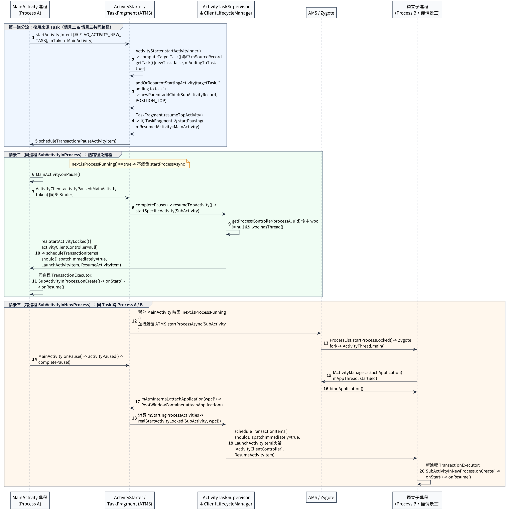

# 7.4 子 Activity 啟動：同進程復用與跨進程同任務（`Task` 與進程解耦模型）

- **情景說明**：接續 7.2–7.3 節已啟動的根元件 `MainActivity`，本節對比另外兩個核心啟動情景，精準定位它們與根 Activity 冷啟動在 Android 17 原始碼中的**唯二兩處關鍵分流點**：
  - **情景二（同進程子 Activity，對應原書 7.3）**：`MainActivity` 呼叫 `startActivity(intent)`（**不帶** `FLAG_ACTIVITY_NEW_TASK`）啟動與自己 `android:process` 相同的 `SubActivityInProcess` → **復用來源 `Task` + 復用既有進程（熱路徑直走 `realStartActivityLocked`）**；
  - **情景三（跨進程同任務子 Activity，對應原書 7.4）**：`MainActivity` 呼叫 `startActivity(intent)`（**不帶** `FLAG_ACTIVITY_NEW_TASK`）啟動在 `AndroidManifest.xml` 中宣告獨立 `android:process` 的 `SubActivityInNewProcess` → **復用來源 `Task` + 並行預建新進程**。
- **對應原書**：7.3 節〈子 Activity 组件在进程内的启动过程〉（p.440–448）與 7.4 節〈子 Activity 组件在新进程中的启动过程〉（p.448–450）
- **涉及專案與版本基準**：
  - `platform/frameworks/base` 〔`android-17.0.0_r1`，commit `94b4c163b`〕

---

## 7.4.1 第一道分流：`Task` 歸屬決策（情景二與情景三共同復用來源任務）

> 對應原書 7.3 Step 1–Step 9（p.441–445）。無論子 Activity 跑在同一個進程還是新進程，只要呼叫端是既有 Activity（`mSourceRecord != null`）、未指定 `FLAG_ACTIVITY_NEW_TASK` 且目標為預設 `standard` 模式，Android 17 在 `ActivityStarter.startActivityInner` 中都會走同一條「壓入既有任務」分支，而不建立新 `Task`。

### Step 1：`ActivityStarter.computeTargetTask` 命中 `mSourceRecord.getTask()`
**位置**：`platform/frameworks/base/services/core/java/com/android/server/wm/ActivityStarter.java` 〔`android-17.0.0_r1`，lines 2042–2046、2144–2157、2306–2313〕

```java
        // Compute if there is an existing task that should be used for.
        final Task targetTask = reusedTask != null ? reusedTask : computeTargetTask();
        final boolean newTask = targetTask == null;
        mTargetTask = targetTask;
```

```java
        if (mTargetRootTask == null) {
            mTargetRootTask = getOrCreateRootTask(mStartActivity, mLaunchFlags, targetTask,
                    mOptions);
        }
        if (newTask) {
            final Task taskToAffiliate = (mLaunchTaskBehind && mSourceRecord != null)
                    ? mSourceRecord.getTask() : null;
            setNewTask(taskToAffiliate);
        } else if (mAddingToTask) {
            // Layout the task to ensure the Task is in correct bounds.
            mSupervisor.getLaunchParamsController().layoutTask(targetTask,
                    mStartActivity.info.windowLayout, mStartActivity, mSourceRecord, options);
            addOrReparentStartingActivity(targetTask, "adding to task");
        }
```

```java
    private Task computeTargetTask() {
        if (mStartActivity.resultTo == null && mInTask == null && !mAddingToTask
                && (mLaunchFlags & FLAG_ACTIVITY_NEW_TASK) != 0) {
            // A new task should be created instead of using existing one.
            return null;
        } else if (mSourceRecord != null) {
            return mSourceRecord.getTask();
        } else if (mInTask != null) {
```

把這段與 7.2 節 Step 5 對照，就一目了然：
1. 在 7.2 節情景一（Launcher 啟動根 Activity）中，`mLaunchFlags` 含 `FLAG_ACTIVITY_NEW_TASK` 且 `resultTo == null`，命中第 2307 行回傳 `null` → `newTask = true` → 呼叫 `setNewTask()` 建立全新 `Task`。
2. 在本節情景二與情景三中，`MainActivity` 發起 `startActivity(intent)` 既未帶 `FLAG_ACTIVITY_NEW_TASK`，又透過 `mToken` 傳入了有效的 `mSourceRecord`（指向 `MainActivity` 的 `ActivityRecord`）。因此 `computeTargetTask()` 落入 **`else if (mSourceRecord != null)`**，直接回傳 **`mSourceRecord.getTask()`**！
3. 於是 `targetTask != null`、`newTask == false`；再經第 2128 行設下 `mAddingToTask = true`，於第 2152–2156 行執行 **`addOrReparentStartingActivity(targetTask, "adding to task")`**。

> 〔與 2.3 差異〕改名搬家 + 結構化：原書 2.3（p.443）在 `ActivityStack.startActivityUncheckedLocked` 以 `else if (sourceRecord != null) { r.task = sourceRecord.task; }` 手動指派欄位；Android 17 抽離為獨立方法 `computeTargetTask()`，並支援多視窗版面計算（`LaunchParamsController.layoutTask`）與嵌入容器查詢。

---

### Step 2：`ActivityStarter.addOrReparentStartingActivity` 壓入任務頂端（含嵌入 `TaskFragment` 判斷）
**位置**：`platform/frameworks/base/services/core/java/com/android/server/wm/ActivityStarter.java` 〔`android-17.0.0_r1`，lines 3362–3392〕

```java
    /** Places {@link #mStartActivity} in {@code task} or an embedded {@link TaskFragment}. */
    private void addOrReparentStartingActivity(@NonNull Task task, String reason) {
        TaskFragment newParent = task;
        if (mInTaskFragment != null) {
            int embeddingCheckResult = canEmbedActivity(mInTaskFragment, mStartActivity, task);
            if (embeddingCheckResult == EMBEDDING_ALLOWED) {
                newParent = mInTaskFragment;
                mStartActivity.mRequestedLaunchingTaskFragmentToken =
                        mInTaskFragment.getFragmentToken();
            } else {
                // Start mStartActivity to task instead if it can't be embedded to mInTaskFragment.
                sendCanNotEmbedActivityError(mInTaskFragment, embeddingCheckResult);
            }
        } else {
            TaskFragment candidateTf = mAddingToTaskFragment;
            if (candidateTf == null) {
                candidateTf = findCandidateTaskFragment(task);
            }
            if (candidateTf != null && candidateTf.isEmbedded()
                    && canEmbedActivity(candidateTf, mStartActivity, task) == EMBEDDING_ALLOWED) {
                newParent = candidateTf;
            }
        }
        if (mStartActivity.getTaskFragment() == null
                || mStartActivity.getTaskFragment() == newParent) {
            newParent.addChild(mStartActivity, POSITION_TOP);
        } else {
            mStartActivity.reparent(newParent, newParent.getChildCount() /* top */, reason);
        }
    }
```

在一般全螢幕單窗格手機情景下，`task` 內頂部子節點是 `MainActivity`（無嵌入 `TaskFragment`），`findCandidateTaskFragment(task)` 回傳 `null`，於是 `newParent` 就是 `targetTask` 自身，第 3388 行執行 **`newParent.addChild(mStartActivity, POSITION_TOP)`**——把 `SubActivity` 壓在 `MainActivity` 正上方成為該 `Task` 新的 `topRunningActivity()`；而在摺疊機或平板啟用 Activity Embedding（例如左右分欄）時，則自動掛入合格的嵌入式 `TaskFragment` 節點下。

> 〔與 2.3 差異〕架構演進：原書 2.3（p.444–445）是在 `ActivityStack.startActivityLocked` 裡用 `for` 迴圈倒序掃描線性陣列 `mHistory` 找 `p.task == r.task` 再插入 `mHistory.add(i + 1, r)`；Android 17 的每個 `Task` 本身就是 `WindowContainer` 樹節點，直接 O(1) 呼叫 `newParent.addChild(mStartActivity, POSITION_TOP)`，並原生支援大螢幕 `TaskFragment` 嵌入。

---

## 7.4.2 同任務暫停與第二道分流：同進程熱路徑 vs 跨進程冷啟動

> 對應原書 7.3 Step 10–Step 30（p.445–448）與 7.4 節（p.448–450）。壓入同一 `Task` 後，同樣走 `resumeFocusedTasksTopActivities` → `TaskFragment.resumeTopActivity`。此時因 `MainActivity` 與 `SubActivity` 位在**同一個 `TaskFragment`**，暫停動作由 `if (mResumedActivity != null) pausing |= startPausing(...)` 直接發起；而真正拉開情景二與情景三執行路徑的，就是接下來對目標進程的查詢。

### Step 3：`TaskFragment.resumeTopActivity` 暫停 `MainActivity` 與 `else if (!next.isProcessRunning())` 的早期分化
**位置**：`platform/frameworks/base/services/core/java/com/android/server/wm/TaskFragment.java` 〔`android-17.0.0_r1`，lines 1442–1471、1668–1683〕

```java
        boolean pausing = !skipPause && taskDisplayArea.pauseBackTasks(next);
        if (mResumedActivity != null) {
            ProtoLog.d(WM_DEBUG_STATES, "resumeTopActivity: Pausing %s", mResumedActivity);
            pausing |= startPausing(mTaskSupervisor.mUserLeaving, false /* uiSleeping */,
                    next, "resumeTopActivity");
        }
        if (pausing) {
            if (next.attachedToProcess()) {
                next.app.updateProcessInfo(false /* updateServiceConnectionActivities */,
                        true /* activityChange */, false /* updateOomAdj */,
                        false /* addPendingTopUid */);
            } else if (!next.isProcessRunning()) {
                final boolean isTop = this == taskDisplayArea.getFocusedRootTask();
                mAtmService.startProcessAsync(next, false /* knownToBeDead */, isTop,
                        isTop ? HostingRecord.HOSTING_TYPE_NEXT_TOP_ACTIVITY
                                : HostingRecord.HOSTING_TYPE_NEXT_ACTIVITY);
            }
            if (lastResumed != null) {
                lastResumed.setWillCloseOrEnterPip(true);
            }
            return true;
        }
```

```java
        } else {
            if (!next.hasBeenLaunched) {
                next.hasBeenLaunched = true;
            } else {
                if (SHOW_APP_STARTING_PREVIEW) {
                    next.showStartingWindow(false /* taskSwich */);
                }
            }
            ProtoLog.d(WM_DEBUG_STATES, "resumeTopActivity: Restarting %s", next);
            next.setVisibility(true);
            mTaskSupervisor.startSpecificActivity(next, true, true);
        }
```

請觀察兩處精妙的時序分化：
1. **第一次進入 `resumeTopActivity`（排程暫停 `MainActivity` 時）**：
   - `mResumedActivity` 即為 `MainActivity`，呼叫 `startPausing(...)` 對 `MainActivity` 送出 `PauseActivityItem` 並得到 `pausing == true`。
   - **情景二（同進程 `SubActivityInProcess`）**：`next.isProcessRunning()` 內部查詢 `mAtmService.getProcessController(processName, getUid())` 發現**目標進程已經在跑**（就是 `MainActivity` 所在進程！），因此**不會**觸發 `startProcessAsync`，只需靜候 `MainActivity` 完成 `onPause()` 回報 `activityPaused`。
   - **情景三（跨進程 `SubActivityInNewProcess`）**：因 `android:process` 為全新進程名，`!next.isProcessRunning()` 為 **`true`**！Android 17 立刻在此處**並行觸發 `mAtmService.startProcessAsync(next, ..., HOSTING_TYPE_NEXT_TOP_ACTIVITY)`**，在 `MainActivity` 執行 `onPause()` 的同時就開始 fork 新進程！
2. **第二次進入 `resumeTopActivity`（`MainActivity` 完成 `activityPaused` → `completePause` 後）**：
   - 此時 `pausing == false` 且新壓入的 `SubActivity` 尚未啟動（`!next.attachedToProcess()`），故直接落入第 1668 行 `else` 分支呼叫 **`mTaskSupervisor.startSpecificActivity(next, true, true)`**。

> 〔與 2.3 差異〕邏輯改變：原書 2.3（p.446–449）在情景三中必須等到 `MainActivity` 回報 `activityPaused` 進到 `startSpecificActivityLocked` 才開始建新進程；Android 17 在情景三的暫停階段就已透過 `!next.isProcessRunning()` 提早並行預建新進程。

---

### Step 4：`ActivityTaskSupervisor.startSpecificActivity` 進程命中（情景二熱路徑 vs 情景三冷啟動）
**位置**：`platform/frameworks/base/services/core/java/com/android/server/wm/ActivityTaskSupervisor.java` 〔`android-17.0.0_r1`，lines 1171–1207〕

```java
    void startSpecificActivity(ActivityRecord r, boolean andResume, boolean checkConfig) {
        // Is this activity's application already running?
        final WindowProcessController wpc =
                mService.getProcessController(r.processName, r.getUid());

        boolean knownToBeDead = false;
        if (wpc != null && wpc.hasThread()) {
            try {
                realStartActivityLocked(r, wpc, andResume, checkConfig);
                return;
            } catch (RemoteException e) {
                Slog.w(TAG, "Exception when starting activity "
                        + r.intent.getComponent().flattenToShortString(), e);
            }
            ...
        }
        ...
        final boolean isTop = andResume && r.isTopRunningActivity();
        mService.startProcessAsync(r, knownToBeDead, isTop,
                isTop ? HostingRecord.HOSTING_TYPE_TOP_ACTIVITY
                        : HostingRecord.HOSTING_TYPE_ACTIVITY);
    }
```

這裡就是原書 7.3 Step 22（p.446）與 7.4（p.449）的分水嶺：決定一個 Activity 是復用既有進程還是開啟新進程的唯二鍵值就是 **`(r.processName, r.getUid())`**（對應 `AndroidManifest.xml` 的 `android:process` 與套件 UID）：

- **情景二（同進程 `SubActivityInProcess`）**：
  - `mService.getProcessController(r.processName, r.getUid())` 立刻查得既有進程的 `WindowProcessController wpc`，且 `wpc.hasThread() == true`（持有 `MainActivity` 進程的 `IApplicationThread`）。
  - 直接呼叫 **`realStartActivityLocked(r, wpc, true, true)`** → 打包 `LaunchActivityItem`（此時 `proc.hasEverLaunchedActivity() == true`，故不再重複夾帶 `IActivityClientController`！）+ `ResumeActivityItem` 送回**同一個進程** → `TransactionExecutor` 在同一個 `ActivityThread` 內實例化並呼叫 `SubActivityInProcess.onCreate()` → `onStart()` → `onResume()`！全程零 Zygote fork、零 `bindApplication`。
- **情景三（跨進程 `SubActivityInNewProcess`）**：
  - 因 `r.processName` 不同，若並行預建的新進程還沒完成 `attachApplication`，`wpc == null` → 呼叫 `startProcessAsync`（去重後靜默返回），待新進程完成 7.3 節 Step 3–6 的 `ActivityThread.main()` → `attachApplication` → `RootWindowContainer.attachApplication` → `realStartActivityLocked` 啟動 `SubActivityInNewProcess`；
  - 若新進程已搶先完成 `attachApplication`（當時因 `MainActivity` 尚在 `PAUSING` 而被 `allPausedActivitiesComplete()` 擋下），此刻 `wpc != null && wpc.hasThread()` 立刻命中，當場直入 `realStartActivityLocked`！

> 〔與 2.3 差異〕改名 + 邏輯優化：原書 2.3（p.446–447）查詢 `mService.getProcessRecordLocked(r.processName, r.info.applicationInfo.uid)` 判斷 `app != null && app.thread != null`；Android 17 改查 WM 側鏡像 `mService.getProcessController(r.processName, r.getUid())` 判斷 `wpc != null && wpc.hasThread()`，且在同進程二次啟動時跳過重複傳遞 `IActivityClientController`。

---

## 7.4.3 `Task`、`TaskFragment` 與 `WindowProcessController` 正交解耦總結

> 對應原書 7.4 節結尾的架構洞察（p.449–450）。在情景三完成後，系統內出現一個極具教學價值的拓撲結構：
> - **同一個 `Task`** 內堆疊著兩個 `ActivityRecord`：`SubActivityInNewProcess`（頂層，`RESUMED`）壓在 `MainActivity`（底層，`PAUSED` → `STOPPED`）之上；
> - 但兩者各自的 `ActivityRecord.app` 分別指向**兩個完全獨立的 `WindowProcessController`**（不同 PID，各自擁有獨立的 `ActivityThread`、Heap 與 `Looper`），甚至可以來自兩個不同 App（不同 UID，例如 App A 呼叫系統分享／郵件編輯器 App B 的 Activity）。

這代表 Android 框架刻意把三個維度徹底正交解耦：
1. **`Task`（業務任務層）**：面向使用者的「返回堆疊（Back Stack）」邏輯單元，定義「按返回鍵該回到哪個畫面」，完全不限制內部 Activity 必須同進程或同套件。
2. **`TaskFragment`（視窗版面層，Android 12L+ 新增）**：位於 `Task` 與 `ActivityRecord` 之間，決定同任務內多個 Activity 是全螢幕疊加還是並排內嵌（Activity Embedding）。
3. **`WindowProcessController` / `ProcessRecord`（作業系統進程層）**：面向核心與記憶體隔離的執行載體，由 `(processName, uid)` 唯一決定；單一 App 可拆出多個進程，單一 `Task` 也可橫跨多個進程。

---

## 7.4.4 本節總結與雙情景對照時序圖



### 全章三情景關鍵原始碼分支總整理（Android 17）

| 檢核關卡 | 情景一：根 Activity 冷啟動（7.2–7.3） | 情景二：同進程子 Activity（7.4） | 情景三：跨進程子 Activity（7.4） |
|---|---|---|---|
| **發起端參數** | `FLAG_ACTIVITY_NEW_TASK`、`sourceRecord = Launcher` | 無 `NEW_TASK`、`sourceRecord = MainActivity` | 無 `NEW_TASK`、`sourceRecord = MainActivity` |
| **`ActivityStarter.computeTargetTask()`** | 回傳 `null`（`newTask = true`） | 回傳 `mSourceRecord.getTask()`（`newTask = false`） | 回傳 `mSourceRecord.getTask()`（`newTask = false`） |
| **掛入視窗樹** | `setNewTask()` 建新 Root `Task` 並 `moveToFront()` | `addOrReparentStartingActivity()` 壓入同一 `Task` 頂端 | `addOrReparentStartingActivity()` 壓入同一 `Task` 頂端 |
| **暫停對象來源** | `taskDisplayArea.pauseBackTasks(next)`（跨 Task 暫停 Launcher） | `TaskFragment.mResumedActivity`（同 Task 暫停 `MainActivity`） | `TaskFragment.mResumedActivity`（同 Task 暫停 `MainActivity`） |
| **暫停期間並行建程** | 觸發 `ATMS.startProcessAsync` | **不觸發**（`next.isProcessRunning() == true`） | 觸發 `ATMS.startProcessAsync` |
| **`startSpecificActivity()` 查詢** | 未命中 → 等待新進程 `attachApplication` | **命中既有 `wpc`** → 直接 `realStartActivityLocked` | 未命中（或已預附著命中）→ 新進程執行 |
| **夾帶 `IActivityClientController`** | 是（`!proc.hasEverLaunchedActivity()`） | 否（`null`，沿用快取） | 是（新進程首次啟動 Activity） |
