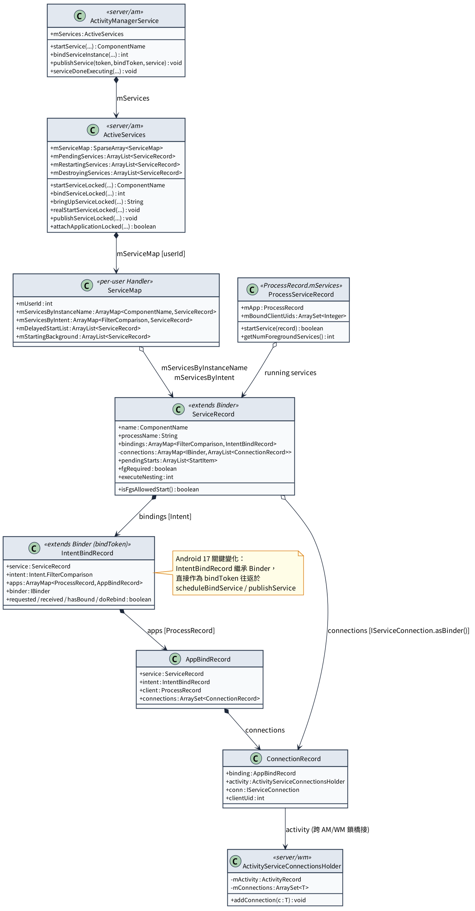
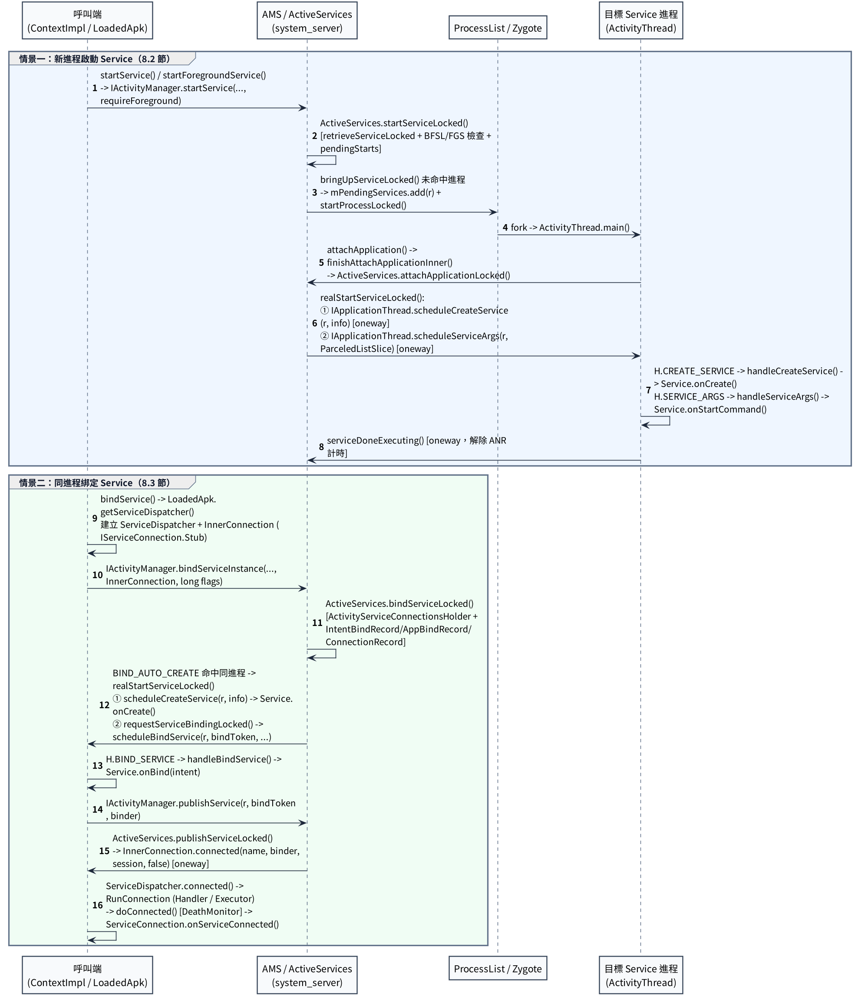

# 8.1 現代 Service 管理架構、資料模型與雙情景總覽（`ActiveServices`、四層綁定模型與 FGS）

- **情景說明**：Service 是 Android 四大組件中專責後台與無 UI 長期運作的核心元件，依呼叫方式分為「啟動型（Started）」與「綁定型（Bound）」兩條主軸。本節延續原書的雙情景切法，先確立貫穿本章的兩條典型情景，並解剖 Android 17 在 `ActivityManagerService`（AMS）中抽離出的 **`ActiveServices`** 管理架構與核心資料模型：
  1. **情景一（新進程啟動 Service，見 8.2 節）**：呼叫端以顯式 `Intent` 呼叫 `startService(intent)`（並對照現代 **`startForegroundService(intent)`**），啟動宣告了獨立 `android:process` 且尚未運行的遠端 Service → 系統核驗背景啟動／FGS 規則、孵化新進程，依序執行 **`Service.onCreate()`** 與 **`Service.onStartCommand()`**；
  2. **情景二（同進程綁定 Service，見 8.3 節）**：Activity 呼叫 `bindService(intent, serviceConnection, Context.BIND_AUTO_CREATE)` 綁定同進程內的本地 Service → 系統建立四層綁定記錄、於同進程建立 Service 並呼叫 **`Service.onBind()`**，透過 `publishService` 與 `IServiceConnection` 回調至 **`ServiceConnection.onServiceConnected()`**。
- **對應原書**：第 8 章引言與 8.1 節〈Service 组件应用实例〉（p.451–459）
- **涉及專案與版本基準**：
  - `platform/frameworks/base` 〔`android-17.0.0_r1`，commit `94b4c163b`〕

---

## 8.1.1 兩大情景與現代 Service 生命週期座標

> 對應原書 8.1（p.451–459）。原書以獨立進程的 `MemoryService`（第 6 章）作為 8.2 節「新進程啟動」範例，並撰寫 `Counter` + `CounterService` 作為 8.3 節「同進程綁定」範例。到了 Android 17，與第 7 章 Activity 被整體移出 AMS 併入 ATMS/WM 不同，**Service 仍歸屬 `com.android.server.am`**，但在 AMS 內部已完整重構為獨立子系統 `ActiveServices`，並補上顯式 Intent 強制、背景啟動限制（BFSL）與前台服務型別管制。

兩大情景在 Android 17 系統內的核心路徑對照如下（可透過 `adb shell dumpsys activity services` 觀察完整 `ServiceRecord` / `IntentBindRecord` / `ConnectionRecord` 樹）：

| 維度 | 情景一：新進程啟動（8.2 節） | 情景二：同進程綁定（8.3 節） |
|---|---|---|
| **發起 API** | `Context.startService()` / `startForegroundService()` | `Context.bindService()`（支援 `BindServiceFlags` 與 `Executor`） |
| **AMS AIDL 入口** | `IActivityManager.startService(...)` | `IActivityManager.bindServiceInstance(...)` |
| **合規與限制檢查** | 強制顯式 Intent、`bgLaunch` 背景啟動限制、`setFgsRestrictionLocked` / FGS 型別逾時 | 強制顯式 Intent、64 位元 `flags` 權限核驗、透過 `ActivityServiceConnectionsHolder` 綁定 Activity 生命週期 |
| **進程啟動判定** | `getProcessRecordLocked == null` → 放入 `mPendingServices` + `startProcessLocked` → 新進程 `attachApplication` | 命中同進程 `app != null && thread != null` → 直接走熱路徑 `realStartServiceLocked` |
| **下行 `IApplicationThread` IPC** | `scheduleCreateService` → `scheduleServiceArgs`（批次 `ParceledListSlice`） | `scheduleCreateService` → `scheduleBindService`（帶 `bindToken`） |
| **目標回呼順序** | `Service.onCreate()` → `Service.onStartCommand()` | `Service.onCreate()` → `Service.onBind()` → `publishService` → `ServiceConnection.onServiceConnected()` |

> 〔與 2.3 差異〕架構與安全模型演進：原書 8.1（p.451–459）尚無背景啟動限制與前台服務啟動管道（`startForegroundService`），亦允許隱式 Intent 啟動 Service；Android 17 嚴格要求顯式 Intent 並對背景／FGS 啟動建立完整審計與例外拋出機制。

---

## 8.1.2 `ActiveServices`、per-user `ServiceMap` 與 `ProcessServiceRecord`

> 對應原書 8.2–8.3 中 AMS 的全域欄位設計（p.462、p.478）。原書 2.3 把所有 Service 索引表與邏輯全塞在 `ActivityManagerService.java` 裡，且全機共用單一 `mServices` 雜湊表；Android 17 已將全部 Service 生命週期與排程邏輯抽離至 `ActiveServices`，並按多使用者與進程拆帳。



### Step 1：`ActiveServices` 全域清單與 per-user `ServiceMap`
**位置**：`platform/frameworks/base/services/core/java/com/android/server/am/ActiveServices.java` 〔`android-17.0.0_r1`，lines 433–457、693–718〕

```java
    final SparseArray<ServiceMap> mServiceMap = new SparseArray<>();
    ...
    final ArrayList<ServiceRecord> mPendingServices = new ArrayList<>();
    ...
    final ArrayList<ServiceRecord> mRestartingServices = new ArrayList<>();
    ...
    final ArrayList<ServiceRecord> mDestroyingServices = new ArrayList<>();
```

```java
    final class ServiceMap extends Handler {
        final int mUserId;
        final ArrayMap<ComponentName, ServiceRecord> mServicesByInstanceName = new ArrayMap<>();
        final ArrayMap<Intent.FilterComparison, ServiceRecord> mServicesByIntent = new ArrayMap<>();

        final ArrayList<ServiceRecord> mDelayedStartList = new ArrayList<>();
        ...
        final ArrayList<ServiceRecord> mStartingBackground = new ArrayList<>();

        final ArrayMap<String, ActiveForegroundApp> mActiveForegroundApps = new ArrayMap<>();
        final ArrayList<String> mPendingRemoveForegroundApps = new ArrayList<>();

        boolean mActiveForegroundAppsChanged;

        static final int MSG_BG_START_TIMEOUT = 1;
        static final int MSG_UPDATE_FOREGROUND_APPS = 2;
        static final int MSG_ENSURE_NOT_START_BG = 3;
```

`ActiveServices` 在 AMS 內部由 `mServices` 持有，透過兩層容器管理全系統的 Service：
1. **按使用者隔離的 `mServiceMap`（`SparseArray<ServiceMap>`）**：每個 Android 使用者（`userId`）擁有專屬 `ServiceMap`（本身繼承 `Handler` 負責處理背景啟動逾時 `MSG_BG_START_TIMEOUT` 與前台應用追蹤）。其中以兩張 `ArrayMap` 雙鍵索引正在運行的 `ServiceRecord`——`mServicesByInstanceName`（以組件實例名 `ComponentName` 查找，支援 Isolated Service 多實例）與 `mServicesByIntent`（以 `Intent.FilterComparison` 查找）；另維護 `mDelayedStartList` 與 `mStartingBackground` 控制背景 Service 同時啟動的併發上限。
2. **四個跨使用者狀態佇列**：其中 **`mPendingServices`** 是 8.2 節新進程冷啟動的關鍵交接箱——當目標進程尚未就緒時，`bringUpServiceInnerLocked` 會把 `ServiceRecord` 放進 `mPendingServices`，等待新進程 `attachApplication` 進入 `ActiveServices.attachApplicationLocked` 時取出並真正啟動。

> 〔與 2.3 差異〕搬家 + 拆分：原書 2.3（p.462–464）直接在 `ActivityManagerService` 中維護單使用者 `mServicesByName`、`mServicesByIntent` 與 `mPendingServices`；Android 17 抽離至 `ActiveServices`，按 `userId` 拆為 `ServiceMap` 並納入背景並發節流與前台 App 狀態追蹤。

---

### Step 2：`ProcessServiceRecord` 進程側服務帳本
**位置**：`platform/frameworks/base/services/core/java/com/android/server/am/ProcessServiceRecord.java` 〔`android-17.0.0_r1`，lines 40–69、110–115〕

```java
final class ProcessServiceRecord extends ProcessServiceRecordInternal {
    private boolean mRepHasForegroundServices;
    boolean mAllowlistManager;
    private ArraySet<Integer> mBoundClientUids = new ArraySet<>();
    private boolean mScheduleServiceTimeoutPending;

    final ProcessRecord mApp;

    private final ActivityManagerService mService;

    ProcessServiceRecord(ProcessRecord app) {
        super(app.mService.mProcessStateController.getOomConstants(), app);

        mApp = app;
        mService = app.mService;
    }
    ...
    @RequiresEnclosingBatchSession
    boolean startService(@NonNull ServiceRecord record) {
        boolean added = mService.mProcessStateController.addRunningService(this, record);
        if (added && record.serviceInfo != null) {
            mApp.getWindowProcessController().onServiceStarted(record.serviceInfo);
            updateHostingComonentTypeForBindingsLocked();
```

原書 2.3 把所有元件集合（`services`、`executingServices`、`connections`）全塞在 `ProcessRecord` 一個巨型類別裡；Android 17 依職責拆出 **`ProcessServiceRecord`**（掛在 `ProcessRecord.mServices` 下），與 `ProcessStateController`（OOM Adj 計算子系統）緊密協作：每當 `realStartServiceLocked` 啟動一個 Service，便透過 `@RequiresEnclosingBatchSession` 保護的 `psr.startService(r)` 登記進該進程的運行服務表，並同步通知 WM 側的 `WindowProcessController.onServiceStarted(...)` 與批次調整 OOM 優先級。

> 〔與 2.3 差異〕拆分 + 新增：原書 2.3（p.466）直接操作 `ProcessRecord.services` 與 `ProcessRecord.executingServices`；Android 17 封裝至 `ProcessServiceRecord`，並整合 `ProcessStateController` 批次會話（`SyncBatchSession`）與 FGS 型別統計。

---

## 8.1.3 四層核心資料模型與跨鎖橋接

> 對應原書 8.3 開頭對綁定關聯的拆解（p.478–483）。一個 Service 可以同時被**多個不同的 `Intent`（Action）**綁定；同一個 `Intent` 又可能被**多個不同的客戶端進程**綁定；而同一個客戶端進程內還可能透過**多個不同的 `ServiceConnection`** 重複綁定！Android 用非常經典的四層結構把這對多對多關係拆解得清清楚楚：**`ServiceRecord` → `IntentBindRecord` → `AppBindRecord` → `ConnectionRecord`**。

### Step 3：`ServiceRecord` 核心元資料、雙向索引與 FGS 合規欄位
**位置**：`platform/frameworks/base/services/core/java/com/android/server/am/ServiceRecord.java` 〔`android-17.0.0_r1`，lines 125–177、252–260、406–420〕

```java
    final ActivityManagerService ams;
    final ComponentName name; // service component.
    final String shortInstanceName; // instanceName.flattenToShortString().
    final String definingPackageName;
    final int definingUid;
    final Intent.FilterComparison intent;
    final ServiceInfo serviceInfo;
    ApplicationInfo appInfo;
    final int userId;       // user that this service is running as
    final String packageName; // the package implementing intent's component
    final String processName; // process where this component wants to run
    final String permission;// permission needed to access service
    final boolean exported; // from ServiceInfo.exported
    ...
    final ArrayMap<Intent.FilterComparison, IntentBindRecord> bindings
            = new ArrayMap<Intent.FilterComparison, IntentBindRecord>();
                            // All active bindings to the service.
    private final ArrayMap<IBinder, ArrayList<ConnectionRecord>> connections
            = new ArrayMap<IBinder, ArrayList<ConnectionRecord>>();
                            // IBinder -> ConnectionRecord of all bound clients
    ...
    boolean delayed;        // are we waiting to start this service in the background?
    boolean fgRequired;     // is the service required to go foreground after starting?
    boolean fgWaiting;      // is a timeout for going foreground already scheduled?
    ...
    int foregroundId;       // Notification ID of last foreground req.
    Notification foregroundNoti; // Notification record of foreground state.
    ...
    int executeNesting;     // number of outstanding operations keeping foreground.
    boolean executeFg;      // should we be executing in the foreground?
    long executingStart;    // start time of last execute request.
```

```java
    // The uptime when the service enters FGS state.
    long mFgsEnterTime = 0;
    // The uptime when the service exits FGS state.
    long mFgsExitTime = 0;
    // FGS notification is deferred.
    boolean mFgsNotificationDeferred;
```

```java
    @PowerExemptionManager.ReasonCode
    int getFgsAllowStart() {
        if (useNewBfslLogic()) {
            return getFgsAllowStart_new();
        } else {
            return getFgsAllowStart_legacy();
        }
    }

    boolean isFgsAllowedStart() {
        return getFgsAllowStart() != REASON_DENIED;
    }
```

`ServiceRecord` 本身繼承自 `Binder`（透過 `ServiceRecordInternal`），因此系統端可以直接把 `ServiceRecord` 物件當成 `IBinder token` 傳給應用進程（`scheduleCreateService(r, ...)`、`scheduleServiceArgs(r, ...)`、`scheduleBindService(r, ...)`），日後應用端回報 `publishService(token, ...)` 或 `serviceDoneExecuting(token, ...)` 時，`ActiveServices` 就能直接把 `token` 轉回 `ServiceRecord`！

除了原本就有的 `bindings`（按 `Intent.FilterComparison` 索引所有 `IntentBindRecord`）、`connections`（按客戶端 `IServiceConnection.asBinder()` 索引 `ConnectionRecord`）、`pendingStarts`（待派發的 `StartItem` 清單）與 ANR 追蹤欄位 `executeNesting`/`executingStart` 外，Android 17 在 `ServiceRecord` 上大幅擴充了 **FGS 與 BFSL（Background FGS Launch）狀態機**：包含 `fgRequired`（由 `startForegroundService` 設為 `true`，要求服務必須在限時內呼叫 `startForeground()` 否則觸發 `ForegroundServiceDidNotStartInTimeException`）、`fgWaiting`、`mFgsEnterTime` 以及 `isFgsAllowedStart()` 背景啟動豁免碼判定。

> 〔與 2.3 差異〕大幅擴充：原書 2.3（p.462、p.479）的 `ServiceRecord` 尚無多使用者 `userId`、SDK Sandbox 欄位、FGS 強制轉前台狀態（`fgRequired`/`fgWaiting`）與 BFSL 背景啟動豁免計算。

---

### Step 4：`IntentBindRecord`（Binder 權杖）、`AppBindRecord` 與 `ConnectionRecord`
**位置**：`platform/frameworks/base/services/core/java/com/android/server/am/IntentBindRecord.java` 〔`android-17.0.0_r1`，lines 32–50〕、`platform/frameworks/base/services/core/java/com/android/server/am/AppBindRecord.java` 〔`android-17.0.0_r1`，lines 28–36〕、`platform/frameworks/base/services/core/java/com/android/server/am/ConnectionRecord.java` 〔`android-17.0.0_r1`，lines 48–67〕

```java
final class IntentBindRecord extends Binder {
    /** The running service. */
    final ServiceRecord service;
    /** The intent that is bound.*/
    final Intent.FilterComparison intent; //
    /** All apps that have bound to this Intent. */
    final ArrayMap<ProcessRecord, AppBindRecord> apps
            = new ArrayMap<ProcessRecord, AppBindRecord>();
    /** Binder published from service. */
    IBinder binder;
    /** Set when we have initiated a request for this binder. */
    boolean requested;
    /** Set when we have received the requested binder. */
    boolean received;
    /** Set when we still need to tell the service all clients are unbound. */
    boolean hasBound;
    /** Set when the service's onUnbind() has asked to be told about new clients. */
    boolean doRebind;
```

```java
final class AppBindRecord {
    final ServiceRecord service;    // The running service.
    final IntentBindRecord intent;  // The intent we are bound to.
    final @NonNull ProcessRecord client;     // Who has started/bound the service.
    final ProcessRecord attributedClient; // The binding was done by the system on behalf
    final ArraySet<ConnectionRecord> connections = new ArraySet<>();
                                    // All ConnectionRecord for this client.
```

```java
final class ConnectionRecord extends ConnectionRecordInternal {
    final @NonNull AppBindRecord binding;    // The application/service binding.
    final ActivityServiceConnectionsHolder<ConnectionRecord> activity;  // If non-null, the owning activity.
    final IServiceConnection conn;  // The client connection.
    final int clientLabel;          // String resource labeling this client.
    final PendingIntent clientIntent; // How to launch the client.
    final int clientUid;            // The identity of this connection's client
    final String clientProcessName; // The source process of this connection's client
    final String clientPackageName; // The source package of this connection's client
    public AssociationState.SourceState association; // Association tracking
    String stringName;              // Caching of toString.
    boolean serviceDead;            // Well is it?
    private Object mProcStatsLock;  // Internal lock for accessing AssociationState
    @Nullable
    final ComponentName aliasComponent;
```

這三層結構串起了整個 8.3 節綁定回調的命脈：
1. **`IntentBindRecord`（Android 17 關鍵變化：繼承 `Binder`！）**：代表「某一個 `Intent.FilterComparison` 對該 `ServiceRecord` 的綁定群組」。它快取了 `Service.onBind()` 發布回來的 `IBinder binder`，並以 `requested` / `received` / `hasBound` / `doRebind` 四個布林值驅動 `onBind` / `onUnbind` / `onRebind` 狀態機。因為它直接繼承 `Binder`，系統端在 `scheduleBindService` 時把 `IntentBindRecord` 本身當成 `bindToken` 傳給服務端，服務端在 `publishService(token, bindToken, binder)` 直接原封不動傳回，免去舊版用 `Intent` 雜湊重找的風險！
2. **`AppBindRecord`**：代表「某個客戶端進程（`ProcessRecord client`）對某個 `IntentBindRecord` 的綁定集合」，記錄該進程下所有的 `ConnectionRecord`。
3. **`ConnectionRecord`**：代表「單次 `bindService()` 呼叫與其對應的一個 `IServiceConnection conn`（客戶端的 `LoadedApk.ServiceDispatcher.InnerConnection` 代理）」，同時持有 64 位元綁定旗標（存於父類 `ConnectionRecordInternal`）與可選的 `ActivityServiceConnectionsHolder`。

> 〔與 2.3 差異〕邏輯改變：原書 2.3（p.479–481）的 `IntentBindRecord` 是普通物件而非 `Binder`、`ConnectionRecord.activity` 直接持有 `HistoryRecord`、旗標為 32 位元 `int`；Android 17 讓 `IntentBindRecord extends Binder` 充當 `bindToken`，旗標升級為 64 位元 `long`，`ConnectionRecord.activity` 則改為 `ActivityServiceConnectionsHolder`。

---

### Step 5：`ActivityServiceConnectionsHolder`——AM 與 WM 鎖域隔離的綁定橋接器
**位置**：`platform/frameworks/base/services/core/java/com/android/server/wm/ActivityServiceConnectionsHolder.java` 〔`android-17.0.0_r1`，lines 39–64〕

```java
public class ActivityServiceConnectionsHolder<T> {

    /** The activity the owns this service connection object. */
    private final ActivityRecord mActivity;

    @GuardedBy("mActivity")
    private ArraySet<T> mConnections;

    /** Whether all connections of {@link #mActivity} are being removed. */
    private volatile boolean mIsDisconnecting;

    ActivityServiceConnectionsHolder(ActivityRecord activity) {
        mActivity = activity;
    }

    /** Adds a connection record that the activity has bound to a specific service. */
    public void addConnection(T c) {
        synchronized (mActivity) {
            if (mIsDisconnecting) {
```

這是一個非常值得細看的跨模組架構設計：當一個 Activity 呼叫 `bindService()` 卻忘記在 `onDestroy()` 呼叫 `unbindService()` 時，系統必須在該 Activity 銷毀時自動幫它解除所有 `ConnectionRecord`（並印出 `ServiceConnectionLeaked` 錯誤）。原書 2.3 因 Activity 與 Service 同屬 AMS 同一把大鎖，直接寫進 `HistoryRecord.connections`；但在 Android 17 中，`ActivityRecord` 位於 WM（`mGlobalLock`）、`ActiveServices` 位於 AM（另一把 `mGlobalLock`），為了避免兩把大鎖互相嵌套引發死鎖，WM 端定義了以 `synchronized (mActivity)` 細粒度保護的泛型容器 `ActivityServiceConnectionsHolder<T>`，讓 `ActiveServices.bindServiceLocked` 透過 `mAm.mAtmInternal.getServiceConnectionsHolder(token)` 取得並安全掛載 `ConnectionRecord`。

> 〔與 2.3 差異〕新增：因應 Activity 抽離至 ATMS/WM，原書 2.3 的 `HistoryRecord.connections` 由 `ActivityServiceConnectionsHolder<ConnectionRecord>` 取代以徹底解耦 AM 與 WM 鎖域。

---

## 8.1.4 三組 AIDL 介面邊界（為何 Service 未改走 `ClientTransaction`）

### Step 6：`IActivityManager.aidl`、`IApplicationThread.aidl` 與 `IServiceConnection.aidl`
**位置**：`platform/frameworks/base/core/java/android/app/IActivityManager.aidl` 〔`android-17.0.0_r1`，lines 226–244、310〕、`platform/frameworks/base/core/java/android/app/IApplicationThread.aidl` 〔`android-17.0.0_r1`，lines 82–85、103、107–111〕、`platform/frameworks/base/core/java/android/app/IServiceConnection.aidl` 〔`android-17.0.0_r1`，lines 24–28〕

```aidl
    ComponentName startService(in IApplicationThread caller, in Intent service,
            in String resolvedType, boolean requireForeground, in String callingPackage,
            in String callingFeatureId, int userId);
    ...
    int bindServiceInstance(in IApplicationThread caller, in IBinder token, in Intent service,
            in String resolvedType, in IServiceConnection connection, long flags,
            in String instanceName, in String callingPackage, int userId);
    ...
    void publishService(in IBinder token, in IBinder bindToken, in IBinder service);
    ...
    oneway void serviceDoneExecuting(in IBinder token, int type, int startId, int res);
```

```aidl
    void scheduleCreateService(IBinder token, in ServiceInfo info,
            in CompatibilityInfo compatInfo, int processState);
    void scheduleStopService(IBinder token);
    ...
    void scheduleServiceArgs(IBinder token, in ParceledListSlice args);
    ...
    void scheduleBindService(IBinder token, IBinder bindToken,
            in Intent intent, boolean rebind, int processState, long bindSeq);
    void scheduleUnbindService(IBinder token, IBinder bindToken,
            in Intent intent);
```

```aidl
oneway interface IServiceConnection {
    @UnsupportedAppUsage
    void connected(in ComponentName name, IBinder service, in @nullable IBinderSession session,
        boolean dead);
}
```

對比第 7 章 Activity 與本章 Service 的 AIDL 邊界，可以清楚看出兩個關鍵設計取捨：
1. **Service 不需要 `ClientTransaction` 狀態機補齊**：Activity 涉及複雜的多視窗組態變更、Surface 轉場與嚴格有序的多階段生命週期（`CREATE → START → RESUME → PAUSE → STOP`），因此收斂到 `ClientLifecycleManager` + `ClientTransaction`；相較之下，Service 沒有視窗樹、沒有複雜組態回呼，生命週期只有線性的 `Create → StartCommand / Bind → Unbind → Destroy`，因此 Android 17 直接在 `oneway interface IApplicationThread` 上保留了精簡的專屬方法（`scheduleCreateService`、`scheduleServiceArgs`、`scheduleBindService`、`scheduleUnbindService`、`scheduleStopService`），且改進了兩個痛點：
   - `scheduleServiceArgs` 改收 `ParceledListSlice args`，把連續多次 `startService` 合併成單次 IPC；
   - `scheduleBindService` 與 `publishService` 改用 `IBinder bindToken`（即 `IntentBindRecord`）精準配對。
2. **`IServiceConnection` 為 `oneway` 回調**：當 `ActiveServices.publishServiceLocked` 拿到 Service 的 `IBinder` 後，透過 `oneway` 的 `IServiceConnection.connected(name, service, session, dead)` 非同步推送回客戶端進程的 `LoadedApk.ServiceDispatcher.InnerConnection`，絕不讓惡意或卡頓的客戶端阻塞 `system_server`！

> 〔與 2.3 差異〕AIDL 化 + 簽名演進：原書 2.3（p.461、p.468、p.476、p.489）手寫 `ActivityManagerProxy` / `ApplicationThreadProxy`；Android 17 全數 AIDL 化，新增 `requireForeground`、`bindServiceInstance`（64 位元 `flags` + `instanceName`）、`ParceledListSlice`、`bindToken`/`bindSeq` 與 `IServiceConnection.connected` 的 `IBinderSession`/`dead` 參數。

---

## 8.1.5 本節總結與雙情景全局時序總覽圖



### 本章閱讀導航（接續 8.2–8.3 節）

- **8.2 節**：沿著情景一逐行追蹤 `ContextImpl.startServiceCommon` → `ActiveServices.startServiceLocked`（含背景啟動與 FGS 規則）→ `bringUpServiceLocked`（新進程 `mPendingServices`）→ 新進程 `attachApplication` → `realStartServiceLocked` → `handleCreateService`（`onCreate`）與 `handleServiceArgs`（`onStartCommand`）。
- **8.3 節**：沿著情景二逐行追蹤 `ContextImpl.bindServiceCommon` → `LoadedApk.ServiceDispatcher` → `ActiveServices.bindServiceLocked` → 同進程 `realStartServiceLocked` → `requestServiceBindingLocked`（`scheduleBindService`）→ `handleBindService`（`onBind` → `publishService`）→ `InnerConnection.connected` → `RunConnection` → `ServiceConnection.onServiceConnected()`。
