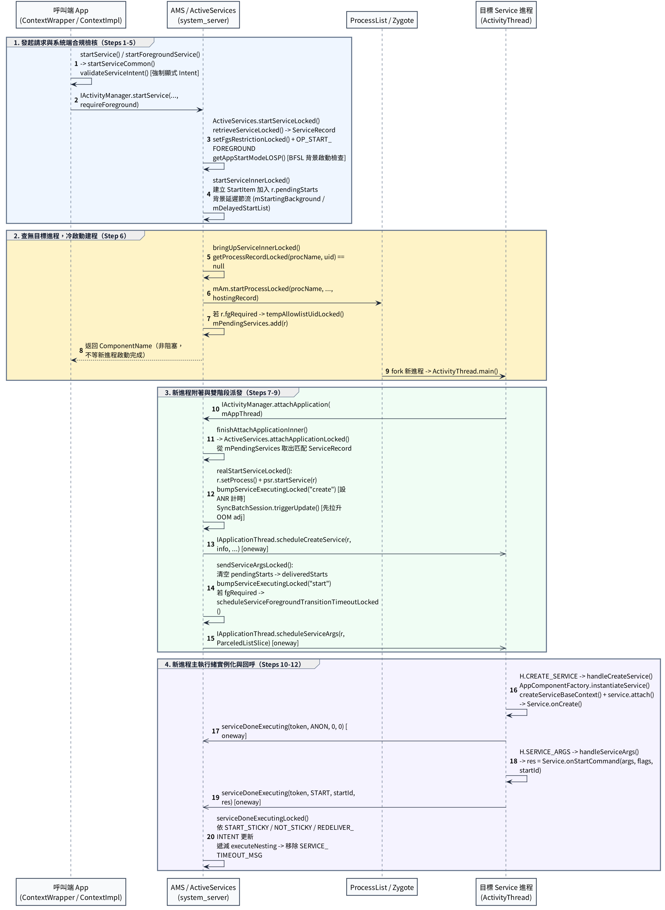

# 8.2 Service 在新進程中的啟動過程（`startService` / `startForegroundService`、`ActiveServices`、`onCreate` 與 `onStartCommand`）

- **情景說明**：應用程式以顯式 `Intent` 呼叫 `startService(intent)`（並對照現代 **`startForegroundService(intent)`**），啟動一個在 `AndroidManifest.xml` 中宣告獨立 `android:process` 且目標進程尚未啟動的遠端 Service。系統端在 `ActivityManagerService` / `ActiveServices` 中完成顯式意圖檢核、背景啟動與前台服務（FGS）合規管制、建立 `StartItem` 排入 `pendingStarts`，查無目標進程後透過 `startProcessLocked` 委由 Zygote 孵化新進程，並將該 `ServiceRecord` 暫存於 `mPendingServices`。待新進程啟動並回呼 `attachApplication` 後，`ActiveServices` 依序派發 **`scheduleCreateService`** 與 **`scheduleServiceArgs`**，最終在新進程主執行緒依序執行 **`Service.onCreate()`** 與 **`Service.onStartCommand()`** 並回報 `serviceDoneExecuting`。
- **對應原書**：第 8 章 8.2 節〈在新的进程中启动 Service 的过程〉（p.459–471）
- **涉及專案與版本基準**：
  - `platform/frameworks/base` 〔`android-17.0.0_r1`，commit `94b4c163b`〕



---

## 8.2.1 發起啟動請求：`ContextWrapper` → `ContextImpl.startServiceCommon`

> 對應原書 8.2 Step 1–2（p.460–461）。呼叫端（無論位於 `Activity` 或 `Application`）皆繼承自 `ContextWrapper`，實際邏輯委派給底層 `ContextImpl`。Android 17 在發送 Binder IPC 前，於客戶端先行強制顯式 `Intent` 檢查，並統一由 `startServiceCommon` 收斂 `startService` 與 `startForegroundService` 兩條入口。

### Step 1：`ContextWrapper.startService` / `startForegroundService` 委派至 `mBase`
**位置**：`platform/frameworks/base/core/java/android/content/ContextWrapper.java` 〔`android-17.0.0_r1`，lines 868–876〕

```java
    @Override
    public @Nullable ComponentName startService(Intent service) {
        return mBase.startService(service);
    }

    @Override
    public @Nullable ComponentName startForegroundService(Intent service) {
        return mBase.startForegroundService(service);
    }
```

`mBase` 是在組件初始化階段（`attachBaseContext`）注入的 `ContextImpl` 實例。兩支公開 API 的差別僅在於是否要求目標 Service 必須在逾時內呼叫 `Service.startForeground()` 晉升為前台服務（`requireForeground`）。

---

### Step 2：`ContextImpl.validateServiceIntent` 與 `startServiceCommon`
**位置**：`platform/frameworks/base/core/java/android/app/ContextImpl.java` 〔`android-17.0.0_r1`，lines 2064–2087、2105–2141〕

```java
    private void validateServiceIntent(Intent service) {
        if (service.getComponent() == null && service.getPackage() == null) {
            if (getApplicationInfo().targetSdkVersion >= Build.VERSION_CODES.LOLLIPOP) {
                IllegalArgumentException ex = new IllegalArgumentException(
                        "Service Intent must be explicit: " + service);
                throw ex;
            } else {
                Log.w(TAG, "Implicit intents with startService are not safe: " + service
                        + " " + Debug.getCallers(2, 3));
            }
        }
    }

    @Override
    public ComponentName startService(Intent service) {
        warnIfCallingFromSystemProcess();
        return startServiceCommon(service, false, mUser);
    }

    @Override
    public ComponentName startForegroundService(Intent service) {
        warnIfCallingFromSystemProcess();
        return startServiceCommon(service, true, mUser);
    }
```

接著進入核心封裝 `startServiceCommon`：

```java
    private ComponentName startServiceCommon(Intent service, boolean requireForeground,
            UserHandle user) {
        // Keep this in sync with ActivityManagerLocal.startSdkSandboxService
        try {
            validateServiceIntent(service);
            service.prepareToLeaveProcess(this);
            ComponentName cn = ActivityManager.getService().startService(
                    mMainThread.getApplicationThread(), service,
                    service.resolveTypeIfNeeded(getContentResolver()), requireForeground,
                    getOpPackageName(), getAttributionTag(), user.getIdentifier());
            if (cn != null) {
                if (cn.getPackageName().equals("!")) {
                    throw new SecurityException(
                            "Not allowed to start service " + service
                            + " without permission " + cn.getClassName());
                } else if (cn.getPackageName().equals("!!")) {
                    throw new SecurityException(
                            "Unable to start service " + service
                            + ": " + cn.getClassName());
                } else if (cn.getPackageName().equals("?")) {
                    throw ServiceStartNotAllowedException.newInstance(requireForeground,
                            "Not allowed to start service " + service + ": " + cn.getClassName());
                }
            }
            // If we started a foreground service in the same package, remember the stack trace.
            if (cn != null && requireForeground) {
                if (cn.getPackageName().equals(getOpPackageName())) {
                    Service.setStartForegroundServiceStackTrace(cn.getClassName(),
                            new StackTrace("Last startServiceCommon() call for this service was "
                                    + "made here"));
                }
            }
            return cn;
        } catch (RemoteException e) {
            throw e.rethrowFromSystemServer();
        }
    }
```

本步驟有四個關鍵設計細節：
1. **強制顯式 Intent**：`validateServiceIntent` 檢查 `service.getComponent()` 與 `service.getPackage()` 不可同時為 `null`（`targetSdk >= 21` 直接拋 `IllegalArgumentException`），杜絕多 App 劫持同一隱式 Action 的安全漏洞。
2. **透過 AIDL 代理跨進程呼叫 AMS**：`ActivityManager.getService()` 返回 `IActivityManager` 的 Binder 代理，附帶呼叫端的 `IApplicationThread`、`requireForeground`、`getOpPackageName()`、`getAttributionTag()`（權限歸因標籤）與 `user.getIdentifier()`（多使用者 ID）。
3. **哨兵 `ComponentName` 錯誤轉譯**：AMS 不直接把所有拒絕理由都以 Binder 跨進程例外回傳，而是以特殊 `packageName` 編碼：`"!"`（缺少權限）與 `"!!"`（啟動失敗／進程異常）轉拋 `SecurityException`；**`"?"`** 則轉拋 **`ServiceStartNotAllowedException`**（視 `requireForeground` 實例化為 `BackgroundServiceStartNotAllowedException` 或 `ForegroundServiceStartNotAllowedException`）。
4. **FGS 除錯堆疊記錄**：若同套件呼叫 `startForegroundService()`，會以 `Service.setStartForegroundServiceStackTrace()` 記下發起呼叫點，日後若忘記呼叫 `startForeground()` 觸發 `ForegroundServiceDidNotStartInTimeException`，可一併印出原始發起堆疊。

> 〔與 2.3 差異〕原書 8.2 Step 2（p.460–461）呼叫 `ActivityManagerNative.getDefault().startService(...)`，無 `validateServiceIntent()`、無 `requireForeground` 參數、無 `attributionTag` 與 `userId`，亦無 `"?"` → `ServiceStartNotAllowedException` 的背景／前台服務限制錯誤轉譯。

---

## 8.2.2 `system_server` 受理與合規檢核：`AMS.startService` → `ActiveServices.startServiceLocked`

> 對應原書 8.2 Step 3–4（p.461–463）。Binder 請求抵達 `system_server` 後，先在 `ActivityManagerService.startService` 完成呼叫者隔離性與參數邊界檢查，再持 `mGlobalLock` 委派給 `ActiveServices.startServiceLocked`。

### Step 3：`ActivityManagerService.startService` 邊界檢核與委派
**位置**：`platform/frameworks/base/services/core/java/com/android/server/am/ActivityManagerService.java` 〔`android-17.0.0_r1`，lines 14504–14569〕

```java
    @Override
    public ComponentName startService(IApplicationThread caller, Intent service,
            String resolvedType, boolean requireForeground, String callingPackage,
            String callingFeatureId, @CanBeCURRENT @UserIdInt int userId)
            throws TransactionTooLargeException {
        return startService(caller, service, resolvedType, requireForeground, callingPackage,
                callingFeatureId, userId, false /* isSdkSandboxService */, INVALID_UID, null, null);
    }

    private ComponentName startService(IApplicationThread caller, Intent service,
            String resolvedType, boolean requireForeground, String callingPackage,
            String callingFeatureId, @CanBeCURRENT @UserIdInt int userId,
            boolean isSdkSandboxService, int sdkSandboxClientAppUid,
            String sdkSandboxClientAppPackage, String instanceName)
            throws TransactionTooLargeException {
        enforceNotIsolatedCaller("startService");
        enforceAllowedToStartOrBindServiceIfSdkSandbox(service);
        enforceCallingPackage(callingPackage, Binder.getCallingUid(),
                com.android.server.am.Flags.serviceCheckCallingPkg());
        addCreatorToken(service, callingPackage);
        if (service != null) {
            // Refuse possible leaked file descriptors
            if (service.hasFileDescriptors()) {
                throw new IllegalArgumentException("File descriptors passed in Intent");
            }
            // Remove existing mismatch flag so it can be properly updated later
            service.removeExtendedFlags(Intent.EXTENDED_FLAG_FILTER_MISMATCH);
        }
        ...
        final int callingPid = Binder.getCallingPid();
        final int callingUid = Binder.getCallingUid();
        final long origId = Binder.clearCallingIdentity();
        ComponentName res;
        try {
            ...
            synchronized (mGlobalLock) {
                res = mServices.startServiceLocked(caller, service,
                        resolvedType, callingPid, callingUid,
                        requireForeground, callingPackage, callingFeatureId, userId,
                        isSdkSandboxService, sdkSandboxClientAppUid, sdkSandboxClientAppPackage,
                        instanceName);
            }
        } finally {
            Trace.traceEnd(Trace.TRACE_TAG_ACTIVITY_MANAGER);
            Binder.restoreCallingIdentity(origId);
        }
        return res;
    }
```

在進入 `synchronized (mGlobalLock)` 之前，AMS 先擋掉不合規的呼叫端：
- `enforceNotIsolatedCaller` 禁止 `isolatedProcess` 直接發起 `startService`；
- `enforceCallingPackage` 核對傳入的 `callingPackage` 與 `Binder.getCallingUid()` 是否一致；
- 拒絕夾帶 FileDescriptor 的 `Intent`（`hasFileDescriptors()`），避免 FD 洩漏到 `system_server` 並跨進程誤傳；
- 記錄真實 `callingPid` / `callingUid` 後立即 `Binder.clearCallingIdentity()`，避免後續存取 `PackageManager` 或 `AppOps` 時以呼叫端身分權限不足而失敗。

---

### Step 4：`ActiveServices.startServiceLocked` 解析 `ServiceRecord` 與背景／FGS 合規管制
**位置**：`platform/frameworks/base/services/core/java/com/android/server/am/ActiveServices.java` 〔`android-17.0.0_r1`，lines 1005–1056、1079–1118、1120–1178、1204–1237〕

```java
    ComponentName startServiceLocked(IApplicationThread caller, Intent service, String resolvedType,
            int callingPid, int callingUid, boolean fgRequired,
            String callingPackage, @Nullable String callingFeatureId,
            @CanBeCURRENT @UserIdInt final int userId,
            BackgroundStartPrivileges backgroundStartPrivileges, boolean isSdkSandboxService,
            int sdkSandboxClientAppUid, String sdkSandboxClientAppPackage, String instanceName)
            throws TransactionTooLargeException {
        ...
        final boolean callerFg;
        if (caller != null) {
            final ProcessRecord callerApp = mAm.getRecordForAppLOSP(caller);
            if (callerApp == null) {
                throw new SecurityException(
                        "Unable to find app for caller " + caller
                        + " (pid=" + callingPid
                        + ") when starting service " + service);
            }
            callerFg = callerApp.getSetSchedGroup() != SCHED_GROUP_BACKGROUND;
        } else {
            callerFg = true;
        }

        ServiceLookupResult res = retrieveServiceLocked(service, instanceName, isSdkSandboxService,
                sdkSandboxClientAppUid, sdkSandboxClientAppPackage, resolvedType, callingPackage,
                callingPid, callingUid, userId, true, callerFg, false, false, null, false, false);
        if (res == null) {
            return null;
        }
        if (res.record == null) {
            return new ComponentName("!", res.permission != null
                    ? res.permission : "private to package");
        }

        ServiceRecord r = res.record;
        ...
        setFgsRestrictionLocked(callingPackage, callingPid, callingUid, service, r,
                backgroundStartPrivileges, false /* isBindService */);
```

取得 `ServiceRecord r`（`retrieveServiceLocked` 會先查 per-user `ServiceMap`，未命中時再透過 `PackageManager` 解析 `ServiceInfo`、檢查 exported 與權限並建立 `ServiceRecord`）後，接著執行 Android 現代最核心的**三道背景／FGS 啟動門檻**：

```java
        final boolean bgLaunch = !mAm.isUidActiveLOSP(appUid);
        ...
        if (fgRequired) {
            boolean isBgFgsRestrictionEnabledForService =  isBgFgsRestrictionEnabled(r, callingUid);
            logFgsBackgroundStart(r, isBgFgsRestrictionEnabledForService);
            if (!r.isFgsAllowedStart() && isBgFgsRestrictionEnabledForService) {
                final String msg = "startForegroundService() not allowed: "
                        + "service "
                        + r.shortInstanceName;
                ...
                if (CompatChanges.isChangeEnabled(FGS_START_EXCEPTION_CHANGE_ID, callingUid)) {
                    throw new ForegroundServiceStartNotAllowedException(msg);
                }
                return null;
            }
        }

        // If this is a direct-to-foreground start, make sure it is allowed as per the app op.
        boolean forceSilentAbort = false;
        if (fgRequired) {
            final int mode = mAm.getAppOpsManager().checkOpNoThrow(
                    AppOpsManager.OP_START_FOREGROUND, appUid, appPackageName);
            switch (mode) {
                case AppOpsManager.MODE_ALLOWED:
                case AppOpsManager.MODE_DEFAULT:
                    // All okay.
                    break;
                case AppOpsManager.MODE_IGNORED:
                    ...
                    fgRequired = false;
                    forceSilentAbort = true;
                    break;
                default:
                    return new ComponentName("!!", "foreground not allowed as per app op");
            }
        }

        // If this isn't a direct-to-foreground start, check our ability to kick off an
        // arbitrary service.
        if (forcedStandby || (!r.isStartRequested() && !fgRequired)) {
            // Before going further -- if this app is not allowed to start services in the
            // background, then at this point we aren't going to let it period.
            final int allowed = mAm.getAppStartModeLOSP(appUid, appPackageName, appTargetSdkVersion,
                    callingPid, false, false, forcedStandby);
            if (allowed != ActivityManager.APP_START_MODE_NORMAL) {
                ...
                UidRecord uidRec = mAm.mProcessList.getUidRecordLOSP(appUid);
                return new ComponentName("?", "app is in background uid " + uidRec);
            }
        }
```

通過合規門檻後，還要檢查目標套件是否正處於安裝／升級凍結狀態（`deferServiceBringupIfFrozenLocked`，若是則打包成 `Runnable` 掛入 `mPendingBringups` 待解凍後補發）以及是否需要權限審查，確認皆可放行後轉入 `startServiceInnerLocked`：

```java
        if (deferServiceBringupIfFrozenLocked(r, service, callingPackage, callingFeatureId,
                callingUid, callingPid, callingProcessName,
                callingProcessState, fgRequired, callerFg, userId,
                backgroundStartPrivileges, false, null)) {
            return null;
        }
        ...
        if (!requestStartTargetPermissionsReviewIfNeededLocked(r, callingPackage, callingFeatureId,
                callingUid, service, callerFg, userId, false, null)) {
            return null;
        }

        final ComponentName realResult =
                startServiceInnerLocked(r, service, callingUid, callingPid,
                        callingProcessName, callingProcessState,
                        fgRequired, callerFg,
                        backgroundStartPrivileges, callingPackage);
        if (res.aliasComponent != null
                && !realResult.getPackageName().startsWith("!")
                && !realResult.getPackageName().startsWith("?")) {
            return res.aliasComponent;
        } else {
            return realResult;
        }
```

這三道現代檢核的職責分工非常清晰：
1. **FGS 背景啟動限制（BFSL）**：`setFgsRestrictionLocked` 計算呼叫當下是否滿足前台啟動白名單（如 TOP App、高優先推播、系統豁免等）；若為 `startForegroundService()`（`fgRequired == true`）且不具資格，直接拋出 `ForegroundServiceStartNotAllowedException`。
2. **AppOp `OP_START_FOREGROUND`**：檢查使用者或系統政策是否限制該 App 啟動前台服務。
3. **一般背景服務啟動限制**：若非前台服務啟動且該 Service 尚未處於 started 狀態，透過 `mAm.getAppStartModeLOSP(...)` 判定目標 UID 是否處於背景閒置；若禁止則回傳 `ComponentName("?", ...)`，由 Step 2 的 `ContextImpl.startServiceCommon` 轉拋 `BackgroundServiceStartNotAllowedException`。

> 〔與 2.3 差異〕原書 8.2 Step 4（p.462–463）的 `ActivityManagerService.startServiceLocked` 僅有 `retrieveServiceLocked`、權限檢查與建立 `StartItem`，完全沒有 `setFgsRestrictionLocked`、`bgLaunch`、`OP_START_FOREGROUND`、`getAppStartModeLOSP` 與 `deferServiceBringupIfFrozenLocked` 這些現代省電與合規管控邏輯。

---

## 8.2.3 登記 `StartItem` 與冷啟動建程：`startServiceInnerLocked` → `bringUpServiceInnerLocked`

> 對應原書 8.2 Step 5–6（p.463–466）。在真正拉起進程之前，系統必須先把本次啟動參數封裝成 `ServiceRecord.StartItem` 寫入 `r.pendingStarts`，並在 `bringUpServiceInnerLocked` 確認目標進程不存在後觸發冷啟動建程。

### Step 5：`ActiveServices.startServiceInnerLocked` 登記 `StartItem` 與背景延遲節流
**位置**：`platform/frameworks/base/services/core/java/com/android/server/am/ActiveServices.java` 〔`android-17.0.0_r1`，lines 1250–1268、1302–1335、1370–1374、1583–1626、1653–1670〕

第一個重載負責記錄狀態與將 `StartItem` 入列：

```java
    private ComponentName startServiceInnerLocked(ServiceRecord r, Intent service,
            int callingUid, int callingPid, String callingProcessName,
            int callingProcessState, boolean fgRequired, boolean callerFg,
            BackgroundStartPrivileges backgroundStartPrivileges, String callingPackage)
            throws TransactionTooLargeException {
        NeededUriGrants neededGrants = mAm.mUgmInternal.checkGrantUriPermissionFromIntent(
                service, callingUid, r.packageName, r.userId);
        if (unscheduleServiceRestartLocked(r, callingUid, false)) {
            if (DEBUG_SERVICE) Slog.v(TAG_SERVICE, "START SERVICE WHILE RESTART PENDING: " + r);
        }
        final boolean wasStartRequested = r.isStartRequested();
        mAm.mProcessStateController.setServiceLastActivityTime(r, SystemClock.uptimeMillis());
        mAm.mProcessStateController.setStartRequested(r, true);
        r.delayedStop = false;
        r.fgRequired = fgRequired;
        r.pendingStarts.add(new ServiceRecord.StartItem(r, false, r.makeNextStartId(),
                service, neededGrants, callingUid, callingProcessName, callingPackage,
                callingProcessState));
        ...
        final ServiceMap smap = getServiceMapLocked(r.userId);
        boolean addToStarting = false;
        if (!callerFg && !fgRequired && r.getHostProcess() == null
                && mAm.mUserController.hasStartedUserState(r.userId)) {
            ProcessRecord proc = mAm.getProcessRecordLocked(r.processName, getServiceUid(r));
            if (proc == null || proc.getProcState() > PROCESS_STATE_RECEIVER) {
                ...
                if (r.delayed) {
                    // This service is already scheduled for a delayed start; just leave
                    // it still waiting.
                    if (DEBUG_DELAYED_STARTS) Slog.v(TAG_SERVICE, "Continuing to delay: " + r);
                    return r.name;
                }
                if (smap.mStartingBackground.size() >= mMaxStartingBackground) {
                    // Something else is starting, delay!
                    Slog.i(TAG_SERVICE, "Delaying start of: " + r);
                    smap.mDelayedStartList.add(r);
                    r.delayed = true;
                    return r.name;
                }
                if (DEBUG_DELAYED_STARTS) Slog.v(TAG_SERVICE, "Not delaying: " + r);
                addToStarting = true;
            }
        }
        ...
        ComponentName cmp = startServiceInnerLocked(smap, service, r, callerFg, addToStarting,
                callingUid, callingProcessName, callingProcessState,
                wasStartRequested, callingPackage);
        return cmp;
    }
```

第二個重載建立 `ProcessStateController` 的 OOM adj 批次會話並呼叫 `bringUpServiceLocked`：

```java
    ComponentName startServiceInnerLocked(ServiceMap smap, Intent service, ServiceRecord r,
            boolean callerFg, boolean addToStarting, int callingUid, String callingProcessName,
            int callingProcessState, boolean wasStartRequested, String callingPackage)
            throws TransactionTooLargeException {
        ...
        try (var unused = mAm.mProcessStateController.startServiceBatchSession(
                OOM_ADJ_REASON_START_SERVICE)) {
            String error = bringUpServiceLocked(r, service.getFlags(), callerFg,
                    false /* whileRestarting */,
                    false /* permissionsReviewRequired */,
                    false /* packageFrozen */,
                    true /* enqueueOomAdj */,
                    SERVICE_BIND_OOMADJ_POLICY_LEGACY);
            if (Flags.pscBatchServiceUpdates()) {
                // Do nothing. The ProcessStateController BatchSession close
                // would have triggered the update.
            } else {
                /* Will be a no-op if nothing pending */
                mAm.updateOomAdjPendingTargetsLocked(OOM_ADJ_REASON_START_SERVICE);
            }
            if (error != null) {
                return new ComponentName("!!", error);
            }
        }
        ...
        if (r.isStartRequested() && addToStarting) {
            boolean first = smap.mStartingBackground.size() == 0;
            smap.mStartingBackground.add(r);
            r.startingBgTimeout = SystemClock.uptimeMillis() + mAm.mConstants.BG_START_TIMEOUT;
            ...
            if (first) {
                smap.rescheduleDelayedStartsLocked();
            }
        } else if (callerFg || r.fgRequired) {
            smap.ensureNotStartingBackgroundLocked(r);
        }

        return r.name;
    }
```

這裡有兩個關鍵機制：
- **`r.pendingStarts` 佇列與 `startId` 遞增**：每次 `startService()` 都會透過 `r.makeNextStartId()` 分配唯一遞增 `startId`，並將本次 `Intent` 與 URI 授權需求打包進 `StartItem`。即使目標進程尚未建立，呼叫端連續發起多次 `startService()` 也會全數排進 `r.pendingStarts`，待進程就緒後在 Step 9 批次交付。
- **背景並發啟動節流（`mStartingBackground` / `mDelayedStartList`）**：若發起端處於背景且非前台服務，每個使用者同時正在啟動的背景 Service 上限為 `mMaxStartingBackground`；超額時先掛入 `smap.mDelayedStartList` 並立即回傳 `r.name`，防止開機或網路切換廣播引發進程啟動風暴。

---

### Step 6：`ActiveServices.bringUpServiceInnerLocked` 查詢目標進程未命中與冷啟動建程
**位置**：`platform/frameworks/base/services/core/java/com/android/server/am/ActiveServices.java` 〔`android-17.0.0_r1`，lines 6171–6179、6233–6281、6339–6395〕

```java
    private String bringUpServiceInnerLocked(ServiceRecord r, int intentFlags, boolean execInFg,
            boolean whileRestarting, boolean permissionsReviewRequired, boolean packageFrozen,
            boolean enqueueOomAdj, @ServiceBindingOomAdjPolicy int serviceBindingOomAdjPolicy)
            throws TransactionTooLargeException {
        if (r.getHostProcess() != null && r.getHostProcess().isThreadReady()) {
            r.updateOomAdjSeq();
            sendServiceArgsLocked(r, execInFg, false);
            return null;
        }
        ...
        final boolean isolated = (r.serviceInfo.flags&ServiceInfo.FLAG_ISOLATED_PROCESS) != 0;
        final String procName = r.processName;
        final boolean isPcc = (r.serviceInfo.flags & ServiceInfo.FLAG_RUN_IN_PCC_SANDBOX) != 0;
        final String hostingType;
        if (r.isStartRequested()) {
            hostingType = HostingRecord.HOSTING_TYPE_STARTED_SERVICE;
        } else {
            hostingType = HostingRecord.HOSTING_TYPE_BOUND_SERVICE;
        }
        HostingRecord hostingRecord = new HostingRecord(
                hostingType, r.instanceName,
                r.definingPackageName, r.definingUid, r.serviceInfo.processName,
                getHostingRecordTriggerType(r), isPcc, r.mRecentCallingUid,
                r.getRecentCallerProcessName());
        ProcessRecord app;

        if (!isolated) {
            final int uid = getServiceUid(r);
            app = mAm.getProcessRecordLocked(procName, uid);
            if (DEBUG_MU) Slog.v(TAG_MU, "bringUpServiceLocked: uid=" + uid
                        + " app=" + app);
            if (app != null) {
                final IApplicationThread thread = app.getThread();
                final int pid = app.getPid();
                final UidRecord uidRecord = app.getUidRecord();
                if (app.isThreadReady()) {
                    try {
                        ...
                        app.addPackage(r.appInfo.packageName, r.appInfo.longVersionCode,
                                mAm.mProcessStats);
                        realStartServiceLocked(r, app, thread, pid, uidRecord, execInFg,
                                enqueueOomAdj, serviceBindingOomAdjPolicy);
                        return null;
                    } catch (TransactionTooLargeException e) {
                        throw e;
                    } catch (RemoteException e) {
                        Slog.w(TAG, "Exception when starting service " + r.shortInstanceName, e);
                    } finally {
                        Trace.traceEnd(Trace.TRACE_TAG_ACTIVITY_MANAGER);
                    }

                    // If a dead object exception was thrown -- fall through to
                    // restart the application.
                }
            }
        }
```

在我們的新進程啟動情景中，目標進程尚未建立，因此 `r.getHostProcess()` 為 `null`，且 `mAm.getProcessRecordLocked(procName, uid)` 也返回 `null`，流程落入冷啟動建程分支：

```java
        // Not running -- get it started, and enqueue this service record
        // to be executed when the app comes up.
        if (app == null && !permissionsReviewRequired && !packageFrozen) {
            ...
            if (r.isSdkSandbox) {
                final int uid = Process.toSdkSandboxUid(r.sdkSandboxClientAppUid);
                app = mAm.startSdkSandboxProcessLocked(procName, r.appInfo, true, intentFlags,
                        hostingRecord, ZYGOTE_POLICY_FLAG_EMPTY, uid, r.sdkSandboxClientAppPackage);
                r.isolationHostProc = app;
            } else {
                int policy = ZYGOTE_POLICY_FLAG_EMPTY;
                if (android.os.Flags.nativeFrameworkPrototype() && r.mIsNativeIsolated) {
                    policy |= ZYGOTE_POLICY_FLAG_NATIVE_PROCESS;
                }
                app = mAm.startProcessLocked(procName, r.appInfo, true, intentFlags, hostingRecord,
                        policy, false, isolated);
            }
            if (app == null) {
                String msg = "Unable to launch app "
                        + r.appInfo.packageName + "/"
                        + getServiceUid(r) + " for service "
                        + r.intent.getIntent() + ": process is bad";
                Slog.w(TAG, msg);
                bringDownServiceLocked(r, enqueueOomAdj, serviceBindingOomAdjPolicy);
                return msg;
            }
            mAm.mProcessList.getAppStartInfoTracker().handleProcessServiceStart(startTimeNs, app,
                    r);
            if (isolated) {
                r.isolationHostProc = app;
            }
        }

        if (r.fgRequired) {
            if (DEBUG_FOREGROUND_SERVICE) {
                Slog.v(TAG, "Allowlisting " + UserHandle.formatUid(getServiceUid(r))
                        + " for fg-service launch");
            }
            mAm.tempAllowlistUidLocked(getServiceUid(r),
                    mAm.mConstants.mServiceStartForegroundTimeoutMs, REASON_SERVICE_LAUNCH,
                    "fg-service-launch",
                    TEMPORARY_ALLOW_LIST_TYPE_FOREGROUND_SERVICE_ALLOWED,
                    r.mRecentCallingUid);
        }

        if (!mPendingServices.contains(r)) {
            mPendingServices.add(r);
        }
```

此處分流決定了 8.2（新進程冷啟動）與 8.3（既有進程熱啟動）的根本差異：
1. **已啟動的 Service**：若 `r.getHostProcess().isThreadReady()`，根本不需再建實例，直接呼叫 `sendServiceArgsLocked` 投遞新的 `onStartCommand()`。
2. **進程已存在但 Service 未建（8.3 情景）**：`app != null && app.isThreadReady()`，直接走 `realStartServiceLocked`。
3. **進程尚未建立（本節 8.2 情景）**：組裝 `HostingRecord`（標記 `HOSTING_TYPE_STARTED_SERVICE`）並呼叫 `mAm.startProcessLocked(...)` 委由 `ProcessList` / Zygote 非同步孵化新進程；若為 `startForegroundService()`（`r.fgRequired`），同步對目標 UID 授予臨時省電白名單（`tempAllowlistUidLocked`），確保新進程在 Doze 模式下仍能順利起來執行 `startForeground()`；最後把 `r` 加入 **`mPendingServices`** 後即返回，呼叫端的 `startService()` 至此已經非阻塞地取得 `ComponentName` 返回值。

> 〔與 2.3 差異〕原書 8.2 Step 5–6（p.463–466）僅簡單檢查 `app == null` 就呼叫舊版 `startProcessLocked(r.processName, r.appInfo, true, intentFlags, "service", r.name, false)`；Android 17 細分了普通進程、Isolated Process（含 WebView Zygote / App Zygote / Shared Isolated Process）與 SDK Sandbox，以結構化 `HostingRecord` 追蹤啟動來源，並在 `r.fgRequired` 時主動加掛 UID 臨時白名單。

---

## 8.2.4 新進程附著與雙階段派發：`attachApplicationLocked` → `realStartServiceLocked` → `sendServiceArgsLocked`

> 對應原書 8.2 Step 7–9（p.466–469）。Zygote fork 出新進程並啟動 `ActivityThread.main()` 後，新進程透過 `IActivityManager.attachApplication(mAppThread, startSeq)` 向 AMS 報到（進程附著前半段與 `bindApplication` 已於第 7 章 7.2 節詳追）。Android 17 將附著完成後的組件拉起獨立為 `finishAttachApplicationInner`，並在此回頭消費 `ActiveServices.mPendingServices`。

### Step 7：`AMS.finishAttachApplicationInner` 轉交 `ActiveServices.attachApplicationLocked`
**位置**：`platform/frameworks/base/services/core/java/com/android/server/am/ActivityManagerService.java` 〔`android-17.0.0_r1`，lines 5612–5645〕

```java
        synchronized (mGlobalLock) {
            // Mark the finish attach application phase as completed
            mProcessStateController.setPendingFinishAttach(app, false);

            final String processName = app.processName;
            boolean badApp = false;
            boolean didSomething = false;
            ...
            // Find any services that should be running in this process...
            if (!badApp) {
                try {
                    didSomething |= mServices.attachApplicationLocked(app, processName);
                    checkTime(startTime, "finishAttachApplicationInner: "
                            + "after mServices.attachApplicationLocked");
                } catch (Exception e) {
                    Slog.wtf(TAG, "Exception thrown starting services in " + app, e);
                    badApp = true;
                }
            }
```

接著進入 `ActiveServices.attachApplicationLocked` 掃描 `mPendingServices`：

**位置**：`platform/frameworks/base/services/core/java/com/android/server/am/ActiveServices.java` 〔`android-17.0.0_r1`，lines 7445–7501〕

```java
    boolean attachApplicationLocked(ProcessRecord proc, String processName)
            throws RemoteException {
        boolean didSomething = false;

        // Update the app background restriction of the caller
        mAm.mProcessStateController.setBackgroundRestricted(proc,
                appRestrictedAnyInBackground(proc.uid, proc.info.packageName));

        // Collect any services that are waiting for this process to come up.
        if (mPendingServices.size() > 0) {
            ServiceRecord sr = null;
            try (var unused = mAm.mProcessStateController.startServiceBatchSession(
                    OOM_ADJ_REASON_START_SERVICE)) {
                for (int i=0; i<mPendingServices.size(); i++) {
                    sr = mPendingServices.get(i);
                    if (!processMatchesServiceRecord(proc, processName, sr)) {
                        continue;
                    }
                    final IApplicationThread thread = proc.getThread();
                    final int pid = proc.getPid();
                    final UidRecord uidRecord = proc.getUidRecord();
                    mPendingServices.remove(i);
                    i--;
                    proc.addPackage(sr.appInfo.packageName, sr.appInfo.longVersionCode,
                            mAm.mProcessStats);
                    try {
                        if (Trace.isTagEnabled(Trace.TRACE_TAG_ACTIVITY_MANAGER)) {
                            Trace.traceBegin(Trace.TRACE_TAG_ACTIVITY_MANAGER,
                                    "realStartServiceLocked: " + sr.shortInstanceName);
                        }
                        realStartServiceLocked(sr, proc, thread, pid, uidRecord, sr.createdFromFg,
                                true, SERVICE_BIND_OOMADJ_POLICY_LEGACY);
                    } finally {
                        Trace.traceEnd(Trace.TRACE_TAG_ACTIVITY_MANAGER);
                    }
                    didSomething = true;
                    if (!sr.isNeededLocked(false, false)) {
                        // We were waiting for this service to start, but it is actually no
                        // longer needed.  This could happen because bringDownServiceIfNeeded
                        // won't bring down a service that is pending...  so now the pending
                        // is done, so let's drop it.
                        bringDownServiceLocked(sr, true, SERVICE_BIND_OOMADJ_POLICY_LEGACY);
                    }
                    if (Flags.pscBatchServiceUpdates()) {
                        // Do nothing. The ProcessStateController BatchSession close
                        // would have triggered the update.
                    } else {
                        /* Will be a no-op if nothing pending */
                        mAm.updateOomAdjPendingTargetsLocked(OOM_ADJ_REASON_START_SERVICE);
                    }
                }
            } catch (RemoteException e) {
                Slog.w(TAG, "Exception in new application when starting service "
                        + sr.shortInstanceName, e);
                throw e;
            }
        }
```

`processMatchesServiceRecord(proc, processName, sr)` 會同時比對 `uid` 與 `processName`（針對 isolated process 則核對 `sr.isolationHostProc == proc`）。配對成功後即把 `sr` 從 `mPendingServices` 移除，交由 `realStartServiceLocked` 正式在該進程中建立 Service 實例。注意若在等進程啟動期間已經有人呼叫 `stopService()` 且無綁定者（`!sr.isNeededLocked(...)`），系統會在啟動後立刻呼叫 `bringDownServiceLocked` 回收。

---

### Step 8：`ActiveServices.realStartServiceLocked` 啟動 ANR 計時並派發 `scheduleCreateService`
**位置**：`platform/frameworks/base/services/core/java/com/android/server/am/ActiveServices.java` 〔`android-17.0.0_r1`，lines 6476–6563、6584–6606〕

```java
    void realStartServiceLocked(ServiceRecord r, ProcessRecord app,
            IApplicationThread thread, int pid, UidRecord uidRecord, boolean execInFg,
            boolean enqueueOomAdj, @ServiceBindingOomAdjPolicy int serviceBindingOomAdjPolicy)
            throws RemoteException {
        if (thread == null) {
            throw new RemoteException();
        }
        ...
        try (SyncBatchSession batch = mAm.mProcessStateController.startServiceBatchSession(
                OOM_ADJ_REASON_START_SERVICE)) {
            if (batch != null && (serviceBindingOomAdjPolicy
                    & SERVICE_BIND_OOMADJ_POLICY_SKIP_OOM_UPDATE_ON_CREATE) != 0) {
                // Batch session is active and this binding won't affect the service host process's
                // importance. Mark the service host process as skippable for the session.
                batch.skipProcDueToServiceBindPolicy(app);
            }

            r.setProcess(app, thread, pid, uidRecord);
            final long now = SystemClock.uptimeMillis();
            r.restartTime = now;
            mAm.mProcessStateController.setServiceLastActivityTime(r, now);
            final boolean skipOomAdj = (serviceBindingOomAdjPolicy
                    & SERVICE_BIND_OOMADJ_POLICY_SKIP_OOM_UPDATE_ON_CREATE) != 0;
            final ProcessServiceRecord psr = app.mServices;
            final boolean newService = psr.startService(r);
            final boolean skipTimeout = skipOomAdj;
            bumpServiceExecutingLocked(r, execInFg, "create",
                    OOM_ADJ_REASON_NONE /* use "none" to avoid extra oom adj */,
                    skipTimeout, serviceBindingOomAdjPolicy);
            mAm.updateLruProcessLocked(app, false, null);
            updateServiceForegroundLocked(psr, /* oomAdj= */ false);
            // Skip the oom adj update if it's a self-binding, the Service#onCreate() will be
            // running at its current adj score.
            if (!skipOomAdj) {
                // Force an immediate oomAdjUpdate, so the host app could be in the correct
                // process state before doing any service related transactions
                mAm.enqueueOomAdjTargetLocked(app);
                r.updateOomAdjSeq();
                ...
            }
            ...
            boolean created = false;
            try {
                ...
                if (batch != null) {
                    // Must trigger the update before the scheduleCreateService IPC is sent out, so
                    // that the process is in correct state before it tries to do anything.
                    batch.triggerUpdate(OOM_ADJ_REASON_BIND_SERVICE);
                }
                thread.scheduleCreateService(r, r.serviceInfo,
                        null /* compatInfo (unused but need to keep method signature) */,
                        app.getReportedProcState());
                r.postNotification(false);
                created = true;
            } catch (DeadObjectException e) {
                Slog.w(TAG, "Application dead when creating service " + r);
                mAm.appDiedLocked(app, "Died when creating service");
                throw e;
            }
            ...
            requestServiceBindingsLocked(r, execInFg, serviceBindingOomAdjPolicy);

            updateServiceClientActivitiesLocked(psr, null, true);

            if (newService && created) {
                psr.addBoundClientUidsOfNewService(r);
            }
        }

        // If the service is in the started state, and there are no
        // pending arguments, then fake up one so its onStartCommand() will
        // be called.
        if (r.isStartRequested() && r.callStart && r.pendingStarts.size() == 0) {
            r.pendingStarts.add(new ServiceRecord.StartItem(r, false, r.makeNextStartId(),
                    null, null, 0, null, null, ActivityManager.PROCESS_STATE_UNKNOWN));
        }

        sendServiceArgsLocked(r, execInFg, r.wasOomAdjUpdated());
```

在發送 `scheduleCreateService` 之前，系統先呼叫 **`bumpServiceExecutingLocked`** 埋下 Service ANR 炸彈（`ActiveServices.java:5540-5595`）：

```java
            ProcessServiceRecord psr;
            if (r.executeNesting == 0) {
                r.executeFg = fg;
                ...
                if (r.getHostProcess() != null) {
                    psr = r.getHostProcess().mServices;
                    mAm.mProcessStateController.startExecutingService(psr, r);
                    mAm.mProcessStateController.setExecServicesFg(psr,
                            psr.isExecServicesFg() || fg);
                    if (timeoutNeeded && psr.numberOfExecutingServices() == 1) {
                        if (!shouldSkipTimeout) {
                            scheduleServiceTimeoutLocked(r.getHostProcess());
                        } else {
                            r.getHostProcess().mServices.noteScheduleServiceTimeoutPending(true);
                        }
                    }
                }
            }
            ...
        r.executeFg |= fg;
        r.executeNesting++;
        r.executingStart = SystemClock.uptimeMillis();
```

`realStartServiceLocked` 串起了整個 Service 啟動最核心的四個順序動作：
1. **建立進程歸屬**：`r.setProcess(...)` 綁定宿主進程，`psr.startService(r)` 將 `r` 登記進 `ProcessServiceRecord.mServices`。
2. **埋設 ANR 計時器**：`bumpServiceExecutingLocked` 遞增 `r.executeNesting`（由 0 → 1），並在該進程第一個執行中 Service 進入時透過 `scheduleServiceTimeoutLocked` 投遞延遲 `SERVICE_TIMEOUT_MSG`（前台預設 `SERVICE_TIMEOUT` 20 秒、背景 `SERVICE_BACKGROUND_TIMEOUT` 200 秒）。
3. **先拉升 OOM adj 再發 IPC**：透過 `batch.triggerUpdate(...)` 在發送 `scheduleCreateService` 之前把新進程的 OOM adj 與 cgroup／凍結狀態更新到位，避免新進程剛收到建立通知就因仍是 cached/frozen 狀態而遭 lmkd 殺掉或卡在凍結狀態。
4. **依序排發三個生命週期階段**：先 `thread.scheduleCreateService(r, ...)`（`oneway`），接著 `requestServiceBindingsLocked`（若有待綁定連線，8.3 節詳追），最後進入 `sendServiceArgsLocked` 投遞 `onStartCommand()` 參數。

> 〔與 2.3 差異〕原書 8.2 Step 8（p.467–468）在 `realStartServiceLocked` 僅以舊版 `updateOomAdjLocked()` 同步重算 adj，且 `scheduleCreateService(r, r.serviceInfo)` 沒有 `processState` 參數；Android 17 透過 `ProcessStateController.SyncBatchSession` 精準控制 OOM adj 觸發時機，並在支援 Freezer 的裝置上處理 `isPendingFreeze`／`skipTimeout`。

---

### Step 9：`ActiveServices.sendServiceArgsLocked` 批次打包並派發 `scheduleServiceArgs`
**位置**：`platform/frameworks/base/services/core/java/com/android/server/am/ActiveServices.java` 〔`android-17.0.0_r1`，lines 6624–6715〕

```java
    private final void sendServiceArgsLocked(ServiceRecord r, boolean execInFg,
            boolean oomAdjusted) throws TransactionTooLargeException {
        final int N = r.pendingStarts.size();
        if (N == 0) {
            return;
        }
        try (SyncBatchSession batch = mAm.mProcessStateController.startServiceBatchSession(
                OOM_ADJ_REASON_START_SERVICE)) {
            ArrayList<ServiceStartArgs> args = new ArrayList<>();

            while (r.pendingStarts.size() > 0) {
                ServiceRecord.StartItem si = r.pendingStarts.remove(0);
                ...
                if (si.intent == null && N > 1) {
                    // If somehow we got a dummy null intent in the middle,
                    // then skip it.  DO NOT skip a null intent when it is
                    // the only one in the list -- this is to support the
                    // onStartCommand(null) case.
                    continue;
                }
                si.deliveredTime = SystemClock.uptimeMillis();
                r.deliveredStarts.add(si);
                si.deliveryCount++;
                if (si.neededGrants != null) {
                    mAm.mUgmInternal.grantUriPermissionUncheckedFromIntent(si.neededGrants,
                            si.getUriPermissionsLocked());
                }
                mAm.grantImplicitAccess(r.userId, si.intent, si.callingId,
                        UserHandle.getAppId(getServiceUid(r))
                );
                bumpServiceExecutingLocked(r, execInFg, "start",
                        OOM_ADJ_REASON_NONE /* use "none" to avoid extra oom adj */,
                        false, SERVICE_BIND_OOMADJ_POLICY_LEGACY);
                if (r.fgRequired && !r.fgWaiting) {
                    if (!r.isForeground()) {
                        ...
                        scheduleServiceForegroundTransitionTimeoutLocked(r);
                    } else {
                        ...
                        r.fgRequired = false;
                    }
                }
                int flags = 0;
                if (si.deliveryCount > 1) {
                    flags |= Service.START_FLAG_RETRY;
                }
                if (si.doneExecutingCount > 0) {
                    flags |= Service.START_FLAG_REDELIVERY;
                }
                args.add(new ServiceStartArgs(si.taskRemoved, si.id, flags, si.intent));
            }
            ...
            if (batch != null) {
                // Must trigger the update before the scheduleServiceArgs IPC is sent out, so
                // that the process is in correct state before it tries to do anything.
                batch.triggerUpdate(OOM_ADJ_REASON_START_SERVICE);
            }

            ParceledListSlice<ServiceStartArgs> slice = new ParceledListSlice<>(args);
            slice.setInlineCountLimit(4);
            Exception caughtException = null;
            try {
                r.getHostProcess().getThread().scheduleServiceArgs(r, slice);
            } catch (TransactionTooLargeException e) {
```

重點解析：
1. **從 `pendingStarts` 移轉至 `deliveredStarts`**：每消費一筆 `StartItem`，就將其轉入 `r.deliveredStarts` 並遞增 `si.deliveryCount`；未來若進程被殺且該 Service 回傳 `START_REDELIVER_INTENT`，系統就能靠 `deliveredStarts` 重新派送並加上 `START_FLAG_RETRY`／`START_FLAG_REDELIVERY`。
2. **FGS 轉正倒數計時**：當 `r.fgRequired && !r.fgWaiting && !r.isForeground()` 時，在此啟動 **`scheduleServiceForegroundTransitionTimeoutLocked(r)`**（預設 5–10 秒級超時視情境而定）；若目標 Service 未在期限內呼叫 `Service.startForeground()`，系統將主動觸發 `ForegroundServiceDidNotStartInTimeException`（ANR / 崩潰）。
3. **單次批次 IPC 投遞**：與原書 2.3 在 `while` 迴圈中逐筆呼叫 `scheduleServiceArgs(r, si.id, ...)` 不同，Android 17 將所有待派送的 `ServiceStartArgs` 裝入 **`ParceledListSlice<ServiceStartArgs>`**（`setInlineCountLimit(4)`，4 筆以內直接內聯於同一 Parcel，超過才走分頁讀取），僅發送一次 `oneway` Binder IPC，大幅降低冷啟動累積多筆 `startService()` 時的 Binder 交易次數。
4. **為什麼 `onCreate()` 必然早於 `onStartCommand()`？** 雖然 `scheduleCreateService` 與 `scheduleServiceArgs` 都是 `oneway` 非同步呼叫，但兩者在 `system_server` 皆對同一個 `IApplicationThread` Binder 實例發送；Linux Binder 驅動對同一目標節點的 `oneway` 交易保證 FIFO 序列化進入目標端，加上目標進程 `ApplicationThread` 依序 `sendMessage` 到主執行緒 `H`（單一 `MessageQueue`），因此 `CREATE_SERVICE` 必然嚴格先於 `SERVICE_ARGS` 執行。

> 〔與 2.3 差異〕原書 8.2 在 Step 8 結束後跳過了 `sendServiceArgsLocked`（p.468 僅略提），直接跳到 `handleCreateService`；且 2.3 時代 `scheduleServiceArgs` 採單筆傳遞、沒有 `ParceledListSlice` 批次化，也沒有 `scheduleServiceForegroundTransitionTimeoutLocked` 前台服務轉正逾時檢查。

---

## 8.2.5 新進程主執行緒實例化與回呼：`handleCreateService` 與 `handleServiceArgs`

> 對應原書 8.2 Step 9–11（p.469–471），並補齊原書省略的 `handleServiceArgs` → `Service.onStartCommand()` → `serviceDoneExecutingLocked` 完整閉環。

### Step 10：`ApplicationThread` 接收 `oneway` RPC 並投遞至主執行緒 `H`
**位置**：`platform/frameworks/base/core/java/android/app/ActivityThread.java` 〔`android-17.0.0_r1`，lines 1307–1323、1366–1388、2791–2812、2843–2864〕

在目標進程的 Binder 執行緒上，`ApplicationThread`（`IApplicationThread.Stub`）分別打包資料物件並投遞至主執行緒 `Handler H`：

```java
        @Override
        public final void scheduleCreateService(IBinder token,
                ServiceInfo info, CompatibilityInfo compatInfo, int processState) {
            updateProcessState(processState, false);
            CreateServiceData s = new CreateServiceData();
            s.token = token;
            s.info = info;
            ...
            sendMessage(H.CREATE_SERVICE, s);
        }
```

```java
        @Override
        public final void scheduleServiceArgs(IBinder token, ParceledListSlice args) {
            List<ServiceStartArgs> list = args.getList();

            for (int i = 0; i < list.size(); i++) {
                ServiceStartArgs ssa = list.get(i);
                ServiceArgsData s = new ServiceArgsData();
                s.token = token;
                s.taskRemoved = ssa.taskRemoved;
                s.startId = ssa.startId;
                s.flags = ssa.flags;
                s.args = ssa.args;
                ...
                sendMessage(H.SERVICE_ARGS, s);
            }
        }
```

主執行緒 `Looper` 取出訊息後，在 `H.handleMessage` 中分派：

```java
                case CREATE_SERVICE:
                    ...
                    CreateServiceData createServiceData = (CreateServiceData) msg.obj;
                    ...
                    try {
                        handleCreateService(createServiceData);
                    } finally {
                        Trace.traceEnd(Trace.TRACE_TAG_ACTIVITY_MANAGER);
                        ...
                    }
                    break;
```

```java
                case SERVICE_ARGS:
                    ...
                    ServiceArgsData serviceData = (ServiceArgsData) msg.obj;
                    ...
                    try {
                        handleServiceArgs(serviceData);
                    } finally {
                        Trace.traceEnd(Trace.TRACE_TAG_ACTIVITY_MANAGER);
                        ...
                    }
                    break;
```

注意 `scheduleServiceArgs` 在 Binder 執行緒把 `ParceledListSlice` 展開成逐筆 `H.SERVICE_ARGS` 訊息；每一筆對應一次獨立的 `onStartCommand()` 與一次獨立的 `serviceDoneExecuting()`，與系統端迴圈內逐筆執行的 `bumpServiceExecutingLocked` 一一配對，確保 `r.executeNesting` 計數嚴格歸零。

---

### Step 11：`ActivityThread.handleCreateService` 建立實例、掛載 Context 並呼叫 `Service.onCreate()`
**位置**：`platform/frameworks/base/core/java/android/app/ActivityThread.java` 〔`android-17.0.0_r1`，lines 5597–5659〕

```java
    @UnsupportedAppUsage
    private void handleCreateService(CreateServiceData data) {
        // If we are getting ready to gc after going to the background, well
        // we are back active so skip it.
        unscheduleGcIdler();

        final LoadedApk packageInfo = getPackageInfoNoCheck(data.info.applicationInfo);
        Service service = null;
        try {
            if (localLOGV) Slog.v(TAG, "Creating service " + data.info.name);

            Application app = packageInfo.makeApplicationInner(false, mInstrumentation);

            final java.lang.ClassLoader cl;
            if (data.info.splitName != null) {
                cl = packageInfo.getSplitClassLoader(data.info.splitName);
            } else {
                cl = packageInfo.getClassLoader();
            }
            service = packageInfo.getAppFactory()
                    .instantiateService(cl, data.info.name, data.intent);
            ContextImpl context = ContextImpl.getImpl(service
                    .createServiceBaseContext(this, packageInfo));
            if (data.info.splitName != null) {
                context = (ContextImpl) context.createContextForSplit(data.info.splitName);
            }
            if (data.info.attributionTags != null && data.info.attributionTags.length > 0) {
                final String attributionTag = data.info.attributionTags[0];
                context = (ContextImpl) context.createAttributionContext(attributionTag);
            }
            // Service resources must be initialized with the same loaders as the application
            // context.
            context.getResources().addLoaders(
                    app.getResources().getLoaders().toArray(new ResourcesLoader[0]));

            context.setOuterContext(service);
            service.attach(context, this, data.info.name, data.token, app,
                    ActivityManager.getService());
            ...
            service.onCreate();
            mServicesData.put(data.token, data);
            mServices.put(data.token, service);
            try {
                ActivityManager.getService().serviceDoneExecuting(
                        data.token, SERVICE_DONE_EXECUTING_ANON, 0, 0);
            } catch (RemoteException e) {
                throw e.rethrowFromSystemServer();
            }
        } catch (Exception e) {
            if (!mInstrumentation.onException(service, e)) {
                throw new RuntimeException(
                    "Unable to create service " + data.info.name, e);
            }
        }
    }
```

其中 `service.createServiceBaseContext` 與 `service.attach` 定義於 `Service.java`：

**位置**：`platform/frameworks/base/core/java/android/app/Service.java` 〔`android-17.0.0_r1`，lines 978–1005〕

```java
    @UnsupportedAppUsage
    public final void attach(
            Context context,
            ActivityThread thread, String className, IBinder token,
            Application application, Object activityManager) {
        attachBaseContext(context);
        mThread = thread;           // NOTE:  unused - remove?
        mClassName = className;
        mToken = token;
        mApplication = application;
        mActivityManager = (IActivityManager)activityManager;
        mStartCompatibility = getApplicationInfo().targetSdkVersion
                < Build.VERSION_CODES.ECLAIR;

        setContentCaptureOptions(application.getContentCaptureOptions());
    }
    ...
    public Context createServiceBaseContext(ActivityThread mainThread, LoadedApk packageInfo) {
        return ContextImpl.createAppContext(mainThread, packageInfo);
    }
```

`handleCreateService` 完成六個關鍵動作：
1. **確保 `Application` 單例存在**：`packageInfo.makeApplicationInner(...)`（新進程在先前 `handleBindApplication` 已建立過，此處直接回傳已存在的 `Application`）。
2. **透過 `AppComponentFactory` 反射實例化**：支援 Split APK 獨立 `ClassLoader`，並透過 `packageInfo.getAppFactory().instantiateService(...)` 允許 App 注入依賴（DI）或自訂建構子。
3. **建立並雙向掛鉤 `ContextImpl`**：透過 `service.createServiceBaseContext()`（允許 `WindowProviderService` 覆寫為 UI Context）建立 `ContextImpl`，補上 Split 與 `attributionTag`，再呼叫 `context.setOuterContext(service)` 與 `service.attach(...)` 注入 `mToken`（即遠端 `ServiceRecord` 的 Binder 代理）。
4. **執行 `service.onCreate()`**：正式進入開發者覆寫的生命週期回呼。
5. **雙表登記**：將 `data.token` 分別存入 `mServicesData` 與 `mServices`，供後續 `handleServiceArgs`、`handleBindService`、`handleStopService` 以 `IBinder token` O(1) 查表取回。
6. **回報完成**：呼叫 `serviceDoneExecuting(data.token, SERVICE_DONE_EXECUTING_ANON, 0, 0)` 通知 `ActiveServices` 遞減 `executeNesting`。

> 〔與 2.3 差異〕原書 8.2 Step 11（p.470–471）直接使用 `cl.loadClass(data.info.name).newInstance()` 與 `new ContextImpl(); context.init(...)`；Android 17 改由 `AppComponentFactory.instantiateService` 與 `service.createServiceBaseContext` 建立，支援 Split APK、`attributionTags`、`ResourcesLoader` 同步與 Virtual Device ID 更新。

---

### Step 12：`ActivityThread.handleServiceArgs` 呼叫 `onStartCommand()` 與 `serviceDoneExecutingLocked` 閉環
**位置**：`platform/frameworks/base/core/java/android/app/ActivityThread.java` 〔`android-17.0.0_r1`，lines 5802–5836〕

```java
    private void handleServiceArgs(ServiceArgsData data) {
        CreateServiceData createData = mServicesData.get(data.token);
        Service s = mServices.get(data.token);
        if (s != null) {
            try {
                if (data.args != null) {
                    data.args.setExtrasClassLoader(s.getClassLoader());
                    data.args.prepareToEnterProcess(isProtectedComponent(createData.info),
                            s.getAttributionSource());
                }
                int res;
                if (!data.taskRemoved) {
                    res = s.onStartCommand(data.args, data.flags, data.startId);
                } else {
                    s.onTaskRemoved(data.args);
                    res = Service.START_TASK_REMOVED_COMPLETE;
                }

                QueuedWork.waitToFinish();

                try {
                    ActivityManager.getService().serviceDoneExecuting(data.token,
                            SERVICE_DONE_EXECUTING_START, data.startId, res);
                } catch (RemoteException e) {
                    throw e.rethrowFromSystemServer();
                }
            } catch (Exception e) {
                if (!mInstrumentation.onException(s, e)) {
                    throw new RuntimeException(
                            "Unable to start service " + s
                            + " with " + data.args, e);
                }
            }
        }
    }
```

`serviceDoneExecuting` 回到 `system_server` 後，經由 `AMS.serviceDoneExecuting` 轉入 `ActiveServices.serviceDoneExecutingLocked`：

**位置**：`platform/frameworks/base/services/core/java/com/android/server/am/ActiveServices.java` 〔`android-17.0.0_r1`，lines 7217–7278、7301–7306〕

```java
    void serviceDoneExecutingLocked(ServiceRecord r, int type, int startId, int res,
            boolean enqueueOomAdj) {
        boolean inDestroying = mDestroyingServices.contains(r);
        if (r != null) {
            boolean skipOomAdj = false;
            boolean needOomAdj = false;
            if (type == ActivityThread.SERVICE_DONE_EXECUTING_START) {
                // This is a call from a service start...  take care of
                // book-keeping.
                r.callStart = true;

                // Set the result to startCommandResult.
                // START_TASK_REMOVED_COMPLETE is _not_ a result from onStartCommand(), so
                // let's ignore.
                if (res != Service.START_TASK_REMOVED_COMPLETE) {
                    r.startCommandResult = res;
                }
                switch (res) {
                    case Service.START_STICKY_COMPATIBILITY:
                    case Service.START_STICKY: {
                        // We are done with the associated start arguments.
                        r.findDeliveredStart(startId, false, true);
                        // Don't stop if killed.
                        r.stopIfKilled = false;
                        break;
                    }
                    case Service.START_NOT_STICKY: {
                        // We are done with the associated start arguments.
                        r.findDeliveredStart(startId, false, true);
                        if (r.getLastStartId() == startId) {
                            // There is no more work, and this service
                            // doesn't want to hang around if killed.
                            r.stopIfKilled = true;
                        }
                        break;
                    }
                    case Service.START_REDELIVER_INTENT: {
                        // We'll keep this item until they explicitly
                        // call stop for it, but keep track of the fact
                        // that it was delivered.
                        ServiceRecord.StartItem si = r.findDeliveredStart(startId, false, false);
                        if (si != null) {
                            si.deliveryCount = 0;
                            si.doneExecutingCount++;
                            // Don't stop if killed.
                            r.stopIfKilled = true;
                        }
                        break;
                    }
                    case Service.START_TASK_REMOVED_COMPLETE: {
                        // Special processing for onTaskRemoved().  Don't
                        // impact normal onStartCommand() processing.
                        r.findDeliveredStart(startId, true, true);
                        break;
                    }
                    default:
                        throw new IllegalArgumentException(
                                "Unknown service start result: " + res);
                }
                if (res == Service.START_STICKY_COMPATIBILITY) {
                    r.callStart = false;
                }
            }
            ...
            final long origId = mAm.mInjector.clearCallingIdentity();
            serviceDoneExecutingLocked(r, inDestroying, inDestroying, enqueueOomAdj,
                    r.wasOomAdjUpdated() || needOomAdj ? OOM_ADJ_REASON_EXECUTING_SERVICE
                            : OOM_ADJ_REASON_NONE);
            mAm.mInjector.restoreCallingIdentity(origId);
```

這裡呈現了 `onStartCommand()` 三種經典回傳值在系統層的真實語意：
- **`START_STICKY`**：從 `deliveredStarts` 移除該筆 `StartItem` 並設 `r.stopIfKilled = false`；進程被殺後系統重啟該 Service 時，因 `r.callStart == true` 且 `pendingStarts` 為空，Step 8 第 6600 行會偽造一筆 `intent == null` 的 `StartItem` 再次呼叫 `onStartCommand(null, ...)`。
- **`START_NOT_STICKY`**：移除該筆 `StartItem`，若已是最新 `startId` 則設 `r.stopIfKilled = true`，進程被殺後不再自動重啟。
- **`START_REDELIVER_INTENT`**：**保留**該 `StartItem` 於 `deliveredStarts`（`remove = false`），並遞增 `si.doneExecutingCount++`（下次重送時才會帶 `START_FLAG_REDELIVERY`），直到 Service 顯式呼叫 `stopSelfResult(startId)` 才真正移出。
- **解除 ANR 炸彈**：內層 `serviceDoneExecutingLocked` 將 `r.executeNesting` 遞減至 0、從 `ProcessServiceRecord.mExecutingServices` 移除 `r`，當整個進程不再有執行中 Service 時移除 `SERVICE_TIMEOUT_MSG`，完成本次啟動閉環。

---

## 8.2.6 本節小結：新進程啟動 Service 的完整關鍵路徑

回顧全節 12 個步驟，新進程冷啟動 Service 的架構骨架可濃縮為四段交接：
1. **客戶端前檢**：`ContextImpl.startServiceCommon` 強制顯式 `Intent` 並收斂 `startService` / `startForegroundService`，把系統端哨兵 `ComponentName`（`"!"` / `"!!"` / `"?"`）轉譯為對應例外。
2. **系統端准入與冷啟動**：`ActiveServices.startServiceLocked` 執行 BFSL / `OP_START_FOREGROUND` / 背景啟動限制三道門檻；`startServiceInnerLocked` 建立 `StartItem` 入列 `r.pendingStarts`；`bringUpServiceInnerLocked` 查無目標進程後呼叫 `startProcessLocked` 並把 `r` 暫存於 `mPendingServices`。
3. **進程附著與先升優先級再派發**：新進程報到觸發 `ActiveServices.attachApplicationLocked` → `realStartServiceLocked`，先 `bumpServiceExecutingLocked` 設 ANR 計時並透過 `SyncBatchSession` 拉升 OOM adj，再依序 `oneway` 派發 `scheduleCreateService` 與批次化的 `scheduleServiceArgs`（`ParceledListSlice`）。
4. **主執行緒執行與閉環**：新進程依 FIFO 依序執行 `handleCreateService`（`onCreate()`）與 `handleServiceArgs`（`onStartCommand()`），每次完成都呼叫 `serviceDoneExecuting` 回報 `res` 黏滯語意並解除 ANR 計時。

下一節（8.3）將切換到「同進程綁定 Service」情景，追蹤 `bindService` 如何命中 `bringUpServiceInnerLocked` 的既有進程熱路徑，並把 `Service.onBind()` 回傳的 `IBinder` 安全地送達客戶端 `ServiceConnection.onServiceConnected()`。
