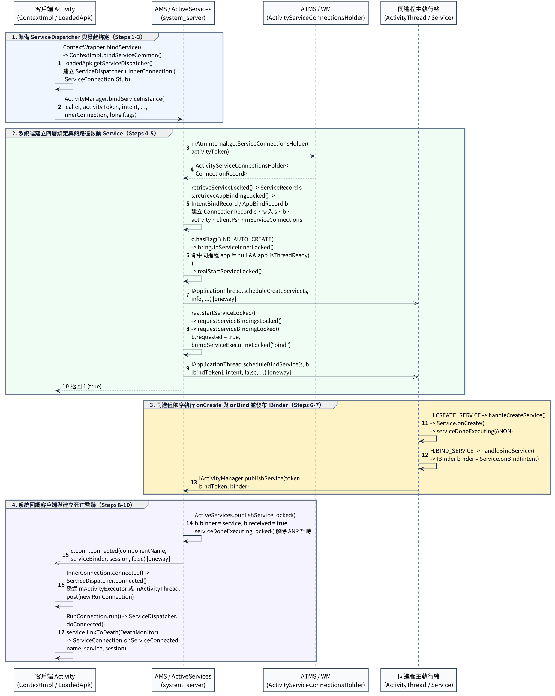

# 8.3 Service 的綁定與回調過程（`bindService`、`ServiceDispatcher`、`publishService` 與 `onServiceConnected`）

- **情景說明**：已運行的 Activity 透過 `bindService(intent, serviceConnection, Context.BIND_AUTO_CREATE)` 綁定同進程內尚未建立的本地 Service。客戶端經由 `LoadedApk.getServiceDispatcher` 將 `ServiceConnection` 封裝為跨進程可傳遞的 `InnerConnection`（`IServiceConnection.Stub`），透過 `IActivityManager.bindServiceInstance` 送交系統端。`ActiveServices.bindServiceLocked` 經由 `ActivityServiceConnectionsHolder` 掛接 Activity 生命週期、建立四層綁定記錄（`ServiceRecord` → `IntentBindRecord` → `AppBindRecord` → `ConnectionRecord`），因帶有 `BIND_AUTO_CREATE` 且命中同進程熱路徑而直接走 `realStartServiceLocked` 派發 `scheduleCreateService` 與 `scheduleBindService`（攜帶 `bindToken`）。同進程主執行緒依序執行 **`Service.onCreate()`** 與 **`Service.onBind()`** 並回報 `publishService`，最後由系統端透過 `IServiceConnection.connected` 回調客戶端 `ServiceDispatcher` 掛載 `DeathMonitor` 並觸發 **`ServiceConnection.onServiceConnected()`**。
- **對應原書**：第 8 章 8.3 節〈在同一个进程中绑定 Service 的过程〉（p.471–493）
- **涉及專案與版本基準**：
  - `platform/frameworks/base` 〔`android-17.0.0_r1`，commit `94b4c163b`〕



---

## 8.3.1 客戶端封裝回調通道：`ContextWrapper` → `ContextImpl.bindServiceCommon` → `LoadedApk.getServiceDispatcher`

> 對應原書 8.3 Step 1–3（p.472–476）。`ServiceConnection` 只是一般 Java 介面，無法直接跨 Binder 傳給 `system_server`。因此客戶端在發送 RPC 之前，必須透過 `LoadedApk` 建立 `ServiceDispatcher` 及其內部 Binder 實體 **`InnerConnection`**，把跨進程回調橋接回指定的 `Handler` 或 `Executor`。

### Step 1：`ContextWrapper.bindService` 與 `ContextImpl.bindServiceCommon`
**位置**：`platform/frameworks/base/core/java/android/content/ContextWrapper.java` 〔`android-17.0.0_r1`，lines 903–925〕

```java
    @Override
    public boolean bindService(Intent service, ServiceConnection conn,
            int flags) {
        return mBase.bindService(service, conn, flags);
    }

    @Override
    public boolean bindService(@NonNull Intent service, @NonNull ServiceConnection conn,
            @NonNull BindServiceFlags flags) {
        return mBase.bindService(service, conn, flags);
    }

    @Override
    public boolean bindService(Intent service, int flags, Executor executor,
            ServiceConnection conn) {
        return mBase.bindService(service, flags, executor, conn);
    }

    @Override
    public boolean bindService(@NonNull Intent service, @NonNull BindServiceFlags flags,
            @NonNull Executor executor, @NonNull ServiceConnection conn) {
        return mBase.bindService(service, flags, executor, conn);
    }
```

所有重載最終都進入 `ContextImpl.bindServiceCommon`：

**位置**：`platform/frameworks/base/core/java/android/app/ContextImpl.java` 〔`android-17.0.0_r1`，lines 2166–2193、2279–2320〕

```java
    @Override
    public boolean bindService(Intent service, ServiceConnection conn, int flags) {
        warnIfCallingFromSystemProcess();
        return bindServiceCommon(service, conn, Integer.toUnsignedLong(flags), null,
                mMainThread.getHandler(), null, getUser());
    }

    @Override
    public boolean bindService(Intent service, ServiceConnection conn,
            @NonNull BindServiceFlags flags) {
        warnIfCallingFromSystemProcess();
        return bindServiceCommon(service, conn, flags.getValue(), null, mMainThread.getHandler(),
                null, getUser());
    }

    @Override
    public boolean bindService(
            Intent service, int flags, Executor executor, ServiceConnection conn) {
        return bindServiceCommon(service, conn, Integer.toUnsignedLong(flags), null, null, executor,
                getUser());
    }
```

```java
    private boolean bindServiceCommon(Intent service, ServiceConnection conn, long flags,
            String instanceName, Handler handler, Executor executor, UserHandle user) {
        // Keep this in sync with DevicePolicyManager.bindDeviceAdminServiceAsUser and
        // ActivityManagerLocal.bindSdkSandboxService
        IServiceConnection sd;
        if (conn == null) {
            throw new IllegalArgumentException("connection is null");
        }
        if (handler != null && executor != null) {
            throw new IllegalArgumentException("Handler and Executor both supplied");
        }
        if (mPackageInfo != null) {
            if (executor != null) {
                sd = mPackageInfo.getServiceDispatcher(conn, getOuterContext(), executor, flags);
            } else {
                sd = mPackageInfo.getServiceDispatcher(conn, getOuterContext(), handler, flags);
            }
        } else {
            throw new RuntimeException("Not supported in system context");
        }
        validateServiceIntent(service);
        try {
            IBinder token = getActivityToken();
            if (token == null && (flags&BIND_AUTO_CREATE) == 0 && mPackageInfo != null
                    && mPackageInfo.getApplicationInfo().targetSdkVersion
                    < android.os.Build.VERSION_CODES.ICE_CREAM_SANDWICH) {
                flags |= BIND_WAIVE_PRIORITY;
            }
            service.prepareToLeaveProcess(this);
            int res = ActivityManager.getService().bindServiceInstance(
                    mMainThread.getApplicationThread(), getActivityToken(), service,
                    service.resolveTypeIfNeeded(getContentResolver()),
                    sd, flags, instanceName, getOpPackageName(), user.getIdentifier());
            if (res < 0) {
                throw new SecurityException(
                        "Not allowed to bind to service " + service);
            }
            return res != 0;
        } catch (RemoteException e) {
            throw e.rethrowFromSystemServer();
        }
    }
```

三個關鍵要點：
1. **64 位元旗標全面統一**：傳統 32 位元 `int flags` 會先以 `Integer.toUnsignedLong(flags)` 擴展為 64 位元 `long`（新版 `Context.BindServiceFlags` 直接攜帶 `long`），以容納超過 32 個綁定旗標（如 `BIND_ALLOW_FREEZE`、`BIND_EXTERNAL_SERVICE_LONG` 等）。
2. **`Handler` vs `Executor` 互斥派發**：傳統 `bindService(intent, conn, flags)` 預設傳入 `mMainThread.getHandler()`，回調永遠落在主執行緒；現代重載則可傳入自訂 `Executor`（此時 `handler == null`），避免主執行緒繁忙延遲回調。
3. **攜帶 `getActivityToken()` 呼叫 `bindServiceInstance`**：當呼叫端是 `Activity` 時，`getActivityToken()` 返回代表該 `ActivityRecord` 的 Binder Token；若由 `Application` 或 `Service` 呼叫則為 `null`。這讓系統端能將此綁定的生命週期與該 Activity 掛鉤。

> 〔與 2.3 差異〕原書 8.3 Step 2（p.473）呼叫 `ActivityManagerNative.getDefault().bindService(...)`（僅支援 32 位元 `int flags` 與主執行緒 `Handler`）；Android 17 升級為 `IActivityManager.bindServiceInstance(...)`，新增 `long flags`、`instanceName`（支援 Isolated / SDK Sandbox 多實例）、`Executor` 回調與 `validateServiceIntent` 顯式意圖檢核。

---

### Step 2：`LoadedApk.getServiceDispatcherCommon` 與 `ServiceDispatcher` / `InnerConnection`
**位置**：`platform/frameworks/base/core/java/android/app/LoadedApk.java` 〔`android-17.0.0_r1`，lines 2159–2195、2260–2322〕

```java
    @UnsupportedAppUsage
    public final IServiceConnection getServiceDispatcher(ServiceConnection c,
            Context context, Handler handler, long flags) {
        return getServiceDispatcherCommon(c, context, handler, null, flags);
    }

    public final IServiceConnection getServiceDispatcher(ServiceConnection c,
            Context context, Executor executor, long flags) {
        return getServiceDispatcherCommon(c, context, null, executor, flags);
    }

    private IServiceConnection getServiceDispatcherCommon(ServiceConnection c,
            Context context, Handler handler, Executor executor, long flags) {
        synchronized (mServices) {
            LoadedApk.ServiceDispatcher sd = null;
            ArrayMap<ServiceConnection, LoadedApk.ServiceDispatcher> map = mServices.get(context);
            if (map != null) {
                if (DEBUG) Slog.d(TAG, "Returning existing dispatcher " + sd + " for conn " + c);
                sd = map.get(c);
            }
            if (sd == null) {
                if (executor != null) {
                    sd = new ServiceDispatcher(c, context, executor, flags);
                } else {
                    sd = new ServiceDispatcher(c, context, handler, flags);
                }
                if (DEBUG) Slog.d(TAG, "Creating new dispatcher " + sd + " for conn " + c);
                if (map == null) {
                    map = new ArrayMap<>();
                    mServices.put(context, map);
                }
                map.put(c, sd);
            } else {
                sd.validate(context, handler, executor);
            }
            return sd.getIServiceConnection();
        }
    }
```

`ServiceDispatcher` 與 `InnerConnection` 的關鍵結構：

```java
    static final class ServiceDispatcher {
        private final ServiceDispatcher.InnerConnection mIServiceConnection;
        @UnsupportedAppUsage(maxTargetSdk = Build.VERSION_CODES.R, trackingBug = 170729553)
        private final ServiceConnection mConnection;
        @UnsupportedAppUsage(maxTargetSdk = Build.VERSION_CODES.P, trackingBug = 115609023)
        private final Context mContext;
        private final Handler mActivityThread;
        private final Executor mActivityExecutor;
        private final ServiceConnectionLeaked mLocation;
        private final long mFlags;
        ...
        private static class InnerConnection extends IServiceConnection.Stub {
            @UnsupportedAppUsage(maxTargetSdk = Build.VERSION_CODES.R, trackingBug = 170729553)
            final WeakReference<LoadedApk.ServiceDispatcher> mDispatcher;

            InnerConnection(LoadedApk.ServiceDispatcher sd) {
                mDispatcher = new WeakReference<LoadedApk.ServiceDispatcher>(sd);
            }

            @Override
            public void connected(ComponentName name, IBinder service, IBinderSession binderSession,
                    boolean dead) throws RemoteException {
                LoadedApk.ServiceDispatcher sd = mDispatcher.get();
                if (sd != null) {
                    sd.connected(name, service, binderSession, dead);
                }
            }
        }
        ...
        ServiceDispatcher(ServiceConnection conn,
                Context context, Handler activityThread, long flags) {
            mIServiceConnection = new InnerConnection(this);
            mConnection = conn;
            mContext = context;
            mActivityThread = activityThread;
            mActivityExecutor = null;
            mLocation = new ServiceConnectionLeaked(null);
            mFlags = flags;
        }
```

這裡有兩個非常經典的記憶體管理設計：
1. **雙層索引 `mServices: ArrayMap<Context, ArrayMap<ServiceConnection, ServiceDispatcher>>`**：以 `outerContext`（例如 Activity 實例）為第一層鍵，讓 `LoadedApk.removeContextRegistrations()` 在 Activity 銷毀時能揪出忘記 `unbindService()` 的殘留連線，並透過建構時捕獲的 **`mLocation = new ServiceConnectionLeaked(null)`** 印出原始綁定呼叫堆疊。
2. **`InnerConnection` 持有 `WeakReference<ServiceDispatcher>`**：因為 `InnerConnection` 是一個跨進程 Binder Stub，會被遠端 `system_server` 強引用（`ConnectionRecord.conn`）。採用弱引用可避免在 `forgetServiceDispatcher()` 移除本地引用後，因遠端尚未 GC 而連帶把整個 `ServiceDispatcher`、`ServiceConnection` 乃至於外部 Activity 實例釘死在記憶體中造成洩漏。

---

## 8.3.2 `system_server` 登記四層綁定模型與熱路徑建程：`AMS.bindServiceInstance` → `ActiveServices.bindServiceLocked`

> 對應原書 8.3 Step 4–8（p.476–482）。系統端收到綁定請求後，先在 AMS 完成參數前檢，接著於 `ActiveServices.bindServiceLocked` 完成 Activity 跨鎖橋接、四層資料結構組裝與 `BIND_AUTO_CREATE` 熱路徑觸發。

### Step 3：`ActivityManagerService.bindServiceInstance` 參數與權限前檢
**位置**：`platform/frameworks/base/services/core/java/com/android/server/am/ActivityManagerService.java` 〔`android-17.0.0_r1`，lines 14744–14795〕

```java
    public int bindServiceInstance(IApplicationThread caller, IBinder token, Intent service,
            String resolvedType, IServiceConnection connection, long flags, String instanceName,
            String callingPackage,
            @CanBeCURRENT @UserIdInt int userId) throws TransactionTooLargeException {
        return bindServiceInstance(caller, token, service, resolvedType, connection, flags,
                instanceName, false, INVALID_UID, null, null, callingPackage, userId);
    }

    private int bindServiceInstance(IApplicationThread caller, IBinder token, Intent service,
            String resolvedType, IServiceConnection connection, long flags, String instanceName,
            boolean isSdkSandboxService, int sdkSandboxClientAppUid,
            String sdkSandboxClientAppPackage,
            IApplicationThread sdkSandboxClientApplicationThread,
            String callingPackage, int userId)
            throws TransactionTooLargeException {
        enforceNotIsolatedCaller("bindService");
        enforceAllowedToStartOrBindServiceIfSdkSandbox(service);
        enforceCallingPackage(callingPackage, Binder.getCallingUid(),
                com.android.server.am.Flags.serviceCheckCallingPkg());

        if (service != null) {
            // Refuse possible leaked file descriptors
            if (service.hasFileDescriptors()) {
                throw new IllegalArgumentException("File descriptors passed in Intent");
            }
            // Remove existing mismatch flag so it can be properly updated later
            service.removeExtendedFlags(Intent.EXTENDED_FLAG_FILTER_MISMATCH);
        }

        if (isSdkSandboxService && instanceName == null) {
            throw new IllegalArgumentException("No instance name provided for isolated process");
        }

        validateServiceInstanceName(instanceName);

        addCreatorToken(service, callingPackage);
        try {
            ...
            synchronized (mGlobalLock) {
                return mServices.bindServiceLocked(caller, token, service, resolvedType, connection,
                        flags, instanceName, isSdkSandboxService, sdkSandboxClientAppUid,
                        sdkSandboxClientAppPackage, sdkSandboxClientApplicationThread,
                        callingPackage, userId);
            }
        } finally {
            Trace.traceEnd(Trace.TRACE_TAG_ACTIVITY_MANAGER);
        }
    }
```

與 `startService` 類似，AMS 在取鎖前完成隔離進程、呼叫套件名、FileDescriptor 檢查與 `validateServiceInstanceName`（核對 `instanceName` 格式合法性），隨後在 `synchronized (mGlobalLock)` 下交由 `ActiveServices.bindServiceLocked` 執行核心邏輯。

---

### Step 4：`ActiveServices.bindServiceLocked`（上）— 跨鎖橋接 Activity 與建立四層綁定記錄
**位置**：`platform/frameworks/base/services/core/java/com/android/server/am/ActiveServices.java` 〔`android-17.0.0_r1`，lines 4199–4226、4313–4333、4397–4436〕

```java
    int bindServiceLocked(IApplicationThread caller, IBinder token, Intent service,
            String resolvedType, final IServiceConnection connection, long flags,
            String instanceName, boolean isSdkSandboxService, int sdkSandboxClientAppUid,
            String sdkSandboxClientAppPackage, IApplicationThread sdkSandboxClientApplicationThread,
            String callingPackage, @CanBeCURRENT @UserIdInt final int userId)
            throws TransactionTooLargeException {
        ...
        final int callingPid = mAm.mInjector.getCallingPid();
        final int callingUid = mAm.mInjector.getCallingUid();
        final ProcessRecord callerApp = mAm.getRecordForAppLOSP(caller);
        if (callerApp == null) {
            throw new SecurityException(
                    "Unable to find app for caller " + caller
                    + " (pid=" + callingPid
                    + ") when binding service " + service);
        }

        ActivityServiceConnectionsHolder<ConnectionRecord> activity = null;
        if (token != null) {
            activity = mAm.mAtmInternal.getServiceConnectionsHolder(token);
            if (activity == null) {
                Slog.w(TAG, "Binding with unknown activity: " + token);
                return 0;
            }
        }
```

接著對特權旗標（如 `BIND_TREAT_LIKE_ACTIVITY`、`BIND_ALLOW_BACKGROUND_ACTIVITY_STARTS`、`BIND_ALLOW_FREEZE` 等）逐一驗證權限，再解析目標 `ServiceRecord` 並建立四層綁定結構：

```java
        ServiceLookupResult res = retrieveServiceLocked(service, instanceName,
                isSdkSandboxService, sdkSandboxClientAppUid, sdkSandboxClientAppPackage,
                resolvedType, callingPackage, callingPid, callingUid, userId, true, callerFg,
                isBindExternal, allowInstant, null /* fgsDelegateOptions */,
                inSharedIsolatedProcess, inPrivateSharedIsolatedProcess, matchQuarantined);
        if (res == null) {
            return 0;
        }
        if (res.record == null) {
            return -1;
        }
        ServiceRecord s = res.record;
        final AppBindRecord b = s.retrieveAppBindingLocked(service, callerApp, attributedApp);
        final ProcessServiceRecord clientPsr = b.client.mServices;
        if (clientPsr.numberOfConnections() >= mAm.mConstants.mMaxServiceConnectionsPerProcess) {
            Slog.w(TAG, "bindService exceeded max service connection number per process, "
                    + "callerApp:" + callerApp.processName
                    + " intent:" + service);
            return 0;
        }
```

其中 `ServiceRecord.retrieveAppBindingLocked` 以 `Intent.FilterComparison` 與 `ProcessRecord` 作為兩層鍵，確保同一組 `(Service, IntentFilter, ClientProcess)` 共享唯一的 `IntentBindRecord` 與 `AppBindRecord`：

**位置**：`platform/frameworks/base/services/core/java/com/android/server/am/ServiceRecord.java` 〔`android-17.0.0_r1`，lines 1523–1538〕

```java
    public @NonNull AppBindRecord retrieveAppBindingLocked(Intent intent,
            @NonNull ProcessRecord app, ProcessRecord attributedApp) {
        Intent.FilterComparison filter = new Intent.FilterComparison(intent);
        IntentBindRecord i = bindings.get(filter);
        if (i == null) {
            i = new IntentBindRecord(this, filter);
            bindings.put(filter, i);
        }
        AppBindRecord a = i.apps.get(app);
        if (a != null) {
            return a;
        }
        a = new AppBindRecord(this, i, app, attributedApp);
        i.apps.put(app, a);
        return a;
    }
```

回到 `ActiveServices.bindServiceLocked`，建立代表本次綁定連線的 `ConnectionRecord c` 並同時掛入五張索引表：

```java
            ConnectionRecord c = new ConnectionRecord(b, activity,
                    connection, flags, clientLabel, clientIntent,
                    callerApp.uid, callerApp.processName, callingPackage, res.aliasComponent);

            IBinder binder = connection.asBinder();
            s.addConnection(binder, c);
            b.connections.add(c);
            if (activity != null) {
                activity.addConnection(c);
            }
            mAm.mProcessStateController.addConnection(clientPsr, c);
            ...
            ArrayList<ConnectionRecord> clist = mServiceConnections.get(binder);
            if (clist == null) {
                clist = new ArrayList<>();
                mServiceConnections.put(binder, clist);
            }
            clist.add(c);
```

五張表各司其職，確保無論哪一方死亡或解綁都能 O(1) 或局部遍歷完成清理：
1. `s.addConnection(binder, c)`（`ServiceRecord.connections`）：Service 發布 `IBinder` 或銷毀時回查所有訂閱連線。
2. `b.connections.add(c)`（`AppBindRecord.connections`）：追蹤該客戶進程對此 `IntentBindRecord` 的連線引用數。
3. `activity.addConnection(c)`（`ActivityServiceConnectionsHolder`）：當 Activity 被銷毀時，由 WM 側透過 `ActivityServiceConnectionsHolder.disconnectActivityFromServices()` 回呼 AM 側自動清理未解綁的連線，**全程無須 AM 直接鎖住 WM 的 `ActivityRecord`**。
4. `mAm.mProcessStateController.addConnection(clientPsr, c)`：將連線登錄至客戶端進程的 `ProcessServiceRecord.mConnections`，作為 OOM adj 傳遞（客戶進程拉抬服務進程優先級）與進程死亡清理的依據。
5. `mServiceConnections.put(binder, clist)`：日後呼叫 `unbindService(IServiceConnection)` 時，直接用 `connection.asBinder()` 在全局表反查對應的 `ConnectionRecord`。

> 〔與 2.3 差異〕原書 8.3 Step 5（p.477–478）在 AMS 內直接查找 `ActivityRecord`（原書稱 `HistoryRecord`）並寫入 `activity.connections.add(c)`；Android 17 因 Activity 遷往 ATMS/WM，改以 `mAtmInternal.getServiceConnectionsHolder(token)` 取得 `ActivityServiceConnectionsHolder<ConnectionRecord>`，徹底解耦 AM/WM 鎖層級，同時新增每進程連線上限 `mMaxServiceConnectionsPerProcess` 防護。

---

### Step 5：`ActiveServices.bindServiceLocked`（下）— `BIND_AUTO_CREATE` 命中同進程熱路徑
**位置**：`platform/frameworks/base/services/core/java/com/android/server/am/ActiveServices.java` 〔`android-17.0.0_r1`，lines 4437–4486、4548–4589〕

```java
            final boolean isolated = (s.serviceInfo.flags & ServiceInfo.FLAG_ISOLATED_PROCESS) != 0;
            final ProcessRecord hostApp = isolated
                    ? null
                    : mAm.getProcessRecordLocked(s.processName, getServiceUid(s));
            final int serviceBindingOomAdjPolicy = hostApp != null
                    ? getServiceBindingOomAdjPolicyForAddLocked(b.client, hostApp, c)
                    : SERVICE_BIND_OOMADJ_POLICY_LEGACY;
            if (batch != null && (serviceBindingOomAdjPolicy
                    & SERVICE_BIND_OOMADJ_POLICY_SKIP_OOM_UPDATE_ON_CONNECT) != 0) {
                // Batch session is active and this binding won't affect the service host process's
                // importance. Mark the service host process as skippable for the session.
                batch.skipProcDueToServiceBindPolicy(hostApp);
            }
            ...
            boolean needOomAdj = false;
            if (c.hasFlag(Context.BIND_AUTO_CREATE)) {
                mAm.mProcessStateController.setServiceLastActivityTime(s,
                        SystemClock.uptimeMillis());
                needOomAdj = (serviceBindingOomAdjPolicy
                        & SERVICE_BIND_OOMADJ_POLICY_SKIP_OOM_UPDATE_ON_CREATE) == 0;
                if (bringUpServiceLocked(s, service.getFlags(), callerFg, false,
                        permissionsReviewRequired, packageFrozen, true, serviceBindingOomAdjPolicy)
                        != null) {
                    if (Flags.pscBatchServiceUpdates()) {
                        // Do nothing. The ProcessStateController BatchSession close
                        // would have triggered the update.
                    } else {
                        mAm.updateOomAdjPendingTargetsLocked(OOM_ADJ_REASON_BIND_SERVICE);
                    }
                    return 0;
                }
            }
```

在本節「同進程綁定」情景中，客戶端 Activity 與目標 Service 同屬一個 `ProcessRecord`（`clientApp == hostApp`），因此發生了兩個與 8.2 截然不同的分支：
1. **同進程 OOM adj 免算最佳化**：`getServiceBindingOomAdjPolicyForAddLocked` 偵測到 `clientApp == hostApp`，回傳 `DEFAULT_SERVICE_NO_BUMP_BIND_POLICY_FLAG`（跳過無意義的自我優先級重算，大幅減少 OOM adj 計算開銷）。
2. **命中既有進程熱路徑**：`bringUpServiceLocked` → `bringUpServiceInnerLocked`（見 8.2 Step 6 lines 6251–6268）呼叫 `mAm.getProcessRecordLocked(procName, uid)` 時，**直接命中當前已啟動的 `ProcessRecord app` 且 `app.isThreadReady() == true`**，因此不走 Zygote 建程，也不入列 `mPendingServices`，而是直接同步進入 **`realStartServiceLocked(...)`**！

在 `realStartServiceLocked` 內部：
- 先發送 `thread.scheduleCreateService(s, ...)`（觸發 `Service.onCreate()`）；
- 緊接著呼叫 **`requestServiceBindingsLocked(s, ...)`**（見下一步 Step 6），此時 `b.intent.requested` 被設為 `true` 並發送 `scheduleBindService`；
- 因為是純綁定情景（`s.pendingStarts` 為空），`sendServiceArgsLocked` 直接返回，不會觸發 `onStartCommand()`。

當 `bringUpServiceLocked` 返回 `bindServiceLocked` 後，最後一段分流如下：

```java
            if (s.getHostProcess() != null && b.intent.received) {
                // Service is already running, so we can immediately
                // publish the connection.
                final ComponentName clientSideComponentName =
                        res.aliasComponent != null ? res.aliasComponent : s.name;
                final IBinderSession session =
                        mAm.mProcessStateController.getBoundServiceSessionFor(c);
                ...
                try {
                    IBinder serviceBinder = createPccProxyIfNeeded(c, b.intent.binder);

                    c.conn.connected(clientSideComponentName, serviceBinder, session, false);
                } catch (Exception e) {
                    ...
                }
                ...
                if (b.intent.apps.size() == 1 && b.intent.doRebind) {
                    requestServiceBindingLocked(s, b.intent, callerFg, true,
                            serviceBindingOomAdjPolicy);
                }
            } else if (!b.intent.requested) {
                requestServiceBindingLocked(s, b.intent, callerFg, false,
                        serviceBindingOomAdjPolicy);
            }
```

留意這兩條分支的精巧配合：
- **情境 A（本節情景：Service 剛由 `bringUpServiceLocked` 建立）**：`realStartServiceLocked` 內已經呼叫 `requestServiceBindingsLocked` 並把 `b.intent.requested` 設為 `true`，此時 `b.intent.received` 仍為 `false`（客戶端還沒執行 `onBind()`），因此兩條分支都不會重複觸發。
- **情境 B（Service 早已被 `startService` 啟動，首次被此 Intent 綁定）**：`bringUpServiceLocked` 看到 `s.getHostProcess().isThreadReady()` 直接返回，此時 `b.intent.received == false && !b.intent.requested`，便由 `else if` 分支補發 `requestServiceBindingLocked`。
- **情境 C（同 Intent 已被其他客戶端綁定過且已發布 `IBinder`）**：`b.intent.received == true`，**不需要再次呼叫 `Service.onBind()`**，直接取出快取的 `b.intent.binder` 呼叫 `c.conn.connected(...)` 立刻通知新客戶端！這正是 Android 文件所說「同一個 `Intent`（依 `FilterComparison` 比對）只會觸發一次 `onBind()`」的底層機制。

---

## 8.3.3 請求綁定與發布 `IBinder`：`requestServiceBindingsLocked` → `handleBindService` → `publishService`

> 對應原書 8.3 Step 8–13（p.482–487）。系統端透過 `scheduleBindService` 通知 Service 進程執行 `onBind()`，並將 `IntentBindRecord` 本身作為 `IBinder bindToken` 傳遞過去，供 `publishService` 精準回傳。

### Step 6：`ActiveServices.requestServiceBindingsLocked` 與 `requestServiceBindingLocked`
**位置**：`platform/frameworks/base/services/core/java/com/android/server/am/ActiveServices.java` 〔`android-17.0.0_r1`，lines 6417–6426、5598–5651〕

```java
    private void requestServiceBindingsLocked(ServiceRecord r, boolean execInFg,
            @ServiceBindingOomAdjPolicy int serviceBindingOomAdjPolicy)
            throws TransactionTooLargeException {
        for (int i=r.bindings.size()-1; i>=0; i--) {
            IntentBindRecord ibr = r.bindings.valueAt(i);
            if (!requestServiceBindingLocked(r, ibr, execInFg, false, serviceBindingOomAdjPolicy)) {
                break;
            }
        }
    }
```

```java
    private final boolean requestServiceBindingLocked(ServiceRecord r, IntentBindRecord b,
            boolean execInFg, boolean rebind,
            @ServiceBindingOomAdjPolicy int serviceBindingOomAdjPolicy)
            throws TransactionTooLargeException {
        if (r.getHostProcess() == null || r.getHostProcess().getThread() == null) {
            // If service is not currently running, can't yet bind.
            return false;
        }
        if (DEBUG_SERVICE) Slog.d(TAG_SERVICE, "requestBind " + b + ": requested=" + b.requested
                + " rebind=" + rebind);
        final boolean skipOomAdj = (serviceBindingOomAdjPolicy
                & SERVICE_BIND_OOMADJ_POLICY_SKIP_OOM_UPDATE_ON_BIND) != 0;
        if ((!b.requested || rebind) && b.apps.size() > 0) {
            try (SyncBatchSession batch = mAm.mProcessStateController.startServiceBatchSession(
                    OOM_ADJ_REASON_BIND_SERVICE)) {
                final boolean skipTimeout = skipOomAdj;
                bumpServiceExecutingLocked(r, execInFg, "bind",
                        skipOomAdj ? OOM_ADJ_REASON_NONE : OOM_ADJ_REASON_BIND_SERVICE,
                        skipTimeout, serviceBindingOomAdjPolicy);
                ...
                if (batch != null && !skipOomAdj) {
                    // Must trigger the update before the scheduleBindService IPC is sent out, so
                    // that the process is in correct state before it tries to do anything.
                    batch.triggerUpdate(OOM_ADJ_REASON_BIND_SERVICE);
                }
                r.getHostProcess().getThread().scheduleBindService(r, b, b.intent.getIntent(),
                        rebind, r.getHostProcess().getReportedProcState(),
                        mBindServiceSeqCounter++);
                if (!rebind) {
                    b.requested = true;
                }
                b.hasBound = true;
                b.doRebind = false;
            } catch (TransactionTooLargeException e) {
                ...
                throw e;
            } catch (RemoteException e) {
                ...
                return false;
            }
        }
        return true;
    }
```

細看第 5626 行 `scheduleBindService(r, b, b.intent.getIntent(), rebind, ...)` 的第二個參數：
- 8.1 節已見過 **`IntentBindRecord extends Binder`**，因此系統端直接把 `b` 當成 `IBinder bindToken` 傳給應用端；
- 同時附上單調遞增的 `mBindServiceSeqCounter++`（`bindSeq`），供系統追蹤（Perfetto / Trace）精準配對每次綁定事件；
- 在發出 `oneway` RPC 之前，同樣先呼叫 `bumpServiceExecutingLocked(r, execInFg, "bind", ...)` 記錄執行中狀態與 ANR 計時，待日後應用端回呼 `publishService` 時才在 `publishServiceLocked` 裡解除。

> 〔與 2.3 差異〕原書 8.3 Step 8（p.482–483）的 `scheduleBindService(r, b.intent.getIntent(), rebind)` 沒有 `bindToken`、`processState` 與 `bindSeq`；Android 17 讓 `IntentBindRecord` 直接繼承 `Binder` 充當 `bindToken`，在回調 `publishService` 時 O(1) 強轉定位，省去 `Intent.FilterComparison` 反查與比對失配風險。

---

### Step 7：`ApplicationThread.scheduleBindService` 與 `ActivityThread.handleBindService`
**位置**：`platform/frameworks/base/core/java/android/app/ActivityThread.java` 〔`android-17.0.0_r1`，lines 1325–1349、2813–2833、5661–5692〕

Binder 執行緒收到 `scheduleBindService` 後封裝 `BindServiceData` 投遞 `H.BIND_SERVICE`：

```java
        @Override
        public final void scheduleBindService(IBinder token, IBinder bindToken, Intent intent,
                boolean rebind, int processState, long bindSeq) {
            updateProcessState(processState, false);
            BindServiceData s = new BindServiceData();
            s.token = token;
            s.bindToken = bindToken;
            s.intent = intent;
            s.rebind = rebind;
            s.bindSeq = bindSeq;
            ...
            sendMessage(H.BIND_SERVICE, s);
        }
```

主執行緒 `H` 在完成先前的 `CREATE_SERVICE`（`handleCreateService` → `Service.onCreate()`）後，緊接著取出 `BIND_SERVICE` 執行 `handleBindService`：

```java
                case BIND_SERVICE:
                    ...
                    BindServiceData bindData = (BindServiceData) msg.obj;
                    ...
                    try {
                        handleBindService(bindData);
                    } finally {
                        Trace.traceEnd(Trace.TRACE_TAG_ACTIVITY_MANAGER);
                        ...
                    }
                    break;
```

```java
    private void handleBindService(BindServiceData data) {
        CreateServiceData createData = mServicesData.get(data.token);
        Service s = mServices.get(data.token);
        if (DEBUG_SERVICE)
            Slog.v(TAG, "handleBindService s=" + s + " rebind=" + data.rebind);
        if (s != null) {
            try {
                data.intent.setExtrasClassLoader(s.getClassLoader());
                data.intent.prepareToEnterProcess(isProtectedComponent(createData.info),
                        s.getAttributionSource());
                try {
                    if (!data.rebind) {
                        IBinder binder = s.onBind(data.intent);
                        ActivityManager.getService().publishService(
                                data.token, data.bindToken, binder);
                    } else {
                        s.onRebind(data.intent);
                        ActivityManager.getService().serviceDoneExecuting(
                                data.token, SERVICE_DONE_EXECUTING_REBIND, 0, 0);
                    }
                } catch (RemoteException ex) {
                    throw ex.rethrowFromSystemServer();
                }
            } catch (Exception e) {
                if (!mInstrumentation.onException(s, e)) {
                    throw new RuntimeException(
                            "Unable to bind to service " + s
                            + " with " + data.intent, e);
                }
            }
        }
    }
```

關鍵觀察：
- `mServices.get(data.token)` 取回的正是剛剛在 `handleCreateService` 存入的本地 Service 實例（例如原書的 `CounterService`）。
- 初次綁定時 `data.rebind == false`：呼叫 **`IBinder binder = s.onBind(data.intent)`**，並將取回的 `binder` 連同 `data.token`（`ServiceRecord`）與 `data.bindToken`（`IntentBindRecord`）透過 **`publishService`** 回傳 `system_server`。注意此分支**不另外呼叫** `serviceDoneExecuting()`，因為 `publishServiceLocked` 內部就會順帶結算 ANR 計時。
- 若曾有 `onUnbind()` 回傳 `true` 後再次綁定（`data.rebind == true`），則呼叫 `s.onRebind(data.intent)`，並改由 `serviceDoneExecuting(..., SERVICE_DONE_EXECUTING_REBIND, ...)` 解除 ANR 計時。

---

## 8.3.4 系統廣播與客戶端分發回調：`publishServiceLocked` → `InnerConnection` → `ServiceConnection.onServiceConnected`

> 對應原書 8.3 Step 14–20（p.487–493）。`publishService` 抵達 `system_server` 後，系統將 `IBinder` 快取進 `IntentBindRecord` 並逐一喚起訂閱該 `Intent` 的所有 `IServiceConnection`，最終在客戶端建立死亡監聽（`DeathMonitor`）並觸發 `ServiceConnection.onServiceConnected()`。

### Step 8：`AMS.publishService` 與 `ActiveServices.publishServiceLocked`
**位置**：`platform/frameworks/base/services/core/java/com/android/server/am/ActivityManagerService.java` 〔`android-17.0.0_r1`，lines 14838–14851〕

```java
    public void publishService(IBinder token, IBinder bindToken, IBinder service) {
        if (!(token instanceof ServiceRecord)) {
            throw new IllegalArgumentException("Invalid service token");
        }

        if (!(bindToken instanceof IntentBindRecord)) {
            throw new IllegalArgumentException("Invalid intent bind record");
        }

        synchronized(this) {
            mServices.publishServiceLocked((ServiceRecord) token, (IntentBindRecord) bindToken,
                    service);
        }
    }
```

請留意第 14839 與 14843 行的精妙 Binder 特性：當 `ServiceRecord` 與 `IntentBindRecord` 跨越 IPC 到應用端再傳回 `system_server` 時，Binder 驅動偵測到目標是本地實例，會直接還原為原始 Java 物件參考，因此 `instanceof` 檢查能同時驗證合法性（防偽造）並做到 O(1) 定位，完全無需雜湊查詢！

接著進入 `ActiveServices.publishServiceLocked`：

**位置**：`platform/frameworks/base/services/core/java/com/android/server/am/ActiveServices.java` 〔`android-17.0.0_r1`，lines 4628–4690〕

```java
    void publishServiceLocked(ServiceRecord r, IntentBindRecord b, IBinder service) {
        final long origId = mAm.mInjector.clearCallingIdentity();
        try {
            if (DEBUG_SERVICE) Slog.v(TAG_SERVICE, "PUBLISHING " + r
                    + " " + b.intent.getIntent() + ": " + service);
            if (r != null) {
                if (b != null && !b.received) {
                    b.binder = service;
                    b.requested = true;
                    b.received = true;
                    ArrayMap<IBinder, ArrayList<ConnectionRecord>> connections = r.getConnections();
                    for (int conni = connections.size() - 1; conni >= 0; conni--) {
                        ArrayList<ConnectionRecord> clist = connections.valueAt(conni);
                        for (int i=0; i<clist.size(); i++) {
                            ConnectionRecord c = clist.get(i);
                            if (!b.intent.equals(c.binding.intent.intent)) {
                                ...
                                continue;
                            }
                            ...
                            // If what the client try to start/connect was an alias, then we need to
                            // pass the alias component name instead to the client.
                            final ComponentName clientSideComponentName =
                                    c.aliasComponent != null ? c.aliasComponent : r.name;
                            final IBinderSession session =
                                    mAm.mProcessStateController.getBoundServiceSessionFor(c);
                            ...
                            try {
                                IBinder serviceBinder = createPccProxyIfNeeded(c, service);

                                c.conn.connected(clientSideComponentName, serviceBinder, session,
                                        false);
                            } catch (Exception e) {
                                Slog.w(TAG, "Failure sending service " + r.shortInstanceName
                                      + " to connection " + c.conn.asBinder()
                                      + " (in " + c.binding.client.processName + ")", e);
                            } finally {
                                if (enablePccFrameworkSupport()) {
                                    Trace.traceEnd(Trace.TRACE_TAG_ACTIVITY_MANAGER);
                                }
                            }
                        }
                    }
                }

                serviceDoneExecutingLocked(r, mDestroyingServices.contains(r), false, false,
                        r.wasOomAdjUpdated() ? OOM_ADJ_REASON_EXECUTING_SERVICE
                                : OOM_ADJ_REASON_NONE);
            }
        } finally {
            mAm.mInjector.restoreCallingIdentity(origId);
        }
    }
```

重點如下：
1. **寫入快取並廣播等待者**：設 `b.binder = service` 與 `b.received = true`，遍歷 `r.getConnections()` 中所有綁定該 `b.intent` 的 `ConnectionRecord c`，逐一呼叫 **`c.conn.connected(clientSideComponentName, serviceBinder, session, false)`**（`oneway` IPC）。
2. **`IBinderSession` 支援 Freezer 解凍會話**：若該綁定帶有 `BIND_ALLOW_FREEZE` / `BIND_SIMULATE_ALLOW_FREEZE`，系統會透過 `getBoundServiceSessionFor(c)` 附帶 `IBinderSession` 給客戶端，讓客戶端在對已凍結的遠端服務發送 Binder 請求前臨時解凍對方（一般同進程／預設綁定下 `session` 為 `null`）。
3. **同進程 `IBinder` 零序列化直傳**：因為在本節情景中，Service 與客戶端 Activity 位於**同一個進程**，當 `service`（例如 `CounterService` 內部的本地 `Binder` 子類）先由該進程經 `publishService` 傳進 `system_server`、再經 `c.conn.connected` 傳回同一進程時，Binder 驅動偵測到目標進程正是該 Binder 實體的宿主進程，因此客戶端收到的 `IBinder` **直接就是同一個 Java 本地物件參考**，不需走跨進程 `BinderProxy` 序列化，可直接向下轉型呼叫本地方法！
4. **解除 ANR 計時**：方法尾端呼叫 `serviceDoneExecutingLocked`，結算 Step 6 `bumpServiceExecutingLocked(..., "bind", ...)` 埋下的計時器。

> 〔與 2.3 差異〕原書 8.3 Step 14–15（p.487–488）的 `publishService(IBinder token, Intent intent, IBinder service)` 必須在 `publishServiceLocked` 中以 `new Intent.FilterComparison(intent)` 查表找 `IntentBindRecord`，且 `c.conn.connected(r.name, service)` 僅兩個參數；Android 17 直接用 `IntentBindRecord` 作為 `bindToken`，並新增 `aliasComponent`、`IBinderSession`（Freezer）、PCC Proxy 與 `dead` 旗標。

---

### Step 9：`InnerConnection.connected` → `ServiceDispatcher.connected` → `RunConnection`
**位置**：`platform/frameworks/base/core/java/android/app/LoadedApk.java` 〔`android-17.0.0_r1`，lines 2288–2295、2381–2390、2476–2500〕

客戶端進程的 Binder 執行緒收到 `IServiceConnection.connected` 後，由 `InnerConnection` 經弱引用轉交 `ServiceDispatcher.connected`：

```java
            @Override
            public void connected(ComponentName name, IBinder service, IBinderSession binderSession,
                    boolean dead) throws RemoteException {
                LoadedApk.ServiceDispatcher sd = mDispatcher.get();
                if (sd != null) {
                    sd.connected(name, service, binderSession, dead);
                }
            }
```

```java
        public void connected(ComponentName name, IBinder service, IBinderSession session,
                boolean dead) {
            if (mActivityExecutor != null) {
                mActivityExecutor.execute(new RunConnection(name, service, session, 0, dead));
            } else if (mActivityThread != null) {
                mActivityThread.post(new RunConnection(name, service, session, 0, dead));
            } else {
                doConnected(name, service, session, dead);
            }
        }
```

```java
        private final class RunConnection implements Runnable {
            RunConnection(ComponentName name, IBinder service, IBinderSession session, int command,
                    boolean dead) {
                mName = name;
                mService = service;
                mBinderSession = session;
                mCommand = command;
                mDead = dead;
            }

            @Override
            public void run() {
                if (mCommand == 0) {
                    doConnected(mName, mService, mBinderSession, mDead);
                } else if (mCommand == 1) {
                    doDeath(mName, mService);
                }
            }

            final ComponentName mName;
            final IBinder mService;
            final IBinderSession mBinderSession;
            final int mCommand;
            final boolean mDead;
        }
```

這裡完成了從「Binder 執行緒」到「目標回調執行緒」的切換：
- 若發起綁定時傳入 `Executor`，直接交給 `mActivityExecutor.execute(...)`；
- 傳統呼叫（本節情景）則透過 `mActivityThread.post(new RunConnection(..., 0, dead))` 投遞回主執行緒 `MessageQueue`（`mCommand == 0` 代表連線建立，`mCommand == 1` 代表遠端死亡通知）。

---

### Step 10：`ServiceDispatcher.doConnected` 掛載 `DeathMonitor` 與觸發 `ServiceConnection.onServiceConnected`
**位置**：`platform/frameworks/base/core/java/android/app/LoadedApk.java` 〔`android-17.0.0_r1`，lines 2402–2459、2502–2516〕

```java
        public void doConnected(ComponentName name, IBinder service, IBinderSession session,
                boolean dead) {
            ServiceDispatcher.ConnectionInfo old;
            ServiceDispatcher.ConnectionInfo info;

            synchronized (this) {
                if (mForgotten) {
                    // We unbound before receiving the connection; ignore
                    // any connection received.
                    return;
                }
                old = mActiveConnections.get(name);
                if (old != null && old.binder == service) {
                    // Huh, already have this one.  Oh well!
                    return;
                }

                if (service != null) {
                    // A new service is being connected... set it all up.
                    info = new ConnectionInfo();
                    info.binder = service;
                    info.deathMonitor = new DeathMonitor(name, service);
                    try {
                        service.linkToDeath(info.deathMonitor, 0);
                        mActiveConnections.put(name, info);
                    } catch (RemoteException e) {
                        // This service was dead before we got it...  just
                        // don't do anything with it.
                        mActiveConnections.remove(name);
                        return;
                    }

                } else {
                    // The named service is being disconnected... clean up.
                    mActiveConnections.remove(name);
                }

                if (old != null) {
                    old.binder.unlinkToDeath(old.deathMonitor, 0);
                }
            }

            // If there was an old service, it is now disconnected.
            if (old != null) {
                mConnection.onServiceDisconnected(name);
            }
            if (dead) {
                mConnection.onBindingDied(name);
            } else {
                // If there is a new viable service, it is now connected.
                if (service != null) {
                    mConnection.onServiceConnected(name, service, session);
                } else {
                    // The binding machinery worked, but the remote returned null from onBind().
                    mConnection.onNullBinding(name);
                }
            }
        }
```

其中 `DeathMonitor` 與 `ServiceConnection` 的四個現代生命週期回呼對應如下：

```java
        private final class DeathMonitor implements IBinder.DeathRecipient
        {
            DeathMonitor(ComponentName name, IBinder service) {
                mName = name;
                mService = service;
            }

            @Override
            public void binderDied() {
                death(mName, mService);
            }

            final ComponentName mName;
            final IBinder mService;
        }
```

**位置**：`platform/frameworks/base/core/java/android/content/ServiceConnection.java` 〔`android-17.0.0_r1`，lines 48、69–76、104–105、121–122〕

```java
    void onServiceConnected(ComponentName name, IBinder service);
    ...
    default void onServiceConnected(ComponentName name, IBinder service,
            @Nullable IBinderSession binderSession) {
        if (binderSession != null) {
            final String tag = getClass().getSimpleName();
            Log.w(tag, "Binder session present but potentially unused for binding to " + name);
        }
        onServiceConnected(name, service);
    }
    ...
    default void onBindingDied(ComponentName name) {
    }
    ...
    default void onNullBinding(ComponentName name) {
    }
```

`doConnected` 處理了四種完整邊界情況，並將鎖內狀態更新與鎖外使用者回調乾淨分離（避免在持有 `synchronized (this)` 時執行 App 程式碼導致死鎖）：
1. **競態防護（`mForgotten`）**：若客戶端在收到回調前已經呼叫 `unbindService()`（`forgetServiceDispatcher` 會將 `mForgotten = true`），直接靜默丟棄，保證不會在解綁後還收到遲到的 `onServiceConnected()`。
2. **死亡監聽（`linkToDeath`）**：對收到的 `service` 註冊 `DeathMonitor`（跨進程綁定時，遠端 Service 進程崩潰會立即透過 Binder 驅動觸發 `binderDied()` → `death()` → `doDeath()` → `onServiceDisconnected()`；同進程本地 `Binder` 的 `linkToDeath()` 則是無操作 no-op）。
3. **四種精細回調語意**：
   - `dead == true`：綁定已永久失效（例如目標 App 更新或永久停止），呼叫 **`onBindingDied(name)`**；
   - `dead == false && service != null`：正常連線成功，呼叫三參數預設方法 `onServiceConnected(name, service, session)`，轉呼開發者覆寫的 **`onServiceConnected(name, service)`**；
   - `dead == false && service == null`：目標 Service 的 `onBind()` 明確回傳 `null`，呼叫 **`onNullBinding(name)`**，明確告知客戶端此綁定不會有後續連線（提示應呼叫 `unbindService()` 釋放資源）。

> 〔與 2.3 差異〕原書 8.3 Step 19–20（p.491–493）的 `ServiceDispatcher.doConnected` 只有 `onServiceConnected(name, service)` 與 `onServiceDisconnected(name)` 兩個回呼，若 `onBind()` 回傳 `null` 客戶端只能無限期乾等；Android 17 補齊了 `onBindingDied`、`onNullBinding` 與支援 Freezer 的三參數 `onServiceConnected(name, service, binderSession)`，並支援透過自訂 `Executor` 派發回調。

---

## 8.3.5 本節小結：同進程綁定與跨進程綁定的對照

透過本節 10 個步驟，我們看清了 `bindService` 如何以「四層綁定模型 + `ServiceDispatcher`」構成雙向閉環：

| 觀察面向 | 同進程綁定（本節情景） | 跨進程綁定（冷啟動遠端進程） |
|---|---|---|
| **進程查詢（`bringUpServiceInnerLocked`）** | 命中 `app != null && app.isThreadReady()` → 直接同步走 `realStartServiceLocked` | `app == null` → 呼叫 `startProcessLocked` 並掛入 `mPendingServices`，等新進程 `attachApplication` 後才走 `realStartServiceLocked` |
| **OOM adj 計算策略** | `clientApp == hostApp` 觸發 `DEFAULT_SERVICE_NO_BUMP_BIND_POLICY_FLAG`，跳過自我重算 | 由 `OomAdjuster.evaluateServiceConnectionAdd` 依綁定旗標傳遞客戶端優先級並拉升遠端進程 |
| **`onBind()` 取得的 `IBinder` 型別** | 經過 `system_server` 折返同進程後，Binder 驅動還原為原始本地 Java `Binder` 物件參考，可直接轉型呼叫 | 客戶端收到 `BinderProxy`，需透過 AIDL `Stub.asInterface(service)` 封裝跨進程代理 |
| **崩潰感知（`DeathMonitor`）** | 同進程共生共死，`Binder.linkToDeath()` 為 no-op | 遠端進程崩潰時由核心 Binder 驅動觸發 `DeathMonitor.binderDied()` → `onServiceDisconnected()` |
| **Activity 銷毀自動防洩漏** | 兩者皆透過 `ActivityServiceConnectionsHolder`（WM 側）與 `LoadedApk.mServices`（客戶端）雙向追蹤，未 `unbindService` 將回報 `ServiceConnectionLeaked` 並強制清理 | 同左 |

至此，第 8 章「Service 在新進程中的啟動（`startService` / `startForegroundService`）」與「Service 在同進程中的綁定（`bindService`）」兩條核心情景已全面貫通。下一章（第 9 章）將進入四大組件中著重非同步事件廣播的 Broadcast 機制，剖析 Android 17 全新重寫的現代 `BroadcastQueueModernImpl` 派發引擎。
