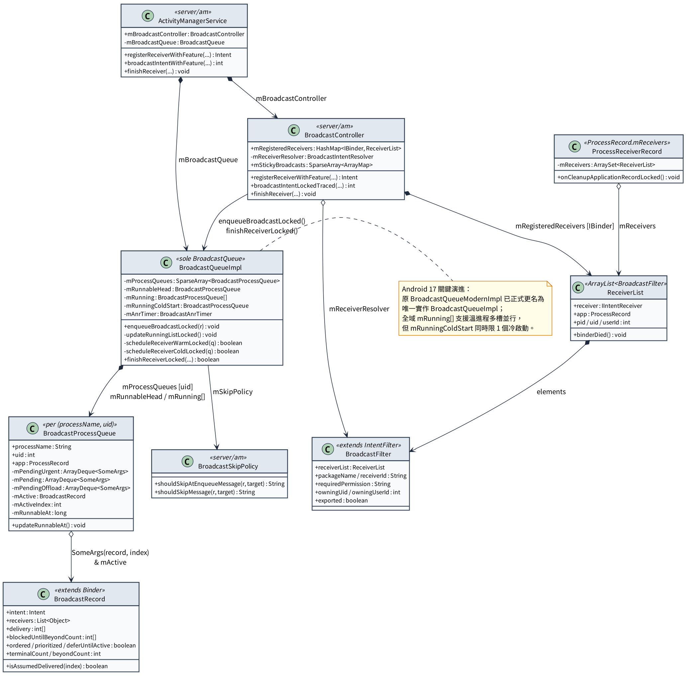
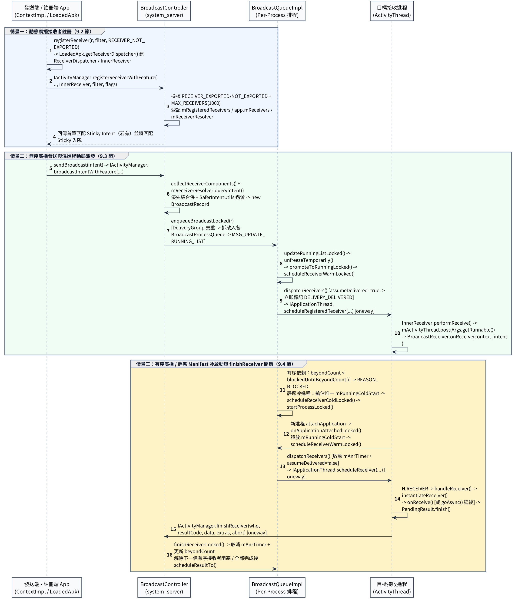

# 9.1 現代廣播系統架構、資料模型與核心情景（`BroadcastController`、`BroadcastQueueImpl` 與 Per-Process 佇列）

- **情景說明**：廣播（Broadcast）是 Android 四大組件中實現「發布／訂閱（Pub/Sub）」解耦通訊的核心機制——發送者無須事先持有接收者的 Binder 代理或知道接收者是否存在，只要透過 `ActivityManagerService`（AMS）這座中央路由中心，就能跨進程或同進程投遞事件。本節延續原書 `Broadcounter` 實例，並補足有序廣播與靜態接收者冷啟動對照，先確立貫穿本章的三大情景，再解剖 Android 17 重構後的 **`BroadcastController` + 單一 `BroadcastQueueImpl` + Per-Process `BroadcastProcessQueue`** 全景架構：
  1. **情景一（動態接收者註冊與註銷，見 9.2 節）**：前景 Activity 呼叫 `registerReceiver(counterActionReceiver, filter, Context.RECEIVER_NOT_EXPORTED)` 訂閱自訂廣播（同時對照 `receiver == null` 讀取黏性廣播的 `BroadcastStickyCache` 快路徑）→ `LoadedApk.ReceiverDispatcher` 封裝 Binder 存根 `InnerReceiver` → `BroadcastController` 強制檢核匯出旗標並登記至 `mRegisteredReceivers`、`app.mReceivers` 與 `mReceiverResolver`；
  2. **情景二（無序廣播發送與溫進程動態派發，見 9.3 節）**：`CounterService` 呼叫 `sendBroadcast(intent)` → `BroadcastController` 解析合併接收者並建立 `BroadcastRecord` → `BroadcastQueueImpl` 將目標接收者拆散投入各進程的 `BroadcastProcessQueue`，以 `runnableAt` 排序與並發槽 `mRunning[]` 派發 → 因無序動態接收者滿足 `assumeDelivered`，送出 `IApplicationThread.scheduleRegisteredReceiver` 後即刻結案，客戶端經 `ReceiverDispatcher` 投遞主執行緒執行 **`BroadcastReceiver.onReceive()`**；
  3. **情景三（有序廣播、靜態 `<receiver>` 冷啟動與 `finishReceiver` 閉環，見 9.4 節）**：有序廣播跨多個進程以 `BroadcastRecord.blockedUntilBeyondCount[]` 維持先後依賴並支援 `abortBroadcast()` 與最終 `resultTo`；靜態 Manifest `<receiver>` 命中尚未運行的冷進程時，搶佔全域唯一的 `mRunningColdStart` 槽冷啟進程，待 `onApplicationAttachedLocked` 後以 `scheduleReceiver` 啟動 **`BroadcastAnrTimer`** 並要求 App 透過 `PendingResult.finish()`（含 `goAsync()`）回報 `AMS.finishReceiver`。
- **對應原書**：第 9 章引言與 9.1 節〈广播机制应用实例〉（p.494–501）
- **涉及專案與版本基準**：
  - `platform/frameworks/base` 〔`android-17.0.0_r1`，commit `94b4c163b`〕

---

## 9.1.1 三大核心情景與現代廣播系統座標

> 對應原書 9.1（p.494–501）。原書第 8 章的 `Counter` 應用程式讓 `CounterService` 直接依賴 `Counter` 提供的 `ICounterCallback` 回調介面；到了第 9 章，原書將其改寫為 `Broadcounter`——`CounterService` 改發 `BROADCAST_COUNTER_ACTION` 廣播，而 `Broadcounter` Activity 動態註冊 `counterActionReceiver` 訂閱更新，徹底解除 Service 對 Activity 的強耦合。

從 Android 2.3 演進至 Android 17，廣播在應用層的 Pub/Sub 心智模型不變，但系統端歷經了翻天覆地的重構：早期（含 Android 2.3 的全域 `mParallelBroadcasts`/`mOrderedBroadcasts`，以及 Android 4–13 的 fg/bg 雙全域 FIFO 佇列）只要單一卡頓進程拖慢有序或靜態廣播，整條全域佇列就會產生嚴重的「隊頭阻塞（Head-of-Line Blocking）」。為此，AOSP 設計了以 **Per-Process 佇列** 為核心的現代廣播佇列（原稱 `BroadcastQueueModernImpl`；在 Android 17 舊版佇列已完全刪除，直接成為唯一的 `BroadcastQueueImpl`），詳見系統內建設計文件 `services/core/java/com/android/server/am/BroadcastQueue.md`。

貫穿本章的三大情景核心路徑對照如下（可透過 `adb shell dumpsys activity broadcasts` 檢視各 `BroadcastProcessQueue`、`ReceiverList` 與 `BroadcastHistory`）：

| 維度 | 情景一：動態註冊（9.2 節） | 情景二：無序動態派發（9.3 節） | 情景三：有序／靜態冷啟動（9.4 節） |
|---|---|---|---|
| **發起 API** | `Context.registerReceiver(r, filter, flags)` | `Context.sendBroadcast(intent)` | `Context.sendOrderedBroadcast(...)` / 命中 `<receiver>` |
| **AMS AIDL 入口** | `IActivityManager.registerReceiverWithFeature` | `IActivityManager.broadcastIntentWithFeature` | `broadcastIntentWithFeature` + `oneway finishReceiver` |
| **核心管理模組** | `BroadcastController`（註冊表與黏性快取） | `BroadcastController` → `BroadcastQueueImpl` | `BroadcastQueueImpl`（`mRunningColdStart` + `mAnrTimer`） |
| **安全與策略管制** | 強制 `RECEIVER_EXPORTED` / `NOT_EXPORTED`、`MAX_RECEIVERS_ALLOWED_PER_APP`（1000） | `SaferIntentUtils`、Delivery Group 去重、`BroadcastSkipPolicy`、凍結臨時解凍 | `BroadcastSkipPolicy`（隱式靜態背景限制）、`blockedUntilBeyondCount[]`、單一冷啟動限流 |
| **下行 IPC 與完成回報** | 回傳首筆匹配 Sticky `Intent`（若有） | `scheduleRegisteredReceiver`（`assumeDelivered=true`，免回報） | `scheduleReceiver` / `scheduleRegisteredReceiver`（`assumeDelivered=false`，須 `finishReceiver` 解除阻塞與 ANR） |

> 〔與 2.3 差異〕架構世代更迭：原書 9.1–9.3（p.494–531）把註冊表與無序／有序兩條全域佇列全數置於 `ActivityManagerService` 單一檔案內，且動態註冊無 exported 旗標要求；Android 17 拆分為 `BroadcastController` 與 Per-Process 的 `BroadcastQueueImpl`，徹底消滅跨進程隊頭阻塞並導入完整的安全與電源凍結協作。

---

## 9.1.2 `BroadcastController` 與動態註冊資料模型

> 對應原書 9.2 中 AMS 的註冊資料結構（p.505–508）。動態註冊的本質，是在 `system_server` 維護兩條互補索引：一條用客戶端的 `IIntentReceiver` Binder 實體反查它所掛載的所有過濾器（用於註銷與死亡清理），另一條用 `IntentFilter` 規則快速匹配收到的廣播 `Intent`（用於路由派發）。



### Step 1：AMS 裝配與 `BroadcastController` 核心索引表
**位置**：`platform/frameworks/base/services/core/java/com/android/server/am/ActivityManagerService.java` 〔`android-17.0.0_r1`，lines 664–665、835–839、2686–2687、20153–20165〕、`platform/frameworks/base/services/core/java/com/android/server/am/BroadcastController.java` 〔`android-17.0.0_r1`，lines 163、197–206、219–270〕

```java
    static final int BROADCAST_FG_TIMEOUT = 10 * 1000 * Build.HW_TIMEOUT_MULTIPLIER;
    static final int BROADCAST_BG_TIMEOUT = 60 * 1000 * Build.HW_TIMEOUT_MULTIPLIER;
    ...
    private BroadcastQueue mBroadcastQueue;
    ...
    BroadcastController mBroadcastController;
    ...
        mBroadcastQueue = mInjector.getBroadcastQueue(this);
        mBroadcastController = new BroadcastController(mContext, this, mBroadcastQueue);
```

```java
        public BroadcastQueue getBroadcastQueue(ActivityManagerService service) {
            // Broadcast policy parameters
            final BroadcastConstants foreConstants = new BroadcastConstants(
                    Settings.Global.BROADCAST_FG_CONSTANTS);
            foreConstants.TIMEOUT = BROADCAST_FG_TIMEOUT;

            final BroadcastConstants backConstants = new BroadcastConstants(
                    Settings.Global.BROADCAST_BG_CONSTANTS);
            backConstants.TIMEOUT = BROADCAST_BG_TIMEOUT;

            return new BroadcastQueueImpl(service, service.mHandler,
                        foreConstants, backConstants);
        }
```

```java
    private static final int MAX_RECEIVERS_ALLOWED_PER_APP = 1000;
    ...
    @GuardedBy("mStickyBroadcasts")
    final SparseArray<ArrayMap<String, ArrayList<StickyBroadcast>>> mStickyBroadcasts =
            new SparseArray<>();

    /**
     * Keeps track of all IIntentReceivers that have been registered for broadcasts.
     * Hash keys are the receiver IBinder, hash value is a ReceiverList.
     */
    @GuardedBy("mService")
    final HashMap<IBinder, ReceiverList> mRegisteredReceivers = new HashMap<>();
    ...
    final class BroadcastIntentResolver extends IntentResolver<BroadcastFilter, BroadcastFilter> {
        @Override
        protected boolean allowFilterResult(
                BroadcastFilter filter, List<BroadcastFilter> dest) {
            IBinder target = filter.receiverList.receiver.asBinder();
            for (int i = dest.size() - 1; i >= 0; i--) {
                if (dest.get(i).receiverList.receiver.asBinder() == target) {
                    return false;
                }
            }
            return true;
        }
        ...
    };
    private final BroadcastIntentResolver mReceiverResolver = new BroadcastIntentResolver();
```

這兩段裝配與容器宣告奠定了 `system_server` 側的兩大職責邊界：
1. **單一 `BroadcastQueueImpl` 取代雙佇列**：`AMS.Injector.getBroadcastQueue()` 只建立一個 `BroadcastQueueImpl` 實例，並同時把前台（預設逾時 10 秒）與背景（預設逾時 60 秒）兩組 `BroadcastConstants` 注入其中，由每筆 `BroadcastRecord` 動態選用對應常數，掛載在 AMS 的 `mHandler` Looper 上運作。
2. **`BroadcastController` 掌握三張全域表**：
   - **`mRegisteredReceivers`**（`HashMap<IBinder, ReceiverList>`）：以客戶端 `IIntentReceiver.asBinder()` 為鍵，對應一個 `ReceiverList`（繼承自 `ArrayList<BroadcastFilter>`），代表同一個 `BroadcastReceiver` 實例註冊過的所有 `IntentFilter`；
   - **`mReceiverResolver`**（`BroadcastIntentResolver`）：繼承 `IntentResolver`，內部以 action／scheme／MIME type 建立雜湊索引，發送廣播時可 $O(1)$ 查出所有匹配的 `BroadcastFilter`；其 `allowFilterResult` 確保同一個 `IIntentReceiver` 就算多個 filter 同時命中同一筆廣播，也不會重複收兩次；
   - **`mStickyBroadcasts`**（`SparseArray<ArrayMap<String, ArrayList<StickyBroadcast>>>`）：按 `userId` → `action` 兩層索引保留黏性廣播（已棄用但為相容性仍保留），並由獨立鎖 `@GuardedBy("mStickyBroadcasts")` 保護以避免與 AMS 主鎖競爭。
   - **防洩漏上限**：`MAX_RECEIVERS_ALLOWED_PER_APP = 1000` 防止單一進程無節制註冊動態接收者耗盡系統記憶體。

> 〔與 2.3 差異〕搬家 + 拆分：原書 2.3（p.505–508）將 `mRegisteredReceivers`、`mReceiverResolver` 與 `mStickyBroadcasts` 直接置於 `ActivityManagerService` 內，且無 `MAX_RECEIVERS_ALLOWED_PER_APP` 上限與獨立的 `mStickyBroadcasts` 細粒度鎖。

---

### Step 2：`ReceiverList`、`BroadcastFilter` 與 `ProcessReceiverRecord`
**位置**：`platform/frameworks/base/services/core/java/com/android/server/am/ReceiverList.java` 〔`android-17.0.0_r1`，lines 35–45、66–69〕、`platform/frameworks/base/services/core/java/com/android/server/am/BroadcastFilter.java` 〔`android-17.0.0_r1`，lines 35–48〕、`platform/frameworks/base/services/core/java/com/android/server/am/ProcessReceiverRecord.java` 〔`android-17.0.0_r1`，lines 29–35、60–66〕

```java
final class ReceiverList extends ArrayList<BroadcastFilter>
        implements IBinder.DeathRecipient {
    final ActivityManagerService owner;
    public final IIntentReceiver receiver;
    public final @Nullable ProcessRecord app;
    public final int pid;
    public final int uid;
    public final int userId;
    BroadcastRecord curBroadcast = null;
    boolean linkedToDeath = false;
    ...
    public void binderDied() {
        linkedToDeath = false;
        owner.unregisterReceiver(receiver);
    }
```

```java
public final class BroadcastFilter extends IntentFilter {

    // Back-pointer to the list this filter is in.
    final ReceiverList receiverList;
    final String packageName;
    final String featureId;
    final String receiverId;
    final String requiredPermission;
    final int owningUid;
    final int owningUserId;
    final boolean instantApp;
    final boolean visibleToInstantApp;
    public final boolean exported;
    final int initialPriority;
```

```java
final class ProcessReceiverRecord extends ProcessReceiverRecordInternal {
    private final ActivityManagerService mService;

    /**
     * All IIntentReceivers that are registered from this process.
     */
    private final ArraySet<ReceiverList> mReceivers = new ArraySet<>();
    ...
    @GuardedBy("mService")
    void onCleanupApplicationRecordLocked() {
        // Unregister any mReceivers.
        for (int i = mReceivers.size() - 1; i >= 0; i--) {
            mService.removeReceiverLocked(mReceivers.valueAt(i));
        }
        mReceivers.clear();
    }
```

這三個類別構成動態接收者在系統端的完整生命週期閉環：
1. **`ReceiverList`** 是「一個 `BroadcastReceiver` 實例（對應一支 `IIntentReceiver` Binder 代理）→ 多個 `BroadcastFilter`」的容器，本身實作 `IBinder.DeathRecipient`（僅當 `app == null`、例如非一般 App 進程註冊時掛上死亡通知 `binderDied()`）；一般 App 進程則由 **`ProcessReceiverRecord`**（掛在 `ProcessRecord.mReceivers`）統一追蹤該進程註冊的所有 `ReceiverList`，當進程意外死亡進入 `onCleanupApplicationRecordLocked()` 時，一次批次從 `mRegisteredReceivers` 與 `mReceiverResolver` 拔除全部過濾器。
2. **`BroadcastFilter`** 繼承自 `IntentFilter`，除保有反向指標 `receiverList` 與 `requiredPermission` 外，Android 17 新增了多使用者歸屬 `owningUserId`、跨應用存取隔離核心欄位 **`exported`**（由註冊時的 `RECEIVER_EXPORTED`/`NOT_EXPORTED` 決定）、權限歸因 `featureId`/`receiverId`、Instant App 可見性旗標，以及經由 `calculateAdjustedPriority()` 校準過的優先級（避免第三方 App 濫用系統優先級搶跑）。

> 〔與 2.3 差異〕擴充 + 拆分：原書 2.3（p.507）的 `BroadcastFilter` 僅包含 `receiverList`、`requiredPermission` 與 `packageName`，且進程側清單直接放在 `ProcessRecord.receivers`；Android 17 獨立為 `ProcessReceiverRecord`，並為 `BroadcastFilter` 補上 `exported`、`owningUserId`、`featureId`/`receiverId` 與優先級校準。

---

## 9.1.3 `BroadcastQueueImpl` 與 Per-Process 排程佇列（`BroadcastProcessQueue`）

> 對應原書 9.3 的排程核心（p.511–522）。這是第 9 章 2.3 → 17 變化最劇烈的部分：原書只有兩條全系統共享的陣列（`mParallelBroadcasts` 與 `mOrderedBroadcasts`）；Android 17 將「以廣播為中心」徹底翻轉為「**以目標進程為中心**」。

### Step 3：`BroadcastQueueImpl` 全域調度架構與 `BroadcastConstants` 門檻
**位置**：`platform/frameworks/base/services/core/java/com/android/server/am/BroadcastQueueImpl.java` 〔`android-17.0.0_r1`，lines 194–241、298–315〕、`platform/frameworks/base/services/core/java/com/android/server/am/BroadcastConstants.java` 〔`android-17.0.0_r1`，lines 120–255〕

```java
        mLocalHandler = new Handler(handler.getLooper(), mLocalCallback);

        // We configure runnable size only once at boot; it'd be too complex to
        // try resizing dynamically at runtime
        mRunning = new BroadcastProcessQueue[mConstants.getMaxRunningQueues()];

        mAnrTimer = new BroadcastAnrTimer(mLocalHandler);
    }

    @GuardedBy("mService")
    private final SparseArray<BroadcastProcessQueue> mProcessQueues = new SparseArray<>();

    private BroadcastProcessQueue mRunnableHead = null;

    @GuardedBy("mService")
    private final BroadcastProcessQueue[] mRunning;

    @GuardedBy("mService")
    private @Nullable BroadcastProcessQueue mRunningColdStart;
    ...
    private final BroadcastConstants mConstants;
    private final BroadcastConstants mFgConstants;
    private final BroadcastConstants mBgConstants;
    ...
    @GuardedBy("mService")
    private final BroadcastAnrTimer mAnrTimer;

    private static final int MSG_UPDATE_RUNNING_LIST = 1;
    private static final int MSG_DELIVERY_TIMEOUT = 2;
```

`BroadcastQueueImpl` 的核心設計就像一套精簡的作業系統行程排程器，透過四個資料結構管理所有待派發廣播：
1. **`mProcessQueues`**（`SparseArray<BroadcastProcessQueue>`）：以 `uid` 為鍵儲存每個潛在進程的專屬佇列；若同一 `uid` 下宣告了多個 `android:process`，則用單向鏈結欄位 `BroadcastProcessQueue.processNameNext` 串接。注意這裡的「進程」以 `(processName, uid)` 為單位，即使該進程目前尚未啟動（冷進程），照樣可以建立並累積待派發廣播。
2. **`mRunnableHead`**（雙向排序鏈結串列）：串起所有目前具備可執行資格（`isRunnable() == true`）的 `BroadcastProcessQueue`，**嚴格按 `getRunnableAt()` 由小到大排序**——等待最久或被賦予負延遲（緊急）的進程排在最前面。
3. **`mRunning[]`**（固定長度並發執行槽陣列）：由 `updateRunningListLocked` 從 `mRunnableHead` 挑出 `runnableAt <= now` 的進程佇列「晉升（promote）」進來真正派發 IPC；單一進程同一時間永遠只派發一筆 `mActive` 廣播以維持該進程內事件順序，而不同進程之間可同時在多個槽位並行推進。
4. **`mRunningColdStart`**（全域唯一冷啟動槽）：由於透過 Zygote fork 並特化新進程代價極高，全系統同一時間**最多只允許 1 個**進程因廣播觸發冷啟動，其餘需要冷啟動的佇列必須等待該進程完成 `onApplicationAttachedLocked` 釋出槽位後再接續。

`BroadcastConstants` 中控制並發度、防飢餓與延遲的核心預設常數（`BroadcastConstants.java:120–255`）整理如下：

| 常數名 | 預設值（一般裝置 / Low-RAM） | 調度作用 |
|---|---|---|
| `MAX_RUNNING_PROCESS_QUEUES` | `4` / `2` | 一般廣播可同時處於 `mRunning[]` 執行中的溫進程槽數上限 |
| `EXTRA_RUNNING_URGENT_PROCESS_QUEUES` | `1` | 當一般槽位全滿時，額外保留給緊急廣播（`isPendingUrgent()`）的搶佔槽數 |
| `MAX_RUNNING_ACTIVE_BROADCASTS` | `16` / `8` | 單一非核心進程在單次晉升後最多連續派發的廣播數，達標即「退位（retire）」讓出槽位防止其他進程飢餓 |
| `MAX_PENDING_BROADCASTS` | `256` / `128` | 單一進程待派廣播累積達此門檻時，無視一切延遲策略（`REASON_MAX_PENDING`）強制立即排程消化 |
| `MAX_PENDING_BROADCASTS_PER_SENDER_UID` | `10_000` | 單一發送者 UID 在一小時內待派廣播上限，超標將觸發 `ExcessiveEnqueuedBroadcastsException` 終止發送者 |
| `DELAY_URGENT_MILLIS` / `DELAY_FOREGROUND_PROC_MILLIS` | `-120_000 ms` | 緊急廣播／前景進程套用負延遲（提前 2 分鐘），確保在 `mRunnableHead` 排在最前端優先派發 |
| `DELAY_NORMAL_MILLIS` / `DELAY_CACHED_MILLIS` | `+500 ms` / `+120_000 ms` | 一般背景廣播微幅延遲 0.5 秒利於合併去重；Cached 進程延遲 2 分鐘（或無限延遲 `deferUntilActive`）減少解凍耗電 |

> 〔與 2.3 差異〕邏輯徹底重寫：原書 2.3（p.511–522）沒有任何 Per-Process 佇列、並發槽限制、防飢餓退位機制或 Cached 進程延遲；全部由單一 `mHandler` 依序消費 `mParallelBroadcasts` 與 `mOrderedBroadcasts`。

---

### Step 4：`BroadcastProcessQueue` 三子佇列與 `runnableAt` 動態調度策略
**位置**：`platform/frameworks/base/services/core/java/com/android/server/am/BroadcastProcessQueue.java` 〔`android-17.0.0_r1`，lines 72–96、131–156、269–277、1247–1349〕

```java
class BroadcastProcessQueue {
    static final boolean VERBOSE = false;
    final @NonNull BroadcastConstants constants;
    final @NonNull String processName;
    final int uid;

    @Nullable BroadcastProcessQueue processNameNext;

    @Nullable BroadcastProcessQueue runnableAtNext;
    @Nullable BroadcastProcessQueue runnableAtPrev;

    @Nullable ProcessRecord app;
    ...
    private final ArrayDeque<SomeArgs> mPending = new ArrayDeque<>();

    private final ArrayDeque<SomeArgs> mPendingUrgent = new ArrayDeque<>(4);

    private final ArrayDeque<SomeArgs> mPendingOffload = new ArrayDeque<>(4);

    private @Nullable BroadcastRecord mActive;

    private int mActiveIndex;
```

```java
    private @NonNull ArrayDeque<SomeArgs> getQueueForBroadcast(@NonNull BroadcastRecord record) {
        if (record.isUrgent()) {
            return mPendingUrgent;
        } else if (record.isOffload()) {
            return mPendingOffload;
        } else {
            return mPending;
        }
    }
```

```java
    void updateRunnableAt() {
        if (!mRunnableAtInvalidated) return;
        mRunnableAtInvalidated = false;

        final SomeArgs next = peekNextBroadcast();
        if (next != null) {
            final BroadcastRecord r = (BroadcastRecord) next.arg1;
            final int index = next.argi1;
            final long runnableAt = r.enqueueTime;

            if (r.isBlocked(index)) {
                mRunnableAt = Long.MAX_VALUE;
                mRunnableAtReason = REASON_BLOCKED;
                return;
            }

            if (mForcedDelayedDurationMs > 0) {
                mRunnableAt = runnableAt + mForcedDelayedDurationMs;
                mRunnableAtReason = REASON_FORCE_DELAYED;
            } else if (mCountForeground > mCountForegroundDeferred) {
                mRunnableAt = runnableAt + constants.DELAY_URGENT_MILLIS;
                mRunnableAtReason = REASON_CONTAINS_FOREGROUND;
            } else if (mCountInteractive > 0) {
                ...
            } else if (mUidForeground) {
                mRunnableAt = runnableAt + constants.DELAY_FOREGROUND_PROC_MILLIS;
                mRunnableAtReason = REASON_FOREGROUND;
            } else if (mCountOrdered > 0) {
                mRunnableAt = runnableAt;
                mRunnableAtReason = REASON_CONTAINS_ORDERED;
            } ... else if (mProcessFreezable) {
                if (r.deferUntilActive) {
                    // All enqueued broadcasts are deferrable, defer
                    if (mCountDeferred == mCountEnqueued) {
                        mRunnableAt = Long.MAX_VALUE;
                        mRunnableAtReason = REASON_CACHED_INFINITE_DEFER;
                    } else { ... }
                } else {
                    // This record isn't deferrable
                    mRunnableAt = runnableAt + constants.DELAY_CACHED_MILLIS;
                    mRunnableAtReason = REASON_CACHED;
                }
            } ... else {
                mRunnableAt = runnableAt + constants.DELAY_NORMAL_MILLIS;
                mRunnableAtReason = REASON_NORMAL;
            }

            // If we have too many broadcasts pending, bypass any delays that
            // might have been applied above to aid draining
            if (mPending.size() + mPendingUrgent.size()
                    + mPendingOffload.size() >= constants.MAX_PENDING_BROADCASTS) {
                mRunnableAt = Math.min(mRunnableAt, runnableAt);
                mRunnableAtReason = REASON_MAX_PENDING;
            }
```

`BroadcastProcessQueue` 的內部運作可以濃縮成三個精巧設計：
1. **三級優先子佇列（`mPendingUrgent` / `mPending` / `mPendingOffload`）**：入隊時不直接複製 `BroadcastRecord`，而是透過池化的 `SomeArgs` 存一組 `(arg1 = BroadcastRecord, argi1 = receiverIndex)` 指向同一筆廣播記錄中的特定接收者位置。`peekNextBroadcast()` 優先取 `mPendingUrgent`，但受 `MAX_CONSECUTIVE_URGENT_DISPATCHES`（預設 3）與 `MAX_CONSECUTIVE_NORMAL_DISPATCHES`（預設 10）輪轉節流，確保普通或 offload 廣播不會被永遠餓死。
2. **靈活的 `runnableAt` 優先權時間軸**：`updateRunnableAt()` 綜合考量隊首廣播是否被前驅阻塞（`r.isBlocked(index)` → `Long.MAX_VALUE` + `REASON_BLOCKED`，暫時移出 `mRunnableHead`）、是否含前台／互動／有序／鬧鐘／靜態廣播、以及進程本身是否處於前景、Persistent 或可凍結（`mProcessFreezable`），算出該佇列的目標執行時間戳。若進程可凍結且所有待派廣播皆標記 `deferUntilActive`，則設為 `Long.MAX_VALUE`（`REASON_CACHED_INFINITE_DEFER`）直到該進程重新活躍才派發，大幅節省電量。
3. **單一活動槽（`mActive` / `mActiveIndex`）**：任一時刻一個進程佇列最多只有一筆活動廣播正在派發中，確保對同一個 `ApplicationThread` 而言，事件順序完全可預測。

> 〔與 2.3 差異〕新增：原書 2.3 完全沒有 `BroadcastProcessQueue`、`runnableAt` 策略引擎或與進程凍結（Freezer）連動的延遲派發機制。

---

## 9.1.4 `BroadcastRecord` 逐接收者狀態機與跨進程有序依賴

> 對應原書 9.3 對 `BroadcastRecord` 的定義（p.511–514）。由於同一筆 `BroadcastRecord` 現在會被拆散、同時掛進數十個不同進程的 `BroadcastProcessQueue` 裡並行派發，舊版靠單一游標 `nextReceiver` 追蹤進度的方式已完全行不通——Android 17 改用「逐接收者平行陣列 + 高水位線」追蹤全局狀態。

### Step 5：`BroadcastRecord` 狀態機、`blockedUntilBeyondCount[]` 與 `isAssumedDelivered`
**位置**：`platform/frameworks/base/services/core/java/com/android/server/am/BroadcastRecord.java` 〔`android-17.0.0_r1`，lines 83–153、193–206、269–272、489–505〕

```java
final class BroadcastRecord extends Binder {
    ...
    final @NonNull Intent intent;    // the original intent that generated us
    ...
    final boolean ordered;  // serialize the send to receivers?
    final boolean sticky;   // originated from existing sticky data?
    ...
    final boolean prioritized; // contains more than one priority tranche
    final boolean deferUntilActive; // infinitely deferrable broadcast
    final boolean shareIdentity;  // whether the broadcaster's identity should be shared
    final boolean urgent;    // has been classified as "urgent"
    ...
    final @NonNull List<Object> receivers;   // contains BroadcastFilter and ResolveInfo
    final @DeliveryState int[] delivery;   // delivery state of each receiver
    final @NonNull String[] deliveryReasons; // reasons for delivery state of each receiver
    final int[] blockedUntilBeyondCount; // blocked until count of each receiver
    @Nullable ProcessRecord resultToApp; // who receives final result if non-null
    @Nullable IIntentReceiver resultTo; // who receives final result if non-null
    ...
    int terminalCount;      // number of receivers in terminal state.
    int deferredCount;      // number of receivers in deferred state.
    int beyondCount;        // high-water number of receivers we've moved beyond.
    @Nullable BroadcastQueue queue;   // the outbound queue handling this broadcast
```

```java
    /** Initial state: waiting to run in future */
    static final int DELIVERY_PENDING = 0;
    /** Terminal state: finished successfully */
    static final int DELIVERY_DELIVERED = 1;
    /** Terminal state: skipped due to internal policy */
    static final int DELIVERY_SKIPPED = 2;
    /** Terminal state: timed out during attempted delivery */
    static final int DELIVERY_TIMEOUT = 3;
    /** Intermediate state: currently executing */
    static final int DELIVERY_SCHEDULED = 4;
    /** Terminal state: failure to dispatch */
    static final int DELIVERY_FAILURE = 5;
    /** Intermediate state: currently deferred while app is cached */
    static final int DELIVERY_DEFERRED = 6;
```

```java
    boolean isAssumedDelivered(int index) {
        return (receivers.get(index) instanceof BroadcastFilter) && !ordered
                && (resultTo == null);
    }
```

```java
        blockedUntilBeyondCount = calculateBlockedUntilBeyondCount(
                receivers, _serialized, platformCompat);
        scheduledTime = new long[delivery.length];
        terminalTime = new long[delivery.length];
        ...
        ordered = _serialized;
        sticky = _sticky;
        initialSticky = _initialSticky;
        prioritized = isPrioritized(blockedUntilBeyondCount, _serialized);
```

讀懂 `BroadcastRecord` 這四個欄位，就掌握了現代廣播佇列的靈魂：
1. **混合型接收者清單 `receivers`（`List<Object>`）**：同時容納動態註冊的 `BroadcastFilter` 與靜態解析的 `ResolveInfo`，在入隊前已按優先級從高到低合併排序（同優先級下動態優先於靜態，見 9.3 節）。
2. **逐接收者狀態機 `delivery[]`**：長度與 `receivers` 相同，每個元素獨立在初始態（`PENDING`）→ 中間態（`DEFERRED` / `SCHEDULED`）→ 終結態（`DELIVERED` / `SKIPPED` / `TIMEOUT` / `FAILURE`）之間流轉；當 `terminalCount == receivers.size()` 時整筆廣播宣告完成。
3. **跨進程有序協調器 `blockedUntilBeyondCount[]` 與 `beyondCount`**：
   - `beyondCount` 代表從 `index = 0` 起算連續已「越過（處於終結態或延遲態）」的最高水位線。
   - 對於普通無序廣播（`ordered == false`），Android 17 的 `calculateBlockedUntilBeyondCount()` 直接將每一格 `blockedUntilBeyondCount[i]` 填為 `-1`（永不阻塞，各進程完全並行）；
   - 對於有序廣播（`ordered == true`），`blockedUntilBeyondCount[i] = i`，也就是第 `i` 個接收者必須等前面 `0..i-1` 全部越過（`beyondCount >= i`）才會從 `REASON_BLOCKED` 解除阻塞（詳見 9.4 節）。
4. **`isAssumedDelivered(index)` 免回報最佳化**：只要目標是動態接收者（`BroadcastFilter`）、非有序廣播且沒有要求最終 `resultTo` 回調，系統一送出 `oneway` 的 `scheduleRegisteredReceiver` 就直接假定送達（`DELIVERY_DELIVERED`），不啟動 ANR 計時也不必等客戶端回呼 `finishReceiver`！反之，靜態接收者（`ResolveInfo`）、有序廣播或帶 `resultTo` 的廣播皆為阻塞派發，必須等客戶端完成回報。

> 〔與 2.3 差異〕邏輯徹底重寫：原書 2.3（p.511）的 `BroadcastRecord` 靠單一 `nextReceiver` 整數逐一前進，無 `delivery[]` 狀態機、`blockedUntilBeyondCount[]`、`prioritized` 分層或 `deferUntilActive` 延遲標記。

---

## 9.1.5 三組 AIDL 介面邊界與 `ReceiverInfo`

> 對應原書 9.2–9.3 的跨進程 IPC 邊界（p.504、p.523–527）。廣播系統在 `system_server` 與 App 進程之間透過三組 AIDL 介面協作，其中有一個容易被忽略、但極具巧思的 Binder 保序設計。

### Step 6：`IActivityManager.aidl`、`IApplicationThread.aidl`、`IIntentReceiver.aidl` 與 `ReceiverInfo.aidl`
**位置**：`platform/frameworks/base/core/java/android/app/IActivityManager.aidl` 〔`android-17.0.0_r1`，lines 189–193、201–208〕、`platform/frameworks/base/core/java/android/app/IApplicationThread.aidl` 〔`android-17.0.0_r1`，lines 72–79、114–117〕、`platform/frameworks/base/core/java/android/content/IIntentReceiver.aidl` 〔`android-17.0.0_r1`，lines 29–33〕、`platform/frameworks/base/core/java/android/app/ReceiverInfo.aidl` 〔`android-17.0.0_r1`，lines 30–63〕

```aidl
    Intent registerReceiverWithFeature(in IApplicationThread caller, in String callerPackage,
            in String callingFeatureId, in String receiverId, in IIntentReceiver receiver,
            in IntentFilter filter, in String requiredPermission, int userId, int flags);
    @UnsupportedAppUsage
    void unregisterReceiver(in IIntentReceiver receiver);
    ...
    int broadcastIntentWithFeature(in IApplicationThread caller, in String callingFeatureId,
            in Intent intent, in String resolvedType, in IIntentReceiver resultTo, int resultCode,
            in String resultData, in Bundle map, in String[] requiredPermissions, in String[] excludePermissions,
            in String[] excludePackages, int appOp, in Bundle options, boolean serialized, boolean sticky, int userId);
    ...
    @UnsupportedAppUsage
    oneway void finishReceiver(in IBinder who, int resultCode, in String resultData, in Bundle map,
            boolean abortBroadcast, int flags);
```

```aidl
oneway interface IApplicationThread {
    void scheduleReceiver(in Intent intent, in ActivityInfo info,
            in CompatibilityInfo compatInfo,
            int resultCode, in String data, in Bundle extras, boolean ordered,
            boolean assumeDelivered, int sendingUser, int processState, int sentFromUid,
            in String sentFromPackage);

    void scheduleReceiverList(in List<ReceiverInfo> info);
    ...
    void scheduleRegisteredReceiver(IIntentReceiver receiver, in Intent intent,
            int resultCode, in String data, in Bundle extras, boolean ordered,
            boolean sticky, boolean assumeDelivered, int sendingUser, int processState,
            int sentFromUid, in String sentFromPackage);
```

```aidl
oneway interface IIntentReceiver {
    @UnsupportedAppUsage
    void performReceive(in Intent intent, int resultCode, String data,
            in Bundle extras, boolean ordered, boolean sticky, int sendingUser);
}
```

```aidl
parcelable ReceiverInfo {
    Intent intent;
    String data;
    Bundle extras;
    boolean assumeDelivered;
    int sendingUser;
    int processState;
    int resultCode;
    int sendingUid = -1;
    String sendingPackage;

    boolean registered;

    IIntentReceiver receiver;
    boolean ordered;
    boolean sticky;

    ActivityInfo activityInfo;
    CompatibilityInfo compatInfo;
    boolean sync;
}
```

這裡隱藏著兩個極重要的系統設計細節：
1. **為何已經有 `IIntentReceiver` 代理，系統派發動態廣播卻仍要繞道 `IApplicationThread.scheduleRegisteredReceiver(...)`？**
   答案就在第 5 章學過的 Binder 驅動特性（同時也寫在 `ActivityThread.java:1650–1652` 的註解裡）：**Binder 驅動對 `oneway` 非同步交易只保證「同一個目標 `binder_node`」上的嚴格 FIFO 順序**！若系統對同一進程內兩個不同的動態接收者 `R1`、`R2` 分別直接呼叫 `R1.performReceive()` 與 `R2.performReceive()`，因為它們屬於不同的 `binder_node`，驅動可能並行派給兩個 Binder 執行緒而發生**亂序**；統一走目標進程唯一的 `IApplicationThread`（單一 `binder_node`）的 `scheduleRegisteredReceiver`，除了能順帶更新 `processState` 並傳遞 `assumeDelivered`、`sentFromUid`/`sentFromPackage`（因 `IIntentReceiver` 受 `@UnsupportedAppUsage` 限制不能改簽名），更根本保證了同一進程內所有靜態／動態廣播在 `oneway` 通道上的嚴格送達順序！
2. **`finishReceiver` 為 `oneway` 非同步回報**：應用端執行完 `onReceive()` 回報 `AMS.finishReceiver(who, ...)` 時，不會卡住 App 主執行緒等 `system_server` 釋放 AMS 大鎖。

> 〔與 2.3 差異〕AIDL 化 + 簽名擴充：原書 2.3（p.504、p.510、p.524）手寫 `ActivityManagerProxy` / `ApplicationThreadProxy`；Android 17 全面 AIDL 化，新增 `callingFeatureId`、`receiverId`、`flags`、`excludePermissions`/`excludePackages`、`BroadcastOptions`、`assumeDelivered`、`sentFromUid`/`sentFromPackage`（支援 `BroadcastOptions.setShareIdentityEnabled`）與批次結構 `ReceiverInfo`。

---

## 9.1.6 本節總結與三情景全局時序總覽圖



### 本章閱讀導航（接續 9.2–9.4 節）

- **9.2 節**：沿情景一逐行追蹤 `ContextWrapper.registerReceiver` → `ContextImpl.registerReceiverInternal`（`LoadedApk.ReceiverDispatcher` 與 `BroadcastStickyCache`）→ `BroadcastController.registerReceiverWithFeatureTraced`（exported 強制檢核、黏性廣播回傳與入隊、`mRegisteredReceivers` / `mReceiverResolver` 登記）與 `unregisterReceiver` 清理。
- **9.3 節**：沿情景二逐行追蹤 `sendBroadcast` → `BroadcastController.broadcastIntentLockedTraced`（靜／動態解析合併與 `SaferIntentUtils`）→ `BroadcastQueueImpl.enqueueBroadcastLocked`（Delivery Group 與 Per-Process 拆散入隊）→ `updateRunningListLocked` → `scheduleReceiverWarmLocked` → `dispatchReceivers`（`assumeDelivered`）→ `ActivityThread` → `ReceiverDispatcher` → `BroadcastReceiver.onReceive()`。
- **9.4 節**：沿情景三逐行追蹤有序／優先級廣播（`blockedUntilBeyondCount[]`、`beyondCount`、`abortBroadcast`、`scheduleResultTo`）、靜態 Manifest 接收者冷啟動（`mRunningColdStart` → `scheduleReceiverColdLocked` → `onApplicationAttachedLocked` → `ActivityThread.handleReceiver`）以及 `PendingResult.finish()` / `goAsync()` → `finishReceiverLocked` 與 `BroadcastAnrTimer` 逾時處置閉環。
