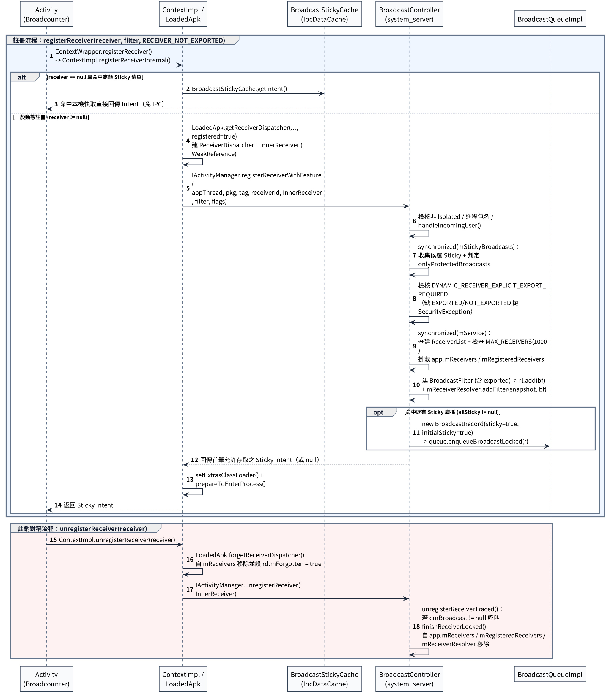

# 9.2 動態廣播接收者的註冊與註銷過程（`registerReceiver`、`ReceiverDispatcher` 與 `BroadcastController`）

- **情景說明**：延續原書 `Broadcounter` 實例，前景 Activity 在 `onResume()` 建立針對自訂 Action（`BROADCAST_COUNTER_ACTION`）的 `IntentFilter`，呼叫 **`registerReceiver(counterActionReceiver, filter, Context.RECEIVER_NOT_EXPORTED)`** 向系統訂閱廣播；本節沿呼叫鏈從客戶端 `ContextWrapper` / `ContextImpl` / `LoadedApk.ReceiverDispatcher` 一路追進 `BroadcastController` 完成安全核驗與雙索引登記，同時對照 `receiver == null` 讀取高頻黏性廣播的 **`BroadcastStickyCache`** 快路徑，並以 `onPause()` 呼叫 **`unregisterReceiver()`** 收尾。
- **對應原書**：9.2 節〈广播接收者的注册过程〉（p.501–509）
- **涉及專案與版本基準**：
  - `platform/frameworks/base` 〔`android-17.0.0_r1`，commit `94b4c163b`〕

---

## 9.2.1 呼叫鏈全景

```text
Activity.onResume()
  └─ ContextWrapper.registerReceiver(receiver, filter, flags)          ## Step 1、委派至 mBase (ContextImpl)
       └─ ContextImpl.registerReceiver(...) -> registerReceiverInternal()  ## Step 2、取分發器或走 Sticky 快取
            ├─ [receiver != null] LoadedApk.getReceiverDispatcher()    ## Step 3、建 ReceiverDispatcher + InnerReceiver
            ├─ [receiver == null] BroadcastStickyCache.getIntent()     ## Step 4、高頻系統黏性廣播 IpcDataCache 快路徑
            └─ IActivityManager.registerReceiverWithFeature()          ## Binder IPC 進入 system_server
                 └─ AMS.registerReceiverWithFeature()                  ## Step 5、委派至 BroadcastController
                      └─ BroadcastController.registerReceiverWithFeatureTraced()
                           ├─ 收集 mStickyBroadcasts + 檢核 EXPORTED/NOT_EXPORTED  ## Step 6、Android 14+ 強制匯出標記
                           └─ 登記 mRegisteredReceivers / app.mReceivers / mReceiverResolver
                              + 若命中 Sticky 則建立 BroadcastRecord 入隊          ## Step 7、雙索引掛載與回傳
--- 註銷對稱流程 ---
ContextImpl.unregisterReceiver() -> LoadedApk.forgetReceiverDispatcher()
  -> BroadcastController.unregisterReceiverTraced() -> removeReceiverLocked()      ## Step 8、移除索引並結束進行中廣播
```

---

## 9.2.2 客戶端入口、分發器建構與 Sticky 快取

### Step 1：`ContextWrapper.registerReceiver`
**位置**：`platform/frameworks/base/core/java/android/content/ContextWrapper.java` 〔`android-17.0.0_r1`，lines 791–807〕

```java
    @Override
    public Intent registerReceiver(@Nullable BroadcastReceiver receiver, IntentFilter filter) {
        return mBase.registerReceiver(receiver, filter);
    }

    @Override
    public Intent registerReceiver(@Nullable BroadcastReceiver receiver, IntentFilter filter,
            int flags) {
        return mBase.registerReceiver(receiver, filter, flags);
    }

    @Override
    public Intent registerReceiver(@Nullable BroadcastReceiver receiver, IntentFilter filter,
            @Nullable String broadcastPermission, @Nullable Handler scheduler) {
        return mBase.registerReceiver(receiver, filter, broadcastPermission,
                scheduler);
    }
```

Activity 與 Service 皆繼承自 `ContextWrapper`，其內部 `mBase` 指向實際的 `ContextImpl`。對比原書 2.3 只有不帶 `flags` 的重載，Android 17 的開發者在註冊非受保護系統廣播（如自訂的 `BROADCAST_COUNTER_ACTION`）時，**必須呼叫帶 `int flags` 的重載**並傳入 `Context.RECEIVER_EXPORTED` 或 `Context.RECEIVER_NOT_EXPORTED`，否則在系統端 Step 6 會直接拋出 `SecurityException`。

> 〔與 2.3 差異〕擴充：原書 9.2 Step 2（p.502）僅有兩參數與四參數重載；Android 17 新增帶 `int flags` 的重載以承載 `RECEIVER_EXPORTED`、`RECEIVER_NOT_EXPORTED` 與 `RECEIVER_VISIBLE_TO_INSTANT_APPS`。

---

### Step 2：`ContextImpl.registerReceiver` 與 `registerReceiverInternal`
**位置**：`platform/frameworks/base/core/java/android/app/ContextImpl.java` 〔`android-17.0.0_r1`，lines 1928–2029〕

```java
    @Override
    public Intent registerReceiver(BroadcastReceiver receiver, IntentFilter filter) {
        return registerReceiver(receiver, filter, null, null);
    }

    @Override
    public Intent registerReceiver(BroadcastReceiver receiver, IntentFilter filter,
            int flags) {
        return registerReceiver(receiver, filter, null, null, flags);
    }
    ...
    @Override
    public Intent registerReceiver(BroadcastReceiver receiver, IntentFilter filter,
            String broadcastPermission, Handler scheduler, int flags) {
        return registerReceiverInternal(receiver, getUserId(),
                filter, broadcastPermission, scheduler, getOuterContext(), flags);
    }
```

```java
    private Intent registerReceiverInternal(BroadcastReceiver receiver, int userId,
            IntentFilter filter, String broadcastPermission,
            Handler scheduler, Context context, int flags) {
        IIntentReceiver rd = null;
        if (receiver != null) {
            if (mPackageInfo != null && context != null) {
                if (scheduler == null) {
                    scheduler = mMainThread.getHandler();
                }
                rd = mPackageInfo.getReceiverDispatcher(
                    receiver, context, scheduler,
                    mMainThread.getInstrumentation(), true);
            } else {
                if (scheduler == null) {
                    scheduler = mMainThread.getHandler();
                }
                rd = new LoadedApk.ReceiverDispatcher(mMainThread.getApplicationThread(),
                        receiver, context, scheduler, null, true).getIIntentReceiver();
            }
        }
        try {
            final Intent intent;
            if (receiver == null && BroadcastStickyCache.useCache(filter)) {
                intent = BroadcastStickyCache.getIntent(
                        mMainThread.getApplicationThread(),
                        mBasePackageName,
                        getAttributionTag(),
                        filter,
                        broadcastPermission,
                        userId,
                        flags);
            } else {
                intent = ActivityManager.getService().registerReceiverWithFeature(
                        mMainThread.getApplicationThread(), mBasePackageName, getAttributionTag(),
                        AppOpsManager.toReceiverId(receiver), rd, filter, broadcastPermission,
                        userId, flags);
            }

            if (intent != null) {
                intent.setExtrasClassLoader(getClassLoader());
                // TODO: determine at registration time if caller is
                // protecting themselves with signature permission
                intent.prepareToEnterProcess(ActivityThread.isProtectedBroadcast(intent),
                        getAttributionSource());
            }
            return intent;
        } catch (RemoteException e) {
            throw e.rethrowFromSystemServer();
        }
    }
```

`registerReceiverInternal()` 負責把 Java 物件 `BroadcastReceiver` 轉換成能跨進程傳遞的 Binder 存根 `IIntentReceiver`：
1. **指定派發執行緒 `scheduler`**：若呼叫者沒提供自訂 `Handler`，預設取 `mMainThread.getHandler()`（即 App 主執行緒 `ActivityThread.H`），日後收到廣播時便會在主執行緒執行 `onReceive()`。
2. **透過 `LoadedApk` 建立／復用 `ReceiverDispatcher`**：若 `mPackageInfo != null`（一般應用程式 Context），交給 `mPackageInfo.getReceiverDispatcher(..., registered = true)` 登記並取回 `IIntentReceiver` 存根（即 `InnerReceiver`）；若 `receiver == null`（僅為查詢當前黏性廣播），則直接跳過分發器建構。
3. **兩條對外路徑**：
   - 若 `receiver == null` 且命中 `BroadcastStickyCache.useCache(filter)`，改走客戶端 `IpcDataCache` 快路徑（見 Step 4）；
   - 一般註冊呼叫 AIDL 介面 `ActivityManager.getService().registerReceiverWithFeature(...)`，附帶 `mMainThread.getApplicationThread()`（標識所屬進程）、`getAttributionTag()`（權限歸因標籤）與 `AppOpsManager.toReceiverId(receiver)`（形如 `ClassName@hash`，供 `BroadcastFilter.getReceiverClassName()` 與超限報錯使用）。
4. **回傳黏性 `Intent` 的安全準備**：若有匹配的黏性 `Intent` 返回，先設定 `ExtrasClassLoader` 並呼叫 `intent.prepareToEnterProcess(...)` 防範反序列化與 URI 權限歸因問題。

> 〔與 2.3 差異〕邏輯改變 + 新增：原書 9.2 Step 3（p.503）呼叫 `ActivityManagerNative.getDefault().registerReceiver(...)` 且沒有 `userId`、`flags`、`attributionTag`、`receiverId`、`BroadcastStickyCache` 與 `prepareToEnterProcess`。

---

### Step 3：`LoadedApk.getReceiverDispatcher` 與 `ReceiverDispatcher` / `InnerReceiver`
**位置**：`platform/frameworks/base/core/java/android/app/LoadedApk.java` 〔`android-17.0.0_r1`，lines 1817–1845、1908–1920、2076–2091〕

```java
    public IIntentReceiver getReceiverDispatcher(BroadcastReceiver r,
            Context context, Handler handler,
            Instrumentation instrumentation, boolean registered) {
        synchronized (mReceivers) {
            LoadedApk.ReceiverDispatcher rd = null;
            ArrayMap<BroadcastReceiver, LoadedApk.ReceiverDispatcher> map = null;
            if (registered) {
                map = mReceivers.get(context);
                if (map != null) {
                    rd = map.get(r);
                }
            }
            if (rd == null) {
                rd = new ReceiverDispatcher(mActivityThread.getApplicationThread(), r, context,
                        handler, instrumentation, registered);
                if (registered) {
                    if (map == null) {
                        map = new ArrayMap<BroadcastReceiver, LoadedApk.ReceiverDispatcher>();
                        mReceivers.put(context, map);
                    }
                    map.put(r, rd);
                }
            } else {
                rd.validate(context, handler);
            }
            rd.mForgotten = false;
            return rd.getIIntentReceiver();
        }
    }
```

```java
    static final class ReceiverDispatcher {

        final static class InnerReceiver extends IIntentReceiver.Stub {
            final IApplicationThread mApplicationThread;
            final WeakReference<LoadedApk.ReceiverDispatcher> mDispatcher;
            final LoadedApk.ReceiverDispatcher mStrongRef;

            InnerReceiver(IApplicationThread thread, LoadedApk.ReceiverDispatcher rd,
                    boolean strong) {
                mApplicationThread = thread;
                mDispatcher = new WeakReference<LoadedApk.ReceiverDispatcher>(rd);
                mStrongRef = strong ? rd : null;
            }
```

```java
        ReceiverDispatcher(IApplicationThread appThread, BroadcastReceiver receiver,
                Context context, Handler activityThread, Instrumentation instrumentation,
                boolean registered) {
            if (activityThread == null) {
                throw new NullPointerException("Handler must not be null");
            }

            mAppThread = appThread;
            mIIntentReceiver = new InnerReceiver(mAppThread, this, !registered);
            mReceiver = receiver;
            mContext = context;
            mActivityThread = activityThread;
            mInstrumentation = instrumentation;
            mRegistered = registered;
            mLocation = new IntentReceiverLeaked(null);
        }
```

這段設計與第 8 章的 `LoadedApk.ServiceDispatcher` 如出一轍，有三個值得特別留意的細節：
1. **雙層快取 `mReceivers`**：`LoadedApk` 以 `Context`（例如某個 `Activity`）為外層鍵、以 `BroadcastReceiver` 為內層鍵保存 `ReceiverDispatcher`。這樣做有兩大好處：第一，同一個 `BroadcastReceiver` 實例多次呼叫 `registerReceiver()` 註冊不同 `IntentFilter` 時，會復用同一支 `InnerReceiver`（`validate()` 驗證 `context` 與 `handler` 一致），讓系統端把這些過濾器全部掛在同一張 `ReceiverList` 下；第二，當 `Activity` 銷毀時，`LoadedApk.removeContextRegistrations()` 能一鍵清查該 `Context` 底下是否還有未 `unregisterReceiver()` 的洩漏接收者，並透過 `mLocation`（`IntentReceiverLeaked`）印出當初註冊的堆疊。
2. **強弱引用切換（`!registered`）**：注意 `new InnerReceiver(mAppThread, this, !registered)`！
   - 對於一般動態註冊（`registered == true`），`mStrongRef == null`，`InnerReceiver` 只對 `ReceiverDispatcher` 持有 **`WeakReference`**。如此一來，就算 `system_server` 仍握有 `InnerReceiver` 的 Binder 遠端引用，只要客戶端已從 `mReceivers` 移除（註銷），`ReceiverDispatcher` 與所屬 `Activity` Context 就能立刻被 GC 回收，不會因 Binder 引用週期造成記憶體洩漏；
   - 對於有序廣播的一次性 `resultReceiver`（`registered == false`，見 9.4 節 `ContextImpl.sendOrderedBroadcast`），它不會放進 `mReceivers`，因此反而需要 `mStrongRef = rd` 強引用保活，直到最終結果回調完畢。
3. **`rd.mForgotten = false`**：重用先前曾註銷過的 `BroadcastReceiver` 時清除遺忘標記，避免 `Args.getRunnable()` 誤判而直接跳過 `onReceive()`。

> 〔與 2.3 差異〕邏輯微調：原書 9.2 Step 3（p.503–504）已具備 `mReceivers` 雙層表與 `WeakReference` 設計；Android 17 在 `InnerReceiver` 中額外持有 `mApplicationThread` 成員（用於已註銷卻收到阻塞廣播時能代為回報 `finishReceiver(mApplicationThread.asBinder(), ...)`，見 9.3 節）並把容器從 `HashMap` 換成省記憶體的 `ArrayMap`。

---

### Step 4：高頻黏性廣播快路徑 `BroadcastStickyCache`
**位置**：`platform/frameworks/base/core/java/android/app/BroadcastStickyCache.java` 〔`android-17.0.0_r1`，lines 51–76、130–170〕

```java
    @VisibleForTesting
    public static final String[] STICKY_BROADCAST_ACTIONS = {
            AudioManager.ACTION_HDMI_AUDIO_PLUG,
            AudioManager.ACTION_HEADSET_PLUG,
            ...
            ConnectivityManager.CONNECTIVITY_ACTION,
            Intent.ACTION_BATTERY_CHANGED,
            Intent.ACTION_DEVICE_STORAGE_FULL,
            Intent.ACTION_DEVICE_STORAGE_LOW,
            ...
            UsbManager.ACTION_USB_STATE,
            ...
            WifiManager.WIFI_STATE_CHANGED_ACTION,
            ...
    };
```

```java
    public static boolean useCache(@Nullable IntentFilter filter) {
        return filter != null
                && filter.safeCountActions() == 1
                && ArrayUtils.contains(STICKY_BROADCAST_ACTIONS, filter.getAction(0));
    }

    public static void invalidateCache(@NonNull String action) {
        if (!ArrayUtils.contains(STICKY_BROADCAST_ACTIONS, action)) {
            return;
        }
        IpcDataCache.invalidateCache(IpcDataCache.MODULE_SYSTEM,
                sActionApiNameMap.get(action));
    }
```

實務上有大量 App 與 SDK 頻繁以 `registerReceiver(null, new IntentFilter(Intent.ACTION_BATTERY_CHANGED))` 輪詢電量或網路狀態，過去每次查詢都必須走一次 Binder IPC 進 `system_server` 搶鎖。Android 17 透過 `BroadcastStickyCache` 搭配系統屬性驅動的 **`IpcDataCache`**，將 23 個高頻系統 Sticky Action（涵蓋電量、USB、Wi-Fi、耳機插拔、鈴聲模式等）快取在 App 進程本機；只有當 `BroadcastController.broadcastIntentWithFeature` 真正發出新版黏性廣播並呼叫 `BroadcastStickyCache.invalidateCache(action)`（遞增共享系統屬性版本號）時，App 端才會回源重新向 `system_server` 拉取。

> 〔與 2.3 差異〕新增：原書 2.3 每次 `registerReceiver(null, filter)` 都必定透過 Binder IPC 呼叫 AMS；Android 17 透過 `BroadcastStickyCache`（`IpcDataCache`）大幅消除高頻系統黏性廣播的 Binder 負荷。

---

## 9.2.3 系統端檢核、`EXPORTED` 強制管制與雙索引登記

### Step 5：`AMS.registerReceiverWithFeature` → `BroadcastController` 入口與身分驗證
**位置**：`platform/frameworks/base/services/core/java/com/android/server/am/ActivityManagerService.java` 〔`android-17.0.0_r1`，lines 15209–15215〕、`platform/frameworks/base/services/core/java/com/android/server/am/BroadcastController.java` 〔`android-17.0.0_r1`，lines 282–293、324–359〕

```java
    public Intent registerReceiverWithFeature(IApplicationThread caller, String callerPackage,
            String callerFeatureId, String receiverId, IIntentReceiver receiver,
            IntentFilter filter, String permission,  @CanBeALL @CanBeCURRENT @UserIdInt int userId,
            int flags) {
        return mBroadcastController.registerReceiverWithFeature(caller, callerPackage,
                callerFeatureId, receiverId, receiver, filter, permission, userId, flags);
    }
```

```java
    Intent registerReceiverWithFeature(IApplicationThread caller, String callerPackage,
            String callerFeatureId, String receiverId, IIntentReceiver receiver,
            IntentFilter filter, String permission,  @CanBeALL @CanBeCURRENT @UserIdInt int userId,
            int flags) {
        traceRegistrationBegin(receiverId, receiver, filter, userId);
        try {
            return registerReceiverWithFeatureTraced(caller, callerPackage, callerFeatureId,
                    receiverId, receiver, filter, permission, userId, flags);
        } finally {
            traceRegistrationEnd();
        }
    }
```

```java
    private Intent registerReceiverWithFeatureTraced(IApplicationThread caller,
            String callerPackage, String callerFeatureId, String receiverId,
            IIntentReceiver receiver, IntentFilter filter, String permission,
            @CanBeALL @CanBeCURRENT @UserIdInt int userId, int flags) {
        mService.enforceNotIsolatedCaller("registerReceiver");

        if (!mAreStickyCachesInvalidated) {
            BroadcastStickyCache.invalidateAllCaches();
            mAreStickyCachesInvalidated = true;
        }
        ArrayList<StickyBroadcast> stickyBroadcasts = null;
        ProcessRecord callerApp = null;
        final boolean visibleToInstantApps =
                (flags & Context.RECEIVER_VISIBLE_TO_INSTANT_APPS) != 0;

        int callingUid;
        int callingPid;
        boolean instantApp;
        synchronized (mService.mProcLock) {
            callerApp = mService.getRecordForAppLOSP(caller);
            if (callerApp == null) {
                Slog.w(TAG, "registerReceiverWithFeature: no app for " + caller);
                return null;
            }
            if (!UserHandle.isCore(callerApp.uid)
                    && !callerApp.getPkgList().containsKey(callerPackage)) {
                throw new SecurityException("Given caller package " + callerPackage
                        + " is not running in process " + callerApp);
            }
            callingUid = callerApp.uid;
            callingPid = callerApp.getPid();

            instantApp = isInstantApp(callerApp, callerPackage, callingUid);
        }
        userId = mService.mUserController.handleIncomingUser(callingPid, callingUid, userId, true,
                ALLOW_FULL_ONLY, "registerReceiver", callerPackage);
```

進入 `BroadcastController.registerReceiverWithFeatureTraced()` 後，先執行三道前置安全檢查（此時**尚未持有 AMS 主鎖 `synchronized (mService)`**，僅在取 `callerApp` 時短暫持 `mService.mProcLock`）：
1. **禁止 Isolated 進程**：`enforceNotIsolatedCaller("registerReceiver")` 阻擋無權限的隔離進程註冊廣播；
2. **進程與套件一致性核驗**：透過 `getRecordForAppLOSP(caller)` 反查呼叫進程的 `ProcessRecord`，並確認非核心 UID 宣告的 `callerPackage` 確實運行在該進程中，防範包名偽造；
3. **多使用者權限解析**：透過 `mUserController.handleIncomingUser(...)` 將 `USER_CURRENT` / `USER_ALL` 解析並檢查跨使用者權限（`INTERACT_ACROSS_USERS_FULL`）。

> 〔與 2.3 差異〕搬家 + 細粒度鎖 + 安全強化：原書 9.2 Step 5（p.505）直接在 `AMS.registerReceiver` 整個函式外層加 `synchronized (this)`，亦無 Isolated 進程檢查、包名驗證與多使用者解析。

---

### Step 6：黏性收集、受保護廣播判斷與強制 `RECEIVER_EXPORTED` / `RECEIVER_NOT_EXPORTED`
**位置**：`platform/frameworks/base/services/core/java/com/android/server/am/BroadcastController.java` 〔`android-17.0.0_r1`，lines 150–152、404–536〕

```java
    @ChangeId
    @EnabledSince(targetSdkVersion = Build.VERSION_CODES.UPSIDE_DOWN_CAKE)
    private static final long DYNAMIC_RECEIVER_EXPLICIT_EXPORT_REQUIRED = 161145287L;
```

```java
        boolean onlyProtectedBroadcasts = true;

        // Collect stickies of users and check if broadcast is only registered for protected
        // broadcasts
        int[] userIds = { UserHandle.USER_ALL, UserHandle.getUserId(callingUid) };
        synchronized (mStickyBroadcasts) {
            while (actions.hasNext()) {
                String action = actions.next();
                for (int id : userIds) {
                    ArrayMap<String, ArrayList<StickyBroadcast>> stickies =
                            mStickyBroadcasts.get(id);
                    if (stickies != null) {
                        ArrayList<StickyBroadcast> broadcasts = stickies.get(action);
                        if (broadcasts != null) {
                            if (stickyBroadcasts == null) {
                                stickyBroadcasts = new ArrayList<>();
                            }
                            stickyBroadcasts.addAll(broadcasts);
                        }
                    }
                }
                if (onlyProtectedBroadcasts) {
                    try {
                        onlyProtectedBroadcasts &=
                                AppGlobals.getPackageManager().isProtectedBroadcast(action);
                    } catch (RemoteException e) {
                        onlyProtectedBroadcasts = false;
                        Slog.w(TAG, "Remote exception", e);
                    }
                }
            }
        }
        ...
        final boolean explicitExportStateDefined =
                (flags & (Context.RECEIVER_EXPORTED | Context.RECEIVER_NOT_EXPORTED)) != 0;
        if (((flags & Context.RECEIVER_EXPORTED) != 0) && (
                (flags & Context.RECEIVER_NOT_EXPORTED) != 0)) {
            throw new IllegalArgumentException(
                    "Receiver can't specify both RECEIVER_EXPORTED and RECEIVER_NOT_EXPORTED"
                            + "flag");
        }

        boolean requireExplicitFlagForDynamicReceivers = CompatChanges.isChangeEnabled(
                DYNAMIC_RECEIVER_EXPLICIT_EXPORT_REQUIRED, callingUid);
        ...
        if (!onlyProtectedBroadcasts) {
            if (receiver == null && !explicitExportStateDefined) {
                // sticky broadcast, no flag specified (flag isn't required)
                flags |= Context.RECEIVER_EXPORTED;
            } else if (requireExplicitFlagForDynamicReceivers && !explicitExportStateDefined) {
                throw new SecurityException(
                        callerPackage + ": One of RECEIVER_EXPORTED or "
                                + "RECEIVER_NOT_EXPORTED should be specified when a receiver "
                                + "isn't being registered exclusively for system broadcasts");
                // Assume default behavior-- flag check is not enforced
            } else if (!requireExplicitFlagForDynamicReceivers && (
                    (flags & Context.RECEIVER_NOT_EXPORTED) == 0)) {
                // Change is not enabled, assume exported unless otherwise specified.
                flags |= Context.RECEIVER_EXPORTED;
            }
        } else if ((flags & Context.RECEIVER_NOT_EXPORTED) == 0) {
            flags |= Context.RECEIVER_EXPORTED;
        }

        // Dynamic receivers are exported by default for versions prior to T
        final boolean exported = (flags & Context.RECEIVER_EXPORTED) != 0;
        ...
        // The first sticky in the list is returned directly back to the client.
        Intent sticky = allSticky != null ? allSticky.get(0).intent : null;
        if (DEBUG_BROADCAST) Slog.v(TAG_BROADCAST, "Register receiver " + filter + ": " + sticky);
        if (receiver == null) {
            return sticky;
        }
```

這段是 Android 現代廣播安全模型最關鍵的防線：
1. **在獨立鎖 `synchronized (mStickyBroadcasts)` 內一次做完兩件事**：遍歷 `filter` 中的每個 `action`，一方面從 `USER_ALL` 與當前使用者收集候選黏性廣播，另一方面向 PackageManager 查詢 `isProtectedBroadcast(action)`，判斷該 `filter` 是否**只**監聽系統受保護廣播（例如 `ACTION_SCREEN_ON`、`ACTION_BATTERY_CHANGED`）。
2. **強制顯式宣告匯出屬性（自 Android 14 / API 34 起全面生效）**：過去動態註冊的接收者預設對全系統任何惡意 App 開放（exported），經常造成隱私外洩或偽造廣播注入攻擊。現在只要 `!onlyProtectedBroadcasts`（包含我們 `Broadcounter` 的自訂 Action）且 `receiver != null`，目標 SDK ≥ 34 的 App 若未顯式傳入 `RECEIVER_EXPORTED` 或 `RECEIVER_NOT_EXPORTED`，就會在這裡直接拋出 `SecurityException`！同時傳入兩者則拋出 `IllegalArgumentException`。
3. **純查詢黏性廣播提前返回**：接著對候選黏性廣播逐一執行 `filter.match(...)`（刻意在 AMS 主鎖之外執行，避免 `content://` scheme 查詢 ContentProvider 引起死鎖）；如果 `receiver == null`，直接回傳 `allSticky.get(0).intent` 結束流程，無須進入主鎖登記任何接收者。

> 〔與 2.3 差異〕新增安全管制：原書 9.2 Step 5（p.505–506）沒有 `exported` 匯出隔離概念，也沒有 `isProtectedBroadcast` 區分與 `DYNAMIC_RECEIVER_EXPLICIT_EXPORT_REQUIRED` 強制檢查。

---

### Step 7：雙索引掛載（`mRegisteredReceivers` / `mReceiverResolver`）與初始黏性廣播入隊
**位置**：`platform/frameworks/base/services/core/java/com/android/server/am/BroadcastController.java` 〔`android-17.0.0_r1`，lines 547–640〕

```java
        synchronized (mService) {
            IApplicationThread thread;
            if (callerApp != null && ((thread = callerApp.getThread()) == null
                    || thread.asBinder() != caller.asBinder())) {
                // Original caller already died
                return null;
            }
            ReceiverList rl = mRegisteredReceivers.get(receiver.asBinder());
            if (rl == null) {
                rl = new ReceiverList(mService, callerApp, callingPid, callingUid,
                        userId, receiver);
                if (rl.app != null) {
                    final int totalReceiversForApp = rl.app.mReceivers.numberOfReceivers();
                    if (totalReceiversForApp >= MAX_RECEIVERS_ALLOWED_PER_APP) {
                        throw new IllegalStateException(
                                buildTooManyReceiversExceptionMessage(rl, callerPackage));
                    }
                    rl.app.mReceivers.addReceiver(rl);
                } else {
                    try {
                        receiver.asBinder().linkToDeath(rl, 0);
                    } catch (RemoteException e) {
                        return sticky;
                    }
                    rl.linkedToDeath = true;
                }
                mRegisteredReceivers.put(receiver.asBinder(), rl);
            } else if (rl.uid != callingUid) {
                throw new IllegalArgumentException(
                        "Receiver requested to register for uid " + callingUid
                                + " was previously registered for uid " + rl.uid
                                + " callerPackage is " + callerPackage);
            }
            ...
            BroadcastFilter bf = new BroadcastFilter(filter, rl, callerPackage, callerFeatureId,
                    receiverId, permission, callingUid, userId, instantApp, visibleToInstantApps,
                    exported, callerApp.info, mService.mPlatformCompat);
            if (rl.containsFilter(filter)) {
                Slog.w(TAG, "Receiver with filter " + filter
                        + " already registered for pid " + rl.pid
                        + ", callerPackage is " + callerPackage);
            } else {
                rl.add(bf);
                if (!bf.debugCheck()) {
                    Slog.w(TAG, "==> For Dynamic broadcast");
                }
                mReceiverResolver.addFilter(mService.getPackageManagerInternal().snapshot(), bf);
            }

            // Enqueue broadcasts for all existing stickies that match
            // this filter.
            if (allSticky != null) {
                ArrayList receivers = new ArrayList();
                receivers.add(bf);
                sticky = null;

                final int stickyCount = allSticky.size();
                for (int i = 0; i < stickyCount; i++) {
                    final StickyBroadcast broadcast = allSticky.get(i);
                    final int originalStickyCallingUid = allSticky.get(i).originalCallingUid;
                    if (sticky == null && (exported || originalStickyCallingUid == callingUid
                            || ActivityManager.canAccessUnexportedComponents(
                            originalStickyCallingUid))) {
                        sticky = broadcast.intent;
                    }
                    BroadcastQueue queue = mBroadcastQueue;
                    BroadcastRecord r = new BroadcastRecord(queue, broadcast.intent, null, null,
                            null, -1  /*callingPid*/, -1 /*callingUid*/, false, null, null, null,
                            null, OP_NONE,
                            BroadcastOptions.makeWithDeferUntilActive(broadcast.deferUntilActive),
                            receivers, null, null, 0, null, null, false, true, true, -1 /*userId*/,
                            originalStickyCallingUid, -1 /*realCallingPid*/,
                            BackgroundStartPrivileges.NONE,
                            false /* only PRE_BOOT_COMPLETED should be exempt, no stickies */,
                            null /* filterExtrasForReceiver */,
                            broadcast.originalCallingAppProcessState, mService.mPlatformCompat);
                    queue.enqueueBroadcastLocked(r);
                }
            }

            return sticky;
        }
```

真正進入 `synchronized (mService)` 臨界區後，流程精準而緊湊：
1. **確認呼叫進程仍存活**：檢查 `callerApp.getThread().asBinder() == caller.asBinder()`，防止進程在剛才等鎖期間已經死亡重啟。
2. **查建 `ReceiverList` 並檢查配額**：以 `receiver.asBinder()`（即客戶端 `InnerReceiver` 在 `system_server` 側的 `BinderProxy`）查 `mRegisteredReceivers`。首次註冊時建立 `ReceiverList`、檢查該進程是否已達 `MAX_RECEIVERS_ALLOWED_PER_APP`（1000 個，超限直接拋 `IllegalStateException` 並附帶前 10 大洩漏 action／類別統計），然後將 `rl` 同時掛入 **`rl.app.mReceivers`** 與 **`mRegisteredReceivers`**。
3. **封裝 `BroadcastFilter` 並雙向掛載**：建立攜帶 `exported`、`owningUid`、`owningUserId` 與校準後優先級的 `BroadcastFilter`，若 `rl` 尚未含相同過濾器（`!rl.containsFilter(filter)`），便同時執行 `rl.add(bf)` 與 **`mReceiverResolver.addFilter(snapshot, bf)`**。至此，該動態接收者正式上線，後續所有匹配廣播都能從 `mReceiverResolver` 搜到它。
4. **初始黏性廣播補發**：若剛才匹配到既有的黏性廣播（`allSticky != null`），會針對每一筆黏性廣播建構 `sticky = true, initialSticky = true` 的 `BroadcastRecord`（只含剛註冊的 `[bf]`）並送入 `mBroadcastQueue.enqueueBroadcastLocked(r)` 非同步投遞給 `onReceive()`，同時只有當 `exported` 或同 UID／具特權發送者時，才把首筆 `sticky` 作為 `registerReceiver()` 的同步回傳值交給客戶端。

> 〔與 2.3 差異〕邏輯改變 + 強化：原書 9.2 Step 5（p.506–508）直接把 `bf` 加入 `mReceiverResolver` 且沒有 `MAX_RECEIVERS_ALLOWED_PER_APP` 配額保護與重複 filter 過濾；對黏性廣播也是直接塞進 `mParallelBroadcasts` 再呼 `scheduleBroadcastsLocked()`，Android 17 則統一交由 `mBroadcastQueue.enqueueBroadcastLocked(r)` 排入該進程的 `BroadcastProcessQueue`，並對非 exported 接收者限制回傳跨 UID 黏性 `Intent`。

---

## 9.2.4 註銷閉環：`unregisterReceiver`

### Step 8：`ContextImpl.unregisterReceiver` → `LoadedApk.forgetReceiverDispatcher` → `BroadcastController.unregisterReceiverTraced`
**位置**：`platform/frameworks/base/core/java/android/app/ContextImpl.java` 〔`android-17.0.0_r1`，lines 2032–2044〕、`platform/frameworks/base/core/java/android/app/LoadedApk.java` 〔`android-17.0.0_r1`，lines 1859–1886〕、`platform/frameworks/base/services/core/java/com/android/server/am/BroadcastController.java` 〔`android-17.0.0_r1`，lines 724–770〕

```java
    @Override
    public void unregisterReceiver(BroadcastReceiver receiver) {
        if (mPackageInfo != null) {
            IIntentReceiver rd = mPackageInfo.forgetReceiverDispatcher(
                    getOuterContext(), receiver);
            try {
                ActivityManager.getService().unregisterReceiver(rd);
            } catch (RemoteException e) {
                throw e.rethrowFromSystemServer();
            }
        } else {
            throw new RuntimeException("Not supported in system context");
        }
    }
```

```java
    public IIntentReceiver forgetReceiverDispatcher(Context context,
            BroadcastReceiver r) {
        synchronized (mReceivers) {
            ArrayMap<BroadcastReceiver, LoadedApk.ReceiverDispatcher> map = mReceivers.get(context);
            LoadedApk.ReceiverDispatcher rd = null;
            if (map != null) {
                rd = map.get(r);
                if (rd != null) {
                    map.remove(r);
                    if (map.size() == 0) {
                        mReceivers.remove(context);
                    }
                    ...
                    rd.mForgotten = true;
                    return rd.getIIntentReceiver();
                }
            }
            ...
            throw new IllegalArgumentException("Receiver not registered: " + r);
        }
    }
```

```java
    private void unregisterReceiverTraced(IIntentReceiver receiver) {
        if (DEBUG_BROADCAST) Slog.v(TAG_BROADCAST, "Unregister receiver: " + receiver);

        final long origId = Binder.clearCallingIdentity();
        try {
            boolean doTrim = false;
            synchronized (mService) {
                ReceiverList rl = mRegisteredReceivers.get(receiver.asBinder());
                if (rl != null) {
                    final BroadcastRecord r = rl.curBroadcast;
                    if (r != null) {
                        final boolean doNext = r.queue.finishReceiverLocked(
                                rl.app, r.resultCode, r.resultData, r.resultExtras,
                                r.resultAbort, false);
                        if (doNext) {
                            doTrim = true;
                        }
                    }
                    if (rl.app != null) {
                        rl.app.mReceivers.removeReceiver(rl);
                    }
                    removeReceiverLocked(rl);
                    if (rl.linkedToDeath) {
                        rl.linkedToDeath = false;
                        rl.receiver.asBinder().unlinkToDeath(rl, 0);
                    }
                }
                if (doTrim) {
                    mService.trimApplicationsLocked(false, OOM_ADJ_REASON_FINISH_RECEIVER);
                    return;
                }
            }
        } finally {
            Binder.restoreCallingIdentity(origId);
        }
    }

    void removeReceiverLocked(ReceiverList rl) {
        mRegisteredReceivers.remove(rl.receiver.asBinder());
        for (int i = rl.size() - 1; i >= 0; i--) {
            mReceiverResolver.removeFilter(rl.get(i));
        }
    }
```

與註冊形成完美對稱：客戶端先由 `LoadedApk.forgetReceiverDispatcher` 把 `ReceiverDispatcher` 從 `mReceivers` 移除並設 **`rd.mForgotten = true`**（這樣就算已經排進主執行緒 MessageQueue 的舊廣播稍後執行到 `Args.getRunnable()`，看到 `mForgotten == true` 也會跳過 `onReceive()` 並代為 `sendFinished`）；接著 IPC 進入 `BroadcastController.unregisterReceiverTraced()`，從 `rl.app.mReceivers`、`mRegisteredReceivers` 與 `mReceiverResolver` 三處徹底拔除，若有正在處理中的廣播亦主動呼叫 `finishReceiverLocked()` 避免阻塞後續接收者。

> 〔與 2.3 差異〕補充原書未詳追之註銷閉環：原書 9.2 未單獨展開 `unregisterReceiver` 原始碼；Android 17 透過 `mForgotten` 標記與 `BroadcastController.removeReceiverLocked` 構成客戶端＋系統端雙重防競態保護。

---

## 9.2.5 本節總結與時序圖



- **雙層表 + 弱引用解偶**：App 側由 `LoadedApk.mReceivers` 維護 `Context → BroadcastReceiver → ReceiverDispatcher`，並讓 `InnerReceiver` 僅持有 `WeakReference<ReceiverDispatcher>`，避免 Binder 遠端參考鎖死 Activity 記憶體。
- **系統端三處連動登記**：`BroadcastController` 透過 `mRegisteredReceivers`（反查清理）、`app.mReceivers`（進程死亡批次清理與 1000 上限）與 `mReceiverResolver`（`IntentFilter` 路由解析）同步維繫動態接收者狀態。
- **現代安全與效能強化**：非受保護廣播強制顯式指定 `RECEIVER_EXPORTED` / `RECEIVER_NOT_EXPORTED`；高頻系統黏性廣播查詢則改由 `BroadcastStickyCache`（`IpcDataCache`）在客戶端本地命中。
