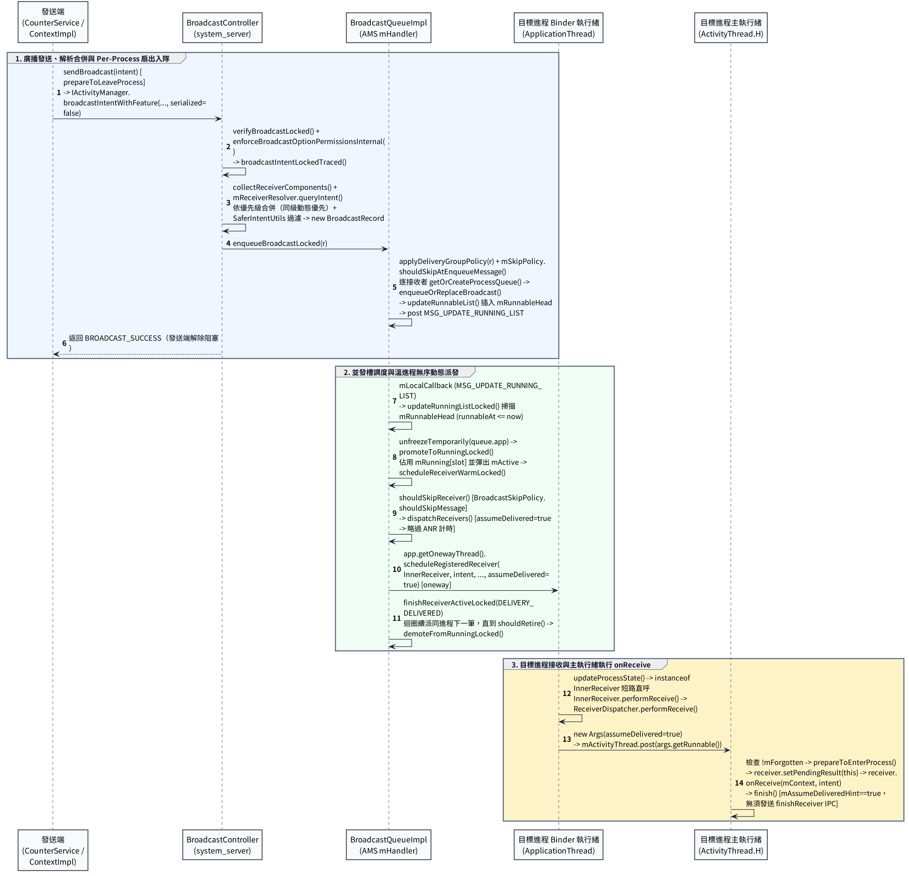

# 9.3 廣播的發送、排程與動態接收者派發過程（`sendBroadcast`、`BroadcastQueueImpl` 與 `ReceiverDispatcher`）

- **情景說明**：延續原書 `Broadcounter` 實例，當 `CounterService` 每秒更新計數值並呼叫 **`sendBroadcast(intent)`**（Action 為 `BROADCAST_COUNTER_ACTION`）時，本節沿著 Android 17 呼叫鏈一路追蹤：發送端經由 `ContextImpl` 與 `IActivityManager.broadcastIntentWithFeature` 進入 `BroadcastController`，合併靜／動態接收者並建構 `BroadcastRecord`，再由 **`BroadcastQueueImpl`** 拆散投入各目標進程的 **`BroadcastProcessQueue`**，經 `mRunnableHead` → `mRunning[]` 晉升與 `unfreezeTemporarily()` 臨時解凍後，透過 `IApplicationThread.scheduleRegisteredReceiver` 非同步送至目標進程，最終在 `LoadedApk.ReceiverDispatcher` 切回主執行緒呼叫 **`BroadcastReceiver.onReceive()`**。
- **對應原書**：9.3 節〈广播的发送过程〉（p.509–531，動態無序廣播主線）
- **涉及專案與版本基準**：
  - `platform/frameworks/base` 〔`android-17.0.0_r1`，commit `94b4c163b`〕

---

## 9.3.1 呼叫鏈全景

```text
CounterService.startCounter()
  └─ ContextWrapper.sendBroadcast(intent) -> ContextImpl.sendBroadcast()     ## Step 1、解析 MIME、準備跨進程 Intent
       └─ IActivityManager.broadcastIntentWithFeature(..., serialized=false) ## Binder IPC 進入 system_server
            └─ AMS.broadcastIntentWithFeature() -> BroadcastController       ## Step 2、身分與 BroadcastOptions 權限驗證
                 └─ broadcastIntentLocked() -> broadcastIntentLockedTraced() ## Step 3、查詢靜/動態接收者、合併、建 BroadcastRecord
                      └─ BroadcastQueueImpl.enqueueBroadcastLocked(r)        ## Step 4、DeliveryGroup 去重 + 拆散入各 BroadcastProcessQueue
                           ├─ queue.enqueueOrReplaceBroadcast(r, i, ...)     ## 投入 mPending / mPendingUrgent / mPendingOffload
                           ├─ updateRunnableList(queue)                      ## Step 5、依 runnableAt 插入排序串列 mRunnableHead
                           └─ enqueueUpdateRunningList()                     ## 投遞 MSG_UPDATE_RUNNING_LIST（發送端 IPC 返回）
=== 非同步排程（AMS mHandler Looper）===
mLocalCallback (MSG_UPDATE_RUNNING_LIST) -> updateRunningListLocked()        ## Step 6、挑 runnableAt <= now 進程、解凍並晉升 mRunning[]
  └─ promoteToRunningLocked(queue) -> scheduleReceiverWarmLocked(queue)      ## Step 7、溫進程批次迴圈派發（until shouldRetire）
       ├─ shouldSkipReceiver() [BroadcastSkipPolicy]                         ## 派發期二次權限/策略過濾
       └─ dispatchReceivers()                                                ## 重點關注：無序動態接收者 assumeDelivered=true
            ├─ IApplicationThread.scheduleRegisteredReceiver(...) [oneway]   ## 走單一 ApplicationThread Binder 節點嚴格保序
            └─ finishReceiverActiveLocked(DELIVERY_DELIVERED)                ## 免等回報，立刻標記完成並推進下一筆
=== 目標接收進程（ActivityThread）===
ApplicationThread.scheduleRegisteredReceiver()                               ## Step 8、更新 procState、短路直呼 InnerReceiver
  └─ InnerReceiver.performReceive() -> ReceiverDispatcher.performReceive()   ## Step 9、包成 Args 並 post 至主執行緒 Handler
       └─ Args.getRunnable() -> BroadcastReceiver.onReceive(context, intent) ## 切回主執行緒執行 onReceive + finish()
```

---

## 9.3.2 發送端入口與 `BroadcastController` 解析合併

### Step 1：`ContextWrapper.sendBroadcast` 與 `ContextImpl.sendBroadcast`
**位置**：`platform/frameworks/base/core/java/android/content/ContextWrapper.java` 〔`android-17.0.0_r1`，lines 507–509〕、`platform/frameworks/base/core/java/android/app/ContextImpl.java` 〔`android-17.0.0_r1`，lines 1324–1336〕

```java
    public void sendBroadcast(Intent intent) {
        mBase.sendBroadcast(intent);
    }
```

```java
    @Override
    public void sendBroadcast(Intent intent) {
        warnIfCallingFromSystemProcess();
        String resolvedType = intent.resolveTypeIfNeeded(getContentResolver());
        try {
            intent.prepareToLeaveProcess(this);
            ActivityManager.getService().broadcastIntentWithFeature(
                    mMainThread.getApplicationThread(), getAttributionTag(), intent, resolvedType,
                    null, Activity.RESULT_OK, null, null, null, null /*excludedPermissions=*/,
                    null, AppOpsManager.OP_NONE, null, false, false, getUserId());
        } catch (RemoteException e) {
            throw e.rethrowFromSystemServer();
        }
    }
```

發送端極為精簡：先解析 `Intent` 可能攜帶的 MIME Type（`resolveTypeIfNeeded`）並執行 `intent.prepareToLeaveProcess(this)`（防範 `file://` URI 外洩與補齊 ClipData 跨進程保護），隨後透過 AIDL 代理呼叫 `broadcastIntentWithFeature(...)`。注意倒數三個布林／使用者參數：`serialized = false`（無序廣播）、`sticky = false`（非黏性）、`userId = getUserId()`（限目前使用者，除非系統特權呼叫 `sendBroadcastAsUser`）。

> 〔與 2.3 差異〕AIDL 化 + 參數擴充：原書 9.3 Step 2–4（p.510–511）走手寫 `ActivityManagerProxy.broadcastIntent`；Android 17 改走 AIDL 的 `broadcastIntentWithFeature`，新增 `attributionTag`、`excludedPermissions`、`excludedPackages`、`appOp`、`BroadcastOptions` 與 `userId`，並強制 `prepareToLeaveProcess()`。

---

### Step 2：`AMS.broadcastIntentWithFeature` 與 `BroadcastController.broadcastIntentWithFeature`
**位置**：`platform/frameworks/base/services/core/java/com/android/server/am/ActivityManagerService.java` 〔`android-17.0.0_r1`，lines 15256–15266〕、`platform/frameworks/base/services/core/java/com/android/server/am/BroadcastController.java` 〔`android-17.0.0_r1`，lines 787–826、862–890〕

```java
    @Override
    public final int broadcastIntentWithFeature(IApplicationThread caller, String callingFeatureId,
            Intent intent, String resolvedType, IIntentReceiver resultTo,
            int resultCode, String resultData, Bundle resultExtras,
            String[] requiredPermissions, String[] excludedPermissions,
            String[] excludedPackages, int appOp, Bundle bOptions,
            boolean serialized, boolean sticky, @CanBeALL @CanBeCURRENT @UserIdInt int userId) {
        return mBroadcastController.broadcastIntentWithFeature(caller, callingFeatureId, intent,
                resolvedType, resultTo, resultCode, resultData, resultExtras, requiredPermissions,
                excludedPermissions, excludedPackages, appOp, bOptions, serialized, sticky, userId);
    }
```

```java
    int broadcastIntentWithFeature(IApplicationThread caller, String callingFeatureId,
            Intent intent, String resolvedType, IIntentReceiver resultTo,
            int resultCode, String resultData, Bundle resultExtras,
            String[] requiredPermissions, String[] excludedPermissions,
            String[] excludedPackages, int appOp, Bundle bOptions,
            boolean serialized, boolean sticky, @CanBeALL @CanBeCURRENT @UserIdInt int userId) {
        mService.enforceNotIsolatedCaller("broadcastIntent");
        final int result;

        synchronized (mService) {
            intent = verifyBroadcastLocked(intent);

            final ProcessRecord callerApp = mService.getRecordForAppLOSP(caller);
            final int callingPid = Binder.getCallingPid();
            final int callingUid = Binder.getCallingUid();

            // We're delivering the result to the caller
            final ProcessRecord resultToApp = callerApp;

            // Permission regimes around sender-supplied broadcast options.
            enforceBroadcastOptionPermissionsInternal(bOptions, callingUid);

            final long origId = Binder.clearCallingIdentity();
            try {
                result = broadcastIntentLocked(callerApp,
                        callerApp != null ? callerApp.info.packageName : null, callingFeatureId,
                        intent, resolvedType, resultToApp, resultTo, resultCode, resultData,
                        resultExtras, requiredPermissions, excludedPermissions, excludedPackages,
                        appOp, bOptions, serialized, sticky, callingPid, callingUid, callingUid,
                        callingPid, userId, BackgroundStartPrivileges.NONE, null, null);
            } finally {
                Binder.restoreCallingIdentity(origId);
            }
        }

        if (sticky && result == ActivityManager.BROADCAST_SUCCESS) {
            BroadcastStickyCache.invalidateCache(intent.getAction());
        }
        return result;
    }
```

```java
    @GuardedBy("mService")
    final int broadcastIntentLocked(ProcessRecord callerApp, String callerPackage,
            ...
            @Nullable BiFunction<Integer, Bundle, Bundle> filterExtrasForReceiver) {
        final int cookie = traceBroadcastIntentBegin(intent, resultTo, ordered, sticky,
                callingUid, realCallingUid, userId);
        try {
            final BroadcastSentEventRecord broadcastSentEventRecord =
                    new BroadcastSentEventRecord();
            final int res = broadcastIntentLockedTraced(callerApp, callerPackage, callerFeatureId,
                    intent, resolvedType, resultToApp, resultTo, resultCode, resultData,
                    resultExtras, requiredPermissions, excludedPermissions, excludedPackages,
                    appOp, BroadcastOptions.fromBundleNullable(bOptions), ordered, sticky,
                    callingPid, callingUid, realCallingUid, realCallingPid, userId,
                    backgroundStartPrivileges, broadcastAllowList, filterExtrasForReceiver,
                    broadcastSentEventRecord);
            broadcastSentEventRecord.setResult(res);
            broadcastSentEventRecord.logToStatsd();
            return res;
        } finally {
            traceBroadcastIntentEnd(cookie);
        }
    }
```

進入 `BroadcastController.broadcastIntentWithFeature()` 後：
1. 禁止 Isolated 進程發送廣播，並由 `verifyBroadcastLocked(intent)` 拒收空 Intent 或內含 FileDescriptor 的非法 Bundle；
2. 校驗呼叫端傳入的 `BroadcastOptions` 權限（例如臨時白名單、互動標記、豁免背景限制等特權選項不得由普通 App 濫用）；
3. 清除 Binder 呼叫身分後呼叫 `broadcastIntentLocked` → `broadcastIntentLockedTraced`；
4. 若為黏性廣播且發送成功，在釋放 AMS 主鎖後立即呼叫 `BroadcastStickyCache.invalidateCache(intent.getAction())`，令所有客戶端的 `IpcDataCache` 失效並重新回源。

> 〔與 2.3 差異〕搬家 + 擴充：原書 9.3 Step 5（p.511）為 `AMS.broadcastIntent`；Android 17 抽離至 `BroadcastController`，加入 `BroadcastOptions` 權限審查、statsd 遙測與 `BroadcastStickyCache` 失效聯動。

---

### Step 3：`BroadcastController.broadcastIntentLockedTraced`——靜／動態接收者查詢、優先級合併與入隊
**位置**：`platform/frameworks/base/services/core/java/com/android/server/am/BroadcastController.java` 〔`android-17.0.0_r1`，lines 1580–1630、1691–1764〕

```java
            // Caller wants broadcast to go to all started users.
            users = mService.mUserController.getStartedUserArray();
        } else {
            // Caller wants broadcast to go to one specific user.
            users = new int[] {userId};
        }

        var args = new SaferIntentUtils.IntentArgs(intent, resolvedType,
                true /* isReceiver */, true /* resolveForStart */, callingUid, callingPid);
        args.platformCompat = mService.mPlatformCompat;

        // Figure out who all will receive this broadcast.
        final int cookie = BroadcastQueue.traceBegin("queryReceivers");
        List receivers = null;
        List<BroadcastFilter> registeredReceivers = null;
        // Need to resolve the intent to interested receivers...
        if ((intent.getFlags() & Intent.FLAG_RECEIVER_REGISTERED_ONLY) == 0) {
            receivers = collectReceiverComponents(
                    intent, resolvedType, callingUid, callingPid, users, broadcastAllowList,
                    brOptions == null ? null : brOptions.getIncludedPackages());
        }
        if (intent.getComponent() == null) {
            final PackageDataSnapshot snapshot = mService.getPackageManagerInternal().snapshot();
            final String[] includedPackages = brOptions != null
                    ? brOptions.getIncludedPackages() : null;
            if (userId == UserHandle.USER_ALL && callingUid == SHELL_UID) {
                ...
            } else {
                registeredReceivers = mReceiverResolver.queryIntent(snapshot, intent,
                        resolvedType, false /*defaultOnly*/, userId, includedPackages);
            }
            if (registeredReceivers != null) {
                SaferIntentUtils.blockNullAction(args, registeredReceivers);
            }
        }
        BroadcastQueue.traceEnd(cookie);
```

```java
            int NT = receivers != null ? receivers.size() : 0;
            int it = 0;
            ResolveInfo curt = null;
            BroadcastFilter curr = null;
            while (it < NT && ir < NR) {
                if (curt == null) {
                    curt = (ResolveInfo) receivers.get(it);
                }
                if (curr == null) {
                    curr = registeredReceivers.get(ir);
                }
                if (curr.getPriority() >= curt.priority) {
                    // Insert this broadcast record into the final list.
                    receivers.add(it, curr);
                    ir++;
                    curr = null;
                    it++;
                    NT++;
                } else {
                    // Skip to the next ResolveInfo in the final list.
                    it++;
                    curt = null;
                }
            }
        }
        while (ir < NR) {
            if (callerInstantApp) {
                intent.setFlags(intent.getFlags() & ~Intent.FLAG_RECEIVER_VISIBLE_TO_INSTANT_APPS);
            }
            if (receivers == null) {
                receivers = new ArrayList();
            }
            receivers.add(registeredReceivers.get(ir));
            ir++;
        }

        if (isCallerSystem) {
            checkBroadcastFromSystem(intent, callerApp, callerPackage, callingUid,
                    isProtectedBroadcast, receivers);
        }

        if ((receivers != null && receivers.size() > 0)
                || resultTo != null) {
            BroadcastQueue queue = mBroadcastQueue;
            SaferIntentUtils.filterNonExportedComponents(args, receivers);
            BroadcastRecord r = new BroadcastRecord(queue, intent, callerApp, callerPackage,
                    callerFeatureId, callingPid, callingUid, callerInstantApp, resolvedType,
                    requiredPermissions, excludedPermissions, excludedPackages, appOp, brOptions,
                    receivers, resultToApp, resultTo, resultCode, resultData, resultExtras, ordered,
                    sticky, false, userId, -1 /* originalStickyCallingUid */, realCallingUid,
                    backgroundStartPrivileges, timeoutExempt, filterExtrasForReceiver,
                    callerAppProcessState, mService.mPlatformCompat);
            broadcastSentEventRecord.setBroadcastRecord(r);

            if (DEBUG_BROADCAST || r.debugLog()) {
                Slog.v(TAG_BROADCAST, "Enqueueing broadcast " + r);
            }
            queue.enqueueBroadcastLocked(r);
        }
        ...
        return ActivityManager.BROADCAST_SUCCESS;
```

`broadcastIntentLockedTraced()` 在經過前段的受保護廣播驗證、特殊系統事件攔截與黏性廣播儲存後，進入核心的**接收者收集、合併與入隊**階段：
1. **分頭收集靜態與動態接收者**：
   - 若未設 `FLAG_RECEIVER_REGISTERED_ONLY`，呼叫 `collectReceiverComponents()` 向 `PackageManagerInternal` 查詢匹配的靜態 `<receiver>`（回傳已按 `priority` 降冪排序的 `List<ResolveInfo>`）；
   - 若未指定明確 `ComponentName`（隱式廣播），向 `mReceiverResolver.queryIntent(...)` 查詢匹配的動態 `BroadcastFilter`（同樣已按優先級降冪排序）。
2. **無條件統一合併為單一有序陣列**：注意這裡**與原書 2.3 最大的一個邏輯簡化**！在原書 2.3 中，無序廣播的動態接收者會先被拆出來塞進 `mParallelBroadcasts`，只有有序廣播或靜態接收者才做合併並進 `mOrderedBroadcasts`；而在 Android 17，無論有序或無序，全部走同一條歸併迴圈把 `registeredReceivers`（`BroadcastFilter`）與 `receivers`（`ResolveInfo`）合併成單一清單——比較條件為 **`curr.getPriority() >= curt.priority`**，這也從原始碼上證實了原書開篇的經典規則：**同等優先級下，動態接收者永遠排在靜態接收者之前**。
3. **安全過濾與統一入隊**：呼叫 `SaferIntentUtils.filterNonExportedComponents(args, receivers)` 剔除非匯出且跨 UID 的目標元件後，建構單一 `BroadcastRecord` 並交給唯一的 **`mBroadcastQueue.enqueueBroadcastLocked(r)`**。

> 〔與 2.3 差異〕邏輯簡化 + 統一：原書 9.3 Step 6（p.511–517）對無序動態接收者走 `mParallelBroadcasts`、對靜態與有序接收者走 `mOrderedBroadcasts` 雙路分叉；Android 17 全數合併為單一 `BroadcastRecord` 並送入單一 `BroadcastQueueImpl`，無序與有序的差別改由 `BroadcastRecord` 內部的 `blockedUntilBeyondCount[]` 與 `isAssumedDelivered()` 驅動。

---

## 9.3.3 `BroadcastQueueImpl` Per-Process 入隊與並發調度

### Step 4：`BroadcastQueueImpl.enqueueBroadcastLocked` 與 `BroadcastProcessQueue.enqueueOrReplaceBroadcast`
**位置**：`platform/frameworks/base/services/core/java/com/android/server/am/BroadcastQueueImpl.java` 〔`android-17.0.0_r1`，lines 831–850、897–964〕、`platform/frameworks/base/services/core/java/com/android/server/am/BroadcastProcessQueue.java` 〔`android-17.0.0_r1`，lines 316–353〕

```java
    @Override
    public void enqueueBroadcastLocked(@NonNull BroadcastRecord r) {
        if (Flags.deferOutgoingBroadcasts() && isProcessFreezable(r.callerApp)) {
            final BroadcastProcessQueue queue = getOrCreateProcessQueue(
                    r.callerApp.processName, r.callerApp.uid);
            if (queue.getOutgoingBroadcastCount() >= mConstants.MAX_FROZEN_OUTGOING_BROADCASTS) {
                r.callerApp.killLocked("Too many outgoing broadcasts in cached state",
                        ApplicationExitInfo.REASON_OTHER,
                        ApplicationExitInfo.SUBREASON_EXCESSIVE_OUTGOING_BROADCASTS_WHILE_CACHED,
                        true /* noisy */);
                return;
            }
            queue.enqueueOutgoingBroadcast(r);
            mHistory.onBroadcastFrozenLocked(r);
            mService.getCachedAppOptimizer().freezeAppAsyncImmediateLSP(r.callerApp);
            return;
        }
        ...
        final int cookie = traceBegin("enqueueBroadcast");
        ...
        r.applySingletonPolicy(mService);

        applyDeliveryGroupPolicy(r);

        r.enqueueTime = SystemClock.uptimeMillis();
        r.enqueueRealTime = SystemClock.elapsedRealtime();
        r.enqueueClockTime = System.currentTimeMillis();
        mHistory.onBroadcastEnqueuedLocked(r);
        ...
        boolean enqueuedBroadcast = false;

        for (int i = 0; i < r.receivers.size(); i++) {
            final Object receiver = r.receivers.get(i);
            final BroadcastProcessQueue queue = getOrCreateProcessQueue(
                    getReceiverProcessName(receiver), getReceiverUid(receiver));

            // If this receiver is going to be skipped, skip it now itself and don't even enqueue
            // it.
            final String skipReason = mSkipPolicy.shouldSkipAtEnqueueMessage(r, receiver);
            if (skipReason != null) {
                setDeliveryState(null, null, r, i, receiver, BroadcastRecord.DELIVERY_SKIPPED,
                        "skipped by policy at enqueue: " + skipReason);
                continue;
            }

            enqueuedBroadcast = true;
            final BroadcastRecord replacedBroadcast = queue.enqueueOrReplaceBroadcast(
                    r, i, mBroadcastConsumerDeferApply);
            if (replacedBroadcast != null) {
                replacedBroadcasts.add(replacedBroadcast);
            }
            updateRunnableList(queue);
            enqueueUpdateRunningList();
        }

        skipAndCancelReplacedBroadcasts(replacedBroadcasts);
        ...
        // If nothing to dispatch, send any pending result immediately
        if (r.receivers.isEmpty() || !enqueuedBroadcast) {
            scheduleResultTo(r);
            notifyFinishBroadcast(r);
        }

        traceEnd(cookie);
    }
```

```java
    @Nullable
    public BroadcastRecord enqueueOrReplaceBroadcast(@NonNull BroadcastRecord record,
            int recordIndex, @NonNull BroadcastConsumer deferredStatesApplyConsumer) {
        if (record.isReplacePending()
                && record.getDeliveryGroupPolicy() == BroadcastOptions.DELIVERY_GROUP_POLICY_ALL) {
            final BroadcastRecord replacedBroadcastRecord = replaceBroadcast(record, recordIndex);
            if (replacedBroadcastRecord != null) {
                ...
                return replacedBroadcastRecord;
            }
        }

        SomeArgs newBroadcastArgs = SomeArgs.obtain();
        newBroadcastArgs.arg1 = record;
        newBroadcastArgs.argi1 = recordIndex;

        getQueueForBroadcast(record).addLast(newBroadcastArgs);
        onBroadcastEnqueued(record, recordIndex);

        if (mLastDeferredStates && shouldBeDeferred()
                && (record.getDeliveryState(recordIndex) == BroadcastRecord.DELIVERY_PENDING)) {
            deferredStatesApplyConsumer.accept(record, recordIndex);
        }
        return null;
    }
```

這一步正式展現了 Per-Process 廣播佇列「**一筆廣播、扇出（Fan-out）至各目標進程佇列**」的核心運作：
1. **發送端防護與去重**：若發送者進程處於可凍結狀態（`deferOutgoingBroadcasts`），暫存進發送者的 `mOutgoingBroadcasts`；若單一 UID 超過 `MAX_PENDING_BROADCASTS_PER_SENDER_UID`（10,000）則強制終止發送者；隨後執行 `applyDeliveryGroupPolicy(r)`，依 `BroadcastOptions` 的 `DELIVERY_GROUP_POLICY_MOST_RECENT`（取消舊廣播）或 `DELIVERY_GROUP_POLICY_MERGED`（合併舊廣播 Extras）壓縮冗餘廣播。
2. **入隊期預過濾（Preflight）**：對 `r.receivers` 中的每一個接收者，呼叫 `mSkipPolicy.shouldSkipAtEnqueueMessage(r, receiver)`（`preflight = true`，呼叫 `checkOpNoThrow` 不記審計日誌），權限不符或策略不通過者直接標為 `DELIVERY_SKIPPED`，連進程佇列都不用進！
3. **扇出投入 `BroadcastProcessQueue`**：透過 `getOrCreateProcessQueue(processName, uid)` 找到該接收者對應的進程佇列，呼叫 `enqueueOrReplaceBroadcast(r, i, ...)`（支援 `FLAG_RECEIVER_REPLACE_PENDING` 原地替換舊廣播，否則將 `(r, i)` 封裝進 `SomeArgs` 塞入 `mPendingUrgent` / `mPendingOffload` / `mPending` 之一）。
4. **更新排序與觸發非同步派發**：每投入一個目標進程佇列，就呼叫 `updateRunnableList(queue)` 重新計算其 `runnableAt` 並插入 `mRunnableHead`，接著呼叫 `enqueueUpdateRunningList()` 投遞 `MSG_UPDATE_RUNNING_LIST`。至此，發送端 `CounterService` 的 `sendBroadcast()` Binder 呼叫即刻返回！

> 〔與 2.3 差異〕邏輯徹底重寫：原書 9.3 Step 6–7（p.514–518）只是把整筆 `BroadcastRecord` 放進單一 `ArrayList` 並呼叫 `scheduleBroadcastsLocked()`；Android 17 執行 Delivery Group 合併、入隊預檢、Per-Process 扇出與 `FLAG_RECEIVER_REPLACE_PENDING` 跨佇列清理。

---

### Step 5：`updateRunnableList` 與 `MSG_UPDATE_RUNNING_LIST` 訊息派發
**位置**：`platform/frameworks/base/services/core/java/com/android/server/am/BroadcastQueueImpl.java` 〔`android-17.0.0_r1`，lines 323–335、440–480〕

```java
    private void enqueueUpdateRunningList() {
        mLocalHandler.removeMessages(MSG_UPDATE_RUNNING_LIST);
        mLocalHandler.sendEmptyMessage(MSG_UPDATE_RUNNING_LIST);
    }

    private final Handler mLocalHandler;

    private final Handler.Callback mLocalCallback = (msg) -> {
        switch (msg.what) {
            case MSG_UPDATE_RUNNING_LIST: {
                updateRunningList();
                return true;
            }
```

```java
    private void updateRunnableList(@NonNull BroadcastProcessQueue queue) {
        if (getRunningIndexOf(queue) >= 0) {
            // Already running; they'll be reinserted into the runnable list
            // once they finish running, so no need to update them now
            return;
        }

        queue.updateDeferredStates(mBroadcastConsumerDeferApply, mBroadcastConsumerDeferClear);
        queue.updateRunnableAt();

        final boolean wantQueue = queue.isRunnable();
        final boolean inQueue = (queue == mRunnableHead) || (queue.runnableAtPrev != null)
                || (queue.runnableAtNext != null);
        if (wantQueue) {
            if (inQueue) {
                final boolean prevLower = (queue.runnableAtPrev != null)
                        ? queue.runnableAtPrev.getRunnableAt() <= queue.getRunnableAt() : true;
                final boolean nextHigher = (queue.runnableAtNext != null)
                        ? queue.runnableAtNext.getRunnableAt() >= queue.getRunnableAt() : true;
                if (!prevLower || !nextHigher) {
                    mRunnableHead = removeFromRunnableList(mRunnableHead, queue);
                    mRunnableHead = insertIntoRunnableList(mRunnableHead, queue);
                }
            } else {
                mRunnableHead = insertIntoRunnableList(mRunnableHead, queue);
            }
        } else if (inQueue) {
            mRunnableHead = removeFromRunnableList(mRunnableHead, queue);
        }

        // If app isn't running, and there's nothing in the queue, clean up
        if (queue.isEmpty() && queue.isOutgoingEmpty() && !queue.isActive()
                && !queue.isProcessWarm()) {
            removeProcessQueue(queue.processName, queue.uid);
        }
    }
```

`updateRunnableList()` 維持了一個優雅的不變式：**已在 `mRunning[]` 中的佇列絕不會出現在 `mRunnableHead`，而所有待命佇列在 `mRunnableHead` 內嚴格按 `getRunnableAt()` 遞增排列**。同時，`enqueueUpdateRunningList()` 先 `removeMessages` 再 `sendEmptyMessage(MSG_UPDATE_RUNNING_LIST)`，把同一輪扇出數十個接收者所觸發的排程請求自動合併為 AMS Handler Looper 上的單次 `updateRunningList()` 呼叫。

> 〔與 2.3 差異〕邏輯徹底重寫：原書 9.3 Step 7–8（p.518–519）靠布林旗標 `mBroadcastsScheduled` 去重並投遞 `BROADCAST_INTENT_MSG`；Android 17 改由 `BroadcastQueueImpl.mLocalHandler` 以 `MSG_UPDATE_RUNNING_LIST` 驅動排序鏈結串列 `mRunnableHead`。

---

### Step 6：`updateRunningListLocked` 與 `promoteToRunningLocked`
**位置**：`platform/frameworks/base/services/core/java/com/android/server/am/BroadcastQueueImpl.java` 〔`android-17.0.0_r1`，lines 496–620、1612–1644〕

```java
    @GuardedBy("mService")
    private void updateRunningListLocked() {
        final int usedExtra = Math.min(getRunningUrgentCount(),
                mConstants.EXTRA_RUNNING_URGENT_PROCESS_QUEUES);
        int avail = mRunning.length - getRunningSize() - usedExtra;
        if (avail == 0) return;

        final int cookie = traceBegin("updateRunningList");
        final long now = SystemClock.uptimeMillis();
        final boolean waitingFor = !mWaitingFor.isEmpty();

        mLocalHandler.removeMessages(MSG_UPDATE_RUNNING_LIST);

        boolean updateOomAdj = false;
        BroadcastProcessQueue queue = mRunnableHead;
        while (queue != null && avail > 0) {
            BroadcastProcessQueue nextQueue = queue.runnableAtNext;
            final long runnableAt = queue.getRunnableAt();

            if (!queue.isRunnable()) {
                queue = nextQueue;
                continue;
            }

            // If we've hit the soft limit for non-urgent dispatch parallelism,
            // only consider delivering from queues whose ready broadcast is urgent
            if (getRunningSize() >= mConstants.MAX_RUNNING_PROCESS_QUEUES) {
                if (!queue.isPendingUrgent()) {
                    queue = nextQueue;
                    continue;
                }
            }

            // If queues beyond this point aren't ready to run yet, schedule
            // another pass when they'll be runnable
            if (runnableAt > now && !waitingFor) {
                mLocalHandler.sendEmptyMessageAtTime(MSG_UPDATE_RUNNING_LIST, runnableAt);
                break;
            }

            queue.clearDeferredStates(mBroadcastConsumerDeferClear);
            updateWarmProcess(queue);

            final boolean processWarm = queue.isProcessWarm();
            if (processWarm) {
                mService.unfreezeTemporarily(queue.app,
                        CachedAppOptimizer.UNFREEZE_REASON_START_RECEIVER);
                if (!queue.isProcessWarm()) {
                    queue = nextQueue;
                    enqueueUpdateRunningList();
                    continue;
                }
            } else {
                // 冷啟動單槽控制（詳見 9.4 節）
                ...
            }

            promoteToRunningLocked(queue);
            boolean completed;
            if (processWarm) {
                updateOomAdj |= queue.runningOomAdjusted;
                try {
                    completed = scheduleReceiverWarmLocked(queue);
                } catch (BroadcastRetryException e) {
                    finishOrReEnqueueActiveBroadcast(queue);
                    completed = true;
                }
            } else {
                completed = scheduleReceiverColdLocked(queue);
            }
            if (completed) {
                demoteFromRunningLocked(queue);
            }
            avail--;

            queue = nextQueue;
        }
```

```java
    @GuardedBy("mService")
    private void promoteToRunningLocked(@NonNull BroadcastProcessQueue queue) {
        final int queueIndex = getRunningIndexOf(null);
        mRunning[queueIndex] = queue;

        mRunnableHead = removeFromRunnableList(mRunnableHead, queue);

        queue.runningTraceTrackName = TAG + ".mRunning[" + queueIndex + "]";
        queue.runningIndex = queueIndex;
        if (!Flags.pscAutoUpdateBroadcastState()) {
            queue.runningOomAdjusted = queue.isPendingManifest()
                    || queue.isPendingOrdered()
                    || queue.isPendingResultTo();
        }

        final boolean processWarm = queue.isProcessWarm();
        if (processWarm) {
            notifyStartedRunning(queue);
        }

        queue.makeActiveNextPending();
        if (processWarm) {
            queue.traceProcessRunningBegin();
        } else {
            queue.traceProcessStartingBegin();
        }
    }
```

`updateRunningListLocked()` 是整個廣播排程器的心臟，每次喚醒時從 `mRunnableHead` 前端依序掃描：
1. **並發配額與緊急保留槽**：`mRunning.length` 為 `MAX_RUNNING_PROCESS_QUEUES + EXTRA_RUNNING_URGENT_PROCESS_QUEUES`（一般裝置為 4 + 1 = 5）；當已用槽數達到軟上限 4 時，剩餘的 1 個保留槽只放行 `queue.isPendingUrgent()` 的緊急廣播。
2. **精準定時喚醒**：由於 `mRunnableHead` 已按 `runnableAt` 嚴格遞增排序，一旦遇到第一個 `runnableAt > now` 的佇列，立刻透過 `sendEmptyMessageAtTime(MSG_UPDATE_RUNNING_LIST, runnableAt)` 預約該時間點再醒來，直接 `break` 結束本輪掃描，毫無多餘遍歷！
3. **進程溫／冷判定與暫時解凍**：對於 `Broadcounter` 這類正在前景運行的動態接收者，`updateWarmProcess(queue)` 確認 `queue.app != null && queue.app.getOnewayThread() != null`，`processWarm == true`；進入派發前還會呼叫 `mService.unfreezeTemporarily(queue.app, UNFREEZE_REASON_START_RECEIVER)`，確保就算目標進程剛進入 Cached 並被 Linux cgroup freezer 凍結，也會先安全解凍再發送 Binder 交易。
4. **晉升並派發**：`promoteToRunningLocked(queue)` 把佇列移出 `mRunnableHead`、塞入 `mRunning[queueIndex]` 空槽並由 `queue.makeActiveNextPending()` 彈出隊首 `(BroadcastRecord, index)` 設為 `mActive`，接著呼叫 `scheduleReceiverWarmLocked(queue)`；若該進程本次全數派完（`completed == true`），立即呼叫 `demoteFromRunningLocked(queue)` 釋出槽位。

> 〔與 2.3 差異〕邏輯徹底重寫：原書 9.3 Step 9（p.519–522）的 `AMS.processNextBroadcast` 是在 `while (mParallelBroadcasts.size() > 0)` 迴圈裡一次性把全部無序廣播送完；Android 17 透過 `mRunnableHead`、`mRunning[]` 並發槽與 `CachedAppOptimizer` 解凍協作，兼顧低延遲、防風暴與省電。

---

### Step 7：`scheduleReceiverWarmLocked`、`shouldSkipReceiver` 與 `dispatchReceivers`
**位置**：`platform/frameworks/base/services/core/java/com/android/server/am/BroadcastQueueImpl.java` 〔`android-17.0.0_r1`，lines 1163–1238、1249–1357〕

```java
    @CheckResult
    @GuardedBy("mService")
    private boolean scheduleReceiverWarmLocked(@NonNull BroadcastProcessQueue queue)
            throws BroadcastRetryException {
        checkState(queue.isActive(), "isActive");

        final int cookie = traceBegin("scheduleReceiverWarmLocked");
        while (queue.isActive()) {
            final BroadcastRecord r = queue.getActive();
            final int index = queue.getActiveIndex();
            ...
            final Object receiver = r.receivers.get(index);
            final Intent receiverIntent = r.getReceiverIntent(receiver);
            final String skipReason = shouldSkipReceiver(queue, r, index, receiverIntent);
            if (skipReason == null) {
                final boolean isBlockingDispatch = dispatchReceivers(queue, r, index,
                        receiverIntent);
                if (isBlockingDispatch) {
                    traceEnd(cookie);
                    return false;
                }
            } else {
                finishReceiverActiveLocked(queue, BroadcastRecord.DELIVERY_SKIPPED, skipReason);
            }

            if (shouldRetire(queue)) {
                break;
            }

            // We're on a roll; move onto the next broadcast for this process
            queue.makeActiveNextPending();
        }
        traceEnd(cookie);
        return true;
    }
```

```java
    @GuardedBy("mService")
    @CheckResult
    private boolean dispatchReceivers(@NonNull BroadcastProcessQueue queue,
            @NonNull BroadcastRecord r, int index, @NonNull Intent receiverIntent)
            throws BroadcastRetryException {
        final ProcessRecord app = queue.app;
        final Object receiver = r.receivers.get(index);

        // Skip ANR tracking early during boot, when requested, or when we
        // immediately assume delivery success
        final boolean assumeDelivered = r.isAssumedDelivered(index);
        if (mService.mProcessesReady && !r.timeoutExempt && !assumeDelivered) {
            queue.setTimeoutScheduled(true);
            final int softTimeoutMillis = (int) (r.isForeground() ? mFgConstants.TIMEOUT
                    : mBgConstants.TIMEOUT);
            startDeliveryTimeoutLocked(queue, softTimeoutMillis);
        } else {
            queue.setTimeoutScheduled(false);
        }
        ...
        setDeliveryState(queue, app, r, index, receiver, BroadcastRecord.DELIVERY_SCHEDULED,
                "scheduleReceiverWarmLocked");

        final IApplicationThread thread = app.getOnewayThread();
        if (thread != null) {
            try {
                if (r.shareIdentity) {
                    mService.mPackageManagerInt.grantImplicitAccess(r.userId, r.intent,
                            UserHandle.getAppId(app.uid), r.callingUid, true);
                }
                queue.lastProcessState = app.getProcState();
                if (receiver instanceof BroadcastFilter) {
                    notifyScheduleRegisteredReceiver(app, r, (BroadcastFilter) receiver);
                    thread.scheduleRegisteredReceiver(
                            ((BroadcastFilter) receiver).receiverList.receiver,
                            receiverIntent, r.resultCode, r.resultData, r.resultExtras,
                            r.ordered, r.initialSticky, assumeDelivered, r.userId,
                            app.getReportedProcState(),
                            r.shareIdentity ? r.callingUid : Process.INVALID_UID,
                            r.shareIdentity ? r.callerPackage : null);
                    // TODO: consider making registered receivers of unordered
                    // broadcasts report results to detect ANRs
                    if (assumeDelivered) {
                        finishReceiverActiveLocked(queue, BroadcastRecord.DELIVERY_DELIVERED,
                                "assuming delivered");
                        return false;
                    }
                } else {
                    notifyScheduleReceiver(app, r, (ResolveInfo) receiver);
                    thread.scheduleReceiver(receiverIntent, ((ResolveInfo) receiver).activityInfo,
                            null, r.resultCode, r.resultData, r.resultExtras, r.ordered,
                            assumeDelivered, r.userId,
                            app.getReportedProcState(),
                            r.shareIdentity ? r.callingUid : Process.INVALID_UID,
                            r.shareIdentity ? r.callerPackage : null);
                }
                return true;
            } catch (RemoteException e) {
                ...
            }
        }
```

這段是整個無序動態派發最精彩的高速通道：
1. **派發期二次檢核（`shouldSkipReceiver`）**：呼叫 `mSkipPolicy.shouldSkipMessage(r, receiver)`（此時 `preflight = false`，會正式 `noteOpNoThrow` 記錄權限審計），並檢查目標進程是否處於 Full Backup 或 `BroadcastFilter.receiverList.pid != app.getPid()`（防範進程重啟後誤投舊 PID 註冊的殘留過濾器）。
2. **特權授予與身分共享**：若 `BroadcastRecord` 攜帶背景啟動 Activity 特權（`mBackgroundStartPrivileges`）或臨時免凍結／省電白名單（`temporaryAppAllowlistDuration`），都在派發前短暫授予目標進程；若發送者啟用了 `BroadcastOptions.setShareIdentityEnabled(true)`（`r.shareIdentity`），則透過 `grantImplicitAccess` 授權並把 `r.callingUid` 與 `r.callerPackage` 帶入下行 IPC。
3. **`assumeDelivered == true` 批次零阻塞推進**：在本節情景中，`receiver` 是動態註冊的 `BroadcastFilter`、且 `!r.ordered && r.resultTo == null`，因此 `assumeDelivered == true`：
   - **不啟動 ANR 計時器**（`queue.setTimeoutScheduled(false)`）；
   - 先把狀態設為 `DELIVERY_SCHEDULED`，接著透過 `app.getOnewayThread().scheduleRegisteredReceiver(...)` 非同步推送至目標進程；
   - 隨即**立刻呼叫 `finishReceiverActiveLocked(queue, DELIVERY_DELIVERED, "assuming delivered")`** 並回傳 `isBlockingDispatch = false`！
   - 回到 `scheduleReceiverWarmLocked` 的 `while (queue.isActive())` 迴圈，只要尚未觸發 `shouldRetire(queue)`（非核心進程連派滿 `MAX_RUNNING_ACTIVE_BROADCASTS = 16` 筆，或佇列已空），就直接 `queue.makeActiveNextPending()` 連續把該進程積壓的下一筆廣播一併送出，大幅攤銷 OOM Adj 調整成本！

> 〔與 2.3 差異〕邏輯改變 + 效能最佳化：原書 9.3 Step 10–11（p.522–524）為 `deliverToRegisteredReceiverLocked` + `performReceiveLocked`；Android 17 收斂至 `scheduleReceiverWarmLocked` + `dispatchReceivers`，引入 `BroadcastSkipPolicy` 雙階段檢查、單進程批次連發與 `shouldRetire` 退位防飢餓，並將「是否等待 `finishReceiver`」明確編碼為 `assumeDelivered` 參數下傳給客戶端。

---

## 9.3.4 目標進程接收與主執行緒執行 `onReceive()`

### Step 8：`ApplicationThread.scheduleRegisteredReceiver` → `InnerReceiver.performReceive`
**位置**：`platform/frameworks/base/core/java/android/app/ActivityThread.java` 〔`android-17.0.0_r1`，lines 1650–1683〕、`platform/frameworks/base/core/java/android/app/LoadedApk.java` 〔`android-17.0.0_r1`，lines 1933–1970〕

```java
        // This function exists to make sure all receiver dispatching is
        // correctly ordered, since these are one-way calls and the binder driver
        // applies transaction ordering per object for such calls.
        @Override
        public void scheduleRegisteredReceiver(IIntentReceiver receiver, Intent intent,
                int resultCode, String dataStr, Bundle extras, boolean ordered,
                boolean sticky, boolean assumeDelivered, int sendingUser, int processState,
                int sendingUid, String sendingPackage)
                throws RemoteException {
            updateProcessState(processState, false);

            if (receiver instanceof LoadedApk.ReceiverDispatcher.InnerReceiver) {
                ((LoadedApk.ReceiverDispatcher.InnerReceiver) receiver).performReceive(intent,
                        resultCode, dataStr, extras, ordered, sticky, assumeDelivered, sendingUser,
                        sendingUid, sendingPackage);
            } else {
                ...
                receiver.performReceive(intent, resultCode, dataStr, extras, ordered, sticky,
                        sendingUser);
            }
        }
```

```java
            public void performReceive(Intent intent, int resultCode, String data,
                    Bundle extras, boolean ordered, boolean sticky, boolean assumeDelivered,
                    int sendingUser, int sendingUid, String sendingPackage) {
                final LoadedApk.ReceiverDispatcher rd;
                if (intent == null) {
                    Log.wtf(TAG, "Null intent received");
                    rd = null;
                } else {
                    rd = mDispatcher.get();
                }
                if (rd != null) {
                    rd.performReceive(intent, resultCode, data, extras,
                            ordered, sticky, assumeDelivered, sendingUser,
                            sendingUid, sendingPackage);
                } else if (!assumeDelivered) {
                    // The activity manager dispatched a broadcast to a registered
                    // receiver in this process, but before it could be delivered the
                    // receiver was unregistered.  Acknowledge the broadcast on its
                    // behalf so that the system's broadcast sequence can continue.
                    IActivityManager mgr = ActivityManager.getService();
                    try {
                        if (extras != null) {
                            extras.setAllowFds(false);
                        }
                        mgr.finishReceiver(mApplicationThread.asBinder(), resultCode, data,
                                extras, false, intent.getFlags());
                    } catch (RemoteException e) {
                        throw e.rethrowFromSystemServer();
                    }
                }
            }
```

當 `oneway` Binder 交易抵達目標進程（`Broadcounter`）的 Binder 執行緒時：
1. **本地實例還原與短路呼叫**：因為 `InnerReceiver` 本來就建立在目標進程裡，當它繞了一圈從 `system_server` 傳回本進程的 `scheduleRegisteredReceiver` 時，Binder 驅動會直接將它還原成原本的 Java 本地物件 `LoadedApk.ReceiverDispatcher.InnerReceiver`（參見第 5 章 `binder_translate_binder`）！於是 `ActivityThread` 直接透過 `instanceof` 短路呼叫 10 參數的內部方法，把 `assumeDelivered`、`sendingUid` 與 `sendingPackage` 完整無損地遞給 `InnerReceiver`（完美繞過了 `IIntentReceiver.aidl` 因 `@UnsupportedAppUsage` 無法修改簽名的歷史包袱）。
2. **弱引用失聯防死鎖**：`InnerReceiver` 透過 `mDispatcher.get()` 取出 `ReceiverDispatcher`。萬一在廣播飛行途中客戶端剛好註銷且 `ReceiverDispatcher` 已被 GC 回收（`rd == null`），若這是需要回報的阻塞廣播（`!assumeDelivered`），`InnerReceiver` 會立刻用保存的 `mApplicationThread.asBinder()` 代為呼叫 `mgr.finishReceiver(...)`，防止系統端卡死直到 ANR！

> 〔與 2.3 差異〕邏輯演進：原書 9.3 Step 13–14（p.525–527）的 `scheduleRegisteredReceiver` 直接呼叫 6 參數 `receiver.performReceive(...)`，`InnerReceiver` 也無法在 `rd == null` 時區分 `assumeDelivered`；Android 17 透過 `instanceof` 短路傳遞現代參數（`assumeDelivered`、`sendingUid`、`sendingPackage`）並先同步 `updateProcessState`。

---

### Step 9：`ReceiverDispatcher.performReceive` → `Args.getRunnable()` → `BroadcastReceiver.onReceive`
**位置**：`platform/frameworks/base/core/java/android/app/LoadedApk.java` 〔`android-17.0.0_r1`，lines 1986–2074、2130–2154〕

```java
        public void performReceive(Intent intent, int resultCode, String data,
                Bundle extras, boolean ordered, boolean sticky, boolean assumeDelivered,
                int sendingUser, int sendingUid, String sendingPackage) {
            final Args args = new Args(intent, resultCode, data, extras, ordered,
                    sticky, assumeDelivered, sendingUser, sendingUid, sendingPackage);
            ...
            if (intent == null || !mActivityThread.post(args.getRunnable())) {
                IActivityManager mgr = ActivityManager.getService();
                if (ActivityThread.DEBUG_BROADCAST) Slog.i(ActivityThread.TAG,
                        "Finishing sync broadcast to " + mReceiver);
                args.sendFinished(mgr);
            }
        }
```

```java
        final class Args extends BroadcastReceiver.PendingResult {
            private Intent mCurIntent;
            private boolean mDispatched;
            private boolean mRunCalled;

            public Args(Intent intent, int resultCode, String resultData, Bundle resultExtras,
                    boolean ordered, boolean sticky, boolean assumeDelivered, int sendingUser,
                    int sendingUid, String sendingPackage) {
                super(resultCode, resultData, resultExtras,
                        mRegistered ? TYPE_REGISTERED : TYPE_UNREGISTERED, ordered,
                        sticky, assumeDelivered, mAppThread.asBinder(), sendingUser,
                        intent.getFlags(), sendingUid, sendingPackage);
                mCurIntent = intent;
            }

            public final Runnable getRunnable() {
                return () -> {
                    final BroadcastReceiver receiver = mReceiver;
                    final IActivityManager mgr = ActivityManager.getService();
                    final Intent intent = mCurIntent;
                    ...
                    mCurIntent = null;
                    mDispatched = true;
                    mRunCalled = true;
                    if (receiver == null || intent == null || mForgotten) {
                        sendFinished(mgr);
                        return;
                    }
                    ...
                    try {
                        ClassLoader cl = mReceiver.getClass().getClassLoader();
                        intent.setExtrasClassLoader(cl);
                        intent.prepareToEnterProcess(ActivityThread.isProtectedBroadcast(intent),
                                mContext.getAttributionSource());
                        setExtrasClassLoader(cl);
                        receiver.setPendingResult(this);
                        receiver.onReceive(mContext, intent);
                    } catch (Exception e) {
                        sendFinished(mgr);
                        if (mInstrumentation == null ||
                                !mInstrumentation.onException(mReceiver, e)) {
                            Trace.traceEnd(Trace.TRACE_TAG_ACTIVITY_MANAGER);
                            throw new RuntimeException(
                                    "Error receiving broadcast " + intent
                                            + " in " + mReceiver, e);
                        }
                    } finally {
                        ...
                    }

                    if (receiver.getPendingResult() != null) {
                        finish();
                    }
                    Trace.traceEnd(Trace.TRACE_TAG_ACTIVITY_MANAGER);
                };
            }
        }
```

最後一哩路完成執行緒切換與回調執行：
1. **從 Binder 執行緒切換到目標 Handler（預設主執行緒 `ActivityThread.H`）**：`ReceiverDispatcher.performReceive()` 建構繼承自 `BroadcastReceiver.PendingResult` 的 `Args`（注意 `mToken` 傳的是 `mAppThread.asBinder()`，而非接收者自身的 `IBinder`），呼叫 `mActivityThread.post(args.getRunnable())` 投進主執行緒訊息佇列；若 `post()` 失敗（例如目標 Looper 正在退出），立刻 `args.sendFinished(mgr)` 收尾。
2. **主執行緒執行 `onReceive()`**：Lambda 執行時先攔截已註銷狀態（`mForgotten == true` → 直接 `sendFinished(mgr)` 返回）；通過後設定 App 專屬的 `ClassLoader`、呼叫 `intent.prepareToEnterProcess(...)`、把 `this` 掛成 `receiver.setPendingResult(this)`，然後呼叫開發者實作的 **`receiver.onReceive(mContext, intent)`**（在 `Broadcounter` 裡即取出計數值並更新 TextView）。
3. **收尾與 `goAsync()` 鉤子**：`onReceive()` 返回後檢查 `if (receiver.getPendingResult() != null) finish();`——若開發者在 `onReceive()` 裡沒呼叫 `goAsync()`，就會立刻執行 `finish()` → `sendFinished()`；而在本節的無序動態廣播裡，`mAssumeDeliveredHint == true`，因此 `sendFinished()` 檢查 `if (!mAssumeDeliveredHint)` 為假，**不會發起多餘的 `finishReceiver` IPC**，整個流程優雅落幕！

> 〔與 2.3 差異〕邏輯改變：原書 9.3 Step 15–17（p.527–531）中 `Args implements Runnable` 直接覆寫 `run()` 且沒有 `goAsync()` / `PendingResult` 機制與 `mForgotten` 防護；Android 17 讓 `Args extends BroadcastReceiver.PendingResult`，透過 `getRunnable()` 驅動並在 `mAssumeDeliveredHint == true` 時省去無謂的回報 IPC。

---

## 9.3.5 本節總結與時序圖



- **一筆記錄、多進程扇出**：`BroadcastController` 不再區分無序／有序兩條佇列，統一合併靜／動態接收者（同優先級下動態優先於靜態）並建立單一 `BroadcastRecord`，交由 `BroadcastQueueImpl.enqueueBroadcastLocked` 拆散投入各目標進程的 `BroadcastProcessQueue`。
- **溫進程批次零阻塞派發**：對無序動態接收者（`assumeDelivered == true`），`dispatchReceivers` 透過 `IApplicationThread.scheduleRegisteredReceiver`（藉單一 Binder 節點嚴格保序）送出後即刻標記 `DELIVERY_DELIVERED`，不啟 ANR 計時器也不等回報，可連續派發最多 `MAX_RUNNING_ACTIVE_BROADCASTS` 筆後退位。
- **App 端安全切換至主執行緒**：`InnerReceiver` 透過 `mActivityThread.post(args.getRunnable())` 將回調切離 Binder 執行緒，加上 `mForgotten` 與 `WeakReference` 雙重防護，避免在 `unregisterReceiver()` 競態下誤呼 `onReceive()` 或造成系統阻塞。
