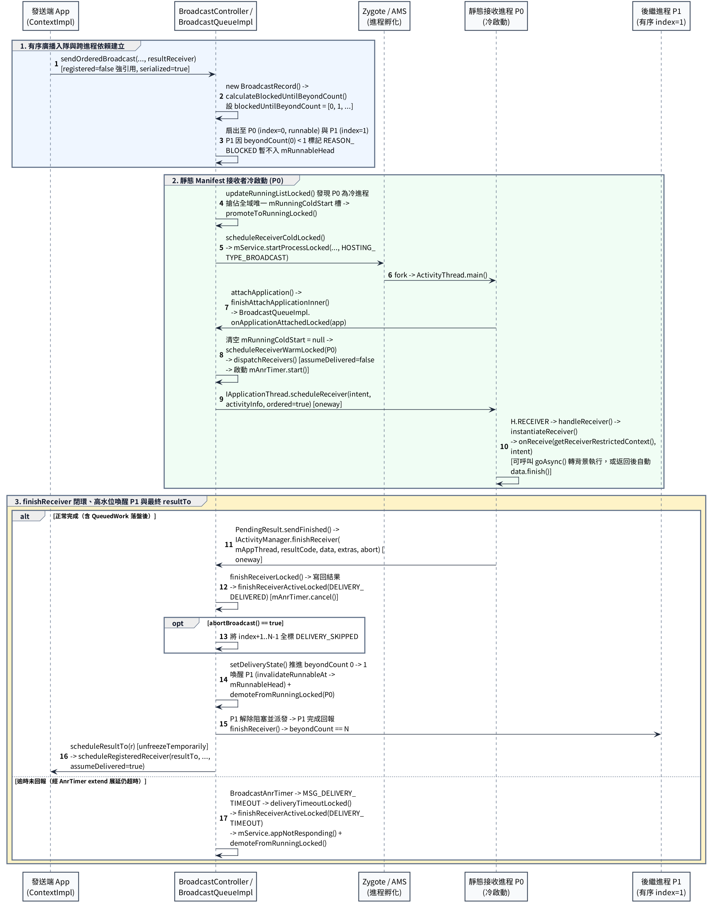

# 9.4 有序廣播、靜態 Manifest 冷啟動與 `finishReceiver` 閉環（`blockedUntilBeyondCount`、`scheduleReceiverColdLocked` 與 `AnrTimer`）

- **情景說明**：上一節追蹤了「無序、溫進程、動態接收者」的高速零阻塞通道（`assumeDelivered == true`）。然而在真實系統中，廣播還有三大最複雜、也最容易引發效能瓶頸與 ANR 的核心場景：
  1. **有序廣播（`sendOrderedBroadcast`）**：高優先級與低優先級接收者分散在不同進程的 `BroadcastProcessQueue` 中，如何不靠全域序列化佇列就能維持嚴格先後順序、支援中途 `abortBroadcast()` 攔截，並在全數完成後透過 `resultTo` 將最終結果回傳給發送者？
  2. **靜態 Manifest `<receiver>` 冷啟動**：當廣播命中宣告在 `AndroidManifest.xml` 但進程尚未運行的靜態接收者（`ResolveInfo`）時，如何透過全域唯一冷啟動槽 **`mRunningColdStart`** 拉起新進程、完成附著接棒並在 `ActivityThread.handleReceiver` 中實例化執行？
  3. **阻塞式回報與 ANR 閉環**：凡是 `assumeDelivered == false` 的接收者（包含所有靜態接收者、有序廣播與帶 `resultTo` 的廣播），系統在派發時啟動 **`BroadcastAnrTimer`**，直到應用端執行 `PendingResult.finish()`（含 `goAsync()` 非同步延後與 `QueuedWork` 落盤等待）發送 `oneway finishReceiver` 回報，或逾時觸發 `appNotResponding()` 為止。
- **對應原書**：9.3 節延伸（p.511–526 中提及之有序廣播 `mOrderedBroadcasts`、靜態 `ResolveInfo` 與 `finishReceiver` 分支）
- **涉及專案與版本基準**：
  - `platform/frameworks/base` 〔`android-17.0.0_r1`，commit `94b4c163b`〕

---

## 9.4.1 呼叫鏈全景

```text
=== 分支 A：有序廣播依賴與跨進程喚醒 ===
ContextImpl.sendOrderedBroadcast(..., resultReceiver)                  ## Step 1、registered=false (強引用) + serialized=true
  └─ new BroadcastRecord() -> calculateBlockedUntilBeyondCount()       ## Step 2、ordered 時設 blockedUntilBeyondCount[i] = i
       ├─ 後繼進程 updateRunnableAt()：r.isBlocked(i) -> REASON_BLOCKED ## 暫不入 mRunnableHead，但絕不阻塞其他無關進程
       └─ 前驅完成 -> BroadcastQueueImpl.setDeliveryState()            ## beyondCount 推進 -> 喚醒後繼佇列；全部完成則 scheduleResultTo()

=== 分支 B：靜態 Manifest 接收者冷啟動 ===
BroadcastQueueImpl.updateRunningListLocked() [!processWarm]            ## Step 3、搶佔全域唯一 mRunningColdStart 槽
  └─ promoteToRunningLocked() -> scheduleReceiverColdLocked()          ## 以 HOSTING_TYPE_BROADCAST 呼叫 mService.startProcessLocked()
       └─ [Zygote fork -> ActivityThread.main() -> attachApplication]
            └─ AMS.finishAttachApplicationInner() -> BroadcastQueueImpl.onApplicationAttachedLocked()  ## Step 4、釋放冷啟動槽
                 └─ scheduleReceiverWarmLocked() -> dispatchReceivers()                                ## 啟動 mAnrTimer + scheduleReceiver
                      └─ ApplicationThread.scheduleReceiver() -> H.RECEIVER -> handleReceiver()        ## Step 5、實例化 Receiver + onReceive()

=== 分支 C：finishReceiver 完成閉環與 ANR 逾時 ===
BroadcastReceiver.onReceive() [可選 goAsync()] -> PendingResult.finish()  ## Step 6、TYPE_COMPONENT 先等 QueuedWork -> sendFinished()
  └─ IActivityManager.finishReceiver(mAppThread, resultCode, ..., abort) [oneway]
       └─ BroadcastController.finishReceiver() -> BroadcastQueueImpl.finishReceiverLocked()  ## Step 7、寫回結果、處理 abortBroadcast
            ├─ finishReceiverActiveLocked(DELIVERY_DELIVERED)          ## 取消 mAnrTimer + 更新 beyondCount 喚醒後繼
            └─ shouldRetire() ? demoteFromRunningLocked() : scheduleReceiverWarmLocked()     ## 退位讓槽或續推下一筆
--- 若逾時未回報 ---
BroadcastAnrTimer (extend=true) -> MSG_DELIVERY_TIMEOUT -> deliveryTimeoutLocked()           ## Step 8、DELIVERY_TIMEOUT -> appNotResponding()
```

---

## 9.4.2 有序廣播：`blockedUntilBeyondCount[]` 與跨進程高水位喚醒

### Step 1：`ContextImpl.sendOrderedBroadcast`
**位置**：`platform/frameworks/base/core/java/android/app/ContextImpl.java` 〔`android-17.0.0_r1`，lines 1518–1553〕

```java
    void sendOrderedBroadcast(Intent intent,
            String receiverPermission, int appOp, BroadcastReceiver resultReceiver,
            Handler scheduler, int initialCode, String initialData,
            Bundle initialExtras, Bundle options) {
        warnIfCallingFromSystemProcess();
        IIntentReceiver rd = null;
        if (resultReceiver != null) {
            if (mPackageInfo != null) {
                if (scheduler == null) {
                    scheduler = mMainThread.getHandler();
                }
                rd = mPackageInfo.getReceiverDispatcher(
                    resultReceiver, getOuterContext(), scheduler,
                    mMainThread.getInstrumentation(), false);
            } else {
                if (scheduler == null) {
                    scheduler = mMainThread.getHandler();
                }
                rd = new LoadedApk.ReceiverDispatcher(mMainThread.getApplicationThread(),
                        resultReceiver, getOuterContext(), scheduler, null, false)
                                .getIIntentReceiver();
            }
        }
        String resolvedType = intent.resolveTypeIfNeeded(getContentResolver());
        String[] receiverPermissions = receiverPermission == null ? null
                : new String[] {receiverPermission};
        try {
            intent.prepareToLeaveProcess(this);
            ActivityManager.getService().broadcastIntentWithFeature(
                    mMainThread.getApplicationThread(), getAttributionTag(), intent, resolvedType,
                    rd, initialCode, initialData, initialExtras, receiverPermissions,
                    null /*excludedPermissions=*/, null, appOp, options, true, false, getUserId());
        } catch (RemoteException e) {
            throw e.rethrowFromSystemServer();
        }
    }
```

與 9.3 節 `sendBroadcast()` 相比，有兩處關鍵差異：
1. **`serialized = true`**：告訴系統端這是一筆有序廣播，所有接收者必須依優先級嚴格串行執行，且前驅可透過 `setResultCode` / `setResultData` / `setResultExtras` 修改傳遞給後繼的結果，或呼叫 `abortBroadcast()` 中止後續派發。
2. **一次性 `resultReceiver` 採用 `registered = false`**：注意 `getReceiverDispatcher(..., false)`！呼應 9.2 節 Step 3，這使 `InnerReceiver` 對 `ReceiverDispatcher` 持有強引用 `mStrongRef = rd` 且不加入 `LoadedApk.mReceivers`，確保即便發送端未保留對匿名 `resultReceiver` 的參考，它也不會在收到最終結果前被 GC 提前回收。

> 〔與 2.3 差異〕AIDL 化 + 參數擴充：原書 9.3 僅以 `sendBroadcast` 為主線；Android 17 的 `sendOrderedBroadcast` 同樣收斂至 `broadcastIntentWithFeature` 並新增 `BroadcastOptions`、`appOp` 與 `prepareToLeaveProcess()`。

---

### Step 2：`BroadcastRecord.calculateBlockedUntilBeyondCount`、`setDeliveryState` 與 `BroadcastQueueImpl.setDeliveryState` / `scheduleResultTo`
**位置**：`platform/frameworks/base/services/core/java/com/android/server/am/BroadcastRecord.java` 〔`android-17.0.0_r1`，lines 592–656、790–808〕、`platform/frameworks/base/services/core/java/com/android/server/am/BroadcastQueueImpl.java` 〔`android-17.0.0_r1`，lines 1364–1393、1687–1756〕

```java
    @VisibleForTesting
    static @NonNull int[] calculateBlockedUntilBeyondCount(
            @NonNull List<Object> receivers, boolean ordered, PlatformCompat platformCompat) {
        final int N = receivers.size();
        final int[] blockedUntilBeyondCount = new int[N];
        if (ordered) {
            // When sending an ordered broadcast, we need to block this
            // receiver until all previous receivers have terminated
            for (int i = 0; i < N; i++) {
                blockedUntilBeyondCount[i] = i;
            }
        } else {
            // Non-ordered broadcasts can be sent in parallel. Mark as -1 to indicate that
            // none of them need to wait
            if (N > 0) {
                Arrays.fill(blockedUntilBeyondCount, -1);
            }
        }
        return blockedUntilBeyondCount;
    }
```

```java
    @CheckResult
    boolean setDeliveryState(int receiverIdx, @DeliveryState int newDeliveryState,
            @NonNull String reason, int queueIdx) {
        final int oldDeliveryState = delivery[receiverIdx];
        if (isDeliveryStateTerminal(oldDeliveryState)
                || newDeliveryState == oldDeliveryState) {
            return false;
        }
        ...
        delivery[receiverIdx] = newDeliveryState;
        deliveryReasons[receiverIdx] = reason;
        queueSlot[receiverIdx] = queueIdx;

        // If this state change might bring us to a new high-water mark, bring
        // ourselves as high as we possibly can
        final int oldBeyondCount = beyondCount;
        if (receiverIdx >= beyondCount) {
            for (int i = beyondCount; i < delivery.length; i++) {
                if (isDeliveryStateBeyond(getDeliveryState(i))) {
                    beyondCount = i + 1;
                } else {
                    break;
                }
            }
        }
        return (beyondCount != oldBeyondCount);
    }

    boolean isBlocked(int index) {
        return (beyondCount < blockedUntilBeyondCount[index]);
    }
```

```java
        final int oldDeliveryState = getDeliveryState(r, index);
        final boolean beyondCountChanged = r.setDeliveryState(index, newDeliveryState, reason,
                queue == null ? UNSPECIFIED_QUEUE_INDEX : queue.runningIndex);
        ...
        // When we've reached a new high-water mark, we might be in a position
        // to unblock other receivers or the final resultTo
        if (beyondCountChanged) {
            if (r.beyondCount == r.receivers.size()) {
                scheduleResultTo(r);
            }

            // Our terminal state here might be enough for another process
            // blocked on us to now be runnable
            if (r.ordered || r.prioritized) {
                for (int i = 0; i < r.receivers.size(); i++) {
                    if (!isDeliveryStateTerminal(getDeliveryState(r, i)) || (i == index)) {
                        final Object otherReceiver = r.receivers.get(i);
                        final BroadcastProcessQueue otherQueue = getProcessQueue(
                                getReceiverProcessName(otherReceiver),
                                getReceiverUid(otherReceiver));
                        if (otherQueue != null) {
                            otherQueue.invalidateRunnableAt();
                            updateRunnableList(otherQueue);
                        }
                    }
                }
                enqueueUpdateRunningList();
            }
        }
```

```java
    @GuardedBy("mService")
    private void scheduleResultTo(@NonNull BroadcastRecord r) {
        if (r.resultTo == null) return;
        final ProcessRecord app = r.resultToApp;
        final IApplicationThread thread = (app != null) ? app.getOnewayThread() : null;
        if (thread != null) {
            mService.unfreezeTemporarily(
                    app, CachedAppOptimizer.UNFREEZE_REASON_FINISH_RECEIVER);
            ...
            try {
                final boolean assumeDelivered = true;
                thread.scheduleRegisteredReceiver(
                        r.resultTo, r.intent,
                        r.resultCode, r.resultData, r.resultExtras, false, r.initialSticky,
                        assumeDelivered, r.userId,
                        app.getReportedProcState(),
                        r.shareIdentity ? r.callingUid : Process.INVALID_UID,
                        r.shareIdentity ? r.callerPackage : null);
            } catch (RemoteException e) { ... }
        }
        // Clear so both local and remote references can be GC'ed
        r.resultTo = null;
    }
```

這套設計完美解決了「在 Per-Process 並行佇列裡實作跨進程有序廣播」的難題：
1. **入隊即建立依賴表**：建構 `BroadcastRecord` 時，`calculateBlockedUntilBeyondCount` 為有序廣播填入 `[0, 1, 2, ..., N-1]`（無序廣播則全填 `-1`）。一開始 `beyondCount == 0`，因此只有 `index = 0` 滿足 `isBlocked(0) == false`（`0 < 0` 為假）能立即進入 `mRunnableHead`；其餘 `1..N-1` 所屬進程在 `updateRunnableAt()` 中全因 `r.isBlocked(i) == true` 被標記 `REASON_BLOCKED`（`mRunnableAt = Long.MAX_VALUE`）暫時掛起，但**完全不會阻塞全系統中其他無關進程的廣播派發**！
2. **高水位單調推進與精準喚醒**：當接收者 `0` 完成（進入 `DELIVERY_DELIVERED` / `SKIPPED` / `TIMEOUT` / `FAILURE` 任一終結態）時，`r.setDeliveryState()` 從 `beyondCount` 往後掃描連續已越過的格子，把 `beyondCount` 推進到 `1`（若 `1` 先前已被 `BroadcastSkipPolicy` 跳過，還會一路連跳到 `2`！）並回傳 `beyondCountChanged = true`。
3. **喚醒後繼與最終 `resultTo` 回調**：`BroadcastQueueImpl.setDeliveryState()` 看到 `beyondCountChanged` 為真，立即遍歷尚未終結的接收者所屬進程佇列，呼叫 `otherQueue.invalidateRunnableAt()` + `updateRunnableList(otherQueue)` + `enqueueUpdateRunningList()`——此時 `index = 1` 的 `isBlocked(1)` 變成 `false`，立刻重新插回 `mRunnableHead` 等待晉升。等到 `r.beyondCount == r.receivers.size()`，呼叫 **`scheduleResultTo(r)`**（先臨時解凍 `resultToApp`，再以 `ordered = false, assumeDelivered = true` 呼叫 `scheduleRegisteredReceiver`），把最終的 `resultCode` / `resultData` / `resultExtras` 交回發送端，並將 `r.resultTo = null` 釋放引用。

> 〔與 2.3 差異〕演算法徹底重寫：原書 2.3（p.519–522）把整個有序廣播放在全域 `mOrderedBroadcasts` 隊首，由單一 `nextReceiver` 阻塞整條佇列；Android 17 改以 `blockedUntilBeyondCount[]` + `beyondCount` 達成細粒度的跨進程依賴解鎖。

---

## 9.4.3 靜態 Manifest 接收者冷啟動與實例化執行

### Step 3：單槽冷啟動限流：`updateRunningListLocked` 與 `scheduleReceiverColdLocked`
**位置**：`platform/frameworks/base/services/core/java/com/android/server/am/BroadcastQueueImpl.java` 〔`android-17.0.0_r1`，lines 566–605、1086–1147〕

```java
            } else {
                // We only offer to run one cold-start at a time to preserve
                // system resources; below we either claim that single slot or
                // skip to look for another warm process
                if (mRunningColdStart == null) {
                    mRunningColdStart = queue;
                    mRunningColdStart.clearProcessStartInitiatedTimestampMillis();
                } else if (isPendingColdStartValid()) {
                    // Move to considering next runnable queue
                    queue = nextQueue;
                    continue;
                } else {
                    // Pending cold start is not valid, so clear it and move on.
                    clearInvalidPendingColdStart();
                    mRunningColdStart = queue;
                    mRunningColdStart.clearProcessStartInitiatedTimestampMillis();
                }
            }

            promoteToRunningLocked(queue);
            boolean completed;
            if (processWarm) {
                ...
            } else {
                completed = scheduleReceiverColdLocked(queue);
            }
            if (completed) {
                demoteFromRunningLocked(queue);
            }
```

```java
    @CheckResult
    @GuardedBy("mService")
    private boolean scheduleReceiverColdLocked(@NonNull BroadcastProcessQueue queue) {
        checkState(queue.isActive(), "isActive");

        // Remember that active broadcast was scheduled via a cold start
        queue.setActiveViaColdStart(true);

        final BroadcastRecord r = queue.getActive();
        final int index = queue.getActiveIndex();
        final Object receiver = r.receivers.get(index);

        // Ignore registered receivers from a previous PID
        if (receiver instanceof BroadcastFilter) {
            mRunningColdStart = null;
            finishReceiverActiveLocked(queue, BroadcastRecord.DELIVERY_SKIPPED,
                    "BroadcastFilter for cold app");
            return true;
        }

        final Intent receiverIntent = r.getReceiverIntent(receiver);
        final String skipReason = shouldSkipReceiver(queue, r, index, receiverIntent);
        if (skipReason != null) {
            mRunningColdStart = null;
            finishReceiverActiveLocked(queue, BroadcastRecord.DELIVERY_SKIPPED, skipReason);
            return true;
        }

        final ActivityInfo activityInfo = ((ResolveInfo) receiver).activityInfo;
        final ApplicationInfo info = activityInfo.applicationInfo;
        final ComponentName component = activityInfo.getComponentName();
        final boolean runInPccSandbox = activityInfo.shouldRunInPccSandbox();

        queue.setActiveWasStopped(info.isStopped());
        queue.setActiveFirstLaunch(info.isNotLaunched());

        final int intentFlags = r.intent.getFlags() | Intent.FLAG_FROM_BACKGROUND;
        final HostingRecord hostingRecord = new HostingRecord(HostingRecord.HOSTING_TYPE_BROADCAST,
                component, r.intent.getAction(), r.getHostingRecordTriggerType(), runInPccSandbox,
                r.callingUid, r.callerApp != null ? r.callerApp.processName : null);
        final boolean isActivityCapable = (r.options != null
                && r.options.getTemporaryAppAllowlistDuration() > 0);
        final int zygotePolicyFlags = isActivityCapable ? ZYGOTE_POLICY_FLAG_LATENCY_SENSITIVE
                : ZYGOTE_POLICY_FLAG_EMPTY;
        final boolean allowWhileBooting = (r.intent.getFlags()
                & Intent.FLAG_RECEIVER_BOOT_UPGRADE) != 0;

        long startTimeNs = SystemClock.uptimeNanos();
        queue.app = mService.startProcessLocked(queue.processName, info, true, intentFlags,
                hostingRecord, zygotePolicyFlags, allowWhileBooting, false);
        if (queue.app == null) {
            mRunningColdStart = null;
            finishReceiverActiveLocked(queue, BroadcastRecord.DELIVERY_FAILURE,
                    "startProcessLocked failed");
            return true;
        }
        queue.setProcessStartInitiatedTimestampMillis(SystemClock.uptimeMillis());
        mService.mProcessList.getAppStartInfoTracker().handleProcessBroadcastStart(
                startTimeNs, queue.app, receiverIntent, r.alarm /* isAlarm */);
        return false;
    }
```

當 `updateRunningListLocked()` 掃到一個尚未運行的冷進程佇列（`!processWarm`）：
1. **全域單一冷啟動槽限流**：若 `mRunningColdStart != null` 且仍有效（`isPendingColdStartValid()`），直接跳過此冷佇列、繼續往後找其他溫進程來填滿 `mRunning[]`，防止例如開機 `BOOT_COMPLETED` 廣播一次 fork 數十個進程造成 CPU 與記憶體雪崩！
2. **動態接收者殘留防護與策略篩選**：進入 `scheduleReceiverColdLocked()` 後，如果隊首目標其實是動態註冊的 `BroadcastFilter`（代表原進程剛死掉），不可能靠冷啟動恢復它，直接釋放 `mRunningColdStart` 並標記 `DELIVERY_SKIPPED`；接著再以 `shouldSkipReceiver()`（涵蓋 `BroadcastSkipPolicy` 對背景隱式靜態廣播、停止狀態、權限與 Instant App 不支援 Manifest 接收者的過濾）確認確實有資格啟動。
3. **發起冷啟動並掛起等待**：組建 `HostingRecord(HOSTING_TYPE_BROADCAST, ...)` 呼叫 `mService.startProcessLocked(...)` 向 Zygote 請求孵化新進程，並回傳 `completed = false` 保持該佇列停留在 `mRunning[]` 與 `mRunningColdStart` 槽中，等待新進程附著回來。

> 〔與 2.3 差異〕邏輯大幅強化：原書 2.3（p.521）在 `processNextBroadcast` 遇冷進程時由全域單一 `mPendingBroadcast` 欄位阻塞整條有序佇列；Android 17 只佔用唯一冷啟動槽 `mRunningColdStart`，其餘溫進程照常在 `mRunning[]` 並行消化廣播。

---

### Step 4：新進程附著接棒：`BroadcastQueueImpl.onApplicationAttachedLocked`
**位置**：`platform/frameworks/base/services/core/java/com/android/server/am/ActivityManagerService.java` 〔`android-17.0.0_r1`，line 5649〕、`platform/frameworks/base/services/core/java/com/android/server/am/BroadcastQueueImpl.java` 〔`android-17.0.0_r1`，lines 697–746〕

```java
// ActivityManagerService.java: finishAttachApplicationInner()
didSomething |= mBroadcastQueue.onApplicationAttachedLocked(app);
```

```java
    @GuardedBy("mService")
    @Override
    public boolean onApplicationAttachedLocked(@NonNull ProcessRecord app)
            throws BroadcastRetryException {
        final BroadcastProcessQueue queue = getProcessQueue(app);
        if (queue != null) {
            setQueueProcess(queue, app);
            queue.clearOutgoingBroadcasts();
        }

        boolean didSomething = false;
        if ((mRunningColdStart != null) && (mRunningColdStart == queue)) {
            // We've been waiting for this app to cold start, and it's ready
            // now; dispatch its next broadcast and clear the slot
            mRunningColdStart.clearProcessStartInitiatedTimestampMillis();
            mRunningColdStart = null;

            notifyStartedRunning(queue);
            if (Flags.pscAutoUpdateBroadcastState()) {
                // No need to manually trigger an update.
            } else {
                mService.updateOomAdjPendingTargetsLocked(OOM_ADJ_REASON_START_RECEIVER);
            }

            queue.traceProcessEnd();
            queue.traceProcessRunningBegin();
            try {
                if (scheduleReceiverWarmLocked(queue)) {
                    demoteFromRunningLocked(queue);
                }
            } catch (BroadcastRetryException e) {
                finishOrReEnqueueActiveBroadcast(queue);
                demoteFromRunningLocked(queue);
                throw e;
            }

            // We might be willing to kick off another cold start
            enqueueUpdateRunningList();
            didSomething = true;
        }
        return didSomething;
    }
```

新進程由 Zygote 孵化並執行 `ActivityThread.main()` → `AMS.attachApplication()` → `finishAttachApplicationInner()`（與第 7、8 章完全一致的接棒點），呼叫 `mBroadcastQueue.onApplicationAttachedLocked(app)`：
1. 先以 `setQueueProcess(queue, app)` 把剛就緒的 `ProcessRecord` 綁定到該進程的 `BroadcastProcessQueue`，使 `queue.isProcessWarm()` 轉為 `true`；
2. 若它正是等待中的 `mRunningColdStart`，立刻清空 `mRunningColdStart = null` 釋放全域冷啟動名額，通知 OOM Adj 調整，並直接轉進 **`scheduleReceiverWarmLocked(queue)`** → `dispatchReceivers()`！
3. 此時目標是靜態 `ResolveInfo`，`isAssumedDelivered` 必為 `false`，因此 `dispatchReceivers()` 會先呼叫 **`startDeliveryTimeoutLocked(queue, softTimeoutMillis)`** 啟動 ANR 計時器，再透過 `app.getOnewayThread().scheduleReceiver(receiverIntent, activityInfo, ...)` 下發給新進程並回傳 `isBlockingDispatch = true`，留在 `mRunning[]` 中等待 `finishReceiver`；最後補發 `enqueueUpdateRunningList()` 讓下一個排隊中的冷進程立刻接棒冷啟動！

> 〔與 2.3 差異〕接棒路徑改名與現代化：原書 2.3 在 `AMS.attachApplicationLocked` 呼叫 `sendPendingBroadcastsLocked`；Android 17 統一交由 `mBroadcastQueue.onApplicationAttachedLocked(app)` 釋放冷啟動槽並無縫銜接 `scheduleReceiverWarmLocked`。

---

### Step 5：目標進程實例化靜態接收者：`ApplicationThread.scheduleReceiver` → `ActivityThread.handleReceiver`
**位置**：`platform/frameworks/base/core/java/android/app/ActivityThread.java` 〔`android-17.0.0_r1`，lines 1253–1266、5329–5406〕

```java
        @Override
        public final void scheduleReceiver(Intent intent, ActivityInfo info,
                CompatibilityInfo compatInfo, int resultCode, String data, Bundle extras,
                boolean ordered, boolean assumeDelivered, int sendingUser, int processState,
                int sendingUid, String sendingPackage) {
            updateProcessState(processState, false);
            ReceiverData r = new ReceiverData(intent, resultCode, data, extras,
                    ordered, false, assumeDelivered, mAppThread.asBinder(), sendingUser,
                    sendingUid, sendingPackage);
            r.info = info;
            if (DEBUG_STORE_ENABLED) {
                DebugStore.recordScheduleBroadcastReceive(System.identityHashCode(r), intent);
            }
            sendMessage(H.RECEIVER, r);
        }
```

```java
    private void handleReceiver(ReceiverData data) {
        unscheduleGcIdler();

        String component = data.intent.getComponent().getClassName();

        final LoadedApk packageInfo = getPackageInfoNoCheck(data.info.applicationInfo);

        IActivityManager mgr = ActivityManager.getService();

        Application app;
        BroadcastReceiver receiver;
        ContextImpl context;
        try {
            app = packageInfo.makeApplicationInner(false, mInstrumentation);
            context = (ContextImpl) app.getBaseContext();
            if (data.info.splitName != null) {
                context = (ContextImpl) context.createContextForSplit(data.info.splitName);
            }
            if (data.info.attributionTags != null && data.info.attributionTags.length > 0) {
                final String attributionTag = data.info.attributionTags[0];
                context = (ContextImpl) context.createAttributionContext(attributionTag);
            }
            context = (ContextImpl) createDisplayContextIfNeeded(context, data);
            java.lang.ClassLoader cl = context.getClassLoader();
            data.intent.setExtrasClassLoader(cl);
            data.intent.prepareToEnterProcess(
                    isProtectedComponent(data.info) || isProtectedBroadcast(data.intent),
                    context.getAttributionSource());
            data.setExtrasClassLoader(cl);
            receiver = packageInfo.getAppFactory()
                    .instantiateReceiver(cl, data.info.name, data.intent);
        } catch (Exception e) {
            data.sendFinished(mgr);
            throw new RuntimeException(
                "Unable to instantiate receiver " + component, e);
        }

        try {
            sCurrentBroadcastIntent.set(data.intent);
            receiver.setPendingResult(data);
            receiver.onReceive(context.getReceiverRestrictedContext(),
                    data.intent);
        } catch (Exception e) {
            data.sendFinished(mgr);
            if (!mInstrumentation.onException(receiver, e)) {
                throw new RuntimeException(
                    "Unable to start receiver " + component, e);
            }
        } finally {
            sCurrentBroadcastIntent.set(null);
        }

        if (receiver.getPendingResult() != null) {
            data.finish();
        }
    }
```

靜態接收者跟動態接收者在客戶端的生命週期有著截然不同的特性：
1. **每次接收皆重新實例化**：`ApplicationThread.scheduleReceiver` 把參數包進繼承自 `BroadcastReceiver.PendingResult`（且 `mType = TYPE_COMPONENT`）的 `ReceiverData` 並送出 `H.RECEIVER`。主執行緒執行 `handleReceiver()` 時，透過 **`AppComponentFactory.instantiateReceiver()`** 動態建立一個全新的 `BroadcastReceiver` 實例，並視需要建立 split / attribution / display Context。
2. **受限的 `ReceiverRestrictedContext`**：傳入 `receiver.onReceive()` 的不是普通 `ContextImpl`，而是 `context.getReceiverRestrictedContext()`——它刻意封鎖 `registerReceiver()` 與 `bindService()`（呼叫會拋出 `ReceiverCallNotAllowedException`），因為靜態 `BroadcastReceiver` 物件在 `onReceive()` 返回後便立即失效，根本無法安全持有動態註冊或服務綁定的生命週期！
3. **自動或手動 `finish()`**：若開發者在 `onReceive()` 中未呼叫 `goAsync()`，則 `receiver.getPendingResult()` 仍非空，末尾立刻呼叫 `data.finish()`；若呼叫了 `goAsync()`，系統則把 `PendingResult` 控制權交給開發者，待背景執行緒結束時自行呼叫 `pendingResult.finish()`。

> 〔與 2.3 差異〕邏輯演進：原書 2.3 使用 `cl.loadClass(component).newInstance()` 實例化且未經 `AppComponentFactory`；Android 17 支援 split APK、權限歸因、多螢幕 Widget DisplayContext、`prepareToEnterProcess()` 與 `goAsync()` 生命週期。

---

## 9.4.4 `finishReceiver` 閉環、`goAsync()` 與 `BroadcastAnrTimer`

### Step 6：`BroadcastReceiver.goAsync` 與 `PendingResult.finish` / `sendFinished`
**位置**：`platform/frameworks/base/core/java/android/content/BroadcastReceiver.java` 〔`android-17.0.0_r1`，lines 259–338、446–460〕

```java
        public final void finish() {
            ...
            if (mType == TYPE_COMPONENT) {
                final IActivityManager mgr = ActivityManager.getService();
                if (QueuedWork.hasPendingWork()) {
                    QueuedWork.queue(new Runnable() {
                        @Override public void run() {
                            sendFinished(mgr);
                        }
                    }, false);
                } else {
                    sendFinished(mgr);
                }
            } else {
                final IActivityManager mgr = ActivityManager.getService();
                sendFinished(mgr);
            }
        }
```

```java
        public void sendFinished(IActivityManager am) {
            synchronized (this) {
                if (mFinished) {
                    throw new IllegalStateException("Broadcast already finished");
                }
                mFinished = true;

                try {
                    if (mResultExtras != null) {
                        mResultExtras.setAllowFds(false);
                    }

                    // When the OS didn't assume delivery, we need to inform
                    // it that we've actually finished the delivery
                    if (!mAssumeDeliveredHint) {
                        if (mOrderedHint) {
                            am.finishReceiver(mToken, mResultCode, mResultData, mResultExtras,
                                    mAbortBroadcast, mFlags);
                        } else {
                            am.finishReceiver(mToken, 0, null, null, false, mFlags);
                        }
                    }
                } catch (RemoteException ex) {
                }
            }
        }
```

```java
    public final PendingResult goAsync() {
        PendingResult res = mPendingResult;
        mPendingResult = null;
        ...
        return res;
    }
```

這三段短小精悍的程式碼，解釋了 Android 開發中三個最常被問到的實務細節：
1. **`goAsync()` 的原理**：就只有兩行——取出 `mPendingResult` 並把 `this.mPendingResult = null`！這讓 `handleReceiver()` 或 `Args.getRunnable()` 末尾的 `if (receiver.getPendingResult() != null)` 檢查為假而跳過立即 `finish()`，讓開發者把耗時 I/O 丟到背景執行緒，但請記住：**系統端的 `BroadcastAnrTimer` 仍在倒數計時**，背景工作仍必須在限時內呼叫 `res.finish()`！
2. **為何靜態接收者（`TYPE_COMPONENT`）要檢查 `QueuedWork.hasPendingWork()`？** 因為開發者常在靜態 `onReceive()` 裡呼叫 `SharedPreferences.Editor.apply()`（非同步寫碟）後就返回；若立刻通知 AMS `finishReceiver`，該冷啟動進程可能下一毫秒就因無存活元件而被降級殺掉、導致資料遺失！透過把 `sendFinished(mgr)` 排在 `QueuedWork` 尾端，確保磁碟寫入全部落盤後才通知系統結案。
3. **`!mAssumeDeliveredHint` 決定是否發 IPC**：只有當系統未假定送達（靜態接收者、有序廣播或帶 `resultTo`）時，才呼叫 `oneway` 的 `am.finishReceiver(mToken, ...)`（`mToken` 永遠是 `mAppThread.asBinder()`，用於在系統端精準反查 `ProcessRecord` 及其唯一的 `BroadcastProcessQueue`）。

> 〔與 2.3 差異〕新增：原書 2.3 沒有 `goAsync()`、`QueuedWork` 落盤等待與 `mAssumeDeliveredHint` 判斷。

---

### Step 7：`BroadcastController.finishReceiver` → `BroadcastQueueImpl.finishReceiverLocked` / `finishReceiverActiveLocked` / `demoteFromRunningLocked`
**位置**：`platform/frameworks/base/services/core/java/com/android/server/am/BroadcastController.java` 〔`android-17.0.0_r1`，lines 1887–1914〕、`platform/frameworks/base/services/core/java/com/android/server/am/BroadcastQueueImpl.java` 〔`android-17.0.0_r1`，lines 1487–1606、1650–1680〕

```java
    void finishReceiver(IBinder caller, int resultCode, String resultData,
            Bundle resultExtras, boolean resultAbort, int flags) {
        if (resultExtras != null && resultExtras.hasFileDescriptors()) {
            throw new IllegalArgumentException("File descriptors passed in Bundle");
        }

        final long origId = Binder.clearCallingIdentity();
        try {
            synchronized (mService) {
                final ProcessRecord callerApp = mService.getRecordForAppLOSP(caller);
                if (callerApp == null) {
                    Slog.w(TAG, "finishReceiver: no app for " + caller);
                    return;
                }

                mBroadcastQueue.finishReceiverLocked(callerApp, resultCode,
                        resultData, resultExtras, resultAbort, true);
                // updateOomAdjLocked() will be done here
                mService.trimApplicationsLocked(false, OOM_ADJ_REASON_FINISH_RECEIVER);
            }
        } finally {
            Binder.restoreCallingIdentity(origId);
        }
    }
```

```java
    @GuardedBy("mService")
    @Override
    public boolean finishReceiverLocked(@NonNull ProcessRecord app, int resultCode,
            @Nullable String resultData, @Nullable Bundle resultExtras, boolean resultAbort,
            boolean waitForServices) {
        final BroadcastProcessQueue queue = getProcessQueue(app);
        if ((queue == null) || !queue.isActive()) {
            logw("Ignoring finishReceiverLocked; no active broadcast for " + queue);
            return false;
        }

        final BroadcastRecord r = queue.getActive();
        final int index = queue.getActiveIndex();
        if (r.ordered) {
            r.resultCode = resultCode;
            r.resultData = resultData;
            r.resultExtras = resultExtras;
            if (!r.isNoAbort()) {
                r.resultAbort = resultAbort;
            }
        }

        finishReceiverActiveLocked(queue,
                BroadcastRecord.DELIVERY_DELIVERED, "remote app");

        // When the caller aborted an ordered broadcast, we mark all
        // remaining receivers as skipped
        if (r.resultAbort) {
            for (int i = index + 1; i < r.receivers.size(); i++) {
                setDeliveryState(null, null, r, i, r.receivers.get(i),
                        BroadcastRecord.DELIVERY_SKIPPED, "resultAbort");
            }
        }

        if (shouldRetire(queue)) {
            demoteFromRunningLocked(queue);
            return true;
        }

        // We're on a roll; move onto the next broadcast for this process
        queue.makeActiveNextPending();
        try {
            if (scheduleReceiverWarmLocked(queue)) {
                demoteFromRunningLocked(queue);
                return true;
            }
        } catch (BroadcastRetryException e) {
            finishOrReEnqueueActiveBroadcast(queue);
            demoteFromRunningLocked(queue);
            return true;
        }

        return false;
    }
```

```java
    @GuardedBy("mService")
    private void finishReceiverActiveLocked(@NonNull BroadcastProcessQueue queue,
            @DeliveryState int deliveryState, @NonNull String reason) {
        if (!queue.isActive()) {
            logw("Ignoring finishReceiverActiveLocked; no active broadcast for " + queue);
            return;
        }

        final int cookie = traceBegin("finishReceiver");
        final ProcessRecord app = queue.app;
        final BroadcastRecord r = queue.getActive();
        final int index = queue.getActiveIndex();
        final Object receiver = r.receivers.get(index);

        setDeliveryState(queue, app, r, index, receiver, deliveryState, reason);

        if (deliveryState == BroadcastRecord.DELIVERY_TIMEOUT) {
            r.anrCount++;
            if (app != null && !app.isDebugging()) {
                final String packageName = getReceiverPackageName(receiver);
                final String className = getReceiverClassName(receiver);
                TimeoutRecord tr = TimeoutRecord.forBroadcastReceiver(r.intent, packageName,
                        className);
                mAnrTimer.accept(queue, tr);
                mService.appNotResponding(queue.app, tr);
            } else {
                mAnrTimer.discard(queue);
            }
        } else if (queue.timeoutScheduled()) {
            cancelDeliveryTimeoutLocked(queue);
        }

        checkAndRemoveWaitingFor();
        traceEnd(cookie);
    }
```

```java
    @GuardedBy("mService")
    private void demoteFromRunningLocked(@NonNull BroadcastProcessQueue queue) {
        if (!queue.isActive()) {
            return;
        }
        ...
        queue.makeActiveIdle();
        queue.traceProcessEnd();
        queue.runningIndex = UNSPECIFIED_QUEUE_INDEX;

        final int queueIndex = getRunningIndexOf(queue);
        mRunning[queueIndex] = null;
        updateRunnableList(queue);
        enqueueUpdateRunningList();

        notifyStoppedRunning(queue);
    }
```

當應用端的 `oneway finishReceiver` 回到 `BroadcastQueueImpl.finishReceiverLocked()`，整條閉環隨即轉動：
1. **寫回有序廣播結果與中止傳播**：若 `r.ordered` 為真，更新 `r.resultCode` / `r.resultData` / `r.resultExtras`（以及在未設 `FLAG_RECEIVER_NO_ABORT` 時更新 `r.resultAbort`）；呼叫 `finishReceiverActiveLocked(queue, DELIVERY_DELIVERED, "remote app")`——內部呼叫 `setDeliveryState()` 推進 `beyondCount` 喚醒下一個有序進程佇列，並執行 **`cancelDeliveryTimeoutLocked(queue)`** 取消 ANR 計時器！若 `r.resultAbort == true`，則一口氣把剩餘 `index + 1 .. size - 1` 全標為 `DELIVERY_SKIPPED`（這會立刻將 `beyondCount` 推到底，進而觸發 `scheduleResultTo(r)`）。
2. **乘勝追擊或退位讓槽**：檢查 `shouldRetire(queue)`（判斷該進程是否已空、不再 runnable、非溫進程，或已達單輪連續派發上限 `MAX_RUNNING_ACTIVE_BROADCASTS = 16`）——若應退位則呼叫 `demoteFromRunningLocked(queue)` 釋出 `mRunning[]` 槽位並重新排程其他進程；否則直接 `queue.makeActiveNextPending()` 呼叫 `scheduleReceiverWarmLocked(queue)` 繼續處理該進程的下一筆廣播！

> 〔與 2.3 差異〕邏輯徹底重寫：原書 2.3 的 `finishReceiverLocked` 只推進全域 `mOrderedBroadcasts` 的下一格；Android 17 改為精準定位 `getProcessQueue(app)`、取消每進程專屬的 `mAnrTimer`、以 `beyondCount` 解鎖他進程、並在退位與連發之間動態平衡吞吐與公平性。

---

### Step 8：`BroadcastAnrTimer` 與 `deliveryTimeoutLocked`
**位置**：`platform/frameworks/base/services/core/java/com/android/server/am/BroadcastQueueImpl.java` 〔`android-17.0.0_r1`，lines 1398–1483〕

```java
    @GuardedBy("mService")
    private void startDeliveryTimeoutLocked(@NonNull BroadcastProcessQueue queue,
            int softTimeoutMillis) {
        mAnrTimer.start(queue, softTimeoutMillis);
    }

    @GuardedBy("mService")
    private void cancelDeliveryTimeoutLocked(@NonNull BroadcastProcessQueue queue) {
        mAnrTimer.cancel(queue);
    }
    ...
    @GuardedBy("mService")
    private void deliveryTimeoutLocked(@NonNull BroadcastProcessQueue queue) {
        finishReceiverActiveLocked(queue, BroadcastRecord.DELIVERY_TIMEOUT,
                "deliveryTimeoutLocked");
        demoteFromRunningLocked(queue);
    }

    private class BroadcastAnrTimer extends AnrTimer<BroadcastProcessQueue> {
        BroadcastAnrTimer(@NonNull Handler handler) {
            super(
                    Objects.requireNonNull(handler),
                    MSG_DELIVERY_TIMEOUT,
                    "BROADCAST_TIMEOUT",
                    new AnrTimer.Args()
                            .extend(true)
                            .longMethodTracing(Flags.enableLongMethodTracingOnAnrTimer())
                            .anrWarning(android.app.Flags.enableAnrWarningCallback())
                            .anrWarningMessageId(MSG_DELIVERY_TIMEOUT_WARNING));
        }
        ...
    }
```

最後補上萬一接收者卡死不回報的保護網：**`BroadcastAnrTimer`**（繼承自 Android 現代統一的 `AnrTimer<BroadcastProcessQueue>`）：
- **軟逾時基準**：前台廣播（`FLAG_RECEIVER_FOREGROUND`）取 `mFgConstants.TIMEOUT`（10 秒），背景廣播取 `mBgConstants.TIMEOUT`（60 秒）。
- **CPU 爭搶自動展延（`.extend(true)`）**：對照 `BroadcastQueue.md` 所描述的防誤判機制，當系統 CPU 高度競爭導致目標進程拿不到排程時間片時，`AnrTimer` 會在內部評估實際 CPU 消耗並自動將軟逾時最高展延至原長度的 2 倍，避免無辜觸發 ANR；並支援提前觸發 `MSG_DELIVERY_TIMEOUT_WARNING` 預警與長耗時方法追蹤。
- **硬逾時處置**：若展延後仍未收到 `finishReceiver`，`mLocalCallback` 收到 `MSG_DELIVERY_TIMEOUT` → `deliveryTimeoutLocked(queue)` → 呼叫 `finishReceiverActiveLocked(queue, DELIVERY_TIMEOUT, ...)` 建構 `TimeoutRecord.forBroadcastReceiver(...)` 交給 **`mService.appNotResponding(queue.app, tr)`** 彈出／記錄 ANR（若進程正在除錯 `app.isDebugging()` 則忽略），同時推進 `beyondCount` 並 `demoteFromRunningLocked(queue)` 釋出槽位，確保這顆壞掉的進程絕不會永遠卡住整個廣播系統！

> 〔與 2.3 差異〕邏輯徹底升級：原書 2.3 僅靠 AMS Handler 單一 `BROADCAST_TIMEOUT_MSG` 固定計時；Android 17 以 `AnrTimer` 統一管理每進程計時、支援 CPU 爭搶展延、ANR 預警回調與原生長方法追蹤。

---

## 9.4.5 本節總結與時序圖



### 第 9 章全章重點整理

- **現代架構三核心**：Android 17 將原書 2.3 散落於單體 AMS 的廣播機制拆為 **`BroadcastController`**（註冊、解析、黏性與安全檢核）與唯一的 **`BroadcastQueueImpl`**（Per-Process **`BroadcastProcessQueue`** + `mRunnableHead` + `mRunning[]` + 單槽 `mRunningColdStart`）。
- **動態註冊與安全邊界**：App 端以 `LoadedApk.ReceiverDispatcher` + `InnerReceiver`（弱引用防洩漏）對接；系統端以 `mRegisteredReceivers` / `app.mReceivers`（上限 1000）/ `mReceiverResolver` 三處聯動，並強制非系統廣播顯式宣告 `RECEIVER_EXPORTED` / `RECEIVER_NOT_EXPORTED`，高頻黏性查詢則由 `BroadcastStickyCache` 在客戶端本機命中。
- **兩條截然不同的派發通道**：無序動態接收者走 `assumeDelivered == true` 批次零阻塞快道（借道 `IApplicationThread.scheduleRegisteredReceiver` 確保單一 Binder 節點 `oneway` 保序，發完即 `DELIVERY_DELIVERED`）；有序與靜態接收者則透過 `blockedUntilBeyondCount[]` / `beyondCount` 跨進程解鎖、單槽冷啟動與 `PendingResult.finish()`（含 `goAsync()` / `QueuedWork`）→ `finishReceiver` + `BroadcastAnrTimer` 構成完整閉環。
