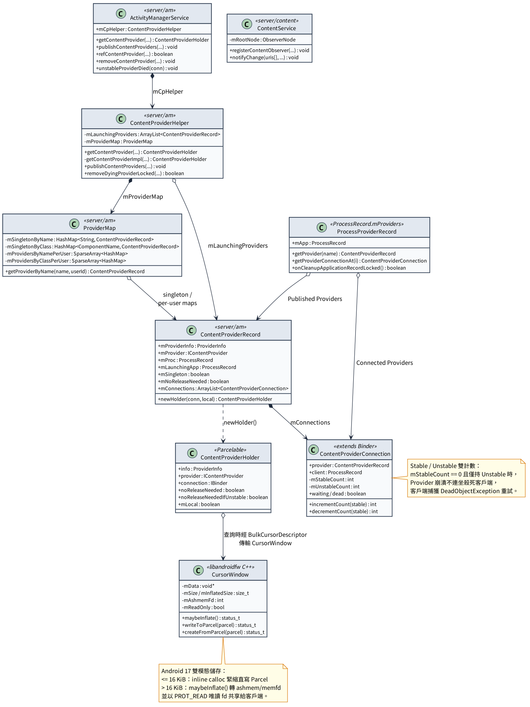
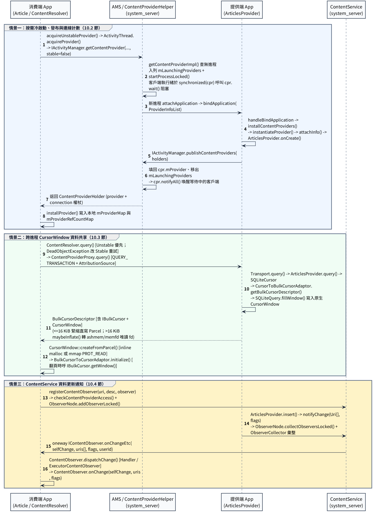

# 10.1 現代 Content Provider 架構、資料模型與核心情景（`ContentProviderHelper`、`ProviderMap` 與 Stable/Unstable 連線）

- **情景說明**：Content Provider 是 Android 四大組件中專責「跨進程結構化資料共享與權限隔離」的核心元件——不同於廣播只傳遞輕量 `Intent`、或 Service 偏向執行操作，Content Provider 以統一的 `content://<authority>/<path>` URI 模型將底層 SQLite 資料庫或檔案暴露給其他應用，同時整合了按需啟動、共享記憶體零拷貝傳輸與資料變更訂閱通知三大子系統。本節延續原書 `ArticlesProvider`（獨立進程資料庫提供者）與 `Article`（消費端 UI 應用）雙應用實例，先確立貫穿本章的三條核心情景，再解剖 Android 17 在 `system_server` 與應用層的核心資料模型：
  1. **情景一（按需啟動、發布與連線計數，見 10.2 節）**：`Article` 進程首度存取尚未運行的 `ArticlesProvider` → `ActivityThread.acquireProvider` 查無本地快取，經 `AMS.getContentProvider` 進入 **`ContentProviderHelper.getContentProviderImpl`** → AMS 孵化 Provider 進程並立即回傳空殼 `ContentProviderHolder`，由客戶端於本機 `ProviderKey.mLock.wait()` 等待（避免佔用 `system_server` Binder 執行緒）→ 新進程隨 `bindApplication` 實例化 Provider 執行 `onCreate()`，呼叫 `publishContentProviders` 透過 `notifyContentProviderPublishStatus` 非同步喚醒客戶端；
  2. **情景二（跨進程 `CursorWindow` 資料共享，見 10.3 節）**：`Article` 呼叫 `ContentResolver.query(...)`（先取 Unstable 連線，遇崩潰才降級 Stable 重試）→ `ContentProvider.Transport.query` 由 **Provider 側**建構並填充原生 `CursorWindow`，封裝進 **`BulkCursorDescriptor`** 單次 IPC 返回（≤ 16 KiB 走內聯 Parcel 直傳，> 16 KiB 呼叫 `maybeInflate()` 延遲轉 Ashmem/`memfd` 唯讀 fd 共享）→ 客戶端 `BulkCursorToCursorAdaptor` 直接唯讀映射或翻頁 `IBulkCursor.getWindow()`；
  3. **情景三（資料更新通知機制，見 10.4 節）**：`Article` 透過 `ContentResolver.registerContentObserver` 向獨立系統服務 **`ContentService`** 的 `ObserverNode` URI 前綴樹登記觀察者；當 `ArticlesProvider.insert()` 寫入新資料並呼叫 `notifyChange()` 時，`ContentService` 透過 **`ObserverCollector`** 彙整受影響的觀察者並以 `oneway IContentObserver.onChangeEtc` 批次推播回客戶端 `ContentObserver.onChange()`。
- **對應原書**：第 10 章引言與 10.1 節〈Content Provider组件应用实例〉（p.532–557）
- **涉及專案與版本基準**：
  - `platform/frameworks/base` 〔`android-17.0.0_r1`，commit `94b4c163b`〕

---

## 10.1.1 三大核心情景與現代 Content Provider 系統座標

> 對應原書 10.1（p.532–557）。原書撰寫了兩個獨立應用程式：`ArticlesProvider` 內建 SQLite 資料庫並以 `android:authorities="shy.luo.providers.articles"` 暴露文章列表；`Article` 則透過 `ContentResolver` 跨進程查詢、增刪改並監聽文章更新。由於兩者運行在不同進程，一次簡單的「打開列表 → 讀取文章 → 新增文章刷新 UI」便自然串起了 Content Provider 的三大核心技術支柱。

三大情景在 Android 17 系統內的核心路徑對照如下（實機上可透過 `adb shell dumpsys activity providers` 觀察 `ProviderMap` 與各進程的 Published / Connected Providers，並用 `adb shell dumpsys content` 觀察 `ContentService` 的 `ObserverNode` 樹）：

| 維度 | 情景一：啟動與發布（10.2 節） | 情景二：跨進程資料共享（10.3 節） | 情景三：資料更新通知（10.4 節） |
|---|---|---|---|
| **發起 API** | `ContentResolver.acquireUnstableProvider()` / `acquireProvider()` | `ContentResolver.query(uri, projection, queryArgs, signal)` | `registerContentObserver()` / `notifyChange()` |
| **核心系統服務** | `AMS` → **`ContentProviderHelper`** + `ProviderMap` | 客戶端 ↔ Provider 進程直連（`IContentProvider` / `IBulkCursor`） | **`ContentService`**（`content` 系統服務） |
| **關鍵資料結構** | `ContentProviderRecord`、`ContentProviderConnection`、`ContentProviderHolder` | `BulkCursorDescriptor`、原生 `CursorWindow`（16 KiB 內聯 / `memfd`） | `ObserverNode` 前綴樹、`ObserverCollector`、`IContentObserver` |
| **安全與容錯核心** | 多使用者與權限核驗、Stable/Unstable 連線雙計數、發布逾時監控 | `AttributionSource` 歸因鏈、`DeadObjectException` 降級重試、`PROT_READ` 唯讀映射 | `checkContentProviderAccess` 強制權限檢核、批次 `Uri[]` + `NOTIFY_*` 旗標 |
| **跨進程通訊方式** | `IActivityManager`（`getContentProvider` / `publishContentProviders`） | 手寫 Binder（`ContentProviderNative` / `BulkCursorNative`）+ 共享記憶體 | `IContentService` + `oneway IContentObserver.onChangeEtc` |

> 〔與 2.3 差異〕全面現代化：原書 10.1–10.4（p.532–618）中的 Provider 管理全寫在 `ActivityManagerService` 單一檔案、無 Stable/Unstable 連線區分、`CursorWindow` 由客戶端固定配置 1 MiB `MemoryHeapBase`、`ContentService` 尚無多使用者與批次 `Uri[]` 彙整；Android 17 在這四個維度均已完成根本性重構。

---

## 10.1.2 `ContentProviderHelper`、`ProviderMap` 與 `ProcessProviderRecord`

> 對應原書 10.2 開頭對 AMS 全域 Provider 容器的說明（p.563–565）。在 Android 17 中，四大組件已有三個留在 `com.android.server.am`（Service → `ActiveServices`、Broadcast → `BroadcastController` + `BroadcastQueueImpl`、Content Provider → **`ContentProviderHelper`**），徹底告別原書 2.3 單體巨型 `ActivityManagerService.java` 的時代。



### Step 1：`AMS.mCpHelper`、`ContentProviderHelper` 與多使用者 `ProviderMap`
**位置**：`platform/frameworks/base/services/core/java/com/android/server/am/ActivityManagerService.java` 〔`android-17.0.0_r1`，lines 1356、2690〕、`platform/frameworks/base/services/core/java/com/android/server/am/ContentProviderHelper.java` 〔`android-17.0.0_r1`，lines 110–133〕、`platform/frameworks/base/services/core/java/com/android/server/am/ProviderMap.java` 〔`android-17.0.0_r1`，lines 48–115〕

```java
// ActivityManagerService.java
    final ContentProviderHelper mCpHelper;
    ...
        mCpHelper = new ContentProviderHelper(this, true);
```

```java
public class ContentProviderHelper {
    private static final String TAG = "ContentProviderHelper";

    private final ActivityManagerService mService;

    /**
     * List of content providers who have clients waiting for them.  The
     * application is currently being launched and the provider will be
     * removed from this list once it is published.
     */
    private final ArrayList<ContentProviderRecord> mLaunchingProviders = new ArrayList<>();
    private final ProviderMap mProviderMap;
    private boolean mSystemProvidersInstalled;

    private final Map<String, Boolean> mCloneProfileAuthorityRedirectionCache = new HashMap<>();

    ContentProviderHelper(ActivityManagerService service, boolean createProviderMap) {
        mService = service;
        mProviderMap = createProviderMap ? new ProviderMap(mService) : null;
    }

    ProviderMap getProviderMap() {
        return mProviderMap;
    }
```

```java
public final class ProviderMap {

    private static final String TAG = "ProviderMap";

    private static final boolean DBG = false;

    private final ActivityManagerService mAm;

    private final HashMap<String, ContentProviderRecord> mSingletonByName = new HashMap<>();
    private final HashMap<ComponentName, ContentProviderRecord> mSingletonByClass = new HashMap<>();

    private final SparseArray<HashMap<String, ContentProviderRecord>> mProvidersByNamePerUser =
            new SparseArray<>();
    private final SparseArray<HashMap<ComponentName, ContentProviderRecord>>
            mProvidersByClassPerUser = new SparseArray<>();
    ...
    ContentProviderRecord getProviderByName(String name, int userId) {
        // Try to find it in the global list
        ContentProviderRecord record = mSingletonByName.get(name);
        if (record != null) {
            return record;
        }

        // Check the current user's list
        return getProvidersByName(userId).get(name);
    }
    ...
    void putProviderByName(String name, ContentProviderRecord record) {
        if (record.mSingleton) {
            mSingletonByName.put(name, record);
        } else {
            final int userId = UserHandle.getUserId(record.mAppInfo.uid);
            getProvidersByName(userId).put(name, record);
        }
    }
```

`ContentProviderHelper` 透過兩個關鍵容器管理全機的 Content Provider 狀態：
1. **`mLaunchingProviders`**（`ArrayList<ContentProviderRecord>`）：記錄所有「正在冷啟動或等待發布、且有客戶端正在 `cpr.wait()` 阻塞等候」的 Provider；一旦目標進程透過 `publishContentProviders` 上報其 `IContentProvider` Binder 代理，該記錄就會被移出此清單。
2. **`mProviderMap`（`ProviderMap`）**：每個 Content Provider 同時由**雙鍵**索引——`authority` 名稱（`String`，注意一個 `<provider>` 可用分號宣告多個 authority，因此會以多筆 key 指向同一個 `ContentProviderRecord`）與元件類別名（`ComponentName`）。因應多使用者與工作設定檔（Work Profile / Clone Profile），`ProviderMap` 嚴格拆分了全機共用的 **`mSingletonByName` / `mSingletonByClass`**（`android:singleUser="true"` 的系統級 Provider，查詢時優先命中）以及按 `userId` 隔離的 **`mProvidersByNamePerUser` / `mProvidersByClassPerUser`**。

> 〔與 2.3 差異〕搬家 + 拆分：原書 10.2 Step 8（p.563–565）直接在 `ActivityManagerService` 中維護單使用者的 `mProvidersByName`、`mProvidersByClass` 與 `mLaunchingProviders`；Android 17 抽離至 `ContentProviderHelper` + `ProviderMap`，加入 singleton 與 per-user 隔離及 Clone Profile authority 重導向快取。

---

### Step 2：`ProcessProviderRecord` 進程側雙向帳本
**位置**：`platform/frameworks/base/services/core/java/com/android/server/am/ProcessProviderRecord.java` 〔`android-17.0.0_r1`，lines 29–96〕

```java
final class ProcessProviderRecord extends ProcessProviderRecordInternal {
    final ProcessRecord mApp;
    private final ActivityManagerService mService;

    ContentProviderRecord getProvider(String name) {
        return (ContentProviderRecord) getProviderInternal(name);
    }

    ContentProviderRecord getProviderAt(int index) {
        return (ContentProviderRecord) getProviderInternalAt(index);
    }

    ContentProviderConnection getProviderConnectionAt(int index) {
        return (ContentProviderConnection) getProviderConnectionInternalAt(index);
    }
    ...
    @GuardedBy("mService")
    boolean onCleanupApplicationRecordLocked(boolean allowRestart) {
        boolean restart = false;
        // Remove published content providers.
        for (int i = numberOfProviders() - 1; i >= 0; i--) {
            final ContentProviderRecord cpr = getProviderAt(i);
            if (cpr.mProc != mApp) {
                continue;
            }
            final boolean alwaysRemove = mApp.mErrorState.isBad() || !allowRestart;
            final boolean inLaunching = mService.mCpHelper
                    .removeDyingProviderLocked(mApp, cpr, alwaysRemove);
            if (!alwaysRemove && inLaunching && cpr.hasConnectionOrHandle()) {
                // We left the provider in the launching list, need to
                // restart it.
                restart = true;
            }

            cpr.mProvider = null;
            cpr.setProcess(null);
        }
        clearProvider();

        // Take care of any launching providers waiting for this process.
        if (mService.mCpHelper.cleanupAppInLaunchingProvidersLocked(mApp, false)) {
            mService.mProcessList.noteProcessDiedLocked(mApp);
            restart = true;
        }

        // Unregister from connected content providers.
        if (numberOfProviderConnections() > 0) {
            for (int i = numberOfProviderConnections() - 1; i >= 0; i--) {
                final ContentProviderConnection conn = getProviderConnectionAt(i);
                conn.provider.mConnections.remove(conn);
                mService.stopAssociationLocked(mApp.uid, mApp.processName, conn.provider.mUid,
                        conn.provider.mAppInfo.longVersionCode, conn.provider.name,
                        conn.provider.mProviderInfo.processName);
            }
            clearProviderConnection();
        }

        return restart;
    }
```

與第 8 章的 `ProcessServiceRecord`、第 9 章的 `ProcessReceiverRecord` 一樣，Android 17 將進程側的 Provider 狀態抽離至 **`ProcessProviderRecord`**（掛在 `ProcessRecord.mProviders` 下）。它同時記錄了一個進程所扮演的**兩種角色**：
1. **作為提供者（Published Providers）**：本進程發布的所有 `ContentProviderRecord`；當本進程死亡進入 `onCleanupApplicationRecordLocked` 時，呼叫 `mCpHelper.removeDyingProviderLocked(...)` 決定是要連帶終止持有 **Stable** 連線的客戶端、僅標記 **Unstable** 連線死亡，或因仍有等待者而將本進程排入重啟（`restart = true`）。
2. **作為消費者（Connected Providers）**：本進程透過 `ContentProviderConnection` 連向其他進程 Provider 的所有連線；本進程死亡時直接將自身 `conn` 從遠端 `conn.provider.mConnections` 拔除並停止進程關聯追蹤，讓遠端 Provider 的 OOM Adj 得以即時降回原狀。

> 〔與 2.3 差異〕拆分 + 強化：原書 2.3 直接在 `ProcessRecord` 內以 `pubProviders` 與 `conProviders` 兩張表維護；Android 17 獨立封裝至 `ProcessProviderRecord`（繼承自 `psc/ProcessProviderRecordInternal` 與 OOM 計算整合）並支援崩潰重啟判斷與關聯統計。

---

## 10.1.3 核心資料模型：`ContentProviderRecord`、`ContentProviderConnection` 與 `ContentProviderHolder`

> 對應原書 10.2 中的 `ContentProviderRecord` 與 `ContentProviderHolder`（p.562–566）。這是 Android 17 在 Provider 生命週期管理上最具工程含金量的改進：**引入 Stable / Unstable 雙計數連線物件 `ContentProviderConnection`**。

### Step 3：`ContentProviderRecord` 與跨進程載體 `ContentProviderHolder`
**位置**：`platform/frameworks/base/services/core/java/com/android/server/am/ContentProviderRecord.java` 〔`android-17.0.0_r1`，lines 46–109〕、`platform/frameworks/base/core/java/android/app/ContentProviderHolder.java` 〔`android-17.0.0_r1`，lines 33–70〕

```java
final class ContentProviderRecord extends ContentProviderRecordInternal
        implements ComponentName.WithComponentName {
    static final int MAX_RETRY_COUNT = 3;

    final ActivityManagerService mService;
    final ProviderInfo mProviderInfo;
    final int mUid;
    final ApplicationInfo mAppInfo;
    final boolean mSingleton;
    IContentProvider mProvider;
    boolean mNoReleaseNeeded;
    // All attached clients
    final ArrayList<ContentProviderConnection> mConnections = new ArrayList<>();
    ArrayMap<IBinder, ExternalProcessHandle> mExternalProcessTokenToHandle;
    int mExternalProcessNoHandleCount;
    int mRestartCount; // number of times we tried before bringing up it successfully.
    ProcessRecord mProc; // if non-null, hosting process.
    ProcessRecord mLaunchingApp; // if non-null, waiting for this app to be launched.
    ...
    ContentProviderRecord(ActivityManagerService service, ProviderInfo providerInfo,
            ApplicationInfo appInfo, ComponentName componentName, boolean singleton) {
        super(componentName);
        mService = service;
        mProviderInfo = providerInfo;
        mUid = providerInfo.getUid();
        mAppInfo = appInfo;
        mSingleton = singleton;
        mNoReleaseNeeded = (mUid == 0 || mUid == Process.SYSTEM_UID)
                && (componentName == null || !"com.android.settings".equals(
                componentName.getPackageName()));
    }

    public ContentProviderHolder newHolder(ContentProviderConnection conn, boolean local) {
        ContentProviderHolder holder = new ContentProviderHolder(mProviderInfo);
        holder.provider = mProvider;
        holder.noReleaseNeeded = mNoReleaseNeeded;
        holder.connection = conn;
        holder.mLocal = local;
        if (conn == null || conn.provider == null || conn.provider.mProc == null) {
            return holder;
        }
        final int procState = conn.provider.mProc.getProcState();
        if (procState == PROCESS_STATE_PERSISTENT || procState == PROCESS_STATE_PERSISTENT_UI) {
            holder.noReleaseNeededIfUnstable = true;
        }
        return holder;
    }
```

```java
public class ContentProviderHolder implements Parcelable {
    public final ProviderInfo info;
    public IContentProvider provider;
    public IBinder connection;
    public boolean noReleaseNeeded;
    public boolean noReleaseNeededIfUnstable;

    /**
     * Whether the provider here is a local provider or not.
     */
    public boolean mLocal;

    @Override
    public void writeToParcel(Parcel dest, int flags) {
        info.writeToParcel(dest, 0);
        if (provider != null) {
            dest.writeStrongBinder(provider.asBinder());
        } else {
            dest.writeStrongBinder(null);
        }
        dest.writeStrongBinder(connection);
        dest.writeInt(noReleaseNeeded ? 1 : 0);
        dest.writeInt(mLocal ? 1 : 0);
        dest.writeInt(noReleaseNeededIfUnstable ? 1 : 0);
    }
```

`ContentProviderRecord` 是系統端對一個 Content Provider 實例的完整檔案，而 `ContentProviderHolder` 則是 `AMS.getContentProvider()` 透過 Binder 傳回給客戶端的 Parcelable 包裹：
- **`mProvider`**（`IContentProvider`）：Provider 進程建立 `ContentProvider` 實例並呼叫 `publishContentProviders()` 後才填入的遠端 Binder 代理（即 `ContentProvider.Transport`）；在發布完成前為 `null`，這也正是 10.2 節 `cpr.wait()` 的等待條件。
- **`connection`**（`IBinder`）：填入的是 **`ContentProviderConnection`** 物件本身（透過父類繼承 `Binder`），作為客戶端日後呼叫 `refContentProvider(connection, ...)`、`removeContentProvider(connection, ...)` 或 `unstableProviderDied(connection)` 時向 AMS 表明身分的權杖！
- **`noReleaseNeeded` 與 `noReleaseNeededIfUnstable` 效能最佳化**：對於永遠活著的 `SYSTEM_UID` / root 系統 Provider（`SettingsProvider` 除外），或處於 `PROCESS_STATE_PERSISTENT` 狀態的持久進程 Provider（若為 Unstable 取得），`holder` 會標記免釋放，讓客戶端不用在每次查詢完畢後多跑一趟 `removeContentProvider` IPC！

> 〔與 2.3 差異〕擴充：原書 10.2（p.562）的 `ContentProviderHolder` 只有 `info`、`provider` 與 `noReleaseNeeded` 三個欄位；Android 17 新增 `IBinder connection`（連線權杖）、`mLocal`（標示目標就在客戶端同進程，由客戶端直接在地實例化）與 `noReleaseNeededIfUnstable`。

---

### Step 4：`ContentProviderConnection`——Stable 與 Unstable 雙引用計數
**位置**：`platform/frameworks/base/services/core/java/com/android/server/am/ContentProviderConnection.java` 〔`android-17.0.0_r1`，lines 37–76、194–250〕

```java
public final class ContentProviderConnection extends ContentProviderConnectionInternal {
    public final ContentProviderRecord provider;
    public final @NonNull ProcessRecord client;
    public final String clientPackage;
    public AssociationState.SourceState association;
    public final long createTime;
    private volatile Object mProcStatsLock;  // Internal lock for accessing AssociationState

    /**
     * Internal lock that guards access to the two counters.
     */
    private final Object mLock = new Object();
    @GuardedBy("mLock")
    private int mStableCount;
    @GuardedBy("mLock")
    private int mUnstableCount;
    // The client of this connection is currently waiting for the provider to appear.
    public boolean waiting;
    // The provider of this connection is now dead.
    public boolean dead;

    @UserIdInt
    final int mExpectedUserId;
    ...
    public void initializeCount(boolean stable) {
        synchronized (mLock) {
            if (stable) {
                mStableCount = 1;
                mNumStableIncs = 1;
                mUnstableCount = 0;
                mNumUnstableIncs = 0;
            } else {
                mStableCount = 0;
                mNumStableIncs = 0;
                mUnstableCount = 1;
                mNumUnstableIncs = 1;
            }
        }
    }

    public int incrementCount(boolean stable) {
        synchronized (mLock) {
            if (stable) {
                mStableCount++;
                mNumStableIncs++;
            } else {
                mUnstableCount++;
                mNumUnstableIncs++;
            }
            return mStableCount + mUnstableCount;
        }
    }
```

為何現代 Android 要把客戶端對 Provider 的引用刻意拆成 **Stable（穩定）** 與 **Unstable（不穩定）** 兩支計數器？
- **2.3 時代的痛點**：當 App A 查詢 App B 的 Content Provider 時，若 App B 恰好因 OOM 或 Crash 被殺，AMS 會認為「依賴它的 App A 狀態可能已不一致」，於是直接連坐把前景中的 App A 也一起殺掉！
- **Android 17 的解法**：`ContentProviderConnection` 維護 `mStableCount` 與 `mUnstableCount`：
  - 當 `mStableCount > 0` 時，代表客戶端要求強依賴（例如取得 `ContentProviderClient` 或降級重試階段），AMS 會把 Provider 進程的 OOM Adj 拉高到至少與客戶端同級，且一旦 Provider 意外死亡，AMS 仍會連帶殺死該客戶端；
  - 當 `mStableCount == 0 && mUnstableCount > 0`（`ContentResolver.query()` 預設優先走這條路！）時，客戶端向 AMS 承諾「**我自己會處理 `DeadObjectException`**」——Provider 進程一旦死亡，AMS 只把 `conn.dead = true`，**絕不連坐殺死客戶端**，客戶端捕獲例外後呼叫 `unstableProviderDied(connection)` 並改拿 Stable 連線重試即可無感恢復！

> 〔與 2.3 差異〕新增核心機制：原書 2.3 僅以 `ContentProviderRecord.clients` 集合記錄客戶端，完全沒有 `ContentProviderConnection` 與 Stable / Unstable 雙計數容錯模型。

---

## 10.1.4 跨進程四組介面邊界

> 對應原書 10.2–10.4 的 IPC 介面定義（p.560、p.583、p.606）。Content Provider 橫跨系統生命週期管理、直連資料傳輸與變更通知三條獨立的 Binder 通道。

### Step 5：`IActivityManager.aidl`、`IContentProvider.java`、`IBulkCursor.java`、`IContentService.aidl` 與 `IContentObserver.aidl`
**位置**：`platform/frameworks/base/core/java/android/app/IActivityManager.aidl` 〔`android-17.0.0_r1`，lines 218–223、333、454〕、`platform/frameworks/base/core/java/android/content/IContentProvider.java` 〔`android-17.0.0_r1`，lines 43–57、94–95〕、`platform/frameworks/base/core/java/android/database/IBulkCursor.java` 〔`android-17.0.0_r1`，lines 31–66〕、`platform/frameworks/base/core/java/android/content/IContentService.aidl` 〔`android-17.0.0_r1`，lines 34–56〕、`platform/frameworks/base/core/java/android/database/IContentObserver.aidl` 〔`android-17.0.0_r1`，lines 25–40〕

```aidl
// IActivityManager.aidl
    ContentProviderHolder getContentProvider(in IApplicationThread caller, in String callingPackage,
            in String name, int userId, boolean stable);
    void publishContentProviders(in IApplicationThread caller,
            in List<ContentProviderHolder> providers);
    boolean refContentProvider(in IBinder connection, int stableDelta, int unstableDelta);
    ...
    oneway void removeContentProvider(in IBinder connection, boolean stable);
    ...
    void unstableProviderDied(in IBinder connection);
```

```java
// IContentProvider.java（手寫 Binder：ContentProviderNative / ContentProviderProxy）
public interface IContentProvider extends IInterface {
    Cursor query(@NonNull AttributionSource attributionSource, Uri url,
            @Nullable String[] projection,
            @Nullable Bundle queryArgs, @Nullable ICancellationSignal cancellationSignal)
            throws RemoteException;
    String getType(@NonNull AttributionSource attributionSource,
            Uri url) throws RemoteException;
    void getTypeAsync(@NonNull AttributionSource attributionSource,
            Uri url, RemoteCallback callback) throws RemoteException;
    ...
    Uri insert(@NonNull AttributionSource attributionSource, Uri url,
            ContentValues initialValues, Bundle extras) throws RemoteException;
```

```java
// IBulkCursor.java（手寫 Binder：BulkCursorNative / BulkCursorProxy）
public interface IBulkCursor extends IInterface  {
    public CursorWindow getWindow(int position) throws RemoteException;
    public void onMove(int position) throws RemoteException;
    public void deactivate() throws RemoteException;
    public void close() throws RemoteException;
    public int requery(IContentObserver observer) throws RemoteException;
    Bundle getExtras() throws RemoteException;
    Bundle respond(Bundle extras) throws RemoteException;
    ...
    static final int GET_CURSOR_WINDOW_TRANSACTION = IBinder.FIRST_CALL_TRANSACTION;
    static final int DEACTIVATE_TRANSACTION = IBinder.FIRST_CALL_TRANSACTION + 1;
    static final int REQUERY_TRANSACTION = IBinder.FIRST_CALL_TRANSACTION + 2;
    static final int ON_MOVE_TRANSACTION = IBinder.FIRST_CALL_TRANSACTION + 3;
    static final int GET_EXTRAS_TRANSACTION = IBinder.FIRST_CALL_TRANSACTION + 4;
    static final int RESPOND_TRANSACTION = IBinder.FIRST_CALL_TRANSACTION + 5;
    static final int CLOSE_TRANSACTION = IBinder.FIRST_CALL_TRANSACTION + 6;
}
```

```aidl
// IContentService.aidl
interface IContentService {
    void unregisterContentObserver(IContentObserver observer);

    void registerContentObserver(in Uri uri, boolean notifyForDescendants,
            IContentObserver observer, int userHandle, int targetSdkVersion);

    void notifyChange(in Uri[] uris, IContentObserver observer,
            boolean observerWantsSelfNotifications, int flags,
            int userHandle, int targetSdkVersion, String callingPackage);
```

```aidl
// IContentObserver.aidl
interface IContentObserver {
    oneway void onChange(boolean selfUpdate, in Uri uri, int userId);

    oneway void onChangeEtc(boolean selfUpdate, in Uri[] uri, int flags, int userId);
}
```

仔細觀察這五個介面，可以解答一個常見疑問——**為什麼到了 Android 17，`IActivityManager`、`IContentService`、`IContentObserver` 都已是 AIDL，唯獨 `IContentProvider` 與 `IBulkCursor` 至今仍保留手寫 Binder（`ContentProviderNative` / `BulkCursorNative`）？**
原因就在於 **`IContentProvider.query()` 的透明轉接**：
- 同進程呼叫時，`IContentProvider` 直接就是本地 `ContentProvider.Transport`，`query()` 直接回傳原始 `Cursor` 物件，零序列化開銷；
- 跨進程呼叫時，`ContentProviderProxy.query()` 在發送 `QUERY_TRANSACTION` 之前先在本機建立 `BulkCursorToCursorAdaptor`，並將它的內部 `IContentObserver` 一併寫進 Parcel；遠端 `ContentProviderNative.onTransact()` 呼叫本地 `query()` 取得 `Cursor` 後，不直接序列化 `Cursor`，而是包成 `CursorToBulkCursorAdaptor`、呼叫 `getBulkCursorDescriptor()` 寫出 **`BulkCursorDescriptor`**；客戶端 Proxy 讀回 `BulkCursorDescriptor` 後立即初始化 `BulkCursorToCursorAdaptor` 並當成普通 `Cursor` 回傳給上層！這種「介面回傳 `Cursor`、線上傳輸 `BulkCursorDescriptor`」的非對稱協定無法直接由標準 AIDL 生成，因此保留了手寫 Binder 實作。

> 〔與 2.3 差異〕大幅精簡與現代化：原書 2.3（p.583、p.590）的 `IContentProvider` 還區分 `query` 與 `bulkQuery` 兩個方法，且 `IBulkCursor` 多達 12 個交易碼（含 `count()`、`getColumnNames()`、`getWantsAllOnMoveCalls()` 等）；Android 17 藉 `BulkCursorDescriptor` 一次帶回所有中繼資料與首頁 `CursorWindow`，把 `IBulkCursor` 壓縮至僅剩 7 個交易碼，並為 `IContentProvider` 全面導入 `AttributionSource`、`Bundle queryArgs` 與 `ICancellationSignal`。

---

## 10.1.5 本節總結與三情景全局時序總覽圖



### 本章閱讀導航（接續 10.2–10.4 節）

- **10.2 節**：沿情景一逐行追蹤 `ContentResolver.acquireUnstableProvider` → `ActivityThread.acquireProvider` → `ContentProviderHelper.getContentProviderImpl`（`mLaunchingProviders`、`startProcessLocked`、`cpr.wait()`）→ 新進程 `bindApplication` → `installContentProviders` → `publishContentProviders`（`cpr.notifyAll()`）→ 客戶端 `installProvider` 與引用計數管理。
- **10.3 節**：沿情景二逐行追蹤 `ContentResolver.query`（Unstable 優先＋`DeadObjectException` 降級 Stable 重試）→ `ContentProviderProxy.query` → `ContentProvider.Transport.query` → `CursorToBulkCursorAdaptor.getBulkCursorDescriptor` → `SQLiteCursor.fillWindow` → 原生 `libs/androidfw/CursorWindow.cpp`（16 KiB 內聯緊縮 vs `maybeInflate()` 膨脹至 Ashmem/`memfd` + `PROT_READ` 映射）與翻頁 `IBulkCursor.getWindow()`。
- **10.4 節**：沿情景三逐行追蹤 `ContentResolver.registerContentObserver` / `notifyChange` → `ContentService`（`checkContentProviderAccess`、`ObserverNode` URI 前綴樹、`ObserverCollector` 批次彙整）→ `oneway IContentObserver.onChangeEtc` → `ContentObserver.dispatchChange`（`Handler` / `ExecutorContentObserver`）→ `onChange(...)`。
