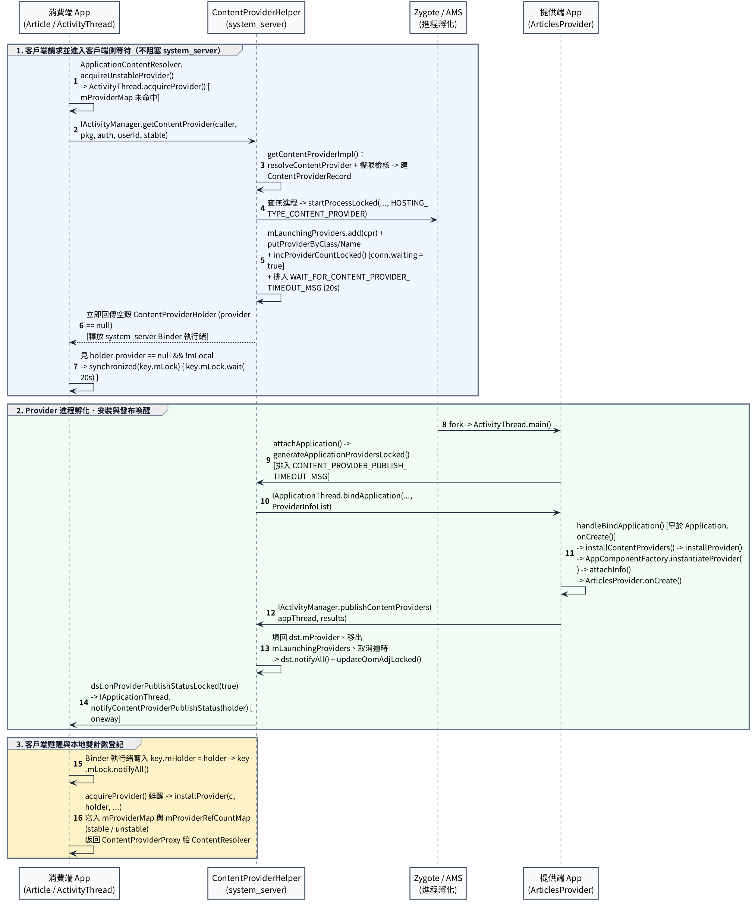

# 10.2 Content Provider 組件的啟動、發布與連線計數過程（`acquireProvider`、`ContentProviderHelper` 與 `publishContentProviders`）

- **情景說明**：延續原書 `Article` 與 `ArticlesProvider` 雙應用實例，當消費端 `Article` 首次透過 `ContentResolver` 存取宣告在另一獨立進程且尚未啟動的 `ArticlesProvider`（`content://shy.luo.providers.articles/...`）時，本節完整追蹤這條跨三個進程（`Article` → `system_server` → `ArticlesProvider`）的按需啟動鏈：客戶端查無本地快取後向 AMS 請求連線、`ContentProviderHelper` 孵化 Provider 進程並**將等待移回客戶端（避免佔用 `system_server` Binder 執行緒）**、新進程隨 `bindApplication` 安裝實例化 Provider 並執行 `onCreate()`、呼叫 `publishContentProviders` 非同步回呼喚醒客戶端，最終客戶端將代理與 Stable/Unstable 引用計數寫入本地快取。
- **對應原書**：10.2 節〈Content Provider组件的启动过程〉（p.558–580）
- **涉及專案與版本基準**：
  - `platform/frameworks/base` 〔`android-17.0.0_r1`，commit `94b4c163b`〕

---

## 10.2.1 呼叫鏈全景

```text
Article (ContentResolver)
  └─ ApplicationContentResolver.acquireUnstableProvider() / acquireProvider()  ## Step 1、拆出 authority 與 userId
       └─ ActivityThread.acquireProvider(c, auth, userId, stable)              ## Step 2、查本地 mProviderMap；未命中則搶 ProviderKey 鎖
            └─ IActivityManager.getContentProvider(..., stable)                ## Binder IPC 進入 system_server
                 └─ ContentProviderHelper.getContentProvider()                 ## Step 3、驗證非 Isolated 與呼叫包名
                      └─ getContentProviderImpl()                              ## Step 4、查 ProviderMap -> 建 CPR -> startProcessLocked
                           ├─ mLaunchingProviders.add(cpr) + incProviderCountLocked()
                           └─ [caller != null] 立即回傳 holder(provider=null)  ## 重點關注：不阻塞 system_server Binder 執行緒！
       └─ [客戶端側] holder.provider == null -> key.mLock.wait(timeout)        ## 客戶端自己等發布回呼（避免耗盡系統 Binder 池）

=== Provider 進程孵化與發布 ===
Zygote fork -> ActivityThread.main() -> AMS.attachApplicationLocked()          ## generateApplicationProvidersLocked 收集 ProviderInfoList
  └─ bindApplication(providers) -> handleBindApplication()
       └─ ActivityThread.installContentProviders(app, data.providers)          ## Step 5、逐一安裝並批次發布
            ├─ ActivityThread.installProvider()                                ## Step 6、AppComponentFactory.instantiateProvider()
            │    └─ localProvider.attachInfo(c, info) -> ArticlesProvider.onCreate()
            └─ IActivityManager.publishContentProviders(appThread, results)    ## Step 7、上報已就緒的 IContentProvider (Transport)
                 └─ ContentProviderHelper.publishContentProviders()
                      ├─ 填回 dst.mProvider、移出 mLaunchingProviders、取消逾時
                      ├─ dst.notifyAll()                                       ## 喚醒外部等待者（如 SHELL）
                      └─ dst.onProviderPublishStatusLocked(true)               ## Step 8、透過 oneway 回呼喚醒正常 App 客戶端
                           └─ clientThread.notifyContentProviderPublishStatus()
                                └─ ActivityThread：key.mHolder = holder; key.mLock.notifyAll()

=== 客戶端甦醒與本地快取登記 ===
ActivityThread.acquireProvider() 甦醒取得完整 holder
  └─ ActivityThread.installProvider(c, holder, ...)                            ## Step 9、寫入 mProviderMap + mProviderRefCountMap
```

---

## 10.2.2 客戶端入口、本地快取與「客戶端側等待」機制

### Step 1：`ApplicationContentResolver.acquireProvider` / `acquireUnstableProvider`
**位置**：`platform/frameworks/base/core/java/android/app/ContextImpl.java` 〔`android-17.0.0_r1`，lines 4044–4095〕

```java
    static final class ApplicationContentResolver extends ContentResolver {
        private final ActivityThread mMainThread;

        public ApplicationContentResolver(Context context, ActivityThread mainThread) {
            super(context);
            mMainThread = Objects.requireNonNull(mainThread);
        }

        @Override
        protected IContentProvider acquireProvider(Context context, String auth) {
            return mMainThread.acquireProvider(context,
                    ContentProvider.getAuthorityWithoutUserId(auth),
                    resolveUserIdFromAuthority(auth), true);
        }

        @Override
        protected IContentProvider acquireUnstableProvider(Context c, String auth) {
            return mMainThread.acquireProvider(c,
                    ContentProvider.getAuthorityWithoutUserId(auth),
                    resolveUserIdFromAuthority(auth), false);
        }

        @Override
        public boolean releaseProvider(IContentProvider provider) {
            return mMainThread.releaseProvider(provider, true);
        }

        @Override
        public boolean releaseUnstableProvider(IContentProvider icp) {
            return mMainThread.releaseProvider(icp, false);
        }

        @Override
        public void unstableProviderDied(IContentProvider icp) {
            mMainThread.handleUnstableProviderDied(icp.asBinder(), true);
        }
```

`ContextImpl.getContentResolver()` 返回的正是 `ApplicationContentResolver` 實例。無論呼叫端走 `acquireProvider`（`stable = true`）或 `ContentResolver.query()` 優先走的 `acquireUnstableProvider`（`stable = false`），這裡都會先從 `content://userId@authority/...` 剝離出純粹的 `authority` 與目標 `userId`，再統一轉交 `ActivityThread.acquireProvider(context, auth, userId, stable)`。

> 〔與 2.3 差異〕擴充：原書 10.2 Step 3（p.560）僅有單一 `acquireProvider(Context, String)`；Android 17 拆分 `stable = true/false` 雙介面並支援從 URI authority 解析多使用者 `userId`。

---

### Step 2：`ActivityThread.acquireProvider`——本地快取命中與客戶端側 `key.mLock.wait()`
**位置**：`platform/frameworks/base/core/java/android/app/ActivityThread.java` 〔`android-17.0.0_r1`，lines 8685–8755〕

```java
    public IContentProvider acquireProvider(
            Context c, String auth, int userId, boolean stable) {
        final IContentProvider provider = acquireExistingProvider(c, auth, userId, stable);
        if (provider != null) {
            return provider;
        }

        ContentProviderHolder holder;
        final ProviderKey key = getGetProviderKey(auth, userId);
        try {
            synchronized (key) {
                holder = ActivityManager.getService().getContentProvider(
                        getApplicationThread(), c.getOpPackageName(), auth, userId, stable);
                // If the returned holder is non-null but its provider is null and it's not
                // local, we'll need to wait for the publishing of the provider.
                if (holder != null && holder.provider == null && !holder.mLocal) {
                    synchronized (key.mLock) {
                        if (key.mHolder != null) {
                            if (DEBUG_PROVIDER) {
                                Slog.i(TAG, "already received provider: " + auth);
                            }
                        } else {
                            key.mLock.wait(ContentResolver.CONTENT_PROVIDER_READY_TIMEOUT_MILLIS);
                        }
                        holder = key.mHolder;
                    }
                    if (holder != null && holder.provider == null) {
                        // probably timed out
                        holder = null;
                    }
                }
            }
        } catch (RemoteException ex) {
            throw ex.rethrowFromSystemServer();
        } catch (InterruptedException e) {
            holder = null;
        } finally {
            // Clear the holder from the key since the key itself is never cleared.
            synchronized (key.mLock) {
                key.mHolder = null;
            }
        }
        if (holder == null) {
            ...
            return null;
        }

        // Install provider will increment the reference count for us, and break
        // any ties in the race.
        holder = installProvider(c, holder, holder.info,
                true /*noisy*/, holder.noReleaseNeeded, stable);
        return holder.provider;
    }
```

這段程式碼藏著 Android 17 相較於原書 2.3 最具代表性的系統擴展性改進：
1. **快路徑先查本機快取**：`acquireExistingProvider()` 先在進程內 `mProviderMap` 以 `ProviderKey(auth, userId)` 查找；若之前已取得過代理且尚未死亡（`jBinder.isBinderAlive()`），只需在本地遞增 `ProviderRefCount`（必要時才呼叫 `AMS.refContentProvider` 通知系統端穩定度升降），零啟動延遲直接返回！
2. **將冷啟動阻塞從 `system_server` 移回客戶端進程！**
   在原書 2.3 中，當 Provider 進程尚未啟動時，呼叫端發起 `getContentProvider()` 後會讓 **`system_server` 裡的 Binder 工作執行緒直接卡在 `cpr.wait()`** 乾等數秒——只要幾十個 App 同時啟動並存取未啟動的 Provider，`system_server` 的 Binder 執行緒池就會瞬間耗盡引發整機卡死！
   Android 17 徹底改寫為**兩階段非同步等待**：
   - `AMS.getContentProvider()` 啟動 Provider 進程後，**立刻返回**一個「`holder != null` 但 `holder.provider == null && !holder.mLocal`」的空殼 `ContentProviderHolder`，瞬間釋放 `system_server` 的 Binder 執行緒！
   - 客戶端在自己的 `ProviderKey` 鎖內檢查 `key.mHolder`（防止極端快路徑下回呼已先抵達），若尚未收到便在**客戶端自己的執行緒**執行 `key.mLock.wait(CONTENT_PROVIDER_READY_TIMEOUT_MILLIS)`（預設 20 秒），等到 Step 8 系統端發來 `notifyContentProviderPublishStatus` 回呼將 `key.mHolder` 填入並 `notifyAll()` 後才甦醒！

> 〔與 2.3 差異〕架構級最佳化：原書 10.2 Step 4–5（p.560–562）在 `ActivityThread.getProvider` 阻塞於 `getContentProvider` 同步回傳；Android 17 改由 `ProviderKey.mLock.wait()` 在客戶端等候非同步發布回呼，徹底根治 `system_server` Binder 執行緒池枯竭問題。

---

## 10.2.3 系統端解析、冷啟動與非阻塞返回

### Step 3：`ContentProviderHelper.getContentProvider` 入口驗證
**位置**：`platform/frameworks/base/services/core/java/com/android/server/am/ContentProviderHelper.java` 〔`android-17.0.0_r1`，lines 135–153〕

```java
    ContentProviderHolder getContentProvider(IApplicationThread caller, String callingPackage,
            String name, int userId, boolean stable) {
        mService.enforceNotIsolatedCaller("getContentProvider");
        if (caller == null) {
            String msg = "null IApplicationThread when getting content provider " + name;
            Slog.w(TAG, msg);
            throw new SecurityException(msg);
        }
        final int callingUid = Binder.getCallingUid();
        if (callingPackage != null && mService.mAppOpsService.checkPackage(
                callingUid, callingPackage) != AppOpsManager.MODE_ALLOWED) {
            throw new SecurityException("Given calling package " + callingPackage
                    + " does not match caller's uid " + callingUid);
        }
        return getContentProviderImpl(caller, name, null, callingUid, callingPackage,
                null, stable, userId);
    }
```

AMS 的 `getContentProvider()` 直接委派至此；先禁止 Isolated 進程呼叫，並透過 `mAppOpsService.checkPackage(callingUid, callingPackage)` 嚴格比對呼叫者宣告的套件名與實際 UID 一致，才進入核心函式 `getContentProviderImpl()`。

> 〔與 2.3 差異〕搬家 + 安全強化：原書 10.2 Step 7（p.563）直接呼叫 `AMS.getContentProviderImpl`；Android 17 抽離至 `ContentProviderHelper` 並加入 Isolated 封鎖與 `AppOpsService.checkPackage` 驗證。

---

### Step 4：`ContentProviderHelper.getContentProviderImpl`——孵化新進程與立即返回空殼 Holder
**位置**：`platform/frameworks/base/services/core/java/com/android/server/am/ContentProviderHelper.java` 〔`android-17.0.0_r1`，lines 480–651、653–690〕

```java
                if (r != null && cpr.canRunHere(r)) {
                    // If this is a multiprocess provider, then just return its
                    // info and allow the caller to instantiate it.
                    return cpr.newHolder(null, true);
                }

                // This is single process, and our app is now connecting to it.
                // See if we are already in the process of launching this provider.
                final int numLaunchingProviders = mLaunchingProviders.size();
                int i;
                for (i = 0; i < numLaunchingProviders; i++) {
                    if (mLaunchingProviders.get(i) == cpr) {
                        break;
                    }
                }

                // If the provider is not already being launched, then get it started.
                if (i >= numLaunchingProviders) {
                    final long origId = Binder.clearCallingIdentity();

                    try {
                        ...
                        // Use existing process if already started
                        ProcessRecord proc = mService.getProcessRecordLocked(
                                cpi.processName, cpr.mUid);
                        IApplicationThread thread;
                        if (proc != null && (thread = proc.getThread()) != null
                                && !proc.isKilled()) {
                            if (mService.mProcessStateController.addPublishedProvider(proc,
                                    cpi.name, cpr)) {
                                mService.unfreezeTemporarily(proc,
                                        CachedAppOptimizer.UNFREEZE_REASON_GET_PROVIDER);
                                try {
                                    thread.scheduleInstallProvider(cpi);
                                } catch (RemoteException e) {
                                }
                            }
                            ...
                        } else {
                            final HostingRecord hostingRecord = HostingRecord.forContentProvider(
                                    new ComponentName(cpi.applicationInfo.packageName, cpi.name),
                                    cpi.shouldRunInPccSandbox(),
                                    callingUid, r != null ? r.processName : null,
                                    name, stable);
                            proc = mService.startProcessLocked(
                                    cpi.processName, cpr.mAppInfo, false, 0,
                                    hostingRecord,
                                    Process.ZYGOTE_POLICY_FLAG_EMPTY, false, false);
                            if (proc == null) {
                                return null;
                            }
                            mService.mProcessList.getAppStartInfoTracker()
                                    .handleProcessContentProviderStart(startTimeNs, proc);
                        }
                        cpr.mLaunchingApp = proc;
                        mLaunchingProviders.add(cpr);
                    } finally {
                        Binder.restoreCallingIdentity(origId);
                    }
                }

                if (firstClass) {
                    mProviderMap.putProviderByClass(comp, cpr);
                }

                mProviderMap.putProviderByName(name, cpr);
                conn = incProviderCountLocked(r, cpr, token, callingUid, callingPackage, callingTag,
                        stable, false, startTime, mService.mProcessList, expectedUserId);
                if (conn != null) {
                    conn.waiting = true;
                }
            }

            mService.grantImplicitAccess(userId, null, callingUid,
                    UserHandle.getAppId(cpr.mUid));

            if (caller != null) {
                // The client will be waiting, and we'll notify it when the provider is ready.
                synchronized (cpr) {
                    if (cpr.mProvider == null) {
                        if (cpr.mLaunchingApp == null) {
                            return null;
                        }

                        if (conn != null) {
                            conn.waiting = true;
                        }
                        Message msg = mService.mHandler.obtainMessage(
                                ActivityManagerService.WAIT_FOR_CONTENT_PROVIDER_TIMEOUT_MSG);
                        msg.obj = cpr;
                        mService.mHandler.sendMessageDelayed(msg,
                                ContentResolver.CONTENT_PROVIDER_READY_TIMEOUT_MILLIS);
                    }
                }
                // Return a holder instance even if we are waiting for the publishing of the
                // provider, client will check for the holder.provider to see if it needs to wait
                // for it.
                return cpr.newHolder(conn, false);
            }
        }

        // Because of the provider's external client (i.e., SHELL), we'll have to wait right here.
        ...
        synchronized (cpr) {
            while (cpr.mProvider == null) {
                ...
                    if (wait > 0) {
                        cpr.wait(wait);
                    }
```

`getContentProviderImpl()` 的前半段（lines 173–479）依序在 `mProviderMap.getProviderByName(name, userId)` 查找已發布的 Provider（若已就緒直接 `incProviderCountLocked` 並回傳）；在本節冷啟動情景中未命中，於是向 PackageManager 呼叫 `resolveContentProvider` 取得 `ProviderInfo`、通過 `checkContentProviderPermissionLocked` 權限檢查並建構 `ContentProviderRecord cpr`，隨後進入以上核心分支：
1. **本地多進程捷徑**：若 `cpr.canRunHere(r)`（宣告 `multiprocess=true` 或就在呼叫者同一進程），直接回傳 `cpr.newHolder(null, true)`（`mLocal = true`），由呼叫端直接在地實例化。
2. **溫進程動態安裝 vs 冷進程孵化**：
   - 若目標進程已存活（`proc != null && proc.getThread() != null`），先 `unfreezeTemporarily` 臨時解凍，再送出 **`thread.scheduleInstallProvider(cpi)`** 通知其補裝；
   - 若尚未啟動（本節 `ArticlesProvider` 情景），以 `HostingRecord.forContentProvider(...)` 呼叫 **`mService.startProcessLocked(...)`** 請 Zygote 孵化新進程，並將 `cpr.mLaunchingApp = proc`、`mLaunchingProviders.add(cpr)`！
3. **雙鍵入表與連線計數**：將 `cpr` 註冊進 `mProviderMap`（同時建立 class 與 authority 索引），呼叫 `incProviderCountLocked()` 建立 `ContentProviderConnection`（依 `stable` 初始化 `mStableCount` 或 `mUnstableCount` 為 1）並標記 `conn.waiting = true`。
4. **雙軌等待**：
   - **一般 App（`caller != null`）**：在 `mService.mHandler` 排入 20 秒後的 `WAIT_FOR_CONTENT_PROVIDER_TIMEOUT_MSG` 逾時保護，**直接 `return cpr.newHolder(conn, false)`**（此時 `holder.provider == null`），把等待交回客戶端（Step 2）！
   - **無 `IApplicationThread` 的外部呼叫者（`caller == null`，如 `shell`）**：才落入下方 `synchronized (cpr)` 的 `cpr.wait(wait)` 迴圈。

> 〔與 2.3 差異〕核心演進：原書 10.2 Step 8（p.563–568）不論呼叫者類型都在 `getContentProviderImpl` 末尾呼叫 `cpr.wait()` 阻塞 `system_server`；Android 17 為正常 App 改走非阻塞空殼 `holder` + `WAIT_FOR_CONTENT_PROVIDER_TIMEOUT_MSG` + 非同步回呼，並對既有溫進程支援 `unfreezeTemporarily` 與 `scheduleInstallProvider`。

---

## 10.2.4 Provider 進程安裝、實例化與發布喚醒

### Step 5：新進程隨 `bindApplication` 觸發 `ActivityThread.installContentProviders`
**位置**：`platform/frameworks/base/services/core/java/com/android/server/am/ActivityManagerService.java` 〔`android-17.0.0_r1`，lines 5323–5326〕、`platform/frameworks/base/core/java/android/app/ActivityThread.java` 〔`android-17.0.0_r1`，lines 8293、8655–8682〕

```java
// ActivityManagerService.java: attachApplicationLocked()
List<ProviderInfo> providers = normalMode
        ? mCpHelper.generateApplicationProvidersLocked(app)
        : null;
if (providers != null && mCpHelper.checkAppInLaunchingProvidersLocked(app)) {
    // 排入 CONTENT_PROVIDER_PUBLISH_TIMEOUT_MSG 監控新進程發布逾時
```

```java
// ActivityThread.java: handleBindApplication()
installContentProviders(app, data.providers);
```

```java
    private void installContentProviders(
            Context context, List<ProviderInfo> providers) {
        final ArrayList<ContentProviderHolder> results = new ArrayList<>();

        for (ProviderInfo cpi : providers) {
            ContentProviderHolder cph = installProvider(context, null, cpi,
                    false /*noisy*/, true /*noReleaseNeeded*/, true /*stable*/);
            if (cph != null) {
                cph.noReleaseNeeded = true;
                results.add(cph);
            }
        }

        try {
            ActivityManager.getService().publishContentProviders(
                getApplicationThread(), results);
        } catch (RemoteException ex) {
            throw ex.rethrowFromSystemServer();
        }
    }
```

當 `ArticlesProvider` 進程由 Zygote fork 並執行 `ActivityThread.main()` → `AMS.attachApplicationLocked()` 時：
1. AMS 呼叫 `mCpHelper.generateApplicationProvidersLocked(app)`，從 PackageManager 查出宣告運行在該進程下的所有 `<provider>`（包含 `ArticlesProvider`），並將對應 `ContentProviderRecord` 登記至 `app.mProviders`；同時因該進程在 `mLaunchingProviders` 上有客戶端等候，排入 `CONTENT_PROVIDER_PUBLISH_TIMEOUT_MSG` 發布逾時定時器；
2. 這些 `ProviderInfo` 隨 `IApplicationThread.bindApplication(..., new ProviderInfoList(providers), ...)` 一起送到新進程主執行緒的 `handleBindApplication()`；
3. **極重要的生命週期順序**：在 `handleBindApplication()` 中，`installContentProviders(app, data.providers)` 是在 `Application.attachBaseContext()` 之後、**`Application.onCreate()` 之前**執行的！這也是為什麼所有 `ContentProvider.onCreate()` 都會比 `Application.onCreate()` 更早被呼叫（許多初始化 SDK 如 Firebase / AndroidX App Startup 正是利用這個特性自動初始化）。逐一安裝完成後，一次性呼叫 `publishContentProviders(getApplicationThread(), results)` 上報給 AMS。

> 〔與 2.3 差異〕不變（核心生命週期順序一致），唯 `generateApplicationProvidersLocked` 抽離至 `ContentProviderHelper` 且 `bindApplication` 改採 `ProviderInfoList` 封裝。

---

### Step 6：`ActivityThread.installProvider`（Provider 側實例化）與 `ContentProvider.attachInfo`
**位置**：`platform/frameworks/base/core/java/android/app/ActivityThread.java` 〔`android-17.0.0_r1`，lines 9124–9226〕、`platform/frameworks/base/core/java/android/content/ContentProvider.java` 〔`android-17.0.0_r1`，lines 2642–2644、2663–2697〕

```java
    private ContentProviderHolder installProvider(Context context,
            ContentProviderHolder holder, ProviderInfo info,
            boolean noisy, boolean noReleaseNeeded, boolean stable) {
        ContentProvider localProvider = null;
        IContentProvider provider;
        if (holder == null || holder.provider == null) {
            ...
            if (info.splitName != null) {
                c = c.createContextForSplit(info.splitName);
            }
            if (info.attributionTags != null && info.attributionTags.length > 0) {
                final String attributionTag = info.attributionTags[0];
                c = c.createAttributionContext(attributionTag);
            }

            try {
                final java.lang.ClassLoader cl = c.getClassLoader();
                LoadedApk packageInfo = peekPackageInfo(ai.packageName, true);
                if (packageInfo == null) {
                    packageInfo = getSystemContext().mPackageInfo;
                }
                localProvider = packageInfo.getAppFactory()
                        .instantiateProvider(cl, info.name);
                provider = localProvider.getIContentProvider();
                if (provider == null) {
                    return null;
                }
                localProvider.attachInfo(c, info);
            } catch (java.lang.Exception e) { ... }
        } else {
            provider = holder.provider;
        }

        ContentProviderHolder retHolder;

        synchronized (mProviderMap) {
            IBinder jBinder = provider.asBinder();
            if (localProvider != null) {
                ComponentName cname = new ComponentName(info.packageName, info.name);
                ProviderClientRecord pr = mLocalProvidersByName.get(cname);
                if (pr != null) {
                    provider = pr.mProvider;
                } else {
                    holder = new ContentProviderHolder(info);
                    holder.provider = provider;
                    holder.noReleaseNeeded = true;
                    pr = installProviderAuthoritiesLocked(provider, localProvider, holder);
                    mLocalProviders.put(jBinder, pr);
                    mLocalProvidersByName.put(cname, pr);
                }
                retHolder = pr.mHolder;
            }
```

```java
// ContentProvider.java
    public IContentProvider getIContentProvider() {
        return mTransport;
    }

    public void attachInfo(Context context, ProviderInfo info) {
        attachInfo(context, info, false);
    }

    private void attachInfo(Context context, ProviderInfo info, boolean testing) {
        mNoPerms = testing;
        mCallingAttributionSource = new ThreadLocal<>();

        if (mContext == null) {
            mContext = context;
            if (context != null && mTransport != null) {
                mTransport.mAppOpsManager = (AppOpsManager) context.getSystemService(
                        Context.APP_OPS_SERVICE);
            }
            mMyUid = Process.myUid();
            if (info != null) {
                setReadPermission(info.readPermission);
                setWritePermission(info.writePermission);
                setPathPermissions(info.pathPermissions);
                mExported = info.exported;
                mSingleUser = (info.flags & ProviderInfo.FLAG_SINGLE_USER) != 0;
                mSystemUserOnly = (info.flags & ProviderInfo.FLAG_SYSTEM_USER_ONLY) != 0;
                setAuthorities(info.authority);
            }
            ...
            ContentProvider.this.onCreate();
        }
    }
```

`installProvider()` 同時服務於「Provider 側建立本地實例（`holder == null`）」與「Client 側安裝遠端代理（`holder.provider != null`，見 Step 9）」兩種呼叫：
1. 在 Provider 進程裡，`holder == null`，於是依 `splitName` / `attributionTags` 建出對應 `Context`，透過 **`AppComponentFactory.instantiateProvider(cl, info.name)`** 實例化 `ArticlesProvider`，呼叫 `getIContentProvider()` 取得其內部的 Binder 存根 **`mTransport`**（`Transport extends ContentProviderNative`）；
2. 呼叫 `localProvider.attachInfo(c, info)` 注入權限設定（read/write/path permissions、exported、singleUser）、設定 `AppOpsManager` 與 `ThreadLocal<AttributionSource>`，最後觸發開發者覆寫的 **`ArticlesProvider.onCreate()`**（開啟 SQLite 資料庫）；
3. 將 `holder` 同時登記進進程本機的 `mProviderMap`（依 authority）、`mLocalProviders`（依 Binder）與 `mLocalProvidersByName`（依 `ComponentName`）後回傳給 `installContentProviders()` 打包上報。

> 〔與 2.3 差異〕邏輯演進：原書 10.2 Step 20–23（p.573–577）直接以 `cl.loadClass(info.name).newInstance()` 建立實例；Android 17 改經 `AppComponentFactory.instantiateProvider`，並補齊 split/attribution Context、`AppOpsManager` 與 `mCallingAttributionSource` 歸因鏈。

---

### Step 7：`ContentProviderHelper.publishContentProviders`——發布上線與取消逾時
**位置**：`platform/frameworks/base/services/core/java/com/android/server/am/ContentProviderHelper.java` 〔`android-17.0.0_r1`，lines 742–832〕

```java
    void publishContentProviders(IApplicationThread caller, List<ContentProviderHolder> providers) {
        if (providers == null) {
            return;
        }

        mService.enforceNotIsolatedOrSdkSandboxCaller("publishContentProviders");
        synchronized (mService) {
            final ProcessRecord r = mService.getRecordForAppLOSP(caller);
            if (r == null) {
                throw new SecurityException("Unable to find app for caller " + caller
                        + " (pid=" + Binder.getCallingPid()
                        + ") when publishing content providers");
            }

            final long origId = Binder.clearCallingIdentity();
            boolean providersPublished = false;
            for (int i = 0, size = providers.size(); i < size; i++) {
                ContentProviderHolder src = providers.get(i);
                if (src == null || src.info == null || src.provider == null) {
                    continue;
                }
                ContentProviderRecord dst = r.mProviders.getProvider(src.info.name);
                if (dst == null) {
                    continue;
                }
                providersPublished = true;

                ComponentName comp = new ComponentName(dst.mProviderInfo.packageName,
                        dst.mProviderInfo.name);
                mProviderMap.putProviderByClass(comp, dst);
                String[] names = dst.mProviderInfo.authority.split(";");
                for (int j = 0; j < names.length; j++) {
                    mProviderMap.putProviderByName(names[j], dst);
                }

                boolean wasInLaunchingProviders = false;
                for (int j = 0, numLaunching = mLaunchingProviders.size(); j < numLaunching; j++) {
                    if (mLaunchingProviders.get(j) == dst) {
                        mLaunchingProviders.remove(j);
                        wasInLaunchingProviders = true;
                        j--;
                        numLaunching--;
                    }
                }
                if (wasInLaunchingProviders) {
                    mService.mHandler.removeMessages(
                            ActivityManagerService.WAIT_FOR_CONTENT_PROVIDER_TIMEOUT_MSG, dst);
                    mService.mHandler.removeMessages(
                            ActivityManagerService.CONTENT_PROVIDER_PUBLISH_TIMEOUT_MSG, r);
                }
                ...
                synchronized (dst) {
                    dst.mProvider = src.provider;
                    dst.setProcess(r);
                    dst.notifyAll();
                    dst.onProviderPublishStatusLocked(true);
                }
                dst.mRestartCount = 0;
                if (hasProviderConnectionLocked(r)) {
                    r.mProfile.addHostingComponentType(HOSTING_COMPONENT_TYPE_PROVIDER);
                }
            }

            if (providersPublished) {
                mService.updateOomAdjLocked(r, OOM_ADJ_REASON_GET_PROVIDER);
                ...
            }

            Binder.restoreCallingIdentity(origId);
        }
    }
```

`publishContentProviders()` 逐一取出上報清單中的 `ContentProviderHolder src`，從該進程的 `r.mProviders` 找到預先建好的 `ContentProviderRecord dst`：
1. 以分號切開所有 `authority` 寫入 `mProviderMap`；
2. 將 `dst` 移出 `mLaunchingProviders`，並立刻撤銷兩顆定時炸彈——`WAIT_FOR_CONTENT_PROVIDER_TIMEOUT_MSG`（等待方逾時）與 `CONTENT_PROVIDER_PUBLISH_TIMEOUT_MSG`（發布方 10 秒超時未發布會直接殺進程）；
3. 進入 `synchronized (dst)`：填入遠端 Binder 代理 **`dst.mProvider = src.provider`**、綁定宿主進程 `dst.setProcess(r)`，先呼叫 `dst.notifyAll()` 喚醒可能存在的外部等待者，緊接著呼叫 **`dst.onProviderPublishStatusLocked(true)`** 通知所有在客戶端等待的 App 進程！最後調整該 Provider 進程的 OOM Adj。

> 〔與 2.3 差異〕邏輯擴充：原書 10.2 Step 25（p.578–579）只需呼叫 `dst.notifyAll()` 喚醒卡在 `system_server` 的等待執行緒；Android 17 新增 `dst.onProviderPublishStatusLocked(true)` 以非同步回呼喚醒在客戶端 `key.mLock.wait()` 等候的 App。

---

### Step 8：非同步喚醒客戶端：`onProviderPublishStatusLocked` → `ApplicationThread.notifyContentProviderPublishStatus`
**位置**：`platform/frameworks/base/services/core/java/com/android/server/am/ContentProviderRecord.java` 〔`android-17.0.0_r1`，lines 233–270〕、`platform/frameworks/base/core/java/android/app/ActivityThread.java` 〔`android-17.0.0_r1`，lines 2442–2452〕

```java
// ContentProviderRecord.java
    void onProviderPublishStatusLocked(boolean status) {
        final int numOfConns = mConnections.size();
        for (int i = 0; i < numOfConns; i++) {
            final ContentProviderConnection conn = mConnections.get(i);
            if (conn.waiting && conn.client != null) {
                final ProcessRecord client = conn.client;
                ...
                final IApplicationThread thread = client.getThread();
                if (thread != null) {
                    try {
                        thread.notifyContentProviderPublishStatus(
                                newHolder(status ? conn : null, false),
                                mProviderInfo.authority, conn.mExpectedUserId, status);
                    } catch (RemoteException e) {
                    }
                }
            }
            conn.waiting = false;
        }
    }
```

```java
// ActivityThread.java (ApplicationThread)
        public void notifyContentProviderPublishStatus(@NonNull ContentProviderHolder holder,
                @NonNull String authorities, int userId, boolean published) {
            final String auths[] = authorities.split(";");
            for (String auth: auths) {
                final ProviderKey key = getGetProviderKey(auth, userId);
                synchronized (key.mLock) {
                    key.mHolder = holder;
                    key.mLock.notifyAll();
                }
            }
        }
```

`onProviderPublishStatusLocked(true)` 遍歷所有 `conn.waiting == true` 的客戶端連線，透過 `oneway` 的 **`IApplicationThread.notifyContentProviderPublishStatus`** 把已填好 `provider` 的完整 `ContentProviderHolder` 推送給消費端 `Article` 的 Binder 執行緒；消費端找到同一個 `ProviderKey(auth, userId)`，寫入 `key.mHolder = holder` 並呼叫 `key.mLock.notifyAll()`，Step 2 中沉睡的 `acquireProvider()` 執行緒隨即甦醒！

> 〔與 2.3 差異〕新增：原書 2.3 無此非同步回呼機制。

---

### Step 9：客戶端安裝遠端代理與本地雙計數快取：`ActivityThread.installProvider`（Client 側）
**位置**：`platform/frameworks/base/core/java/android/app/ActivityThread.java` 〔`android-17.0.0_r1`，lines 9227–9260〕

```java
                ProviderRefCount prc = mProviderRefCountMap.get(jBinder);
                if (prc != null) {
                    // We need to transfer our new reference to the existing
                    // ref count, releasing the old one...  but only if
                    // release is needed (that is, it is not running in the
                    // system process).
                    if (!noReleaseNeeded) {
                        incProviderRefLocked(prc, stable);
                        try {
                            ActivityManager.getService().removeContentProvider(
                                    holder.connection, stable);
                        } catch (RemoteException e) {
                            //do nothing content provider object is dead any way
                        }
                    }
                } else {
                    ProviderClientRecord client = installProviderAuthoritiesLocked(
                            provider, localProvider, holder);
                    if (noReleaseNeeded) {
                        prc = new ProviderRefCount(holder, client, 1000, 1000);
                    } else {
                        prc = stable
                                ? new ProviderRefCount(holder, client, 1, 0)
                                : new ProviderRefCount(holder, client, 0, 1);
                    }
                    mProviderRefCountMap.put(jBinder, prc);
                }
                retHolder = prc.holder;
```

甦醒後的 `acquireProvider()` 呼叫 `installProvider(c, holder, holder.info, true, holder.noReleaseNeeded, stable)`（這次 `holder.provider != null`，走遠端代理分支）：
- 若同進程沒有其他執行緒搶先安裝同一支 Binder（`prc == null`），便透過 `installProviderAuthoritiesLocked` 把每個 `authority` 存入 `mProviderMap`，並建立 `ProviderRefCount`（記錄本地的 `stableCount` 與 `unstableCount`；若 `noReleaseNeeded == true` 則直接給初始值 `1000, 1000` 避免觸發釋放 IPC）放進 `mProviderRefCountMap`；
- 若恰好與另一條執行緒發生競態（`prc != null`），則透過 `incProviderRefLocked(prc, stable)` 合併到本地既有計數器，並把多取得的那次系統連線用 `removeContentProvider(holder.connection, stable)` 退還給 AMS！
- 最後返回 `holder.provider`（即指向遠端 `ArticlesProvider.mTransport` 的 `ContentProviderProxy`），消費端即可直接向 Provider 發起查詢或讀寫操作。

> 〔與 2.3 差異〕邏輯強化：原書 10.2 Step 26（p.579–580）的 `ProviderRefCount` 僅有單一整數 `count`；Android 17 細分為 `stableCount` / `unstableCount` 雙計數，並搭配 `removePending` 延遲釋放與競態合併機制，大幅降低頻繁查詢時的 AMS IPC 次數。

---

## 10.2.5 本節總結與時序圖



- **避免 `system_server` Binder 池耗竭的關鍵設計**：Android 17 讓 `ContentProviderHelper.getContentProviderImpl()` 對一般 App 直接返回 `provider == null` 的空殼 `ContentProviderHolder`，將等待轉移到客戶端 `ProviderKey.mLock.wait()`，待發布時再經由 `oneway notifyContentProviderPublishStatus` 精準喚醒。
- **生命週期時機**：新進程在 `handleBindApplication()` 階段、**早於 `Application.onCreate()`** 透過 `installContentProviders()` 實例化全部宣告的 Provider 並執行 `onCreate()`，再一次 `publishContentProviders()` 上報。
- **本機 + 系統雙層 Stable/Unstable 計數**：App 側由 `mProviderRefCountMap` 合併同進程內多次存取，系統側由 `ContentProviderConnection` 依 `mStableCount` / `mUnstableCount` 決定 OOM Adj 保護與崩潰連坐策略。
