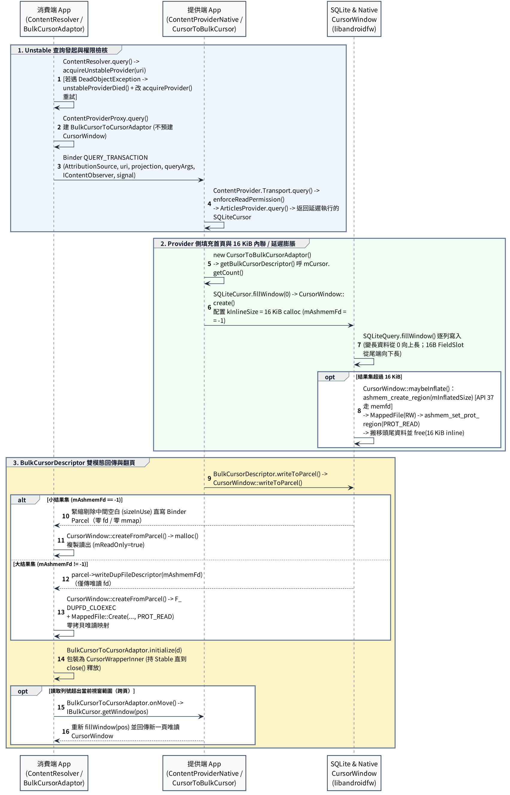

# 10.3 Content Provider 的跨進程資料共享原理（`CursorWindow` 16 KiB 內聯延遲膨脹至 Ashmem/`memfd` 與 `BulkCursorDescriptor`）

- **情景說明**：延續原書 `Article` 查詢 `ArticlesProvider` 的情景，單筆 Binder 交易緩衝區（mmap 空間約 1 MiB 扣減並發上限）並不適合直接搬運大量資料庫查詢結果，因此 Android 透過 `CursorWindow` 與共享記憶體機制傳遞結果集。本節完整追蹤 `ContentResolver.query(...)` 從 Unstable 防崩潰查詢入口一路穿越 `ContentProviderProxy` → `ContentProvider.Transport` → `CursorToBulkCursorAdaptor` → `SQLiteCursor` → 原生 C++ **`libs/androidfw/CursorWindow.cpp`**，深入剖析 Android 17 相較於原書 2.3 的兩大革命性重寫：**`CursorWindow` 所有權自客戶端翻轉為 Provider 側單次往返（`BulkCursorDescriptor`）**，以及**「16 KiB 內聯緊縮直傳 Parcel → 超限時 `maybeInflate()` 延遲膨脹為 Ashmem/`memfd` 唯讀零拷貝共享」**的雙模態設計。
- **對應原書**：10.3 節〈Content Provider组件的数据共享原理〉（p.581–603，含 10.3.1 數據共享模型與 10.3.2 數據傳輸過程）
- **涉及專案與版本基準**：
  - `platform/frameworks/base` 〔`android-17.0.0_r1`，commit `94b4c163b`〕

---

## 10.3.1 數據共享模型演進（2.3 vs 17）與呼叫鏈全景

> 對應原書 10.3.1（p.581–583）。在原書 Android 2.3 中，消費端（Client）在發起 `bulkQuery()` 之前得先自己配置一塊 1 MiB 固定大小的 Ashmem（經 `MemoryHeapBase` / `IMemory`）傳給 Provider，Provider 還沒真正填資料，消費端拿到 `IBulkCursor` 後還得再發一次 `count()` IPC 才觸發 `SQLiteCursor.fillWindow()`。這個設計有兩大缺點：(1) 就算查詢只回傳 3 筆小資料，也白白耗掉一次 Ashmem 建立、`mmap`、fd 傳遞與 `munmap`；(2) 首頁查詢至少浪費 2 次跨進程 IPC。

Android 17 的現代模型徹底翻轉了上述兩點：

| 比較維度 | 原書 Android 2.3（p.581–603） | Android 17（`android-17.0.0_r1`） |
|---|---|---|
| **連線容錯** | `acquireProvider()` 單一路徑，Provider 死就連坐殺客戶端 | 先走 `acquireUnstableProvider()`，遇 `DeadObjectException` 降級改拿 `acquireProvider()` 重試 |
| **`CursorWindow` 建立方** | 客戶端建立空視窗傳入 `bulkQuery()` | **Provider 側**建構並填好首頁資料，連同中繼資料打包成 **`BulkCursorDescriptor`** 一次返回 |
| **首頁查詢 IPC 次數** | 至少 2 次（`bulkQuery` + `count`） | **1 次**（`QUERY_TRANSACTION` 直接帶回 `count`、`columnNames`、`IBulkCursor` 與首頁 `CursorWindow`） |
| **底層記憶體配置** | 固定配置 1 MiB `MemoryHeapBase` / `IMemory` | 預設 **`kInlineSize = 16384`（16 KiB）內聯 `calloc`**；僅超出 16 KiB 才 **`maybeInflate()`** 轉 `ashmem_create_region`（API 37 預設走 **`memfd`**） |
| **跨進程序列化與保護** | 傳遞 `IMemory` Binder 代理 | 內聯態緊縮直寫 Binder Parcel（零 fd）；膨脹態先降權 `PROT_READ` 再以 `writeDupFileDescriptor` 共享唯讀映射 |

### 呼叫鏈全景

```text
Article.getArticleByPos()
  └─ ContentResolver.query(uri, projection, queryArgs, signal)               ## Step 1、Unstable 優先 + DeadObjectException 降級 Stable
       └─ ContentProviderProxy.query()                                       ## Step 2、建 BulkCursorToCursorAdaptor -> QUERY_TRANSACTION
            └─ [Binder IPC] ContentProviderNative.onTransact()               ## Step 3、解包 AttributionSource + queryArgs
                 ├─ ContentProvider.Transport.query()                        ## Step 4、enforceReadPermission -> ArticlesProvider.query()
                 │    └─ SQLiteQueryBuilder -> SQLiteCursor (延遲查詢)
                 └─ new CursorToBulkCursorAdaptor() -> getBulkCursorDescriptor()  ## Step 5、觸發 getCount() 填充首頁 CursorWindow
                      └─ SQLiteCursor.getCount() -> fillWindow(0) -> mQuery.fillWindow()
                           └─ 原生 CursorWindow::create() [16 KiB inline]    ## Step 6、寫入超出 16 KiB 才 maybeInflate() -> ashmem/memfd
                 └─ BulkCursorDescriptor.writeToParcel()                     ## Step 7、<=16 KiB 緊縮直寫 Parcel；>16 KiB dup 唯讀 fd
                      └─ CursorWindow::writeToParcel()
       └─ [Client 收回 Reply] BulkCursorDescriptor.readFromParcel()          ## Step 8、inline malloc 讀取或 MappedFile(PROT_READ) 唯讀映射
            └─ CursorWindow::createFromParcel() -> adaptor.initialize(d)
  └─ 包裝 CursorWrapperInner 返回（close 時自動釋放連線）
=== 讀取超出首頁範圍（翻頁）===
Cursor.moveToPosition(pos) -> BulkCursorToCursorAdaptor.onMove()             ## Step 9、跨頁呼叫 IBulkCursor.getWindow(pos) 取得新視窗
```

---

## 10.3.2 防崩潰查詢入口與 `QUERY_TRANSACTION` 雙側轉接

### Step 1：`ContentResolver.query`——Unstable 優先與 `DeadObjectException` 降級重試
**位置**：`platform/frameworks/base/core/java/android/content/ContentResolver.java` 〔`android-17.0.0_r1`，lines 1195–1201、1240–1317〕

```java
    public final @Nullable Cursor query(@RequiresPermission.Read @NonNull Uri uri,
            @Nullable String[] projection, @Nullable String selection,
            @Nullable String[] selectionArgs, @Nullable String sortOrder,
            @Nullable CancellationSignal cancellationSignal) {
        Bundle queryArgs = createSqlQueryBundle(selection, selectionArgs, sortOrder);
        return query(uri, projection, queryArgs, cancellationSignal);
    }
```

```java
    public final @Nullable Cursor query(final @RequiresPermission.Read @NonNull Uri uri,
            @Nullable String[] projection, @Nullable Bundle queryArgs,
            @Nullable CancellationSignal cancellationSignal) {
        Objects.requireNonNull(uri, "uri");
        ...
        IContentProvider unstableProvider = acquireUnstableProvider(uri);
        if (unstableProvider == null) {
            return null;
        }
        IContentProvider stableProvider = null;
        Cursor qCursor = null;
        try {
            long startTime = SystemClock.uptimeMillis();

            ICancellationSignal remoteCancellationSignal = null;
            if (cancellationSignal != null) {
                cancellationSignal.throwIfCanceled();
                remoteCancellationSignal = unstableProvider.createCancellationSignal();
                cancellationSignal.setRemote(remoteCancellationSignal);
            }
            try {
                qCursor = unstableProvider.query(mContext.getAttributionSource(), uri, projection,
                        queryArgs, remoteCancellationSignal);
            } catch (DeadObjectException e) {
                // The remote process has died...  but we only hold an unstable
                // reference though, so we might recover!!!  Let's try!!!!
                unstableProviderDied(unstableProvider);
                stableProvider = acquireProvider(uri);
                if (stableProvider == null) {
                    return null;
                }
                qCursor = stableProvider.query(mContext.getAttributionSource(), uri, projection,
                        queryArgs, remoteCancellationSignal);
            }
            if (qCursor == null) {
                return null;
            }

            // Force query execution.  Might fail and throw a runtime exception here.
            qCursor.getCount();
            long durationMillis = SystemClock.uptimeMillis() - startTime;
            maybeLogQueryToEventLog(durationMillis, uri, projection, queryArgs);

            // Wrap the cursor object into CursorWrapperInner object.
            final IContentProvider provider = (stableProvider != null) ? stableProvider
                    : acquireProvider(uri);
            final CursorWrapperInner wrapper = new CursorWrapperInner(qCursor, provider);
            stableProvider = null;
            qCursor = null;
            return wrapper;
        } catch (RemoteException e) {
            return null;
        } finally {
            if (qCursor != null) {
                qCursor.close();
            }
            if (cancellationSignal != null) {
                cancellationSignal.setRemote(null);
            }
            if (unstableProvider != null) {
                releaseUnstableProvider(unstableProvider);
            }
            if (stableProvider != null) {
                releaseProvider(stableProvider);
            }
        }
    }
```

這段程式碼是 Stable / Unstable 連線模型的經典教科書實作：
1. **先拿 Unstable 試探**：呼叫 `acquireUnstableProvider(uri)`（10.2 節）並執行 `unstableProvider.query(mContext.getAttributionSource(), ...)`。萬一遠端 Provider 進程在查詢前剛好被 LMK 殺死，只會拋出 `DeadObjectException` 而不致於被 AMS 連坐殺死客戶端！
2. **捕獲崩潰、通知重啟並改拿 Stable 重試**：`catch (DeadObjectException e)` 立刻呼叫 `unstableProviderDied(unstableProvider)` 清理本地與系統端死掉的連線，再改呼叫 `acquireProvider(uri)`（`stable = true`）重新拉起 Provider 並重試查詢！
3. **升級為 Stable 交由 `CursorWrapperInner` 託管**：查詢成功並確認 `qCursor.getCount()` 無異常後，取得 `stableProvider` 連同 `qCursor` 包進 **`CursorWrapperInner`** 返回（`finally` 則釋放剛剛暫借的 `unstableProvider`）——如此在開發者遍歷 `Cursor`（可能還會翻頁呼叫 `IBulkCursor.getWindow()`）期間，Provider 進程受到 Stable OOM 保護；直到開發者呼叫 `cursor.close()` 時，`CursorWrapperInner` 才會自動呼叫 `releaseProvider(provider)` 歸還連線！

> 〔與 2.3 差異〕容錯與參數大改：原書 10.3.2 Step 2（p.585）直接 `acquireProvider` 查詢，且 `selection`/`selectionArgs`/`sortOrder` 為獨立參數；Android 17 打包為 `Bundle queryArgs`、支援 `ICancellationSignal` 取消與 `AttributionSource` 歸因，並導入 Unstable → Stable 降級恢復機制。

---

### Step 2：`ContentProviderProxy.query`——建立客戶端轉接器並發送 `QUERY_TRANSACTION`
**位置**：`platform/frameworks/base/core/java/android/content/ContentProviderNative.java` 〔`android-17.0.0_r1`，lines 470–518〕

```java
    @Override
    public Cursor query(@NonNull AttributionSource attributionSource, Uri url,
            @Nullable String[] projection, @Nullable Bundle queryArgs,
            @Nullable ICancellationSignal cancellationSignal)
            throws RemoteException {
        BulkCursorToCursorAdaptor adaptor = new BulkCursorToCursorAdaptor();
        Parcel data = Parcel.obtain();
        Parcel reply = Parcel.obtain();
        try {
            data.writeInterfaceToken(IContentProvider.descriptor);

            attributionSource.writeToParcel(data, 0);
            url.writeToParcel(data, 0);
            int length = 0;
            if (projection != null) {
                length = projection.length;
            }
            data.writeInt(length);
            for (int i = 0; i < length; i++) {
                data.writeString(projection[i]);
            }
            data.writeBundle(queryArgs);
            data.writeStrongBinder(adaptor.getObserver().asBinder());
            data.writeStrongBinder(
                    cancellationSignal != null ? cancellationSignal.asBinder() : null);

            mRemote.transact(IContentProvider.QUERY_TRANSACTION, data, reply, 0);

            DatabaseUtils.readExceptionFromParcel(reply);

            if (reply.readInt() != 0) {
                BulkCursorDescriptor d = BulkCursorDescriptor.CREATOR.createFromParcel(reply);
                Binder.copyAllowBlocking(mRemote, (d.cursor != null) ? d.cursor.asBinder() : null);
                adaptor.initialize(d);
            } else {
                adaptor.close();
                adaptor = null;
            }
            return adaptor;
        } catch (RemoteException ex) {
            adaptor.close();
            throw ex;
        } catch (RuntimeException ex) {
            adaptor.close();
            throw ex;
        } finally {
            data.recycle();
            reply.recycle();
        }
    }
```

注意與原書 2.3 最鮮明的對比：`ContentProviderProxy.query()` **完全不再建立或寫入 `CursorWindow`**！它只建立一個空的客戶端轉接器 `BulkCursorToCursorAdaptor`、把它的 `IContentObserver`（供遠端資料變動時通知 Cursor）連同 `attributionSource`/`url`/`projection`/`queryArgs`/`cancellationSignal` 打包送出 `QUERY_TRANSACTION`；等 `reply` 返回後，直接反序列化 **`BulkCursorDescriptor d`** 並執行 `adaptor.initialize(d)`（見 Step 8），一次 IPC 就拿到完整可用的 `Cursor`！

> 〔與 2.3 差異〕邏輯徹底反轉：原書 10.3.2 Step 7–11（p.588–592）在客戶端建立 `CursorWindow` 並於 `bulkQuery()` 中將其 `IMemory` 寫入 `data` Parcel；Android 17 改由 `reply` 直接取回 Provider 填妥的 `BulkCursorDescriptor`。

---

### Step 3：`ContentProviderNative.onTransact`（`QUERY_TRANSACTION`）與 `ContentProvider.Transport.query`
**位置**：`platform/frameworks/base/core/java/android/content/ContentProviderNative.java` 〔`android-17.0.0_r1`，lines 85–140〕、`platform/frameworks/base/core/java/android/content/ContentProvider.java` 〔`android-17.0.0_r1`，lines 260–313〕

```java
// ContentProviderNative.java: onTransact()
                case QUERY_TRANSACTION:
                {
                    data.enforceInterface(IContentProvider.descriptor);

                    AttributionSource attributionSource = AttributionSource.CREATOR
                            .createFromParcel(data);
                    Uri url = Uri.CREATOR.createFromParcel(data);
                    ...
                    Bundle queryArgs = data.readBundle();
                    IContentObserver observer = IContentObserver.Stub.asInterface(
                            data.readStrongBinder());
                    ICancellationSignal cancellationSignal = ICancellationSignal.Stub.asInterface(
                            data.readStrongBinder());

                    Cursor cursor = query(attributionSource, url, projection, queryArgs,
                            cancellationSignal);
                    if (cursor != null) {
                        CursorToBulkCursorAdaptor adaptor = null;

                        try {
                            adaptor = new CursorToBulkCursorAdaptor(cursor, observer,
                                    getProviderName());
                            cursor = null;

                            BulkCursorDescriptor d = adaptor.getBulkCursorDescriptor();
                            adaptor = null;

                            reply.writeNoException();
                            reply.writeInt(1);
                            d.writeToParcel(reply, Parcelable.PARCELABLE_WRITE_RETURN_VALUE);
                        } finally {
                            if (adaptor != null) {
                                adaptor.close();
                            }
                            if (cursor != null) {
                                cursor.close();
                            }
                        }
                    } else {
                        reply.writeNoException();
                        reply.writeInt(0);
                    }

                    return true;
                }
```

```java
// ContentProvider.java: Transport.query()
        @Override
        public Cursor query(@NonNull AttributionSource attributionSource, Uri uri,
                @Nullable String[] projection, @Nullable Bundle queryArgs,
                @Nullable ICancellationSignal cancellationSignal) {
            uri = validateIncomingUri(uri);
            uri = maybeGetUriWithoutUserId(uri);
            if (enforceReadPermission(attributionSource, uri)
                    != PermissionChecker.PERMISSION_GRANTED) {
                if (projection != null) {
                    return new MatrixCursor(projection, 0);
                }
                ...
                return new MatrixCursor(cursor.getColumnNames(), 0);
            }
            traceBegin(TRACE_TAG_ACTIVITY_MANAGER, "query: ", uri.getAuthority());
            final AttributionSource original = setCallingAttributionSource(
                    attributionSource);
            try {
                return mInterface.query(
                        uri, projection, queryArgs,
                        CancellationSignal.fromTransport(cancellationSignal));
            } catch (RemoteException e) {
                throw e.rethrowAsRuntimeException();
            } finally {
                setCallingAttributionSource(original);
                Trace.traceEnd(TRACE_TAG_ACTIVITY_MANAGER);
            }
        }
```

抵達 `ArticlesProvider` 進程的 Binder 執行緒後，流程一氣呵成：
1. `Transport.query()` 校驗 URI 格式並執行 `enforceReadPermission(attributionSource, uri)`（注意若 AppOps 處於 `MODE_IGNORED` 等軟拒絕狀態，系統會回傳 0 筆資料的空 `MatrixCursor` 而非讓舊 App 崩潰），接著把 `attributionSource` 存入執行緒區域變數後呼叫開發者的 **`ArticlesProvider.query()`**，取得尚未真正填資料的 `SQLiteCursor`；
2. 回到 `ContentProviderNative.onTransact()`，把 `cursor` 包進 **`CursorToBulkCursorAdaptor`**（繼承 `BulkCursorNative`，即遠端 `IBulkCursor` 存根），立即呼叫 **`adaptor.getBulkCursorDescriptor()`** 觸發查詢並填滿第一頁 `CursorWindow`，再透過 `d.writeToParcel(reply, PARCELABLE_WRITE_RETURN_VALUE)` 寫入回覆 Parcel！

> 〔與 2.3 差異〕架構簡化 + 權限強化：原書 10.3.2 Step 12–16（p.592–597）由 `onTransact` 反序列化客戶端傳來的 `CursorWindow` 再呼叫 `Transport.bulkQuery()`；Android 17 取消 `bulkQuery()`，由 `onTransact` 統一透過 `CursorToBulkCursorAdaptor.getBulkCursorDescriptor()` 完成打包。

---

## 10.3.3 Provider 側填滿視窗與原生 `CursorWindow` 雙模態儲存

### Step 4：`CursorToBulkCursorAdaptor.getBulkCursorDescriptor` 與 `SQLiteCursor.getCount` / `fillWindow`
**位置**：`platform/frameworks/base/core/java/android/database/CursorToBulkCursorAdaptor.java` 〔`android-17.0.0_r1`，lines 153–170〕、`platform/frameworks/base/core/java/android/database/sqlite/SQLiteCursor.java` 〔`android-17.0.0_r1`，lines 130–163〕

```java
// CursorToBulkCursorAdaptor.java
    public BulkCursorDescriptor getBulkCursorDescriptor() {
        synchronized (mLock) {
            throwIfCursorIsClosed();

            BulkCursorDescriptor d = new BulkCursorDescriptor();
            d.cursor = this;
            d.columnNames = mCursor.getColumnNames();
            d.wantsAllOnMoveCalls = mCursor.getWantsAllOnMoveCalls();
            d.count = mCursor.getCount();
            d.window = mCursor.getWindow();
            if (d.window != null) {
                // Acquire a reference to the window because its reference count will be
                // decremented when it is returned as part of the binder call reply parcel.
                d.window.acquireReference();
            }
            return d;
        }
    }
```

```java
// SQLiteCursor.java
    @Override
    public int getCount() {
        if (mCount == NO_COUNT) {
            fillWindow(0);
        }
        return mCount;
    }

    private void fillWindow(int requiredPos) {
        clearOrCreateWindow(getDatabase().getPath());
        try {
            Preconditions.checkArgumentNonnegative(requiredPos,
                    "requiredPos cannot be negative");

            if (mCount == NO_COUNT) {
                mCount = mQuery.fillWindow(mWindow, requiredPos, requiredPos, true);
                mCursorWindowCapacity = mWindow.getNumRows();
            } else {
                int startPos = mFillWindowForwardOnly ? requiredPos : DatabaseUtils
                        .cursorPickFillWindowStartPosition(requiredPos, mCursorWindowCapacity);
                mQuery.fillWindow(mWindow, startPos, requiredPos, false);
            }
        } catch (RuntimeException ex) {
            closeWindow();
            throw ex;
        }
    }
```

關鍵觸發點就在 `d.count = mCursor.getCount()`：
1. `SQLiteCursor` 採延遲執行設計（建構時 `mCount == NO_COUNT`），首次呼叫 `getCount()` 時呼叫 `fillWindow(0)`；
2. `clearOrCreateWindow()` 在父類 `AbstractWindowedCursor` 中首次建立 Java `CursorWindow`（對應呼叫底層 JNI `nativeCreate(name, sCursorWindowSize)`，預設最大膨脹上限 `sCursorWindowSize` 來自 `config_cursorWindowSize`，一般為 2 MiB）；
3. `mQuery.fillWindow(mWindow, 0, 0, true)` 透過 JNI 執行 SQLite `sqlite3_step()`，逐列把查詢結果寫進原生 `CursorWindow`，同時算完總列數 `mCount`；
4. 接著 `d.window = mCursor.getWindow()` 取出剛填好的視窗並 `acquireReference()`（抵銷寫出 `PARCELABLE_WRITE_RETURN_VALUE` 時自動 `releaseReference()` 的一次遞減）。

> 〔與 2.3 差異〕時機前置：原書 10.3.2 Step 21–24（p.600–602）要等客戶端收到 `IBulkCursor` 後另發一次 `count()` IPC 才觸發 `SQLiteCursor.fillWindow()`；Android 17 在 `QUERY_TRANSACTION` 回覆前就於 `getBulkCursorDescriptor()` 內一次填好。

---

### Step 5：原生 `CursorWindow` 記憶體模型——16 KiB 內聯配置與 `maybeInflate()` 延遲轉 Ashmem/`memfd`
**位置**：`platform/frameworks/base/libs/androidfw/CursorWindow.cpp` 〔`android-17.0.0_r1`，lines 33–139、252–260〕

```cpp
/**
 * By default windows are lightweight inline allocations of this size;
 * they're only inflated to ashmem regions when more space is needed.
 */
static constexpr const size_t kInlineSize = 16384;

static constexpr const size_t kSlotShift = 4;
static constexpr const size_t kSlotSizeBytes = 1 << kSlotShift;
...
status_t CursorWindow::create(const String8 &name, size_t inflatedSize, CursorWindow **outWindow) {
    *outWindow = nullptr;

    CursorWindow* window = new CursorWindow();
    if (!window) goto fail;

    window->mName = name;
    window->mSize = std::min(kInlineSize, inflatedSize);
    window->mInflatedSize = inflatedSize;
    window->mData = calloc(window->mSize, 1);
    if (!window->mData) goto fail;
    window->mReadOnly = false;

    window->clear();
    window->updateSlotsData();

    *outWindow = window;
    return OK;
    ...
}

status_t CursorWindow::maybeInflate() {
    int ashmemFd = 0;
    void* newData = nullptr;
    std::optional<MappedFile> newMappedFile;

    // Bail early when we can't expand any further
    if (mReadOnly || mSize == mInflatedSize) {
        return INVALID_OPERATION;
    }

    String8 ashmemName("CursorWindow: ");
    ashmemName.append(mName);

    ashmemFd = ashmem_create_region(ashmemName.c_str(), mInflatedSize);
    if (ashmemFd < 0) {
        PLOG(ERROR) << "Failed ashmem_create_region";
        goto fail_silent;
    }

    if (ashmem_set_prot_region(ashmemFd, PROT_READ | PROT_WRITE) < 0) {
        PLOG(ERROR) << "Failed ashmem_set_prot_region";
        goto fail_silent;
    }

    newMappedFile = MappedFile::Create(ashmemFd, 0, mInflatedSize, PROT_READ | PROT_WRITE);
    if (!newMappedFile) {
        PLOG(ERROR) << "Failed mmap";
        goto fail_silent;
    }
    newData = newMappedFile->data();

    if (ashmem_set_prot_region(ashmemFd, PROT_READ) < 0) {
        PLOG(ERROR) << "Failed ashmem_set_prot_region";
        goto fail_silent;
    }

    {
        // Migrate existing contents into new ashmem region
        uint32_t slotsSize = sizeOfSlots();
        uint32_t newSlotsOffset = mInflatedSize - slotsSize;
        memcpy(static_cast<uint8_t*>(newData),
                static_cast<uint8_t*>(mData), mAllocOffset);
        memcpy(static_cast<uint8_t*>(newData) + newSlotsOffset,
                static_cast<uint8_t*>(mData) + mSlotsOffset, slotsSize);

        free(mData);
        mAshmemFd = ashmemFd;
        mMappedFile = std::move(newMappedFile);
        mData = newData;
        mSize = mInflatedSize;
        mSlotsOffset = newSlotsOffset;

        updateSlotsData();
    }

    return OK;
    ...
}
```

這段 C++ 原始碼是整章最令人拍案叫絕的工程傑作，也直接銜接了我們在第 6 章〈`memfd` 與現行 Ashmem〉所追蹤的底層機制：
1. **雙向成長的精巧記憶體佈局**：在一塊連續記憶體 `[0 .. mSize)` 裡：
   - 變長欄位內容（字串、Blob）從位址 `0` **向上**分配（`mAllocOffset` 遞增）；
   - 定長 16 位元組的欄位索引槽 `FieldSlot`（`kSlotSizeBytes = 16`）從尾端 `mSize` **向下**增長（`mSlotsOffset` 遞減）。兩端相向而行，中間剩餘空間完全共享，無須事先切分比例！
2. **輕量預設（`kInlineSize = 16384`）**：`CursorWindow::create()` 並不立刻向核心申請共享記憶體，而是僅 `calloc(16 KiB)` 作為普通堆記憶體（`mAshmemFd == -1`）。系統中超過九成的小查詢（例如讀幾筆設定值或單篇文章）根本用不到 16 KiB，從頭到尾零 syscall、零 fd 消耗！
3. **無縫膨脹與唯讀安全降權（`maybeInflate()`）**：只有當 SQLite 寫入資料導致 16 KiB 滿溢時，才呼叫 `maybeInflate()`：
   - 呼叫 `libcutils` 的 **`ashmem_create_region(..., mInflatedSize)`**（呼應第 6 章 6.2 節：在 Android 17 / API 37 中預設走 **`memfd_create` + `F_SEAL_GROW`/`F_SEAL_SHRINK`**！）；
   - 先讓本進程以 `PROT_READ | PROT_WRITE` 建立 `MappedFile` 映射（取得可寫的虛擬位址指標 `newData`）；
   - **隨即呼叫 `ashmem_set_prot_region(ashmemFd, PROT_READ)` 把 fd 的後續映射權限鎖死為唯讀**——這樣自己手上已映射好的 `newData` 仍可繼續寫入剩餘列，但透過 Binder 拿到這個 fd 的遠端消費進程，就算惡意嘗試 `mmap(PROT_WRITE)` 也會被核心直接拒絕！
   - 將原本 16 KiB 頭尾兩段有效資料分別 `memcpy` 到新共享區的頭端 `0` 與新尾端 `mInflatedSize - slotsSize`，釋放舊 `calloc` 後繼續無縫填入剩餘資料。

> 〔與 2.3 差異〕徹底重寫：原書 10.3.2（p.589–594）的 `CursorWindow` 位於 `core/jni/` 且固定透過 `MemoryHeapBase` / `IMemory` 一律建立 1 MiB Ashmem；Android 17 移至 `libs/androidfw/CursorWindow.cpp`，引入 16 KiB 內聯緩衝區 + `maybeInflate()` 延遲膨脹至 `memfd`/Ashmem，並以先 RW 映射再降 fd 為 `PROT_READ` 強化跨進程唯讀隔離。

---

### Step 6：跨進程雙模態序列化與反序列化：`BulkCursorDescriptor` 與 `CursorWindow::writeToParcel` / `createFromParcel`
**位置**：`platform/frameworks/base/core/java/android/database/BulkCursorDescriptor.java` 〔`android-17.0.0_r1`，lines 56–77〕、`platform/frameworks/base/libs/androidfw/CursorWindow.cpp` 〔`android-17.0.0_r1`，lines 142–249〕

```java
// BulkCursorDescriptor.java
    @Override
    public void writeToParcel(Parcel out, int flags) {
        out.writeStrongBinder(cursor.asBinder());
        out.writeStringArray(columnNames);
        out.writeInt(wantsAllOnMoveCalls ? 1 : 0);
        out.writeInt(count);
        if (window != null) {
            out.writeInt(1);
            window.writeToParcel(out, flags);
        } else {
            out.writeInt(0);
        }
    }
```

```cpp
// CursorWindow.cpp: writeToParcel()
status_t CursorWindow::writeToParcel(Parcel* parcel) {
    if (parcel->writeString8(mName)) goto fail;
    if (parcel->writeUint32(mNumRows)) goto fail;
    if (parcel->writeUint32(mNumColumns)) goto fail;
    if (mNumRows == 0) {
        if (parcel->writeUint32(/*size=*/0)) goto fail;
        if (parcel->writeBool(/*isAshmem=*/false)) goto fail;
    } else if (mAshmemFd != -1) {
        if (parcel->writeUint32(mSize)) goto fail;
        if (parcel->writeBool(/*isAshmem=*/true)) goto fail;
        if (parcel->writeDupFileDescriptor(mAshmemFd)) goto fail;
    } else {
        // Since we know we're going to be read-only on the remote side,
        // we can compact ourselves on the wire.
        size_t slotsSize = sizeOfSlots();
        size_t compactedSize = sizeInUse();
        if (parcel->writeUint32(compactedSize)) goto fail;
        if (parcel->writeBool(/*isAshmem=*/false)) goto fail;
        void* dest = parcel->writeInplace(compactedSize);
        if (!dest) goto fail;
        memcpy(static_cast<uint8_t*>(dest),
                static_cast<uint8_t*>(mData), mAllocOffset);
        memcpy(static_cast<uint8_t*>(dest) + compactedSize - slotsSize,
                static_cast<uint8_t*>(mData) + mSlotsOffset, slotsSize);
    }
    return OK;
    ...
}
```

```cpp
// CursorWindow.cpp: createFromParcel()
status_t CursorWindow::createFromParcel(Parcel* parcel, CursorWindow** outWindow) {
    ...
    bool isAshmem;
    if (parcel->readBool(&isAshmem)) goto fail;
    if (isAshmem) {
        int tempFd = parcel->readFileDescriptor();
        if (tempFd < 0) {
            LOG(ERROR) << "Failed readFileDescriptor";
            goto fail_silent;
        }

        tempFd = ::fcntl(tempFd, F_DUPFD_CLOEXEC, 0);
        if (tempFd < 0) {
            PLOG(ERROR) << "Failed F_DUPFD_CLOEXEC";
            goto fail_silent;
        }
        window->mMappedFile = MappedFile::Create(tempFd, 0, window->mSize, PROT_READ);
        if (!window->mMappedFile) {
            ::close(tempFd);
            goto fail_silent;
        }
        window->mData = window->mMappedFile->data();
        window->mAshmemFd = tempFd;
    } else {
        window->mAshmemFd = -1;
        if (window->mSize > kInlineSize) {
            LOG(ERROR) << "Unexpected size " << window->mSize << " for inline window";
            goto fail_silent;
        }

        window->mData = malloc(window->mSize);
        if (!window->mData) goto fail;
        if (window->mSize > 0) {
            if (parcel->read(window->mData, window->mSize)) goto fail;
        }
    }

    // We just came from a remote source, so we're read-only
    // and we can't inflate ourselves
    window->mInflatedSize = window->mSize;
    window->mReadOnly = true;

    window->updateSlotsData();
    *outWindow = window;
    return OK;
```

跨進程傳輸時展現出極致的空間效率：
- **小查詢（`mAshmemFd == -1`）**：`writeToParcel` 計算實際已用大小 `compactedSize = sizeInUse()`，直接剔除中間空白區域、把頭段變長資料與尾段 `FieldSlot` 緊密貼齊地寫入 `parcel->writeInplace(compactedSize)`；客戶端 `createFromParcel` 直接 `malloc(compactedSize)` 讀出即可，全程只走一次 Binder 拷貝、零 fd 與零記憶體映射開銷！
- **大查詢（`mAshmemFd != -1`）**：`writeToParcel` 僅寫出一個檔案描述符 `parcel->writeDupFileDescriptor(mAshmemFd)`（由第 6 章的 `binder_translate_fd` 在核心把同一份 `struct file` 安裝到消費進程）；客戶端 `createFromParcel` 執行 `F_DUPFD_CLOEXEC` 後呼叫 `MappedFile::Create(tempFd, 0, window->mSize, PROT_READ)` 建立唯讀映射（`mReadOnly = true`），數百 KiB 至 2 MiB 的結果集完全零拷貝直達消費端！

> 〔與 2.3 差異〕傳輸協定徹底革新：原書 10.3.2 Step 10–14（p.591–595）透過 `writeStrongBinder(IMemory)` 傳遞 Ashmem 代理；Android 17 依資料量自動切換「內聯緊縮直傳 Parcel」或「直傳唯讀 Ashmem/`memfd` fd」。

---

## 10.3.4 客戶端初始化與跨視窗翻頁（`IBulkCursor.getWindow`）

### Step 7：`BulkCursorToCursorAdaptor.initialize` 與跨頁 `onMove` → `CursorToBulkCursorAdaptor.getWindow`
**位置**：`platform/frameworks/base/core/java/android/database/BulkCursorToCursorAdaptor.java` 〔`android-17.0.0_r1`，lines 41–49、74–98〕、`platform/frameworks/base/core/java/android/database/CursorToBulkCursorAdaptor.java` 〔`android-17.0.0_r1`，lines 173–204〕

```java
// BulkCursorToCursorAdaptor.java
    public void initialize(BulkCursorDescriptor d) {
        mBulkCursor = d.cursor;
        mColumns = d.columnNames;
        mWantsAllOnMoveCalls = d.wantsAllOnMoveCalls;
        mCount = d.count;
        if (d.window != null) {
            setWindow(d.window);
        }
    }

    @Override
    public boolean onMove(int oldPosition, int newPosition) {
        throwIfCursorIsClosed();

        try {
            // Make sure we have the proper window
            if (mWindow == null
                    || newPosition < mWindow.getStartPosition()
                    || newPosition >= mWindow.getStartPosition() + mWindow.getNumRows()) {
                setWindow(mBulkCursor.getWindow(newPosition));
            } else if (mWantsAllOnMoveCalls) {
                mBulkCursor.onMove(newPosition);
            }
        } catch (RemoteException ex) {
            Log.e(TAG, "Unable to get window because the remote process is dead");
            return false;
        }

        if (mWindow == null) {
            return false;
        }

        return true;
    }
```

```java
// CursorToBulkCursorAdaptor.java
    @Override
    public CursorWindow getWindow(int position) {
        synchronized (mLock) {
            throwIfCursorIsClosed();

            if (!mCursor.moveToPosition(position)) {
                closeFilledWindowLocked();
                return null;
            }

            CursorWindow window = mCursor.getWindow();
            if (window != null) {
                closeFilledWindowLocked();
            } else {
                window = mFilledWindow;
                if (window == null) {
                    mFilledWindow = new CursorWindow(mProviderName);
                    window = mFilledWindow;
                } else if (position < window.getStartPosition()
                        || position >= window.getStartPosition() + window.getNumRows()) {
                    window.clear();
                }
                mCursor.fillWindow(position, window);
            }

            if (window != null) {
                window.acquireReference();
            }
            return window;
        }
    }
```

當消費端 `Article` 呼叫 `cursor.moveToPosition(newPosition)` 讀取資料時：
- **命中當前視窗**：直接從本機 `mWindow`（透過 `@CriticalNative` / `@FastNative` 讀記憶體）取回欄位，**零 Binder IPC**；
- **超出當前視窗（例如結果集超過 2 MiB）**：`BulkCursorToCursorAdaptor.onMove()` 發現 `newPosition` 落在 `[startPos, startPos + numRows)` 之外，立刻透過 `mBulkCursor.getWindow(newPosition)` 呼叫遠端 `CursorToBulkCursorAdaptor.getWindow(newPosition)` → `SQLiteCursor.moveToPosition()` 觸發下一頁 `fillWindow()`，把全新一頁的 `CursorWindow` 再透過 Step 6 傳回客戶端替換 `setWindow(...)`！

> 〔與 2.3 差異〕翻頁簡化：原書 2.3 中由客戶端持有單一 Ashmem 視窗並請遠端覆寫；Android 17 的 `IBulkCursor.getWindow(position)` 直接由遠端返回一個新的唯讀 `CursorWindow` 替換，避免雙進程同時讀寫同一共享區的競態風險。

---

## 10.3.5 本節總結與時序圖



- **容錯先行的查詢管道**：`ContentResolver.query` 採「Unstable 查詢 → 遇 `DeadObjectException` 降級改 Stable 重試 → 結果包成 `CursorWrapperInner` 持 Stable 直到 `close()`」三段式策略，兼顧防連坐崩潰與讀取期間進程保活。
- **單次往返打包（`BulkCursorDescriptor`）**：Provider 側在 `QUERY_TRANSACTION` 回覆前即於 `CursorToBulkCursorAdaptor.getBulkCursorDescriptor()` 填好首頁 `CursorWindow`，連同 `IBulkCursor`、`columnNames` 與 `count` 一次傳回。
- **16 KiB 內聯緊縮 vs 延遲膨脹 Ashmem/`memfd`**：`libs/androidfw/CursorWindow.cpp` 讓小結果集直接壓縮寫進 Binder Parcel 省去 fd／`mmap` 負擔，大結果集才觸發 `maybeInflate()` 轉為唯讀 `PROT_READ` 共享記憶體（API 37 預設走 `memfd`），實現小量低延遲與大量零拷貝的完美平衡。
