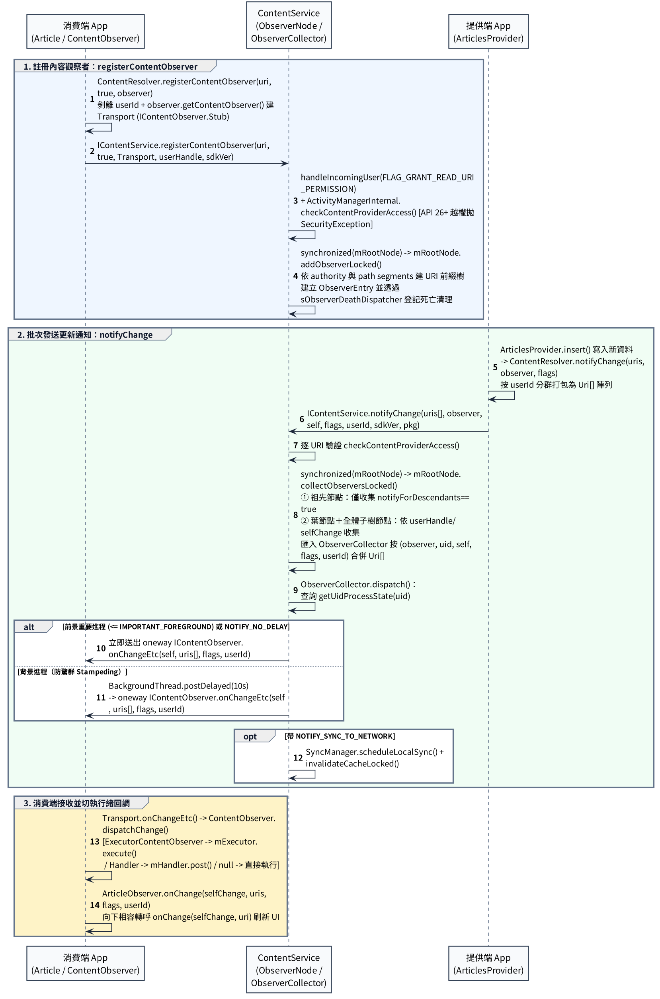

# 10.4 Content Provider 的資料更新通知機制（`ContentService`、`ObserverNode` 樹與 `ContentObserver`）

- **情景說明**：延續原書 `Article` 與 `ArticlesProvider` 雙應用實例，資料共享若只靠消費端定時輪詢勢必浪費電量與延遲刷新；Android 因此設計了獨立的系統服務 **`ContentService`**（註冊名 `"content"`），以 URI 階層前綴樹管理所有內容訂閱。本節完整追蹤兩條對稱情景：
  1. **註冊內容觀察者**：消費端 `Article` 在 `onCreate()` 呼叫 `ContentResolver.registerContentObserver(uri, true, articleObserver)` → `ContentService` 核驗跨使用者與 Provider 存取權限 → 在 `ObserverNode` 樹中依 URI 路徑段逐層建立節點並掛載死亡通知；
  2. **批次發送與接收更新通知**：當 `ArticlesProvider.insert()` 寫入新文章並呼叫 `ContentResolver.notifyChange(...)` → `ContentService` 遍歷 `ObserverNode` 收集所有匹配的祖先／葉／子孫觀察者 → 透過 **`ObserverCollector`** 聚類批次 `Uri[]` 並依目標進程前／背景狀態分流（背景延遲防驚群）→ 以 `oneway IContentObserver.onChangeEtc` 推播至消費端 `ContentObserver.dispatchChange`（支援 `Handler` 或 `ExecutorContentObserver`）觸發 `onChange()`。
- **對應原書**：10.4 節〈Content Provider组件的数据更新通知机制〉（p.604–618，含 10.4.1 注册内容观察者與 10.4.2 发送数据更新通知）
- **涉及專案與版本基準**：
  - `platform/frameworks/base` 〔`android-17.0.0_r1`，commit `94b4c163b`〕

---

## 10.4.1 呼叫鏈全景

```text
=== 情景 A：註冊內容觀察者 ===
Article.onCreate()
  └─ ContentResolver.registerContentObserver(uri, true, observer)            ## Step 1、剝離 userId、取 Transport 存根
       └─ IContentService.registerContentObserver(..., userHandle, sdkVer)   ## Binder IPC 進入 ContentService
            └─ ContentService.registerContentObserver()                      ## Step 2、handleIncomingUser + checkContentProviderAccess
                 └─ mRootNode.addObserverLocked(...)                         ## Step 3、按 URI 路徑段建前綴樹 + linkToDeath

=== 情景 B：批次發送與接收更新通知 ===
ArticlesProvider.insert()
  └─ ContentResolver.notifyChange(uris, observer, flags)                     ## Step 4、按 userId 分群成 Uri[] 批次呼叫
       └─ IContentService.notifyChange(uris[], ..., flags, userId, ...)
            └─ ContentService.notifyChange()                                 ## Step 5、驗證權限 -> 收集觀察者 -> 觸發 Sync 與清快取
                 ├─ mRootNode.collectObserversLocked(...)                    ## 同時匹配祖先(notifyForDescendants) + 葉 + 子樹
                 └─ ObserverCollector.dispatch()                             ## Step 6、聚類 Uri[] + 前景立即 / 背景延遲防驚群
                      └─ oneway IContentObserver.onChangeEtc(self, uris[], flags, userId)
=== 消費端進程（Article）===
ContentObserver.Transport.onChangeEtc()                                      ## Step 7、Binder 執行緒收包轉交 dispatchChange()
  └─ ContentObserver.dispatchChange() [Executor / Handler / 同步]
       └─ ArticleObserver.onChange(selfChange, uris, flags, userId)          ## 切回 UI 執行緒或自訂 Executor 刷新資料
```

---

## 10.4.2 註冊內容觀察者（`ObserverNode` URI 前綴樹）

### Step 1：`ContentResolver.registerContentObserver`
**位置**：`platform/frameworks/base/core/java/android/content/ContentResolver.java` 〔`android-17.0.0_r1`，lines 2762–2771、2815–2823〕

```java
    public final void registerContentObserver(@NonNull Uri uri, boolean notifyForDescendants,
            @NonNull ContentObserver observer) {
        Objects.requireNonNull(uri, "uri");
        Objects.requireNonNull(observer, "observer");
        registerContentObserver(
                ContentProvider.getUriWithoutUserId(uri),
                notifyForDescendants,
                observer,
                ContentProvider.getUserIdFromUri(uri, mContext.getUserId()));
    }
    ...
    public final void registerContentObserver(Uri uri, boolean notifyForDescendants,
            ContentObserver observer, @CanBeALL @CanBeCURRENT @UserIdInt int userHandle) {
        try {
            getContentService().registerContentObserver(uri, notifyForDescendants,
                    observer.getContentObserver(), userHandle, mTargetSdkVersion);
        } catch (RemoteException e) {
            throw e.rethrowFromSystemServer();
        }
    }
```

與 9.2 節動態廣播註冊類似，`ContentObserver` 並非直接繼承 `Binder`，而是透過 `observer.getContentObserver()` 延遲建立並回傳內部 Binder 存根 `ContentObserver.Transport`（繼承自 `IContentObserver.Stub`），連同剝離出 `userId` 的純淨 `uri`、`notifyForDescendants`（是否監聽子路徑變更）與呼叫端的 `mTargetSdkVersion` 一併發送給 `ContentService`（`ServiceManager.getService("content")`）。

> 〔與 2.3 差異〕參數擴充：原書 10.4.1 Step 2–4（p.605–607）僅傳遞 `(uri, notifyForDescendants, observer)` 三個參數；Android 17 新增 `userHandle` 與 `mTargetSdkVersion`（供系統端權限檢查決定拋例外或靜默忽略）。

---

### Step 2：`ContentService.registerContentObserver`——跨使用者與存取權限審查
**位置**：`platform/frameworks/base/services/core/java/com/android/server/content/ContentService.java` 〔`android-17.0.0_r1`，lines 365–401〕

```java
    @Override
    public void registerContentObserver(Uri uri, boolean notifyForDescendants,
            IContentObserver observer, @CanBeALL @CanBeCURRENT @UserIdInt int userHandle,
            int targetSdkVersion) {
        if (observer == null || uri == null) {
            throw new IllegalArgumentException("You must pass a valid uri and observer");
        }

        final int uid = Binder.getCallingUid();
        final int pid = Binder.getCallingPid();

        userHandle = handleIncomingUser(uri, pid, uid,
                Intent.FLAG_GRANT_READ_URI_PERMISSION, true, userHandle);

        final String msg = LocalServices.getService(ActivityManagerInternal.class)
                .checkContentProviderAccess(uri.getAuthority(), userHandle);
        if (msg != null) {
            if (targetSdkVersion >= Build.VERSION_CODES.O) {
                throw new SecurityException(msg);
            } else {
                if (msg.startsWith("Failed to find provider")) {
                    // Sigh, we need to quietly let apps targeting older API
                    // levels notify on non-existent providers.
                } else {
                    Log.w(TAG, "Ignoring content changes for " + uri + " from " + uid + ": " + msg);
                    return;
                }
            }
        }

        synchronized (mRootNode) {
            mRootNode.addObserverLocked(uri, observer, notifyForDescendants, mRootNode,
                    uid, pid, userHandle);
        }
    }
```

Android 17 在將觀察者掛入 `mRootNode` 前多了兩道至關重要的安全守門員：
1. **`handleIncomingUser(..., FLAG_GRANT_READ_URI_PERMISSION, ...)`**：若跨使用者註冊，呼叫者必須具備 `INTERACT_ACROSS_USERS_FULL` 權限或持有該 URI 的讀取授權；
2. **`ActivityManagerInternal.checkContentProviderAccess(authority, userHandle)`**：回查 `ContentProviderHelper` 確認該 authority 確實存在、套件可見且呼叫者具有存取資格——自 Android 8.0（API 26 / `Build.VERSION_CODES.O`）起，企圖監聽不存在或無權存取的 Provider 會直接拋出 **`SecurityException`**，杜絕惡意 App 靠監聽他方 URI 側錄使用者行為！

> 〔與 2.3 差異〕新增安全門檻：原書 10.4.1 Step 5（p.608）完全沒有檢查 Provider 是否存在或呼叫端是否具存取權限，直接呼叫 `mRootNode.addObserverLocked(...)`。

---

### Step 3：`ContentService.ObserverNode.addObserverLocked` 與 `removeObserverLocked`
**位置**：`platform/frameworks/base/services/core/java/com/android/server/content/ContentService.java` 〔`android-17.0.0_r1`，lines 1793–1859〕

```java
        // Invariant:  userHandle is either a hard user number or is USER_ALL
        public void addObserverLocked(Uri uri, IContentObserver observer,
                                      boolean notifyForDescendants, Object observersLock,
                                      int uid, int pid, int userHandle) {
            addObserverLocked(uri, 0, observer, notifyForDescendants, observersLock,
                    uid, pid, userHandle);
        }

        private void addObserverLocked(Uri uri, int index, IContentObserver observer,
                                       boolean notifyForDescendants, Object observersLock,
                                       int uid, int pid, int userHandle) {
            // If this is the leaf node add the observer
            if (index == countUriSegments(uri)) {
                mObservers.add(new ObserverEntry(observer, notifyForDescendants, observersLock,
                        uid, pid, userHandle, uri));
                return;
            }

            // Look to see if the proper child already exists
            String segment = getUriSegment(uri, index);
            if (segment == null) {
                throw new IllegalArgumentException("Invalid Uri (" + uri + ") used for observer");
            }
            int N = mChildren.size();
            for (int i = 0; i < N; i++) {
                ObserverNode node = mChildren.get(i);
                if (node.mName.equals(segment)) {
                    node.addObserverLocked(uri, index + 1, observer, notifyForDescendants,
                            observersLock, uid, pid, userHandle);
                    return;
                }
            }

            // No child found, create one
            ObserverNode node = new ObserverNode(segment);
            mChildren.add(node);
            node.addObserverLocked(uri, index + 1, observer, notifyForDescendants,
                    observersLock, uid, pid, userHandle);
        }

        public boolean removeObserverLocked(IContentObserver observer) {
            int size = mChildren.size();
            for (int i = 0; i < size; i++) {
                boolean empty = mChildren.get(i).removeObserverLocked(observer);
                if (empty) {
                    mChildren.remove(i);
                    i--;
                    size--;
                }
            }

            IBinder observerBinder = observer.asBinder();
            size = mObservers.size();
            for (int i = 0; i < size; i++) {
                ObserverEntry entry = mObservers.get(i);
                if (entry.observer.asBinder() == observerBinder) {
                    mObservers.remove(i);
                    // We no longer need to listen for death notifications. Remove it.
                    sObserverDeathDispatcher.unlinkToDeath(observer, entry);
                    break;
                }
            }

            if (mChildren.size() == 0 && mObservers.size() == 0) {
                return true;
            }
            return false;
        }
```

`ObserverNode` 將所有訂閱的 URI 組織成一棵**以路徑段（Segment）為鍵的前綴樹（Trie）**：
- `index = 0` 對應 `uri.getAuthority()`（如 `shy.luo.providers.articles`），`index = 1, 2, ...` 依序對應 `uri.getPathSegments().get(index - 1)`（如 `item`、`42`）；
- 遞迴走到葉節點（`index == countUriSegments(uri)`）時，建立 `ObserverEntry` 掛入 `mObservers`，並在 `ObserverEntry` 建構子中透過共享的 `sObserverDeathDispatcher`（`BinderDeathDispatcher`）向該 `IContentObserver` 登記死亡回呼——若消費端進程異常崩潰未呼叫 `unregisterContentObserver()`，系統會自動遞迴剪除其 `ObserverEntry` 與變成空殼的 `ObserverNode` 樹枝，杜絕記憶體洩漏！

> 〔與 2.3 差異〕邏輯微調 + 強化：原書 10.4.1 Step 6（p.608–611）的 `ObserverNode` 建樹與剪枝演算法核心不變；Android 17 在 `ObserverEntry` 加入 `userHandle` 多使用者欄位，並以集中式 `sObserverDeathDispatcher` 取代逐一呼叫 `linkToDeath` 節省原生 Binder 死亡監聽開銷。

---

## 10.4.3 批次發送與接收更新通知（`ObserverCollector` 與 `onChangeEtc`）

### Step 4：`ContentResolver.notifyChange`——多 URI 按使用者分群批次發送
**位置**：`platform/frameworks/base/core/java/android/content/ContentResolver.java` 〔`android-17.0.0_r1`，lines 2967–3026〕

```java
    public void notifyChange(@NonNull Collection<Uri> uris, @Nullable ContentObserver observer,
            @NotifyFlags int flags) {
        Objects.requireNonNull(uris, "uris");

        // Cluster based on user ID
        final SparseArray<ArrayList<Uri>> clusteredByUser = new SparseArray<>();
        for (Uri uri : uris) {
            final int userId = ContentProvider.getUserIdFromUri(uri, mContext.getUserId());
            ArrayList<Uri> list = clusteredByUser.get(userId);
            if (list == null) {
                list = new ArrayList<>();
                clusteredByUser.put(userId, list);
            }
            list.add(ContentProvider.getUriWithoutUserId(uri));
        }

        for (int i = 0; i < clusteredByUser.size(); i++) {
            final int userId = clusteredByUser.keyAt(i);
            final ArrayList<Uri> list = clusteredByUser.valueAt(i);
            notifyChange(list.toArray(new Uri[list.size()]), observer, flags, userId);
        }
    }
    ...
    public void notifyChange(@NonNull Uri uri, ContentObserver observer, @NotifyFlags int flags,
            @CanBeALL @CanBeCURRENT @UserIdInt int userHandle) {
        notifyChange(new Uri[] { uri }, observer, flags, userHandle);
    }

    public void notifyChange(@NonNull Uri[] uris, ContentObserver observer, @NotifyFlags int flags,
            @CanBeALL @CanBeCURRENT @UserIdInt int userHandle) {
        try {
            getContentService().notifyChange(
                    uris, observer == null ? null : observer.getContentObserver(),
                    observer != null && observer.deliverSelfNotifications(), flags,
                    userHandle, mTargetSdkVersion, mContext.getPackageName());
        } catch (RemoteException e) {
            throw e.rethrowFromSystemServer();
        }
    }
```

現代 Android 的 `notifyChange()` 除了相容單一 `Uri` 外，原生支援傳入 `Collection<Uri>` 批次通知（例如 `bulkInsert` 或批次刪除多筆文章），自動按 `userId` 聚類為 `Uri[]` 陣列，並攜帶細粒度 `flags`（`NOTIFY_INSERT`、`NOTIFY_UPDATE`、`NOTIFY_DELETE`、`NOTIFY_SYNC_TO_NETWORK`、`NOTIFY_NO_DELAY`、`NOTIFY_SKIP_NOTIFY_FOR_DESCENDANTS`）一趟 IPC 送進 `ContentService`。

> 〔與 2.3 差異〕擴充：原書 10.4.2 Step 2（p.612）僅接受單一 `Uri` 與單一布林 `syncToNetwork`；Android 17 升級為 `Uri[]` 批次陣列與位元遮罩 `@NotifyFlags int flags`。

---

### Step 5：`ContentService.notifyChange` 與 `ObserverNode.collectObserversLocked`
**位置**：`platform/frameworks/base/services/core/java/com/android/server/content/ContentService.java` 〔`android-17.0.0_r1`，lines 449–517、1861–1951〕

```java
// ContentService.java: notifyChange()
        for (Uri uri : uris) {
            // Validate that calling app has access to this provider
            final int resolvedUserId = handleIncomingUser(uri, callingPid, callingUid,
                    Intent.FLAG_GRANT_WRITE_URI_PERMISSION, true, userId);
            final Pair<String, Integer> provider = Pair.create(uri.getAuthority(), resolvedUserId);
            if (!validatedProviders.containsKey(provider)) {
                final String msg = LocalServices.getService(ActivityManagerInternal.class)
                        .checkContentProviderAccess(uri.getAuthority(), resolvedUserId);
                if (msg != null) {
                    if (targetSdkVersion >= Build.VERSION_CODES.O) {
                        throw new SecurityException(msg);
                    } else { ... }
                }

                final String packageName = getProviderPackageName(uri, resolvedUserId);
                validatedProviders.put(provider, packageName);
            }

            // No concerns raised above, so caller has access; let's collect the
            // notifications that should be dispatched
            synchronized (mRootNode) {
                final int segmentCount = ObserverNode.countUriSegments(uri);
                mRootNode.collectObserversLocked(uri, segmentCount, 0, observer,
                        observerWantsSelfNotifications, flags, resolvedUserId, collector);
            }
        }

        final long token = clearCallingIdentity();
        try {
            // Actually dispatch all the notifications we collected
            collector.dispatch();

            final SyncManager syncManager = getSyncManager();
            for (int i = 0; i < validatedProviders.size(); i++) {
                ...
                if ((flags & ContentResolver.NOTIFY_SYNC_TO_NETWORK) != 0) {
                    syncManager.scheduleLocalSync(...);
                }

                synchronized (mCache) {
                    for (Uri uri : uris) {
                        if (Objects.equals(uri.getAuthority(), authority)) {
                            invalidateCacheLocked(resolvedUserId, packageName, uri);
                        }
                    }
                }
            }
        } finally {
            Binder.restoreCallingIdentity(token);
        }
```

```java
// ObserverNode.java (inner class): collectMyObserversLocked() & collectObserversLocked()
        private void collectMyObserversLocked(Uri uri, boolean leaf, IContentObserver observer,
                                              boolean observerWantsSelfNotifications, int flags,
                                              int targetUserHandle, ObserverCollector collector) {
            int N = mObservers.size();
            IBinder observerBinder = observer == null ? null : observer.asBinder();
            for (int i = 0; i < N; i++) {
                ObserverEntry entry = mObservers.get(i);

                boolean selfChange = (entry.observer.asBinder() == observerBinder);
                if (selfChange && !observerWantsSelfNotifications) {
                    continue;
                }

                // Does this observer match the target user?
                if (targetUserHandle == UserHandle.USER_ALL
                        || entry.userHandle == UserHandle.USER_ALL
                        || targetUserHandle == entry.userHandle) {
                    if (leaf) {
                        if ((flags&ContentResolver.NOTIFY_SKIP_NOTIFY_FOR_DESCENDANTS) != 0
                                && entry.notifyForDescendants) {
                            continue;
                        }
                    } else {
                        if (!entry.notifyForDescendants) {
                            continue;
                        }
                    }
                    collector.collect(entry.observer, entry.uid, selfChange, uri, flags,
                            targetUserHandle);
                }
            }
        }

        public void collectObserversLocked(Uri uri, int segmentCount, int index,
                IContentObserver observer, boolean observerWantsSelfNotifications, int flags,
                int targetUserHandle, ObserverCollector collector) {
            String segment = null;
            if (index >= segmentCount) {
                // This is the leaf node, notify all observers
                collectMyObserversLocked(uri, true, observer, observerWantsSelfNotifications,
                        flags, targetUserHandle, collector);
            } else if (index < segmentCount){
                segment = getUriSegment(uri, index);
                // Notify any observers at this level who are interested in descendants
                collectMyObserversLocked(uri, false, observer, observerWantsSelfNotifications,
                        flags, targetUserHandle, collector);
            }

            int N = mChildren.size();
            for (int i = 0; i < N; i++) {
                ObserverNode node = mChildren.get(i);
                if (segment == null || node.mName.equals(segment)) {
                    node.collectObserversLocked(uri, segmentCount, index + 1, observer,
                            observerWantsSelfNotifications, flags, targetUserHandle, collector);
                    if (segment != null) {
                        break;
                    }
                }
            }
        }
```

`collectObserversLocked()` 延續了原書 10.4.2 非常經典的三段式前綴樹走訪規則（假設通知 `content://shy.luo.providers.articles/item/5`）：
1. **沿路經過的祖先節點（`index < segmentCount`，`leaf == false`）**：如 `shy.luo.providers.articles` 與 `item`，只收集 **`entry.notifyForDescendants == true`** 的觀察者，然後透過 `node.mName.equals(segment)` 精準往下一層走並 `break`；
2. **抵達對應葉節點（`index == segmentCount`，`leaf == true`、`segment == null`）**：如 `5`，收集該節點上全部符合 `userHandle` 與 `selfChange` 條件的觀察者（除非發送者設了 `NOTIFY_SKIP_NOTIFY_FOR_DESCENDANTS` 跳過祖先通配訂閱者）；
3. **繼續遍歷葉節點底下的全部子樹（`index > segmentCount`，`segment == null`）**：因為父路徑的變更（例如整個 `item` 集合被清空或重整）連帶影響所有更細的子路徑（如 `item/5`），所以子節點上的觀察者同樣會以 `leaf == true` 全部被收進 **`collector`**！

> 〔與 2.3 差異〕邏輯演進：原書 10.4.2 Step 3–4（p.612–616）把收集到的每筆通知直接塞進平鋪的 `ArrayList<ObserverCall>` 逐筆發送；Android 17 加入 `checkContentProviderAccess`、多使用者比對、`NOTIFY_SKIP_NOTIFY_FOR_DESCENDANTS` 過濾、快取失效以及 `ObserverCollector` 聚類。

---

### Step 6：`ContentService.ObserverCollector`——批次合併與背景防驚群延遲
**位置**：`platform/frameworks/base/services/core/java/com/android/server/content/ContentService.java` 〔`android-17.0.0_r1`，lines 535–610〕

```java
    public static class ObserverCollector {
        private final ArrayMap<Key, List<Uri>> collected = new ArrayMap<>();

        private static class Key {
            final IContentObserver observer;
            final int uid;
            final boolean selfChange;
            final int flags;
            final int userId;
            ...
        }

        public void collect(IContentObserver observer, int uid, boolean selfChange, Uri uri,
                int flags, int userId) {
            final Key key = new Key(observer, uid, selfChange, flags, userId);
            List<Uri> value = collected.get(key);
            if (value == null) {
                value = new ArrayList<>();
                collected.put(key, value);
            }
            value.add(uri);
        }

        public void dispatch() {
            for (int i = 0; i < collected.size(); i++) {
                final Key key = collected.keyAt(i);
                final List<Uri> value = collected.valueAt(i);

                final Runnable task = () -> {
                    try {
                        key.observer.onChangeEtc(key.selfChange,
                                value.toArray(new Uri[value.size()]), key.flags, key.userId);
                    } catch (RemoteException ignored) {
                    }
                };

                // Immediately dispatch notifications to foreground apps that
                // are important to the user; all other background observers are
                // delayed to avoid stampeding
                final boolean noDelay = (key.flags & ContentResolver.NOTIFY_NO_DELAY) != 0;
                @ProcessState final int procState = LocalServices.getService(
                                ActivityManagerInternal.class)
                        .getUidProcessState(key.uid);
                if (procState <= ActivityManager.PROCESS_STATE_IMPORTANT_FOREGROUND || noDelay) {
                    task.run();
                } else {
                    BackgroundThread.getHandler().postDelayed(task, BACKGROUND_OBSERVER_DELAY);
                }
            }
        }
    }
```

`ObserverCollector` 是現代 Android 降低跨進程抖動（Thundering Herd / Stampeding）的兩大巧思：
1. **合併多筆 URI 為單次 `onChangeEtc` IPC**：以 `(observer, uid, selfChange, flags, userId)` 作為複合鍵，把同一觀察者在這次批次通知中命中的所有 `Uri` 收入同一個 `List<Uri>`，最終只發送 **1 次 `oneway key.observer.onChangeEtc(...)`**！
2. **前景即時、背景延遲分流**：向 `ActivityManagerInternal.getUidProcessState(key.uid)` 查詢訂閱者的當前進程狀態——若處於前台重要狀態（`<= PROCESS_STATE_IMPORTANT_FOREGROUND`，如正在畫面上的 `Article` Activity）或明確帶有 `NOTIFY_NO_DELAY`，立即同步執行 `task.run()` 送出 `oneway` IPC；其餘背景進程則一律延遲 `BACKGROUND_OBSERVER_DELAY`（10 秒）交給 `BackgroundThread` 稍後派發，避免媒體掃描或聯絡人同步一發生，數十個背景 App 瞬間同時湧起來搶 CPU！

> 〔與 2.3 差異〕新增：原書 2.3（p.613）在 `notifyChange()` 內對所有觀察者一視同仁立刻迴圈呼叫 `oc.mObserver.onChange(oc.mSelfNotify)`；Android 17 透過 `ObserverCollector` 實現批次 URI 聚類與前／背景進程狀態分流。

---

### Step 7：`ContentObserver.Transport.onChangeEtc` → `dispatchChange` 與 `ExecutorContentObserver`
**位置**：`platform/frameworks/base/core/java/android/database/ContentObserver.java` 〔`android-17.0.0_r1`，lines 321–365〕、`platform/frameworks/base/core/java/android/database/ExecutorContentObserver.java` 〔`android-17.0.0_r1`，lines 29–38〕

```java
// ContentObserver.java
    public final void dispatchChange(boolean selfChange, @NonNull Collection<Uri> uris,
            @NotifyFlags int flags, @UserIdInt int userId) {
        if (mExecutor != null) {
            mExecutor.execute(() -> {
                onChange(selfChange, uris, flags, userId);
            });
        } else if (mHandler != null) {
            // Supporting Handler directly rather than wrapping in a HandlerExecutor
            //  avoids introducing a RejectedExecutionException for legacy code when
            //  the post fails.
            mHandler.post(() -> {
                onChange(selfChange, uris, flags, userId);
            });
        } else {
            onChange(selfChange, uris, flags, userId);
        }
    }

    private static final class Transport extends IContentObserver.Stub {
        private ContentObserver mContentObserver;

        public Transport(ContentObserver contentObserver) {
            mContentObserver = contentObserver;
        }

        @Override
        public void onChange(boolean selfChange, Uri uri, int userId) {
            onChangeEtc(selfChange, new Uri[] { uri }, 0, userId);
        }

        @Override
        public void onChangeEtc(boolean selfChange, Uri[] uris, int flags, int userId) {
            ContentObserver contentObserver = mContentObserver;
            if (contentObserver != null) {
                contentObserver.dispatchChange(selfChange, Arrays.asList(uris), flags, userId);
            }
        }
```

```java
// ExecutorContentObserver.java
public abstract class ExecutorContentObserver extends ContentObserver {
    public ExecutorContentObserver(@Nullable Executor executor) {
        super(executor, 0);
    }
}
```

`oneway onChangeEtc` 抵達消費端 `Article` 的 Binder 執行緒後，`Transport` 呼叫 `contentObserver.dispatchChange(...)` 完成執行緒切換：
- 若為 `ExecutorContentObserver`（設定了 `mExecutor`），提交至指定 `Executor` 執行；
- 若為傳統 `ContentObserver(Handler)`（如主執行緒 `Handler`），以 `mHandler.post(...)` 切回主執行緒訊息佇列（刻意直接走 `mHandler.post` 而非包裝成 `HandlerExecutor`，以避免舊版 App 在 Looper 結束時拋出非預期的 `RejectedExecutionException`）；
- 若兩者皆為 `null`，則直接在當前 Binder 執行緒同步呼叫 `onChange(selfChange, uris, flags, userId)`（其預設實作會向下相容逐一轉呼 `onChange(selfChange, uri, flags)` → `onChange(selfChange, uri)` → `onChange(selfChange)`）。至此，`Article` 收到通知、重新查詢更新畫面，整條通知閉環圓滿結束！

> 〔與 2.3 差異〕擴充：原書 10.4.2 Step 5–8（p.616–618）僅支援 `onChange(boolean)` 與單一 `Handler`（內部以 `NotificationRunnable` 封裝）；Android 17 升級為 `onChangeEtc` 傳遞 `Collection<Uri>` / `flags` / `userId`，並新增 `ExecutorContentObserver` 支援現代並行派發。

---

## 10.4.4 本節總結與時序圖



### 第 10 章全章重點整理

- **系統管理解耦與 Stable/Unstable 容錯**：Android 17 將 Provider 生命週期抽離至 **`ContentProviderHelper`** + 多使用者 **`ProviderMap`** + **`ProcessProviderRecord`**；以 **`ContentProviderConnection`**（`mStableCount` / `mUnstableCount`）讓 `ContentResolver.query()` 先用 Unstable 連線查詢、遇崩潰重試而不連坐殺死客戶端。
- **不阻塞 `system_server` 的按需啟動**：冷啟動 Provider 時，`getContentProviderImpl()` 對一般 App 直接返回空殼 `ContentProviderHolder`，將等待交由客戶端 `ProviderKey.mLock.wait()`，待新進程早於 `Application.onCreate()` 完成 `installContentProviders()` 與 `publishContentProviders()` 後，透過 `oneway notifyContentProviderPublishStatus` 精準喚醒。
- **`CursorWindow` 雙模態跨進程資料共享**：所有權由客戶端翻轉至 Provider 側並打包為 **`BulkCursorDescriptor`** 單次往返；原生 `libs/androidfw/CursorWindow.cpp` 預設僅配置 **16 KiB 內聯緩衝區**（序列化時緊縮直寫 Binder Parcel），僅在資料超限時透過 **`maybeInflate()`** 延遲膨脹為唯讀 `PROT_READ` 的 Ashmem/`memfd`（銜接第 6 章）零拷貝共享。
- **`ContentService` 現代化內容訂閱**：以 `ObserverNode` URI 前綴樹搭配 `checkContentProviderAccess` 安全審查，透過 **`ObserverCollector`** 聚類批次 `Uri[]` 並實施「前景即時、背景延遲」防驚群策略，最終經 `oneway onChangeEtc` 派送至 `Handler` 或 `ExecutorContentObserver`。
