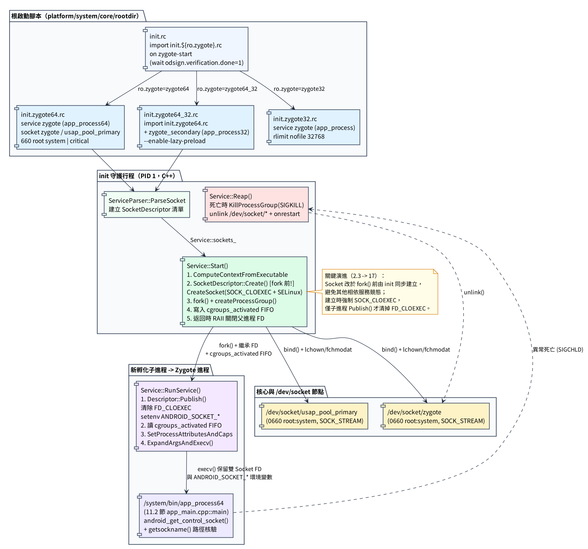
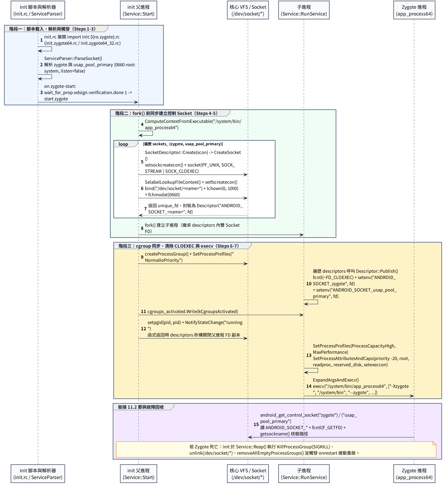

# 11.1 Zygote 進程的啟動腳本與 `init` 服務孵化機制（`init.zygote64.rc`、`Service::Start` 與 `CreateSocket`）

- **情景說明**：如果 Android 沒有 Zygote 進程，每一次開啟 App 都得從零啟動 ART 虛擬機、重新載入數千個框架類別與系統資源，不僅冷啟動耗時成倍拉長，還會讓各進程各自佔用重複的記憶體頁。Zygote（「受精卵／進程孵化器」）由使用者空間第一個進程 `init` 啟動，先在單一進程內完成 ART 虛擬機與框架預載，再透過 `fork()` 寫時複製（Copy-on-Write）快速孵化 `system_server` 與所有應用程式進程。本節追蹤開機階段 `init` 如何依 `ro.zygote` 屬性載入 `init.zygote64.rc`（或 `init.zygote64_32.rc`）、解析 `service zygote` 與雙控制 Socket 宣告、在 `fork()` 前同步建立 `/dev/socket/zygote` 與 `/dev/socket/usap_pool_primary`、於子進程清除 `FD_CLOEXEC` 並發布 `ANDROID_SOCKET_*` 環境變數，最後 `execv("/system/bin/app_process64", ...)` 進入 Zygote 原生入口，並對照 `libcutils` 的 `android_get_control_socket()` 取回驗證與 `Service::Reap()` 的死亡清理機制。
- **對應原書**：第 11 章引言與 11.1 節〈Zygote进程的启动脚本〉（p.619–622）
- **涉及專案與版本基準**：
  - `platform/system/core` 〔`android-17.0.0_r1`，commit `545d248`〕

---

## 11.1.1 啟動腳本體系：從單一 `init.rc` 到 `init.${ro.zygote}.rc`

> 對應原書 11.1 開頭（p.619）。原書 2.3 時代所有裝置皆為 32 位元，`service zygote` 直接硬編碼寫在 `system/core/rootdir/init.rc` 裡；進入 64 位元與雙 ABI 時代後，Android 將 Zygote 宣告拆分為獨立的 `init.zygote*.rc` 腳本，交由裝置屬性 `ro.zygote` 在開機解析 `init.rc` 時動態匯入。



### Step 1：`init.rc` 動態匯入與 `on zygote-start` 觸發時機
**位置**：`platform/system/core/rootdir/init.rc` 〔`android-17.0.0_r1`，lines 12、542–544、1091–1095〕

```rc
import /system/etc/init/hw/init.${ro.zygote}.rc
...
    # Now we can start zygote.
    trigger zygote-start
...
on zygote-start
    wait_for_prop odsign.verification.done 1
    start statsd
    start zygote
    start zygote_secondary
```

1. **依 ABI 配置動態 `import`**：`init` 在第二階段解析 `init.rc` 頂部時，會展開系統屬性 `${ro.zygote}`（常見值為 `zygote64`、`zygote64_32` 或 `zygote32`），匯入 `/system/etc/init/hw/init.${ro.zygote}.rc` 中定義的 `service zygote`（以及雙 ABI 配置下的 `service zygote_secondary`）。
2. **精準的啟動柵欄（`on zygote-start`）**：`init.rc` 在 `post-fs-data` 與 `load-bpf-programs` 完成後觸發 `trigger zygote-start`。`on zygote-start` 動作不會立刻拉起 Zygote，而是先執行 **`wait_for_prop odsign.verification.done 1`**——等待開機時的 On-Device Signing（`odsign`）完成 ART boot classpath / system server 編譯產物（`/data/misc/apexdata/com.android.art/dalvik-cache`）的簽章驗證，避免 Zygote 載入遭竄改或尚未就緒的 AOT 產物；驗證通過後才依序 `start statsd`、`start zygote`、`start zygote_secondary`（純 64 位元裝置無 `zygote_secondary` 服務定義時，`start zygote_secondary` 會略過）。

> 〔與 2.3 差異〕邏輯改變 + 新增：原書 11.1（p.619）的 `service zygote` 直接寫在 `init.rc` 內、隨 `class_start default` / `main` 一併啟動；Android 17 改由 `import /system/etc/init/hw/init.${ro.zygote}.rc` 依裝置 ABI 動態選擇，並獨立出 `on zygote-start` 柵欄等待 `odsign.verification.done=1`。

---

### Step 2：`init.zygote64.rc`、`init.zygote64_32.rc` 與 `init.zygote32.rc` 服務宣告
**位置**：`platform/system/core/rootdir/init.zygote64.rc` 〔`android-17.0.0_r1`，lines 1–20〕、`platform/system/core/rootdir/init.zygote64_32.rc` 〔`android-17.0.0_r1`，lines 1–14〕、`platform/system/core/rootdir/init.zygote32.rc` 〔`android-17.0.0_r1`，lines 1–23〕

```rc
# init.zygote64.rc
service zygote /system/bin/app_process64 -Xzygote /system/bin --zygote --start-system-server --socket-name=zygote
    class main
    priority -20
    user root
    group root readproc reserved_disk
    socket zygote stream 660 root system
    socket usap_pool_primary stream 660 root system
    onrestart exec_background - system system -- /system/bin/vdc volume abort_fuse
    onrestart write /sys/power/state on
    # NOTE: If the wakelock name here is changed, then also
    # update it in SystemSuspend.cpp
    onrestart write /sys/power/wake_lock zygote_kwl
    onrestart restart audioserver
    onrestart restart cameraserver
    onrestart restart media
    onrestart restart --only-if-running media.tuner
    onrestart restart netd
    onrestart restart wificond
    task_profiles ProcessCapacityHigh MaxPerformance
    critical window=${zygote.critical_window.minute:-off} target=zygote-fatal
```

```rc
# init.zygote64_32.rc
import /system/etc/init/hw/init.zygote64.rc

service zygote_secondary /system/bin/app_process32 -Xzygote /system/bin --zygote --socket-name=zygote_secondary --enable-lazy-preload
    class main
    priority -20
    user root
    group root readproc reserved_disk
    socket zygote_secondary stream 660 root system
    socket usap_pool_secondary stream 660 root system
    onrestart restart zygote
    task_profiles ProcessCapacityHigh MaxPerformance
    # The stdio implementation for arm32/x86 stores fds in a short.
    # This is part of the ABI, so 32Ki is the max for nofile for ilp32.
    rlimit nofile 32768 32768
```

`init.zygote64.rc` 的每一行宣告都直接影響後續 11.2 與 11.3 節的行為，關鍵指令解析如下：

| 宣告指令 | 內容 | 作用與安全意涵 |
|---|---|---|
| **執行檔與啟動參數** | `/system/bin/app_process64 -Xzygote /system/bin --zygote --start-system-server --socket-name=zygote` | `-Xzygote` 傳給 ART 虛擬機；`/system/bin` 為歷史遺留 `parent dir` 佔位參數；`--zygote` 進入 Zygote 模式；`--start-system-server` 指示孵化 `system_server`；`--socket-name=zygote` 指定控制 Socket 名稱 |
| **權限與排程** | `priority -20`、`user root`、`group root readproc reserved_disk`、`task_profiles ProcessCapacityHigh MaxPerformance` | 以最高非即時優先權（nice `-20`）與高效能 task profile 加速開機預載；維持 `root` 以利後續 `fork()` 後呼叫 `setuid`/`setgid`/`capset` 降權給子進程 |
| **雙控制 Socket** | `socket zygote stream 660 root system`<br>`socket usap_pool_primary stream 660 root system` | 由 `init` 預建兩個 UNIX Domain `SOCK_STREAM` Socket：前者供 `system_server`（`ZygoteProcess`）傳送孵化請求，後者供 **USAP（Unspecialized App Process）預孵化進程池**接受特化請求；權限自 2.3 的 `666` 收緊為 **`660 root system`**，僅允許 `root` 與 `system` 群組連線 |
| **故障連動（`onrestart`）** | `vdc volume abort_fuse`、喚醒螢幕與 `zygote_kwl` wakelock、重啟 `audioserver` / `cameraserver` / `media` / `media.tuner` / `netd` / `wificond` | 當 Zygote 重啟（例如 `system_server` 崩潰觸發 Zygote 自殺，見 11.2 節）時，連動重置持有舊 Binder 參考與 FUSE 掛載狀態的核心原生守護行程 |
| **致命保護（`critical`）** | `critical window=${zygote.critical_window.minute:-off} target=zygote-fatal` | 若在設定時間窗內反覆崩潰 4 次，觸發 `zygote-fatal` 復原／重開機流程 |

三種官方腳本變體的差異對照：

| 腳本 | 主 Zygote（64/32） | 副 Zygote（`zygote_secondary`） | 特徵 |
|---|---|---|---|
| `init.zygote64.rc` | `app_process64`（`--start-system-server`） | 無 | 現代純 64 位元裝置預設配置 |
| `init.zygote64_32.rc` | 直接 `import init.zygote64.rc` | `app_process32`（`--socket-name=zygote_secondary --enable-lazy-preload`） | 64 位元主導、32 位元相容；副 Zygote 不帶 `--start-system-server`、採延遲預載（首度孵化 32 位元 App 時才預載）並限制 `rlimit nofile 32768`（ilp32 stdio fd 存於 `short`）；副 Zygote 異常時透過 `onrestart restart zygote` 連動重啟主 Zygote |
| `init.zygote32.rc` | `app_process`（`--start-system-server`） | 無 | 純 32 位元裝置配置，同樣配置雙 Socket 與 `rlimit nofile 32768` |

> 〔與 2.3 差異〕邏輯改變 + 安全強化：原書 11.1（p.619）僅有 2 行宣告（`service zygote /system/bin/app_process ...` 與 `socket zygote stream 666`），任何使用者皆可讀寫 `/dev/socket/zygote`；Android 17 支援 64/32 雙架構、新增 USAP 控制 Socket、將權限收緊至 `660 root system`，並補上 `priority -20`、`task_profiles`、`onrestart` 與 `critical` 容錯策略。

---

## 11.1.2 `init` 解析 `socket` 宣告與 `Service::Start()` 孵化服務

> 對應原書 11.1 中 `system/core/init/init.c::service_start` 與 `util.c::create_socket`（p.619–622）。Android 17 的 `init` 已全面以 C++ 重寫，不僅結構拆分為 `ServiceParser`、`Service`、`SocketDescriptor` 與 `Descriptor`，連**建立 Socket 與 `fork()` 的先後順序**也發生了關鍵演進。

### Step 3：`ServiceParser::ParseSocket` 解析 `socket` 指令
**位置**：`platform/system/core/init/service_parser.cpp` 〔`android-17.0.0_r1`，lines 427–493〕

```cpp
// name type perm [ uid gid context ]
Result<void> ServiceParser::ParseSocket(std::vector<std::string>&& args) {
    SocketDescriptor socket;
    socket.name = std::move(args[1]);

    auto types = Split(args[2], "+");
    if (types[0] == "stream") {
        socket.type = SOCK_STREAM;
    } else if (types[0] == "dgram") {
        socket.type = SOCK_DGRAM;
    } else if (types[0] == "seqpacket") {
        socket.type = SOCK_SEQPACKET;
    } else {
        return Error() << "socket type must be 'dgram', 'stream' or 'seqpacket', got '" << types[0]
                       << "' instead.";
    }

    for (size_t i = 1; i < types.size(); i++) {
        if (types[i] == "passcred") {
            socket.passcred = true;
        } else if (types[i] == "listen") {
            socket.listen = true;
        } else {
            return Error() << "Unknown socket type decoration '" << types[i]
                           << "'. Known values are ['passcred', 'listen']";
        }
    }

    errno = 0;
    char* end = nullptr;
    socket.perm = strtol(args[3].c_str(), &end, 8);
    ...
    if (args.size() > 4) {
        auto uid = DecodeUid(args[4]);
        ...
        socket.uid = *uid;
    }

    if (args.size() > 5) {
        auto gid = DecodeUid(args[5]);
        ...
        socket.gid = *gid;
    }

    socket.context = args.size() > 6 ? args[6] : "";
    ...
    service_->sockets_.emplace_back(std::move(socket));

    return {};
}
```

解析 `init.zygote64.rc` 的兩條 `socket` 宣告後，`Service::sockets_` 向量會存入兩個 `SocketDescriptor` 物件：
- `name = "zygote"`、`type = SOCK_STREAM`、`perm = 0660`（八進位）、`uid = 0`（`root`）、`gid = 1000`（`system`）、`passcred = false`、`listen = false`、`context = ""`；
- `name = "usap_pool_primary"`，其餘欄位相同。

注意 `SocketDescriptor::listen` 預設為 **`false`**（定義於 `init/service_utils.h:65`）：只有腳本寫成 `stream+listen` 時 `init` 才會在建完後立刻呼叫 `listen()`；`zygote` 與 `usap_pool_primary` 均只寫 `stream`，因此 `init` 只負責 `socket()` + `bind()`，真正的 `listen()` 留待 11.2 節的 `LocalServerSocket(FileDescriptor)` 執行。

> 〔與 2.3 差異〕改名搬家 + 邏輯擴充：原書 2.3（p.620）由 C 語言 `init_parser` 串成單向鏈結串列 `struct socketinfo *sockets`，且 `type` 僅為字串比對；Android 17 由 `ServiceParser::ParseSocket` 轉為 `std::vector<SocketDescriptor>`，支援 `+passcred`、`+listen` 修飾詞與 SELinux `context` 參數。

---

### Step 4：`Service::Start()` 在 `fork()` 前同步建立 Socket 與父子進程同步
**位置**：`platform/system/core/init/service.cpp` 〔`android-17.0.0_r1`，lines 606–823〕

```cpp
Result<void> Service::Start() {
    ...
    InterprocessFifo cgroups_activated, setsid_finished;
    OR_RETURN(cgroups_activated.Initialize());
    OR_RETURN(setsid_finished.Initialize());
    ...
    std::string scon;
    if (!seclabel_.empty()) {
        scon = seclabel_;
    } else {
        auto result = ComputeContextFromExecutable(args_[0]);
        if (!result.ok()) {
            return result.error();
        }
        scon = *result;
    }
    ...
    LOG(INFO) << "starting service '" << name_ << "'...";

    std::vector<Descriptor> descriptors;
    for (const auto& socket : sockets_) {
        if (auto result = socket.Create(scon); result.ok()) {
            descriptors.emplace_back(std::move(*result));
        } else {
            LOG(INFO) << "Could not create socket '" << socket.name << "': " << result.error();
        }
    }
    ...
    pid_t pid = -1;
    if (namespaces_.flags) {
        pid = clone(nullptr, nullptr, namespaces_.flags | SIGCHLD, nullptr);
    } else {
        pid = fork();
    }

    if (pid == 0) {
        umask(077);
        cgroups_activated.CloseWriteFd();
        setsid_finished.CloseReadFd();
        RunService(descriptors, std::move(cgroups_activated), std::move(setsid_finished));
        _exit(127);
    } else {
        cgroups_activated.CloseReadFd();
        setsid_finished.CloseWriteFd();
    }
    ...
    pid_ = pid;
    flags_ |= SVC_RUNNING;
    ...
    if (CgroupsAvailable()) {
        ...
        errno = -createProcessGroup(uid(), pid_, use_memcg);
        ...
        SetProcessProfiles(uid(), pid_, {"NormalIoPriority"});
        ...
    }
    ...
    if (Result<void> result = cgroups_activated.Write(kCgroupsActivated); !result.ok()) {
        return Error() << "Sending cgroups activated notification failed: " << result.error();
    }

    cgroups_activated.Close();

    if (!RequiresConsole(proc_attr_)) {
        if (setpgid(pid, pid) < 0) {
            ...
        }
    }
    ...
    NotifyStateChange("running");
    reboot_on_failure.Disable();

    LOG(INFO) << "... started service '" << name_ << "' has pid " << pid_;

    return {};
}
```

這段程式碼藏著三個現代 Android `init` 最精巧的設計細節：
1. **先建 Socket、再 `fork()`（同步消除競態）**：不同於 2.3 先 `fork()` 才由子進程建 Socket，Android 17 在 **`fork()` 之前**就在父進程 `init` 內遍歷 `sockets_` 呼叫 `socket.Create(scon)`（`init/service_utils.h:68–70` 明確註記理由：確保 `/dev/socket/zygote` 在 `Service::Start()` 返回前就已經同步建立完成，後續相依服務不會因為排程順序而撲空）。
2. **RAII 防止父進程 FD 洩漏**：每個建好的 Socket fd 都以 `android::base::unique_fd` 封裝進區域變數 `std::vector<Descriptor> descriptors`。`fork()` 之後，子進程繼承這些 fd 並由 `RunService()` 發布；父進程 `init` 則在 `Service::Start()` 返回時自動觸發 `descriptors` 析構，關閉父進程自身對這批 Socket 的檔案描述符（加上建立時即帶 `SOCK_CLOEXEC`，確保絕不洩漏給其他無關服務）。
3. **雙 FIFO 消除 cgroup / `setsid` 競態**：透過 `cgroups_activated` 管線，父進程先呼叫 `createProcessGroup(uid(), pid_, ...)` 把新生的 Zygote 進程放入對應 cgroup，寫入 `kCgroupsActivated` 後子進程才往下設定 `task_profiles` 與 `execv()`；父進程同時呼叫 `setpgid(pid, pid)` 確保後續若要砍進程群組（`kill(-pgid, ...)`）不會發生競態。

> 〔與 2.3 差異〕改名搬家 + 邏輯改變：原書 11.1（p.620）的 `init.c::service_start()` 先呼叫 `fork()`，再於 `pid == 0` 的子進程分支內呼叫 `create_socket()` 與 `publish_socket()`，且沒有 cgroup 同步管線與 SELinux `ComputeContextFromExecutable()`；Android 17 改在 `fork()` 前於父進程同步建好帶 `SOCK_CLOEXEC` 的 Socket，再以 RAII 自動回收父進程副本。

---

### Step 5：`SocketDescriptor::Create()` 與 `CreateSocket()` 建立 UNIX Domain Socket
**位置**：`platform/system/core/init/service_utils.cpp` 〔`android-17.0.0_r1`，lines 197–206〕、`platform/system/core/init/util.cpp` 〔`android-17.0.0_r1`，lines 97–164〕、`platform/system/core/libcutils/include/cutils/sockets.h` 〔`android-17.0.0_r1`，lines 44–45〕

```cpp
// libcutils/include/cutils/sockets.h
#define ANDROID_SOCKET_ENV_PREFIX	"ANDROID_SOCKET_"
#define ANDROID_SOCKET_DIR		"/dev/socket"
```

```cpp
// init/service_utils.cpp
Result<Descriptor> SocketDescriptor::Create(const std::string& global_context) const {
    const auto& socket_context = context.empty() ? global_context : context;
    auto result = CreateSocket(name, type | SOCK_CLOEXEC, passcred, listen, perm, uid, gid,
                               socket_context);
    if (!result.ok()) {
        return result.error();
    }

    return Descriptor(ANDROID_SOCKET_ENV_PREFIX + name, unique_fd(*result));
}
```

```cpp
// init/util.cpp
Result<int> CreateSocket(const std::string& name, int type, bool passcred, bool should_listen,
                         mode_t perm, uid_t uid, gid_t gid, const std::string& socketcon) {
    if (!socketcon.empty()) {
        if (setsockcreatecon(socketcon.c_str()) == -1) {
            return ErrnoError() << "setsockcreatecon(\"" << socketcon << "\") failed";
        }
    }

    android::base::unique_fd fd(socket(PF_UNIX, type, 0));
    if (fd < 0) {
        return ErrnoError() << "Failed to open socket '" << name << "'";
    }

    if (!socketcon.empty()) setsockcreatecon(nullptr);

    struct sockaddr_un addr;
    memset(&addr, 0 , sizeof(addr));
    addr.sun_family = AF_UNIX;
    snprintf(addr.sun_path, sizeof(addr.sun_path), ANDROID_SOCKET_DIR "/%s", name.c_str());

    if ((unlink(addr.sun_path) != 0) && (errno != ENOENT)) {
        return ErrnoError() << "Failed to unlink old socket '" << name << "'";
    }

    std::string secontext;
    if (SelabelLookupFileContext(addr.sun_path, S_IFSOCK, &secontext) && !secontext.empty()) {
        setfscreatecon(secontext.c_str());
    }

    if (passcred) {
        int on = 1;
        if (setsockopt(fd.get(), SOL_SOCKET, SO_PASSCRED, &on, sizeof(on))) {
            return ErrnoError() << "Failed to set SO_PASSCRED '" << name << "'";
        }
    }

    int ret = bind(fd.get(), (struct sockaddr*)&addr, sizeof(addr));
    int savederrno = errno;

    if (!secontext.empty()) {
        setfscreatecon(nullptr);
    }

    auto guard = android::base::make_scope_guard([&addr] { unlink(addr.sun_path); });

    if (ret) {
        errno = savederrno;
        return ErrnoError() << "Failed to bind socket '" << name << "'";
    }

    if (lchown(addr.sun_path, uid, gid)) {
        return ErrnoError() << "Failed to lchown socket '" << addr.sun_path << "'";
    }
    if (fchmodat(AT_FDCWD, addr.sun_path, perm, AT_SYMLINK_NOFOLLOW)) {
        return ErrnoError() << "Failed to fchmodat socket '" << addr.sun_path << "'";
    }
    if (should_listen && listen(fd.get(), /* use OS maximum */ 1 << 30)) {
        return ErrnoError() << "Failed to listen on socket '" << addr.sun_path << "'";
    }

    LOG(INFO) << "Created socket '" << addr.sun_path << "'"
              << ", mode " << std::oct << perm << std::dec
              << ", user " << uid
              << ", group " << gid;

    guard.Disable();
    return fd.release();
}
```

`CreateSocket()` 依序完成五項動作：
1. **套用 Socket SELinux 安全上下文**：呼叫 `setsockcreatecon(socketcon)` 設定核心 Socket 物件的 SELinux label，再以 **`socket(PF_UNIX, SOCK_STREAM | SOCK_CLOEXEC, 0)`** 原子建立帶 close-on-exec 旗標的 UNIX Domain Socket。
2. **準備 `/dev/socket/<name>` 節點與檔案系統 SELinux label**：將路徑組為 `/dev/socket/zygote`（以及 `/dev/socket/usap_pool_primary`），先 `unlink()` 清除殘留節點，再查詢 `SelabelLookupFileContext` 並透過 `setfscreatecon()` 確保 `bind()` 建出的檔案系統 socket 節點帶有正確 SELinux context（例如 `u:object_r:zygote_socket:s0`）。
3. **綁定與防符號連結攻擊的權限設定**：呼叫 `bind()` 在 `/dev/socket/` 下建立節點；接著刻意使用 **`lchown()`** 與 **`fchmodat(..., AT_SYMLINK_NOFOLLOW)`**（而非跟隨符號連結的 `chown`/`chmod`）將擁有者設為 `root:system`、權限設為 `0660`，若中途任何步驟失敗，RAII `make_scope_guard` 會自動 `unlink` 清理殘骸。
4. **條件式 `listen()`**：因 `init.zygote64.rc` 未加 `+listen`，此處 `should_listen == false`，跳過 `listen()`。
5. **封裝為 `Descriptor`**：`SocketDescriptor::Create()` 將名稱拼成 **`"ANDROID_SOCKET_zygote"`** 與 **`"ANDROID_SOCKET_usap_pool_primary"`** 連同 `unique_fd` 包裝回傳。

> 〔與 2.3 差異〕改名搬家 + 安全強化：原書 11.1（p.621–622）的 `util.c::create_socket()` 不帶 `SOCK_CLOEXEC`、沒有 SELinux `setsockcreatecon`/`setfscreatecon`，且直接呼叫 `chown()`/`chmod()`；Android 17 改用 `SOCK_CLOEXEC`、雙重 SELinux 標記、防符號連結的 `lchown`/`fchmodat(AT_SYMLINK_NOFOLLOW)` 以及 scope guard 錯誤回滾。

---

## 11.1.3 子進程發布 Socket 環境變數與 `execv` 載入 `app_process64`

> 對應原書 11.1 的 `publish_socket` 與 `execve`（p.620、622）。一旦 `fork()` 產出子進程，子進程必須在 `execv()` 替換映像之前，將 Socket FD 的 `FD_CLOEXEC` 移除並寫入環境變數，讓新載入的 `/system/bin/app_process64` 順利接手控制權。

### Step 6：`Service::RunService()` 與 `Descriptor::Publish()` 發布環境變數
**位置**：`platform/system/core/init/service.cpp` 〔`android-17.0.0_r1`，lines 549–604〕、`platform/system/core/init/service_utils.cpp` 〔`android-17.0.0_r1`，lines 178–195〕

```cpp
// init/service.cpp
void Service::RunService(const std::vector<Descriptor>& descriptors,
                         InterprocessFifo cgroups_activated, InterprocessFifo setsid_finished) {
    if (auto result = EnterNamespaces(namespaces_, name_, mount_namespace_); !result.ok()) {
        LOG(FATAL) << "Service '" << name_ << "' failed to set up namespaces: " << result.error();
    }

    for (const auto& [key, value] : once_environment_vars_) {
        setenv(key.c_str(), value.c_str(), 1);
    }
    for (const auto& [key, value] : environment_vars_) {
        setenv(key.c_str(), value.c_str(), 1);
    }

    for (const auto& descriptor : descriptors) {
        descriptor.Publish();
    }
    ...
    // Wait until the cgroups have been created and until the cgroup controllers have been
    // activated.
    Result<uint8_t> byte = cgroups_activated.Read();
    ...
    cgroups_activated.Close();
    if (*byte != kCgroupsActivated) {
        LOG(FATAL) << "Service '" << name_  << "' failed to start due to a fatal error";
        _exit(EXIT_FAILURE);
    }

    if (task_profiles_.size() > 0) {
        bool succeeded = SelinuxGetVendorAndroidVersion() < __ANDROID_API_U__
                                 ?
                                 // Compatibility mode: apply the task profiles to the current
                                 // thread.
                                 SetTaskProfiles(getpid(), task_profiles_)
                                 :
                                 // Apply the task profiles to the current process.
                                 SetProcessProfiles(getuid(), getpid(), task_profiles_);
        if (!succeeded) {
            LOG(ERROR) << "failed to set task profiles";
        }
    }

    // As requested, set our gid, supplemental gids, uid, context, and
    // priority. Aborts on failure.
    SetProcessAttributesAndCaps(std::move(setsid_finished));

    if (!ExpandArgsAndExecv(args_, sigstop_)) {
        PLOG(ERROR) << "cannot execv('" << args_[0]
                    << "'). See the 'Debugging init' section of init's README.md for tips";
    }
}
```

```cpp
// init/service_utils.cpp
void Descriptor::Publish() const {
    auto published_name = name_;

    for (auto& c : published_name) {
        c = isalnum(c) ? c : '_';
    }

    int fd = fd_.get();
    // For safety, the FD is created as CLOEXEC, so that must be removed before publishing.
    auto fd_flags = fcntl(fd, F_GETFD);
    fd_flags &= ~FD_CLOEXEC;
    if (fcntl(fd, F_SETFD, fd_flags) != 0) {
        PLOG(ERROR) << "Failed to remove CLOEXEC from '" << published_name << "'";
    }

    std::string val = std::to_string(fd);
    setenv(published_name.c_str(), val.c_str(), 1);
}
```

`Descriptor::Publish()` 正是跨 `execv()` 傳遞 Socket 的關鍵樞紐：
1. **清理環境變數鍵名**：將非英數字元替換為 `_`，產出 `ANDROID_SOCKET_zygote` 與 `ANDROID_SOCKET_usap_pool_primary`。
2. **關鍵一步——移除 `FD_CLOEXEC`**：因為 Step 5 建立時統一設了 `SOCK_CLOEXEC`，若不在此透過 `fcntl(fd, F_SETFD, fd_flags & ~FD_CLOEXEC)` 清除，接下來 `execv()` 時核心會把這兩個 Socket FD 自動關閉！唯獨執行到此處的子進程才會刻意「開閘放行」，讓這兩個 FD 活過 `execv()`。
3. **寫入環境變數**：呼叫 `setenv("ANDROID_SOCKET_zygote", "<fd>", 1)` 與 `setenv("ANDROID_SOCKET_usap_pool_primary", "<fd>", 1)`。
4. **同步 cgroups 與套用進程屬性**：等待 `cgroups_activated.Read()` 收到 `kCgroupsActivated` → 套用 `ProcessCapacityHigh` / `MaxPerformance` task profiles → `SetProcessAttributesAndCaps()` 套用 `priority -20`、UID/GID/supplementary groups（`root`、`readproc`、`reserved_disk`）與 SELinux exec context（`setexeccon`）→ 呼叫 `ExpandArgsAndExecv()`。

> 〔與 2.3 差異〕改名搬家 + 邏輯改變：原書 11.1（p.622）的 `init.c::publish_socket()` 呼叫 `fcntl(fd, F_SETFD, 0)` 寫死清除所有 FD 旗標，並手寫 `add_environment()` 填入全域靜態陣列 `ENV`；Android 17 改用標準 `setenv()` + 精準位元清除 `~FD_CLOEXEC`，並在 `execv()` 前完成 namespace、cgroup 同步、task profiles 與 SELinux `setexeccon()` 設定。

---

### Step 7：`ExpandArgsAndExecv()`、`android_get_control_socket()` 驗證與 `Service::Reap()` 清理
**位置**：`platform/system/core/init/service.cpp` 〔`android-17.0.0_r1`，lines 120–157、280–318〕、`platform/system/core/libcutils/sockets_unix.cpp` 〔`android-17.0.0_r1`，lines 54–73〕、`platform/system/core/libcutils/android_get_control_file.cpp` 〔`android-17.0.0_r1`，lines 49–77〕

```cpp
// init/service.cpp
static bool ExpandArgsAndExecv(const std::vector<std::string>& args, bool sigstop) {
    std::vector<std::string> expanded_args;
    std::vector<char*> c_strings;

    expanded_args.resize(args.size());
    c_strings.push_back(const_cast<char*>(args[0].data()));
    for (std::size_t i = 1; i < args.size(); ++i) {
        auto expanded_arg = ExpandProps(args[i]);
        if (!expanded_arg.ok()) {
            LOG(FATAL) << args[0] << ": cannot expand arguments': " << expanded_arg.error();
        }
        expanded_args[i] = *expanded_arg;
        c_strings.push_back(expanded_args[i].data());
    }
    c_strings.push_back(nullptr);
    ...
    return execv(c_strings[0], c_strings.data()) == 0;
}
```

```cpp
// libcutils/sockets_unix.cpp（11.2 節 Zygote.nativeInitNativeState 呼叫的接收端）
int android_get_control_socket(const char* name) {
    int fd = __android_get_control_from_env(ANDROID_SOCKET_ENV_PREFIX, name);

    if (fd < 0) return fd;

    // Compare to UNIX domain socket name, must match!
    struct sockaddr_un addr;
    socklen_t addrlen = sizeof(addr);
    int ret = getsockname(fd, (struct sockaddr*)&addr, &addrlen);
    if (ret < 0) return -1;

    constexpr char prefix[] = ANDROID_SOCKET_DIR "/";
    constexpr size_t prefix_size = sizeof(prefix) - sizeof('\0');
    if ((strncmp(addr.sun_path, prefix, prefix_size) == 0) &&
        (strcmp(addr.sun_path + prefix_size, name) == 0)) {
        // It is what we think it is
        return fd;
    }
    return -1;
}
```

```cpp
// init/service.cpp（Zygote 異常終止時的回收閉環）
void Service::Reap(const siginfo_t& siginfo) {
    if (!(flags_ & SVC_ONESHOT) || (flags_ & SVC_RESTART)) {
        KillProcessGroup(SIGKILL);
    } ...

    // Remove any socket resources we may have created.
    for (const auto& socket : sockets_) {
        if (socket.persist) {
            continue;
        }
        auto path = ANDROID_SOCKET_DIR "/" + socket.name;
        unlink(path.c_str());
    }
    ...
    if (name_ == "zygote" || name_ == "zygote64") {
        removeAllEmptyProcessGroups();
    }
    ...
```

1. **啟動映像切換**：`ExpandArgsAndExecv()` 展開所有參數中的 `${...}` 系統屬性後，呼叫 `execv("/system/bin/app_process64", ...)`（使用子進程剛剛透過 `setenv()` 更新過的環境變數表）。自此子進程正式變身為 Zygote 進程，進入 11.2 節的 `app_main.cpp::main()`。
2. **接收端雙重核驗（銜接 11.2 節）**：進入 Zygote 後，原生層 `Zygote.nativeInitNativeState()` 會呼叫 `android_get_control_socket("zygote")` 與 `android_get_control_socket("usap_pool_primary")`。`libcutils` 先透過 `__android_get_control_from_env()` 讀取 `ANDROID_SOCKET_<name>` 並以 `fcntl(fd, F_GETFD)` 確認 FD 仍開啟，接著再呼叫 **`getsockname()`** 核對該 FD 綁定的路徑是否確實等於 `"/dev/socket/" + name`，杜絕環境變數偽造或 FD 錯置。（Java 層 `Zygote.createManagedSocketFromInitSocket()` 亦會讀取同一個環境變數包裝為 `LocalServerSocket`。）
3. **死亡清理與重啟閉環**：當 Zygote 死亡（例如 11.3 節 `system_server` 崩潰導致 Zygote 在 `SigChldHandler` 自殺）時，`init` 在 `Service::Reap()` 中會以 `KillProcessGroup(SIGKILL)` 清空整個進程群組、`unlink("/dev/socket/zygote")` 與 `unlink("/dev/socket/usap_pool_primary")`、對 `zygote`/`zygote64` 額外清理空 process groups，再執行 `init.zygote64.rc` 的全部 `onrestart` 動作並重新啟動 Zygote。

> 〔與 2.3 差異〕邏輯改變 + 新增：原書 11.1（p.620）由 `service_start` 直接把全域 `ENV` 傳給 `execve()`，並未交代 `getsockname()` 路徑驗證與 `Service::Reap()` 回收閉環；Android 17 改用 `ExpandArgsAndExecv`（展開屬性 + `execv`），在 `libcutils` 加入 `getsockname()` 核驗，並在 `Service::Reap()` 對 `zygote`/`zygote64` 進行 process group 徹底清理。

---

## 11.1.4 本節總結與時序圖



| 階段 | 核心函式 / 檔案 | 關鍵產出與狀態變化 |
|---|---|---|
| **腳本載入與柵欄** | `init.rc` → `init.zygote64.rc` / `init.zygote64_32.rc` | 依 `ro.zygote` 匯入對應 ABI 腳本；`on zygote-start` 等待 `odsign.verification.done=1` 後觸發 `start zygote` |
| **Socket 宣告解析** | `ServiceParser::ParseSocket` | 解析雙 `SocketDescriptor`（`zygote`、`usap_pool_primary`，`SOCK_STREAM`，`0660 root:system`，`listen=false`） |
| **同步預建 Socket** | `Service::Start` → `SocketDescriptor::Create` → `CreateSocket` | 在 `fork()` **之前**以 `SOCK_CLOEXEC` + SELinux context 綁定 `/dev/socket/{zygote,usap_pool_primary}`，以 `lchown`/`fchmodat` 設權限 |
| **孵化與環境發布** | `fork()` → `Service::RunService` → `Descriptor::Publish` | 子進程清除 `FD_CLOEXEC` 並 `setenv("ANDROID_SOCKET_*", fd)`；父進程建立 cgroup 後經 `cgroups_activated` FIFO 放行，函式返回時自動關閉父進程 FD 副本 |
| **載入映像與銜接** | `SetProcessAttributesAndCaps` → `ExpandArgsAndExecv` | 套用 `priority -20`、群組與 SELinux context 後 `execv("/system/bin/app_process64", ...)`，交棒給 11.2 節 `app_main.cpp::main()` |
