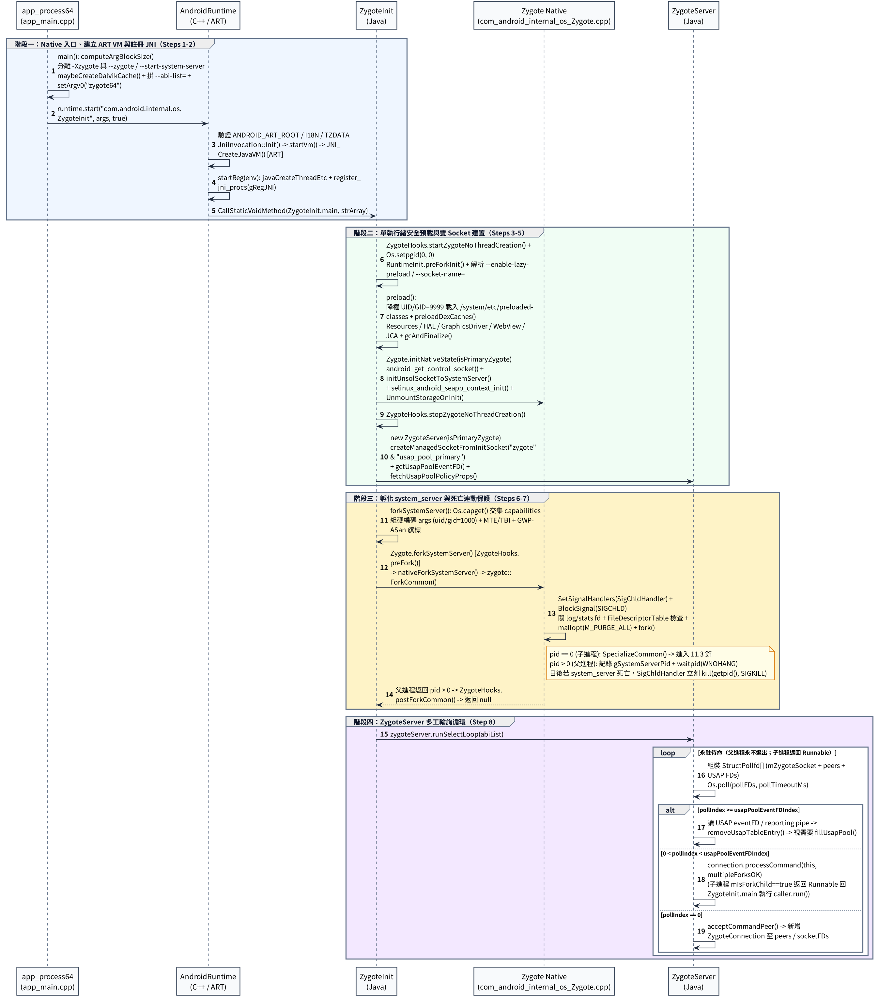

# 11.2 Zygote 進程的啟動過程（`app_main`、`AndroidRuntime`、`ZygoteInit` 預載與 `ZygoteServer` 輪詢循環）

- **情景說明**：接續 11.1 節，`init` 呼叫 `execv("/system/bin/app_process64", ["-Xzygote", "/system/bin", "--zygote", "--start-system-server", "--socket-name=zygote"])` 並繼承了 `ANDROID_SOCKET_zygote` 與 `ANDROID_SOCKET_usap_pool_primary` 兩個控制 Socket FD。本節從 C++ 入口 `app_main.cpp::main()` 出發，一路追蹤 Zygote 如何建立 ART 虛擬機、註冊框架 JNI、在單執行緒保護下以非特權身分預載共用類／資源／HAL／圖形驅動／WebView／JCA Providers、初始化原生狀態與 `ZygoteServer` 雙監聽 Socket、透過 `ForkCommon()` 孵化 `system_server` 並安裝 `SigChldHandler` 建立死亡連動重啟機制，最後進入 `ZygoteServer.runSelectLoop()` 以 `Os.poll()` 多工監聽來自 `system_server` 的新進程孵化請求（與可選的 USAP 預孵化進程池）。
- **對應原書**：11.2 節〈Zygote进程的启动过程〉（p.622–630）
- **涉及專案與版本基準**：
  - `platform/frameworks/base` 〔`android-17.0.0_r1`，commit `94b4c163b`〕

---

## 11.2.1 Native 入口與 ART 虛擬機建立（`app_main` → `AndroidRuntime`）

> 對應原書 11.2 Step 1–Step 2（p.622–626）。Zygote 進程剛從 `execv` 起來時仍是純 C++ 進程，必須先由 `app_process64` 解析命令列參數並改寫進程名稱，再交由 `AndroidRuntime::start()` 透過 `JniInvocation` 載入 ART（`libart.so`）建立 JavaVM、註冊全體 Android 框架 JNI 函式，才正式踏入 Java 世界執行 `ZygoteInit.main()`。

### Step 1：`app_main.cpp::main()` 解析啟動參數與設定進程名
**位置**：`platform/frameworks/base/cmds/app_process/app_main.cpp` 〔`android-17.0.0_r1`，lines 165–190、256–344〕

```cpp
#if defined(__LP64__)
static const char ABI_LIST_PROPERTY[] = "ro.product.cpu.abilist64";
static const char ZYGOTE_NICE_NAME[] = "zygote64";
#else
static const char ABI_LIST_PROPERTY[] = "ro.product.cpu.abilist32";
static const char ZYGOTE_NICE_NAME[] = "zygote";
#endif

int main(int argc, char* const argv[])
{
    ...
    AppRuntime runtime(argv[0], computeArgBlockSize(argc, argv));
    // Process command line arguments
    // ignore argv[0]
    argc--;
    argv++;
    ...
    // Parse runtime arguments.  Stop at first unrecognized option.
    bool zygote = false;
    bool startSystemServer = false;
    bool application = false;
    String8 niceName;
    String8 className;

    ++i;  // Skip unused "parent dir" argument.
    while (i < argc) {
        const char* arg = argv[i++];
        if (strcmp(arg, "--zygote") == 0) {
            zygote = true;
            niceName = ZYGOTE_NICE_NAME;
        } else if (strcmp(arg, "--start-system-server") == 0) {
            startSystemServer = true;
        } else if (strcmp(arg, "--application") == 0) {
            application = true;
        } else if (strncmp(arg, "--nice-name=", 12) == 0) {
            niceName = (arg + 12);
        } else if (strncmp(arg, "--", 2) != 0) {
            className = arg;
            break;
        } else {
            --i;
            break;
        }
    }

    Vector<String8> args;
    if (!className.empty()) {
        ...
    } else {
        // We're in zygote mode.
        maybeCreateDalvikCache();

        if (startSystemServer) {
            args.add(String8("start-system-server"));
        }

        char prop[PROP_VALUE_MAX];
        if (property_get(ABI_LIST_PROPERTY, prop, NULL) == 0) {
            LOG_ALWAYS_FATAL("app_process: Unable to determine ABI list from property %s.",
                ABI_LIST_PROPERTY);
            return 11;
        }

        String8 abiFlag("--abi-list=");
        abiFlag.append(prop);
        args.add(abiFlag);

        // In zygote mode, pass all remaining arguments to the zygote
        // main() method.
        for (; i < argc; ++i) {
            args.add(String8(argv[i]));
        }
    }

    if (!niceName.empty()) {
        runtime.setArgv0(niceName.c_str(), true /* setProcName */);
    }

    if (zygote) {
        runtime.start("com.android.internal.os.ZygoteInit", args, zygote);
    } else if (!className.empty()) {
        runtime.start("com.android.internal.os.RuntimeInit", args, zygote);
    } else {
        fprintf(stderr, "Error: no class name or --zygote supplied.\n");
        app_usage();
        LOG_ALWAYS_FATAL("app_process: no class name or --zygote supplied.");
    }
}
```

對照 11.1 節 `init.zygote64.rc` 傳入的命令列 `/system/bin/app_process64 -Xzygote /system/bin --zygote --start-system-server --socket-name=zygote`，`main()` 的執行脈絡一目了然：
1. **計算參數區塊長度**：`computeArgBlockSize(argc, argv)` 算好連續 `argv` 記憶體大小交給 `AppRuntime`（繼承自 `AndroidRuntime`），後續 `runtime.setArgv0("zygote64", true)` 與子進程改名（如 `system_server` 或 App 包名）都靠覆寫這段記憶體，同時呼叫 `prctl(PR_SET_NAME)` 改變 `/proc/<pid>/comm`。
2. **分段解析選項**：第一個迴圈把以 `-` 開頭的 `-Xzygote` 透過 `runtime.addOption()` 交給 ART VM；接著跳過佔位參數 `/system/bin`；第二個迴圈認出 `--zygote`（設 `zygote = true`、`niceName = "zygote64"`）與 `--start-system-server`（設 `startSystemServer = true`），碰到未內建辨識的 `--socket-name=zygote` 時回退 `--i` 跳出。
3. **組裝 Java 參數並進入 Runtime**：呼叫 `maybeCreateDalvikCache()` 確保 `$ANDROID_DATA/dalvik-cache/<abi>` 存在且權限為 `0711 root:root`；讀取 `ro.product.cpu.abilist64` 拼出 `--abi-list=...`，連同 `"start-system-server"` 與剩餘參數 `"--socket-name=zygote"`（副 Zygote 還會帶上 `"--enable-lazy-preload"`）一起存入 `args`，最後呼叫 `runtime.start("com.android.internal.os.ZygoteInit", args, true)`。

> 〔與 2.3 差異〕邏輯改變：原書 11.2 Step 1（p.623–624）的 `app_main.cpp` 只認 `--zygote` / `--start-system-server` 且呼叫 `runtime.start("com.android.internal.os.ZygoteInit", startSystemServer)`（僅傳布林值）；Android 17 新增 64/32 雙 ABI（`ZYGOTE_NICE_NAME = "zygote64"`、`--abi-list=`）、`computeArgBlockSize()` + `setArgv0()` 改進程名、`maybeCreateDalvikCache()`，以及將 `--socket-name=` / `--enable-lazy-preload` 透傳至 Java 層。

---

### Step 2：`AndroidRuntime::start()`、`startVm()` 與 `startReg()`
**位置**：`platform/frameworks/base/core/jni/AndroidRuntime.cpp` 〔`android-17.0.0_r1`，lines 1196–1214、1235–1350、1751–1780〕

```cpp
void AndroidRuntime::start(const char* className, const Vector<String8>& options, bool zygote)
{
    ...
    static const String8 startSystemServer("start-system-server");
    // Whether this is the primary zygote, meaning the zygote which will fork system server.
    bool primary_zygote = false;

    for (size_t i = 0; i < options.size(); ++i) {
        if (options[i] == startSystemServer) {
            primary_zygote = true;
           /* track our progress through the boot sequence */
           const int LOG_BOOT_PROGRESS_START = 3000;
           LOG_EVENT_LONG(LOG_BOOT_PROGRESS_START,  ns2ms(systemTime(SYSTEM_TIME_MONOTONIC)));
        }
    }
    ...
    const char* artRootDir = getenv("ANDROID_ART_ROOT");
    if (artRootDir == NULL) {
        LOG_FATAL("No ART directory specified with ANDROID_ART_ROOT environment variable.");
        return;
    }

    const char* i18nRootDir = getenv("ANDROID_I18N_ROOT");
    if (i18nRootDir == NULL) {
        LOG_FATAL("No runtime directory specified with ANDROID_I18N_ROOT environment variable.");
        return;
    }

    const char* tzdataRootDir = getenv("ANDROID_TZDATA_ROOT");
    if (tzdataRootDir == NULL) {
        LOG_FATAL("No tz data directory specified with ANDROID_TZDATA_ROOT environment variable.");
        return;
    }

    /* start the virtual machine */
    JniInvocation jni_invocation;
    jni_invocation.Init(NULL);
    JNIEnv* env;
    if (startVm(&mJavaVM, &env, zygote, primary_zygote) != 0) {
        return;
    }
    onVmCreated(env);

    /*
     * Register android functions.
     */
    if (startReg(env) < 0) {
        ALOGE("Unable to register all android natives\n");
        return;
    }

    jclass stringClass;
    jobjectArray strArray;
    jstring classNameStr;

    stringClass = env->FindClass("java/lang/String");
    assert(stringClass != NULL);
    strArray = env->NewObjectArray(options.size() + 1, stringClass, NULL);
    assert(strArray != NULL);
    classNameStr = env->NewStringUTF(className);
    assert(classNameStr != NULL);
    env->SetObjectArrayElement(strArray, 0, classNameStr);

    for (size_t i = 0; i < options.size(); ++i) {
        jstring optionsStr = env->NewStringUTF(options.itemAt(i).c_str());
        assert(optionsStr != NULL);
        env->SetObjectArrayElement(strArray, i + 1, optionsStr);
    }

    char* slashClassName = toSlashClassName(className != NULL ? className : "");
    jclass startClass = env->FindClass(slashClassName);
    if (startClass == NULL) {
        ALOGE("JavaVM unable to locate class '%s'\n", slashClassName);
        /* keep going */
    } else {
        jmethodID startMeth = env->GetStaticMethodID(startClass, "main",
            "([Ljava/lang/String;)V");
        if (startMeth == NULL) {
            ALOGE("JavaVM unable to find main() in '%s'\n", className);
            /* keep going */
        } else {
            env->CallStaticVoidMethod(startClass, startMeth, strArray);
        }
    }
    ...
```

```cpp
// AndroidRuntime::startVm() 尾段（lines 1196–1214）
    initArgs.version = JNI_VERSION_1_4;
    initArgs.options = mOptions.editArray();
    initArgs.nOptions = mOptions.size();
    initArgs.ignoreUnrecognized = JNI_FALSE;

    if (JNI_CreateJavaVM(pJavaVM, pEnv, &initArgs) < 0) {
        ALOGE("JNI_CreateJavaVM failed\n");
        return -1;
    }

    return 0;
```

```cpp
/*static*/ int AndroidRuntime::startReg(JNIEnv* env)
{
    ATRACE_NAME("RegisterAndroidNatives");
    androidSetCreateThreadFunc((android_create_thread_fn) javaCreateThreadEtc);

    ALOGV("--- registering native functions ---\n");
    env->PushLocalFrame(200);

    if (register_jni_procs(gRegJNI, NELEM(gRegJNI), env) < 0) {
        env->PopLocalFrame(NULL);
        return -1;
    }
    env->PopLocalFrame(NULL);

    return 0;
}
```

`AndroidRuntime::start()` 完成了四件奠基大事：
1. **確認 Mainline APEX 執行環境**：檢查 `ANDROID_ART_ROOT`、`/apex/com.android.i18n`（`ANDROID_I18N_ROOT`）與 `/apex/com.android.tzdata`（`ANDROID_TZDATA_ROOT`），並於主 Zygote 寫入開機里程碑事件 `LOG_BOOT_PROGRESS_START (3000)`。
2. **動態載入 ART 並建立 JavaVM**：`JniInvocation::Init(NULL)` 透過 `dlopen` 載入 ART 虛擬機動態庫（`libart.so`）；接著 `startVm()` 整理所有 `dalvik.vm.*` 系統屬性（heap 大小、GC、JIT/AOT、NativeBridge、`--cpu-abilist=`、build fingerprint 等）並呼叫 **`JNI_CreateJavaVM(pJavaVM, pEnv, &initArgs)`** 誕生 ART 虛擬機實例，再呼叫 `onVmCreated(env)`（在 Zygote 模式下 `mClassName` 為空，直接返回）。
3. **批次註冊全體 Android 框架 JNI**：`startReg(env)` 先用 `androidSetCreateThreadFunc(javaCreateThreadEtc)` 掛載原生執行緒建立鉤子（讓後續 C++ 執行緒自動附掛至 JavaVM），再呼叫 `register_jni_procs(gRegJNI, ...)` 一次性註冊整個 `frameworks/base` 的數百組 JNI 函式（包含 `Zygote`、`ZygoteInit`、`RuntimeInit`、`Binder`、`CursorWindow` 等）。日後所有從 Zygote `fork()` 出來的進程都會直接繼承這份已註冊的 JNI 對應表，無須重複註冊。
4. **進入 Java 入口**：組裝 `String[] strArray`（`argv[0] = "com.android.internal.os.ZygoteInit"`，後接 `"start-system-server"`、`"--abi-list=..."`、`"--socket-name=zygote"`），透過 `env->CallStaticVoidMethod(startClass, startMeth, strArray)` 正式踏入 `ZygoteInit.main()`。

> 〔與 2.3 差異〕邏輯徹底改變：原書 11.2 Step 2（p.624–626）直接靜態連結 Dalvik VM（`libdvm.so`）且不具 APEX 模組路徑檢查；Android 17 改經 `JniInvocation::Init` 動態載入 ART（`libart.so`）並強制驗證 `ANDROID_ART_ROOT` / `ANDROID_I18N_ROOT` / `ANDROID_TZDATA_ROOT`，且 `strArray` 改為動態展開整個 `options` 向量。

---

## 11.2.2 Java 層初始化、安全預載與控制 Socket 建置（`ZygoteInit` → `ZygoteServer`）

> 對應原書 11.2 Step 3–Step 4（p.626–628）。進入 `ZygoteInit.main()` 後，Zygote 在單執行緒禁令保護下執行大規模預載（讓未來所有 App 透過 CoW 共享只讀與乾淨頁），接著完成原生狀態初始化，並交由獨立的 `ZygoteServer` 接管 11.1 節 `init` 傳來的雙控制 Socket。

### Step 3：`ZygoteInit.main()` 主控編排與 `Runnable` 跳板出口
**位置**：`platform/frameworks/base/core/java/com/android/internal/os/ZygoteInit.java` 〔`android-17.0.0_r1`，lines 824–941〕

```java
    public static void main(String[] argv) {
        ZygoteServer zygoteServer = null;

        // Mark zygote start. This ensures that thread creation will throw
        // an error.
        ZygoteHooks.startZygoteNoThreadCreation();

        // Zygote goes into its own process group.
        try {
            Os.setpgid(0, 0);
        } catch (ErrnoException ex) {
            throw new RuntimeException("Failed to setpgid(0,0)", ex);
        }

        Runnable caller;
        try {
            ...
            RuntimeInit.preForkInit();

            boolean startSystemServer = false;
            String zygoteSocketName = "zygote";
            String abiList = null;
            boolean enableLazyPreload = false;
            for (int i = 1; i < argv.length; i++) {
                if ("start-system-server".equals(argv[i])) {
                    startSystemServer = true;
                } else if ("--enable-lazy-preload".equals(argv[i])) {
                    enableLazyPreload = true;
                } else if (argv[i].startsWith(ABI_LIST_ARG)) {
                    abiList = argv[i].substring(ABI_LIST_ARG.length());
                } else if (argv[i].startsWith(SOCKET_NAME_ARG)) {
                    zygoteSocketName = argv[i].substring(SOCKET_NAME_ARG.length());
                } else {
                    throw new RuntimeException("Unknown command line argument: " + argv[i]);
                }
            }

            final boolean isPrimaryZygote = zygoteSocketName.equals(Zygote.PRIMARY_SOCKET_NAME);
            ...
            if (!enableLazyPreload) {
                bootTimingsTraceLog.traceBegin("ZygotePreload");
                EventLog.writeEvent(LOG_BOOT_PROGRESS_PRELOAD_START,
                        SystemClock.uptimeMillis());
                preload(bootTimingsTraceLog);
                EventLog.writeEvent(LOG_BOOT_PROGRESS_PRELOAD_END,
                        SystemClock.uptimeMillis());
                bootTimingsTraceLog.traceEnd(); // ZygotePreload
            }

            // Do an initial gc to clean up after startup
            bootTimingsTraceLog.traceBegin("PostZygoteInitGC");
            gcAndFinalize();
            bootTimingsTraceLog.traceEnd(); // PostZygoteInitGC

            bootTimingsTraceLog.traceEnd(); // ZygoteInit

            Zygote.initNativeState(isPrimaryZygote);

            ZygoteHooks.stopZygoteNoThreadCreation();

            zygoteServer = new ZygoteServer(isPrimaryZygote);

            if (startSystemServer) {
                Runnable r = forkSystemServer(abiList, zygoteSocketName, zygoteServer);

                // {@code r == null} in the parent (zygote) process, and {@code r != null} in the
                // child (system_server) process.
                if (r != null) {
                    r.run();
                    return;
                }
            }

            Log.i(TAG, "Accepting command socket connections");

            // The select loop returns early in the child process after a fork and
            // loops forever in the zygote.
            caller = zygoteServer.runSelectLoop(abiList);
        } catch (Throwable ex) {
            Log.e(TAG, "System zygote died with fatal exception", ex);
            throw ex;
        } finally {
            if (zygoteServer != null) {
                zygoteServer.closeServerSocket();
            }
        }

        // We're in the child process and have exited the select loop. Proceed to execute the
        // command.
        if (caller != null) {
            caller.run();
        }
    }
```

`ZygoteInit.main()` 的設計極為嚴謹，四個細節最值得關注：
1. **單執行緒禁令（`startZygoteNoThreadCreation` / `stopZygoteNoThreadCreation`）**：Linux `fork()` 在多執行緒進程中只會複製呼叫 `fork()` 的那條執行緒，其他執行緒持有的鎖會永遠死鎖。因此在 `preload()` 期間透過 `ZygoteHooks.startZygoteNoThreadCreation()` 強制任何意外建執行緒的靜態初始化器立刻拋錯。
2. **延遲預載選項（`--enable-lazy-preload`）**：主 Zygote（64 位元）會立刻執行 `preload()` 並呼叫 `gcAndFinalize()` 清理暫存垃圾；雙 ABI 裝置的 32 位元 `zygote_secondary` 帶著 `--enable-lazy-preload`，開機階段跳過預載，直到第一個 32 位元 App 啟動（或 `SystemServer` 背景觸發 `preloadDefault`）才呼叫 `lazyPreload()`，大幅節省純 64 位元使用情境的記憶體。
3. **兩處 `Runnable` 跳板（無例外清棧）**：無論是 `forkSystemServer()` 返回的 `r`（供 `system_server` 執行 `SystemServer.main`），或是 `zygoteServer.runSelectLoop()` 返回的 `caller`（供新孵化 App 執行 `ActivityThread.main`），在父進程（Zygote）永遠不會返回或返回 `null`，在子進程則一路 unwind 回最頂層的 `ZygoteInit.main()` 呼叫 `r.run()` / `caller.run()`，既清空所有 Zygote 初始化堆疊幀，又省去 2.3 拋出例外物件的開銷。
4. **`finally` 自動關 Socket**：子進程自 `runSelectLoop()` 返回後會經過 `finally` 執行 `zygoteServer.closeServerSocket()`，確保 App 子進程不會繼續持有 Zygote 監聽 Socket。

> 〔與 2.3 差異〕邏輯改變：原書 11.2 Step 3（p.626–627）先呼叫 `registerZygoteSocket()` 再 `preloadClasses()`，設有 `ZYGOTE_FORK_MODE` 切換 `runForkMode` / `runSelectLoopMode`，並靠 `catch (MethodAndArgsCaller caller)` 攔截例外來執行子進程入口；Android 17 改為先預載再建 `ZygoteServer`、移除 `runForkMode`、新增單執行緒禁令與 `--enable-lazy-preload`，並全面改用返回 `Runnable` 跳板。

---

### Step 4：`ZygoteInit.preload()` 與降權預載機制
**位置**：`platform/frameworks/base/core/java/com/android/internal/os/ZygoteInit.java` 〔`android-17.0.0_r1`，lines 128–176、291–404〕

```java
    static void preload(TimingsTraceLog bootTimingsTraceLog) {
        Log.d(TAG, "begin preload");
        bootTimingsTraceLog.traceBegin("BeginPreload");
        beginPreload();
        bootTimingsTraceLog.traceEnd(); // BeginPreload
        bootTimingsTraceLog.traceBegin("PreloadClasses");
        preloadClasses();
        bootTimingsTraceLog.traceEnd(); // PreloadClasses
        bootTimingsTraceLog.traceBegin("CacheNonBootClasspathClassLoaders");
        cacheNonBootClasspathClassLoaders();
        bootTimingsTraceLog.traceEnd(); // CacheNonBootClasspathClassLoaders
        bootTimingsTraceLog.traceBegin("PreloadResources");
        Resources.preloadResources();
        bootTimingsTraceLog.traceEnd(); // PreloadResources
        Trace.traceBegin(Trace.TRACE_TAG_DALVIK, "PreloadAppProcessHALs");
        nativePreloadAppProcessHALs();
        Trace.traceEnd(Trace.TRACE_TAG_DALVIK);
        Trace.traceBegin(Trace.TRACE_TAG_DALVIK, "PreloadGraphicsDriver");
        maybePreloadGraphicsDriver();
        Trace.traceEnd(Trace.TRACE_TAG_DALVIK);
        preloadSharedLibraries();
        preloadTextResources();
        preloadCompatConfig();
        ...
        WebViewFactory.prepareWebViewInZygote();
        endPreload();
        warmUpJcaProviders();
        Log.d(TAG, "end preload");

        sPreloadComplete = true;
    }
```

```java
    private static void preloadClasses() {
        final VMRuntime runtime = VMRuntime.getRuntime();
        ...
        // Drop root perms while running static initializers.
        final int reuid = Os.getuid();
        final int regid = Os.getgid();

        boolean droppedPriviliges = false;
        if (reuid == ROOT_UID && regid == ROOT_GID) {
            try {
                Os.setregid(ROOT_GID, UNPRIVILEGED_GID);
                Os.setreuid(ROOT_UID, UNPRIVILEGED_UID);
            } catch (ErrnoException ex) {
                throw new RuntimeException("Failed to drop root", ex);
            }

            droppedPriviliges = true;
        }

        try {
            BufferedReader br =
                    new BufferedReader(new InputStreamReader(is), Zygote.SOCKET_BUFFER_SIZE);
            ...
            while ((line = br.readLine()) != null) {
                line = line.trim();
                if (line.startsWith("#") || line.equals("")) {
                    continue;
                }
                Trace.traceBegin(Trace.TRACE_TAG_DALVIK, line);
                try {
                    Class.forName(line, true, null);
                    count++;
                } ...
                Trace.traceEnd(Trace.TRACE_TAG_DALVIK);
            }
            ...
        } catch (IOException e) {
            Log.e(TAG, "Error reading " + PRELOADED_CLASSES + ".", e);
        } finally {
            IoUtils.closeQuietly(is);

            // Fill in dex caches with classes, fields, and methods brought in by preloading.
            Trace.traceBegin(Trace.TRACE_TAG_DALVIK, "PreloadDexCaches");
            runtime.preloadDexCaches();
            Trace.traceEnd(Trace.TRACE_TAG_DALVIK);
            ...
            // Bring back root. We'll need it later if we're in the zygote.
            if (droppedPriviliges) {
                try {
                    Os.setreuid(ROOT_UID, ROOT_UID);
                    Os.setregid(ROOT_GID, ROOT_GID);
                } catch (ErrnoException ex) {
                    throw new RuntimeException("Failed to restore root", ex);
                }
            }
        }
    }
```

`preload()` 涵蓋的預載清單遠比 2.3 豐富，且處處體現效能與安全考量：
1. **暫時降權執行 `<clinit>`**：Zygote 進程以 `root` 運行，但在 `preloadClasses()` 逐行呼叫 `Class.forName(line, true, null)` 觸發 `/system/etc/preloaded-classes` 中數千個類別的靜態初始化器前，先呼叫 `Os.setregid(0, 9999)` / `Os.setreuid(0, 9999)` 將有效身分降為無特權的 `UNPRIVILEGED_UID/GID (9999)`（保留 real uid = 0 以便 `finally` 恢復 root），防止任何靜態初始化器誤用 root 權限建立檔案。
2. **ART Dex Cache 與非 BootClassPath 快取**：載完後呼叫 `runtime.preloadDexCaches()` 預填 ART DexCache，再以 `cacheNonBootClasspathClassLoaders()` 快取常用系統共用函式庫（如 `androidx.window.extensions.jar`）的 ClassLoader。
3. **跨層預載**：依序預載系統資源（`Resources.preloadResources()`）、Gralloc 等直通 HAL（`nativePreloadAppProcessHALs()` → `GraphicBufferMapper::preloadHal()`）、OpenGL/Vulkan 圖形驅動（`maybePreloadGraphicsDriver()` → `zygote_preload_graphics()`）、核心共用 `.so`（`libandroid`、`libjnigraphics`）、斷詞與字型快取（`preloadTextResources()`）、WebView（`WebViewFactory.prepareWebViewInZygote()`）及 Keystore / JCA 安全提供者（`warmUpJcaProviders()`）。

> 〔與 2.3 差異〕邏輯擴充：原書 11.2（p.626）僅預載 `preloadClasses()` 與 `preloadResources()`；Android 17 擴充了 `ZygoteHooks.onBeginPreload`/`onEndPreload`、`preloadDexCaches()`、非 bootclasspath ClassLoader、HAL、圖形驅動、字型、WebView 與 JCA Providers，並於 `preloadClasses()` 加入暫時降權至 9999 的安全隔離。

---

### Step 5：`Zygote.initNativeState()` 與 `new ZygoteServer()` 接管雙控制 Socket
**位置**：`platform/frameworks/base/core/jni/com_android_internal_os_Zygote.cpp` 〔`android-17.0.0_r1`，lines 2868–2925〕、`platform/frameworks/base/core/java/com/android/internal/os/ZygoteServer.java` 〔`android-17.0.0_r1`，lines 152–169〕、`platform/frameworks/base/core/java/com/android/internal/os/Zygote.java` 〔`android-17.0.0_r1`，lines 1151–1170〕

```cpp
// com_android_internal_os_Zygote.cpp
static void com_android_internal_os_Zygote_nativeInitNativeState(JNIEnv* env, jclass,
                                                                 jboolean is_primary) {
  gZygoteSocketFD =
      android_get_control_socket(is_primary ? "zygote" : "zygote_secondary");
  ...
  gUsapPoolSocketFD =
      android_get_control_socket(is_primary ? "usap_pool_primary" : "usap_pool_secondary");
  ...
  initUnsolSocketToSystemServer();

  // security_getenforce is not allowed on app process. Initialize and cache
  // the value before zygote forks.
  gIsSecurityEnforced = security_getenforce();

  selinux_android_seapp_context_init();
  ...
  UnmountStorageOnInit(env);

  if (!SetTaskProfiles(0, {})) {
    zygote::ZygoteFailure(env, "zygote", nullptr, "Zygote SetTaskProfiles failed");
  }
}
```

```java
// ZygoteServer.java
    ZygoteServer(boolean isPrimaryZygote) {
        mUsapPoolEventFD = Zygote.getUsapPoolEventFD();

        if (isPrimaryZygote) {
            mZygoteSocket = Zygote.createManagedSocketFromInitSocket(Zygote.PRIMARY_SOCKET_NAME);
            mUsapPoolSocket =
                    Zygote.createManagedSocketFromInitSocket(
                            Zygote.USAP_POOL_PRIMARY_SOCKET_NAME);
        } else {
            mZygoteSocket = Zygote.createManagedSocketFromInitSocket(Zygote.SECONDARY_SOCKET_NAME);
            mUsapPoolSocket =
                    Zygote.createManagedSocketFromInitSocket(
                            Zygote.USAP_POOL_SECONDARY_SOCKET_NAME);
        }

        mUsapPoolSupported = true;
        fetchUsapPoolPolicyProps();
    }
```

```java
// Zygote.java
    static LocalServerSocket createManagedSocketFromInitSocket(String socketName) {
        int fileDesc;
        final String fullSocketName = ANDROID_SOCKET_PREFIX + socketName;

        try {
            String env = System.getenv(fullSocketName);
            fileDesc = Integer.parseInt(env);
        } catch (RuntimeException ex) {
            throw new RuntimeException("Socket unset or invalid: " + fullSocketName, ex);
        }

        try {
            FileDescriptor fd = new FileDescriptor();
            fd.setInt$(fileDesc);
            return new LocalServerSocket(fd);
        } catch (IOException ex) {
            throw new RuntimeException(
                "Error building socket from file descriptor: " + fileDesc, ex);
        }
    }
```

這一步完美銜接了 11.1 節 `init` 的 `Descriptor::Publish()`：
1. **原生側初始化（`Zygote.initNativeState`）**：先透過 `android_get_control_socket()`（內含 `getsockname()` 路徑核驗）取得 `gZygoteSocketFD` 與 `gUsapPoolSocketFD` 存為原生全域變數（後續 `ForkCommon()` 需用以在子進程中關閉）；建立 `initUnsolSocketToSystemServer()` 供 `SigChldHandler` 向 `system_server` 非同步上報子進程退出狀態；快取 `security_getenforce()` 與載入 `seapp_contexts`（App 進程無權查 SELinux enforce 狀態，必須在 fork 前先查好）；並執行 `UnmountStorageOnInit()` 與 `SetTaskProfiles()` 初始化。
2. **Java 側包裝雙 `LocalServerSocket`（`new ZygoteServer`）**：讀取 `ANDROID_SOCKET_zygote` 與 `ANDROID_SOCKET_usap_pool_primary` 環境變數取得 FD 整數值，分別封裝為 `FileDescriptor` 傳入 `new LocalServerSocket(fd)`（內部呼叫 `listen()` 開始接受連線），同時取得用於 `SigChldHandler` 與 `poll` 迴圈通訊的 `mUsapPoolEventFD`（`eventfd`），並讀取 USAP 池上限／下限／補池延遲設定。

> 〔與 2.3 差異〕拆分 + 邏輯擴充：原書 11.2 Step 4（p.627）僅有 `ZygoteInit.registerZygoteSocket()` 將單一 `ANDROID_SOCKET_zygote` 包成靜態變數 `sServerSocket`；Android 17 抽離至 `ZygoteServer` 同時接管主 Socket 與 USAP 池 Socket，並新增 `Zygote.initNativeState()` 完成 SELinux、儲存命名空間與 `unsolicited` 上報通道初始化。

---

## 11.2.3 孵化 `system_server` 與 `ZygoteServer` 多工輪詢循環

> 對應原書 11.2 Step 5–Step 6（p.627–630）。主 Zygote 準備就緒後，第一件事就是孵化 `system_server`（子進程路徑留待 11.3 節完整解剖），父進程則進入 `ZygoteServer.runSelectLoop()` 永駐待命，回應後續整個系統生命週期內的所有 App 進程孵化請求。

### Step 6：`ZygoteInit.forkSystemServer()` 與 `Zygote.forkSystemServer()`
**位置**：`platform/frameworks/base/core/java/com/android/internal/os/ZygoteInit.java` 〔`android-17.0.0_r1`，lines 699–809〕、`platform/frameworks/base/core/java/com/android/internal/os/Zygote.java` 〔`android-17.0.0_r1`，lines 510–523〕

```java
    private static Runnable forkSystemServer(String abiList, String socketName,
            ZygoteServer zygoteServer) {
        long capabilities =
                (1L << OsConstants.CAP_IPC_LOCK) |
                (1L << OsConstants.CAP_KILL) |
                (1L << OsConstants.CAP_NET_ADMIN) |
                (1L << OsConstants.CAP_NET_BIND_SERVICE) |
                (1L << OsConstants.CAP_NET_BROADCAST) |
                (1L << OsConstants.CAP_NET_RAW) |
                (1L << OsConstants.CAP_SYS_NICE) |
                (1L << OsConstants.CAP_SYS_PTRACE) |
                (1L << OsConstants.CAP_SYS_TIME) |
                (1L << OsConstants.CAP_SYS_TTY_CONFIG) |
                (1L << OsConstants.CAP_WAKE_ALARM) |
                (1L << OsConstants.CAP_BLOCK_SUSPEND) |
                (1L << OsConstants.CAP_MAC_ADMIN);
        /* Containers run without some capabilities, so drop any caps that are not available. */
        StructCapUserHeader header = new StructCapUserHeader(
                OsConstants._LINUX_CAPABILITY_VERSION_3, 0);
        StructCapUserData[] data;
        try {
            data = Os.capget(header);
        } catch (ErrnoException ex) {
            throw new RuntimeException("Failed to capget()", ex);
        }
        capabilities &= Integer.toUnsignedLong(data[0].effective) |
                (Integer.toUnsignedLong(data[1].effective) << 32);

        /* Hardcoded command line to start the system server */
        String[] args = {
                "--setuid=1000",
                "--setgid=1000",
                "--setgroups=1001,1002,1003,1004,1005,1006,1007,1008,1009,1010,1018,1021,1023,"
                        + "1024,1032,1065,3001,3002,3003,3005,3006,3007,3009,3010,3011,3012",
                "--capabilities=" + capabilities + "," + capabilities,
                "--nice-name=system_server",
                "--runtime-args",
                "--target-sdk-version=" + VMRuntime.SDK_VERSION_CUR_DEVELOPMENT,
                "com.android.server.SystemServer",
        };
        ZygoteArguments parsedArgs;
        int pid;

        try {
            ZygoteCommandBuffer commandBuffer = new ZygoteCommandBuffer(args);
            try {
                parsedArgs = ZygoteArguments.getInstance(commandBuffer);
            } catch (EOFException e) {
                throw new AssertionError("Unexpected argument error for forking system server", e);
            }
            commandBuffer.close();
            Zygote.applyDebuggerSystemProperty(parsedArgs);
            Zygote.applyInvokeWithSystemProperty(parsedArgs);

            if (Zygote.nativeSupportsMemoryTagging()) {
                ...
                parsedArgs.mRuntimeFlags |= Zygote.MEMORY_TAG_LEVEL_ASYNC;
                ...
            } else if (Zygote.nativeSupportsTaggedPointers()) {
                parsedArgs.mRuntimeFlags |= Zygote.MEMORY_TAG_LEVEL_TBI;
            }

            parsedArgs.mRuntimeFlags |= Zygote.GWP_ASAN_LEVEL_LOTTERY;
            ...
            /* Request to fork the system server process */
            pid = Zygote.forkSystemServer(
                    parsedArgs.mUid, parsedArgs.mGid,
                    parsedArgs.mGids,
                    parsedArgs.mRuntimeFlags,
                    null,
                    parsedArgs.mPermittedCapabilities,
                    parsedArgs.mEffectiveCapabilities);
        } catch (IllegalArgumentException ex) {
            throw new RuntimeException(ex);
        }

        /* For child process */
        if (pid == 0) {
            if (hasSecondZygote(abiList)) {
                waitForSecondaryZygote(socketName);
            }

            zygoteServer.closeServerSocket();
            return handleSystemServerProcess(parsedArgs);
        }

        return null;
    }
```

```java
// Zygote.java
    static int forkSystemServer(int uid, int gid, int[] gids, int runtimeFlags,
            int[][] rlimits, long permittedCapabilities, long effectiveCapabilities) {
        ZygoteHooks.preFork();

        int pid = nativeForkSystemServer(
                uid, gid, gids, runtimeFlags, rlimits,
                permittedCapabilities, effectiveCapabilities);

        // Set the Java Language thread priority to the default value for new apps.
        Thread.currentThread().setPriority(Thread.NORM_PRIORITY);

        ZygoteHooks.postForkCommon();
        return pid;
    }
```

`forkSystemServer()` 在真正 `fork()` 前為 `system_server` 精心準備了安全邊界：
1. **動態交集 Linux Capabilities**：先用 `Os.capget()` 取得 Zygote 當前真實擁有的有效 capabilities，與 `system_server` 所需清單（`CAP_KILL`、`CAP_NET_ADMIN`、`CAP_SYS_NICE`、`CAP_WAKE_ALARM`、`CAP_BLOCK_SUSPEND`、`CAP_MAC_ADMIN` 等 13 項）做位元 AND，避免在容器環境因請求不存在的 capability 導致 `capset` 失敗。
2. **固定身分與記憶體安全旗標**：透過 `ZygoteCommandBuffer` 與 `ZygoteArguments` 解析硬編碼參數（`uid=1000`、`gid=1000`、26 個 supplementary groups、`--nice-name=system_server`、啟動類別 `com.android.server.SystemServer`），再附加 ARM64 硬體記憶體安全旗標——支援 MTE 時預設 `MEMORY_TAG_LEVEL_ASYNC`、否則啟用 `MEMORY_TAG_LEVEL_TBI`，並加上 `GWP_ASAN_LEVEL_LOTTERY` 抽樣偵測原生堆積記憶體錯誤。
3. **ART Pre/Post-Fork 鉤子**：`Zygote.forkSystemServer()` 在呼叫 `nativeForkSystemServer()` 前先呼叫 **`ZygoteHooks.preFork()`**（暫停 ART 內部背景執行緒如 HeapTaskDaemon / ReferenceQueueDaemon，使進程回到純單執行緒以安全執行 `fork()`），返回後再以 **`ZygoteHooks.postForkCommon()`** 恢復父、子進程各自的 ART 執行期服務。父進程因 `pid > 0` 直接返回 `null`；子進程（`pid == 0`）的後續路徑詳見 11.3 節。

> 〔與 2.3 差異〕改名 + 邏輯擴充：原書 11.2 Step 5（p.627–628）方法名為 `startSystemServer()`，透過 `ZygoteConnection.Arguments` 解析固定 capabilities 常數 `130104352` 並直接呼叫 `dalvik.system.Zygote.forkSystemServer`；Android 17 改名為 `forkSystemServer()`、改用 `ZygoteArguments` 與 `Os.capget()` 動態交集、加上 MTE/TBI/GWP-ASan 旗標，並透過 `ZygoteHooks.preFork()`/`postForkCommon()` 協調 ART 執行緒安全。

---

### Step 7：`nativeForkSystemServer()`、`zygote::ForkCommon()` 與 `SigChldHandler()`
**位置**：`platform/frameworks/base/core/jni/com_android_internal_os_Zygote.cpp` 〔`android-17.0.0_r1`，lines 438–508、2457–2601、2667–2713〕

```cpp
static jint com_android_internal_os_Zygote_nativeForkSystemServer(
        JNIEnv* env, jclass, uid_t uid, gid_t gid, jintArray gids,
        jint runtime_flags, jobjectArray rlimits, jlong permitted_capabilities,
        jlong effective_capabilities) {
  ATRACE_CALL();
  std::vector<int> fds_to_close(MakeUsapPipeReadFDVector()),
                   fds_to_ignore(fds_to_close);

  fds_to_close.push_back(gUsapPoolSocketFD);

  if (gUsapPoolEventFD != -1) {
    fds_to_close.push_back(gUsapPoolEventFD);
    fds_to_ignore.push_back(gUsapPoolEventFD);
  }

  if (gSystemServerSocketFd != -1) {
      fds_to_close.push_back(gSystemServerSocketFd);
      fds_to_ignore.push_back(gSystemServerSocketFd);
  }

  pid_t pid = zygote::ForkCommon(env, true,
                                 fds_to_close,
                                 fds_to_ignore,
                                 true);
  if (pid == 0) {
      SpecializeCommon(env, uid, gid, gids, runtime_flags, rlimits, permitted_capabilities,
                       effective_capabilities, 0, MOUNT_EXTERNAL_DEFAULT, nullptr, nullptr, true,
                       false, nullptr, nullptr, /* is_top_app= */ false,
                       /* pkg_data_info_list */ nullptr,
                       /* allowlisted_data_info_list */ nullptr, false, false, false);
  } else if (pid > 0) {
      // The zygote process checks whether the child process has died or not.
      ALOGI("System server process %d has been created", pid);
      gSystemServerPid = pid;
      int status;
      if (waitpid(pid, &status, WNOHANG) == pid) {
          ALOGE("System server process %d has died. Restarting Zygote!", pid);
          RuntimeAbort(env, __LINE__, "System server process has died. Restarting Zygote!");
      }
  }
  return pid;
}
```

```cpp
pid_t zygote::ForkCommon(JNIEnv* env, bool is_system_server,
                         const std::vector<int>& fds_to_close,
                         const std::vector<int>& fds_to_ignore,
                         bool is_priority_fork,
                         bool is_top_app,
                         bool use_fifo_ui,
                         bool purge) {
  ...
  SetSignalHandlers();
  ...
  BlockSignal(SIGCHLD, fail_fn);

  __android_log_close();
  AStatsSocket_close();

  if (gOpenFdTable == nullptr) {
    gOpenFdTable = FileDescriptorTable::Create(fds_to_ignore, fail_fn);
  } else {
    gOpenFdTable->Restat(fds_to_ignore, fail_fn);
  }

  android_fdsan_error_level fdsan_error_level = android_fdsan_get_error_level();

  if (purge) {
    if (mallopt(M_PURGE_ALL, 0) != 1) {
      mallopt(M_PURGE, 0);
    }
  }

  pid_t pid = fork();

  if (pid == 0) {
    ...
    android_reset_stack_guards();
    PreApplicationInit();
    DetachDescriptors(env, fds_to_close, fail_fn);
    ClearUsapTable();
    gOpenFdTable->ReopenOrDetach(fail_fn);
    android_fdsan_set_error_level(fdsan_error_level);
    gSystemServerSocketFd = -1;
  }
  ...
  UnblockSignal(SIGCHLD, fail_fn);
  ...
  return pid;
}
```

```cpp
static void SigChldHandler(int /*signal_number*/, siginfo_t* info, void* /*ucontext*/) {
    pid_t pid;
    int status;
    int64_t usaps_removed = 0;
    int saved_errno = errno;

    while ((pid = waitpid(-1, &status, WNOHANG)) > 0) {
        // Notify system_server that we received a SIGCHLD
        sendSigChildStatus(pid, info->si_uid, status);
        ...
        // If the just-crashed process is the system_server, bring down zygote
        // so that it is restarted by init and system server will be restarted
        // from there.
        if (pid == gSystemServerPid) {
            async_safe_format_log(ANDROID_LOG_ERROR, LOG_TAG,
                                  "Exit zygote because system server (pid %d) has terminated", pid);
            kill(getpid(), SIGKILL);
        }
    }
    ...
    if (usaps_removed > 0) {
        if (TEMP_FAILURE_RETRY(write(gUsapPoolEventFD, &usaps_removed, sizeof(usaps_removed))) ==
            -1) {
            ...
            kill(getpid(), SIGKILL);
        }
    }

    errno = saved_errno;
}
```

`ForkCommon()` 與 `SigChldHandler()` 是現代 Zygote 穩定性與安全性的核心守門員：
1. **FD 衛生檢查（`FileDescriptorTable`）與日誌暫關**：`fork()` 前先暫時封鎖 `SIGCHLD`（避免 signal handler 寫 log 把剛關掉的 logd socket 重新打開），關閉 `__android_log_close()` / `AStatsSocket_close()`，並掃描 `/proc/self/fd` 建立或核驗 `gOpenFdTable` 白名單，防止任何未授權的檔案描述符外洩給所有子進程；子進程誕生後立即以 `DetachDescriptors()` 把不該繼承的 USAP/unsolicited Socket 改指 `/dev/null`，再呼叫 `ReopenOrDetach()` 讓允許繼承的檔案各自擁有獨立 file description（避免共用 file offset）。
2. **減少 CoW 假共享（`mallopt(M_PURGE_ALL, 0)`）與重設 Stack Guard**：`fork()` 前主動回收原生 allocator 未用頁面，減少父子進程因 malloc metadata 寫入觸發的 private-dirty 頁；子進程立刻呼叫 `android_reset_stack_guards()` 換上獨立的 stack canary，避免所有 App 與 Zygote 共用同一個 canary 值。
3. **父子命運共同體（`gSystemServerPid` + `SigChldHandler`）**：父進程記錄 `gSystemServerPid = pid` 並立即 `waitpid(pid, &status, WNOHANG)` 防止瞬間崩潰漏接；此後只要 `system_server` 終止，核心送出 `SIGCHLD`，`SigChldHandler` 偵測到 `pid == gSystemServerPid` 便立刻呼叫 **`kill(getpid(), SIGKILL)`** 自我了斷，進而觸發 11.1 節 `init` 的 `Service::Reap()` 殺光殘留進程並依 `onrestart` 整套重啟整個 Android 框架！

> 〔與 2.3 差異〕搬家 + 邏輯大幅增強：原書 2.3 的 `forkSystemServer` 實作位於 Dalvik 內部的 `dalvik/vm/native/dalvik_system_Zygote.c`；Android 17 搬回 `frameworks/base/core/jni/com_android_internal_os_Zygote.cpp`，新增 `FileDescriptorTable` FD 衛生檢查、`mallopt(M_PURGE_ALL)`、`android_reset_stack_guards()`、`sendSigChildStatus()` 上報，以及 USAP 表清理與 `gUsapPoolEventFD` 通知。

---

### Step 8：`ZygoteServer.runSelectLoop()` 多工輪詢與 USAP 池調度
**位置**：`platform/frameworks/base/core/java/com/android/internal/os/ZygoteServer.java` 〔`android-17.0.0_r1`，lines 394–658〕

```java
    Runnable runSelectLoop(String abiList) {
        ArrayList<FileDescriptor> socketFDs = new ArrayList<>();
        ArrayList<ZygoteConnection> peers = new ArrayList<>();

        socketFDs.add(mZygoteSocket.getFileDescriptor());
        peers.add(null);

        mUsapPoolRefillTriggerTimestamp = INVALID_TIMESTAMP;

        while (true) {
            fetchUsapPoolPolicyPropsWithMinInterval();
            mUsapPoolRefillAction = UsapPoolRefillAction.NONE;

            int[] usapPipeFDs = null;
            StructPollfd[] pollFDs;

            if (mUsapPoolEnabled) {
                usapPipeFDs = Zygote.getUsapPipeFDs();
                pollFDs = new StructPollfd[socketFDs.size() + 1 + usapPipeFDs.length];
            } else {
                pollFDs = new StructPollfd[socketFDs.size()];
            }

            int pollIndex = 0;
            for (FileDescriptor socketFD : socketFDs) {
                pollFDs[pollIndex] = new StructPollfd();
                pollFDs[pollIndex].fd = socketFD;
                pollFDs[pollIndex].events = (short) POLLIN;
                ++pollIndex;
            }

            final int usapPoolEventFDIndex = pollIndex;

            if (mUsapPoolEnabled) {
                pollFDs[pollIndex] = new StructPollfd();
                pollFDs[pollIndex].fd = mUsapPoolEventFD;
                pollFDs[pollIndex].events = (short) POLLIN;
                ++pollIndex;

                assert usapPipeFDs != null;
                for (int usapPipeFD : usapPipeFDs) {
                    FileDescriptor managedFd = new FileDescriptor();
                    managedFd.setInt$(usapPipeFD);

                    pollFDs[pollIndex] = new StructPollfd();
                    pollFDs[pollIndex].fd = managedFd;
                    pollFDs[pollIndex].events = (short) POLLIN;
                    ++pollIndex;
                }
            }
            ...
            int pollReturnValue;
            try {
                pollReturnValue = Os.poll(pollFDs, pollTimeoutMs);
            } catch (ErrnoException ex) {
                throw new RuntimeException("poll failed", ex);
            }

            if (pollReturnValue == 0) {
                mUsapPoolRefillTriggerTimestamp = INVALID_TIMESTAMP;
                mUsapPoolRefillAction = UsapPoolRefillAction.DELAYED;
            } else {
                boolean usapPoolFDRead = false;

                while (--pollIndex >= 0) {
                    if ((pollFDs[pollIndex].revents & POLLIN) == 0) {
                        continue;
                    }

                    if (pollIndex == 0) {
                        // Zygote server socket
                        ZygoteConnection newPeer = acceptCommandPeer(abiList);
                        peers.add(newPeer);
                        socketFDs.add(newPeer.getFileDescriptor());
                    } else if (pollIndex < usapPoolEventFDIndex) {
                        // Session socket accepted from the Zygote server socket
                        try {
                            ZygoteConnection connection = peers.get(pollIndex);
                            boolean multipleForksOK = !isUsapPoolEnabled()
                                    && ZygoteHooks.isIndefiniteThreadSuspensionSafe();
                            final Runnable command =
                                    connection.processCommand(this, multipleForksOK);

                            if (mIsForkChild) {
                                if (command == null) {
                                    throw new IllegalStateException("command == null");
                                }
                                return command;
                            } else {
                                if (command != null) {
                                    throw new IllegalStateException("command != null");
                                }
                                if (connection.isClosedByPeer()) {
                                    connection.closeSocket();
                                    peers.remove(pollIndex);
                                    socketFDs.remove(pollIndex);
                                }
                            }
                        } ... finally {
                            mIsForkChild = false;
                        }
                    } else {
                        // Either the USAP pool event FD or a USAP reporting pipe.
                        ...
                        if (pollIndex > usapPoolEventFDIndex) {
                            Zygote.removeUsapTableEntry((int) messagePayload);
                        }
                        usapPoolFDRead = true;
                    }
                }
                ...
            }

            if (mUsapPoolRefillAction != UsapPoolRefillAction.NONE) {
                ...
                final Runnable command =
                        fillUsapPool(sessionSocketRawFDs, isPriorityRefill);
                if (command != null) {
                    return command;
                }
                ...
            }
        }
    }
```

`runSelectLoop()` 精巧地用同一個 `Os.poll(pollFDs, pollTimeoutMs)` 迴圈分層管理三類檔案描述符，且**刻意倒序遍歷 `while (--pollIndex >= 0)`**：
1. **先處理 USAP 管理 FD（`pollIndex >= usapPoolEventFDIndex`）**：優先讀取 `mUsapPoolEventFD`（來自 `SigChldHandler`）或 `usapPipeFDs`（已被特化為 App 的 USAP 回報自己的 PID），確保在處理下一個命令前 USAP 池帳本完全準確；若池內數量低於 `mUsapPoolSizeMin` 立即補池（`IMMEDIATE`），否則排定延遲補池（`DELAYED`），由 `fillUsapPool()` → `Zygote.forkUsap()` 預先 `fork()` 好待命進程（App 啟動細節留待第 12 章詳述）。
2. **處理已連線的 `ZygoteConnection`（`0 < pollIndex < usapPoolEventFDIndex`）**：呼叫 `connection.processCommand(this, multipleForksOK)`（支援在安全條件下單次暫停執行緒後批次處理多個簡單 fork 請求 `forkSimpleApps`）。在父進程側 `mIsForkChild == false` 繼續迴圈（對端關閉則移除）；在剛被 `fork()` 出的 App 子進程側 `mIsForkChild == true`，直接 `return command` 跳回 `ZygoteInit.main()` 執行 `caller.run()`！
3. **最後處理主監聽 Socket（`pollIndex == 0`）**：有新客戶端（如 `system_server` 的 `ZygoteProcess`）連上 `/dev/socket/zygote` 時，呼叫 `acceptCommandPeer()` 建立 `ZygoteConnection` 並加入 `peers` 與 `socketFDs`。

> 〔與 2.3 差異〕搬家 + 邏輯改變：原書 11.2 Step 6（p.628–630）是 `ZygoteInit.runSelectLoopMode()`，內部呼叫自製 JNI `selectReadable(fds)`、每次只 `connection.runOnce()` 處理單筆請求，且另有一套廢棄的 `runForkMode()`；Android 17 移至 `ZygoteServer.runSelectLoop()`，改用標準 POSIX `Os.poll(StructPollfd[])`、移除 `runForkMode()`，新增 USAP 預孵化進程池調度與 `multipleForksOK` 批次 fork 最佳化。

---

## 11.2.4 本節總結與時序圖



| 階段 | 核心函式 / 檔案 | 關鍵動作 |
|---|---|---|
| **Native 入口** | `app_main.cpp::main()` | 建立 `AppRuntime`、分離 `-Xzygote` 與 `--zygote`/`--start-system-server`/`--socket-name=`、建 `dalvik-cache`、拼 `--abi-list=`、`setArgv0("zygote64", true)` |
| **ART VM 與 JNI** | `AndroidRuntime::start()` → `startVm()` / `startReg()` | 驗證 APEX 路徑、`JniInvocation::Init` 載入 `libart.so`、`JNI_CreateJavaVM` 建立 VM、`register_jni_procs(gRegJNI)` 批次註冊全體 JNI、呼 `ZygoteInit.main` |
| **單執行緒預載** | `ZygoteInit.main()` → `preload()` / `preloadClasses()` | `startZygoteNoThreadCreation()` 保護；降權 UID/GID=9999 預載 `/system/etc/preloaded-classes` + `preloadDexCaches`、資源、HAL、圖形驅動、WebView、JCA；`gcAndFinalize()` |
| **原生狀態與雙 Socket** | `Zygote.initNativeState()` + `new ZygoteServer()` | 驗取 `gZygoteSocketFD`/`gUsapPoolSocketFD`、初始化 `seapp_contexts` 與儲存卸載；Java 側包裝雙 `LocalServerSocket` 與 `mUsapPoolEventFD` |
| **孵化 `system_server`** | `ZygoteInit.forkSystemServer()` → `ForkCommon()` + `SigChldHandler()` | 交集 capabilities、設 MTE/TBI/GWP-ASan、`ZygoteHooks.preFork()`、FD 白名單與 `M_PURGE_ALL`、`fork()`；父進程記 `gSystemServerPid`，死亡即 `SIGKILL` 連動重啟 |
| **多工待命循環** | `ZygoteServer.runSelectLoop()` | `Os.poll(StructPollfd[])` 倒序輪詢 USAP FD → `ZygoteConnection.processCommand()` → `acceptCommandPeer()`；子進程返回 `Runnable` 回 `ZygoteInit.main` 清棧執行 |
