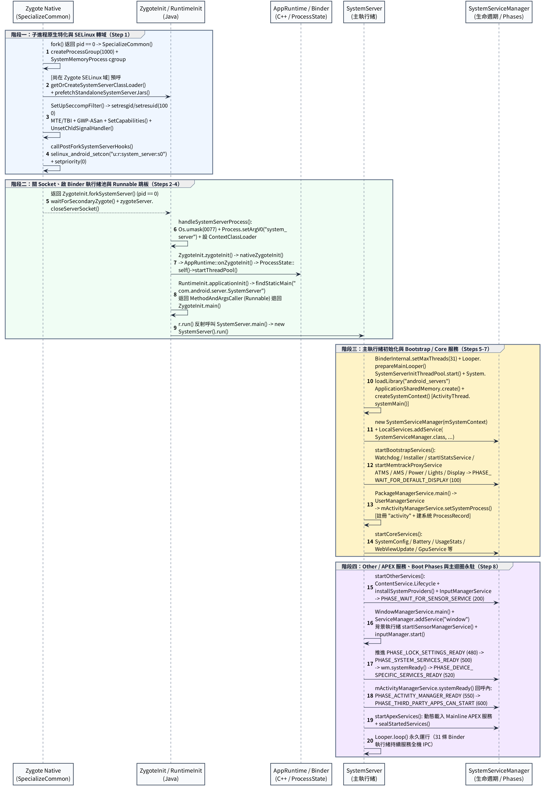

# 11.3 System 進程（`system_server`）的啟動過程（`SpecializeCommon`、Binder 執行緒池與四階段 `SystemServiceManager` 啟動）

- **情景說明**：接續 11.2 節 `ZygoteInit.forkSystemServer()` 透過 `fork()` 產出 `system_server` 子進程（`pid == 0`）。此時子進程剛複製出 Zygote 的記憶體映像與 ART 虛擬機，仍頂著 Zygote 的 SELinux 域、`-20` 優先權與尚未開啟的 Binder 執行緒池。本節從原生特化 `SpecializeCommon()` 出發，一路追蹤子進程如何先在 Zygote 域下預建 `SYSTEMSERVERCLASSPATH` ClassLoader、完成降權（`uid/gid=1000`）與 `u:r:system_server:s0` SELinux 轉域、經 `ZygoteInit.zygoteInit()` 透過 `AppRuntime::onZygoteInit()` 啟動 Binder 執行緒池、藉 `RuntimeInit.MethodAndArgsCaller`（`Runnable` 跳板）清棧踏入 `SystemServer.main()`，最終在 `SystemServer.run()` 主執行緒中載入 `libandroid_servers.so`、建立 `SystemContext` 與 `SystemServiceManager`，依序推動 Bootstrap → Core → Other → APEX 四階段與 8 個 Boot Phases 啟動全機系統服務並進入 `Looper.loop()`。
- **對應原書**：11.3 節〈System进程的启动过程〉（p.630–638）
- **涉及專案與版本基準**：
  - `platform/frameworks/base` 〔`android-17.0.0_r1`，commit `94b4c163b`〕
  - `platform/frameworks/native` 〔`android-17.0.0_r1`，commit `ae266dc`〕（獨立 `surfaceflinger.rc` 對照）

---

## 11.3.1 子進程原生特化、Binder 執行緒池與 `Runnable` 跳板

> 對應原書 11.3 Step 1–Step 2（p.630–632）。`fork()` 返回 `pid == 0` 後，子進程必須依嚴格順序完成「資源清理 → 預建 ClassLoader → 降權與 SELinux 轉域 → 關掉 Zygote 監聽 Socket → 啟 Binder 執行緒池 → 清棧跳轉至 `SystemServer.main()`」。

### Step 1：`SpecializeCommon()` 原生權限特化與 SELinux 轉域
**位置**：`platform/frameworks/base/core/jni/com_android_internal_os_Zygote.cpp` 〔`android-17.0.0_r1`，lines 1913–1942、1985–2058、2094–2224〕

```cpp
static void SpecializeCommon(JNIEnv* env, uid_t uid, gid_t gid, jintArray gids, jint runtime_flags,
                             jobjectArray rlimits, jlong permitted_capabilities,
                             jlong effective_capabilities, jlong bounding_capabilities,
                             jint mount_external, jstring managed_se_info,
                             jstring managed_nice_name, bool is_system_server, bool is_child_zygote,
                             jstring managed_instruction_set, jstring managed_app_data_dir,
                             bool is_top_app, jobjectArray pkg_data_info_list,
                             jobjectArray allowlisted_data_info_list, bool mount_data_dirs,
                             bool mount_storage_dirs, bool mount_sysprop_overrides) {
    ...
    // Keep capabilities across UID change, unless we're staying root.
    if (uid != 0) {
        EnableKeepCapabilities(fail_fn);
    }

    SetInheritable(permitted_capabilities, fail_fn);

    DropCapabilitiesBoundingSet(fail_fn, bounding_capabilities);
    ...
    if (getuid() == 0) {
        const int rc = createProcessGroup(uid, getpid());
        ...
        if (is_system_server) {
            if (UsePerAppMemcg()) {
                if (!SetTaskProfiles(getpid(), std::vector<std::string>{"SystemMemoryProcess"})) {
                    ALOGE("couldn't add process %d into system memcg group", getpid());
                }
            }

            if (zygote_set_no_swap_system_server() &&
                !SetTaskProfiles(getpid(), std::vector<std::string>{"NoSwapUsage"})) {
                ALOGE("couldn't apply NoSwapUsage on process %d ", getpid());
            }
        }
    }

    SetGids(env, gids, is_child_zygote, fail_fn);
    SetRLimits(env, rlimits, fail_fn);
    ...
    if (is_system_server && !(runtime_flags & RuntimeFlags::PROFILE_SYSTEM_SERVER)) {
        // Prefetch the classloader for the system server. This is done early to
        // allow a tie-down of the proper system server selinux domain.
        env->CallStaticObjectMethod(gZygoteInitClass, gGetOrCreateSystemServerClassLoader);
        if (env->ExceptionCheck()) {
            env->ExceptionClear();
        }
        env->CallStaticVoidMethod(gZygoteInitClass, gPrefetchStandaloneSystemServerJars);
        if (env->ExceptionCheck()) {
            env->ExceptionClear();
        }
    }

    if (setresgid(gid, gid, gid) == -1) {
        fail_fn(CREATE_ERROR("setresgid(%d) failed: %s", gid, strerror(errno)));
    }

    SetUpSeccompFilter(uid, is_child_zygote);
    SetSchedulerPolicy(fail_fn, is_top_app);

    if (setresuid(uid, uid, uid) == -1) {
        fail_fn(CREATE_ERROR("setresuid(%d) failed: %s", uid, strerror(errno)));
    }
    ...
    mallopt(M_BIONIC_SET_HEAP_TAGGING_LEVEL, heap_tagging_level);
    ...
    android_mallopt(M_INITIALIZE_GWP_ASAN, &gwp_asan_options, sizeof(gwp_asan_options));
    ...
    SetCapabilities(permitted_capabilities, effective_capabilities, permitted_capabilities,
                    fail_fn);
    ...
    if (selinux_android_setcontext(uid, is_system_server, se_info_ptr, nice_name_ptr) == -1) {
        fail_fn(CREATE_ERROR("selinux_android_setcontext(%d, %d, \"%s\", \"%s\") failed", uid,
                             is_system_server, se_info_ptr, nice_name_ptr));
    }
    ...
    } else if (is_system_server) {
        SetThreadName("system_server");
    }

    // Unset the SIGCHLD handler, but keep ignoring SIGHUP (rationale in SetSignalHandlers).
    UnsetChldSignalHandler();

    if (is_system_server) {
        env->CallStaticVoidMethod(gZygoteClass, gCallPostForkSystemServerHooks, runtime_flags);
        if (env->ExceptionCheck()) {
            fail_fn("Error calling post fork system server hooks.");
        }

        static const char* kSystemServerLabel = "u:r:system_server:s0";
        if (selinux_android_setcon(kSystemServerLabel) != 0) {
            fail_fn(CREATE_ERROR("selinux_android_setcon(%s)", kSystemServerLabel));
        }
    }
    ...
    env->CallStaticVoidMethod(gZygoteClass, gCallPostForkChildHooks, runtime_flags,
                              is_system_server, is_child_zygote, managed_instruction_set);

    // Reset the process priority to the default value.
    setpriority(PRIO_PROCESS, 0, PROCESS_PRIORITY_DEFAULT);
}
```

`SpecializeCommon()` 的呼叫順序環環相扣，每一步都有硬性安全理由：
1. **保持 Capabilities 並建專屬 cgroup**：因接著要把 UID 從 `0` 降為 `1000`，須先 `EnableKeepCapabilities()` 避免核心在 `setresuid` 時清光 capabilities；接著建立 `createProcessGroup(1000, pid)` 並套用 `SystemMemoryProcess`（以及選用的 `NoSwapUsage`）task profile。
2. **趁還處於 Zygote SELinux 域時預載 `SYSTEMSERVERCLASSPATH`**：在降權與 SELinux 轉域之前，預先透過 JNI 回呼 `ZygoteInit.getOrCreateSystemServerClassLoader()` 與 `prefetchStandaloneSystemServerJars()`，讓 `system_server` 提前映射 `services.jar` 與各 standalone system server JAR 的 AOT 產物，後續轉域後即可收緊 `u:r:system_server:s0` 的檔案存取策略。
3. **Seccomp → 降權 → MTE/GWP-ASan → Capabilities → SELinux 轉域**：依序安裝 Seccomp filter（須在 `CAP_SYS_ADMIN` 還在時）、`setresgid(1000)` / `setresuid(1000)`、套用 MTE/TBI 與 GWP-ASan、以 `SetCapabilities()` 鎖定最小權限集合、撤除繼承自 Zygote 的 `SigChldHandler`（`UnsetChldSignalHandler()`）、呼叫 `ZygoteHooks.postForkSystemServer()`，再呼叫 **`selinux_android_setcon("u:r:system_server:s0")`** 正式進入 `system_server` 安全域，最後呼 `callPostForkChildHooks` 並將 nice 值自 `-20` 還原為 `PROCESS_PRIORITY_DEFAULT (0)`。

> 〔與 2.3 差異〕邏輯大幅擴充：原書 2.3 的 `forkAndSpecializeCommon` 只設 uid/gid/groups/rlimits/capabilities；Android 17 新增 `SystemMemoryProcess` cgroup、預建 `SYSTEMSERVERCLASSPATH` ClassLoader、Seccomp、MTE/TBI 與 GWP-ASan 記憶體安全、以及分兩段切換至 `u:r:system_server:s0` SELinux 域。

---

### Step 2：`ZygoteInit.forkSystemServer()`（子進程）與 `handleSystemServerProcess()`
**位置**：`platform/frameworks/base/core/java/com/android/internal/os/ZygoteInit.java` 〔`android-17.0.0_r1`，lines 492–585、798–806〕

```java
        /* For child process */
        if (pid == 0) {
            if (hasSecondZygote(abiList)) {
                waitForSecondaryZygote(socketName);
            }

            zygoteServer.closeServerSocket();
            return handleSystemServerProcess(parsedArgs);
        }
```

```java
    private static Runnable handleSystemServerProcess(ZygoteArguments parsedArgs) {
        // set umask to 0077 so new files and directories will default to owner-only permissions.
        Os.umask(S_IRWXG | S_IRWXO);

        if (parsedArgs.mNiceName != null) {
            Process.setArgV0(parsedArgs.mNiceName);
        }

        final String systemServerClasspath = Os.getenv("SYSTEMSERVERCLASSPATH");
        ...
        if (parsedArgs.mInvokeWith != null) {
            ...
        } else {
            ClassLoader cl = getOrCreateSystemServerClassLoader();
            if (cl != null) {
                Thread.currentThread().setContextClassLoader(cl);
            }

            /*
             * Pass the remaining arguments to SystemServer.
             */
            return ZygoteInit.zygoteInit(parsedArgs.mTargetSdkVersion,
                    parsedArgs.mDisabledCompatChanges,
                    parsedArgs.mEnabledCompatChanges,
                    parsedArgs.mRemainingArgs, cl);
        }
    }
```

子進程從 `Zygote.forkSystemServer()` 拿到 `pid == 0` 後，進入四個關鍵收尾動作：
1. **等待副 Zygote 就緒（雙 ABI 裝置）**：若 `hasSecondZygote(abiList)` 為真（裝置支援的總 ABI 清單大於本 Zygote 的 64 位元 ABI 清單），呼叫 `waitForSecondaryZygote()` 等候 `zygote_secondary` 監聽 Socket 就緒，避免開機早期有 32 位元系統服務啟動失敗。
2. **關閉繼承自 Zygote 的 Server Socket**：呼叫 `zygoteServer.closeServerSocket()`，釋放 `/dev/socket/zygote` 監聽 FD。
3. **設定 `umask(0077)` 與進程名稱**：將新建檔案預設權限鎖定為僅 owner 可讀寫，並呼叫 `Process.setArgV0("system_server")` 改寫 `/proc/<pid>/cmdline`。
4. **掛載 `SystemServer` 專屬 `ClassLoader`**：取回 Step 1 已預建快取在 `sCachedSystemServerClassLoader` 的 `PathClassLoader`（載入 `SYSTEMSERVERCLASSPATH`，父載入器為 boot class loader），設為主執行緒 `ContextClassLoader` 後呼叫 `ZygoteInit.zygoteInit()`。

> 〔與 2.3 差異〕邏輯改變：原書 11.3 Step 1（p.630–631）的 `handleSystemServerProcess()` 只關 `sServerSocket` 就呼叫 `RuntimeInit.zygoteInit()`；Android 17 新增 `waitForSecondaryZygote()`、`Os.umask(0077)`、`Process.setArgV0("system_server")`、獨立 `SYSTEMSERVERCLASSPATH` `PathClassLoader`，且入口函式移至 `ZygoteInit.zygoteInit()` 並改為**返回 `Runnable`**。

---

### Step 3：`ZygoteInit.zygoteInit()` → `AppRuntime::onZygoteInit()` 啟動 Binder 執行緒池
**位置**：`platform/frameworks/base/core/java/com/android/internal/os/ZygoteInit.java` 〔`android-17.0.0_r1`，lines 983–996、1008〕、`platform/frameworks/base/core/jni/AndroidRuntime.cpp` 〔`android-17.0.0_r1`，lines 284–287〕、`platform/frameworks/base/cmds/app_process/app_main.cpp` 〔`android-17.0.0_r1`，lines 92–97〕

```java
// ZygoteInit.java
    public static Runnable zygoteInit(int targetSdkVersion, long[] disabledCompatChanges,
            long[] enabledCompatChanges, String[] argv, ClassLoader classLoader) {
        ...
        Trace.traceBegin(Trace.TRACE_TAG_ACTIVITY_MANAGER, "ZygoteInit");
        RuntimeInit.redirectLogStreams();

        RuntimeInit.commonInit();
        ZygoteInit.nativeZygoteInit();
        return RuntimeInit.applicationInit(targetSdkVersion, disabledCompatChanges,
                enabledCompatChanges, argv, classLoader);
    }
```

```cpp
// AndroidRuntime.cpp
static void com_android_internal_os_ZygoteInit_nativeZygoteInit(JNIEnv* env, jobject clazz)
{
    gCurRuntime->onZygoteInit();
}
```

```cpp
// app_main.cpp
    virtual void onZygoteInit()
    {
        sp<ProcessState> proc = ProcessState::self();
        ALOGV("App process: starting thread pool.\n");
        proc->startThreadPool();
    }
```

這正是 `system_server`（以及未來所有由 Zygote 孵化的 App 進程）**開啟 Binder 通訊能力**的時刻：
1. `RuntimeInit.redirectLogStreams()` 將 `System.out` / `System.err` 重導向至 `logd`（見第 4 章）；`RuntimeInit.commonInit()` 安裝預設未捕獲例外處理器、時區與 `TrafficStats` socket tagger。
2. **`ZygoteInit.nativeZygoteInit()`** 經由 `gCurRuntime->onZygoteInit()` 動態分派至 `AppRuntime::onZygoteInit()`，呼叫 **`ProcessState::self()->startThreadPool()`**——開啟 `/dev/binder`、執行 `mmap` 並派生 Binder 工作執行緒（見第 5 章 5.2 節）。之所以絕不能在 Zygote 進程本身開啟 `/dev/binder`，正是因為 Binder 驅動以進程（`binder_proc`）為隔離單位，必須等 `fork()` 完在子進程各自初始化。

> 〔與 2.3 差異〕改名搬家：原書 11.3 Step 2（p.631–632）為 `RuntimeInit.zygoteInit()` → `RuntimeInit.zygoteInitNative()`；Android 17 搬移至 `ZygoteInit.zygoteInit()` → `ZygoteInit.nativeZygoteInit()`，底層仍透過 `gCurRuntime->onZygoteInit()` 啟動 `ProcessState::self()->startThreadPool()`（核心邏輯不變）。

---

### Step 4：`RuntimeInit.applicationInit()`、`findStaticMain()` 與 `MethodAndArgsCaller` 跳板
**位置**：`platform/frameworks/base/core/java/com/android/internal/os/RuntimeInit.java` 〔`android-17.0.0_r1`，lines 313–349、372–399、561–588〕

```java
    protected static Runnable applicationInit(int targetSdkVersion, long[] disabledCompatChanges,
            long[] enabledCompatChanges, String[] argv, ClassLoader classLoader) {
        nativeSetExitWithoutCleanup(true);

        VMRuntime.getRuntime().setTargetSdkVersion(targetSdkVersion);
        VMRuntime.getRuntime().setDisabledCompatChanges(disabledCompatChanges);
        ...
        final Arguments args = new Arguments(argv);

        // The end of of the RuntimeInit event (see #zygoteInit).
        Trace.traceEnd(Trace.TRACE_TAG_ACTIVITY_MANAGER);

        // Remaining arguments are passed to the start class's static main
        return findStaticMain(args.startClass, args.startArgs, classLoader);
    }
```

```java
    protected static Runnable findStaticMain(String className, String[] argv,
            ClassLoader classLoader) {
        Class<?> cl;
        try {
            cl = Class.forName(className, true, classLoader);
        } catch (ClassNotFoundException ex) {
            throw new RuntimeException(
                    "Missing class when invoking static main " + className,
                    ex);
        }

        Method m;
        try {
            m = cl.getMethod("main", new Class[] { String[].class });
        } ...
        return new MethodAndArgsCaller(m, argv);
    }
```

```java
    static class MethodAndArgsCaller implements Runnable {
        private final Method mMethod;
        private final String[] mArgs;

        public MethodAndArgsCaller(Method method, String[] args) {
            mMethod = method;
            mArgs = args;
        }

        public void run() {
            try {
                mMethod.invoke(null, new Object[] { mArgs });
            } ...
        }
    }
```

`args.startClass` 即 Step 6 傳入的 `"com.android.server.SystemServer"`。`findStaticMain()` 以 `sCachedSystemServerClassLoader` 載入 `SystemServer` 類別並找到 `public static void main(String[])`，封裝成 `new MethodAndArgsCaller(m, argv)`（實作 `Runnable`）逐層回傳：`findStaticMain` → `applicationInit` → `zygoteInit` → `handleSystemServerProcess` → `forkSystemServer` → **`ZygoteInit.main()`**！回到 `ZygoteInit.main()` 第 917 行呼叫 `r.run()` 時，所有 `forkSystemServer` / `handleSystemServerProcess` / `RuntimeInit` 堆疊幀皆已徹底彈出，乾淨地進入 `SystemServer.main()`。

> 〔與 2.3 差異〕邏輯改變：原書 11.3 Step 2（p.631–632）由 `RuntimeInit.invokeStaticMain()` **拋出 `ZygoteInit.MethodAndArgsCaller` 例外**，靠 `ZygoteInit.main()` 的 `catch` 區塊執行 `caller.run()`；Android 17 改為 `findStaticMain()` **直接回傳實作 `Runnable` 的 `RuntimeInit.MethodAndArgsCaller`**，以正常函式返回完成清棧跳板。

---

## 11.3.2 `SystemServer.run()` 主執行緒準備與 `SystemServiceManager`

> 對應原書 11.3 Step 3–Step 5（p.632–634）。這是整章相對 Android 2.3 變化最劇烈的區域：原書的 JNI `init1()`、`cmds/system_server/library/system_init.cpp`、`GrimReaper` 死亡監控、`system_server` 同進程啟動 `SurfaceFlinger`、回呼 `init2()` 與另起 `ServerThread` 已**全數退場**。

### Step 5：`SystemServer.main()` 與 `SystemServer.run()` 前置初始化（對照 `SurfaceFlinger` 外移）
**位置**：`platform/frameworks/base/services/java/com/android/server/SystemServer.java` 〔`android-17.0.0_r1`，lines 510、726–743、852–1099、1176–1184〕、`platform/frameworks/native/services/surfaceflinger/surfaceflinger.rc` 〔`android-17.0.0_r1`，lines 1–7〕

```rc
# platform/frameworks/native/services/surfaceflinger/surfaceflinger.rc（已自 system_server 外移為獨立 init 服務）
service surfaceflinger /system/bin/surfaceflinger
    class core animation
    user system
    group graphics drmrpc readproc
    capabilities SYS_NICE
    onrestart restart --only-if-running zygote
    task_profiles HighPerformance
```

```java
// SystemServer.java
    private static final int sMaxBinderThreads = 31;
    ...
    public static void main(String[] args) {
        new SystemServer().run();
    }
    ...
    private void run() {
        ...
        try {
            ...
            // The system server should never make non-oneway calls
            Binder.setWarnOnBlocking(true);
            ...
            // Mmmmmm... more memory!
            VMRuntime.getRuntime().clearGrowthLimit();
            ...
            // Ensure binder calls into the system always run at foreground priority.
            BinderInternal.disableBackgroundScheduling(true);

            // Increase the number of binder threads in system_server
            BinderInternal.setMaxThreads(sMaxBinderThreads);

            // Prepare the main looper thread (this thread).
            android.os.Process.setThreadPriority(
                    android.os.Process.THREAD_PRIORITY_FOREGROUND);
            MessageQueue.setUseDeliQueue(true);
            Looper.prepareMainLooper();
            Looper.getMainLooper().setSlowLogThresholdMs(
                    SLOW_DISPATCH_THRESHOLD_MS, SLOW_DELIVERY_THRESHOLD_MS);
            ...
            // Prepare the thread pool for init tasks that can be parallelized
            SystemServerInitThreadPool.start();
            ...
            // Initialize native services.
            System.loadLibrary("android_servers");
            ...
            // Initialize the application shared memory region.
            ApplicationSharedMemory instance = ApplicationSharedMemory.create();
            ApplicationSharedMemory.setInstance(instance);

            // Initialize the system context.
            createSystemContext();

            // Call per-process mainline module initialization.
            ActivityThread.initializeMainlineModules();
            ...
            // Create the system service manager.
            mSystemServiceManager = new SystemServiceManager(mSystemContext);
            mSystemServiceManager.setStartInfo(mRuntimeRestart,
                    mRuntimeStartElapsedTime, mRuntimeStartUptime);
            mDumper.addDumpable(mSystemServiceManager);

            LocalServices.addService(SystemServiceManager.class, mSystemServiceManager);
            ...
        } finally {
            t.traceEnd();  // InitBeforeStartServices
        }

        // Start services.
        try {
            t.traceBegin("StartServices");
            ...
            startBootstrapServices(t);
            startCoreServices(t);
            startOtherServices(t);
            startApexServices(t);
            updateWatchdogTimeout(t);
            CriticalEventLog.getInstance().logSystemServerStarted();
        } ... finally {
            t.traceEnd(); // StartServices
        }
        ...
        // Loop forever.
        Looper.loop();
        throw new RuntimeException("Main thread loop unexpectedly exited");
    }

    private void createSystemContext() {
        ActivityThread activityThread = ActivityThread.systemMain();
        mSystemContext = activityThread.getSystemContext();
        mSystemContext.setTheme(DEFAULT_SYSTEM_THEME);

        final Context systemUiContext = activityThread.getSystemUiContext();
        systemUiContext.setTheme(DEFAULT_SYSTEM_THEME);
        Trace.registerWithPerfetto();
    }
```

`SystemServer.run()` 在啟動任何服務前先把整個核心進程的執行環境打牢：
1. **不再有 `init1()` / `init2()` / `ServerThread`**：原書 2.3 中，主執行緒進入原生 `system_init()` 跑 `IPCThreadState::joinThreadPool()`，Java 服務被迫另開一條 `ServerThread`；Android 17 徹底反轉——主執行緒直接呼叫 `Looper.prepareMainLooper()` 成為 `system_server` 主訊息迴圈執行緒（並開啟 `MessageQueue.setUseDeliQueue(true)`），而 Binder 服務端執行緒池則透過 `BinderInternal.setMaxThreads(31)` 擴大至 31 條專職服務跨進程請求（連同 Step 3 啟動的主池執行緒）。
2. **`SurfaceFlinger` 外移與 `libandroid_servers.so`**：`SurfaceFlinger` 早已被移出 `system_server`，由 `surfaceflinger.rc` 作為獨立的 `class core animation` 原生進程由 `init` 啟動（若異常同樣透過 `onrestart restart --only-if-running zygote` 連動重啟）。`SystemServer` 仍透過 `System.loadLibrary("android_servers")` 載入 `services/core/jni` 的 JNI 實作（包含 `com_android_server_SystemServer.cpp` 提供的 `startIStatsService`、`startMemtrackProxyService`、`startISensorManagerService`、`startIncrementalService`）。
3. **建立 `SystemContext` 與 `SystemServiceManager`**：`VMRuntime.clearGrowthLimit()` 解除堆積成長上限；啟動 `SystemServerInitThreadPool` 讓耗時初始化得以並行；建立全機共用唯讀記憶體 `ApplicationSharedMemory`；透過 `ActivityThread.systemMain()` 建立 `mSystemContext`（`framework-res.apk` 系統上下文）；最後建立 **`SystemServiceManager`** 並註冊進同進程快速查詢表 `LocalServices`。

> 〔與 2.3 差異〕已移除 + 架構重構：原書 11.3 Step 3–Step 5（p.632–634）的 `SystemServer.init1()`、`cmds/system_server/library/system_init.cpp`、`GrimReaper`、`SurfaceFlinger::instantiate()`、`SystemServer.init2()` 與 `ServerThread` 全數移除；改由主執行緒直接跑 `new SystemServer().run()` + `Looper.prepareMainLooper()` + `SystemServiceManager`。

---

### Step 6：`SystemServiceManager` 統一服務生命週期與 Boot Phases
**位置**：`platform/frameworks/base/services/core/java/com/android/server/SystemServiceManager.java` 〔`android-17.0.0_r1`，lines 154–175、230–325〕、`platform/frameworks/base/services/core/java/com/android/server/SystemService.java` 〔`android-17.0.0_r1`，lines 80–132〕

```java
// SystemServiceManager.java
    public SystemService startService(String className) {
        final Class<SystemService> serviceClass = loadClassFromLoader(className,
                this.getClass().getClassLoader());
        return startService(serviceClass);
    }

    public SystemService startServiceFromJar(String className, String path) {
        PathClassLoader pathClassLoader =
                SystemServerClassLoaderFactory.getOrCreateClassLoader(
                        path, this.getClass().getClassLoader(), isJarInTestApex(path));
        final Class<SystemService> serviceClass = loadClassFromLoader(className, pathClassLoader);
        return startService(serviceClass);
    }

    public <T extends SystemService> T startService(Class<T> serviceClass) {
        try {
            final String name = serviceClass.getName();
            ...
            final T service;
            try {
                Constructor<T> constructor = serviceClass.getConstructor(Context.class);
                service = constructor.newInstance(mContext);
            } ...
            startService(service);
            return service;
        } finally {
            Trace.traceEnd(Trace.TRACE_TAG_SYSTEM_SERVER);
        }
    }

    public void startService(@NonNull final SystemService service) {
        String className = service.getClass().getName();
        if (mServiceClassnames.contains(className)) {
            Slog.i(TAG, "Not starting an already started service " + className);
            return;
        }
        mServiceClassnames.add(className);
        mServices.add(service);

        long time = SystemClock.elapsedRealtime();
        try {
            service.onStart();
        } catch (RuntimeException ex) {
            throw new RuntimeException("Failed to start service " + service.getClass().getName()
                    + ": onStart threw an exception", ex);
        }
        warnIfTooLong(SystemClock.elapsedRealtime() - time, service, "onStart");
    }

    public void sealStartedServices() {
        mServiceClassnames = Collections.emptySet();
        mServices = Collections.unmodifiableList(mServices);
    }

    public void startBootPhase(@NonNull TimingsTraceAndSlog t, int phase) {
        if (phase <= mCurrentPhase) {
            throw new IllegalArgumentException("Next phase must be larger than previous");
        }
        mCurrentPhase = phase;
        ...
```

原書 2.3 的 `ServerThread.run()` 只能把幾十個系統服務寫成一大串 `new XxxService()` + `ServiceManager.addService()`，彼此的依賴關係極難維護；Android 17 改由 `SystemService` 抽象基類與 `SystemServiceManager` 統一調度：
- **三種啟動入口**：同 `services.jar` 的服務呼 `startService(Class)`；來自 `SYSTEMSERVERCLASSPATH` 其他 JAR 的服務呼 `startService(String)`；位於 Mainline APEX 獨立 JAR 的服務呼 `startServiceFromJar(className, path)`（透過 `SystemServerClassLoaderFactory` 取得預載的 `PathClassLoader`）。啟動時反射呼叫 `Constructor(Context)` 建構物件、加入 `mServices`，並呼叫 **`service.onStart()`**（服務在此內呼叫 `publishBinderService()` 註冊至 `servicemanager` 或 `publishLocalService()` 註冊至 `LocalServices`）。
- **單調遞增的 Boot Phases 狀態機**：每到達一個里程碑，`SystemServer` 呼叫 `mSystemServiceManager.startBootPhase(t, phase)` 通知所有已啟動服務的 `onBootPhase(phase)`，徹底解耦服務間的循環依賴：

| Boot Phase 常數 | 數值 | 觸發位置 | 語意 |
|---|---|---|---|
| `PHASE_WAIT_FOR_DEFAULT_DISPLAY` | `100` | `startBootstrapServices()` | 預設顯示器就緒，`PackageManagerService` 可安全初始化 |
| `PHASE_WAIT_FOR_SENSOR_SERVICE` | `200` | `startOtherServices()` | SensorService 就緒，`WindowManagerService` 與 `startISensorManagerService()` 可連線 |
| `PHASE_LOCK_SETTINGS_READY` | `480` | `startOtherServices()` | 鎖定螢幕／憑證設定資料可存取（供 `DevicePolicyManager` 等初始化） |
| `PHASE_SYSTEM_SERVICES_READY` | `500` | `startOtherServices()` | 核心系統服務（Power、Package 等）皆已可安全呼叫 |
| `PHASE_DEVICE_SPECIFIC_SERVICES_READY` | `520` | `startOtherServices()` | 裝置特定服務就緒 |
| `PHASE_ACTIVITY_MANAGER_READY` | `550` | `AMS.systemReady()` 回呼內 | 系統服務可開始發送廣播 `Intent` |
| `PHASE_THIRD_PARTY_APPS_CAN_START` | `600` | `AMS.systemReady()` 回呼內 | 第三方 App 可開始啟動並對系統服務發起 Binder 呼叫 |
| `PHASE_BOOT_COMPLETED` | `1000` | `AMS.finishBooting()` | 開機完成且 Home 啟動，可接受使用者互動 |

> 〔與 2.3 差異〕新增架構：原書 11.3 Step 6（p.634–638）沒有 `SystemServiceManager` 或 Boot Phases，所有服務在 `ServerThread.run()` 內線性實例化並手寫零散的 `systemReady()`；Android 17 全面統一為 `SystemService` 生命週期與 8 階段單調遞增 Boot Phases。

---

## 11.3.3 四階段系統服務啟動與主迴圈永駐

> 對應原書 11.3 Step 6 對 `ActivityManagerService`、`PackageManagerService`、`ContentService`、`WindowManagerService` 四大代表服務的解析（p.634–638）。下面沿著 `SystemServer.run()` 的四大階段，定位原書這四個核心服務以及現代新增的 `ATMS`、JNI 代理服務與 Mainline APEX 服務。

### Step 7：`startBootstrapServices()` 與 `startCoreServices()`
**位置**：`platform/frameworks/base/services/java/com/android/server/SystemServer.java` 〔`android-17.0.0_r1`，lines 1192–1450、1467–1545〕、`platform/frameworks/base/services/core/java/com/android/server/am/ActivityManagerService.java` 〔`android-17.0.0_r1`，lines 2127–2165〕、`platform/frameworks/base/services/core/jni/com_android_server_SystemServer.cpp` 〔`android-17.0.0_r1`，lines 99–122〕

```java
// SystemServer.java - startBootstrapServices() 關鍵主幹
    private void startBootstrapServices(@NonNull TimingsTraceAndSlog t) {
        t.traceBegin("startBootstrapServices");
        ...
        final Watchdog watchdog = Watchdog.getInstance();
        watchdog.start();
        ...
        Installer installer = mSystemServiceManager.startService(Installer.class);
        ...
        startIStatsService();
        startMemtrackProxyService();
        ...
        // Activity manager runs the show.
        ActivityTaskManagerService atm = mSystemServiceManager.startService(
                ActivityTaskManagerService.Lifecycle.class).getService();
        mActivityManagerService = ActivityManagerService.Lifecycle.startService(
                mSystemServiceManager, atm);
        mActivityManagerService.setSystemServiceManager(mSystemServiceManager);
        mActivityManagerService.setInstaller(installer);
        mWindowManagerGlobalLock = atm.getGlobalLock();
        ...
        mPowerManagerService = mSystemServiceManager.startService(PowerManagerService.class);
        ...
        mActivityManagerService.initPowerManagement();
        ...
        mSystemServiceManager.startService(LightsService.class);
        ...
        mDisplayManagerService = mSystemServiceManager.startService(DisplayManagerService.class);

        // We need the default display before we can initialize the package manager.
        mSystemServiceManager.startBootPhase(t, SystemService.PHASE_WAIT_FOR_DEFAULT_DISPLAY);
        ...
        mPackageManagerService = PackageManagerService.main(
                mSystemContext, installer, domainVerificationService,
                mFactoryTestMode != FactoryTest.FACTORY_TEST_OFF);
        ...
        mUserManagerService = mSystemServiceManager
                .startService(UserManagerService.LifeCycle.class).getService();
        ...
        // Set up the Application instance for the system process and get started.
        mActivityManagerService.setSystemProcess();
        ...
        watchdog.init(mSystemContext, mActivityManagerService);
        ...
    }
```

```java
// ActivityManagerService.java - setSystemProcess()
    public void setSystemProcess() {
        try {
            ServiceManager.addService(Context.ACTIVITY_SERVICE, this, /* allowIsolated= */ true,
                    DUMP_FLAG_PRIORITY_CRITICAL | DUMP_FLAG_PRIORITY_NORMAL | DUMP_FLAG_PROTO);
            ServiceManager.addService(ProcessStats.SERVICE_NAME, mProcessStats);
            ServiceManager.addService("meminfo", new MemBinder(this), /* allowIsolated= */ false,
                    DUMP_FLAG_PRIORITY_HIGH);
            ...
            ApplicationInfo info = mContext.getPackageManager().getApplicationInfo(
                    "android", STOCK_PM_FLAGS | MATCH_SYSTEM_ONLY);
            mSystemThread.installSystemApplicationInfo(info, getClass().getClassLoader());

            synchronized (mGlobalLock) {
                ProcessRecord app = mProcessList.newProcessRecordLocked(info, info.processName,
                        false,
                        0,
                        false,
                        0,
                        null,
                        new HostingRecord(HostingRecord.HOSTING_TYPE_SYSTEM));
                app.setPersistent(true);
                app.setPid(MY_PID);
                mProcessStateController.setMaxAdj(app, SYSTEM_ADJ);
                app.makeActive(new ApplicationThreadDeferred(mSystemThread.getApplicationThread()),
                        ...);
```

```cpp
// com_android_server_SystemServer.cpp（少量留在 system_server 的原生 AIDL 服務）
static void android_server_SystemServer_startIStatsService(JNIEnv* /* env */, jobject /* clazz */) {
    startStatsAidlService();
}

static void android_server_SystemServer_startISensorManagerService(JNIEnv* env,
                                                                   jobject /* clazz */) {
    startSensorManagerHidlService(env);
    startSensorManagerAidlService(env);
}

static void android_server_SystemServer_startMemtrackProxyService(JNIEnv* env,
                                                                  jobject /* clazz */) {
    ...
    const binder_exception_t err = AServiceManager_addService(binder.get(), memtrackProxyService);
    LOG_ALWAYS_FATAL_IF(err != EX_NONE, "Cannot register %s: %d", memtrackProxyService, err);
}
```

1. **階段一：`startBootstrapServices()`** 負責處理相互依賴最緊密的引導核心：
   - 最早啟動 `Watchdog`（防止開機早期死鎖）與 `Installer`（連線 `installd`）、原生 `startIStatsService()` / `startMemtrackProxyService()`；
   - 依序透過 `SystemServiceManager` 啟動 **`ActivityTaskManagerService`**（自 AMS 拆出、專管 Activity/Task，見第 7 章）與 **`ActivityManagerService`**（對應原書 11.3 p.634–635 的 `AMS.main()`），緊接著啟動 `PowerManagerService`、`LightsService`（第 2 章主線案例）與 `DisplayManagerService`；
   - 推進 **`PHASE_WAIT_FOR_DEFAULT_DISPLAY (100)`** 後，暫停主執行緒 Watchdog 計時並呼叫 **`PackageManagerService.main(...)`** 掃描全機套件（對應原書 p.635–636），接著啟動 `UserManagerService`；
   - 等 PMS 就緒後才呼叫 **`mActivityManagerService.setSystemProcess()`**（對應原書 p.636）：將 `"activity"`（及 `procstats`、`meminfo` 等診斷 Binder）正式註冊至 `servicemanager`，並向 PMS 查詢 `"android"` 系統套件的 `ApplicationInfo`、為 `system_server` 自身建立 `persistent = true`、`maxAdj = SYSTEM_ADJ` 的 `ProcessRecord`。
2. **階段二：`startCoreServices()`**（lines 1467–1545）啟動無循環依賴的基礎服務：`SystemConfigService`、`BatteryService`、`UsageStatsService`、`WebViewUpdateService`、`CachedDeviceStateService`、`BinderCallsStatsService`、`RollbackManagerService`、`NativeTombstoneManagerService`、`BugreportManagerService`、`GpuService` 等。

> 〔與 2.3 差異〕邏輯改變：原書 11.3 Step 6（p.634–636）的 `ActivityManagerService.main()` 內部自己另外起 `AThread`、建立 `SystemContext` 並同步回傳 `Context`；Android 17 改由 `SystemServer.createSystemContext()` 預先建好 `mSystemContext`，再由 `SystemServiceManager` 分別啟動 `ATMS` 與 `AMS.Lifecycle`，並把 `PMS` 與 `setSystemProcess()` 嚴格排在 `PHASE_WAIT_FOR_DEFAULT_DISPLAY` 之後。

---

### Step 8：`startOtherServices()`、`startApexServices()` 與 `Looper.loop()`
**位置**：`platform/frameworks/base/services/java/com/android/server/SystemServer.java` 〔`android-17.0.0_r1`，lines 1550–1790、3160–3215、3318、3394–3540、3685–3712〕

```java
// SystemServer.java - startOtherServices() 關鍵主幹
    private void startOtherServices(@NonNull TimingsTraceAndSlog t) {
        ...
        mSystemServiceManager.startService(ContentService.Lifecycle.class);
        mActivityManagerService.getContentProviderHelper().installSystemProviders();
        ...
        inputManager = mSystemServiceManager.startService(
                InputManagerService.Lifecycle.class).getService();
        ...
        // WMS needs sensor service ready
        mSystemServiceManager.startBootPhase(t, SystemService.PHASE_WAIT_FOR_SENSOR_SERVICE);
        wm = WindowManagerService.main(context, inputManager, !mFirstBoot,
                new PhoneWindowManager(), mActivityManagerService.mActivityTaskManager);
        ServiceManager.addService(Context.WINDOW_SERVICE, wm, /* allowIsolated= */ false,
                DUMP_FLAG_PRIORITY_CRITICAL | DUMP_FLAG_PRIORITY_HIGH
                        | DUMP_FLAG_PROTO);
        mActivityManagerService.setWindowManager(wm);
        wm.onInitReady();

        SystemServerInitThreadPool.submit(() -> {
            ...
            startISensorManagerService();
            ...
        }, START_SENSOR_MANAGER_SERVICE);

        inputManager.setWindowManagerCallbacks(wm.getInputManagerCallback());
        inputManager.start();
        ...
        mSystemServiceManager.startBootPhase(t, SystemService.PHASE_LOCK_SETTINGS_READY);
        ...
        mSystemServiceManager.startBootPhase(t, SystemService.PHASE_SYSTEM_SERVICES_READY);
        wm.systemReady();
        ...
        mSystemServiceManager.startBootPhase(t, SystemService.PHASE_DEVICE_SPECIFIC_SERVICES_READY);
        ...
        mActivityManagerService.systemReady(() -> {
            mSystemServiceManager.startBootPhase(t, SystemService.PHASE_ACTIVITY_MANAGER_READY);
            ...
            mSystemServiceManager.startBootPhase(t, SystemService.PHASE_THIRD_PARTY_APPS_CAN_START);
            ...
        }, t);
    }
```

```java
// SystemServer.java - startApexServices()
    private void startApexServices(@NonNull TimingsTraceAndSlog t) {
        ...
        List<ApexSystemServiceInfo> services = ApexManager.getInstance().getApexSystemServices();
        for (ApexSystemServiceInfo info : services) {
            String name = info.getName();
            String jarPath = info.getJarPath();
            t.traceBegin("starting " + name);
            if (TextUtils.isEmpty(jarPath)) {
                mSystemServiceManager.startService(name);
            } else {
                mSystemServiceManager.startServiceFromJar(name, jarPath);
            }
            t.traceEnd();
        }

        // make sure no other services are started after this point
        mSystemServiceManager.sealStartedServices();

        t.traceEnd(); // startApexServices
    }
```

1. **階段三：`startOtherServices()`** 完成其餘框架核心服務並推動系統進入可互動狀態：
   - 透過 `ContentService.Lifecycle` 啟動 **`ContentService`**（第 10 章主線服務，對應原書 p.636 的 `ContentService.main()`），緊接著呼叫 `mActivityManagerService.getContentProviderHelper().installSystemProviders()` 安裝 `SettingsProvider`；
   - 啟動 `InputManagerService`，推進 **`PHASE_WAIT_FOR_SENSOR_SERVICE (200)`**，呼叫 **`WindowManagerService.main(...)`** 建立 WMS（對應原書 p.636–637），將 `"window"` 註冊至 `servicemanager` 並綁定至 AMS 與 `InputManagerService`，同時於 `SystemServerInitThreadPool` 背景執行 `startISensorManagerService()` 註冊原生 AIDL/HIDL `ISensorManager` 橋接服務；
   - 依序推進 `PHASE_LOCK_SETTINGS_READY (480)`、`PHASE_SYSTEM_SERVICES_READY (500)`（呼叫 `wm.systemReady()`）、`PHASE_DEVICE_SPECIFIC_SERVICES_READY (520)`；
   - 呼叫 **`mActivityManagerService.systemReady(goingCallback, t)`**：在其回呼內推進 `PHASE_ACTIVITY_MANAGER_READY (550)` 與 `PHASE_THIRD_PARTY_APPS_CAN_START (600)`，允許啟動系統常駐 App、Launcher（Home）與第三方應用。
2. **階段四：`startApexServices()` 與封箱**：向 `ApexManager` 讀取各 Mainline APEX 宣告的系統服務清單，動態以 `startService()` 或 `startServiceFromJar()` 載入，最後呼叫 **`mSystemServiceManager.sealStartedServices()`** 將 `mServices` 鎖為不可變集合，禁止日後任意新增系統服務。
3. **主迴圈永駐**：返回 `SystemServer.run()` 尾段，安裝 `Binder.setTransactionCallback`（偵測對凍結進程的 Binder 交易錯誤），呼叫 **`Looper.loop()`** 讓主執行緒進入永久訊息循環；31 條 Binder 執行緒持續服務全機 IPC 請求。至此，Zygote 與 `system_server` 的啟動任務全部完成。

> 〔與 2.3 差異〕邏輯改變 + 新增：原書 11.3 Step 6（p.636–638）在 `ServerThread.run()` 尾端直接呼叫 `ContentService.main()`、`WindowManagerService.main()` 與 `AMS.systemReady()` 後進入 `Looper.loop()`；Android 17 透過 `ContentService.Lifecycle`、`InputManagerService`、`SystemServerInitThreadPool` 並行啟動、`startApexServices()` 動態載入 Mainline APEX 服務與 `sealStartedServices()` 封箱，並以分層 Boot Phases 精準控管全機啟動順序。

---

## 11.3.4 本節總結與時序圖



| 階段 | 核心函式 / 檔案 | 關鍵產出與狀態變化 |
|---|---|---|
| **原生特化與轉域** | `com_android_internal_os_Zygote.cpp::SpecializeCommon()` | 建 `SystemMemoryProcess` cgroup → 在 Zygote 域預載 `SYSTEMSERVERCLASSPATH` ClassLoader → Seccomp → `setresgid`/`setresuid(1000)` → MTE/TBI + GWP-ASan → `SetCapabilities` → `UnsetChldSignalHandler` → `selinux_android_setcon("u:r:system_server:s0")` → 恢復優先權 `0` |
| **收尾與啟 Binder 池** | `ZygoteInit.handleSystemServerProcess()` → `zygoteInit()` → `AppRuntime::onZygoteInit()` | 等待副 Zygote、關閉 Server Socket、`umask(0077)`、`setArgV0("system_server")`、設 `ContextClassLoader`、`ProcessState::self()->startThreadPool()` 開啟 Binder 通訊 |
| **清棧跳板** | `RuntimeInit.applicationInit()` → `findStaticMain()` → `MethodAndArgsCaller.run()` | 返回 `Runnable` 退回 `ZygoteInit.main()` 執行 `r.run()` 反射呼叫 `SystemServer.main()`（取代 2.3 拋例外技巧） |
| **主執行緒與管理員** | `SystemServer.run()` + `createSystemContext()` | 設 `maxBinderThreads=31`、`Looper.prepareMainLooper()`、`SystemServerInitThreadPool.start()`、載入 `libandroid_servers.so`、`ActivityThread.systemMain()` 建 `mSystemContext`、建 `SystemServiceManager` |
| **四階段與 Boot Phases** | `startBootstrapServices()` → `startCoreServices()` → `startOtherServices()` → `startApexServices()` | 依序啟動 `Watchdog`/`ATMS`/`AMS`/`PMS`/`AMS.setSystemProcess()`、`ContentService`/`InputManagerService`/`WMS`、`AMS.systemReady()` 與 Mainline APEX 服務，推進 Boot Phases `100→200→480→500→520→550→600`、`sealStartedServices()` 後進入 `Looper.loop()` |
