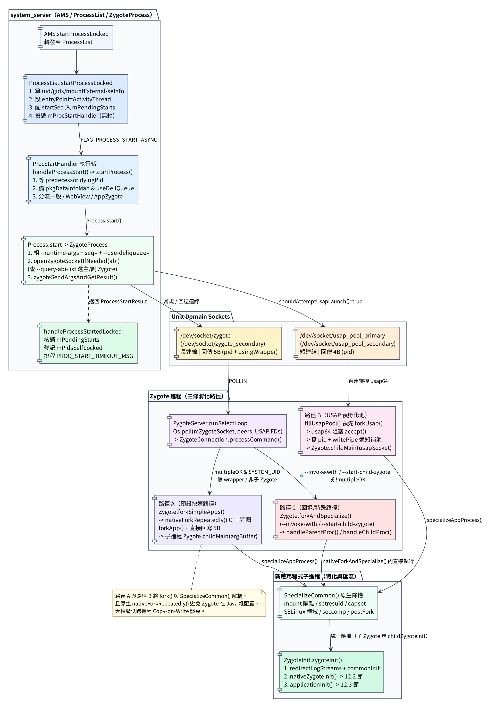
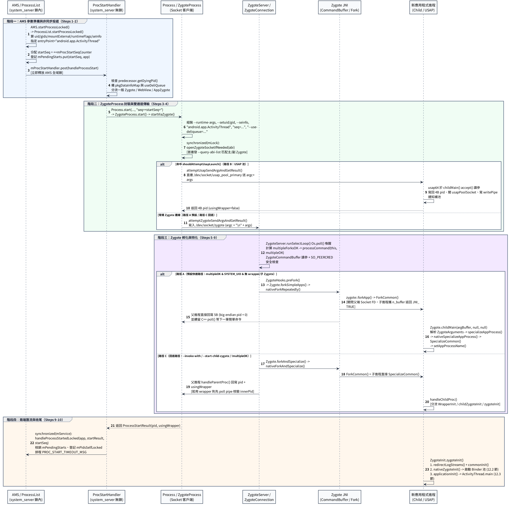

# 12.1 應用程式進程的建立過程（`ProcessList` 非同步啟動、`ZygoteProcess` 與三條 Zygote 孵化路徑）

- **情景說明**：在 Android 系統中，應用程式本身無法自行透過 `fork()` 建立新的獨立 App 進程；每當系統需要啟動一個尚未執行的組件（例如第 7 章點擊 Launcher 圖示啟動 Activity、第 8 章啟動遠端 Service、第 9 章觸發靜態廣播接收器或第 10 章喚起 Content Provider），`ActivityManagerService`（AMS）便必須向常駐的 Zygote 進程發出孵化請求。如果這段請求仍在 AMS 全域鎖內同步阻塞執行，整個系統服務的排程吞吐量就會被跨進程 Socket I/O 與 `fork()` 延遲拖垮；同時，現代 64/32 雙 ABI、資料目錄隔離、USAP 預孵化進程池與減少 Zygote 記憶體頁髒化的需求，也讓這條路徑遠比 Android 2.3 複雜。本節從 `AMS.startProcessLocked()` 出發，一路追蹤 `ProcessList` 的無鎖非同步投遞與 `startSeq` 機制、`Process.start()` / `ZygoteProcess` 的雙 ABI 連線與參數封裝、`ZygoteServer.runSelectLoop()` 與 `ZygoteConnection.processCommand()` 的三條孵化路徑（常規快速路徑 `forkSimpleApps` / `nativeForkRepeatedly`、USAP 池路徑與回退路徑 `forkAndSpecialize`），直到子進程匯流進入 `ZygoteInit.zygoteInit()`，以及 `system_server` 側以 `ProcessList.handleProcessStartedLocked()` 完成進程登記。
- **對應原書**：第 12 章引言與 12.1 節〈应用程序进程的创建过程〉（p.638–646）
- **涉及專案與版本基準**：
  - `platform/frameworks/base` 〔`android-17.0.0_r1`，commit `94b4c163b`〕

---

## 12.1.1 系統端啟動調度：從 `AMS.startProcessLocked` 到 `ProcessList` 非同步無鎖孵化

> 對應原書 12.1 開頭與 Step 1（p.638–639）。原書 2.3 由 `ActivityManagerService.startProcessLocked()` 持有 AMS 全域鎖直接同步呼叫 `Process.start()`；Android 17 將進程啟動主邏輯拆離至 `ProcessList`，改以獨立 `ProcStartHandler` 執行緒在**鎖外非同步**向 Zygote 發送請求，並以遞增序號 `startSeq` 解決新進程搶先 `attachApplication()` 的競態。



整條建立鏈路跨 `system_server`、Unix Domain Socket、Zygote 與新應用程式子進程四個邊界，總呼叫樹如下（編號對應後續 Step）：

```text
ActivityManagerService.startProcessLocked()                ## Step 1、AMS 入口轉發至 ProcessList
  ProcessList.startProcessLocked(ProcessRecord, ...)       ## Step 1、算 uid/gids/mountExternal/runtimeFlags/seInfo，設 entryPoint="android.app.ActivityThread"
    ProcessList.startProcessLocked(HostingRecord, ...)     ## Step 1、分配 startSeq、登記 mPendingStarts、投遞至 mProcStartHandler
      [非同步：ProcStartHandler 執行緒，不持有 AMS 鎖]
      ProcessList.handleProcessStart()                     ## Step 2、檢查前任 dyingPid，呼叫 startRunnable
        ProcessList.startProcess()                         ## Step 2、準備資料隔離映射、DeliQueue 旗標；分流一般 Zygote / WebViewZygote / AppZygote
          Process.start()                                  ## Step 3、選擇 ZYGOTE_PROCESS（或 NATIVE_ZYGOTE_PROCESS）
            ZygoteProcess.start()                          ## Step 3、定時同步 USAP 開關
              ZygoteProcess.startViaZygote()               ## Step 3、組裝 --runtime-args/--setuid=.../ActivityThread/seq=.../--use-deliqueue=...
                ZygoteProcess.openZygoteSocketIfNeeded()   ## Step 4、依 ABI 連線主/副 Zygote 並查詢 --query-abi-list
                ZygoteProcess.zygoteSendArgsAndGetResult() ## Step 4、線性編碼並依 shouldAttemptUsapLaunch 分流 Zygote 或 USAP Socket
==================== 跨 Unix Domain Socket (/dev/socket/zygote 或 usap_pool_primary) ====================
ZygoteServer.runSelectLoop()                               ## Step 5、Os.poll() 喚醒，計算 multipleForksOK 派發至 peer
  ZygoteConnection.processCommand(zygoteServer, multipleOK)## Step 6、ZygoteCommandBuffer 讀參、安全策略檢查，分派三路徑
    ├─[路徑 A：預設快速路徑] Zygote.forkSimpleApps()        ## Step 7、ZygoteCommandBuffer.forkRepeatedly() -> nativeForkRepeatedly() 迴圈 forkApp()
    │   └─[子進程] Zygote.childMain(argBuffer, null, null)  ## Step 8、回 Java 解析參數 -> specializeAppProcess() -> setAppProcessName()
    ├─[路徑 B：USAP 預孵化池] Zygote.forkUsap()（預先完成）  ## Step 8、usap64 於 childMain() accept() 讀參、回寫 pid、寫 writePipe -> specializeAppProcess()
    └─[路徑 C：回退/特殊路徑] Zygote.forkAndSpecialize()    ## Step 9、nativeForkAndSpecialize() 一次完成 ForkCommon+SpecializeCommon
        ├─[父進程] ZygoteConnection.handleParentProc()      ## Step 9、回寫 pid + usingWrapper（含 wrapper pipe 追蹤）
        └─[子進程] ZygoteConnection.handleChildProc()       ## Step 9、分流 WrapperInit / childZygoteInit / zygoteInit
  [三路徑子進程匯流] ZygoteInit.zygoteInit()                ## Step 10、重導 log、commonInit、nativeZygoteInit(12.2)、applicationInit(12.3)
==================== 返回 system_server（ProcStartHandler 取得 ProcessStartResult）====================
ProcessList.handleProcessStartedLocked()                   ## Step 9、加鎖核銷 mPendingStarts、登記 mPidsSelfLocked、排程 PROC_START_TIMEOUT_MSG
```

### Step 1：`ActivityManagerService.startProcessLocked` 與 `ProcessList.startProcessLocked`
**位置**：
- `platform/frameworks/base/services/core/java/com/android/server/am/ActivityManagerService.java` 〔`android-17.0.0_r1`，lines 3495–3506〕
- `platform/frameworks/base/services/core/java/com/android/server/am/ProcessList.java` 〔`android-17.0.0_r1`，lines 1829–1911、2076–2085、2142–2201〕

```java
// ActivityManagerService.java:3495-3506
    @GuardedBy("this")
    final ProcessRecord startProcessLocked(String processName,
            ApplicationInfo info, boolean knownToBeDead, int intentFlags,
            HostingRecord hostingRecord, int zygotePolicyFlags, boolean allowWhileBooting,
            boolean isolated) {
        return mProcessList.startProcessLocked(processName, info, knownToBeDead, intentFlags,
                hostingRecord, zygotePolicyFlags, allowWhileBooting, isolated, 0 /* isolatedUid */,
                false /* isSdkSandbox */, 0 /* sdkSandboxClientAppUid */,
                null /* sdkSandboxClientAppPackage */,
                null /* ABI override */, null /* entryPoint */,
                null /* entryPointArgs */, null /* crashHandler */);
    }
```

`AMS.startProcessLocked()` 只是薄包裝，直接把建立 `ProcessRecord` 與啟動進程的工作交給 `mProcessList`（`ProcessList`）。`ProcessList.startProcessLocked(ProcessRecord app, ...)` 負責收集該進程所有安全與執行期參數，並指定標準入口類：

```java
// ProcessList.java:1829-1911, 2076-2085
    @GuardedBy("mService")
    boolean startProcessLocked(ProcessRecord app, HostingRecord hostingRecord,
            int zygotePolicyFlags, boolean disableHiddenApiChecks, boolean disableTestApiChecks,
            String abiOverride) {
        if (app.isPendingStart()) {
            return true;
        }
        final long startUptime = SystemClock.uptimeMillis();
        final long startElapsedTime = SystemClock.elapsedRealtime();
        if (app.getPid() > 0 && app.getPid() != ActivityManagerService.MY_PID) {
            checkSlow(startUptime, "startProcess: removing from pids map");
            mService.removePidLocked(app.getPid(), app);
            app.setBindMountPending(false);
            mService.mHandler.removeMessages(PROC_START_TIMEOUT_MSG, app);
            checkSlow(startUptime, "startProcess: done removing from pids map");
            app.setPid(0);
            app.setStartSeq(0);
        }
        ...
            int uid = app.uid;
            int[] gids = null;
            int mountExternal = Zygote.MOUNT_EXTERNAL_NONE;
            boolean externalStorageAccess = false;
            if (!app.isolated) {
                int[] permGids = null;
                try {
                    checkSlow(startUptime, "startProcess: getting gids from package manager");
                    final IPackageManager pm = AppGlobals.getPackageManager();
                    permGids = pm.getPackageGids(app.info.packageName,
                            MATCH_DIRECT_BOOT_AUTO, app.userId);
                    StorageManagerInternal storageManagerInternal = LocalServices.getService(
                            StorageManagerInternal.class);
                    mountExternal = storageManagerInternal.getExternalStorageMountMode(uid,
                            app.info.packageName);
                    externalStorageAccess = storageManagerInternal.hasExternalStorageAccess(uid,
                            app.info.packageName);
                } catch (RemoteException e) {
                    throw e.rethrowAsRuntimeException();
                }
                ...
                gids = computeGidsForProcess(mountExternal, uid, permGids, externalStorageAccess);
            }
            ...
            String seInfo = updateSeInfo(app);

            // Start the process.  It will either succeed and return a result containing
            // the PID of the new process, or else throw a RuntimeException.
            final String entryPoint = "android.app.ActivityThread";

            return startProcessLocked(hostingRecord, entryPoint, app, uid, gids,
                    runtimeFlags, zygotePolicyFlags, mountExternal, seInfo, requiredAbi,
                    instructionSet, invokeWith, startUptime, startElapsedTime);
```

緊接著呼叫的重載 `startProcessLocked(HostingRecord, String entryPoint, ...)` 完成啟動序號分配與非同步投遞：

```java
// ProcessList.java:2142-2201
    @GuardedBy("mService")
    boolean startProcessLocked(HostingRecord hostingRecord, String entryPoint, ProcessRecord app,
            int uid, int[] gids, int runtimeFlags, int zygotePolicyFlags, int mountExternal,
            String seInfo, String requiredAbi, String instructionSet, String invokeWith,
            long startUptime, long startElapsedTime) {
        app.setPendingStart(true);
        app.setRemoved(false);
        synchronized (mProcLock) {
            mService.mProcessStateController.setKilledByAm(app, false);
            mService.mProcessStateController.setKilled(app, false);
        }
        ...
        final long startSeq = ++mProcStartSeqCounter;
        app.setStartSeq(startSeq);
        app.setStartParams(uid, hostingRecord, seInfo, startUptime, startElapsedTime);
        app.setUsingWrapper(invokeWith != null
                || Zygote.getWrapProperty(app.processName) != null);
        mPendingStarts.put(startSeq, app);

        if (mService.mConstants.FLAG_PROCESS_START_ASYNC) {
            if (DEBUG_PROCESSES) Slog.i(TAG_PROCESSES,
                    "Posting procStart msg for " + app.toShortString());
            mService.mProcStartHandler.post(() -> handleProcessStart(
                    app, entryPoint, gids, runtimeFlags, zygotePolicyFlags, mountExternal,
                    requiredAbi, instructionSet, invokeWith, startSeq));
            return true;
        } else {
            try {
                final Process.ProcessStartResult startResult = startProcess(hostingRecord,
                        entryPoint, app,
                        uid, gids, runtimeFlags, zygotePolicyFlags, mountExternal, seInfo,
                        requiredAbi, instructionSet, invokeWith, startUptime);
                handleProcessStartedLocked(app, startResult.pid, startResult.usingWrapper,
                        startSeq, false);
            } catch (RuntimeException e) {
                ...
            }
            return app.getPid() > 0;
        }
    }
```

1. **安全與隔離參數彙整**：除了查詢 `PackageManager.getPackageGids()`（並扣除 `processInfo.deniedPermissions` 對應的 GID），還向 `StorageManagerInternal` 查詢外部儲存掛載模式 `mountExternal`、透過 `updateSeInfo(app)` 組合 SELinux 標籤，並從 `mPlatformCompat` 擷取 App 相容性變更清單，最後硬編碼指定入口類 `entryPoint = "android.app.ActivityThread"`。
2. **`startSeq` 與 `mPendingStarts` 競態防護**：為本次啟動遞增分配全域唯一序號 `startSeq = ++mProcStartSeqCounter`，寫入 `app.setStartSeq(startSeq)` 並投入 `mPendingStarts`（`LongSparseArray<ProcessRecord>`）。因為啟動改採非同步，子進程完全有可能在 `mProcStartHandler` 尚未搶到 `mService` 鎖回寫 `pid` 之前，就已執行到 `ActivityThread.attach()` 並向 AMS 發起 Binder `attachApplication(mAppThread, startSeq)`——屆時 `AMS.attachApplicationLocked()` 即可憑 `startSeq` 從 `mPendingStarts` 提前認領該 `ProcessRecord`（詳見 12.3 節）。
3. **非同步無鎖切換**：當 `FLAG_PROCESS_START_ASYNC` 為真時，只把 `handleProcessStart(...)` 投遞到 `mService.mProcStartHandler`（專屬執行緒 `ActivityManager:procStart`）便立即返回 `true` 釋放 AMS 全域鎖，避免後續 Zygote Socket 往返阻塞整個系統服務。

> 〔與 2.3 差異〕搬家 + 架構重構：原書 12.1 Step 1（p.638–639）由 `ActivityManagerService.startProcessLocked()` 持全域鎖同步呼叫 `Process.start("android.app.ActivityThread", ...)`；Android 17 拆出至 `ProcessList`，改為 `mProcStartHandler` 鎖外非同步啟動，並加入 `startSeq` / `mPendingStarts`、SELinux `seInfo`、外部儲存掛載模式與 `PlatformCompat` 相容性設定。

---

### Step 2：`ProcessList.handleProcessStart` 與 `ProcessList.startProcess`
**位置**：`platform/frameworks/base/services/core/java/com/android/server/am/ProcessList.java` 〔`android-17.0.0_r1`，lines 2208–2261、2505–2679〕

```java
// ProcessList.java:2208-2243
    private void handleProcessStart(final ProcessRecord app, final String entryPoint,
            final int[] gids, final int runtimeFlags, int zygotePolicyFlags,
            final int mountExternal, final String requiredAbi, final String instructionSet,
            final String invokeWith, final long startSeq) {
        final Runnable startRunnable = () -> {
            try {
                final Process.ProcessStartResult startResult = startProcess(app.getHostingRecord(),
                        entryPoint, app, app.getStartUid(), gids, runtimeFlags, zygotePolicyFlags,
                        mountExternal, app.getSeInfo(), requiredAbi, instructionSet, invokeWith,
                        app.getStartTime());

                synchronized (mService) {
                    handleProcessStartedLocked(app, startResult, startSeq);
                }
            } catch (RuntimeException e) {
                synchronized (mService) {
                    Slog.e(ActivityManagerService.TAG, "Failure starting process "
                            + app.processName, e);
                    mPendingStarts.remove(startSeq);
                    app.setPendingStart(false);
                    mService.forceStopPackageLocked(app.info.packageName,
                            UserHandle.getAppId(app.uid),
                            false, false, true, false, false, false, app.userId, "start failure");
                    app.doEarlyCleanupIfNecessaryLocked();
                }
            }
        };
        // Use local reference since we are not using locks here
        final ProcessRecord predecessor = app.mPredecessor;
        if (predecessor != null && predecessor.getDyingPid() > 0) {
            handleProcessStartWithPredecessor(predecessor, startRunnable);
        } else {
            // Kick off the process start for real.
            startRunnable.run();
        }
    }
```

```java
// ProcessList.java:2505-2529, 2629-2679
    private Process.ProcessStartResult startProcess(HostingRecord hostingRecord, String entryPoint,
            ProcessRecord app, int uid, int[] gids, int runtimeFlags, int zygotePolicyFlags,
            int mountExternal, String seInfo, String requiredAbi, String instructionSet,
            String invokeWith, long startTime) {
        try {
            Trace.traceBegin(Trace.TRACE_TAG_ACTIVITY_MANAGER, "Start proc: " +
                    app.processName);
            ...
            final boolean isTopApp = hostingRecord.isTopApp();
            ...
            boolean bindMountAppsData = mAppDataIsolationEnabled
                    && (UserHandle.isApp(app.uid) || UserHandle.isIsolated(app.uid)
                        || app.isSdkSandbox
                        || (enablePccFrameworkSupport() && Process.isPrivateComputeCoreUid(uid)))
                    && mPlatformCompat.isChangeEnabled(APP_DATA_DIRECTORY_ISOLATION, app.info);
            ...
            final Process.ProcessStartResult startResult;
            boolean regularZygote = false;
            app.mProcessGroupCreated = false;
            app.mSkipProcessGroupCreation = false;
            long forkTimeNs = SystemClock.uptimeNanos();
            final boolean useDeliQueue = mPlatformCompat.getUseDeliQueue(app.info);
            if (hostingRecord.usesWebviewZygote()) {
                startResult = startWebView(entryPoint,
                        app.processName, uid, uid, gids, runtimeFlags, mountExternal,
                        app.info.targetSdkVersion, seInfo, requiredAbi, instructionSet,
                        app.info.dataDir, null, app.info.packageName,
                        app.getDisabledCompatChanges(), app.getEnabledCompatChanges(),
                        useDeliQueue, app.getStartSeq(),
                        new String[]{PROC_START_SEQ_IDENT + app.getStartSeq()});
            } else if (hostingRecord.usesAppZygote()) {
                final AppZygote appZygote = createAppZygoteForProcessIfNeeded(app);
                ...
                startResult = appZygote.startProcess(entryPoint,
                        app.processName, uid, gids, runtimeFlags, mountExternal,
                        app.info.targetSdkVersion, seInfo, requiredAbi, instructionSet,
                        app.info.dataDir, app.info.packageName, isTopApp,
                        app.getDisabledCompatChanges(), app.getEnabledCompatChanges(),
                        useDeliQueue, pkgDataInfoMap,
                        allowlistedAppDataInfoMap, app.getStartSeq(),
                        new String[]{PROC_START_SEQ_IDENT + app.getStartSeq()});
            } else {
                regularZygote = true;
                startResult = Process.start(entryPoint,
                        app.processName, uid, uid, gids, runtimeFlags, mountExternal,
                        app.info.targetSdkVersion, seInfo, requiredAbi, instructionSet,
                        app.info.dataDir, invokeWith, app.info.packageName, zygotePolicyFlags,
                        isTopApp, app.getDisabledCompatChanges(), app.getEnabledCompatChanges(),
                        useDeliQueue, pkgDataInfoMap,
                        allowlistedAppDataInfoMap, bindMountAppsData, bindMountAppStorageDirs,
                        bindOverrideSysprops, app.getStartSeq(),
                        new String[]{PROC_START_SEQ_IDENT + app.getStartSeq()});
                // By now the process group should have been created by zygote.
                app.mProcessGroupCreated = true;
            }
```

1. **前任進程死亡同步（`mPredecessor`）**：若同一個 `processName` 的舊實例才剛被殺掉、核心尚未完全釋放（`predecessor.getDyingPid() > 0`），`handleProcessStart()` 會暫存 `predecessor.mSuccessorStartRunnable = startRunnable` 並排程 `MSG_PROCESS_KILL_TIMEOUT`，等待 `MSG_PROCESS_DIED` 抵達後再真正啟動新進程，避免新舊實例併存搶佔同份資料檔或資料庫鎖。
2. **資料目錄隔離與 DeliQueue 旗標**：`startProcess()` 收集同 `sharedUserId` 套件與白名單套件的 CE 資料目錄 volume UUID 與 inode（`pkgDataInfoMap` / `allowlistedAppDataInfoMap`），決定是否要由 Zygote 替子進程進行 private mount namespace 隔離（`bindMountAppsData`、`bindMountAppStorageDirs`）；同時透過 `mPlatformCompat.getUseDeliQueue(app.info)` 查詢該 App 在 Android 17 是否啟用無鎖 `MessageQueue`（DeliQueue，見 12.3 節）。
3. **三類 Zygote 分派與 `seq=<startSeq>` 夾帶**：依 `hostingRecord` 分派給 `WebViewZygote`（WebView 渲染進程）、`AppZygote`（由 App 自定義預載的隔離服務進程）或一般系統 Zygote（`Process.start(...)`）。所有路徑都在最後的 `zygoteArgs` 夾帶 `new String[]{PROC_START_SEQ_IDENT + app.getStartSeq()}`（即 `"seq=<startSeq>"`），透傳至 `ActivityThread.main(String[] args)`。

> 〔與 2.3 差異〕新增：原書 2.3 無非同步啟動層、無前任進程死亡等待、無 App 資料目錄 mount 隔離、無 `WebViewZygote`/`AppZygote` 子 Zygote 分流，也無 `seq=` 與 `useDeliQueue` 參數。

---

## 12.1.2 Zygote 客戶端：`Process.start` 與 `ZygoteProcess` 參數封裝及 Socket / USAP 分派

> 對應原書 12.1 Step 2–Step 4（p.639–644）。原書 2.3 把 `startViaZygote()`、`zygoteSendArgsAndGetPid()`、`openZygoteSocketIfNeeded()` 與單一靜態 `sZygoteSocket` 全塞在 `android.os.Process`；Android 17 抽離為獨立類別 `android.os.ZygoteProcess`，同時管理主／副 Zygote 連線與 USAP 池連線。

### Step 3：`Process.start`、`ZygoteProcess.start` 與 `ZygoteProcess.startViaZygote`
**位置**：
- `platform/frameworks/base/core/java/android/os/Process.java` 〔`android-17.0.0_r1`，lines 707–713、769–805〕
- `platform/frameworks/base/core/java/android/os/ZygoteProcess.java` 〔`android-17.0.0_r1`，lines 305–349、593–790〕

```java
// Process.java:707-713, 769-805
    public static final ZygoteProcess ZYGOTE_PROCESS = new ZygoteProcess();
    ...
    public static final NativeZygoteProcess NATIVE_ZYGOTE_PROCESS = new NativeZygoteProcess();
    ...
    public static ProcessStartResult start(@NonNull final String processClass,
                                           @Nullable final String niceName,
                                           int uid, int gid, @Nullable int[] gids,
                                           int runtimeFlags,
                                           int mountExternal,
                                           int targetSdkVersion,
                                           @Nullable String seInfo,
                                           @NonNull String abi,
                                           @Nullable String instructionSet,
                                           @Nullable String appDataDir,
                                           @Nullable String invokeWith,
                                           @Nullable String packageName,
                                           int zygotePolicyFlags,
                                           boolean isTopApp,
                                           @Nullable long[] disabledCompatChanges,
                                           @Nullable long[] enabledCompatChanges,
                                           boolean useDeliQueue,
                                           @Nullable Map<String, Pair<String, Long>>
                                                   pkgDataInfoMap,
                                           @Nullable Map<String, Pair<String, Long>>
                                                   whitelistedDataInfoMap,
                                           boolean bindMountAppsData,
                                           boolean bindMountAppStorageDirs,
                                           boolean bindMountSystemOverrides,
                                           long startSeq,
                                           @Nullable String[] zygoteArgs) {
        boolean isNative = android.os.Flags.nativeFrameworkPrototype()
                && (zygotePolicyFlags & ZYGOTE_POLICY_FLAG_NATIVE_PROCESS) != 0;
        IZygoteProcess process = isNative ? NATIVE_ZYGOTE_PROCESS : ZYGOTE_PROCESS;
        return process.start(processClass, niceName, uid, gid, gids,
                    runtimeFlags, mountExternal, targetSdkVersion, seInfo,
                    abi, instructionSet, appDataDir, invokeWith, packageName,
                    zygotePolicyFlags, isTopApp, disabledCompatChanges,
                    enabledCompatChanges, useDeliQueue,
                    pkgDataInfoMap, whitelistedDataInfoMap, bindMountAppsData,
                    bindMountAppStorageDirs, bindMountSystemOverrides, startSeq, zygoteArgs);
    }
```

`Process.ZYGOTE_PROCESS` 建構時預設綁定四個 `LocalSocketAddress.Namespace.RESERVED`（對應 `/dev/socket/`）位址：`zygote`、`zygote_secondary`、`usap_pool_primary` 與 `usap_pool_secondary`，並將 `mUsapPoolSupported` 設為 `true`。進入 `ZygoteProcess.start()` 後，先週期性檢查 USAP 池開關是否變更，再呼叫 `startViaZygote()` 組裝命令字串列表：

```java
// ZygoteProcess.java:305-349
    @Override
    public final Process.ProcessStartResult start(@NonNull final String processClass,
                                                  final String niceName,
                                                  int uid, int gid, @Nullable int[] gids,
                                                  int runtimeFlags, int mountExternal,
                                                  int targetSdkVersion,
                                                  @Nullable String seInfo,
                                                  @NonNull String abi,
                                                  @Nullable String instructionSet,
                                                  @Nullable String appDataDir,
                                                  @Nullable String invokeWith,
                                                  @Nullable String packageName,
                                                  int zygotePolicyFlags,
                                                  boolean isTopApp,
                                                  @Nullable long[] disabledCompatChanges,
                                                  @Nullable long[] enabledCompatChanges,
                                                  boolean useDeliQueue,
                                                  @Nullable Map<String, Pair<String, Long>>
                                                          pkgDataInfoMap,
                                                  @Nullable Map<String, Pair<String, Long>>
                                                          allowlistedDataInfoList,
                                                  boolean bindMountAppsData,
                                                  boolean bindMountAppStorageDirs,
                                                  boolean bindOverrideSysprops,
                                                  long startSeq,
                                                  @Nullable String[] zygoteArgs) {
        // TODO (chriswailes): Is there a better place to check this value?
        if (fetchUsapPoolEnabledPropWithMinInterval()) {
            informZygotesOfUsapPoolStatus();
        }

        try {
            return startViaZygote(processClass, niceName, uid, gid, gids,
                    runtimeFlags, mountExternal, targetSdkVersion, seInfo,
                    abi, instructionSet, appDataDir, invokeWith, /*startChildZygote=*/ false,
                    packageName, zygotePolicyFlags, isTopApp, disabledCompatChanges,
                    enabledCompatChanges, useDeliQueue, pkgDataInfoMap, allowlistedDataInfoList,
                    bindMountAppsData, bindMountAppStorageDirs, bindOverrideSysprops,
                    startSeq, zygoteArgs);
        } catch (ZygoteStartFailedEx ex) {
            Log.e(LOG_TAG,
                    "Starting VM process through Zygote failed");
            throw new RuntimeException(
                    "Starting VM process through Zygote failed", ex);
        }
    }
```

```java
// ZygoteProcess.java:621-790（主幹）
        ArrayList<String> argsForZygote = new ArrayList<>();

        // --runtime-args, --setuid=, --setgid=,
        // and --setgroups= must go first
        argsForZygote.add("--runtime-args");
        argsForZygote.add("--setuid=" + uid);
        argsForZygote.add("--setgid=" + gid);
        argsForZygote.add("--runtime-flags=" + runtimeFlags);
        ...
        argsForZygote.add("--target-sdk-version=" + targetSdkVersion);

        // --setgroups is a comma-separated list
        if (gids != null && gids.length > 0) {
            final StringBuilder sb = new StringBuilder();
            sb.append("--setgroups=");
            ...
            argsForZygote.add(sb.toString());
        }

        if (niceName != null) {
            argsForZygote.add("--nice-name=" + niceName);
        }

        if (seInfo != null) {
            argsForZygote.add("--seinfo=" + seInfo);
        }
        ...
        argsForZygote.add(processClass);

        if (extraArgs != null) {
            Collections.addAll(argsForZygote, extraArgs);
        }

        // Ordering is significant; only args after processClass (android.app.ActivityThread if
        // started from ProcessList) are propagated to ActivityThread, where
        // Looper.prepareMainLooper() is called.
        StringBuilder deliQueueSb = new StringBuilder();
        deliQueueSb.append("--use-deliqueue=");
        deliQueueSb.append(useDeliQueue);
        argsForZygote.add(deliQueueSb.toString());

        synchronized(mLock) {
            // The USAP pool can not be used if the application will not use the systems graphics
            // driver.  If that driver is requested use the Zygote application start path.
            return zygoteSendArgsAndGetResult(openZygoteSocketIfNeeded(abi),
                                              zygotePolicyFlags,
                                              argsForZygote);
        }
```

1. **移除單進程模擬分支**：原書 2.3 的 `Process.start()` 還會呼叫 `supportsProcesses()`，在不支援 Binder 時退回建立執行緒模擬進程；Android 17 早已移除該分支，直接委派給 `IZygoteProcess`（常規為 `ZYGOTE_PROCESS`）。
2. **`--runtime-args` 與參數順序契約**：原書 2.3 的 `--runtime-init` 在 Android 17 已改名為 **`--runtime-args`**（由 `ZygoteArguments` 與 `ZygoteCommandBuffer` 辨識）。特別留意 `processClass`（`"android.app.ActivityThread"`）的位置——在 `processClass` **之後**的參數（`seq=<startSeq>` 與 `--use-deliqueue=<bool>`）才會被歸類進 `parsedArgs.mRemainingArgs`，最終透傳給 `ActivityThread.main(String[] args)`；因此 `--use-deliqueue=` 刻意加在 `processClass` 之後。
3. **跨執行緒保護（`mLock`）**：雖然不同進程啟動可能併發呼叫 `ZygoteProcess.start()`，但在實際存取 `ZygoteState` Socket 串流時統一由 `synchronized(mLock)` 序列化，防止多條命令在同一個 `SOCK_STREAM` 上交錯。

> 〔與 2.3 差異〕抽離搬家 + 邏輯改變：原書 12.1 Step 2–3（p.639–641）中 `Process.start()` 含 `supportsProcesses()` 分支並直接呼叫靜態 `Process.startViaZygote()`，回傳 `int pid` 並使用 `--runtime-init`；Android 17 改由 `ZygoteProcess` 承接，回傳 `ProcessStartResult(pid, usingWrapper)`，旗標改為 `--runtime-args`，且新增 `seInfo`、資料隔離、相容性清單與 `--use-deliqueue=` 等十餘種參數。

---

### Step 4：`ZygoteProcess.openZygoteSocketIfNeeded` 與 `ZygoteProcess.zygoteSendArgsAndGetResult`
**位置**：`platform/frameworks/base/core/java/android/os/ZygoteProcess.java` 〔`android-17.0.0_r1`，lines 185–226、386–519、1042–1096〕

```java
// ZygoteProcess.java:1042-1096
    @GuardedBy("mLock")
    private void attemptConnectionToPrimaryZygote() throws IOException {
        if (primaryZygoteState == null || primaryZygoteState.isClosed()) {
            primaryZygoteState =
                    ZygoteState.connect(mZygoteSocketAddress, mUsapPoolSocketAddress);

            maybeSetApiDenylistExemptions(primaryZygoteState, false);
            maybeSetHiddenApiAccessLogSampleRate(primaryZygoteState);
        }
    }
    ...
    @GuardedBy("mLock")
    private ZygoteState openZygoteSocketIfNeeded(String abi) throws ZygoteStartFailedEx {
        try {
            attemptConnectionToPrimaryZygote();

            if (primaryZygoteState.matches(abi)) {
                return primaryZygoteState;
            }

            if (mZygoteSecondarySocketAddress != null) {
                // The primary zygote didn't match. Try the secondary.
                attemptConnectionToSecondaryZygote();

                if (secondaryZygoteState.matches(abi)) {
                    return secondaryZygoteState;
                }
            }
        } catch (IOException ioe) {
            throw new ZygoteStartFailedEx("Error connecting to zygote", ioe);
        }

        throw new ZygoteStartFailedEx("Unsupported zygote ABI: " + abi);
    }
```

首次連線時，`ZygoteState.connect()` 會建立 `LocalSocket` 連線至 `/dev/socket/zygote`（或 `zygote_secondary`），並立即透過 `getAbiList()` 發送 `"1\n--query-abi-list\n"` 取回該 Zygote 支援的 ABI 清單（例如 `arm64-v8a`），存入 `mAbiList` 供 `matches(abi)` 比對。取得相容 `ZygoteState` 後，隨即進入 `zygoteSendArgsAndGetResult()`：

```java
// ZygoteProcess.java:386-484
    @GuardedBy("mLock")
    private Process.ProcessStartResult zygoteSendArgsAndGetResult(
            ZygoteState zygoteState, int zygotePolicyFlags, @NonNull ArrayList<String> args)
            throws ZygoteStartFailedEx {
        // Throw early if any of the arguments are malformed. This means we can
        // avoid writing a partial response to the zygote.
        for (String arg : args) {
            if (arg.indexOf('\n') >= 0) {
                throw new ZygoteStartFailedEx("Embedded newlines not allowed");
            } else if (arg.indexOf('\r') >= 0) {
                throw new ZygoteStartFailedEx("Embedded carriage returns not allowed");
            } else if (arg.indexOf('\u0000') >= 0) {
                throw new ZygoteStartFailedEx("Embedded nulls not allowed");
            }
        }

        String msgStr = args.size() + "\n" + String.join("\n", args) + "\n";

        if (shouldAttemptUsapLaunch(zygotePolicyFlags, args)) {
            try {
                return attemptUsapSendArgsAndGetResult(zygoteState, msgStr);
            } catch (IOException ex) {
                // If there was an IOException using the USAP pool we will log the error and
                // attempt to start the process through the Zygote.
                Log.e(LOG_TAG, "IO Exception while communicating with USAP pool - "
                        + ex.getMessage());
            }
        }

        return attemptZygoteSendArgsAndGetResult(zygoteState, msgStr);
    }

    private Process.ProcessStartResult attemptZygoteSendArgsAndGetResult(
            ZygoteState zygoteState, String msgStr) throws ZygoteStartFailedEx {
        try {
            final BufferedWriter zygoteWriter = zygoteState.mZygoteOutputWriter;
            final DataInputStream zygoteInputStream = zygoteState.mZygoteInputStream;

            zygoteWriter.write(msgStr);
            zygoteWriter.flush();

            Process.ProcessStartResult result = new Process.ProcessStartResult();
            result.pid = zygoteInputStream.readInt();
            result.usingWrapper = zygoteInputStream.readBoolean();

            if (result.pid < 0) {
                throw new ZygoteStartFailedEx("fork() failed");
            }

            return result;
        } catch (IOException ex) {
            zygoteState.close();
            Log.e(LOG_TAG, "IO Exception while communicating with Zygote - "
                    + ex.toString());
            throw new ZygoteStartFailedEx(ex);
        }
    }

    private Process.ProcessStartResult attemptUsapSendArgsAndGetResult(
            ZygoteState zygoteState, String msgStr)
            throws ZygoteStartFailedEx, IOException {
        try (LocalSocket usapSessionSocket = zygoteState.getUsapSessionSocket()) {
            final BufferedWriter usapWriter =
                    new BufferedWriter(
                            new OutputStreamWriter(usapSessionSocket.getOutputStream()),
                            Zygote.SOCKET_BUFFER_SIZE);
            final DataInputStream usapReader =
                    new DataInputStream(usapSessionSocket.getInputStream());

            usapWriter.write(msgStr);
            usapWriter.flush();

            Process.ProcessStartResult result = new Process.ProcessStartResult();
            result.pid = usapReader.readInt();
            // USAPs can't be used to spawn processes that need wrappers.
            result.usingWrapper = false;

            if (result.pid >= 0) {
                return result;
            } else {
                throw new ZygoteStartFailedEx("USAP specialization failed");
            }
        }
    }
```

1. **線性文字協定與注入防禦**：先遍歷所有參數拒絕內嵌 `\n`、`\r`、`\0`（避免行協定注入或只送出一半就拋錯破壞串流邊界），再一次組合成 `argc + "\n" + arg0 + "\n" + ... + "\n"`。
2. **雙通道分派（USAP 池 vs 常規 Zygote）**：
   - `shouldAttemptUsapLaunch()` 同時要求四個條件：`mUsapPoolSupported`、`mUsapPoolEnabled`、`policySpecifiesUsapPoolLaunch(zygotePolicyFlags)`（必須帶有 `ZYGOTE_POLICY_FLAG_LATENCY_SENSITIVE` 且**不帶** `ZYGOTE_POLICY_FLAG_SYSTEM_PROCESS`）、`commandSupportedByUsap(args)`（不含 `--invoke-with`、`--start-child-zygote` 等 `INVALID_USAP_FLAGS`，且未設定 `wrap.<niceName>` 屬性）。
   - 命中 USAP 時，`attemptUsapSendArgsAndGetResult()` 每次建立一條短連線直連 `/dev/socket/usap_pool_primary`，直接對待機的 `usap64` 進程送出參數，只需讀回 4 位元組 `pid`（`usingWrapper` 固定 `false`）；若發生 `IOException`，會自動降級回退到 `attemptZygoteSendArgsAndGetResult()`。
   - 走常規 Zygote 連線時，複用長連線 `mZygoteSessionSocket`，送出後依序讀回 4 位元組大端序 `int pid` 與 1 位元組 `boolean usingWrapper`（合計 5 位元組）。

> 〔與 2.3 差異〕抽離搬家 + 邏輯擴充：原書 12.1 Step 4（p.641–644）的 `Process.openZygoteSocketIfNeeded()` 只連單一 `"zygote"` 並只讀一個 `int pid`；Android 17 支援 64/32 雙 Zygote ABI 查詢匹配、回傳 5 位元組（`pid` + `usingWrapper`）、阻擋 `\r`/`\0` 注入，並新增 USAP 預孵化池通道與自動降級機制。

---

## 12.1.3 Zygote 服務端：`ZygoteServer.runSelectLoop` 與 `ZygoteConnection.processCommand` 三條孵化路徑

> 對應原書 12.1 Step 5–Step 7（p.644–646）。原書 2.3 的 `ZygoteInit.runSelectLoopMode()` 收到請求後只走單一路徑 `ZygoteConnection.runOnce()` → `Zygote.forkAndSpecialize()` → `handleChildProc()`。Android 17 不僅把伺服器迴圈拆至 `ZygoteServer`，還在 `ZygoteConnection.processCommand()` 中以 **C++ `forkSimpleApps`（`nativeForkRepeatedly`）作為預設快速路徑**，將 `fork()` 與 `specialize` 徹底分離，並與 USAP 預孵化池共用 `Zygote.childMain()`。

### Step 5：`ZygoteServer.runSelectLoop`
**位置**：`platform/frameworks/base/core/java/com/android/internal/os/ZygoteServer.java` 〔`android-17.0.0_r1`，lines 503–578〕

```java
// ZygoteServer.java:503-547（Os.poll 返回後的派發主幹）
                while (--pollIndex >= 0) {
                    if ((pollFDs[pollIndex].revents & POLLIN) == 0) {
                        continue;
                    }

                    if (pollIndex == 0) {
                        // Zygote server socket
                        ZygoteConnection newPeer = acceptCommandPeer(abiList);
                        peers.add(newPeer);
                        socketFDs.add(newPeer.getFileDescriptor());
                    } else if (pollIndex < usapPoolEventFDIndex) {
                        // Session socket accepted from the Zygote server socket

                        try {
                            ZygoteConnection connection = peers.get(pollIndex);
                            boolean multipleForksOK = !isUsapPoolEnabled()
                                    && ZygoteHooks.isIndefiniteThreadSuspensionSafe();
                            final Runnable command =
                                    connection.processCommand(this, multipleForksOK);

                            // TODO (chriswailes): Is this extra check necessary?
                            if (mIsForkChild) {
                                // We're in the child. We should always have a command to run at
                                // this stage if processCommand hasn't called "exec".
                                if (command == null) {
                                    throw new IllegalStateException("command == null");
                                }

                                return command;
                            } else {
                                // We're in the server - we should never have any commands to run.
                                if (command != null) {
                                    throw new IllegalStateException("command != null");
                                }

                                if (connection.isClosedByPeer()) {
                                    connection.closeSocket();
                                    peers.remove(pollIndex);
                                    socketFDs.remove(pollIndex);
                                }
                            }
                        } catch (Exception e) {
                            ...
                        } finally {
                            mIsForkChild = false;
                        }
                    } else {
                        // Either the USAP pool event FD or a USAP reporting pipe.
                        ...
                    }
                }
```

1. **連線接受與派發**：`pollIndex == 0` 對應 `/dev/socket/zygote` 監聽端，`acceptCommandPeer()` 建立 `ZygoteConnection` 並加入 `peers` / `socketFDs`；後續 `ZygoteProcess` 寫入孵化命令時，對應的 `pollIndex` 就緒並呼叫 `connection.processCommand(this, multipleForksOK)`。
2. **`multipleForksOK` 閘道**：當 USAP 池未啟用且 ART 確認可安全維持長期執行緒暫停（`ZygoteHooks.isIndefiniteThreadSuspensionSafe()`）時，`multipleForksOK` 為 `true`——允許 `processCommand()` 進入 C++ 層的 `nativeForkRepeatedly()` 連續孵化迴圈（Step 7），大幅減少 Zygote 進程在 Java 堆的配置與 Copy-on-Write 記憶體頁髒化。
3. **父子分流契約**：`processCommand()` 內部一旦 `fork()`，**子進程**會標記 `zygoteServer.setForkChild()` 並回傳非空 `Runnable command`（即 12.3 節的 `MethodAndArgsCaller`），`runSelectLoop()` 立刻 `return command` 退出迴圈回到 `ZygoteInit.main()`；**父進程（Zygote）**永遠收到 `null` 並繼續下一輪 `Os.poll()`。

> 〔與 2.3 差異〕抽離搬家 + 邏輯改變：原書 12.1 Step 5（p.644）在 `ZygoteInit.runSelectLoopMode()` 使用 `selectReadable()` 並呼叫回傳 `boolean` 的 `runOnce()`；Android 17 搬至 `ZygoteServer.runSelectLoop()`，改用 `Os.poll()` 整合 USAP 事件／回報 FD，並透過回傳 `Runnable` 與 `mIsForkChild` 清楚分離父子控制流。

---

### Step 6：`ZygoteConnection.processCommand`（三條孵化路徑分派中心）
**位置**：`platform/frameworks/base/core/java/com/android/internal/os/ZygoteConnection.java` 〔`android-17.0.0_r1`，lines 120–302〕

```java
// ZygoteConnection.java:120-139, 184-197, 231-302
    Runnable processCommand(ZygoteServer zygoteServer, boolean multipleOK) {
        ZygoteArguments parsedArgs;

        try (ZygoteCommandBuffer argBuffer = new ZygoteCommandBuffer(mSocket)) {
            while (true) {
                try {
                    parsedArgs = ZygoteArguments.getInstance(argBuffer);
                    // Keep argBuffer around, since we need it to fork.
                } catch (IOException ex) {
                    throw new IllegalStateException("IOException on command socket", ex);
                }
                if (parsedArgs == null) {
                    isEof = true;
                    return null;
                }
                ...
                if (parsedArgs.mPermittedCapabilities != 0
                        || parsedArgs.mEffectiveCapabilities != 0) {
                    throw new ZygoteSecurityException("Client may not specify capabilities: "
                            + "permitted=0x" + Long.toHexString(parsedArgs.mPermittedCapabilities)
                            + ", effective=0x"
                            + Long.toHexString(parsedArgs.mEffectiveCapabilities));
                }

                Zygote.applyUidSecurityPolicy(parsedArgs, peer);
                Zygote.applyInvokeWithSecurityPolicy(parsedArgs, peer);

                Zygote.applyDebuggerSystemProperty(parsedArgs);
                Zygote.applyInvokeWithSystemProperty(parsedArgs);
                ...
                int [] fdsToClose = { -1, -1 };

                FileDescriptor fd = mSocket.getFileDescriptor();

                if (fd != null) {
                    fdsToClose[0] = fd.getInt$();
                }

                FileDescriptor zygoteFd = zygoteServer.getZygoteSocketFileDescriptor();

                if (zygoteFd != null) {
                    fdsToClose[1] = zygoteFd.getInt$();
                }

                if (parsedArgs.mInvokeWith != null || parsedArgs.mStartChildZygote
                        || !multipleOK || peer.getUid() != Process.SYSTEM_UID) {
                    Log.w(TAG, "Resorting to Java fork code; multipleOK = " + multipleOK
                            + (parsedArgs.mInvokeWith != null ? "; invokeWith used" : ""));
                    // Continue using old code for now. TODO: Handle these cases in the other path.
                    pid = Zygote.forkAndSpecialize(parsedArgs.mUid, parsedArgs.mGid,
                            parsedArgs.mGids, parsedArgs.mRuntimeFlags, rlimits,
                            parsedArgs.mMountExternal, parsedArgs.mSeInfo, parsedArgs.mNiceName,
                            fdsToClose, fdsToIgnore, parsedArgs.mStartChildZygote,
                            parsedArgs.mInstructionSet, parsedArgs.mAppDataDir,
                            parsedArgs.mIsTopApp, parsedArgs.mPkgDataInfoList,
                            parsedArgs.mAllowlistedDataInfoList, parsedArgs.mBindMountAppDataDirs,
                            parsedArgs.mBindMountAppStorageDirs,
                            parsedArgs.mBindMountSyspropOverrides);

                    try {
                        if (pid == 0) {
                            // in child
                            zygoteServer.setForkChild();

                            zygoteServer.closeServerSocket();
                            IoUtils.closeQuietly(serverPipeFd);
                            serverPipeFd = null;

                            return handleChildProc(parsedArgs, childPipeFd,
                                    parsedArgs.mStartChildZygote);
                        } else {
                            // In the parent. A pid < 0 indicates a failure and will be handled in
                            // handleParentProc.
                            IoUtils.closeQuietly(childPipeFd);
                            childPipeFd = null;
                            handleParentProc(pid, serverPipeFd);
                            return null;
                        }
                    } finally {
                        IoUtils.closeQuietly(childPipeFd);
                        IoUtils.closeQuietly(serverPipeFd);
                    }
                } else {
                    ZygoteHooks.preFork();
                    Runnable result = Zygote.forkSimpleApps(argBuffer,
                            zygoteServer.getZygoteSocketFileDescriptor(),
                            peer.getUid(), Zygote.minChildUid(peer), parsedArgs.mNiceName,
                            parsedArgs.mIsTopApp);
                    if (result == null) {
                        // parent; we finished some number of forks. Result is Boolean.
                        // We already did the equivalent of handleParentProc().
                        ZygoteHooks.postForkCommon();
                        // argBuffer contains a command not understood by forksimpleApps.
                        continue;
                    } else {
                        // child; result is a Runnable.
                        zygoteServer.setForkChild();
                        return result;
                    }
                }
            }
        }
```

1. **原生緩衝區零配置讀取（`ZygoteCommandBuffer`）**：放棄原書的 Java `BufferedReader`，改用 `ZygoteCommandBuffer` 透過 `mmap(MAP_ANONYMOUS | MAP_PRIVATE)` 分配單一頁對齊的 `NativeCommandBuffer`，避免在 Zygote 進程中反覆建立暫時性 Java `String` 與陣列造成記憶體碎片與 CoW 浪費。
2. **嚴格的 Peer 安全檢查**：除了拒絕外部客戶端直接請求 Linux capabilities 外，還透過 `SO_PEERCRED` 取得的 `peer` 驗證 UID 與 `--invoke-with` 權限，防止非特權進程偽造高權限子進程。
3. **快速路徑 vs 回退路徑分水嶺**：
   - 凡是一般由 `system_server`（`peer.getUid() == Process.SYSTEM_UID`）發起、非 `--invoke-with`、非 `--start-child-zygote` 且 `multipleOK == true` 的應用程式啟動，皆進入 `else` 分支的 **Step 7：`Zygote.forkSimpleApps()`**。
   - 若帶有 `--invoke-with`（例如除錯器／ASan 包裝器，會額外建 `Os.pipe2(O_CLOEXEC)` 追蹤真實內部 PID）、`--start-child-zygote`（`AppZygote`/`WebViewZygote`）或 `multipleOK == false`，則走 `if` 分支的 **Step 9：`Zygote.forkAndSpecialize()`**。

> 〔與 2.3 差異〕改名 + 邏輯大幅擴充：原書 12.1 Step 6（p.645–646）的 `ZygoteConnection.runOnce()` 以 `readArgumentList()` 讀參後一律呼叫 `Zygote.forkAndSpecialize()`；Android 17 改名 `processCommand()`，導入 `ZygoteCommandBuffer`、完整控制命令（`--query-abi-list`、`--preload-app`、USAP 狀態切換等），並將常規 App 孵化預設切往 C++ 批量快速路徑 `forkSimpleApps()`。

---

### Step 7：常規快速路徑 — `Zygote.forkSimpleApps` 與 `ZygoteCommandBuffer.nativeForkRepeatedly`
**位置**：
- `platform/frameworks/base/core/java/com/android/internal/os/Zygote.java` 〔`android-17.0.0_r1`，lines 738–752〕
- `platform/frameworks/base/core/java/com/android/internal/os/ZygoteCommandBuffer.java` 〔`android-17.0.0_r1`，lines 167–177〕
- `platform/frameworks/base/core/jni/com_android_internal_os_ZygoteCommandBuffer.cpp` 〔`android-17.0.0_r1`，lines 428–573〕

```java
// Zygote.java:738-752
    static @Nullable Runnable forkSimpleApps(@NonNull ZygoteCommandBuffer argBuffer,
                                             @NonNull FileDescriptor zygoteSocket,
                                             int expectedUid,
                                             int minUid,
                                             @Nullable String firstNiceName,
                                             boolean isTopApp) {
        boolean in_child =
                argBuffer.forkRepeatedly(zygoteSocket, expectedUid, minUid, firstNiceName,
                        isTopApp);
        if (in_child) {
            return childMain(argBuffer, /*usapPoolSocket=*/null, /*writePipe=*/null);
        } else {
            return null;
        }
    }
```

```cpp
// com_android_internal_os_ZygoteCommandBuffer.cpp:428-518, 566-573
NO_STACK_PROTECTOR
jboolean com_android_internal_os_ZygoteCommandBuffer_nativeForkRepeatedly(
            JNIEnv* env,
            jclass,
            jlong j_buffer,
            jint zygote_socket_fd,
            jint expected_uid,
            jint minUid,
            jstring managed_nice_name,
            jboolean is_top_app,
            jboolean use_fifo_ui) {

  ALOGI("Entering forkRepeatedly native zygote loop");
  NativeCommandBuffer* n_buffer = reinterpret_cast<NativeCommandBuffer*>(j_buffer);
  int session_socket = n_buffer->getFd();
  std::vector<int> session_socket_fds {session_socket};
  ...
  uid_t peerUid = getSocketPeerUid(session_socket, fail_fn_1);
  if (peerUid != static_cast<uid_t>(expected_uid)) {
    return JNI_FALSE;
  }
  bool first_time = true;
  bool is_simple_command = false;
  do {
    n_buffer->readAllLines(first_time ? fail_fn_1 : fail_fn_n);
    n_buffer->reset();
    int pid = zygote::forkApp(env, /* no pipe FDs */ -1, -1, session_socket_fds,
                              /*args_known=*/ true, /*is_priority_fork=*/ true,
                              is_top_app == JNI_TRUE, use_fifo_ui == JNI_TRUE,
                              /*purge=*/ first_time);
    if (pid == 0) {
      return JNI_TRUE;
    }
    // We're in the parent. Write big-endian pid, followed by a boolean.
    char pid_buf[5];
    int tmp_pid = pid;
    for (int i = 3; i >= 0; --i) {
      pid_buf[i] = tmp_pid & 0xff;
      tmp_pid >>= 8;
    }
    pid_buf[4] = 0;  // Process is not wrapped.
    int res = TEMP_FAILURE_RETRY(write(session_socket, pid_buf, 5));
    ...
    for (;;) {
      bool valid_session_socket = true;
      // Clear buffer and get count from next command.
      n_buffer->clear();
      int poll_res = TEMP_FAILURE_RETRY(poll(fd_structs, 2, -1 /* infinite timeout */));
      ...
      if ((fd_structs[SESSION_IDX].revents & POLLIN) != 0) {
        if (n_buffer->getCount(fail_fn_z) != 0) {
          break;
        } else {
          // Session socket was disconnected
          valid_session_socket = false;
          close(session_socket);
        }
      }
      ...
    }
    first_time = false;
    std::tie(is_simple_command, is_top_app) = n_buffer->isSimpleForkCommand(minUid, fail_fn_n);
  } while (is_simple_command);
  ALOGW("forkRepeatedly terminated due to non-simple command");
  n_buffer->logState();
  n_buffer->reset();
  return JNI_FALSE;
}
```

1. **為什麼要留在 C++ 迴圈內反覆 `fork()`？**
   - 正常情況下，Zygote 一旦進入 `nativeForkRepeatedly()` 就**幾乎不再返回 Java 層**：`ZygoteHooks.preFork()` 已經先暫停了 ART 背景執行緒，且僅在首次（`purge = first_time`）執行 `mallopt(M_PURGE_ALL)`；之後每當 `system_server` 送來下一條簡單啟動命令（由 `isSimpleForkCommand()` 核對含 `--runtime-args`、`--setuid=`、`--setgid=` 且無 wrap/child-zygote 等複雜選項），C++ 迴圈直接將整段命令讀滿進 `n_buffer` 並 `reset()`，接著呼叫 **`zygote::forkApp()` → `zygote::ForkCommon()`**。
   - **全程零 Java 物件配置**，使 Zygote 的 ART 堆頁面維持靜止，大幅降低所有子進程之間的 Copy-on-Write 額外記憶體開銷。
2. **父子雙邊結果**：
   - **父進程（Zygote）**：把 4 位元組大端序 `pid` + 1 位元組 `0`（`usingWrapper = false`）共 5 位元組直接 `write()` 回 `session_socket`（剛好對齊 Step 4 `attemptZygoteSendArgsAndGetResult()` 的 `readInt()` + `readBoolean()`），隨即繼續在原生 `poll()` 等待下一筆命令；只有遇到非簡單命令（例如控制查詢或 `--invoke-with`）才會回傳 `JNI_FALSE` 退回 `processCommand()` 的 `while (true)` 重試。
   - **子進程**：`zygote::forkApp()` 內的 `ForkCommon()` 已自動把 `gZygoteSocketFD`、`gUsapPoolSocketFD`、`session_socket` 等父端 FD 以 `/dev/null` 覆蓋關閉；子進程只帶著完整保存在 `n_buffer` 記憶體裡的命令文字返回 `JNI_TRUE`，交給 Step 8 的 **`Zygote.childMain(argBuffer, null, null)`** 延後到子進程自己的地址空間才解析 Java `ZygoteArguments` 並特化！

> 〔與 2.3 差異〕新增：原書 2.3 完全沒有 `ZygoteCommandBuffer` 與 `nativeForkRepeatedly()` 批量零配置孵化設計；將 `ZygoteArguments` 解析與 `SpecializeCommon()` 延後至子進程執行，是現代 Android 壓低 Zygote CoW 髒頁與縮短 App 冷啟動延遲的核心優化。

---

### Step 8：延遲特化與 USAP 池對照 — `Zygote.childMain` 與 `Zygote.specializeAppProcess`
**位置**：
- `platform/frameworks/base/core/java/com/android/internal/os/Zygote.java` 〔`android-17.0.0_r1`，lines 445–473、677–705、764–912〕
- `platform/frameworks/base/core/jni/com_android_internal_os_Zygote.cpp` 〔`android-17.0.0_r1`，lines 2840–2858〕

```java
// Zygote.java:677-705（USAP 預孵化對照）
    static @Nullable Runnable forkUsap(LocalServerSocket usapPoolSocket,
                                       int[] sessionSocketRawFDs,
                                       boolean isPriorityFork) {
        FileDescriptor readFD;
        FileDescriptor writeFD;
        try {
            FileDescriptor[] pipeFDs = Os.pipe2(O_CLOEXEC);
            readFD = pipeFDs[0];
            writeFD = pipeFDs[1];
        } catch (ErrnoException errnoEx) {
            throw new IllegalStateException("Unable to create USAP pipe.", errnoEx);
        }

        int pid = nativeForkApp(readFD.getInt$(), writeFD.getInt$(),
                                sessionSocketRawFDs, /*argsKnown=*/ false, isPriorityFork);
        if (pid == 0) {
            IoUtils.closeQuietly(readFD);
            return childMain(null, usapPoolSocket, writeFD);
        } else if (pid == -1) {
            // Fork failed.
            return null;
        } else {
            IoUtils.closeQuietly(writeFD);
            nativeAddUsapTableEntry(pid, readFD.getInt$());
            return null;
        }
    }
```

無論是常規快速路徑（`forkSimpleApps` 傳入 `argBuffer != null`、`usapPoolSocket == null`）還是預先孵化的 USAP 進程（`forkUsap` 傳入 `argBuffer == null`、`usapPoolSocket != null`、`writePipe != null`），子進程都會匯入同一個 `Zygote.childMain()`：

```java
// Zygote.java:764-912（主幹）
    private static Runnable childMain(@Nullable ZygoteCommandBuffer argBuffer,
                                      @Nullable LocalServerSocket usapPoolSocket,
                                      FileDescriptor writePipe) {
        final int pid = Process.myPid();

        DataOutputStream usapOutputStream = null;
        ZygoteArguments args = null;

        LocalSocket sessionSocket = null;
        if (argBuffer == null) {
            // Read arguments from usapPoolSocket instead.
            Process.setArgV0(Process.is64Bit() ? "usap64" : "usap32");
            boostUsapPriority();

            while (true) {
                ZygoteCommandBuffer tmpArgBuffer = null;
                try {
                    sessionSocket = usapPoolSocket.accept();
                    blockSigTerm();

                    usapOutputStream =
                            new DataOutputStream(sessionSocket.getOutputStream());
                    Credentials peerCredentials = sessionSocket.getPeerCredentials();
                    tmpArgBuffer = new ZygoteCommandBuffer(sessionSocket);
                    args = ZygoteArguments.getInstance(tmpArgBuffer);
                    applyUidSecurityPolicy(args, peerCredentials);
                    validateUsapCommand(args);
                    break;
                } catch (Exception ex) {
                    Log.e("USAP", ex.getMessage());
                }
                unblockSigTerm();
                IoUtils.closeQuietly(sessionSocket);
                IoUtils.closeQuietly(tmpArgBuffer);
            }
        } else {
            // Block SIGTERM so we won't be killed if the Zygote flushes the USAP pool.
            blockSigTerm();
            try {
                args = ZygoteArguments.getInstance(argBuffer);
            } catch (Exception ex) {
                Log.e("AppStartup", ex.getMessage());
                throw new AssertionError("Failed to parse application start command", ex);
            }
        }
        ...
        try {
            applyDebuggerSystemProperty(args);
            ...
            if (argBuffer == null) {
                try {
                    usapOutputStream.writeInt(pid);
                } catch (IOException ioEx) {
                    ...
                } finally {
                    try {
                        FileDescriptor fd = usapPoolSocket.getFileDescriptor();
                        usapPoolSocket.close();
                        Os.close(fd);
                    } catch (ErrnoException | IOException ex) {
                        ...
                    }
                }
            }

            if (writePipe != null) {
                try {
                    ...
                    outputStream.writeLong(pid);
                    outputStream.flush();
                    Os.write(writePipe, buffer.toByteArray(), 0, buffer.size());
                } finally {
                    IoUtils.closeQuietly(writePipe);
                }
            }

            specializeAppProcess(args.mUid, args.mGid, args.mGids,
                                 args.mRuntimeFlags, rlimits, args.mMountExternal,
                                 args.mSeInfo, args.mNiceName, args.mStartChildZygote,
                                 args.mInstructionSet, args.mAppDataDir, args.mIsTopApp,
                                 args.mPkgDataInfoList, args.mAllowlistedDataInfoList,
                                 args.mBindMountAppDataDirs, args.mBindMountAppStorageDirs,
                                 args.mBindMountSyspropOverrides);

            Zygote.setAppProcessName(args, TAG);

            Trace.traceEnd(Trace.TRACE_TAG_ACTIVITY_MANAGER);

            return ZygoteInit.zygoteInit(args.mTargetSdkVersion,
                                         args.mDisabledCompatChanges,
                                         args.mEnabledCompatChanges,
                                         args.mRemainingArgs,
                                         null /* classLoader */);
        } finally {
            unblockSigTerm();
        }
    }
```

```java
// Zygote.java:445-473
    private static void specializeAppProcess(int uid, int gid, int[] gids, int runtimeFlags,
            int[][] rlimits, int mountExternal, String seInfo, String niceName,
            boolean startChildZygote, String instructionSet, String appDataDir, boolean isTopApp,
            String[] pkgDataInfoList, String[] allowlistedDataInfoList,
            boolean bindMountAppDataDirs, boolean bindMountAppStorageDirs,
            boolean bindMountSyspropOverrides) {
        nativeSpecializeAppProcess(uid, gid, gids, runtimeFlags, rlimits, mountExternal, seInfo,
                niceName, startChildZygote, instructionSet, appDataDir, isTopApp,
                pkgDataInfoList, allowlistedDataInfoList,
                bindMountAppDataDirs, bindMountAppStorageDirs, bindMountSyspropOverrides);

        // Note that this event ends at the end of handleChildProc.
        Trace.traceBegin(Trace.TRACE_TAG_ACTIVITY_MANAGER, "PostFork");

        if (gids != null && gids.length > 0) {
            NetworkUtilsInternal.setAllowNetworkingForProcess(containsInetGid(gids));
        }

        // Set the Java Language thread priority to the default value for new apps.
        Thread.currentThread().setPriority(Thread.NORM_PRIORITY);

        ZygoteHooks.postForkCommon();
    }
```

```cpp
// com_android_internal_os_Zygote.cpp:2840-2858
static void com_android_internal_os_Zygote_nativeSpecializeAppProcess(
        JNIEnv* env, jclass, jint uid, jint gid, jintArray gids, jint runtime_flags,
        jobjectArray rlimits, jint mount_external, jstring se_info, jstring nice_name,
        jboolean is_child_zygote, jstring instruction_set, jstring app_data_dir,
        jboolean is_top_app, jobjectArray pkg_data_info_list,
        jobjectArray allowlisted_data_info_list, jboolean mount_data_dirs,
        jboolean mount_storage_dirs, jboolean mount_sysprop_overrides) {
    // Containers run without some capabilities, so drop any caps that are not available.
    jlong capabilities = zygote::CalculateCapabilities(env, uid, gid, gids, is_child_zygote) &
            GetEffectiveCapabilityMask(env);
    jlong bounding_capabilities = zygote::CalculateBoundingCapabilities(env, uid, gid, gids);

    SpecializeCommon(env, uid, gid, gids, runtime_flags, rlimits, capabilities, capabilities,
                     bounding_capabilities, mount_external, se_info, nice_name, false,
                     is_child_zygote == JNI_TRUE, instruction_set, app_data_dir,
                     is_top_app == JNI_TRUE, pkg_data_info_list, allowlisted_data_info_list,
                     mount_data_dirs == JNI_TRUE, mount_storage_dirs == JNI_TRUE,
                     mount_sysprop_overrides == JNI_TRUE);
}
```

1. **兩階段特化（Fork 與 Specialize 解耦）**：
   - 在 **常規快速路徑** 中，子進程進 `childMain()` 後直接從已複製到本進程記憶體的 `argBuffer` 解析 `ZygoteArguments`；
   - 在 **USAP 池路徑** 中，`ZygoteServer.fillUsapPool()` 早已透過 `forkUsap()` 提前 `fork()` 出名為 `usap64` 的空白子進程並阻塞在 `usapPoolSocket.accept()`；一旦 `ZygoteProcess.attemptUsapSendArgsAndGetResult()` 連上來，它便立即讀參、在**切換 SELinux 域之前**寫回自身 4 位元組 `pid` 並徹底關閉 `usapPoolSocket`（避免洩漏給 App）、透過 `writePipe` 寫入 8 位元組 `pid` 喚醒 `ZygoteServer.runSelectLoop()` 移除表項並補池。
2. **`SpecializeCommon()` 降權與沙盒化**：兩條路徑隨即呼叫 `specializeAppProcess()` → `nativeSpecializeAppProcess()` → `SpecializeCommon()`（與第 11 章 `11.3` 節 `system_server` 共用同一個原生特化函式，但 `is_system_server = false`），在仍保有 root 權限的最後一刻完成：掛載外部儲存與資料目錄隔離 namespace、設定 `rlimits`、`setgroups`/`setresgid`/`setresuid` 降權至 App UID/GID、套用精簡 capabilities 與 seccomp filter、切換 SELinux domain（如 `untrusted_app`）、執行 ART `postForkChild` hooks；返回 Java 後再依是否含 `INET` GID 設定網路權限（`NetworkUtilsInternal.setAllowNetworkingForProcess`）、恢復執行緒優先權與呼叫 `ZygoteHooks.postForkCommon()`，最後透過 `Zygote.setAppProcessName()` 設定 `argv[0]` 進程名並進入 Step 10 的 `ZygoteInit.zygoteInit()`。

> 〔與 2.3 差異〕新增：原書 2.3 沒有 USAP 預孵化池，也沒有將 `fork` 與 `specializeAppProcess` 拆為兩階段；現代實作透過 `childMain()` 統一承接 `forkSimpleApps` 與 USAP，並於 `SpecializeCommon()` 集中完成掛載命名空間隔離、SELinux 轉域與 seccomp 鎖定。

---

### Step 9：回退路徑與父進程收尾 — `Zygote.forkAndSpecialize`、`handleChildProc`、`handleParentProc` 與 `ProcessList.handleProcessStartedLocked`
**位置**：
- `platform/frameworks/base/core/java/com/android/internal/os/Zygote.java` 〔`android-17.0.0_r1`，lines 376–405〕
- `platform/frameworks/base/core/jni/com_android_internal_os_Zygote.cpp` 〔`android-17.0.0_r1`，lines 2608–2664〕
- `platform/frameworks/base/core/java/com/android/internal/os/ZygoteConnection.java` 〔`android-17.0.0_r1`，lines 507–556、634–640〕
- `platform/frameworks/base/services/core/java/com/android/server/am/ProcessList.java` 〔`android-17.0.0_r1`，lines 2941–2975、3014–3047〕

當請求需要 `--invoke-with`（例如除錯 wrapper）、`--start-child-zygote`（`AppZygote`/`WebViewZygote`）或 `multipleOK == false` 時，`ZygoteConnection.processCommand()` 走回退路徑：

```java
// Zygote.java:376-405
    static int forkAndSpecialize(int uid, int gid, int[] gids, int runtimeFlags,
            int[][] rlimits, int mountExternal, String seInfo, String niceName, int[] fdsToClose,
            int[] fdsToIgnore, boolean startChildZygote, String instructionSet, String appDataDir,
            boolean isTopApp, String[] pkgDataInfoList, String[] allowlistedDataInfoList,
            boolean bindMountAppDataDirs, boolean bindMountAppStorageDirs,
            boolean bindMountSyspropOverrides) {
        ZygoteHooks.preFork();

        boolean useFifoUi = SystemProperties.getInt("sys.use_fifo_ui", 0) == 1;
        int pid = nativeForkAndSpecialize(
                uid, gid, gids, runtimeFlags, rlimits, mountExternal, seInfo, niceName, fdsToClose,
                fdsToIgnore, startChildZygote, instructionSet, appDataDir, isTopApp, useFifoUi,
                pkgDataInfoList, allowlistedDataInfoList, bindMountAppDataDirs,
                bindMountAppStorageDirs, bindMountSyspropOverrides);
        if (pid == 0) {
            Trace.traceBegin(Trace.TRACE_TAG_ACTIVITY_MANAGER, "PostFork");

            if (gids != null && gids.length > 0) {
                NetworkUtilsInternal.setAllowNetworkingForProcess(containsInetGid(gids));
            }
        }

        Thread.currentThread().setPriority(Thread.NORM_PRIORITY);

        ZygoteHooks.postForkCommon();
        return pid;
    }
```

原生層 `com_android_internal_os_Zygote_nativeForkAndSpecialize()` 在同一次 JNI 內呼叫 `zygote::ForkCommon()`，並在 `if (pid == 0)` 分支立即執行 `SpecializeCommon()`。返回 Java 後：
- **子進程**進入 `ZygoteConnection.handleChildProc()`：

```java
// ZygoteConnection.java:507-540
    private Runnable handleChildProc(ZygoteArguments parsedArgs,
            FileDescriptor pipeFd, boolean isZygote) {
        closeSocket();

        Zygote.setAppProcessName(parsedArgs, TAG);

        // End of the postFork event.
        Trace.traceEnd(Trace.TRACE_TAG_ACTIVITY_MANAGER);
        if (parsedArgs.mInvokeWith != null) {
            WrapperInit.execApplication(parsedArgs.mInvokeWith,
                    parsedArgs.mNiceName, parsedArgs.mTargetSdkVersion,
                    VMRuntime.getCurrentInstructionSet(),
                    pipeFd, parsedArgs.mRemainingArgs);

            // Should not get here.
            throw new IllegalStateException("WrapperInit.execApplication unexpectedly returned");
        } else {
            if (!isZygote) {
                return ZygoteInit.zygoteInit(parsedArgs.mTargetSdkVersion,
                        parsedArgs.mDisabledCompatChanges,
                        parsedArgs.mEnabledCompatChanges,
                        parsedArgs.mRemainingArgs, null /* classLoader */);
            } else {
                return ZygoteInit.childZygoteInit(
                        parsedArgs.mRemainingArgs  /* classLoader */);
            }
        }
    }
```

- **父進程（Zygote）**進入 `ZygoteConnection.handleParentProc()`：若使用 `--invoke-with`，透過 `Os.poll()` 等待 `serverPipeFd` 讀回被包裝後真正的內部 `innerPid` 並核驗其父系鏈確為剛孵化的 `pid`（將 `usingWrapper` 設為 `true`），最後經 `mSocketOutStream.writeInt(pid)` 與 `writeBoolean(usingWrapper)` 回傳給 `ZygoteProcess`。
- **`system_server` 收尾（`ProcessList.handleProcessStartedLocked`）**：`ProcStartHandler` 取得 `ProcessStartResult` 後重新鎖住 `mService`，呼叫 `handleProcessStartedLocked()`：

```java
// ProcessList.java:2941-2975, 3014-3047
    @GuardedBy("mService")
    private boolean handleProcessStartedLocked(ProcessRecord pending,
            Process.ProcessStartResult startResult, long expectedStartSeq) {
        // Indicates that this process start has been taken care of.
        if (mPendingStarts.get(expectedStartSeq) == null) {
            if (pending.getPid() == startResult.pid) {
                pending.setUsingWrapper(startResult.usingWrapper);
            }
            return false;
        }
        return handleProcessStartedLocked(pending, startResult.pid, startResult.usingWrapper,
                expectedStartSeq, false);
    }

    @GuardedBy("mService")
    boolean handleProcessStartedLocked(ProcessRecord app, int pid, boolean usingWrapper,
            long expectedStartSeq, boolean procAttached) {
        mPendingStarts.remove(expectedStartSeq);
        final String reason = isProcStartValidLocked(app, expectedStartSeq);
        if (reason != null) {
            ...
            app.setPendingStart(false);
            killProcessQuiet(pid);
            ...
            return false;
        }
        ...
        synchronized (mProcLock) {
            app.setPid(pid);
            app.setUsingWrapper(usingWrapper);
            app.setPendingStart(false);
        }
        ...
        mService.addPidLocked(app);
        synchronized (mService.mPidsSelfLocked) {
            if (!procAttached) {
                Message msg = mService.mHandler.obtainMessage(PROC_START_TIMEOUT_MSG);
                msg.obj = app;
                mService.mHandler.sendMessageDelayed(msg, usingWrapper
                        ? PROC_START_TIMEOUT_WITH_WRAPPER : PROC_START_TIMEOUT);
            }
        }
        dispatchProcessStarted(app, pid);
        checkSlow(app.getStartTime(), "startProcess: done updating pids map");
        return true;
    }
```

若子進程已搶先呼叫 `AMS.attachApplicationLocked()`，則 `mPendingStarts.get(expectedStartSeq)` 早已被核銷為 `null`，`handleProcessStartedLocked()` 只補寫 `usingWrapper` 後直接返回 `false`；否則正式將 `pid` 登記進 `mService.mPidsSelfLocked` 並啟動 `PROC_START_TIMEOUT_MSG` 超時監控（等待 12.3 節 `ActivityThread.attach()` 報到）。

> 〔與 2.3 差異〕邏輯改變 + 補齊收尾：原書 12.1 Step 7（p.646）的 `handleChildProc()` 僅檢查 `parsedArgs.runtimeInit` 並呼叫 `RuntimeInit.zygoteInit()`；Android 17 改為分流 `WrapperInit.execApplication()`、`ZygoteInit.childZygoteInit()` 與 `ZygoteInit.zygoteInit()`，且父端 `handleParentProc()` 支援 wrapper 真實 PID 驗證、AMS 側則由 `handleProcessStartedLocked()` 與 `mPendingStarts` 閉合非同步啟動狀態機。

---

## 12.1.4 匯流點：`ZygoteInit.zygoteInit` 與本節總結時序圖

### Step 10：`ZygoteInit.zygoteInit`
**位置**：`platform/frameworks/base/core/java/com/android/internal/os/ZygoteInit.java` 〔`android-17.0.0_r1`，lines 983–996〕

```java
// ZygoteInit.java:983-996
    public static Runnable zygoteInit(int targetSdkVersion, long[] disabledCompatChanges,
            long[] enabledCompatChanges, String[] argv, ClassLoader classLoader) {
        if (RuntimeInit.DEBUG) {
            Slog.d(RuntimeInit.TAG, "RuntimeInit: Starting application from zygote");
        }

        Trace.traceBegin(Trace.TRACE_TAG_ACTIVITY_MANAGER, "ZygoteInit");
        RuntimeInit.redirectLogStreams();

        RuntimeInit.commonInit();
        ZygoteInit.nativeZygoteInit();
        return RuntimeInit.applicationInit(targetSdkVersion, disabledCompatChanges,
                enabledCompatChanges, argv, classLoader);
    }
```

無論新應用程式進程經由「預設快速路徑 `forkSimpleApps`」、「USAP 預孵化池 `forkUsap`」或「回退路徑 `forkAndSpecialize`」建立，子進程最終都統一匯流到 `ZygoteInit.zygoteInit()`，依序完成四件關鍵初始化：
1. `RuntimeInit.redirectLogStreams()`：將 `System.out` / `System.err` 重導至 Android 日誌系統（`AndroidPrintStream`）。
2. `RuntimeInit.commonInit()`：設定未捕獲例外處理器（`KillApplicationHandler`）、時區與 HTTP User-Agent 等進程共通設定。
3. **`ZygoteInit.nativeZygoteInit()`**：在原生層首次開啟 `/dev/binder` 並啟動 Binder 執行緒池（詳見 **12.2 節**）。
4. **`RuntimeInit.applicationInit(...)`**：設定 ART `targetSdkVersion` / 相容性變更並反射查找 `ActivityThread.main`，回傳 `MethodAndArgsCaller` 跳板供 `ZygoteInit.main()` 執行（詳見 **12.3 節**）。

> 〔與 2.3 差異〕搬家 + 邏輯改變：原書 12.1 Step 8（p.646–647）的 `RuntimeInit.zygoteInit(String[] argv)` 直接呼叫 `zygoteInitNative()` 並以 `invokeStaticMain()` 拋出例外；Android 17 搬入 `ZygoteInit.zygoteInit()`，改呼 `ZygoteInit.nativeZygoteInit()` 並回傳 `RuntimeInit.applicationInit()` 產生的 `Runnable` 跳板。

---

### 本節總結與時序圖



| 階段 | 核心類別 / 方法 | 關鍵狀態與三路徑重點 |
|---|---|---|
| **AMS 參數彙整與非同步投遞** | `AMS.startProcessLocked` → `ProcessList.startProcessLocked` / `handleProcessStart` / `startProcess` | 鎖內算 `uid`/`gids`/`seInfo`、配置 `startSeq` 入 `mPendingStarts`，切至 `mProcStartHandler` 鎖外處理 `mPredecessor` 等待、資料隔離與 `useDeliQueue` |
| **Zygote 客戶端與雙通道分派** | `Process.start` → `ZygoteProcess.start` / `startViaZygote` / `openZygoteSocketIfNeeded` / `zygoteSendArgsAndGetResult` | 依 ABI 匹配主／副 Zygote；組裝 `--runtime-args` 與夾帶 `seq=<startSeq>`、`--use-deliqueue=`；依策略直連 USAP 池或複用 Zygote 長連線 |
| **Zygote 輪詢與路徑選擇** | `ZygoteServer.runSelectLoop` → `ZygoteConnection.processCommand` | `Os.poll()` 喚醒，以 `ZygoteCommandBuffer`（`mmap` 原生緩衝）零配置讀參並執行 `SO_PEERCRED` 安全核驗 |
| **三條孵化與特化路徑** | ① `forkSimpleApps`（`nativeForkRepeatedly`）→ `childMain`<br>② `forkUsap` → `childMain`（`usap64`）<br>③ `forkAndSpecialize` → `handleChildProc` / `handleParentProc` | 預設走 C++ 迴圈批量 `forkApp()` 降低 Zygote CoW 髒頁；USAP 預先 `fork` 壓低延遲；wrapper／子 Zygote 回退 Java `forkAndSpecialize()`；最終皆在 `SpecializeCommon()` 降權沙盒化 |
| **收尾與匯流** | 服務端 `ProcessList.handleProcessStartedLocked`；子進程 `ZygoteInit.zygoteInit` | `system_server` 核銷 `mPendingStarts`、登記 `mPidsSelfLocked` 與排程 `PROC_START_TIMEOUT_MSG`；子進程進入 `nativeZygoteInit()`（12.2）與 `applicationInit()`（12.3） |
