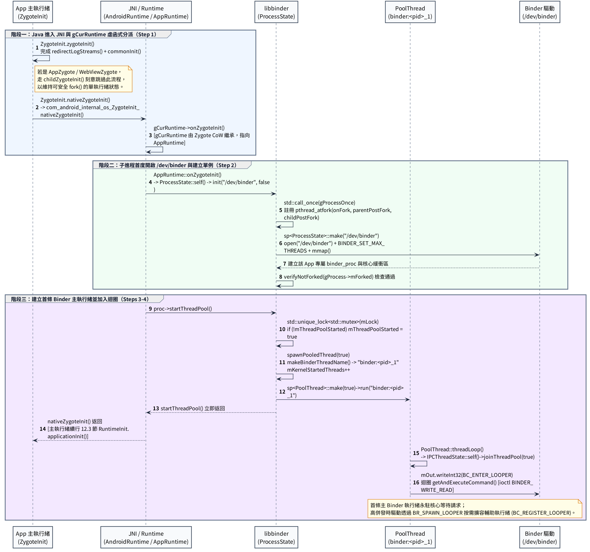

# 12.2 Binder 執行緒池的啟動過程（`ZygoteInit.nativeZygoteInit`、`AppRuntime::onZygoteInit` 與 `ProcessState::startThreadPool`）

- **情景說明**：如果一個剛由 Zygote 孵化出來的應用程式進程只會自己埋頭往下執行，而沒有建立接收跨進程請求的 Binder 執行緒池，那麼它既無法接受來自 `system_server`（AMS / ATMS / WMS）的遠端 `IApplicationThread` 呼叫（例如分派 Activity 生命週期、廣播或輸入事件），也無法對外提供 Bound Service 或 Content Provider 介面。更關鍵的是，Zygote 進程本身在 `fork()` 前**絕對不能**提前開啟 `/dev/binder`（否則所有子進程都會共享同一個核心 `binder_proc` 與 `mmap` 緩衝區）；因此 Android 刻意把開啟 `/dev/binder` 與啟動 Binder 執行緒池的動作，延後到子進程完成 `SpecializeCommon()` 降權沙盒化之後、準備進入 `ActivityThread.main()` 之前，在 `ZygoteInit.zygoteInit()` 中一次完成。本節承接 12.1 節 Step 10，從 `ZygoteInit.nativeZygoteInit()` 出發，經 `AndroidRuntime.cpp` 全域指標 `gCurRuntime`、`AppRuntime::onZygoteInit()`、`ProcessState::self()`（含 `pthread_atfork` 防護）與 `ProcessState::startThreadPool()`，一路追到第一個 Binder 執行緒 `PoolThread` 進入 `IPCThreadState::joinThreadPool(true)`，並對照子 Zygote（`ZygoteInit.childZygoteInit()`）為何必須跳過此流程。
- **對應原書**：12.2 節〈Binder线程池的启动过程〉（p.647–648）
- **涉及專案與版本基準**：
  - `platform/frameworks/base` 〔`android-17.0.0_r1`，commit `94b4c163b`〕
  - `platform/frameworks/native` 〔`android-17.0.0_r1`，commit `ae266dc`〕

---

## 12.2.1 總呼叫樹與跨層路徑

承接 12.1 節 Step 10 `ZygoteInit.zygoteInit()`，本節整條 Binder 執行緒池啟動呼叫樹如下：

```text
ZygoteInit.zygoteInit()                                    ## 12.1 節 Step 10 匯流點
  ZygoteInit.nativeZygoteInit()                            ## Step 1、JNI 入口（原書為 RuntimeInit.zygoteInitNative）
    com_android_internal_os_ZygoteInit_nativeZygoteInit()  ## Step 1、透過自 Zygote CoW 繼承的 gCurRuntime 分派
      AppRuntime::onZygoteInit()                           ## Step 2、覆寫 AndroidRuntime 虛函式
        ProcessState::self()                               ## Step 2、子進程首次開啟 /dev/binder、mmap 緩衝區並裝 pthread_atfork
        ProcessState::startThreadPool()                    ## Step 3、以 std::mutex 確保僅啟動一次
          ProcessState::spawnPooledThread(true)            ## Step 3、命名 binder:<pid>_<seq>，建立並啟動 PoolThread
            [新原生執行緒：binder:<pid>_1]
            PoolThread::threadLoop()                       ## Step 4、進入 Binder 主執行緒循環
              IPCThreadState::self()->joinThreadPool(true) ## Step 4、寫入 BC_ENTER_LOOPER，循環 getAndExecuteCommand()
```

---

## 12.2.2 逐步驟原始碼分析

### Step 1：`ZygoteInit.nativeZygoteInit` 與 `com_android_internal_os_ZygoteInit_nativeZygoteInit`
**位置**：
- `platform/frameworks/base/core/java/com/android/internal/os/ZygoteInit.java` 〔`android-17.0.0_r1`，lines 983–1008〕
- `platform/frameworks/base/core/jni/AndroidRuntime.cpp` 〔`android-17.0.0_r1`，lines 271、284–287、311–337〕

```java
// ZygoteInit.java:983-1008
    public static Runnable zygoteInit(int targetSdkVersion, long[] disabledCompatChanges,
            long[] enabledCompatChanges, String[] argv, ClassLoader classLoader) {
        if (RuntimeInit.DEBUG) {
            Slog.d(RuntimeInit.TAG, "RuntimeInit: Starting application from zygote");
        }

        Trace.traceBegin(Trace.TRACE_TAG_ACTIVITY_MANAGER, "ZygoteInit");
        RuntimeInit.redirectLogStreams();

        RuntimeInit.commonInit();
        ZygoteInit.nativeZygoteInit();
        return RuntimeInit.applicationInit(targetSdkVersion, disabledCompatChanges,
                enabledCompatChanges, argv, classLoader);
    }

    static Runnable childZygoteInit(String[] argv) {
        RuntimeInit.Arguments args = new RuntimeInit.Arguments(argv);
        return RuntimeInit.findStaticMain(args.startClass, args.startArgs, /* classLoader= */null);
    }

    private static native void nativeZygoteInit();
```

`ZygoteInit.nativeZygoteInit()` 在 Zygote 啟動初期呼叫 `AndroidRuntime::startReg()` 時，就已經透過 `register_com_android_internal_os_ZygoteInit_nativeZygoteInit()` 綁定至 `AndroidRuntime.cpp` 的靜態函式：

```cpp
// AndroidRuntime.cpp:271, 284-287, 311-337
static AndroidRuntime* gCurRuntime = NULL;
...
static void com_android_internal_os_ZygoteInit_nativeZygoteInit(JNIEnv* env, jobject clazz)
{
    gCurRuntime->onZygoteInit();
}
...
int register_com_android_internal_os_ZygoteInit_nativeZygoteInit(JNIEnv* env)
{
    const JNINativeMethod methods[] = {
        { "nativeZygoteInit", "()V",
            (void*) com_android_internal_os_ZygoteInit_nativeZygoteInit },
    };
    return jniRegisterNativeMethods(env, "com/android/internal/os/ZygoteInit",
        methods, NELEM(methods));
}
...
AndroidRuntime::AndroidRuntime(char* argBlockStart, const size_t argBlockLength) :
        mExitWithoutCleanup(false),
        mArgBlockStart(argBlockStart),
        mArgBlockLength(argBlockLength)
{
    init_android_graphics();

    // Pre-allocate enough space to hold a fair number of options.
    mOptions.setCapacity(20);

    assert(gCurRuntime == NULL);        // one per process
    gCurRuntime = this;
}
```

1. **為何子進程不用重新建構 `AppRuntime` 就有 `gCurRuntime`？**：如第 11 章 `11.2` 節所述，Zygote 剛從 `app_main.cpp::main()` 啟動時，在主執行緒堆疊上建立了 `AppRuntime runtime(...)` 物件；其父類 `AndroidRuntime` 建構子將全域指標 `gCurRuntime = this` 指向該 `AppRuntime` 實例。之後所有由 Zygote `fork()` 出來的應用程式進程（以及 `system_server`）都透過 Copy-on-Write 完整繼承了 Zygote 的虛擬位址空間，因此在每個新進程裡，`gCurRuntime` 自然指向同一個虛擬位址上的 `AppRuntime` 物件，虛函式分派 `gCurRuntime->onZygoteInit()` 也就直接落入 `AppRuntime::onZygoteInit()`。
2. **反例對照：`ZygoteInit.childZygoteInit()` 刻意跳過 `nativeZygoteInit()`**：注意上方 `ZygoteInit.java:1003-1006` 的 `childZygoteInit()`——當 Zygote 孵化的是 `AppZygote` 或 `WebViewZygote`（12.1 節 Step 9 `handleChildProc()` 中 `isZygote == true`）時，不會走 `zygoteInit()`，而是走 `childZygoteInit()` 直接查找並進入 `ChildZygoteInit.main()`，**故意不呼叫 `nativeZygoteInit()`**。原因在於子 Zygote 之後還必須繼續 `fork()` 孫進程（隔離服務或 WebView 渲染器）；一旦啟動了 Binder 執行緒池，不僅會多出背景執行緒違反安全 `fork()` 的單執行緒前提，還會觸發下方 Step 2 的 `ProcessState` 跨 `fork()` 致命檢查。

> 〔與 2.3 差異〕搬家 + 改名 + 新增對照：原書 12.2 Step 1（p.647–648）的 JNI 宣告是 `RuntimeInit.zygoteInitNative()`（對應 `com_android_internal_os_RuntimeInit_zygoteInit`）；Android 17 搬移並改名為 `ZygoteInit.nativeZygoteInit()`（`com_android_internal_os_ZygoteInit_nativeZygoteInit`），且新增專供子 Zygote 使用、刻意跳過 Binder 初始化的 `ZygoteInit.childZygoteInit()`。

---

### Step 2：`AppRuntime::onZygoteInit` 與 `ProcessState::self`（延遲開啟 `/dev/binder` 與 `pthread_atfork` 防護）
**位置**：
- `platform/frameworks/base/cmds/app_process/app_main.cpp` 〔`android-17.0.0_r1`，lines 92–97〕
- `platform/frameworks/native/libs/binder/ProcessState.cpp` 〔`android-17.0.0_r1`，lines 106–109、126–181、198–218〕

```cpp
// app_main.cpp:92-97
    virtual void onZygoteInit()
    {
        sp<ProcessState> proc = ProcessState::self();
        ALOGV("App process: starting thread pool.\n");
        proc->startThreadPool();
    }
```

這短短六行完成了應用程式進程接入 Binder 系統最關鍵的兩件事：**首次建構 `ProcessState` 單例**與**啟動執行緒池**。先看 `ProcessState::self()` → `ProcessState::init("/dev/binder", false)` 的現代防護機制：

```cpp
// ProcessState.cpp:106-109, 126-181, 198-218
sp<ProcessState> ProcessState::self()
{
    return init(kDefaultDriver, false /*requireDefault*/);
}
...
[[clang::no_destroy]] static sp<ProcessState> gProcess;
[[clang::no_destroy]] static std::mutex gProcessMutex;

static void verifyNotForked(bool forked) {
    LOG_ALWAYS_FATAL_IF(forked, "libbinder ProcessState can not be used after fork");
}
...
sp<ProcessState> ProcessState::init(const char* driver, bool requireDefault) {
    ...
    [[clang::no_destroy]] static std::once_flag gProcessOnce;
    std::call_once(gProcessOnce, [&](){
        if (access(driver, R_OK) == -1) {
            ALOGE("Binder driver %s is unavailable. Using /dev/binder instead.", driver);
            driver = "/dev/binder";
        }
        ...
        int ret = pthread_atfork(ProcessState::onFork, ProcessState::parentPostFork,
                                 ProcessState::childPostFork);
        LOG_ALWAYS_FATAL_IF(ret != 0, "pthread_atfork error %s", strerror(ret));

        std::lock_guard<std::mutex> l(gProcessMutex);
        gProcess = sp<ProcessState>::make(driver);
    });
    ...
    verifyNotForked(gProcess->mForked);
    return gProcess;
}
...
void ProcessState::onFork() {
    // make sure another thread isn't currently retrieving ProcessState
    gProcessMutex.lock();
}

void ProcessState::parentPostFork() {
    gProcessMutex.unlock();
}

void ProcessState::childPostFork() {
    // another thread might call fork before gProcess is instantiated, but after
    // the thread handler is installed
    if (gProcess) {
        gProcess->mForked = true;

        // "O_CLOFORK"
        close(gProcess->mDriverFD);
        gProcess->mDriverFD = -1;
    }
    gProcessMutex.unlock();
}
```

1. **移除 `supportsProcesses()` 歷史遺留判斷**：原書 2.3 的 `AppRuntime::onZygoteInit()` 還會判斷 `if (proc->supportsProcesses())`；Android 17 的 `ProcessState` 已無該函式，直接呼叫 `proc->startThreadPool()`。
2. **為何一定要在子進程 `onZygoteInit()` 才首次呼叫 `ProcessState::self()`？**：
   - 依第 5 章 `5.1`、`5.2` 節所述，`sp<ProcessState>::make("/dev/binder")` 會在建構子中呼叫 `open("/dev/binder")`、`ioctl(BINDER_SET_MAX_THREADS)`（預設 `DEFAULT_MAX_BINDER_THREADS = 15`）與 `mmap()` 映射約 1 MiB − 8 KiB（`BINDER_VM_SIZE`）的專屬核心緩衝區；核心 Binder 驅動會為這次 `open()` 建立一份綁定當前進程 `pid` 的 `struct binder_proc`。
   - 如果 Zygote 父進程在 `fork()` 前就呼叫了 `ProcessState::self()`，所有子進程將繼承指向父進程 `binder_proc` 的同一個 `mDriverFD`；現代 `libbinder` 透過 `pthread_atfork()` 註冊的 `childPostFork()` 甚至會直接標記 `gProcess->mForked = true` 並關閉 `mDriverFD`，之後任何 `ProcessState::self()` 呼叫都會觸發 `LOG_ALWAYS_FATAL_IF(forked, ...)` 立即崩潰。
   - 正因 Zygote 進程本身全程僅靠 Unix Domain Socket（`/dev/socket/zygote`）與 `system_server` 通訊、完全不碰 `/dev/binder`，所以 `gProcessOnce` 在 Zygote 中從未執行；等到子進程 `fork()` 並特化完成、執行到 `AppRuntime::onZygoteInit()` 時，`std::call_once(gProcessOnce, ...)` 才在**該子進程獨立的記憶體空間中首度觸發**，為新 App 進程乾淨地打開專屬於自己的 `/dev/binder` 實例！

> 〔與 2.3 差異〕邏輯簡化 + 安全強化：原書 12.2 Step 2（p.648）的 `AppRuntime::onZygoteInit()` 仍包含 `proc->supportsProcesses()` 檢查，且 2.3 的 `ProcessState` 位於 `frameworks/base/libs/binder/`、沒有 `std::call_once` 與 `pthread_atfork` 防護；Android 17 的 `ProcessState` 搬至 `platform/frameworks/native/libs/binder/`，改以 `std::call_once` 建構並強制經由 `childPostFork()` + `verifyNotForked()` 封殺跨 `fork()` 重用 `/dev/binder`。

---

### Step 3：`ProcessState::startThreadPool` 與 `ProcessState::spawnPooledThread`
**位置**：`platform/frameworks/native/libs/binder/ProcessState.cpp` 〔`android-17.0.0_r1`，lines 220–232、422–449〕

```cpp
// ProcessState.cpp:220-232
void ProcessState::startThreadPool()
{
    std::unique_lock<std::mutex> _l(mLock);
    if (!mThreadPoolStarted) {
        if (mMaxThreads == 0) {
            // see also getThreadPoolMaxTotalThreadCount
            ALOGW("Extra binder thread started, but 0 threads requested. Do not use "
                  "*startThreadPool when zero threads are requested.");
        }
        mThreadPoolStarted = true;
        spawnPooledThread(true);
    }
}
```

```cpp
// ProcessState.cpp:422-449
String8 ProcessState::makeBinderThreadName() {
    int32_t s = mThreadPoolSeq.fetch_add(1, std::memory_order_release);
    pid_t pid = getpid();

    std::string_view driverName = mDriverName.c_str();
    android::base::ConsumePrefix(&driverName, "/dev/");

    String8 name;
    name.appendFormat("%.*s:%d_%X", static_cast<int>(driverName.length()), driverName.data(), pid,
                      s);
    return name;
}

void ProcessState::spawnPooledThread(bool isMain)
{
    if (mThreadPoolStarted) {
        String8 name = makeBinderThreadName();
        ALOGV("Spawning new pooled thread, name=%s\n", name.c_str());
        sp<Thread> t = sp<PoolThread>::make(isMain);
        t->run(name.c_str());
        mKernelStartedThreads++;
    }
}
```

1. **冪等鎖控（`mThreadPoolStarted`）**：以標準 C++ `std::unique_lock<std::mutex>` 鎖定 `mLock`，確保每個進程的 `startThreadPool()` 只會主動拉起**第一個** Binder 主執行緒（`isMain = true`），後續再呼叫直接略過。
2. **現代執行緒命名規則**：`makeBinderThreadName()` 去掉 `/dev/` 前綴並遞增原子序號 `mThreadPoolSeq`，組合出形如 **`binder:<pid>_1`** 的執行緒名稱（而非早期的 `Binder Thread #1`），方便在 `ps -T`、Perfetto 或 tombstone 中一眼區分是 `/dev/binder`、`hwbinder` 還是 `vndbinder` 的執行緒，以及歸屬哪個 PID。
3. **動態擴容起點**：`startThreadPool()` 只啟動第 1 條 `PoolThread`（`isMain = true`）並遞增 `mKernelStartedThreads++`；後續若該進程並發收到多筆 Binder 請求、核心 Binder 驅動判斷無空閒執行緒且未達上限（預設 15 條）時，會透過 `BR_SPAWN_LOOPER` 指令喚醒既有 Binder 執行緒呼叫 `spawnPooledThread(false)` 按需拉起額外輔助執行緒（`isMain = false`）。

> 〔與 2.3 差異〕搬家 + 邏輯微調：原書 12.2 Step 3（p.648）位於 `frameworks/base/libs/binder/ProcessState.cpp`，使用 `AutoMutex`、`new PoolThread(isMain)` 與 `Binder Thread #%d` 命名；Android 17 搬至 `platform/frameworks/native/libs/binder/ProcessState.cpp`，改用 `std::unique_lock<std::mutex>`、`sp<PoolThread>::make(isMain)`、`mKernelStartedThreads++` 與 `binder:<pid>_<seq>` 命名，並加入 `mMaxThreads == 0` 警訊。

---

### Step 4：`PoolThread::threadLoop` 與 `IPCThreadState::joinThreadPool`
**位置**：
- `platform/frameworks/native/libs/binder/ProcessState.cpp` 〔`android-17.0.0_r1`，lines 88–104〕
- `platform/frameworks/native/libs/binder/IPCThreadState.cpp` 〔`android-17.0.0_r1`，lines 841–866〕

```cpp
// ProcessState.cpp:88-104
class PoolThread : public Thread
{
public:
    explicit PoolThread(bool isMain)
        : mIsMain(isMain)
    {
    }

protected:
    virtual bool threadLoop()
    {
        IPCThreadState::self()->joinThreadPool(mIsMain);
        return false;
    }

    const bool mIsMain;
};
```

```cpp
// IPCThreadState.cpp:841-866
void IPCThreadState::joinThreadPool(bool isMain)
{
    LOG_THREADPOOL("**** THREAD %p (PID %d) IS JOINING THE THREAD POOL\n", (void*)pthread_self(),
        getpid());
    mProcess->checkExpectingThreadPoolStart();
    mProcess->mCurrentThreads++;
    mOut.writeInt32(isMain ? BC_ENTER_LOOPER : BC_REGISTER_LOOPER);

    mIsLooper = true;
    status_t result;
    do {
        processPendingDerefs();
        // now get the next command to be processed, waiting if necessary
        result = getAndExecuteCommand();

        if (result < NO_ERROR && result != TIMED_OUT && result != -ECONNREFUSED && result != -EBADF) {
            LOG_ALWAYS_FATAL("getAndExecuteCommand(fd=%d) returned unexpected error %d, aborting",
                  mProcess->mDriverFD, result);
        }

        // Let this thread exit the thread pool if it is no longer
        // needed and it is not the main process thread.
        if(result == TIMED_OUT && !isMain) {
            break;
        }
    } while (result != -ECONNREFUSED && result != -EBADF);
```

1. **向驅動報到（`BC_ENTER_LOOPER`）**：新建立的 `binder:<pid>_1` 執行緒進入 `PoolThread::threadLoop()` 後，建立本執行緒專屬的 `IPCThreadState` TLS 單例，因為 `isMain == true`，往輸出緩衝 `mOut` 寫入 **`BC_ENTER_LOOPER`**（相對地，日後由驅動透過 `BR_SPAWN_LOOPER` 觸發建出的執行緒 `isMain == false`，寫入 `BC_REGISTER_LOOPER`）。
2. **長駐等待跨進程請求**：迴圈反覆呼叫 `getAndExecuteCommand()`（透過 `ioctl(BINDER_WRITE_READ)` 阻塞睡眠於核心 Binder 驅動），等待遠端進程呼叫本 App 的任何 `BBinder` 物件（最先抵達的便是 12.3 節向 AMS 註冊 `mAppThread` 後，AMS 立刻回呼的 `bindApplication()` 與後續 `scheduleTransaction()`）；由於 `isMain == true`，即使發生 `TIMED_OUT` 也不會退出迴圈。
3. **主執行緒同步返回**：建立並啟動 `PoolThread` 是非同步操作，`startThreadPool()` → `onZygoteInit()` → `nativeZygoteInit()` 立刻返回到 `ZygoteInit.zygoteInit()`，由主執行緒接著執行 12.3 節的 `RuntimeInit.applicationInit()` 進入 `ActivityThread.main()`。

> 〔與 2.3 差異〕邏輯微調：核心 `BC_ENTER_LOOPER` / `getAndExecuteCommand()` 模型與原書第 5 章 5.8.2 及 12.2 節（p.648）一致；Android 17 新增 `checkExpectingThreadPoolStart()`、`mCurrentThreads++`、異常錯誤碼即刻 `LOG_ALWAYS_FATAL` 與更嚴格的退出條件檢查。

---

## 12.2.3 本節總結與時序圖



| 階段 | 核心類別 / 方法 | 關鍵動作與設計意涵 |
|---|---|---|
| **Java → JNI 入口** | `ZygoteInit.zygoteInit` → `ZygoteInit.nativeZygoteInit` → `AndroidRuntime.cpp` | 承接 12.1 節匯流點，經由 Zygote CoW 繼承下來的 `gCurRuntime` 虛函式分派至 `AppRuntime::onZygoteInit()`（子 Zygote 走 `childZygoteInit()` 刻意跳過） |
| **延遲開啟 Binder 驅動** | `AppRuntime::onZygoteInit` → `ProcessState::self` / `init` | 在子進程特化後**首度**執行 `std::call_once` 開啟 `/dev/binder` 並 `mmap` 專屬緩衝區，同時註冊 `pthread_atfork` 嚴禁跨 `fork()` 共享 `mDriverFD` |
| **啟動首條 Binder 執行緒** | `ProcessState::startThreadPool` → `spawnPooledThread(true)` | 鎖控確保只主動拉起 1 條命名為 `binder:<pid>_1` 的 `PoolThread`（`isMain = true`），其餘按需由驅動 `BR_SPAWN_LOOPER` 擴容 |
| **加入驅動事件迴圈** | `PoolThread::threadLoop` → `IPCThreadState::joinThreadPool(true)` | 發送 `BC_ENTER_LOOPER` 並長駐 `getAndExecuteCommand()` 等待 AMS 回呼 `IApplicationThread`；主執行緒立即返回進入 12.3 節建立主迴圈 |
