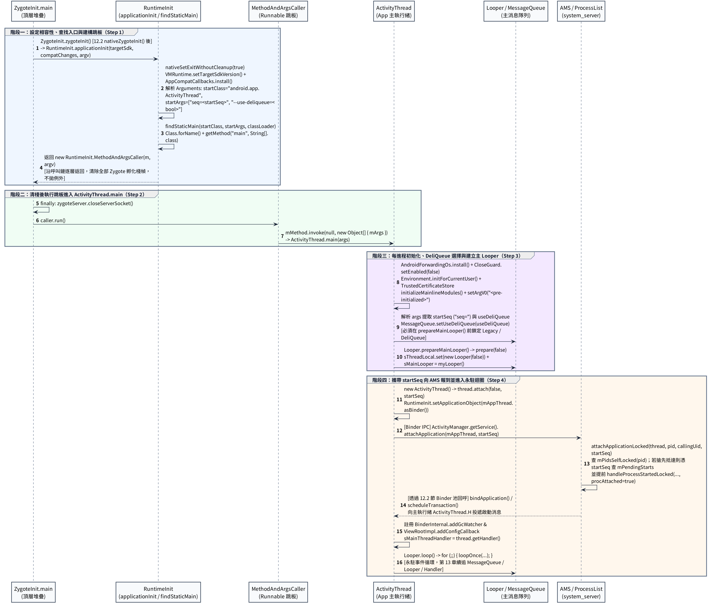

# 12.3 消息循環的建立過程（`MethodAndArgsCaller` `Runnable` 跳板、`ActivityThread.main` 與 `Looper.prepareMainLooper` / `loop`）

- **情景說明**：應用程式進程雖然已經透過 12.1 節建立、並於 12.2 節啟動了接收跨進程呼叫的 Binder 執行緒池，但此時主執行緒仍停留在 `ZygoteInit.zygoteInit()` 的孵化呼叫堆疊裡——如果主執行緒直接返回退出，整個進程就會瞬間結束；如果在孵化堆疊深處直接呼叫 `ActivityThread.main()`，不但會把一大串 Zygote 內部棧幀（`runSelectLoop`、`processCommand`、`forkSimpleApps`、`childMain`、`zygoteInit`）永久壓在堆疊底部浪費記憶體，也會讓堆疊追蹤充斥無關的啟動框架。因此 Android 設計了「清棧跳板」把控制權先退回 `ZygoteInit.main()` 頂層，再反射啟動 `ActivityThread.main()`；進入後主執行緒完成每進程環境初始化、依 `--use-deliqueue=` 選擇 `MessageQueue` 實作、以 `Looper.prepareMainLooper()` 建立不可退出的主消息隊列、攜帶 `startSeq` 向 AMS 報到（`attachApplication`），最後進入 `Looper.loop()` 永駐等待事件驅動。本節完整追蹤 Android 17 從 `RuntimeInit.applicationInit()` 到 `Looper.loop()` 的四個步驟，自然銜接第 13 章的消息處理機制。
- **對應原書**：12.3 節〈消息循环的创建过程〉（p.649–652）
- **涉及專案與版本基準**：
  - `platform/frameworks/base` 〔`android-17.0.0_r1`，commit `94b4c163b`〕

---

## 12.3.1 總呼叫樹與堆疊展開路徑

承接 12.2 節 `ZygoteInit.nativeZygoteInit()` 返回後，主執行緒在 `ZygoteInit.zygoteInit()` 最後一行進入本節流程：

```text
ZygoteInit.zygoteInit()                                    ## 12.2 節返回後繼續
  RuntimeInit.applicationInit()                            ## Step 1、設 nativeSetExitWithoutCleanup(true)、targetSdkVersion、AppCompatCallbacks
    RuntimeInit.findStaticMain("android.app.ActivityThread")## Step 1、Class.forName + getMethod("main", String[].class)
      return new RuntimeInit.MethodAndArgsCaller(m, argv)  ## Step 1、回傳 Runnable 跳板（不再拋例外！）
==================== 沿呼叫鏈逐層返回，清除全部 Zygote 孵化棧幀 ====================
ZygoteInit.main()                                          ## Step 2、runSelectLoop() 返回 caller；finally 關閉 ServerSocket
  caller.run() [RuntimeInit.MethodAndArgsCaller.run()]     ## Step 2、mMethod.invoke(null, new Object[] { mArgs })
    ActivityThread.main(String[] args)                     ## Step 3、主進程入口：AndroidForwardingOs、Environment、Mainline 初始化
      解析 "seq=<startSeq>" 與 "--use-deliqueue=<bool>"     ## Step 3、MessageQueue.setUseDeliQueue(useDeliQueue)（必須在 prepareMainLooper 前）
      Looper.prepareMainLooper()                           ## Step 3、prepare(false) 建不可退出主 Looper 並設 sMainLooper
      new ActivityThread() -> thread.attach(false, startSeq)## Step 4、setApplicationObject + AMS.attachApplication(mAppThread, startSeq)
        [Binder 跨進程至 system_server]
        AMS.attachApplicationLocked(thread, pid, uid, seq) ## Step 4、依 pid 或 mPendingStarts.get(startSeq) 認領並呼叫 bindApplication()
      Looper.loop()                                        ## Step 4、進入無限 loopOnce() 消息循環（銜接第 13 章）
```

---

## 12.3.2 逐步驟原始碼分析

### Step 1：`RuntimeInit.applicationInit` 與 `RuntimeInit.findStaticMain`
**位置**：`platform/frameworks/base/core/java/com/android/internal/os/RuntimeInit.java` 〔`android-17.0.0_r1`，lines 313–349、372–399、514–555〕

```java
// RuntimeInit.java:372-399
    protected static Runnable applicationInit(int targetSdkVersion, long[] disabledCompatChanges,
            long[] enabledCompatChanges, String[] argv, ClassLoader classLoader) {
        // If the application calls System.exit(), terminate the process
        // immediately without running any shutdown hooks.  It is not possible to
        // shutdown an Android application gracefully.  Among other things, the
        // Android runtime shutdown hooks close the Binder driver, which can cause
        // leftover running threads to crash before the process actually exits.
        nativeSetExitWithoutCleanup(true);

        VMRuntime.getRuntime().setTargetSdkVersion(targetSdkVersion);
        VMRuntime.getRuntime().setDisabledCompatChanges(disabledCompatChanges);

        // For apps started via Zygote, we install AppCompatCallbacks here early
        // so that they are available during static initialization of the app.
        // ActivityThread will re-install them with more complete data later.
        if (disabledCompatChanges != null || enabledCompatChanges != null) {
            AppCompatCallbacks.install(disabledCompatChanges, enabledCompatChanges, null, false,
                    targetSdkVersion);
        }

        final Arguments args = new Arguments(argv);

        // The end of of the RuntimeInit event (see #zygoteInit).
        Trace.traceEnd(Trace.TRACE_TAG_ACTIVITY_MANAGER);

        // Remaining arguments are passed to the start class's static main
        return findStaticMain(args.startClass, args.startArgs, classLoader);
    }
```

```java
// RuntimeInit.java:313-349
    protected static Runnable findStaticMain(String className, String[] argv,
            ClassLoader classLoader) {
        Class<?> cl;

        try {
            cl = Class.forName(className, true, classLoader);
        } catch (ClassNotFoundException ex) {
            throw new RuntimeException(
                    "Missing class when invoking static main " + className,
                    ex);
        }

        Method m;
        try {
            m = cl.getMethod("main", new Class[] { String[].class });
        } catch (NoSuchMethodException ex) {
            throw new RuntimeException(
                    "Missing static main on " + className, ex);
        } catch (SecurityException ex) {
            throw new RuntimeException(
                    "Problem getting static main on " + className, ex);
        }

        int modifiers = m.getModifiers();
        if (! (Modifier.isStatic(modifiers) && Modifier.isPublic(modifiers))) {
            throw new RuntimeException(
                    "Main method is not public and static on " + className);
        }

        /*
         * This throw gets caught in ZygoteInit.main(), which responds
         * by invoking the exception's run() method. This arrangement
         * clears up all the stack frames that were required in setting
         * up the process.
         */
        return new MethodAndArgsCaller(m, argv);
    }
```

1. **退出策略與早期相容性掛載**：`applicationInit()` 先透過 `nativeSetExitWithoutCleanup(true)` 通知 `AndroidRuntime`（呼叫 `gCurRuntime->setExitWithoutCleanup(true)`），日後若 App 呼叫 `System.exit()` 應直接終止進程而不跑可能提早關閉 Binder 驅動的關機勾子；接著替 ART 設定 `targetSdkVersion` 與 `disabledCompatChanges`，並趁早安裝 `AppCompatCallbacks`，確保連類別靜態初始化階段都能套用正確的相容性變更。
2. **解析入口類與透傳參數**：`new Arguments(argv)` 略過任何 `--` 選項後，把第一個非選項引數取為 `startClass`（即 12.1 節 Step 1 指定的 `"android.app.ActivityThread"`），把其餘引數複製為 `startArgs`（包含 12.1 節 Step 2–3 夾帶的 `"seq=<startSeq>"` 與 `"--use-deliqueue=<bool>"`）。
3. **以回傳 `Runnable` 取代拋出例外**：`findStaticMain()` 載入 `android.app.ActivityThread`、反射查找並檢驗 `public static void main(String[])`，最後直接 **`return new MethodAndArgsCaller(m, argv)`**（程式碼裡的舊註解甚至還殘留著過去 `This throw gets caught...` 的歷史描述，但實作早已改為純 `return`）。

> 〔與 2.3 差異〕改名 + 邏輯改變：原書 12.3 Step 1（p.649–650）的 `RuntimeInit.invokeStaticMain()` 最後以 `throw new ZygoteInit.MethodAndArgsCaller(m, argv)` 拋出例外清棧；Android 17 拆為 `applicationInit()` + `findStaticMain()`，改為正常 `return` 實作 `Runnable` 的 `RuntimeInit.MethodAndArgsCaller`，完全免除建構例外堆疊與異常展開的開銷，並新增 `nativeSetExitWithoutCleanup(true)`、`VMRuntime` 與 `AppCompatCallbacks.install()`。

---

### Step 2：`ZygoteInit.main` 與 `RuntimeInit.MethodAndArgsCaller.run`
**位置**：
- `platform/frameworks/base/core/java/com/android/internal/os/ZygoteInit.java` 〔`android-17.0.0_r1`，lines 924–941〕
- `platform/frameworks/base/core/java/com/android/internal/os/RuntimeInit.java` 〔`android-17.0.0_r1`，lines 561–588〕

```java
// ZygoteInit.java:924-941
            // The select loop returns early in the child process after a fork and
            // loops forever in the zygote.
            caller = zygoteServer.runSelectLoop(abiList);
        } catch (Throwable ex) {
            Log.e(TAG, "System zygote died with fatal exception", ex);
            throw ex;
        } finally {
            if (zygoteServer != null) {
                zygoteServer.closeServerSocket();
            }
        }

        // We're in the child process and have exited the select loop. Proceed to execute the
        // command.
        if (caller != null) {
            caller.run();
        }
    }
```

```java
// RuntimeInit.java:561-588
    static class MethodAndArgsCaller implements Runnable {
        /** method to call */
        private final Method mMethod;

        /** argument array */
        private final String[] mArgs;

        public MethodAndArgsCaller(Method method, String[] args) {
            mMethod = method;
            mArgs = args;
        }

        public void run() {
            try {
                mMethod.invoke(null, new Object[] { mArgs });
            } catch (IllegalAccessException ex) {
                throw new RuntimeException(ex);
            } catch (InvocationTargetException ex) {
                Throwable cause = ex.getCause();
                if (cause instanceof RuntimeException) {
                    throw (RuntimeException) cause;
                } else if (cause instanceof Error) {
                    throw (Error) cause;
                }
                throw new RuntimeException(ex);
            }
        }
    }
```

1. **乾淨清棧的原理（無例外版）**：`MethodAndArgsCaller` 物件依序從 `findStaticMain()` → `applicationInit()` → `zygoteInit()` → `childMain()`（或 `handleChildProc()`）→ `forkSimpleApps()` / `processCommand()` → `ZygoteServer.runSelectLoop()` 一路**正常返回**到 `ZygoteInit.main()`。當控制流離開 `try { ... } finally { zygoteServer.closeServerSocket(); }` 進入 `caller.run()` 時，前面整個 Zygote 孵化過程的本地變數與呼叫棧幀都已自然彈出回收，同時 `finally` 再次確保子進程不會殘留 `ZygoteServer` 的監聽 Socket 物件。
2. **反射啟動入口並還原原始例外**：`MethodAndArgsCaller.run()` 透過 `mMethod.invoke(null, new Object[] { mArgs })` 呼叫 `ActivityThread.main(String[] args)`；若目標 `main()` 拋出 `RuntimeException` 或 `Error`，`catch (InvocationTargetException)` 會主動拆封並重新拋出原始 `cause`，使崩潰日誌與 `UncaughtExceptionHandler` 看到真實例外而非外層反射包裝。

> 〔與 2.3 差異〕搬家 + 邏輯改變：原書 12.3 Step 2–3（p.651）中 `MethodAndArgsCaller` 位於 `ZygoteInit` 內且繼承 `Exception`，由 `ZygoteInit.main()` 的 `catch (MethodAndArgsCaller caller)` 接住執行；Android 17 移至 `RuntimeInit` 並移除 `extends Exception` 僅保留 `implements Runnable`，改由 `ZygoteInit.main()` 在 `finally` 之後直接執行 `caller.run()`。

---

### Step 3：`ActivityThread.main` 與 `Looper.prepareMainLooper`（含 DeliQueue 切換）
**位置**：
- `platform/frameworks/base/core/java/android/app/ActivityThread.java` 〔`android-17.0.0_r1`，lines 9465–9526〕
- `platform/frameworks/base/core/java/android/os/CombinedDeliMessageQueue/MessageQueue.java` 〔`android-17.0.0_r1`，lines 168–186〕
- `platform/frameworks/base/core/java/android/os/Looper.java` 〔`android-17.0.0_r1`，lines 151–174、497–500〕

```java
// ActivityThread.java:9465-9526
    public static void main(String[] args) {
        Trace.traceBegin(Trace.TRACE_TAG_ACTIVITY_MANAGER, "ActivityThreadMain");

        // Install selective syscall interception
        AndroidForwardingOs.install();

        // CloseGuard defaults to true and can be quite spammy.  We
        // disable it here, but selectively enable it later (via
        // StrictMode) on debug builds, but using DropBox, not logs.
        CloseGuard.setEnabled(false);

        Environment.initForCurrentUser();

        // Make sure TrustedCertificateStore looks in the right place for CA certificates
        final File configDir = Environment.getUserConfigDirectory(UserHandle.myUserId());
        TrustedCertificateStore.setDefaultUserDirectory(configDir);

        // Call per-process mainline module initialization.
        initializeMainlineModules();

        Process.setArgV0("<pre-initialized>");

        long startSeq = 0;
        if (args != null) {
            for (int i = args.length - 1; i >= 0; --i) {
                if (args[i] != null) {
                    // Find the value for {@link #PROC_START_SEQ_IDENT} if provided on the command
                    // line. It will be in the format "seq=114"
                    if (args[i].startsWith(PROC_START_SEQ_IDENT)) {
                        startSeq = Long.parseLong(
                                args[i].substring(PROC_START_SEQ_IDENT.length()));
                    } else if (args[i].startsWith("--use-deliqueue=")) {
                        boolean useDeliQueue =
                                Boolean.parseBoolean(args[i].substring(args[i].indexOf('=') + 1));
                        // This must be called before Looper.prepareMainLooper(), which will
                        // instantiate a MessageQueue.
                        MessageQueue.setUseDeliQueue(useDeliQueue);
                    }
                }
            }
        }

        Looper.prepareMainLooper();

        ActivityThread thread = new ActivityThread();
        thread.attach(false, startSeq);

        if (sMainThreadHandler == null) {
            sMainThreadHandler = thread.getHandler();
        }

        if (false) {
            Looper.myLooper().setMessageLogging(new
                    LogPrinter(Log.DEBUG, "ActivityThread"));
        }

        // End of event ActivityThreadMain.
        Trace.traceEnd(Trace.TRACE_TAG_ACTIVITY_MANAGER);
        Looper.loop();

        throw new RuntimeException("Main thread loop unexpectedly exited");
    }
```

```java
// MessageQueue.java:168-186 (CombinedDeliMessageQueue)
    public static void setUseDeliQueue(boolean enable) {
        if (!sUseDeliQueueInitialized) {
            if (!enable) {
                sUseDeliQueue = false;
            } else {
                final boolean useDeliQueue = computeUseDeliQueue(enable);
                sUseDeliQueue = useDeliQueue;
            }
        }
        sUseDeliQueueInitialized = true;
    }
```

```java
// Looper.java:151-174, 497-500
    private static void prepare(boolean quitAllowed) {
        if (sThreadLocal.get() != null) {
            throw new RuntimeException("Only one Looper may be created per thread");
        }
        sThreadLocal.set(new Looper(quitAllowed));
    }
    ...
    public static void prepareMainLooper() {
        prepare(false);
        synchronized (Looper.class) {
            if (sMainLooper != null) {
                throw new IllegalStateException("The main Looper has already been prepared.");
            }
            sMainLooper = myLooper();
        }
    }
    ...
    private Looper(boolean quitAllowed) {
        mQueue = new MessageQueue(quitAllowed);
        mThread = Thread.currentThread();
    }
```

1. **每進程執行環境前置初始化**：在建立主執行緒消息循環之前，`ActivityThread.main()` 先安裝 `AndroidForwardingOs` 系統呼叫攔截層、關閉過於吵雜的 `CloseGuard`、初始化當前多使用者目錄（`Environment.initForCurrentUser()`）與 CA 憑證路徑（`TrustedCertificateStore`），並呼叫 `initializeMainlineModules()` 註冊 Telephony / Stats / Media / Bluetooth 等 Mainline 模組服務管理器。
2. **Android 17 關鍵新參數解析（`seq=` 與 `--use-deliqueue=`）**：
   - `seq=<startSeq>`：取回 12.1 節 Step 1 由 `ProcessList` 分配的啟動序號，傳給下方 Step 4 的 `thread.attach(false, startSeq)`。
   - `--use-deliqueue=<bool>`：**必須在 `Looper.prepareMainLooper()` 之前**呼叫 `MessageQueue.setUseDeliQueue(useDeliQueue)`。在 Android 17 中，框架原始碼下存在多套 `MessageQueue` 實作（`LegacyMessageQueue`、`CombinedMessageQueue`、`CombinedDeliMessageQueue`）；當編譯採用 `CombinedDeliMessageQueue` 時，`setUseDeliQueue()` 會鎖定靜態開關 `sUseDeliQueue`，決定後續 `new MessageQueue(quitAllowed)` 底層要使用傳統單鎖排序鏈表，還是新一代無鎖 **DeliQueue**（Treiber Stack + 雙 Min-Heap，解決低優先權執行緒持鎖阻塞 UI 主執行緒的優先權反轉問題，將於第 13 章深入解剖）。
3. **不可退出的主執行緒 `Looper`**：`Looper.prepareMainLooper()` 呼叫 `prepare(false)`，在主執行緒的 `ThreadLocal`（`sThreadLocal`）綁定唯一 `Looper`（`mQueue = new MessageQueue(false)`，禁止呼叫 `quit()`）並快取至靜態欄位 `sMainLooper`，供整個進程任何執行緒透過 `Looper.getMainLooper()` 取得主線程派發目標。

> 〔與 2.3 差異〕邏輯擴充：原書 12.3 Step 4（p.652）的 `ActivityThread.main()` 幾乎只有 `Looper.prepareMainLooper()` → `new ActivityThread()` → `thread.attach(false)` → `Looper.loop()` 四行；Android 17 補齊多使用者環境、`initializeMainlineModules()`、`seq=<startSeq>` 啟動序號解析與 `--use-deliqueue=` 動態選擇 DeliQueue。

---

### Step 4：`ActivityThread.attach`、`AMS.attachApplicationLocked` 認領與 `Looper.loop`
**位置**：
- `platform/frameworks/base/core/java/android/app/ActivityThread.java` 〔`android-17.0.0_r1`，lines 9275–9342〕
- `platform/frameworks/base/services/core/java/com/android/server/am/ActivityManagerService.java` 〔`android-17.0.0_r1`，lines 5192–5239〕
- `platform/frameworks/base/core/java/android/os/Looper.java` 〔`android-17.0.0_r1`，lines 373–401〕

```java
// ActivityThread.java:9275-9314, 9322-9342
    private void attach(boolean system, long startSeq) {
        sCurrentActivityThread = this;
        mConfigurationController = new ConfigurationController(this);
        mSystemThread = system;
        mStartSeq = startSeq;
        mDdmSyncStageUpdater.next(Stage.Attach);

        if (!system) {
            android.ddm.DdmHandleAppName.setAppName("<pre-initialized>",
                                                    UserHandle.myUserId());
            RuntimeInit.setApplicationObject(mAppThread.asBinder());
            final IActivityManager mgr = ActivityManager.getService();
            try {
                mgr.attachApplication(mAppThread, startSeq);
            } catch (RemoteException ex) {
                throw ex.rethrowFromSystemServer();
            }
            // Watch for getting close to heap limit.
            BinderInternal.addGcWatcher(new Runnable() {
                @Override public void run() {
                    if (!mSomeActivitiesChanged) {
                        return;
                    }
                    Runtime runtime = Runtime.getRuntime();
                    long dalvikMax = runtime.maxMemory();
                    long dalvikUsed = runtime.totalMemory() - runtime.freeMemory();
                    if (dalvikUsed > ((3*dalvikMax)/4)) {
                        ...
                        mSomeActivitiesChanged = false;
                        try {
                            ActivityTaskManager.getService().releaseSomeActivities(mAppThread);
                        } catch (RemoteException e) {
                            throw e.rethrowFromSystemServer();
                        }
                    }
                }
            });
        } else {
            ...
        }

        ViewRootImpl.ConfigChangedCallback configChangedCallback = (Configuration globalConfig) -> {
            synchronized (mResourcesManager) {
                if (mResourcesManager.applyConfigurationToResources(globalConfig,
                        null /* compat */)) {
                    mConfigurationController.updateLocaleListFromAppContext(
                            mInitialApplication.getApplicationContext());

                    final Configuration updatedConfig =
                            mConfigurationController.updatePendingConfiguration(globalConfig);
                    if (updatedConfig != null) {
                        sendMessage(H.CONFIGURATION_CHANGED, globalConfig);
                        mPendingConfiguration = updatedConfig;
                    }
                }
            }
        };
        ViewRootImpl.addConfigCallback(configChangedCallback);
    }
```

這裡正好與 12.1 節 Step 1、Step 9 的非同步啟動閉合：當子進程把 `mAppThread`（`ApplicationThread`，Binder 本地物件）與 `startSeq` 送達 `AMS.attachApplicationLocked()` 時：

```java
// ActivityManagerService.java:5192-5239（認領主幹）
    @GuardedBy("this")
    private void attachApplicationLocked(@NonNull IApplicationThread thread,
            int pid, int callingUid, long startSeq) {
        ProcessRecord app;
        ...
        if (pid != MY_PID && pid >= 0) {
            synchronized (mPidsSelfLocked) {
                app = mPidsSelfLocked.get(pid);
            }
            ...
        } else {
            app = null;
        }

        // It's possible that process called attachApplication before we got a chance to
        // update the internal state.
        if (app == null && startSeq > 0) {
            final ProcessRecord pending = mProcessList.mPendingStarts.get(startSeq);
            if (pending != null && pending.getStartUid() == callingUid
                    && pending.getStartSeq() == startSeq
                    && mProcessList.handleProcessStartedLocked(pending, pid,
                        pending.isUsingWrapper(), startSeq, true)) {
                app = pending;
            }
        }
```

`attach()` 返回後，`ActivityThread.main()` 記錄 `sMainThreadHandler = thread.getHandler()`，隨即呼叫 `Looper.loop()`：

```java
// Looper.java:373-401
    public static void loop() {
        final Looper me = myLooper();
        if (me == null) {
            throw new RuntimeException("No Looper; Looper.prepare() wasn't called on this thread.");
        }
        ...
        me.mInLoop = true;

        Binder.clearCallingIdentity();
        final long ident = Binder.clearCallingIdentity();

        final int thresholdOverride = getThresholdOverride();

        me.mSlowDeliveryDetected = false;

        for (;;) {
            if (!loopOnce(me, ident, thresholdOverride)) {
                return;
            }
        }
    }
```

1. **非同步啟動的競態閉合**：透過 12.2 節啟動好的 Binder 執行緒池，`thread.attach(false, startSeq)` 向 `AMS` 遞交 `mAppThread` 與 `startSeq`。即使子進程跑得比 `system_server` 的 `ProcStartHandler` 還快、導致 `mPidsSelfLocked.get(pid)` 暫時查不到記錄，`AMS.attachApplicationLocked()` 也會憑 `startSeq` 到 `mProcessList.mPendingStarts` 核對 `callingUid` 與 `startSeq`，直接提前呼叫 `handleProcessStartedLocked(..., procAttached = true)` 認領並免排超時訊息；緊接著 AMS 透過 `mAppThread.bindApplication(...)`（以及第 7–10 章的 `ClientTransaction` / `scheduleCreateService` / `scheduleReceiver`）把初始任務送入本進程的 `Binder` 執行緒，再轉投主執行緒 `ActivityThread.H`（`Handler`）的消息隊列！
2. **進程常駐與事件驅動**：主執行緒呼叫 `Looper.loop()` 後，進入無限 `for (;;) { loopOnce(...); }` 迴圈，不斷從 `MessageQueue` 取出 AMS 剛投遞進來的 `BIND_APPLICATION`、`EXECUTE_TRANSACTION` 等消息交由 `Handler.dispatchMessage()` 執行；沒有消息時便在底層核心 `epoll_wait()` 上睡眠讓出 CPU。至此，一個完整的 Android 應用程式進程便宣告啟動完成並進入穩定運作期。

> 〔與 2.3 差異〕邏輯擴充：原書 12.3 Step 4（p.652）的 `thread.attach(false)` 不帶 `startSeq`，也無 `mPendingStarts` 競態認領與 `ViewRootImpl.addConfigCallback`；`Looper.loop()` 則將單輪取訊與派發抽離為 `loopOnce()`，加入 `Binder.clearCallingIdentity()` 身分防護與可動態設定的慢消息閾值監控。

---

## 12.3.3 本節總結與時序圖



| 階段 | 核心類別 / 方法 | 關鍵動作與第 12 章閉環 |
|---|---|---|
| **反射查找與跳板建構** | `RuntimeInit.applicationInit` → `RuntimeInit.findStaticMain` | 設 `nativeSetExitWithoutCleanup(true)`、`targetSdkVersion` 與 `AppCompatCallbacks`，反射取得 `ActivityThread.main` 並**回傳** `RuntimeInit.MethodAndArgsCaller`（`Runnable`） |
| **清棧與入口調用** | `ZygoteInit.main` → `MethodAndArgsCaller.run` | 沿呼叫鏈逐層正常返回清除 Zygote 棧幀、`finally` 關閉 Server Socket，再透過 `mMethod.invoke()` 進入 `ActivityThread.main(args)` |
| **環境設定與 DeliQueue 切換** | `ActivityThread.main` → `MessageQueue.setUseDeliQueue` → `Looper.prepareMainLooper` | 完成多使用者與 Mainline 初始化；解析 `seq=` 與 `--use-deliqueue=` 在建立 `MessageQueue` 前鎖定是否啟用 DeliQueue；建立不可退出的主執行緒 `Looper` |
| **向 AMS 報到與永駐迴圈** | `ActivityThread.attach` → `AMS.attachApplicationLocked` → `Looper.loop` | 攜帶 `startSeq` 註冊 `IApplicationThread`（透過 `mPendingStarts` 閉合 12.1 節非同步競態），由 12.2 節 Binder 池接收 `bindApplication` 並轉交主執行緒 `Looper.loop()` 處理（第 13 章續追 `MessageQueue` / `Looper` / `Handler` 內部實作） |
